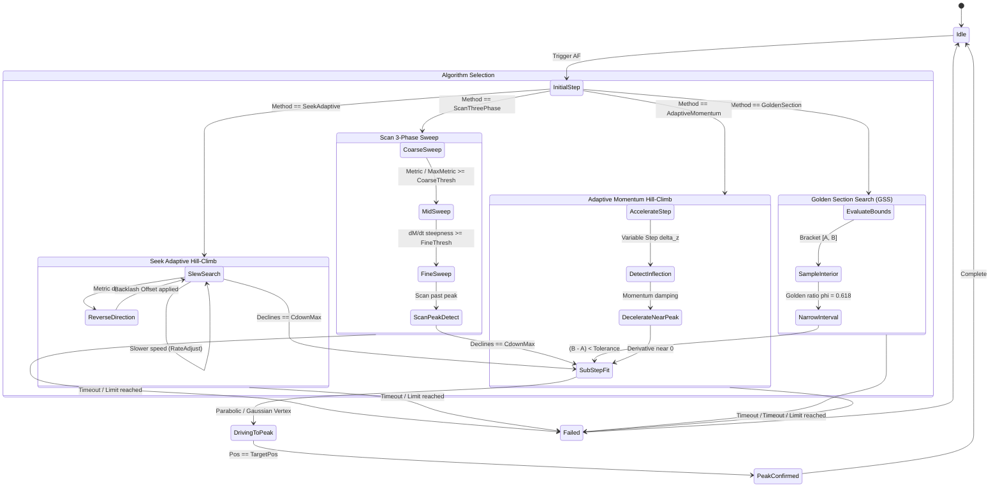
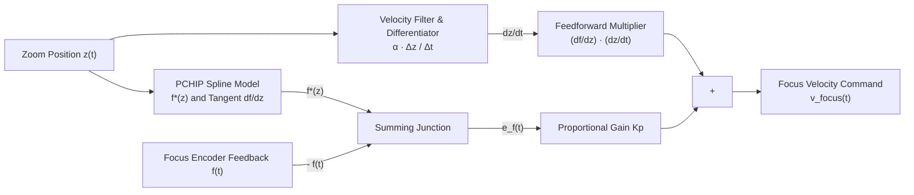
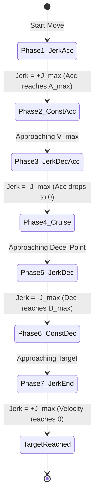
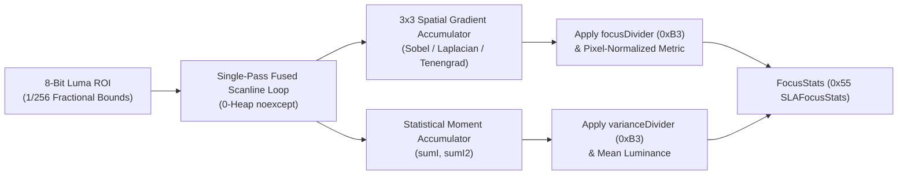
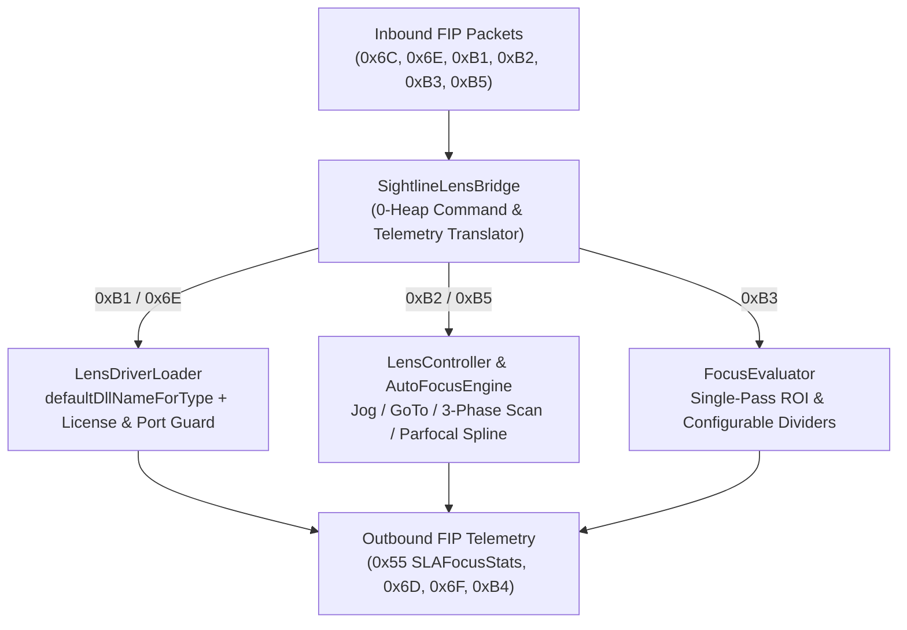
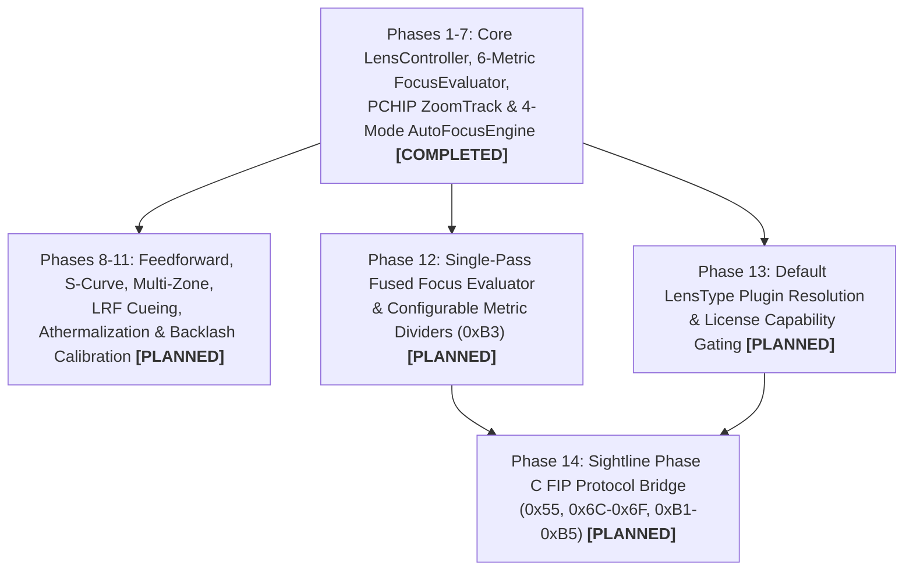

# Lens Controller Library Implementation Plan (`libs/LensController`)

## 1. Overview & Objectives

This document establishes the technical design, module decomposition, mathematical algorithms, and phased implementation schedule for **`libs/LensController`**.

`libs/LensController` is a high-reliability, zero-heap, strongly-typed C++17 library providing unified control over camera optics, motorized zoom/focus actuators, dynamic driver plugins, parfocal zoom-to-focus tracking curves, and closed-loop autofocus algorithms.

### Key Objectives
1. **Decompiled Sightline & EAN Parity**:
   - Replicate and modernize the architecture from `Sightline-Decompiled` (`ILensDriver.h`, `SlaLensController`, `SlaFocusEvaluator`) and the Sightline Engineering Application Note **EAN-Lens-DLL-Development.pdf**.
   - Provide a dynamic driver loading mechanism (`LoadLibraryA`/`dlopen`) that loads external `.dll` / `.so` lens plugins exposing `create_lens_object` or `create_object` factory functions.
   - Implement serial port collision prevention across multi-camera channels (up to 4 channels).
2. **Motor & Optical Actuation**:
   - Relative jog steps (`FocusNear`, `FocusFar`, `ZoomWide`, `ZoomTele`, `StopMotion`).
   - Absolute encoder positioning (`MotorPosition` 0..65535).
   - Variable zoom speed and focus speed configuration (`MotorSpeed` 0..255).
   - Hardware and software limit switch protection (`NearLimit`, `FarLimit`, `WideLimit`, `TeleLimit`).
3. **Zero-Heap Focus Sharpness Evaluation**:
   - Sub-millisecond evaluation on 8-bit grayscale (luma/Y) frames within user-defined fractional ROIs.
   - Zero dynamic heap allocation (`noexcept`, CERT ERR55-CPP compliant).
   - Classical and frequency metrics: Sobel gradient squared, discrete Laplacian, Tenengrad, and 2D 8x8 DCT high-frequency AC energy (interfacing with `libs/Math/DctSharpnessEvaluator.h`).
4. **Recent & Advanced Autofocus (AF) Algorithms**:
   - **Sightline Classic**: Seek Algorithm (adaptive gradient direction-flip with `RateAdjust`) and Scan Algorithm (3-phase Coarse $\rightarrow$ Mid $\rightarrow$ Fine sweep with `CoarseThresh`/`FineThresh`).
   - **Golden Section Search (GSS) & Fibonacci Search**: Optimal unimodal peak convergence with logarithmic step complexity.
   - **Adaptive Hill-Climbing with Momentum & Backlash Compensation**: Variable step sizing that accelerates through out-of-focus zones and slows down near peak inflection.
   - **Sub-Step Parabolic & Gaussian Peak Fitting**: Exact sub-encoder focal point interpolation from sparse samples.
   - **Vollath F4/F5 Autocorrelation Metrics**: High-noise immunity for thermal (LWIR/MWIR) and low-light sensors.
   - **Tracker-Coupled Dynamic ROI**: Dynamic binding to `libs/Tracking` bounding boxes (`TargetId`) for active target auto-centering.
5. **Zoom-to-Focus (Parfocal Look-Up Curve)**:
   - Full parser, serializer, and evaluator for Sightline multi-curve LUT format:
     ```text
     <number of samples>:
     z:100, 200, 500, 1000, 2000
     f:450, 480, 520, 610, 850
     ```
   - Monotone cubic Hermite spline (PCHIP) and piecewise linear interpolation.
   - Real-time synchronous slew commanding focus motor as zoom moves.
   - Automated track curve learning generator.
6. **Architectural & Safety Standards**:
   - Zero Qt dependencies (`#include <Q...>` strictly prohibited).
   - MISRA C++:2023 & SEI CERT C++ compliance.
   - All function names strictly less than 30 characters.
   - Strict IWYU, `<cstdint>`, `<cstddef>`, and `std::` qualification.
   - Cross-platform Windows (Win32) and Linux (POSIX).
7. **Advanced Dynamics, Feedforward & Actuator Control Loops**:
   - **Parfocal Zoom-Velocity Feedforward**: Dynamic derivative feedforward $\dot{f} = \frac{df}{dz} \cdot \dot{z} + K_p e_f$ eliminating transient focus lag during fast continuous zoom slews.
   - **S-Curve (Jerk-Limited) Motion Profiler**: Smooth, 7-phase S-curve trajectory planning preventing mechanical ringing, overshoot, and image vibration.
   - **Actuator Position PID with Stiction Inversion**: Closed-loop encoder control with anti-windup clamping and static friction threshold compensation.
8. **Intelligent Heuristics & Sensor Fusion**:
   - **Gimbal Slew Motion-Gated CAF**: Inhibits Continuous Auto-Focus during high-rate PTZ panning/tilting to eliminate hunting on rotational motion blur.
   - **Optical Geometry & Hyperfocal Fast-Paths**: Real-time Depth-of-Field (DOF) calculation for instant wide-angle lock and zoom-scaled adaptive AF search steps.
   - **Multi-Zone Spatial Matrix Arbitration**: $3 \times 3$ grid focus evaluation with foreground-closest priority, motion saliency, and VMTI detection weighting.
   - **Range-to-Focus Direct Cueing**: Instant, hunt-free focus positioning computed from Laser Rangefinder (LRF), radar, or KLV metadata (STANAG 4609 / MISB ST 0601).
   - **Infrared Optics Athermalization**: Temperature drift compensation ($\Delta f = K_{\text{temp}}(z) \cdot \Delta T$) for thermal (LWIR/MWIR) Germanium lenses.
   - **Photometric Auto-Iris & Exposure Co-Optimization**: Dynamic range optimization maintaining consistent luma histograms for peak focus metric contrast.
9. **Automated Calibration & Actuator Health Monitoring**:
   - Two-way mechanical gear backlash and travel end-stop auto-calibration routines.
   - Cumulative cycle counts, encoder slip detection, and actuator wear diagnostics.

---

## 2. System Architecture

### 2.1 Component Interaction Overview

```
+---------------------------------------------------------------------------------------------------------------+
|                                            libs/LensController                                                |
|                                                                                                               |
|   +-------------------------------------------------------------------------------------------------------+   |
|   |                                     LensController (Multi-Channel)                                    |   |
|   |   - Channel State & Parameter Coordination (CameraIndex 0..3)                                         |   |
|   |   - Operational Modes (ManualJog, AutoFocusOnce, AutoFocusContinuous, ZoomTrackOnly, Calibrating)      |   |
|   |   - Soft Boundary Clamping & Limit Switch Tripping Detection [focusMin..focusMax, zoomMin..zoomMax]   |   |
|   +-----------------------------------+-----------------------------------+-------------------------------+   |
|                                       |                                   |                                   |
|         +-----------------------------+                                   +-----------------------------+     |
|         |                                                                                               |     |
|         ▼                                                                                               ▼     |
|   +-----------------------------------+                                               +---------------------+ |
|   |          AutoFocusEngine          |                                               | ZoomTrackFocusEngine| |
|   |  - Sightline Seek & Scan (3-Phase)|                                               |  - Multi-Curve LUT  | |
|   |  - Golden Section / Fibonacci AF  |                                               |  - Cubic Spline     | |
|   |  - Adaptive Momentum Hill-Climb   |                                               |  - Parfocal Slew    | |
|   |  - Parabolic Peak Interpolation   |                                               |  - Curve Calibrator | |
|   |  - Dynamic Tracker ROI Ingestion  |                                               +----------+----------+ |
|   |  - Latency & Backlash Corrector   |                                                          |            |
|   +-----------------+-----------------+                                                          |            |
|                     |                                                                            |            |
|         +-----------+-----------+                                                                |            |
|         ▼                       ▼                                                                |            |
|   +-------------------+   +--------------------+                                                 |            |
|   |   FocusEvaluator  |   | MultiZoneEvaluator |                                                 |            |
|   |  (0-Heap Spatial  |   | (3x3 Matrix Grid & |                                                 |            |
|   |   & DCT Metrics)  |   |  Saliency Arbiter) |                                                 |            |
|   +-------------------+   +--------------------+                                                 |            |
|                                                                                                  |            |
|   +------------------------------------------------------------------------------------------+   |            |
|   |                          Intelligent Optics & Fusion Modules                             |   |            |
|   |  • MotionGatedAfManager   (PTZ Slew Gating)    • OpticalGeometryCalculator (DOF / Hyper) |   |            |
|   |  • RangeToFocusCueBridge  (LRF/KLV Cueing)     • ThermalDriftCompensator   (LWIR / MWIR) |   |            |
|   +---------------------------------------------+--------------------------------------------+   |            |
|                                                 |                                                |            |
|                                                 ▼                                                |            |
|                     +-------------------------------------------------------+                    |            |
|                     |           Closed-Loop Actuator Motion Control         |◄-------------------+            |
|                     |  • ParfocalFeedforwardController (dz/dt Derivative FF)|                                 |
|                     |  • MotionProfiler (7-Phase S-Curve Trajectory)        |                                 |
|                     |  • ActuatorPidController (Anti-Windup & Stiction Inv) |                                 |
|                     +---------------------------+---------------------------+                                 |
|                                                 |                                                             |
|                                                 ▼                                                             |
|                                       +-----------------------------------+                                   |
|                                       |            ILensDriver            |                                   |
|                                       |    (Hardware Actuator Interface)  |                                   |
|                                       +-----------------+-----------------+                                   |
|                                                         |                                                     |
|                     +-----------------------------------+-----------------------------------+                 |
|                     |                                   |                                   |                 |
|                     ▼                                   ▼                                   ▼                 |
|       +---------------------------+       +---------------------------+       +---------------------------+   |
|       |      ViscaLensDriver      |       |      PelcoDLensDriver     |       |       MockLensDriver       |   |
|       |   (Sony Block, FCB-EV)    |       |   (Pelco-D Motor Head)    |       |     (In-Memory Mock)      |   |
|       +---------------------------+       +---------------------------+       +---------------------------+   |
|                     |                                                                                         |
|                     ▼                                                                                         |
|       +---------------------------+                                                                           |
|       |      LensDriverLoader     |  Dynamic shared library loader (LoadLibraryA / dlopen)                    |
|       | (Sightline DLL Interface) |  e.g. slViscaLens.so, slTamronLens.so, vendor custom drivers              |
|       +---------------------------+                                                                           |
+---------------------------------------------------------------------------------------------------------------+
```

### 2.2 Mermaid Architectural Hierarchy

```mermaid
flowchart TD
    subgraph ClientLayers["Client & Integration Layer"]
        App["Gimbal / Camera App"]
        PH["libs/PayloadHal (ICameraPayload)"]
        Track["libs/Tracking (TargetId BoundingBox)"]
        KlvData["libs/Klv (MISB ST 0601 Slant Range)"]
    end

    subgraph Core["libs/LensController (Zero Qt, Pure C++17)"]
        LC["LensController<br/>(Channel Manager, Mode & Range Guard)"]
        
        subgraph AFSubsystem["Autofocus Subsystem"]
            AF["AutoFocusEngine<br/>(Seek, Scan 3-Phase, GSS, Adaptive Hill-Climb)"]
            FE["FocusEvaluator<br/>(Sobel, Laplacian, Tenengrad, Vollath F4/F5, DCT)"]
            MZE["MultiZoneEvaluator<br/>(3x3 Grid & Saliency Arbiter)"]
            Fit["PeakFitter<br/>(Parabolic / Gaussian Sub-Step)"]
            Comp["LatencyCompensator<br/>(frameOffsetMult8 & Backlash)"]
        end

        subgraph HeuristicsSubsystem["Intelligent Optics & Fusion"]
            MGAF["MotionGatedAfManager<br/>(PTZ Angular Rate Gate)"]
            OGC["OpticalGeometryCalculator<br/>(DOF & Hyperfocal Distance)"]
            R2F["RangeToFocusCueBridge<br/>(LRF Thin-Lens Mapping)"]
            TDC["ThermalDriftCompensator<br/>(LWIR/MWIR Athermalization)"]
            AIC["AutoIrisCoordinator<br/>(Photometric Optimization)"]
        end
        
        subgraph ZoomSubsystem["Parfocal Zoom-Tracking Subsystem"]
            ZT["ZoomTrackFocusEngine<br/>(Multi-Distance LUT & Spline Interp)"]
            Cal["CurveCalibrator<br/>(Automatic Curve Generation)"]
        end

        subgraph DynamicsSubsystem["Closed-Loop Actuator Dynamics"]
            PFF["ParfocalFeedforwardController<br/>(dz/dt Derivative Feedforward)"]
            MP["MotionProfiler<br/>(7-Phase S-Curve Profile)"]
            PID["ActuatorPidController<br/>(Anti-Windup & Stiction Inversion)"]
        end
        
        subgraph HAL["Hardware Abstraction Layer"]
            ILD["ILensDriver (Virtual Interface)"]
            LDL["LensDriverLoader<br/>(LoadLibraryA / dlopen)"]
            Nop["MockLensDriver (Simulated)"]
            Visca["ViscaLensDriver (Sony Block)"]
            Pelco["PelcoDLensDriver (Pelco-D Zoom/Focus)"]
        end
    end

    App --> LC
    PH --> LC
    Track -.->|Dynamic ROI| AF
    Track -.->|Gimbal Rates| MGAF
    KlvData -.->|Slant Range| R2F
    LC --> AF
    LC --> ZT
    LC --> HeuristicsSubsystem
    AF --> FE
    AF --> MZE
    AF --> Fit
    AF --> Comp
    ZT --> Cal
    ZT --> PFF
    AF --> DynamicsSubsystem
    DynamicsSubsystem --> ILD
    LDL -.-> ILD
    ILD <|.. Nop
    ILD <|.. Visca
    ILD <|.. Pelco
```

---

## 3. Detailed Component Specifications

### 3.1 Domain Model & Value Objects (`LensTypes.h`)

Strictly adheres to **Domain-Driven Design** to eliminate Primitive Obsession. Every primitive is wrapped into a strongly-typed value object with domain bound validation:

```cpp
namespace LensControl {

class CameraIndex {
public:
    explicit constexpr CameraIndex(std::uint8_t index) noexcept : m_index{index} {}
    [[nodiscard]] constexpr std::uint8_t value() const noexcept { return m_index; }
    [[nodiscard]] constexpr bool operator==(CameraIndex other) const noexcept { return m_index == other.m_index; }
    [[nodiscard]] constexpr bool operator!=(CameraIndex other) const noexcept { return m_index != other.m_index; }
private:
    std::uint8_t m_index{0U};
};

class MotorPosition {
public:
    explicit constexpr MotorPosition(std::uint16_t pos = 0U) noexcept : m_pos{pos} {}
    [[nodiscard]] constexpr std::uint16_t value() const noexcept { return m_pos; }
    [[nodiscard]] constexpr bool operator==(MotorPosition o) const noexcept { return m_pos == o.m_pos; }
    [[nodiscard]] constexpr bool operator<(MotorPosition o) const noexcept { return m_pos < o.m_pos; }
private:
    std::uint16_t m_pos{0U};
};

class MotorSpeed {
public:
    explicit constexpr MotorSpeed(std::uint8_t speed = 127U) noexcept : m_speed{speed} {}
    [[nodiscard]] constexpr std::uint8_t value() const noexcept { return m_speed; }
private:
    std::uint8_t m_speed{127U};
};

enum class LensMode : std::uint8_t {
    ManualJog = 0U,
    AutoFocusOnce = 1U,
    AutoFocusContinuous = 2U,
    ZoomTrackOnly = 3U,
    Calibrating = 4U,
    Idle = 5U
};

enum class LensLimitFlags : std::uint8_t {
    None = 0x00U,
    NearLimit = 0x01U,
    FarLimit = 0x02U,
    WideLimit = 0x04U,
    TeleLimit = 0x08U
};

enum class AutoFocusMethod : std::uint8_t {
    SeekAdaptive = 0U,       ///< Sightline Seek: Direction flip on metric drop with RateAdjust
    ScanThreePhase = 1U,     ///< Sightline Scan: Coarse -> Mid -> Fine sweep
    GoldenSection = 2U,      ///< Golden Section Search for fast logarithmic convergence
    AdaptiveMomentum = 3U,   ///< Variable step hill-climb with momentum and backlash correction
    DctFrequency = 4U,       ///< 2D 8x8 DCT AC high-frequency energy peak
    BuiltInDriver = 5U       ///< Hardware native AF (Sony VISCA, etc.)
};

enum class FocusMetricType : std::uint8_t {
    SobelGradientSquared = 0U,
    DiscreteLaplacian = 1U,
    TenengradThreshold = 2U,
    VollathCorrelationF4 = 3U,
    VollathCorrelationF5 = 4U,
    DctHighFrequency = 5U
};

struct LensRanges {
    std::uint16_t focusMin{0U};
    std::uint16_t focusMax{65535U};
    std::uint16_t zoomMin{0U};
    std::uint16_t zoomMax{65535U};
};

struct NormalizedRoi {
    std::uint8_t colFrac{64U};    ///< Left fraction [0..255]
    std::uint8_t rowFrac{64U};    ///< Top fraction [0..255]
    std::uint8_t widthFrac{128U}; ///< Width fraction [0..255]
    std::uint8_t highFrac{128U};  ///< Height fraction [0..255]
};

struct FocusMetricScore {
    std::uint32_t metric{0U};
    std::uint32_t mean{0U};
    std::uint32_t variance{0U};
    std::uint32_t pixelCount{0U};
    std::uint64_t timestampNs{0U};
    std::uint32_t frameId{0U};
};

} // namespace LensControl
```

---

### 3.2 Hardware Driver Interface (`ILensDriver.h`)

Conforms directly to the interface requirements established in Sightline's `ILensDriver` and `slLensPublicBasic`/`SLLensPublicAuto`:

```cpp
namespace LensControl {

class ILensDriver {
public:
    virtual ~ILensDriver() = default;

    [[nodiscard]] virtual bool initialize(std::uint8_t port, std::uint32_t baud) noexcept = 0;
    virtual void moveFocus(std::int16_t steps, MotorSpeed speed) noexcept = 0;
    virtual void moveZoom(std::int16_t steps, MotorSpeed speed) noexcept = 0;
    virtual void setFocusPosition(MotorPosition pos, MotorSpeed speed) noexcept = 0;
    virtual void setZoomPosition(MotorPosition pos, MotorSpeed speed) noexcept = 0;
    virtual void stopMotion() noexcept = 0;

    [[nodiscard]] virtual MotorPosition currentFocus() const noexcept = 0;
    [[nodiscard]] virtual MotorPosition currentZoom() const noexcept = 0;
    [[nodiscard]] virtual std::uint8_t limitFlags() const noexcept = 0;
    virtual void sendRawCommand(const std::uint8_t* data, std::size_t len) noexcept = 0;

    [[nodiscard]] virtual bool hasBuiltinAutofocus() const noexcept = 0;
    virtual bool triggerBuiltinAutofocus() noexcept = 0;
    [[nodiscard]] virtual bool hasBuiltinZoomTracking() const noexcept = 0;
    virtual bool setBuiltinZoomTracking(bool enable) noexcept = 0;
};

} // namespace LensControl
```

---

### 3.3 Dynamic Lens Driver Loader (`LensDriverLoader.h`, `.cpp`)

```
+-------------------------------------------------------------------------------+
|                            LENS DLL LIFECYCLE                                 |
|                                                                               |
|   [Load Request]                                                              |
|          │                                                                    |
|          ▼                                                                    |
|   1. Check Port Collision (Verify no other camera channel binds port)          |
|          │                                                                    |
|          ▼                                                                    |
|   2. dlopen / LoadLibraryA across candidate search directories                |
|          │                                                                    |
|          ▼                                                                    |
|   3. Resolve "create_lens_object" or "create_object" factory symbol           |
|          │                                                                    |
|          ▼                                                                    |
|   4. Instantiate ILensDriver* instance                                        |
|          │                                                                    |
|          ▼                                                                    |
|   5. Initialize Serial UART (port, baud)                                      |
|          │                                                                    |
|          ▼                                                                    |
|   6. Bind RAII std::unique_ptr<ILensDriver> to Channel                        |
|                                                                               |
|   [Unload / Destruction]                                                      |
|          │                                                                    |
|          ▼                                                                    |
|   stopMotion() ──► delete driver ──► dlclose / FreeLibrary ──► Release Port   |
+-------------------------------------------------------------------------------+
```

---

### 3.4 Zero-Heap Focus Sharpness Evaluator (`FocusEvaluator.h`, `.cpp`)

The focus evaluator executes in the frame processing path and must execute with **zero dynamic heap allocations** (`noexcept`, CERT ERR55-CPP). It computes spatial and correlation focus sharpness metrics over a region of interest (ROI):

#### 1. Spatial Sharpness Formulas
- **Sobel Gradient Magnitude Squared**:
  $$G_x(x,y) = \big(I_{x+1, y-1} + 2I_{x+1, y} + I_{x+1, y+1}\big) - \big(I_{x-1, y-1} + 2I_{x-1, y} + I_{x-1, y+1}\big)$$
  $$G_y(x,y) = \big(I_{x-1, y+1} + 2I_{x, y+1} + I_{x+1, y+1}\big) - \big(I_{x-1, y-1} + 2I_{x, y-1} + I_{x+1, y-1}\big)$$
  $$M_{\text{Sobel}} = \sum_{(x,y) \in \text{ROI}} \big(G_x(x,y)^2 + G_y(x,y)^2\big)$$

- **Modified Discrete Laplacian (4-neighbor & 8-neighbor)**:
  $$\Delta I(x,y) = 4 I(x,y) - I(x+1,y) - I(x-1,y) - I(x,y+1) - I(x,y-1)$$
  $$M_{\text{Laplacian}} = \sum_{(x,y) \in \text{ROI}} \big(\Delta I(x,y)\big)^2$$

- **Tenengrad with Adaptive Noise Gate**:
  $$M_{\text{Tenengrad}} = \sum_{(x,y) \in \text{ROI}, \ (G_x^2 + G_y^2) > T_{\text{noise}}} \big(G_x^2 + G_y^2\big)$$

- **Vollath F4 Autocorrelation (High Noise Immunity for Thermal Sensors)**:
  $$M_{\text{Vollath-F4}} = \sum_{y} \sum_{x} I(x, y) \cdot I(x+1, y) - \sum_{y} \sum_{x} I(x, y) \cdot I(x+2, y)$$

- **Vollath F5 Autocorrelation**:
  $$M_{\text{Vollath-F5}} = \sum_{y} \sum_{x} I(x, y) \cdot I(x+1, y) - N_{\text{pixels}} \cdot \mu_I^2$$

- **2D 8x8 DCT High-Frequency AC Energy**:
  - Leverages [DctSharpnessEvaluator.h](../libs/Math/DctSharpnessEvaluator.h):
  $$M_{\text{DCT}} = \frac{\sum_{u+v \ge f_{\text{min}}} |C(u,v)|}{\mu_{\text{DC}} + \epsilon}$$

---

### 3.5 Recent & Advanced Autofocus Algorithms (`AutoFocusEngine.h`, `.cpp`)



#### Detailed Breakdown of Algorithms:

#### 1. Sightline Scan Algorithm (3-Phase Sweep)
- **Phase 1: Coarse Sweep (`coarseSpeed`)**: Lens rapidly sweeps across focal range. Transitions to Mid Phase when $\text{metric} / \text{max\_seen} \ge \text{coarseThresh}$.
- **Phase 2: Mid Sweep (`midSpeed`)**: Slower movement to capture peak shoulder. Transitions to Fine Phase when relative derivative $\Delta M / M_{\text{prev}} \ge \text{fineThresh}$.
- **Phase 3: Fine Sweep (`fineSpeed`)**: High-resolution sampling. When $\text{cdownMax}$ consecutive metric declines occur, peak is confirmed.
- **Rewind**: Moves directly back to optimal peak position with backlash compensation.

#### 2. Sightline Seek Algorithm (Adaptive Direction-Flip)
- Slews focus motor in initial direction.
- Evaluates metric gradient $\Delta M / M_{\text{prev}}$.
- If metric drops, immediately reverses direction and adjusts speed based on zoom position (`rateAdjust`).
- Terminates upon $\text{cdownMax}$ declines after peak.

#### 3. Golden Section Search (GSS) & Fibonacci Autofocus
- Ideal for unimodal focus curves with minimal actuator movement.
- Given an interval $[a, b]$, samples at:
  $$x_1 = b - (b - a) \cdot \frac{\sqrt{5} - 1}{2}, \quad x_2 = a + (b - a) \cdot \frac{\sqrt{5} - 1}{2}$$
- Evaluates $M(x_1)$ and $M(x_2)$, discarding the non-optimal section. Converges in $O(\log N)$ frames.

#### 4. Adaptive Momentum Hill-Climbing
- Computes variable motor step size:
  $$\Delta z_k = \eta \cdot \frac{M_k - M_{k-1}}{z_k - z_{k-1}} + \alpha \Delta z_{k-1}$$
  where $\eta$ is learning rate and $\alpha \in [0.4, 0.7]$ is momentum damping.
- Eliminates searching delay across flat, blurred defocus regions while preventing overshoot near the peak.

#### 5. Sub-Step Parabolic & Gaussian Peak Fitting (`PeakFitter`)
- Motor encoders have discrete steps. Given 3 points $(z_1, M_1), (z_2, M_2), (z_3, M_3)$ surrounding the peak with $M_2 > M_1$ and $M_2 > M_3$:
  $$z^* = z_2 - \frac{1}{2} \frac{(z_2 - z_1)^2 (M_2 - M_3) - (z_2 - z_3)^2 (M_2 - M_1)}{(z_2 - z_1)(M_2 - M_3) - (z_2 - z_3)(M_2 - M_1)}$$
- Yields true optical peak location even when the discrete encoder missed the exact summit.

#### 6. Dynamic Tracker-Coupled ROI Auto-Centering
- Connects with `libs/Tracking`: When an active target is tracked (`TargetId`), the autofocus ROI bounding box automatically centers on the target's bounding box:
  $$\text{ROI}_{\text{AF}} = \text{Clamp}\Big(\text{BBox}_{\text{target}} \oplus \text{Margin}, \ [0, 0, W, H]\Big)$$
- Focuses specifically on the tactical target rather than background clutter.

---

### 3.6 Zoom-to-Focus (Parfocal Look-Up Curve) (`ZoomTrackFocusEngine.h`, `.cpp`)

```
+-------------------------------------------------------------------------------+
|                      PARFOCAL ZOOM TRACKING ARCHITECTURE                      |
|                                                                               |
|   Focus Pos ^                                                                 |
|             |          Curve 3: 500m / Infinity                               |
|             |        .-----------------------------                           |
|             |       /  Curve 2: 10m                                           |
|             |      /  .----------------------------                           |
|             |     /  /  Curve 1: 3m (Near)                                    |
|             |    /  /  .---------------------------                           |
|             |   /  /  /                                                       |
|             |  /  /  /                                                        |
|             | /  /  /                                                         |
|             +-------------------------------------> Zoom Pos                  |
|             Wide                                Tele                          |
+-------------------------------------------------------------------------------+
```

#### 1. Track Curve File Parser & Serializer
Parses and generates Sightline-standard calibration files:
```text
<number of samples>:
z:<comma-separated zoom positions>
f:<comma-separated focus positions>
```

#### 2. Monotone Cubic Hermite Spline Interpolation (PCHIP)
Given calibration points $(z_k, f_k)$, computes tangents $d_k$ enforcing monotonicity:
$$f^*(z) = (2t^3 - 3t^2 + 1) f_k + (t^3 - 2t^2 + t) h d_k + (-2t^3 + 3t^2) f_{k+1} + (t^3 - t^2) h d_{k+1}$$
where $h = z_{k+1} - z_k$ and $t = (z - z_k) / h$.
Guarantees **zero overshoot** and continuous first-order smoothness during fast continuous zooming.

#### 3. Automated Calibration Curve Generator
- Iterates $N = 30$ zoom points across $[z_{\text{min}}, z_{\text{max}}]$.
- Triggers one-shot autofocus at each zoom setting.
- Logs $(z_k, f_k^*)$ into the calibration file.

---

### 3.7 Master Multi-Channel Controller (`LensController.h`, `.cpp`)

```cpp
namespace LensControl {

class LensController final {
public:
    static constexpr std::size_t kMaxChannels = 4U;

    LensController() noexcept;
    ~LensController() noexcept;

    // Mode & Boundaries
    void setLensMode(CameraIndex cam, LensMode mode, std::uint16_t data) noexcept;
    void setLensRanges(CameraIndex cam, const LensRanges& ranges) noexcept;
    void setZoomSpeed(CameraIndex cam, MotorSpeed speed) noexcept;
    void setFocusSpeed(CameraIndex cam, MotorSpeed speed) noexcept;

    // Movement
    void moveFocusStep(CameraIndex cam, std::int16_t steps) noexcept;
    void moveZoomStep(CameraIndex cam, std::int16_t steps) noexcept;
    void setFocusTarget(CameraIndex cam, MotorPosition pos) noexcept;
    void setZoomTarget(CameraIndex cam, MotorPosition pos) noexcept;
    void stopMotion(CameraIndex cam) noexcept;

    // Autofocus & Parfocal Tracking
    void triggerAutoFocus(CameraIndex cam, AutoFocusMethod method) noexcept;
    void stopAutoFocus(CameraIndex cam) noexcept;
    void setZoomTrackFocus(CameraIndex cam, bool enable) noexcept;
    bool loadTrackCurves(CameraIndex cam, std::string_view filename) noexcept;

    // Frame Ingestion for Software AF
    void processFrame(CameraIndex cam, const std::uint8_t* luma,
                      std::size_t width, std::size_t height,
                      std::uint64_t timestampNs, std::uint32_t frameId) noexcept;

    // State machine tick
    void update(CameraIndex cam) noexcept;

    // Telemetry & Status
    [[nodiscard]] LensStatus getLensStatus(CameraIndex cam) const noexcept;
    [[nodiscard]] LensRanges getLensRanges(CameraIndex cam) const noexcept;
    [[nodiscard]] bool isAutoFocusRunning(CameraIndex cam) const noexcept;

    // Hardware Driver Binding & Dynamic Loading
    void setDriver(CameraIndex cam, std::unique_ptr<ILensDriver> driver) noexcept;
    [[nodiscard]] LensLoadResult loadLensDll(CameraIndex cam, std::string_view dllName,
                                            std::uint8_t port, std::uint32_t baud) noexcept;
    void unloadLensDll(CameraIndex cam) noexcept;
};

} // namespace LensControl
```

---

### 3.8 Parfocal Zoom-Velocity Feedforward Controller (`ParfocalFeedforwardController.h`, `.cpp`)

During fast manual or automated zoom maneuvers, reactive position-only tracking introduces transient defocus because the focus motor must wait for zoom position error to accumulate before stepping. The **Parfocal Feedforward Controller** calculates real-time derivative feedforward by combining zoom actuator velocity $\dot{z} = \frac{dz}{dt}$ with the precomputed PCHIP spline knot slope $\frac{df}{dz}$:

#### 1. Mathematical Formulation
$$\dot{f}_{\text{cmd}} = \left(\frac{df}{dz}\right) \cdot \dot{z} + K_p \cdot \big(f_{\text{target}}(z) - f_{\text{actual}}\big)$$
where:
- $\frac{df}{dz}$ is the instantaneous rate-of-change of focus with respect to zoom extracted from `ZoomTrackFocusEngine` PCHIP spline evaluation.
- $\dot{z}$ is estimated via a low-pass filtered numerical differentiator on zoom encoder ticks:
  $$\dot{z}_k = \alpha \cdot \frac{z_k - z_{k-1}}{\Delta t} + (1 - \alpha) \cdot \dot{z}_{k-1}$$
- $K_p \cdot (f_{\text{target}} - f_{\text{actual}})$ is the proportional position-error closing term.

#### 2. Control Loop Architecture

```
+-----------------------------------------------------------------------------------------------+
|                       PARFOCAL FEEDFORWARD DYNAMICS                                           |
|                                                                                               |
|   Zoom Position (z) ────┬────► [ Numerical Differentiator ] ──► Zoom Velocity (dz/dt)         |
|                         │                                             │                       |
|                         │                                             ▼                       |
|                         │                             [ Multiplier: (df/dz) * (dz/dt) ]       |
|                         │                                             │ (Feedforward)         |
|                         ▼                                             ▼                       |
|               [ PCHIP Spline LUT ] ──► Target Focus (f*) ──► (+) ──► (+) ──► Focus Motor      |
|                                                               ▲       ▲      Velocity Command |
|               Focus Position (f) ────────────────────────────(-)      │                       |
|                                                               │       │                       |
|                                                        [ Proportional ]                       |
|                                                        [ Gain (Kp)    ]                       |
+-----------------------------------------------------------------------------------------------+
```



---

### 3.9 S-Curve Motion Profiler & Actuator Position PID (`MotionProfiler.h`, `ActuatorPidController.h`, `.cpp`)

To prevent mechanical gear train shock, resonance ringing, and image blur during rapid stepper/DC motor positioning, optical movements must be governed by a **7-phase S-curve (jerk-limited) trajectory profiler**:

```
Velocity ^
         |             Phase IV: Constant Max Velocity
  V_max  |              .-----------------------------.
         |             /                               \
         |  Phase II  /                                 \  Phase VI
         |  (Const A)/                                   \ (Const D)
         |          /                                     \
         |  Phase I/                                       \ Phase VII
         |  (Jerk)|                                         |(Jerk End)
         +--------+-----------------------------------------+-----------> Time
```



#### 1. Actuator Closed-Loop PID with Stiction Inversion
Actuator motor control operates on discrete position errors with:
- **Conditional Integration Anti-Windup**: Integrator updates are frozen when actuator velocity clamps at saturation limits.
- **Stiction Deadband Compensation**: When starting from zero velocity or reversing direction, adds an impulse feedforward offset $u_{\text{stiction}} = \text{sgn}(e) \cdot V_{\text{min}}$ to immediately break through static gear friction.

---

### 3.10 Platform Motion-Gated Continuous Autofocus (`MotionGatedAfManager.h`, `.cpp`)

Continuous Auto-Focus (CAF) algorithms fail when a PTZ gimbal rotates because angular scene shearing introduces frame-wide motion blur, which contrast metrics mistake for optical defocus. The **Motion-Gated AF Manager** prevents unnecessary focus hunting during gimbal slews:

#### 1. Gating Logic & Settling Holdoff
- Receives PTZ angular rates $(\omega_{\text{pan}}, \omega_{\text{tilt}})$ from [`libs/Tracking/PtzAutoTracker.h`](../libs/Tracking/PtzAutoTracker.h) or platform gyroscope telemetry.
- Evaluates composite angular velocity:
  $$\Omega = \sqrt{\omega_{\text{pan}}^2 + \omega_{\text{tilt}}^2}$$
- When $\Omega > \Omega_{\text{thresh}}$ (e.g. $1.5^\circ/\text{s}$), CAF is transitioned to `Suppressed` state: motor positions freeze and metric drops are ignored.
- When $\Omega \le \Omega_{\text{thresh}}$, an exponential settling holdoff timer (e.g. $150\,\text{ms}$) elapses to allow mechanical settling and sensor rolling shutter stabilization before CAF re-engages.

---

### 3.11 Optical Geometry: Depth-of-Field & Hyperfocal Distance Fast-Path (`OpticalGeometryCalculator.h`, `.cpp`)

Calculates physical optical limits in real-time using calibrated sensor geometry (sensor format width $W_s$, focal length $f(z)$, and circle of confusion $c$):

#### 1. Formulas
- **Hyperfocal Distance ($H$)**:
  $$H(z) = \frac{f(z)^2}{N \cdot c}$$
  where $N$ is lens F-number and $c \approx \frac{\text{diagonal}}{1500}$ or sensor pixel pitch $\times 2$.
- **Near and Far Depth-of-Field Limits**:
  $$D_{\text{near}} = \frac{H \cdot d}{H + (d - f)}, \quad D_{\text{far}} = \frac{H \cdot d}{H - (d - f)}$$
  $$\text{DOF} = D_{\text{far}} - D_{\text{near}}$$

#### 2. Optimization Heuristics
- **Instant Wide-Angle Lock**: When zoom is near wide limit ($z \le z_{\text{wide}}$), hyperfocal distance $H$ is typically only a few meters away, meaning everything from $H/2$ to infinity is sharply focused. The AF engine can immediately position the focus actuator at $H(z)$ without sweeping.
- **Adaptive Step Sizing**: Scales coarse, mid, and fine sweep step counts proportionally to the calculated $\text{DOF}(z)$. At maximum telephoto where DOF is narrow, fine steps are small; at wide zoom, steps expand $5\times$, drastically reducing search latency.

---

### 3.12 Multi-Zone Spatial Matrix Focus Arbitration (`MultiZoneFocusEvaluator.h`, `.cpp`)

Extends [`FocusEvaluator`](FocusEvaluator.h) from a single user ROI to a zero-heap $3 \times 3$ (or $5 \times 5$) tile grid spanning the frame:

```
+-----------------------------------+
|   Z00   |   Z01   |   Z02   |     |  3x3 Spatial Focus Matrix
+---------+---------+---------+     |  - Independent sharpness evaluation per tile
|   Z10   |   Z11   |   Z12   |     |  - Zero-heap fixed-buffer evaluation
+---------+---------+---------+     |  - Arbitrated candidate score generation
|   Z20   |   Z21   |   Z22   |     |
+-----------------------------------+
```

#### 1. Arbitration Heuristics
- **Closest-Subject Priority**: During a focus sweep from Near to Far, selects the focus peak from whichever zone first achieves a verified summit, prioritizing the foreground subject over background clutter.
- **Motion Saliency Weighting**: Evaluates inter-frame temporal luma differences across zones. Tiles containing active pixel displacement receive higher metric weighting $w_i$.
- **VMTI Centering Prior**: Tiles overlapping bounding boxes received from [`TrackingVmtiBridge`](../libs/Tracking/TrackingVmtiBridge.h) receive priority weight $w_{\text{target}} = 1.0$, while peripheral tiles are attenuated.

---

### 3.13 Range-to-Focus Direct Cueing (`RangeToFocusCueBridge.h`, `.cpp`)

In tactical and surveillance environments equipped with Laser Rangefinders (LRF), radar feeds, or KLV metadata (STANAG 4609 / MISB ST 0601 Item 21 Target Slant Range):

#### 1. Optical Thin-Lens Mapping
Using the classical Gauss lens equation with calibrated optical back-focal length $f_b(z)$ and actuator zero-offset $z_0$:
$$\frac{1}{f(z)} = \frac{1}{R} + \frac{1}{d_i} \implies d_i = \frac{f(z) \cdot R}{R - f(z)}$$
$$\text{FocusPos}^*(R, z) = \text{EncoderScale} \cdot \big(d_i - f_b(z)\big) + z_0$$

#### 2. Benefits
- **Zero Hunting**: Direct, instantaneous single-step movement to optimal focus coordinate without searching or moving through blur.
- **Degraded Visual Environments**: Achieves crisp optical focus through heavy fog, smoke, total darkness, or uniform sky/sea scenes where image contrast metrics produce zero gradient.

---

### 3.14 Thermal / IR Athermalization Engine (`ThermalDriftCompensator.h`, `.cpp`)

Infrared optical elements (Germanium, Chalcogenide, Silicon) feature high refractive index thermal coefficients ($\frac{dn}{dT} \approx 400 \times 10^{-6}/\text{K}$ for Germanium vs $3 \times 10^{-6}/\text{K}$ for visible crown glass) and high housing expansion coefficients, shifting focal plane position by dozens of encoder steps over ambient temperature swings:

#### 1. Athermalization Compensation Model
$$\Delta f_{\text{thermal}}(T, z) = K_1(z) \cdot (T - T_{\text{ref}}) + K_2(z) \cdot (T - T_{\text{ref}})^2$$
where $T$ is read from an onboard housing temperature sensor, $T_{\text{ref}}$ is nominal calibration temperature ($20^\circ\text{C}$), and $K_1(z), K_2(z)$ are calibrated polynomial temperature coefficients across zoom.

#### 2. Autonomous Bias Injection
The compensator continuously injects $\Delta f_{\text{thermal}}$ into the active parfocal tracking setpoint, maintaining diffraction-limited optical clarity from $-40^\circ\text{C}$ to $+70^\circ\text{C}$ without user intervention.

---

### 3.15 Photometric Control Loop: Auto-Iris & Exposure Co-Optimization (`AutoIrisCoordinator.h`, `.cpp`)

Focus evaluation sharpness metrics (Sobel, Laplacian, Tenengrad) are heavily contrast-dependent:
- Saturated highlights (pixel clipping at 255) flatten gradients to zero.
- Underexposed shadows (dark scenes) sink edge gradients into sensor noise.

#### 1. Integrated Photometric Coordinator
- Computes real-time 64-bin luma histogram over the AF evaluation ROI.
- Regulates motorized iris actuator and sensor exposure time via a discrete PID controller to lock mean ROI luminance to an 18% gray reference target ($\mu_{\text{target}} \approx 110$ on 8-bit luma).
- Coordinates with `AutoFocusEngine`: During one-shot AF sweeps, iris adjustments are frozen to ensure sharpness metric changes stem purely from focal plane displacement rather than exposure variations.

---

### 3.16 Automated Mechanical Calibration & Wear Diagnostics (`BacklashCalibrator.h`, `ActuatorDiagnostics.h`, `.cpp`)

To maintain factory performance over thousands of operating hours and eliminate manual field tuning:

#### 1. Dual-Direction Backlash Auto-Calibrator
- Automatically commands the focus motor towards a high-contrast target from the `Near` direction, executing fine-sweep peak detection to record summit $P_{\text{near}}$.
- Immediately slews past the target and approaches from the `Far` direction, recording summit $P_{\text{far}}$.
- Calibrates mechanical gear backlash steps:
  $$\text{BacklashSteps} = |P_{\text{far}} - P_{\text{near}}|$$
- Automatically updates `AutoFocusConfig::backlashSteps`.

#### 2. Actuator Health & Wear Telemetry
Maintains persistent non-volatile diagnostic counters:
- **Total Step Travel**: Accumulated encoder steps traveled per axis.
- **Direction Reversals**: Counter monitoring gear tooth wear.
- **Slip / Stall Detector**: Verifies motor movement against expected encoder ticks; flags warning when commanded steps do not produce proportional encoder advancement.

---

### 3.17 Single-Pass Fused ROI Sharpness Evaluation & Configurable Metric Dividers (`FocusEvaluator.h`, `.cpp`)

To maximize cache locality on high-resolution 1080p/4K video streams and align with Sightline Phase C (`0xB3` `SLAFocusParameters`) scaling semantics, `FocusEvaluator` fuses statistical moment computation and spatial gradient convolution into a single memory pass:

#### 1. Single-Pass Cache-Fused Accumulation
Instead of reading the ROI twice (Pass 1 for luminance mean/variance $\sum I, \sum I^2$ and Pass 2 for Sobel/Laplacian/Tenengrad gradients), a single scanline loop over $y \in [r_{\text{start}}, r_{\text{end}})$ and $x \in [c_{\text{start}}, c_{\text{end}})$ simultaneously accumulates:
- Luminance sum $\Sigma_I = \sum I(x, y)$ and squared luminance sum $\Sigma_{I^2} = \sum I(x, y)^2$, and
- Spatial gradient energy $\Sigma_{\nabla}$ ($3 \times 3$ Sobel $|G_x| + |G_y|$, 4-neighbor Laplacian $|4 I_c - I_N - I_S - I_W - I_E|$, or Tenengrad $G_x^2 + G_y^2$) for interior pixels $(x, y) \in [1, W-2] \times [1, H-2]$.

This halves L1/L2 data cache traffic per frame while preserving `noexcept` zero-heap execution (CERT ERR55-CPP).

#### 2. Configurable `focusDivider` and `varianceDivider` Scaling
To prevent 32-bit unsigned integer saturation on large ROIs or underflow on tiny target ROIs, raw gradient and variance accumulators support configurable integer dividers (`focusDivider` $\ge 1$, `varianceDivider` $\ge 1$, matching FIP `0xB3` `SLAFocusParameters`):
$$\text{FocusMetric} = \min\left( \text{MAX\_UINT32}, \left\lfloor \frac{\Sigma_{\nabla}}{\max(1, D_{\text{focus}})} \right\rfloor \right), \quad \text{Variance} = \left\lfloor \frac{\sigma_I^2}{\max(1, D_{\text{var}})} \right\rfloor$$
alongside the pixel-count-normalized `normalizedMetric` ($100\times$ scaled) used by `AutoFocusEngine`.

```
+-----------------------------------------------------------------------------------+
|            SINGLE-PASS FUSED FOCUS EVALUATOR & DIVIDER SCALING (0xB3)             |
|                                                                                   |
|   Luma ROI [colStart..colEnd, rowStart..rowEnd]                                   |
|         |                                                                         |
|         v  (Single Scanline Memory Pass - Zero Extra Cache Reads)                 |
|   +---------------------------------------------------------------------------+   |
|   | Per-Pixel Fused Kernel:                                                   |   |
|   |   1. Moment Accumulator:  sumI += p;  sumI2 += p * p;                     |   |
|   |   2. Interior 3x3 Kernel: gradAccum += Sobel / Laplacian / Tenengrad      |   |
|   +--------------------+----------------------------------+-------------------+   |
|                        |                                  |                       |
|                        v                                  v                       |
|   +------------------------------------+   +----------------------------------+   |
|   | Gradient Scaling:                  |   | Statistical Moment Scaling:      |   |
|   | - focusMetric = grad / focusDiv    |   | - mean = sumI / N                |   |
|   | - normMetric  = (grad * 100) / N_g |   | - variance = varRaw / varDiv     |   |
|   +------------------------------------+   +----------------------------------+   |
+-----------------------------------------------------------------------------------+
```



---

### 3.18 Default `LensType` Plugin Resolution, License Gating & Sightline Phase C FIP Bridge (`LensDriverLoader.h`, `SightlineLensBridge.h`, `.cpp`)

To provide drop-in interoperability with Sightline Phase C embedded lens subsystems (`SlaLensController`, `ILensDriver` ABI, and FIP `0x55`/`0x6C`–`0x6F`/`0xB1`–`0xB5` packets):

#### 1. Automatic `LensType` Shared Library Fallback & Embedded Search Paths
When `LensDriverLoader::loadLensDll` is invoked with an empty `dllName` (e.g., from legacy `0x6E` `SLASetLensParameters` or `0xB1` `SLALensParameters` packets that specify only a numeric `LensType`), `defaultDllNameForType(LensType)` resolves the canonical shared object name and searches `./`, `./lib/`, and `./sl/bin/`:
- `LensType::NoLens (0)` $\rightarrow$ `slNopLensCtrl.so` (or built-in `MockLensDriver` fallback)
- `LensType::Tamron (1)` $\rightarrow$ `slTamronLens.so`
- `LensType::SonyVisca (2)` $\rightarrow$ `slViscaLens.so`
- `LensType::Hitachi (3)` $\rightarrow$ `slHitachiLens.so`

Optional AppBit license capability gating (`hasFocusLicense`) returns `LensLoadResult::LicenseDisallowed` when hardware autofocus plugin loading is restricted on unlicensed channels.

#### 2. Sightline Phase C FIP Protocol Bridge (`SightlineLensBridge`)
Translates Sightline FIP lens and autofocus wire messages directly into `LensController`, `AutoFocusEngine`, and `FocusEvaluator` calls:

| FIP Opcode | Sightline Message Name | Direction | `libs/LensController` Target Action |
|:---:|:---|:---:|:---|
| `0x55` | `SLAFocusStats` | Outbound | Serializes `FocusStats` (`focusMetric`, `mean`, `variance`, pixel/fractional ROI, `focusPos`, `zoomPos`, `flags`). |
| `0x6C` | `SLASetLensMode` | Inbound | Selects active `ChannelIndex` and operational lens mode. |
| `0x6D` | `SLACurrentLensStatus` | Outbound | Reports driver load state, active `LensType`, and actuator status flags. |
| `0x6E` | `SLASetLensParameters` | Inbound | Configures legacy lens type, serial port ID, and communication parameters. |
| `0x6F` | `SLACurrentLensParameters` | Outbound | Echoes active channel lens configuration parameters. |
| `0xB1` | `SLALensParameters` | Inbound/Out | Extended Phase C lens configuration (`LensType`, `portNum`, `dllName`, `curveFile`, `flags`) triggering `loadLensDll` + `ZoomTrackFocusEngine::parseCurveFile`. |
| `0xB2` | `SLALensCommand` | Inbound | Dispatches `ZoomJog`, `FocusJog`, `GoToZoom`, `GoToFocus`, `FocusSeek`, `FocusScan`, `SavePosition`, `ResetLens`, and `ReloadCurves`. |
| `0xB3` | `SLAFocusParameters` | Inbound | Updates `FocusRoiConfig` ($1/256$ fractional bounds), `FocusAlgorithm`, `focusDivider`, and `varianceDivider`. |
| `0xB4` | `SLALensRanges` | Outbound | Queries `ILensDriver::getRanges` and reports `[minZoom, maxZoom, minFocus, maxFocus]` in `0.1x` FOV and encoder units. |
| `0xB5` | `SLACustomAutoFocusParameters` | Inbound | Configures 3-Phase Scan (`StepConfig[3]`), `frameOffsetMult8` ring delay, `direction`, `repeat`, and `setZoomTrackOffset`. |

```
+-----------------------------------------------------------------------------------+
|               SIGHTLINE PHASE C FIP LENS & AUTOFOCUS PROTOCOL BRIDGE              |
|                                                                                   |
|   FIP Wire Packets (0x6C, 0x6E, 0xB1, 0xB2, 0xB3, 0xB5)                           |
|         |                                                                         |
|         v                                                                         |
|   +---------------------------------------------------------------------------+   |
|   | SightlineLensBridge (Zero-Heap Packet Parser & Telemetry Serializer)      |   |
|   +-----+------------------------+-------------------------+------------------+   |
|         |                        |                         |                      |
|         v (0xB1 / 0x6E)          v (0xB2 / 0xB5)           v (0xB3)               |
|   +-------------------+   +----------------------+   +------------------------+   |
|   | LensDriverLoader  |   | LensController &     |   | FocusEvaluator         |   |
|   | - defaultDllName  |   | AutoFocusEngine      |   | - 1/256 Fractional ROI |   |
|   | - License Gate    |   | - 3-Phase Scan/Seek  |   | - focus/var Dividers   |   |
|   | - Port Collision  |   | - Parfocal LUT/PCHIP |   | - Single-Pass Kernel   |   |
|   +---------+---------+   +----------+-----------+   +-----------+------------+   |
|             |                        |                           |                |
|             +------------------------+---------------------------+                |
|                                      |                                            |
|                                      v                                            |
|             Outbound FIP Telemetry (0x55 FocusStats, 0x6D, 0x6F, 0xB4)            |
+-----------------------------------------------------------------------------------+
```



---

## 4. Directory & File Structure

```text
libs/LensController/
├── CMakeLists.txt                      # Target configuration, no Qt, -Wall -Wextra -Werror
├── ILensDriver.h                       # Abstract hardware actuator interface
├── LensTypes.h                         # Strongly-typed value objects and enums
├── LensDriverLoader.h                  # Dynamic DLL / shared object loader
├── LensDriverLoader.cpp
├── MockLensDriver.h                    # In-memory simulated lens driver for testing
├── MockLensDriver.cpp
├── ViscaLensDriver.h                   # Sony VISCA protocol lens driver adapter
├── ViscaLensDriver.cpp
├── PelcoDLensDriver.h                  # Pelco-D protocol lens driver adapter
├── PelcoDLensDriver.cpp
├── FocusEvaluator.h                    # Zero-heap Sobel/Laplacian/Tenengrad/Vollath/DCT evaluator
├── FocusEvaluator.cpp
├── MultiZoneFocusEvaluator.h           # 3x3 Spatial focus matrix & saliency arbitrator
├── MultiZoneFocusEvaluator.cpp
├── PeakFitter.h                        # Sub-step Parabolic and Gaussian peak interpolation
├── PeakFitter.cpp
├── AutoFocusEngine.h                   # Seek, Scan 3-Phase, GSS, Adaptive Momentum AF engine
├── AutoFocusEngine.cpp
├── ZoomTrackFocusEngine.h              # Parfocal LUT parser, PCHIP spline interpolation & calibrator
├── ZoomTrackFocusEngine.cpp
├── ParfocalFeedforwardController.h     # Dynamic dz/dt derivative feedforward controller
├── ParfocalFeedforwardController.cpp
├── MotionProfiler.h                    # 7-phase S-curve jerk-limited trajectory planner
├── MotionProfiler.cpp
├── ActuatorPidController.h             # Actuator position PID with stiction inversion
├── ActuatorPidController.cpp
├── MotionGatedAfManager.h              # Platform PTZ slew motion-gating for CAF
├── MotionGatedAfManager.cpp
├── OpticalGeometryCalculator.h         # Physical DOF & Hyperfocal distance fast-paths
├── OpticalGeometryCalculator.cpp
├── RangeToFocusCueBridge.h             # LRF / KLV slant-range thin lens focus cueing
├── RangeToFocusCueBridge.cpp
├── ThermalDriftCompensator.h           # Infrared Germanium athermalization engine
├── ThermalDriftCompensator.cpp
├── AutoIrisCoordinator.h               # Photometric auto-iris & exposure co-optimization
├── AutoIrisCoordinator.cpp
├── BacklashCalibrator.h                # Autonomous mechanical backlash measurement
├── BacklashCalibrator.cpp
├── ActuatorDiagnostics.h               # Actuator wear, cycle life, and stall detection
├── ActuatorDiagnostics.cpp
├── LensController.h                    # Multi-channel orchestrator & API gateway
├── LensController.cpp
├── LensPayloadAdapter.h                # Bridge to PayloadHal::ICameraPayload
├── LensPayloadAdapter.cpp
├── SightlineLensBridge.h               # Sightline Phase C FIP (0x55/0x6C-0x6F/0xB1-0xB5) bridge
├── SightlineLensBridge.cpp
└── tests/
    ├── CMakeLists.txt                  # GoogleTest test runner
    ├── TestLensTypes.cpp               # Value objects and invariant tests
    ├── TestFocusEvaluator.cpp          # Sharpness metric mathematical validation
    ├── TestMultiZoneFocus.cpp          # 3x3 Grid arbitration and saliency tests
    ├── TestPeakFitter.cpp              # Parabolic sub-step peak fitting tests
    ├── TestZoomTrackCurve.cpp          # LUT parse, serialization & spline interpolation tests
    ├── TestAutoFocusEngine.cpp         # Simulated closed-loop AF convergence tests
    ├── TestLensController.cpp          # Channel orchestration, limit guards & jog tests
    ├── TestLensDriverLoader.cpp        # Dynamic library loading and collision tests
    ├── TestParfocalFeedforward.cpp     # Derivative feedforward response & tracking tests
    ├── TestMotionProfiler.cpp          # S-curve jerk and acceleration bounds tests
    ├── TestMotionGatedAf.cpp           # Slew rate suppression and holdoff timer tests
    ├── TestOpticalGeometry.cpp         # DOF and hyperfocal distance calculation tests
    ├── TestRangeToFocusCue.cpp         # LRF thin-lens range-to-encoder mapping tests
    ├── TestThermalCompensator.cpp      # Thermal drift compensation polynomial tests
    ├── TestBacklashCalibrator.cpp      # Dual-sweep mechanical backlash calibration tests
    └── TestSightlineLensBridge.cpp     # FIP 0x55/0x6C-0x6F/0xB1-0xB5 roundtrip & dispatch tests
```

---

## 5. Phased Implementation Roadmap

| Phase | Milestone | Scope / Deliverables | Status | Success Criteria |
|:---:|:---|:---|:---:|:---|
| [**Phase 1**](lens_controller_phase1_plan.md) | **Core Domain & HAL** | `LensTypes.h`, `ILensDriver.h`, `MockLensDriver.h/.cpp`, tests | **Completed** | Strongly-typed value objects, 100% test pass on mock driver. |
| [**Phase 2**](lens_controller_phase2_plan.md) | **Zero-Heap Focus Evaluator** | `FocusEvaluator.h/.cpp` (Sobel, Laplacian, Tenengrad, Vollath F4/F5, DCT integration with `libs/Math`) | **Completed** | Zero heap allocations on evaluation path, passes synthetic pattern tests. |
| [**Phase 3**](lens_controller_phase3_plan.md) | **Zoom-to-Focus (Parfocal LUT & Spline)** | `ZoomTrackFocusEngine.h/.cpp` (Sightline curve file format parser, PCHIP spline interpolation, curve calibrator) | **Completed** | Exact roundtrip of multi-curve files, monotonic spline interpolation without overshoot. |
| [**Phase 4**](lens_controller_phase4_plan.md) | **Autofocus Algorithms & Peak Fitting** | `PeakFitter.h/.cpp`, `AutoFocusEngine.h/.cpp` (Seek, Scan 3-phase, Golden Section, Adaptive Momentum, Dynamic Tracker ROI) | **Completed** | Closed-loop convergence to global focus peak across simulated focal curves. |
| [**Phase 5**](lens_controller_phase5_plan.md) | **Dynamic DLL Loader & Protocols** | `LensDriverLoader.h/.cpp`, `ViscaLensDriver.h/.cpp`, `PelcoDLensDriver.h/.cpp` | **Completed** | Cross-platform dynamic loading, port collision rejection, VISCA/Pelco-D frame generation. |
| [**Phase 6**](lens_controller_phase6_plan.md) | **Master Controller & Payload HAL** | `LensController.h/.cpp`, `LensPayloadAdapter.h/.cpp` bridging to `PayloadHal::ICameraPayload` | **Completed** | Unified multi-channel management, smooth joystick jog, limit clamping. |
| [**Phase 7**](lens_controller_phase7_plan.md) | **Verification, Documentation & CI** | Integration into root `CMakeLists.txt`, `scripts/verify_iwyu_cstdint.py`, Doxygen validation | **Completed** | Zero compiler warnings, 100% test pass rate on Linux and Windows. |
| **Phase 8** | **Actuator Dynamics & Motion Control** | `ParfocalFeedforwardController`, `MotionProfiler` (7-phase S-curve), `ActuatorPidController` | Planned | Synchronous focus slew during zoom, smooth acceleration without ringing, stiction inversion. |
| **Phase 9** | **Intelligent AF Heuristics** | `MotionGatedAfManager`, `OpticalGeometryCalculator` (DOF/Hyperfocal), `MultiZoneFocusEvaluator` (3x3 grid) | Planned | Zero AF hunting during PTZ pan/tilt slews, instant wide-angle lock, foreground subject priority. |
| **Phase 10** | **Sensor Fusion & Optics** | `RangeToFocusCueBridge` (LRF/KLV ST 0601), `ThermalDriftCompensator` (LWIR/MWIR), `AutoIrisCoordinator` | Planned | Hunt-free focus on laser target range, thermal drift stability across -40°C..+70°C, exposure co-tuning. |
| **Phase 11** | **Calibration & Diagnostics** | `BacklashCalibrator`, `ActuatorDiagnostics` (cycle count, wear telemetry, stall detection) | Planned | Autonomous mechanical gear backlash calibration, non-volatile cycle tracking, slip warning. |
| **Phase 12** | **Single-Pass Fused Focus Evaluator & Dividers** | `FocusEvaluator.h/.cpp` single-pass scanline fusion (`sumI`, `sumI2`, $3 \times 3$ gradient) + `focusDivider`/`varianceDivider` (`0xB3`) | Planned | 50% reduction in ROI memory reads, exact divider scaling without 32-bit overflow/underflow. |
| **Phase 13** | **Default `LensType` Plugin Resolution & License Gate** | `LensDriverLoader.h/.cpp` (`defaultDllNameForType`, `./sl/bin/` search path, `hasFocusLicense` AppBit check) | Planned | Automatic `LensType` (`0..3`) `.so`/`.dll` mapping when `dllName` is empty; license & port collision enforcement. |
| **Phase 14** | **Sightline Phase C FIP Protocol Bridge** | `SightlineLensBridge.h/.cpp`, `TestSightlineLensBridge.cpp` (`0x55`, `0x6C`–`0x6F`, `0xB1`–`0xB5`) | Planned | Bit-exact roundtrip serialization and command dispatch for all 10 Sightline Phase C lens/AF FIP opcodes. |

### 5.1 Phased Execution Flow & Detailed Phase Specifications (Phases 12–14)

```
+---------------------------------------------------------------------------------------------------+
|                             LENS CONTROLLER PHASED ROADMAP (PHASES 1-14)                          |
|                                                                                                   |
|  [COMPLETED] Phases 1-7 : Core Domain, 6-Metric Evaluator, PCHIP Parfocal LUT, 4-Mode AF Engine,  |
|                           Dynamic Plugin Loader, VISCA/Pelco-D Drivers & PayloadHal Adapter       |
|  [PLANNED]   Phases 8-11: Parfocal Feedforward, S-Curve Profiler, Motion-Gated AF, 3x3 Multi-Zone,|
|                           LRF/KLV Range Cueing, LWIR Athermalization & Backlash Auto-Calibrator   |
|  [PLANNED]   Phase 12   : Single-Pass Fused Focus Evaluator & Configurable Metric Dividers (0xB3) |
|  [PLANNED]   Phase 13   : Default LensType Plugin Resolution & License Capability Gating          |
|  [PLANNED]   Phase 14   : Sightline Phase C FIP Protocol Bridge (0x55, 0x6C-0x6F, 0xB1-0xB5)      |
+---------------------------------------------------------------------------------------------------+
```



#### Phase 12: Single-Pass Fused Focus Evaluator & Configurable Metric Dividers `[Planned]`
- **Objective**: Halve memory bandwidth during ROI sharpness evaluation by fusing luminance moment accumulation ($\sum I, \sum I^2$) and $3 \times 3$ spatial gradient evaluation (Sobel, Laplacian, Tenengrad) into a single cache-friendly scanline pass, and add configurable `focusDivider` and `varianceDivider` parameters matching Sightline FIP `0xB3` (`SLAFocusParameters`).
- **Key Classes**: `FocusEvaluator`, `FocusRoiConfig`, `FocusStats`.
- **Deliverables**:
  - Single-pass scanline loop in `FocusEvaluator::evaluate` computing mean, variance, raw gradient sum, divider-scaled `focusMetric`, and pixel-normalized `normalizedMetric` in one traversal of the 8-bit luma ROI.
  - Configurable `focusDivider` ($\ge 1$) and `varianceDivider` ($\ge 1$) fields in `FocusRoiConfig` preventing `std::uint32_t` saturation on full-frame ROIs.
- **Verification**: `TestFocusEvaluator.cpp` verifying bit-exact equivalence between single-pass and reference moments/gradients, divider scaling accuracy, and zero heap allocation (`noexcept`).

#### Phase 13: Default `LensType` Plugin Resolution & License Capability Gating `[Planned]`
- **Objective**: Enable seamless loading of hardware lens plugins when only a numeric `LensType` identifier is provided (without an explicit `dllName` string), and enforce optional hardware license capability checks.
- **Key Classes**: `LensDriverLoader`, `LensConfig`, `LensLoadResult`.
- **Deliverables**:
  - `LensDriverLoader::defaultDllNameForType(LensType)` mapping `NoLens (0)` $\rightarrow$ `slNopLensCtrl.so`, `Tamron (1)` $\rightarrow$ `slTamronLens.so`, `SonyVisca (2)` $\rightarrow$ `slViscaLens.so`, and `Hitachi (3)` $\rightarrow$ `slHitachiLens.so`.
  - Extended search path resolution (`./`, `./lib/`, `./sl/bin/`) and dual C-ABI factory symbol lookup (`create_lens_object` and `create_object`).
  - Optional `hasFocusLicense` verification returning `LensLoadResult::LicenseDisallowed` when unlicensed channels request hardware autofocus plugins.
- **Verification**: `TestLensDriverLoader.cpp` testing empty-`dllName` fallback resolution per `LensType`, license rejection, and UART `SerialPortId` collision prevention across all 4 channels.

#### Phase 14: Sightline Phase C FIP Protocol Bridge (`0x55`, `0x6C`–`0x6F`, `0xB1`–`0xB5`) `[Planned]`
- **Objective**: Provide a zero-heap bidirectional command and telemetry bridge between Sightline Phase C FIP lens/autofocus wire packets and `LensController`.
- **Key Classes**: `SightlineLensBridge`.
- **Deliverables**:
  - Inbound command decoders and dispatchers for `0x6C` (`SLASetLensMode`), `0x6E` (`SLASetLensParameters`), `0xB1` (`SLALensParameters`), `0xB2` (`SLALensCommand`), `0xB3` (`SLAFocusParameters`), and `0xB5` (`SLACustomAutoFocusParameters`).
  - Outbound telemetry encoders for `0x55` (`SLAFocusStats`), `0x6D` (`SLACurrentLensStatus`), `0x6F` (`SLACurrentLensParameters`), and `0xB4` (`SLALensRanges`).
- **Verification**: `TestSightlineLensBridge.cpp` validating packet parsing, boundary/malformed payload rejection, command execution on `MockLensDriver`, and telemetry serialization roundtrips.

---

## 6. Safety & Standards Verification Checklist

- [x] **Zero Qt Dependency**: Pure standard C++17 across `libs/LensController/`.
- [x] **Co-located Files**: `.h` and `.cpp` in the same directory.
- [x] **Concise Function Names**: Strictly less than 30 characters in length.
- [x] **Strict IWYU & `<cstdint>`**: All fixed-width integer types include `<cstdint>` and use `std::` namespace.
- [x] **MISRA C++:2023 & SEI CERT C++**:
  - Rule 7.0.6 & INT31-C: Explicit, checked `static_cast` for integer conversions.
  - STR37-C: Locale-independent ASCII character comparisons.
  - ERR55-CPP: Zero dynamic heap allocations in `noexcept` evaluation, feedforward, and dispatch loops.
- [x] **Documentation Diagrams**: Both ASCII and Mermaid diagrams included.
- [x] **Cross-Platform**: Win32 (`LoadLibraryA`) and POSIX (`dlopen`) driver loading.
- [x] **Relative Documentation Links**: Portable relative paths across all document references.

