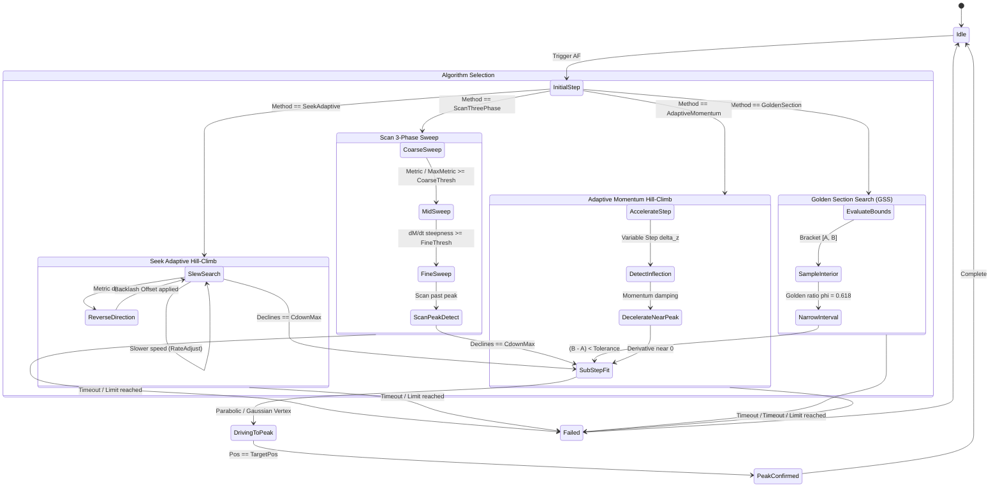

# Lens Controller Library Implementation Plan (`libs/LensController`)

## 1. Overview & Objectives

This document establishes the technical design, module decomposition, mathematical algorithms, and phased implementation schedule for **`libs/LensController`**.

`libs/LensController` is a high-reliability, zero-heap, strongly-typed C++17 library providing unified control over camera optics, motorized zoom/focus actuators, dynamic driver plugins, parfocal zoom-to-focus tracking curves, and closed-loop autofocus algorithms.

### Key Objectives
1. **Decompiled Sightline & EAN Parity**:
   - Replicate and modernize the architecture from `Sightline-Decompiled` (`ILensDriver.h`, `SlaLensController`, `SlaFocusEvaluator`) and the Sightline Engineering Application Note **EAN-Lens-DLL-Development.pdf**.
   - Provide a dynamic driver loading mechanism (`LoadLibraryA`/`dlopen`) that loads external `.dll` / `.so` lens plugins exposing `create_lens_object` or `create_object` factory functions.
   - Implement serial port collision prevention across multi-camera channels (up to 4 channels).
2. **Motor & Optical Actuation**:
   - Relative jog steps (`FocusNear`, `FocusFar`, `ZoomWide`, `ZoomTele`, `StopMotion`).
   - Absolute encoder positioning (`MotorPosition` 0..65535).
   - Variable zoom speed and focus speed configuration (`MotorSpeed` 0..255).
   - Hardware and software limit switch protection (`NearLimit`, `FarLimit`, `WideLimit`, `TeleLimit`).
3. **Zero-Heap Focus Sharpness Evaluation**:
   - Sub-millisecond evaluation on 8-bit grayscale (luma/Y) frames within user-defined fractional ROIs.
   - Zero dynamic heap allocation (`noexcept`, CERT ERR55-CPP compliant).
   - Classical and frequency metrics: Sobel gradient squared, discrete Laplacian, Tenengrad, and 2D 8x8 DCT high-frequency AC energy (interfacing with `libs/Math/DctSharpnessEvaluator.h`).
4. **Recent & Advanced Autofocus (AF) Algorithms**:
   - **Sightline Classic**: Seek Algorithm (adaptive gradient direction-flip with `RateAdjust`) and Scan Algorithm (3-phase Coarse $\rightarrow$ Mid $\rightarrow$ Fine sweep with `CoarseThresh`/`FineThresh`).
   - **Golden Section Search (GSS) & Fibonacci Search**: Optimal unimodal peak convergence with logarithmic step complexity.
   - **Adaptive Hill-Climbing with Momentum & Backlash Compensation**: Variable step sizing that accelerates through out-of-focus zones and slows down near peak inflection.
   - **Sub-Step Parabolic & Gaussian Peak Fitting**: Exact sub-encoder focal point interpolation from sparse samples.
   - **Vollath F4/F5 Autocorrelation Metrics**: High-noise immunity for thermal (LWIR/MWIR) and low-light sensors.
   - **Tracker-Coupled Dynamic ROI**: Dynamic binding to `libs/Tracking` bounding boxes (`TargetId`) for active target auto-centering.
5. **Zoom-to-Focus (Parfocal Look-Up Curve)**:
   - Full parser, serializer, and evaluator for Sightline multi-curve LUT format:
     ```text
     <number of samples>:
     z:100, 200, 500, 1000, 2000
     f:450, 480, 520, 610, 850
     ```
   - Monotone cubic Hermite spline (PCHIP) and piecewise linear interpolation.
   - Real-time synchronous slew commanding focus motor as zoom moves.
   - Automated track curve learning generator.
6. **Architectural & Safety Standards**:
   - Zero Qt dependencies (`#include <Q...>` strictly prohibited).
   - MISRA C++:2023 & SEI CERT C++ compliance.
   - All function names strictly less than 30 characters.
   - Strict IWYU, `<cstdint>`, `<cstddef>`, and `std::` qualification.
   - Cross-platform Windows (Win32) and Linux (POSIX).

---

## 2. System Architecture

### 2.1 Component Interaction Overview

```
+---------------------------------------------------------------------------------------------------------------+
|                                            libs/LensController                                                |
|                                                                                                               |
|   +-------------------------------------------------------------------------------------------------------+   |
|   |                                     LensController (Multi-Channel)                                    |   |
|   |   - Channel State & Parameter Coordination (CameraIndex 0..3)                                         |   |
|   |   - Operational Modes (ManualJog, AutoFocusOnce, AutoFocusContinuous, ZoomTrackOnly, Calibrating)      |   |
|   |   - Soft Boundary Clamping & Limit Switch Tripping Detection [focusMin..focusMax, zoomMin..zoomMax]   |   |
|   +-----------------------------------+-----------------------------------+-------------------------------+   |
|                                       |                                   |                                   |
|         +-----------------------------+                                   +-----------------------------+     |
|         |                                                                                               |     |
|         ▼                                                                                               ▼     |
|   +-----------------------------------+                                               +---------------------+ |
|   |          AutoFocusEngine          |                                               | ZoomTrackFocusEngine| |
|   |  - Sightline Seek & Scan (3-Phase)|                                               |  - Multi-Curve LUT  | |
|   |  - Golden Section / Fibonacci AF  |                                               |  - Cubic Spline     | |
|   |  - Adaptive Momentum Hill-Climb   |                                               |  - Parfocal Slew    | |
|   |  - Parabolic Peak Interpolation   |                                               |  - Curve Calibrator | |
|   |  - Dynamic Tracker ROI Ingestion  |                                               +----------+----------+ |
|   |  - Latency & Backlash Corrector   |                                                          |            |
|   +-----------------+-----------------+                                                          |            |
|                     |                                                                            |            |
|                     ▼                                                                            |            |
|   +-----------------------------------+                                                          |            |
|   |       FocusEvaluator (0-Heap)     |                                                          |            |
|   |  - Sobel / Laplacian / Tenengrad  |                                                          |            |
|   |  - Vollath F4 / F5 Autocorr       |                                                          |            |
|   |  - 2D 8x8 DCT AC Energy (Math)    |                                                          |            |
|   +-----------------------------------+                                                          |            |
|                                                                                                  |            |
|                                       +-----------------------------------+                      |            |
|                                       |            ILensDriver            |<---------------------+            |
|                                       |    (Hardware Actuator Interface)  |                                   |
|                                       +-----------------+-----------------+                                   |
|                                                         |                                                     |
|                     +-----------------------------------+-----------------------------------+                 |
|                     |                                   |                                   |                 |
|                     ▼                                   ▼                                   ▼                 |
|       +---------------------------+       +---------------------------+       +---------------------------+   |
|       |      ViscaLensDriver      |       |      PelcoDLensDriver     |       |       MockLensDriver       |   |
|       |   (Sony Block, FCB-EV)    |       |   (Pelco-D Motor Head)    |       |     (In-Memory Mock)      |   |
|       +---------------------------+       +---------------------------+       +---------------------------+   |
|                     |                                                                                         |
|                     ▼                                                                                         |
|       +---------------------------+                                                                           |
|       |      LensDriverLoader     |  Dynamic shared library loader (LoadLibraryA / dlopen)                    |
|       | (Sightline DLL Interface) |  e.g. slViscaLens.so, slTamronLens.so, vendor custom drivers              |
|       +---------------------------+                                                                           |
+---------------------------------------------------------------------------------------------------------------+
```

### 2.2 Mermaid Architectural Hierarchy

```mermaid
flowchart TD
    subgraph ClientLayers["Client & Integration Layer"]
        App["Gimbal / Camera App"]
        PH["libs/PayloadHal (ICameraPayload)"]
        Track["libs/Tracking (TargetId BoundingBox)"]
    end

    subgraph Core["libs/LensController (Zero Qt, Pure C++17)"]
        LC["LensController<br/>(Channel Manager, Mode & Range Guard)"]
        
        subgraph AFSubsystem["Autofocus Subsystem"]
            AF["AutoFocusEngine<br/>(Seek, Scan 3-Phase, GSS, Adaptive Hill-Climb)"]
            FE["FocusEvaluator<br/>(Sobel, Laplacian, Tenengrad, Vollath F4/F5, DCT)"]
            Fit["PeakFitter<br/>(Parabolic / Gaussian Sub-Step)"]
            Comp["LatencyCompensator<br/>(frameOffsetMult8 & Backlash)"]
        end
        
        subgraph ZoomSubsystem["Parfocal Zoom-Tracking Subsystem"]
            ZT["ZoomTrackFocusEngine<br/>(Multi-Distance LUT & Spline Interp)"]
            Cal["CurveCalibrator<br/>(Automatic Curve Generation)"]
        end
        
        subgraph HAL["Hardware Abstraction Layer"]
            ILD["ILensDriver (Virtual Interface)"]
            LDL["LensDriverLoader<br/>(LoadLibraryA / dlopen)"]
            Nop["MockLensDriver (Simulated)"]
            Visca["ViscaLensDriver (Sony Block)"]
            Pelco["PelcoDLensDriver (Pelco-D Zoom/Focus)"]
        end
    end

    App --> LC
    PH --> LC
    Track -.->|Dynamic ROI| AF
    LC --> AF
    LC --> ZT
    AF --> FE
    AF --> Fit
    AF --> Comp
    ZT --> Cal
    LC --> ILD
    AF --> ILD
    ZT --> ILD
    LDL -.-> ILD
    ILD <|.. Nop
    ILD <|.. Visca
    ILD <|.. Pelco
```

---

## 3. Detailed Component Specifications

### 3.1 Domain Model & Value Objects (`LensTypes.h`)

Strictly adheres to **Domain-Driven Design** to eliminate Primitive Obsession. Every primitive is wrapped into a strongly-typed value object with domain bound validation:

```cpp
namespace LensControl {

class CameraIndex {
public:
    explicit constexpr CameraIndex(std::uint8_t index) noexcept : m_index{index} {}
    [[nodiscard]] constexpr std::uint8_t value() const noexcept { return m_index; }
    [[nodiscard]] constexpr bool operator==(CameraIndex other) const noexcept { return m_index == other.m_index; }
    [[nodiscard]] constexpr bool operator!=(CameraIndex other) const noexcept { return m_index != other.m_index; }
private:
    std::uint8_t m_index{0U};
};

class MotorPosition {
public:
    explicit constexpr MotorPosition(std::uint16_t pos = 0U) noexcept : m_pos{pos} {}
    [[nodiscard]] constexpr std::uint16_t value() const noexcept { return m_pos; }
    [[nodiscard]] constexpr bool operator==(MotorPosition o) const noexcept { return m_pos == o.m_pos; }
    [[nodiscard]] constexpr bool operator<(MotorPosition o) const noexcept { return m_pos < o.m_pos; }
private:
    std::uint16_t m_pos{0U};
};

class MotorSpeed {
public:
    explicit constexpr MotorSpeed(std::uint8_t speed = 127U) noexcept : m_speed{speed} {}
    [[nodiscard]] constexpr std::uint8_t value() const noexcept { return m_speed; }
private:
    std::uint8_t m_speed{127U};
};

enum class LensMode : std::uint8_t {
    ManualJog = 0U,
    AutoFocusOnce = 1U,
    AutoFocusContinuous = 2U,
    ZoomTrackOnly = 3U,
    Calibrating = 4U,
    Idle = 5U
};

enum class LensLimitFlags : std::uint8_t {
    None = 0x00U,
    NearLimit = 0x01U,
    FarLimit = 0x02U,
    WideLimit = 0x04U,
    TeleLimit = 0x08U
};

enum class AutoFocusMethod : std::uint8_t {
    SeekAdaptive = 0U,       ///< Sightline Seek: Direction flip on metric drop with RateAdjust
    ScanThreePhase = 1U,     ///< Sightline Scan: Coarse -> Mid -> Fine sweep
    GoldenSection = 2U,      ///< Golden Section Search for fast logarithmic convergence
    AdaptiveMomentum = 3U,   ///< Variable step hill-climb with momentum and backlash correction
    DctFrequency = 4U,       ///< 2D 8x8 DCT AC high-frequency energy peak
    BuiltInDriver = 5U       ///< Hardware native AF (Sony VISCA, etc.)
};

enum class FocusMetricType : std::uint8_t {
    SobelGradientSquared = 0U,
    DiscreteLaplacian = 1U,
    TenengradThreshold = 2U,
    VollathCorrelationF4 = 3U,
    VollathCorrelationF5 = 4U,
    DctHighFrequency = 5U
};

struct LensRanges {
    std::uint16_t focusMin{0U};
    std::uint16_t focusMax{65535U};
    std::uint16_t zoomMin{0U};
    std::uint16_t zoomMax{65535U};
};

struct NormalizedRoi {
    std::uint8_t colFrac{64U};    ///< Left fraction [0..255]
    std::uint8_t rowFrac{64U};    ///< Top fraction [0..255]
    std::uint8_t widthFrac{128U}; ///< Width fraction [0..255]
    std::uint8_t highFrac{128U};  ///< Height fraction [0..255]
};

struct FocusMetricScore {
    std::uint32_t metric{0U};
    std::uint32_t mean{0U};
    std::uint32_t variance{0U};
    std::uint32_t pixelCount{0U};
    std::uint64_t timestampNs{0U};
    std::uint32_t frameId{0U};
};

} // namespace LensControl
```

---

### 3.2 Hardware Driver Interface (`ILensDriver.h`)

Conforms directly to the interface requirements established in Sightline's `ILensDriver` and `slLensPublicBasic`/`SLLensPublicAuto`:

```cpp
namespace LensControl {

class ILensDriver {
public:
    virtual ~ILensDriver() = default;

    [[nodiscard]] virtual bool initialize(std::uint8_t port, std::uint32_t baud) noexcept = 0;
    virtual void moveFocus(std::int16_t steps, MotorSpeed speed) noexcept = 0;
    virtual void moveZoom(std::int16_t steps, MotorSpeed speed) noexcept = 0;
    virtual void setFocusPosition(MotorPosition pos, MotorSpeed speed) noexcept = 0;
    virtual void setZoomPosition(MotorPosition pos, MotorSpeed speed) noexcept = 0;
    virtual void stopMotion() noexcept = 0;

    [[nodiscard]] virtual MotorPosition currentFocus() const noexcept = 0;
    [[nodiscard]] virtual MotorPosition currentZoom() const noexcept = 0;
    [[nodiscard]] virtual std::uint8_t limitFlags() const noexcept = 0;
    virtual void sendRawCommand(const std::uint8_t* data, std::size_t len) noexcept = 0;

    [[nodiscard]] virtual bool hasBuiltinAutofocus() const noexcept = 0;
    virtual bool triggerBuiltinAutofocus() noexcept = 0;
    [[nodiscard]] virtual bool hasBuiltinZoomTracking() const noexcept = 0;
    virtual bool setBuiltinZoomTracking(bool enable) noexcept = 0;
};

} // namespace LensControl
```

---

### 3.3 Dynamic Lens Driver Loader (`LensDriverLoader.h`, `.cpp`)

```
+-------------------------------------------------------------------------------+
|                            LENS DLL LIFECYCLE                                 |
|                                                                               |
|   [Load Request]                                                              |
|          │                                                                    |
|          ▼                                                                    |
|   1. Check Port Collision (Verify no other camera channel binds port)          |
|          │                                                                    |
|          ▼                                                                    |
|   2. dlopen / LoadLibraryA across candidate search directories                |
|          │                                                                    |
|          ▼                                                                    |
|   3. Resolve "create_lens_object" or "create_object" factory symbol           |
|          │                                                                    |
|          ▼                                                                    |
|   4. Instantiate ILensDriver* instance                                        |
|          │                                                                    |
|          ▼                                                                    |
|   5. Initialize Serial UART (port, baud)                                      |
|          │                                                                    |
|          ▼                                                                    |
|   6. Bind RAII std::unique_ptr<ILensDriver> to Channel                        |
|                                                                               |
|   [Unload / Destruction]                                                      |
|          │                                                                    |
|          ▼                                                                    |
|   stopMotion() ──► delete driver ──► dlclose / FreeLibrary ──► Release Port   |
+-------------------------------------------------------------------------------+
```

---

### 3.4 Zero-Heap Focus Sharpness Evaluator (`FocusEvaluator.h`, `.cpp`)

The focus evaluator executes in the frame processing path and must execute with **zero dynamic heap allocations** (`noexcept`, CERT ERR55-CPP). It computes spatial and correlation focus sharpness metrics over a region of interest (ROI):

#### 1. Spatial Sharpness Formulas
- **Sobel Gradient Magnitude Squared**:
  $$G_x(x,y) = \big(I_{x+1, y-1} + 2I_{x+1, y} + I_{x+1, y+1}\big) - \big(I_{x-1, y-1} + 2I_{x-1, y} + I_{x-1, y+1}\big)$$
  $$G_y(x,y) = \big(I_{x-1, y+1} + 2I_{x, y+1} + I_{x+1, y+1}\big) - \big(I_{x-1, y-1} + 2I_{x, y-1} + I_{x+1, y-1}\big)$$
  $$M_{\text{Sobel}} = \sum_{(x,y) \in \text{ROI}} \big(G_x(x,y)^2 + G_y(x,y)^2\big)$$

- **Modified Discrete Laplacian (4-neighbor & 8-neighbor)**:
  $$\Delta I(x,y) = 4 I(x,y) - I(x+1,y) - I(x-1,y) - I(x,y+1) - I(x,y-1)$$
  $$M_{\text{Laplacian}} = \sum_{(x,y) \in \text{ROI}} \big(\Delta I(x,y)\big)^2$$

- **Tenengrad with Adaptive Noise Gate**:
  $$M_{\text{Tenengrad}} = \sum_{(x,y) \in \text{ROI}, \ (G_x^2 + G_y^2) > T_{\text{noise}}} \big(G_x^2 + G_y^2\big)$$

- **Vollath F4 Autocorrelation (High Noise Immunity for Thermal Sensors)**:
  $$M_{\text{Vollath-F4}} = \sum_{y} \sum_{x} I(x, y) \cdot I(x+1, y) - \sum_{y} \sum_{x} I(x, y) \cdot I(x+2, y)$$

- **Vollath F5 Autocorrelation**:
  $$M_{\text{Vollath-F5}} = \sum_{y} \sum_{x} I(x, y) \cdot I(x+1, y) - N_{\text{pixels}} \cdot \mu_I^2$$

- **2D 8x8 DCT High-Frequency AC Energy**:
  - Leverages [DctSharpnessEvaluator.h](../libs/Math/DctSharpnessEvaluator.h):
  $$M_{\text{DCT}} = \frac{\sum_{u+v \ge f_{\text{min}}} |C(u,v)|}{\mu_{\text{DC}} + \epsilon}$$

---

### 3.5 Recent & Advanced Autofocus Algorithms (`AutoFocusEngine.h`, `.cpp`)



#### Detailed Breakdown of Algorithms:

#### 1. Sightline Scan Algorithm (3-Phase Sweep)
- **Phase 1: Coarse Sweep (`coarseSpeed`)**: Lens rapidly sweeps across focal range. Transitions to Mid Phase when $\text{metric} / \text{max\_seen} \ge \text{coarseThresh}$.
- **Phase 2: Mid Sweep (`midSpeed`)**: Slower movement to capture peak shoulder. Transitions to Fine Phase when relative derivative $\Delta M / M_{\text{prev}} \ge \text{fineThresh}$.
- **Phase 3: Fine Sweep (`fineSpeed`)**: High-resolution sampling. When $\text{cdownMax}$ consecutive metric declines occur, peak is confirmed.
- **Rewind**: Moves directly back to optimal peak position with backlash compensation.

#### 2. Sightline Seek Algorithm (Adaptive Direction-Flip)
- Slews focus motor in initial direction.
- Evaluates metric gradient $\Delta M / M_{\text{prev}}$.
- If metric drops, immediately reverses direction and adjusts speed based on zoom position (`rateAdjust`).
- Terminates upon $\text{cdownMax}$ declines after peak.

#### 3. Golden Section Search (GSS) & Fibonacci Autofocus
- Ideal for unimodal focus curves with minimal actuator movement.
- Given an interval $[a, b]$, samples at:
  $$x_1 = b - (b - a) \cdot \frac{\sqrt{5} - 1}{2}, \quad x_2 = a + (b - a) \cdot \frac{\sqrt{5} - 1}{2}$$
- Evaluates $M(x_1)$ and $M(x_2)$, discarding the non-optimal section. Converges in $O(\log N)$ frames.

#### 4. Adaptive Momentum Hill-Climbing
- Computes variable motor step size:
  $$\Delta z_k = \eta \cdot \frac{M_k - M_{k-1}}{z_k - z_{k-1}} + \alpha \Delta z_{k-1}$$
  where $\eta$ is learning rate and $\alpha \in [0.4, 0.7]$ is momentum damping.
- Eliminates searching delay across flat, blurred defocus regions while preventing overshoot near the peak.

#### 5. Sub-Step Parabolic & Gaussian Peak Fitting (`PeakFitter`)
- Motor encoders have discrete steps. Given 3 points $(z_1, M_1), (z_2, M_2), (z_3, M_3)$ surrounding the peak with $M_2 > M_1$ and $M_2 > M_3$:
  $$z^* = z_2 - \frac{1}{2} \frac{(z_2 - z_1)^2 (M_2 - M_3) - (z_2 - z_3)^2 (M_2 - M_1)}{(z_2 - z_1)(M_2 - M_3) - (z_2 - z_3)(M_2 - M_1)}$$
- Yields true optical peak location even when the discrete encoder missed the exact summit.

#### 6. Dynamic Tracker-Coupled ROI Auto-Centering
- Connects with `libs/Tracking`: When an active target is tracked (`TargetId`), the autofocus ROI bounding box automatically centers on the target's bounding box:
  $$\text{ROI}_{\text{AF}} = \text{Clamp}\Big(\text{BBox}_{\text{target}} \oplus \text{Margin}, \ [0, 0, W, H]\Big)$$
- Focuses specifically on the tactical target rather than background clutter.

---

### 3.6 Zoom-to-Focus (Parfocal Look-Up Curve) (`ZoomTrackFocusEngine.h`, `.cpp`)

```
+-------------------------------------------------------------------------------+
|                      PARFOCAL ZOOM TRACKING ARCHITECTURE                      |
|                                                                               |
|   Focus Pos ^                                                                 |
|             |          Curve 3: 500m / Infinity                               |
|             |        .-----------------------------                           |
|             |       /  Curve 2: 10m                                           |
|             |      /  .----------------------------                           |
|             |     /  /  Curve 1: 3m (Near)                                    |
|             |    /  /  .---------------------------                           |
|             |   /  /  /                                                       |
|             |  /  /  /                                                        |
|             | /  /  /                                                         |
|             +-------------------------------------> Zoom Pos                  |
|             Wide                                Tele                          |
+-------------------------------------------------------------------------------+
```

#### 1. Track Curve File Parser & Serializer
Parses and generates Sightline-standard calibration files:
```text
<number of samples>:
z:<comma-separated zoom positions>
f:<comma-separated focus positions>
```

#### 2. Monotone Cubic Hermite Spline Interpolation (PCHIP)
Given calibration points $(z_k, f_k)$, computes tangents $d_k$ enforcing monotonicity:
$$f^*(z) = (2t^3 - 3t^2 + 1) f_k + (t^3 - 2t^2 + t) h d_k + (-2t^3 + 3t^2) f_{k+1} + (t^3 - t^2) h d_{k+1}$$
where $h = z_{k+1} - z_k$ and $t = (z - z_k) / h$.
Guarantees **zero overshoot** and continuous first-order smoothness during fast continuous zooming.

#### 3. Automated Calibration Curve Generator
- Iterates $N = 30$ zoom points across $[z_{\text{min}}, z_{\text{max}}]$.
- Triggers one-shot autofocus at each zoom setting.
- Logs $(z_k, f_k^*)$ into the calibration file.

---

### 3.7 Master Multi-Channel Controller (`LensController.h`, `.cpp`)

```cpp
namespace LensControl {

class LensController final {
public:
    static constexpr std::size_t kMaxChannels = 4U;

    LensController() noexcept;
    ~LensController() noexcept;

    // Mode & Boundaries
    void setLensMode(CameraIndex cam, LensMode mode, std::uint16_t data) noexcept;
    void setLensRanges(CameraIndex cam, const LensRanges& ranges) noexcept;
    void setZoomSpeed(CameraIndex cam, MotorSpeed speed) noexcept;
    void setFocusSpeed(CameraIndex cam, MotorSpeed speed) noexcept;

    // Movement
    void moveFocusStep(CameraIndex cam, std::int16_t steps) noexcept;
    void moveZoomStep(CameraIndex cam, std::int16_t steps) noexcept;
    void setFocusTarget(CameraIndex cam, MotorPosition pos) noexcept;
    void setZoomTarget(CameraIndex cam, MotorPosition pos) noexcept;
    void stopMotion(CameraIndex cam) noexcept;

    // Autofocus & Parfocal Tracking
    void triggerAutoFocus(CameraIndex cam, AutoFocusMethod method) noexcept;
    void stopAutoFocus(CameraIndex cam) noexcept;
    void setZoomTrackFocus(CameraIndex cam, bool enable) noexcept;
    bool loadTrackCurves(CameraIndex cam, std::string_view filename) noexcept;

    // Frame Ingestion for Software AF
    void processFrame(CameraIndex cam, const std::uint8_t* luma,
                      std::size_t width, std::size_t height,
                      std::uint64_t timestampNs, std::uint32_t frameId) noexcept;

    // State machine tick
    void update(CameraIndex cam) noexcept;

    // Telemetry & Status
    [[nodiscard]] LensStatus getLensStatus(CameraIndex cam) const noexcept;
    [[nodiscard]] LensRanges getLensRanges(CameraIndex cam) const noexcept;
    [[nodiscard]] bool isAutoFocusRunning(CameraIndex cam) const noexcept;

    // Hardware Driver Binding & Dynamic Loading
    void setDriver(CameraIndex cam, std::unique_ptr<ILensDriver> driver) noexcept;
    [[nodiscard]] LensLoadResult loadLensDll(CameraIndex cam, std::string_view dllName,
                                            std::uint8_t port, std::uint32_t baud) noexcept;
    void unloadLensDll(CameraIndex cam) noexcept;
};

} // namespace LensControl
```

---

## 4. Directory & File Structure

```text
libs/LensController/
├── CMakeLists.txt                      # Target configuration, no Qt, -Wall -Wextra -Werror
├── ILensDriver.h                       # Abstract hardware actuator interface
├── LensTypes.h                         # Strongly-typed value objects and enums
├── LensDriverLoader.h                  # Dynamic DLL / shared object loader
├── LensDriverLoader.cpp
├── MockLensDriver.h                     # In-memory simulated lens driver for testing
├── MockLensDriver.cpp
├── ViscaLensDriver.h                   # Sony VISCA protocol lens driver adapter
├── ViscaLensDriver.cpp
├── PelcoDLensDriver.h                  # Pelco-D protocol lens driver adapter
├── PelcoDLensDriver.cpp
├── FocusEvaluator.h                    # Zero-heap Sobel/Laplacian/Tenengrad/Vollath/DCT evaluator
├── FocusEvaluator.cpp
├── PeakFitter.h                        # Sub-step Parabolic and Gaussian peak interpolation
├── PeakFitter.cpp
├── AutoFocusEngine.h                   # Seek, Scan 3-Phase, GSS, Adaptive Momentum AF engine
├── AutoFocusEngine.cpp
├── ZoomTrackFocusEngine.h              # Parfocal LUT parser, PCHIP spline interpolation & calibrator
├── ZoomTrackFocusEngine.cpp
├── LensController.h                    # Multi-channel orchestrator & API gateway
├── LensController.cpp
├── LensPayloadAdapter.h                # Bridge to PayloadHal::ICameraPayload
├── LensPayloadAdapter.cpp
└── tests/
    ├── CMakeLists.txt                  # GoogleTest test runner
    ├── TestLensTypes.cpp               # Value objects and invariant tests
    ├── TestFocusEvaluator.cpp          # Sharpness metric mathematical validation
    ├── TestPeakFitter.cpp              # Parabolic sub-step peak fitting tests
    ├── TestZoomTrackCurve.cpp          # LUT parse, serialization & spline interpolation tests
    ├── TestAutoFocusEngine.cpp         # Simulated closed-loop AF convergence tests
    ├── TestLensController.cpp          # Channel orchestration, limit guards & jog tests
    └── TestLensDriverLoader.cpp        # Dynamic library loading and collision tests
```

---

## 5. Phased Implementation Roadmap

| Phase | Milestone | Scope / Deliverables | Success Criteria |
|:---:|:---|:---|:---|
| [**Phase 1**](lens_controller_phase1_plan.md) | **Core Domain & HAL** | `LensTypes.h`, `ILensDriver.h`, `MockLensDriver.h/.cpp`, tests | Strongly-typed value objects, 100% test pass on mock driver. |
| [**Phase 2**](lens_controller_phase2_plan.md) | **Zero-Heap Focus Evaluator** | `FocusEvaluator.h/.cpp` (Sobel, Laplacian, Tenengrad, Vollath F4/F5, DCT integration with `libs/Math`) | Zero heap allocations on evaluation path, passes synthetic pattern tests. |
| [**Phase 3**](lens_controller_phase3_plan.md) | **Zoom-to-Focus (Parfocal LUT & Spline)** | `ZoomTrackFocusEngine.h/.cpp` (Sightline curve file format parser, PCHIP spline interpolation, curve calibrator) | Exact roundtrip of multi-curve files, monotonic spline interpolation without overshoot. |
| [**Phase 4**](lens_controller_phase4_plan.md) | **Autofocus Algorithms & Peak Fitting** | `PeakFitter.h/.cpp`, `AutoFocusEngine.h/.cpp` (Seek, Scan 3-phase, Golden Section, Adaptive Momentum, Dynamic Tracker ROI) | Closed-loop convergence to global focus peak across simulated focal curves. |
| [**Phase 5**](lens_controller_phase5_plan.md) | **Dynamic DLL Loader & Protocols** | `LensDriverLoader.h/.cpp`, `ViscaLensDriver.h/.cpp`, `PelcoDLensDriver.h/.cpp` | Cross-platform dynamic loading, port collision rejection, VISCA/Pelco-D frame generation. |
| [**Phase 6**](lens_controller_phase6_plan.md) | **Master Controller & Payload HAL** | `LensController.h/.cpp`, `LensPayloadAdapter.h/.cpp` bridging to `PayloadHal::ICameraPayload` | Unified multi-channel management, smooth joystick jog, limit clamping. |
| **Phase 7** | **Verification, Documentation & CI** | Integration into root `CMakeLists.txt`, `scripts/verify_iwyu_cstdint.py`, Doxygen validation | Zero compiler warnings, 100% test pass rate on Linux and Windows. |

---

## 6. Safety & Standards Verification Checklist

- [x] **Zero Qt Dependency**: Pure standard C++17 across `libs/LensController/`.
- [x] **Co-located Files**: `.h` and `.cpp` in the same directory.
- [x] **Concise Function Names**: Strictly less than 30 characters in length.
- [x] **Strict IWYU & `<cstdint>`**: All fixed-width integer types include `<cstdint>` and use `std::` namespace.
- [x] **MISRA C++:2023 & SEI CERT C++**:
  - Rule 7.0.6 & INT31-C: Explicit, checked `static_cast` for integer conversions.
  - STR37-C: Locale-independent ASCII character comparisons.
  - ERR55-CPP: Zero dynamic heap allocations in `noexcept` evaluation and dispatch loops.
- [x] **Documentation Diagrams**: Both ASCII and Mermaid diagrams included.
- [x] **Cross-Platform**: Win32 (`LoadLibraryA`) and POSIX (`dlopen`) driver loading.

