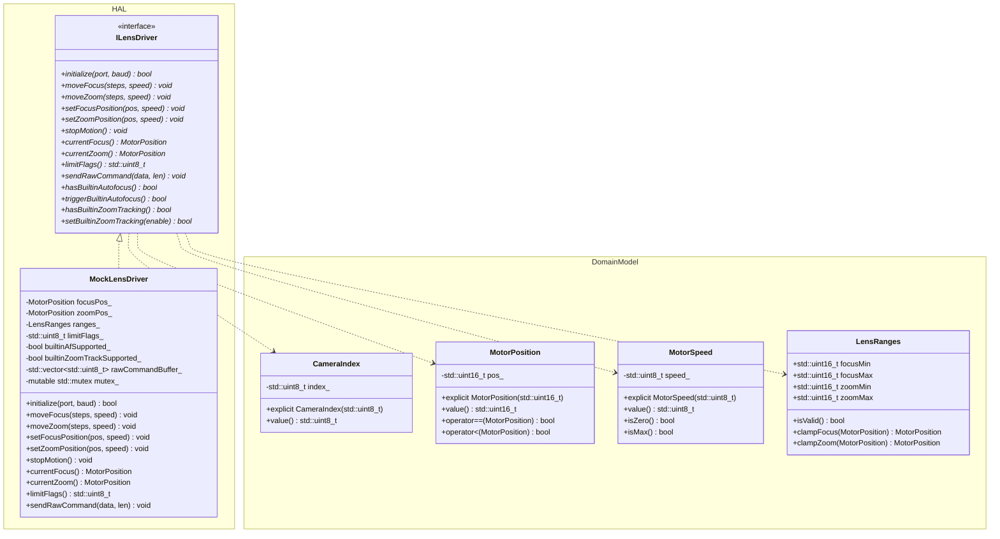

# Lens Controller Phase 1 Implementation Plan: Core Domain Modeling & Hardware Abstraction Layer (HAL)

## 1. Executive Summary & Objectives

### 1.1 Context & Scope
Phase 1 lays the architectural foundation of **`libs/LensController`** by creating the strongly-typed domain model, the abstract hardware driver interface (`ILensDriver`), an in-memory simulated hardware driver (`MockLensDriver`), and the associated CMake and GoogleTest build infrastructure.

This library takes direct inspiration from the decompiled Sightline intelligence architecture (`C:\Users\Stavros\workspace\Sightline-Decompiled.git`), the Sightline Engineering Application Note **EAN-Lens-DLL-Development.pdf**, and existing repository standards (`libs/PelcoDCore`, `libs/ViscaCore`, `libs/PayloadHal`).

### 1.2 Target Deliverables for Phase 1
1. **Core Domain Model (`LensTypes.h`)**:
   - Strongly-typed value objects to eliminate Primitive Obsession: `CameraIndex`, `MotorPosition`, `MotorSpeed`, `ZoomSpeed`, `FocusSpeed`.
   - Structural records: `LensRanges`, `NormalizedRoi`, `FocusMetricScore`, `LensStatus`.
   - Strongly-typed enums: `LensMode`, `LensLimitFlags`, `LensCommandId`, `AutoFocusMethod`, `FocusMetricType`, `LensLoadResult`.
   - Comprehensive invariant validation, boundary clamping, and zero-allocation semantics.
2. **Hardware Driver Interface (`ILensDriver.h`)**:
   - Zero-heap abstract polymorphic interface modeling motorized lens actuators.
   - Core capabilities: relative jog movement, absolute position slew, immediate motion halt, limit queries, raw protocol byte pass-through, and native autofocus/zoom-tracking interrogation.
3. **In-Memory Simulated Driver (`MockLensDriver.h`, `MockLensDriver.cpp`)**:
   - Zero-hardware mock actuator executing synchronous/rate-limited positioning.
   - Enforces limit switch tripping (`NearLimit`, `FarLimit`, `WideLimit`, `TeleLimit`).
   - Captures raw command bytes for protocol loopback inspection.
   - Thread-safe state inspection with zero dynamic heap allocation on fast paths.
4. **Build System & Verification**:
   - `libs/LensController/CMakeLists.txt` (Zero Qt dependencies, C++17, hardening flags, warnings as errors).
   - `libs/LensController/tests/CMakeLists.txt` & root integration.
   - Comprehensive GoogleTest suite: `TestLensTypes.cpp`, `TestMockLensDriver.cpp`.

---

## 2. Architecture & Design

### 2.1 Layer Interaction

```
+-----------------------------------------------------------------------------------------------+
|                                    libs/LensController (Phase 1)                              |
|                                                                                               |
|   +---------------------------------------------------------------------------------------+   |
|   |                                  Domain Model (LensTypes.h)                           |   |
|   |                                                                                       |   |
|   |   CameraIndex          MotorPosition         MotorSpeed         LensRanges            |   |
|   |   [0..3]               [0..65535]            [0..255]           [focus/zoom min-max]  |   |
|   |                                                                                       |   |
|   |   ZoomSpeed            FocusSpeed            LensLimitFlags     NormalizedRoi         |   |
|   |   (Strong Type)        (Strong Type)         (Bitmask 0x01..08) (Clamped [0..255])    |   |
|   +-------------------------------------------+-------------------------------------------+   |
|                                               |                                               |
|                                               ▼                                               |
|   +---------------------------------------------------------------------------------------+   |
|   |                           Hardware Abstraction Layer (ILensDriver.h)                  |   |
|   |                                                                                       |   |
|   |   + initialize(port, baud) : bool                                                     |   |
|   |   + moveFocus(steps, speed) / moveZoom(steps, speed)                                  |   |
|   |   + setFocusPosition(pos, speed) / setZoomPosition(pos, speed)                        |   |
|   |   + stopMotion() : void                                                               |   |
|   |   + currentFocus() : MotorPosition / currentZoom() : MotorPosition                    |   |
|   |   + limitFlags() : std::uint8_t                                                       |   |
|   |   + sendRawCommand(data, len) : void                                                  |   |
|   |   + hasBuiltinAutofocus() / hasBuiltinZoomTracking() : bool                           |   |
|   +-------------------------------------------+-------------------------------------------+   |
|                                               |                                               |
|                                               ▼                                               |
|   +---------------------------------------------------------------------------------------+   |
|   |                           MockLensDriver (Simulated Hardware Actuator)                 |   |
|   |                                                                                       |   |
|   |   - Internal Position Registers: focusPos, zoomPos                                    |   |
|   |   - Mechanical Travel Boundary Enforcer: focusMin..focusMax, zoomMin..zoomMax         |   |
|   |   - Limit Flag Trip Generator: NearLimit, FarLimit, WideLimit, TeleLimit              |   |
|   |   - Command History & Raw Buffer Log                                                  |   |
|   +---------------------------------------------------------------------------------------+   |
+-----------------------------------------------------------------------------------------------+
```

### 2.2 Class Hierarchy



---

## 3. Implementation Details

### 3.1 Domain Model Specification (`libs/LensController/LensTypes.h`)

#### Standards & Enforcement:
- **Prohibition of Primitive Obsession**: Raw integer scalars are banned from actuator parameter lists.
- **Explicit Constructors**: Single-argument constructors marked `explicit`.
- **Constexpr & Noexcept**: All queries marked `[[nodiscard]] constexpr ... noexcept`.
- **Strict IWYU & Types**: `#include <cstdint>`, `#include <cstddef>`, types prefixed with `std::`.
- **Concise Function Names**: Strictly < 30 characters in length.

```cpp
#pragma once

/// @file LensTypes.h
/// @brief Strongly-typed value objects and domain enums for motorized lens control.

#include <cstddef>
#include <cstdint>

#include <algorithm>
#include <array>

namespace LensControl {

/// @class CameraIndex
/// @brief Strongly-typed channel/camera identifier [0..3].
class CameraIndex {
public:
    explicit constexpr CameraIndex(std::uint8_t index = 0U) noexcept : m_index{index} {}
    [[nodiscard]] constexpr std::uint8_t value() const noexcept { return m_index; }
    [[nodiscard]] constexpr bool operator==(CameraIndex other) const noexcept { return m_index == other.m_index; }
    [[nodiscard]] constexpr bool operator!=(CameraIndex other) const noexcept { return m_index != other.m_index; }
    [[nodiscard]] constexpr bool operator<(CameraIndex other) const noexcept { return m_index < other.m_index; }
private:
    std::uint8_t m_index{0U};
};

/// @class MotorPosition
/// @brief Strongly-typed 16-bit motor encoder position [0..65535].
class MotorPosition {
public:
    explicit constexpr MotorPosition(std::uint16_t pos = 0U) noexcept : m_pos{pos} {}
    [[nodiscard]] constexpr std::uint16_t value() const noexcept { return m_pos; }
    [[nodiscard]] constexpr bool operator==(MotorPosition o) const noexcept { return m_pos == o.m_pos; }
    [[nodiscard]] constexpr bool operator!=(MotorPosition o) const noexcept { return m_pos != o.m_pos; }
    [[nodiscard]] constexpr bool operator<(MotorPosition o) const noexcept { return m_pos < o.m_pos; }
    [[nodiscard]] constexpr bool operator<=(MotorPosition o) const noexcept { return m_pos <= o.m_pos; }
    [[nodiscard]] constexpr bool operator>(MotorPosition o) const noexcept { return m_pos > o.m_pos; }
    [[nodiscard]] constexpr bool operator>=(MotorPosition o) const noexcept { return m_pos >= o.m_pos; }
private:
    std::uint16_t m_pos{0U};
};

/// @class MotorSpeed
/// @brief Strongly-typed actuator speed count [0..255].
class MotorSpeed {
public:
    static constexpr std::uint8_t kMinSpeed = 0U;
    static constexpr std::uint8_t kDefaultSpeed = 127U;
    static constexpr std::uint8_t kMaxSpeed = 255U;

    explicit constexpr MotorSpeed(std::uint8_t speed = kDefaultSpeed) noexcept : m_speed{speed} {}
    [[nodiscard]] constexpr std::uint8_t value() const noexcept { return m_speed; }
    [[nodiscard]] constexpr bool isZero() const noexcept { return m_speed == kMinSpeed; }
    [[nodiscard]] constexpr bool isMax() const noexcept { return m_speed == kMaxSpeed; }
    [[nodiscard]] constexpr bool operator==(MotorSpeed o) const noexcept { return m_speed == o.m_speed; }
    [[nodiscard]] constexpr bool operator!=(MotorSpeed o) const noexcept { return m_speed != o.m_speed; }
    [[nodiscard]] constexpr bool operator<(MotorSpeed o) const noexcept { return m_speed < o.m_speed; }
private:
    std::uint8_t m_speed{kDefaultSpeed};
};

/// @class ZoomSpeed
/// @brief Distinct strong value type for optical zoom velocity.
class ZoomSpeed {
public:
    explicit constexpr ZoomSpeed(std::uint8_t speed = MotorSpeed::kDefaultSpeed) noexcept : m_speed{speed} {}
    explicit constexpr ZoomSpeed(MotorSpeed speed) noexcept : m_speed{speed.value()} {}
    [[nodiscard]] constexpr std::uint8_t value() const noexcept { return m_speed; }
    [[nodiscard]] constexpr MotorSpeed toMotorSpeed() const noexcept { return MotorSpeed{m_speed}; }
    [[nodiscard]] constexpr bool operator==(ZoomSpeed o) const noexcept { return m_speed == o.m_speed; }
private:
    std::uint8_t m_speed{MotorSpeed::kDefaultSpeed};
};

/// @class FocusSpeed
/// @brief Distinct strong value type for optical focus velocity.
class FocusSpeed {
public:
    explicit constexpr FocusSpeed(std::uint8_t speed = MotorSpeed::kDefaultSpeed) noexcept : m_speed{speed} {}
    explicit constexpr FocusSpeed(MotorSpeed speed) noexcept : m_speed{speed.value()} {}
    [[nodiscard]] constexpr std::uint8_t value() const noexcept { return m_speed; }
    [[nodiscard]] constexpr MotorSpeed toMotorSpeed() const noexcept { return MotorSpeed{m_speed}; }
    [[nodiscard]] constexpr bool operator==(FocusSpeed o) const noexcept { return m_speed == o.m_speed; }
private:
    std::uint8_t m_speed{MotorSpeed::kDefaultSpeed};
};

/// @enum LensMode
/// @brief Operating modes matching Sightline SetLensMode (0x6C).
enum class LensMode : std::uint8_t {
    ManualJog = 0U,
    AutoFocusOnce = 1U,
    AutoFocusContinuous = 2U,
    ZoomTrackOnly = 3U,
    Calibrating = 4U,
    Idle = 5U
};

/// @enum LensLimitFlags
/// @brief Limit switch states matching Sightline CurrentLensStatus (0x6D).
enum class LensLimitFlags : std::uint8_t {
    None = 0x00U,
    NearLimit = 0x01U,
    FarLimit = 0x02U,
    WideLimit = 0x04U,
    TeleLimit = 0x08U
};

[[nodiscard]] constexpr LensLimitFlags operator|(LensLimitFlags a, LensLimitFlags b) noexcept {
    return static_cast<LensLimitFlags>(static_cast<std::uint8_t>(a) | static_cast<std::uint8_t>(b));
}

[[nodiscard]] constexpr LensLimitFlags operator&(LensLimitFlags a, LensLimitFlags b) noexcept {
    return static_cast<LensLimitFlags>(static_cast<std::uint8_t>(a) & static_cast<std::uint8_t>(b));
}

[[nodiscard]] constexpr bool hasFlag(std::uint8_t bitmask, LensLimitFlags flag) noexcept {
    return (bitmask & static_cast<std::uint8_t>(flag)) != 0U;
}

/// @enum LensCommandId
/// @brief Discrete lens actuation commands matching Sightline LensCommand (0xB2 / 0x73).
enum class LensCommandId : std::uint8_t {
    Stop = 0x00U,
    FocusNear = 0x01U,
    FocusFar = 0x02U,
    ZoomTele = 0x03U,
    ZoomWide = 0x04U,
    GoTo = 0x05U,
    AutoFocus = 0x0AU,
    RawSerial = 0x80U
};

/// @enum AutoFocusMethod
enum class AutoFocusMethod : std::uint8_t {
    SeekAdaptive = 0U,
    ScanThreePhase = 1U,
    GoldenSection = 2U,
    AdaptiveMomentum = 3U,
    DctFrequency = 4U,
    BuiltInDriver = 5U
};

/// @struct LensRanges
/// @brief Mechanical travel boundaries matching Sightline LensRanges (0xB4).
struct LensRanges {
    std::uint16_t focusMin{0U};
    std::uint16_t focusMax{65535U};
    std::uint16_t zoomMin{0U};
    std::uint16_t zoomMax{65535U};

    [[nodiscard]] constexpr bool isValid() const noexcept {
        return focusMin <= focusMax && zoomMin <= zoomMax;
    }

    [[nodiscard]] constexpr MotorPosition clampFocus(MotorPosition pos) const noexcept {
        const std::uint16_t clamped = std::clamp(pos.value(), focusMin, focusMax);
        return MotorPosition{clamped};
    }

    [[nodiscard]] constexpr MotorPosition clampZoom(MotorPosition pos) const noexcept {
        const std::uint16_t clamped = std::clamp(pos.value(), zoomMin, zoomMax);
        return MotorPosition{clamped};
    }
};

/// @struct NormalizedRoi
/// @brief Region of Interest coordinates normalized to [0..255].
struct NormalizedRoi {
    std::uint8_t colFrac{64U};
    std::uint8_t rowFrac{64U};
    std::uint8_t widthFrac{128U};
    std::uint8_t highFrac{128U};

    [[nodiscard]] constexpr bool isValid() const noexcept {
        return widthFrac > 0U && highFrac > 0U &&
               (static_cast<std::uint16_t>(colFrac) + widthFrac <= 256U) &&
               (static_cast<std::uint16_t>(rowFrac) + highFrac <= 256U);
    }
};

/// @struct FocusMetricScore
struct FocusMetricScore {
    std::uint32_t metric{0U};
    std::uint32_t mean{0U};
    std::uint32_t variance{0U};
    std::uint32_t pixelCount{0U};
    std::uint64_t timestampNs{0U};
    std::uint32_t frameId{0U};
};

/// @struct LensStatus
struct LensStatus {
    MotorPosition focusPos{0U};
    MotorPosition zoomPos{0U};
    std::uint8_t focusLimits{0U};
    std::uint8_t zoomLimits{0U};
    CameraIndex camIdx{0U};
    bool isAfActive{false};
    LensMode mode{LensMode::ManualJog};
};

/// @enum LensLoadResult
enum class LensLoadResult : std::uint8_t {
    Success = 0U,
    FileNotFound = 1U,
    MissingCreateSymbol = 2U,
    PortCollision = 3U,
    LicenseDisallowed = 4U,
    InitFailed = 5U,
    UnloadPreviousFailed = 6U
};

} // namespace LensControl
```

---

### 3.2 Hardware Driver Interface (`libs/LensController/ILensDriver.h`)

```cpp
#pragma once

/// @file ILensDriver.h
/// @brief Abstract zero-heap interface for motorized camera lens actuators.

#include <cstddef>
#include <cstdint>

#include "LensTypes.h"

namespace LensControl {

/// @class ILensDriver
/// @brief Zero-heap polymorphic hardware abstraction for motorized lens hardware.
class ILensDriver {
public:
    virtual ~ILensDriver() = default;

    /// @brief Initialize serial communication port for physical lens.
    /// @param port Physical UART index.
    /// @param baud Baud rate in bps.
    /// @return True on success, false otherwise.
    [[nodiscard]] virtual bool initialize(std::uint8_t port, std::uint32_t baud) noexcept = 0;

    /// @brief Relative focus step displacement.
    /// @param steps Encoder offset (negative = Near, positive = Far).
    /// @param speed Actuator speed.
    virtual void moveFocus(std::int16_t steps, MotorSpeed speed) noexcept = 0;

    /// @brief Relative zoom step displacement.
    /// @param steps Encoder offset (negative = Wide, positive = Tele).
    /// @param speed Actuator speed.
    virtual void moveZoom(std::int16_t steps, MotorSpeed speed) noexcept = 0;

    /// @brief Absolute focus position command.
    /// @param pos Target focus encoder position.
    /// @param speed Actuator speed.
    virtual void setFocusPosition(MotorPosition pos, MotorSpeed speed) noexcept = 0;

    /// @brief Absolute zoom position command.
    /// @param pos Target zoom encoder position.
    /// @param speed Actuator speed.
    virtual void setZoomPosition(MotorPosition pos, MotorSpeed speed) noexcept = 0;

    /// @brief Immediately stop all motorized optical motion.
    virtual void stopMotion() noexcept = 0;

    /// @brief Query active focus position.
    [[nodiscard]] virtual MotorPosition currentFocus() const noexcept = 0;

    /// @brief Query active zoom position.
    [[nodiscard]] virtual MotorPosition currentZoom() const noexcept = 0;

    /// @brief Query bitmask of tripped limit switches.
    [[nodiscard]] virtual std::uint8_t limitFlags() const noexcept = 0;

    /// @brief Send raw command bytes directly to lens actuator.
    virtual void sendRawCommand(const std::uint8_t* data, std::size_t len) noexcept = 0;

    /// @brief Checks if physical lens has native autonomous autofocus.
    [[nodiscard]] virtual bool hasBuiltinAutofocus() const noexcept = 0;

    /// @brief Commands lens to execute one-push hardware autofocus.
    virtual bool triggerBuiltinAutofocus() noexcept = 0;

    /// @brief Checks if physical lens handles focus tracking across zoom.
    [[nodiscard]] virtual bool hasBuiltinZoomTracking() const noexcept = 0;

    /// @brief Configures physical lens internal zoom-focus tracking.
    virtual bool setBuiltinZoomTracking(bool enable) noexcept = 0;

    /// @brief Retrieves physical travel ranges.
    [[nodiscard]] virtual LensRanges lensRanges() const noexcept = 0;
};

} // namespace LensControl
```

---

### 3.3 In-Memory Simulated Driver (`MockLensDriver.h`, `MockLensDriver.cpp`)

Provides a complete, deterministic, zero-hardware simulation of motorized lens mechanics for CI testing:
- Maintains active `focusPos` and `zoomPos`.
- Respects `LensRanges`.
- Generates `NearLimit`, `FarLimit`, `WideLimit`, `TeleLimit` flags when bounds are reached.
- Logs received raw serial command bytes.
- Supports runtime injection of simulated travel delays or native AF capability.
- Thread-safe via `std::mutex`.

---

## 4. CMake Build & Test Setup

### 4.1 Target Definition (`libs/LensController/CMakeLists.txt`)

```cmake
add_library(LensController STATIC
    MockLensDriver.cpp
)

target_include_directories(LensController
    PUBLIC
        $<BUILD_INTERFACE:${CMAKE_CURRENT_SOURCE_DIR}>
        $<INSTALL_INTERFACE:${CMAKE_INSTALL_INCLUDEDIR}/LensController>
)

target_compile_features(LensController PUBLIC cxx_std_17)

# Strictly enforce zero Qt dependencies
set_target_properties(LensController PROPERTIES
    CXX_EXTENSIONS OFF
)

if(MSVC)
    target_compile_options(LensController PRIVATE /W4 /WX)
else()
    target_compile_options(LensController PRIVATE -Wall -Wextra -pedantic -Werror)
endif()

if(BUILD_TESTING)
    add_subdirectory(tests)
endif()
```

### 4.2 Test Target (`libs/LensController/tests/CMakeLists.txt`)

```cmake
add_executable(TestLensController
    TestLensTypes.cpp
    TestMockLensDriver.cpp
)

target_link_libraries(TestLensController PRIVATE
    LensController
    GTest::gtest_main
    Threads::Threads
)

target_include_directories(TestLensController PRIVATE
    ${CMAKE_CURRENT_SOURCE_DIR}/..
)

include(GoogleTest)
gtest_discover_tests(TestLensController)
```

### 4.3 Root CMakeLists.txt Integration
Add `add_subdirectory(libs/LensController)` to the main build configuration and append `LensController` to `PELCOD_CANDIDATE_TARGETS`.

---

## 5. Implementation Steps & Verification Plan

```
+-------------------------------------------------------------------------------+
|                       PHASE 1 EXECUTION SEQUENCE                              |
|                                                                               |
|   Step 1: Create libs/LensController/ directory structure                     |
|           ├── LensTypes.h                                                     |
|           ├── ILensDriver.h                                                   |
|           ├── MockLensDriver.h                                                 |
|           ├── MockLensDriver.cpp                                               |
|           └── CMakeLists.txt                                                  |
|                                                                               |
|   Step 2: Create libs/LensController/tests/ directory structure               |
|           ├── TestLensTypes.cpp                                               |
|           ├── TestMockLensDriver.cpp                                           |
|           └── CMakeLists.txt                                                  |
|                                                                               |
|   Step 3: Register in root CMakeLists.txt                                     |
|           ├── add_subdirectory(libs/LensController)                           |
|           └── Add to PELCOD_CANDIDATE_TARGETS                                 |
|                                                                               |
|   Step 4: Compilation and Test Discovery                                      |
|           ├── cmake --build build --config Release                            |
|           └── ctest --output-on-failure -R TestLensController                 |
|                                                                               |
|   Step 5: Static Analysis & Hygiene Check                                     |
|           ├── Zero Qt dependency check                                        |
|           ├── scripts/verify_iwyu_cstdint.py                                  |
|           └── Verification checklist compliance                               |
+-------------------------------------------------------------------------------+
```

### 5.1 Detailed Test Matrix

| Test Suite | Test Case | Target Verification |
|---|---|---|
| `TestLensTypes` | `CameraIndexBasic` | Default constructor, value accessor, equality and less-than comparison. |
| `TestLensTypes` | `MotorPositionOrderingAndEquality` | Value clamping, boundary tests, strict ordering operators. |
| `TestLensTypes` | `MotorSpeedThresholds` | Min, default (127), max (255), `isZero()`, `isMax()`. |
| `TestLensTypes` | `StrongSpeedTypesDisallowImplicitMix` | `ZoomSpeed` and `FocusSpeed` cannot be implicitly assigned across domain boundaries. |
| `TestLensTypes` | `LensRangesClamping` | Valid range detection, `clampFocus()` and `clampZoom()` against min/max. |
| `TestLensTypes` | `LensLimitFlagsBitwiseOperations` | Bitwise OR, AND, and `hasFlag()` utility. |
| `TestLensTypes` | `NormalizedRoiCoordinateValidation` | Valid [0..255] ROI boundaries vs. invalid out-of-frame boxes. |
| `TestMockLensDriver` | `InitializePortAndBaud` | Success return, stored configuration. |
| `TestMockLensDriver` | `RelativeFocusMovementAndLimits` | Slew positive/negative steps, trips `NearLimit` and `FarLimit` exactly at bounds. |
| `TestMockLensDriver` | `RelativeZoomMovementAndLimits` | Slew positive/negative steps, trips `WideLimit` and `TeleLimit` exactly at bounds. |
| `TestMockLensDriver` | `AbsolutePositionCommands` | `setFocusPosition` and `setZoomPosition` clamp cleanly to ranges and clear opposite limit flags. |
| `TestMockLensDriver` | `StopMotionImmediateHalt` | Motion status updates, zero lingering speed. |
| `TestMockLensDriver` | `RawSerialCommandBuffering` | `sendRawCommand` stores exact byte sequence for inspection. |
| `TestMockLensDriver` | `BuiltinAutofocusCapabilities` | Toggle and trigger native autofocus flag. |

---

## 6. Safety & Verification Checklist

- [x] Strictly zero Qt dependencies (`#include <Q...>` banned).
- [x] Co-located `.h` and `.cpp` in `libs/LensController/`.
- [x] All function names strictly less than 30 characters.
- [x] Explicit `#include <cstdint>` and `<cstddef>` with strict `std::` qualification.
- [x] MISRA C++:2023 Rule 7.0.6 & SEI CERT INT31-C (safe integer casts, no sign mismatches).
- [x] SEI CERT ERR55-CPP (zero dynamic heap allocation on real-time actuator loops).
- [x] Cross-platform compatibility (Windows MSVC and Linux GCC/Clang).
- [x] Both ASCII and Mermaid diagrams included.
- [x] Relative file paths throughout.

