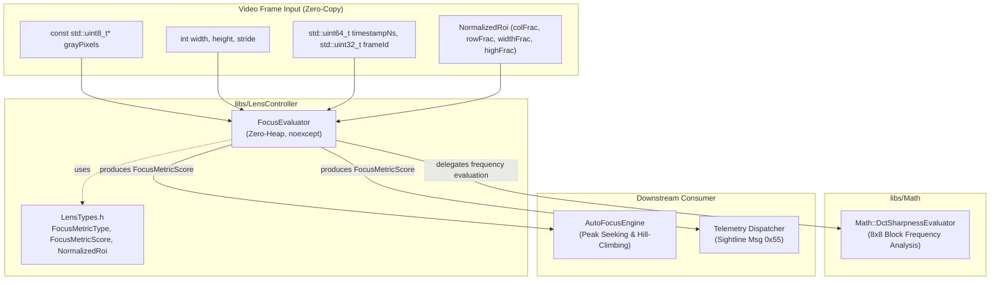

# Lens Controller Phase 2 Implementation Plan: Zero-Heap Focus Sharpness Evaluator

## 1. Executive Summary & Objectives

### 1.1 Context & Scope
Phase 2 of the **`libs/LensController`** library implements **`FocusEvaluator`**—a high-performance, real-time optical sharpness and focus score engine executing in the video ingestion path.

In motorized camera systems (e.g., EO/IR surveillance gimbals, industrial inspection cameras, Pelco-D and VISCA zoom blocks), autofocus algorithms require continuous, sub-millisecond focus metric scoring over user-defined Regions of Interest (ROIs). The evaluator must operate with **strictly zero dynamic heap allocations** (`noexcept`, conforming to **SEI CERT ERR55-CPP** and **MISRA C++:2023**), ensuring deterministic execution without risk of memory fragmentation, allocation latency, or `std::bad_alloc` terminations in critical control loops.

### 1.2 Target Deliverables for Phase 2
1. **Focus Evaluator Engine (`FocusEvaluator.h`, `FocusEvaluator.cpp`)**:
   - Zero-heap, `noexcept` focus evaluator class under `libs/LensController/`.
   - Ingestion of 8-bit grayscale (luma/Y channel) image frames with arbitrary row stride.
   - Fractional ROI mapping via `NormalizedRoi` (`[0..255]` domain coordinates) with safe boundary clamping.
   - Five spatial/correlation sharpness metrics + frequency-domain DCT integration:
     1. **Sobel Gradient Squared** ($M_{\text{Sobel}}$)
     2. **Modified Discrete Laplacian** ($M_{\text{Laplacian}}$)
     3. **Tenengrad with Adaptive Noise Gate** ($M_{\text{Tenengrad}}$)
     4. **Vollath F4 Autocorrelation** ($M_{\text{Vollath-F4}}$ for thermal LWIR/MWIR sensors)
     5. **Vollath F5 Autocorrelation** ($M_{\text{Vollath-F5}}$)
     6. **2D 8x8 DCT High-Frequency AC Energy** ($M_{\text{DCT}}$ via `Math::DctSharpnessEvaluator`)
   - Telemetry calculation conforming to Sightline Focus Metric Message 0x55:
     `FocusMetricScore` (`metric`, `mean`, `variance`, `pixelCount`, `timestampNs`, `frameId`).
2. **Build System Updates (`libs/LensController/CMakeLists.txt`)**:
   - Add `FocusEvaluator.h` and `FocusEvaluator.cpp` to `LensController` static library.
   - Link `Math` library (`libs/Math`) to provide `DctSharpnessEvaluator`.
   - Maintain zero Qt dependencies and strict hardening flags (`-Wall -Wextra -Werror` / `/W4 /WX`).
3. **Comprehensive GoogleTest Suite (`libs/LensController/tests/TestFocusEvaluator.cpp`)**:
   - Synthetic mathematical pattern validation (flat field, step edge, blurred edge, thermal sensor noise).
   - Monotonic sharpness decline under progressive Gaussian blur.
   - Fractional ROI boundary clamping, sub-window offsets, and stride handling.
   - Strict zero-heap verification and error handling for null/empty frame buffers.
4. **Verification & Standards Compliance**:
   - Strict IWYU, `<cstdint>`, `<cstddef>`, and `std::` qualification.
   - MISRA C++:2023 Rule 7.0.6 & SEI CERT INT31-C (safe integer arithmetic, 64-bit accumulators).
   - All function names strictly less than 30 characters.
   - Relative paths across all documentation links and source references.

---

## 2. Architecture & Design

### 2.1 System Context & Ingestion Pipeline

```
+---------------------------------------------------------------------------------------------------------------+
|                                            libs/LensController                                                |
|                                                                                                               |
|   Video Frame Ingestion (8-bit Gray/Luma Y Buffer)                                                            |
|          │                                                                                                    |
|          ▼                                                                                                    |
|   +-------------------------------------------------------------------------------------------------------+   |
|   |                                     FocusEvaluator (Zero-Heap)                                        |   |
|   |                                                                                                       |   |
|   |   1. ROI Fractional Mapping & Clamping:                                                               |   |
|   |      NormalizedRoi [0..255] ──► Pixel Coordinates [x, y, w, h] inside [0..width, 0..height]           |   |
|   |                                                                                                       |   |
|   |   2. First-Pass Luma Statistics (SIMD-Friendly Single Pass):                                          |   |
|   |      sumLuma, sumLumaSq ──► Mean Luminance (mean), Luminance Variance (variance)                      |   |
|   |                                                                                                       |   |
|   |   3. Metric Kernel Computation:                                                                       |   |
|   |      ┌─────────────────────────┬─────────────────────────┬─────────────────────────┐                  |   |
|   |      │  Sobel Gradient Sq      │  Discrete Laplacian     │  Tenengrad (Noise Gate) │                  |   |
|   |      ├─────────────────────────┼─────────────────────────┼─────────────────────────┤                  |   |
|   |      │  Vollath F4 Autocorr    │  Vollath F5 Autocorr    │  2D 8x8 DCT AC Energy   │                  |   |
|   |      └─────────────────────────┴─────────────────────────┴─────────────────────────┘                  |   |
|   |                                                                                                       |   |
|   |   4. Telemetry Synthesis:                                                                             |   |
|   |      FocusMetricScore { metric, mean, variance, pixelCount, timestampNs, frameId }                    |   |
|   +---------------------------------------------------+---------------------------------------------------+   |
|                                                       │                                                       |
|                                                       ▼                                                       |
|                           +-------------------------------------------------------+                           |
|                           |             AutoFocusEngine (Phase 4)                 |                           |
|                           |  - Sightline Seek & Scan 3-Phase                      |                           |
|                           |  - Golden Section Search / Fibonacci                  |                           |
|                           |  - Adaptive Momentum Hill-Climbing                    |                           |
|                           +-------------------------------------------------------+                           |
+---------------------------------------------------------------------------------------------------------------+
```

### 2.2 Class & Component Hierarchy



---

## 3. Mathematical Formulations & Algorithms

### 3.1 Region of Interest (ROI) Pixel Transformation
The evaluator receives fractional coordinates in $[0..255]$ from `NormalizedRoi`:
$$\text{col} = \frac{\text{colFrac} \times W}{256}, \quad \text{row} = \frac{\text{rowFrac} \times H}{256}$$
$$\text{width} = \frac{\text{widthFrac} \times W}{256}, \quad \text{height} = \frac{\text{highFrac} \times H}{256}$$

#### Boundary Clamping & Safety Guard:
$$\text{col} = \min(\text{col}, W - 1), \quad \text{row} = \min(\text{row}, H - 1)$$
$$\text{width} = \min(\text{width}, W - \text{col}), \quad \text{height} = \min(\text{height}, H - \text{row})$$
If $\text{width} < 3$ or $\text{height} < 3$, the evaluator returns a zeroed `FocusMetricScore` safely without kernel evaluation.

### 3.2 Luma First & Second Moments (Mean and Variance)
Computed across all $N = \text{width} \times \text{height}$ pixels within the ROI:
$$\mu = \frac{1}{N} \sum_{y=0}^{h-1} \sum_{x=0}^{w-1} I(x, y)$$
$$\sigma^2 = \left( \frac{1}{N} \sum_{y=0}^{h-1} \sum_{x=0}^{w-1} I(x, y)^2 \right) - \mu^2$$
All accumulations use `std::uint64_t` to guarantee zero overflow for frames up to 8K resolution ($7680 \times 4320 \times 255^2 \approx 2.16 \times 10^{12} \ll 2^{64}-1$).

### 3.3 Spatial & Correlation Sharpness Metrics

#### 1. Sobel Gradient Magnitude Squared (`SobelGradientSquared`)
Applies horizontal and vertical $3 \times 3$ Sobel convolution operators for each interior pixel $(x, y) \in [1..w-2] \times [1..h-2]$:
$$G_x(x,y) = \big(I_{x+1, y-1} + 2I_{x+1, y} + I_{x+1, y+1}\big) - \big(I_{x-1, y-1} + 2I_{x-1, y} + I_{x-1, y+1}\big)$$
$$G_y(x,y) = \big(I_{x-1, y+1} + 2I_{x, y+1} + I_{x+1, y+1}\big) - \big(I_{x-1, y-1} + 2I_{x, y-1} + I_{x+1, y-1}\big)$$
$$M_{\text{Sobel}} = \sum_{y=1}^{h-2} \sum_{x=1}^{w-2} \big(G_x(x,y)^2 + G_y(x,y)^2\big)$$
Normalized metric score scaled per evaluated pixel:
$$\text{metric} = \min\left(\frac{M_{\text{Sobel}}}{(w-2)(h-2)}, \ \text{UINT32\_MAX}\right)$$

#### 2. Modified Discrete Laplacian (`DiscreteLaplacian`)
Uses a 4-connected discrete Laplacian operator measuring second spatial derivatives (high-frequency curvature):
$$\Delta I(x,y) = 4 I(x,y) - I(x+1,y) - I(x-1,y) - I(x,y+1) - I(x,y-1)$$
$$M_{\text{Laplacian}} = \sum_{y=1}^{h-2} \sum_{x=1}^{w-2} \big(\Delta I(x,y)\big)^2$$
$$\text{metric} = \min\left(\frac{M_{\text{Laplacian}}}{(w-2)(h-2)}, \ \text{UINT32\_MAX}\right)$$

#### 3. Tenengrad with Adaptive Noise Gate (`TenengradThreshold`)
Applies the Sobel gradient magnitude squared but rejects pixel noise by enforcing a configurable threshold gate $T_{\text{noise}}$:
$$S(x,y) = G_x(x,y)^2 + G_y(x,y)^2$$
$$M_{\text{Tenengrad}} = \sum_{y=1}^{h-2} \sum_{x=1}^{w-2} \begin{cases} S(x,y) & \text{if } S(x,y) > T_{\text{noise}} \\ 0 & \text{otherwise} \end{cases}$$
$$\text{metric} = \min\left(\frac{M_{\text{Tenengrad}}}{(w-2)(h-2)}, \ \text{UINT32\_MAX}\right)$$

#### 4. Vollath F4 Autocorrelation (`VollathCorrelationF4`)
Designed specifically for thermal (LWIR/MWIR) and low-light sensors dominated by fixed-pattern or high-frequency Gaussian noise. By calculating the cross-correlation between 1-pixel and 2-pixel horizontally displaced neighbors, uncorrelated sensor noise cancels out:
$$M_{\text{Vollath-F4}} = \sum_{y=0}^{h-1} \sum_{x=0}^{w-3} I(x, y) \cdot I(x+1, y) - \sum_{y=0}^{h-1} \sum_{x=0}^{w-3} I(x, y) \cdot I(x+2, y)$$
If $M_{\text{Vollath-F4}} < 0$, the metric is clamped to 0.
$$\text{metric} = \min\left(\frac{\max(0, \ M_{\text{Vollath-F4}})}{h \cdot (w-2)}, \ \text{UINT32\_MAX}\right)$$

#### 5. Vollath F5 Autocorrelation (`VollathCorrelationF5`)
Measures the correlation of adjacent pixels minus the DC background offset:
$$M_{\text{Vollath-F5}} = \sum_{y=0}^{h-1} \sum_{x=0}^{w-2} I(x, y) \cdot I(x+1, y) - \big(h \cdot (w-1)\big) \cdot \mu^2$$
$$\text{metric} = \min\left(\frac{\max(0, \ M_{\text{Vollath-F5}})}{h \cdot (w-1)}, \ \text{UINT32\_MAX}\right)$$

#### 6. 2D 8x8 DCT High-Frequency AC Energy (`DctHighFrequency`)
Delegates block analysis to `Math::DctSharpnessEvaluator`, which computes the fast 2D DCT-II on $8 \times 8$ blocks within the ROI:
$$M_{\text{DCT}} = \frac{\sum_{u+v \ge f_{\text{min}}} |C(u,v)|}{\mu_{\text{DC}} + \epsilon}$$
The resulting contrast-normalized score is scaled into the integer `std::uint32_t` domain:
$$\text{metric} = \min\big(\text{static\_cast<std::uint32\_t>}(\text{result.normalizedScore} \times 1000.0), \ \text{UINT32\_MAX}\big)$$

---

## 4. Class Design & API Specification

### 4.1 Interface Header: `libs/LensController/FocusEvaluator.h`

```cpp
#pragma once

/// @file FocusEvaluator.h
/// @brief Zero-heap optical sharpness and focus score evaluator for video frames.

#include <cstddef>
#include <cstdint>

#include "LensTypes.h"

namespace Math {
class DctSharpnessEvaluator;
} // namespace Math

namespace LensControl {

/// @struct PixelRoi
/// @brief Frame-space region of interest rectangle in absolute integer pixels.
struct PixelRoi {
    std::size_t x{0U};
    std::size_t y{0U};
    std::size_t width{0U};
    std::size_t height{0U};

    [[nodiscard]] constexpr bool isValid() const noexcept {
        return width >= 3U && height >= 3U;
    }
};

/// @class FocusEvaluator
/// @brief High-performance, zero-heap optical focus and sharpness evaluator.
/// @details Evaluates spatial gradients, Laplacian curvature, Tenengrad noise gating,
///          Vollath autocorrelations, and 2D DCT high-frequency AC energy on 8-bit luma buffers.
class FocusEvaluator final {
public:
    /// @brief Constructs a FocusEvaluator with default Sobel metric and center ROI.
    explicit FocusEvaluator(FocusMetricType metric = FocusMetricType::SobelGradientSquared) noexcept;

    ~FocusEvaluator() noexcept;

    FocusEvaluator(const FocusEvaluator&) = delete;
    FocusEvaluator& operator=(const FocusEvaluator&) = delete;
    FocusEvaluator(FocusEvaluator&&) noexcept;
    FocusEvaluator& operator=(FocusEvaluator&&) noexcept;

    /// @brief Evaluates the focus sharpness score of an 8-bit grayscale image frame.
    /// @details Executes with strictly zero dynamic heap allocations.
    /// @param[in] grayPixels Pointer to contiguous 8-bit grayscale pixel data.
    /// @param[in] width Frame width in pixels.
    /// @param[in] height Frame height in pixels.
    /// @param[in] stride Row stride in bytes (if 0, assumes stride == width).
    /// @param[in] timestampNs Frame acquisition timestamp in nanoseconds.
    /// @param[in] frameId Monotonically increasing frame sequence identifier.
    /// @return FocusMetricScore containing sharpness metric, mean, variance, and pixel count.
    [[nodiscard]] FocusMetricScore evaluate(
        const std::uint8_t* grayPixels,
        std::size_t width,
        std::size_t height,
        std::size_t stride = 0U,
        std::uint64_t timestampNs = 0U,
        std::uint32_t frameId = 0U) const noexcept;

    /// @brief Sets the active focus evaluation algorithm.
    /// @param[in] metric FocusMetricType enumeration value.
    void setMetricType(FocusMetricType metric) noexcept;

    /// @brief Returns the active focus evaluation algorithm.
    /// @return Currently configured FocusMetricType.
    [[nodiscard]] FocusMetricType metricType() const noexcept;

    /// @brief Sets the fractional Region of Interest.
    /// @param[in] roi Normalized fractional coordinates in [0..255].
    void setRoi(NormalizedRoi roi) noexcept;

    /// @brief Returns the active fractional Region of Interest.
    /// @return Active NormalizedRoi structure.
    [[nodiscard]] NormalizedRoi roi() const noexcept;

    /// @brief Sets the noise threshold gate for Tenengrad metric calculation.
    /// @param[in] threshold Minimum gradient magnitude squared to accumulate.
    void setNoiseThreshold(std::uint32_t threshold) noexcept;

    /// @brief Returns the Tenengrad noise gate threshold.
    /// @return Active noise threshold value.
    [[nodiscard]] std::uint32_t noiseThreshold() const noexcept;

    /// @brief Converts normalized fractional ROI to frame-bounded pixel coordinates.
    /// @param[in] roi Normalized fractional coordinates [0..255].
    /// @param[in] frameWidth Frame width in pixels.
    /// @param[in] frameHeight Frame height in pixels.
    /// @return PixelRoi clamped to frame bounds.
    [[nodiscard]] static PixelRoi calculatePixelRoi(
        NormalizedRoi roi,
        std::size_t frameWidth,
        std::size_t frameHeight) noexcept;

private:
    [[nodiscard]] std::uint32_t evalSobel(
        const std::uint8_t* pixels,
        std::size_t stride,
        const PixelRoi& roi) const noexcept;

    [[nodiscard]] std::uint32_t evalLaplacian(
        const std::uint8_t* pixels,
        std::size_t stride,
        const PixelRoi& roi) const noexcept;

    [[nodiscard]] std::uint32_t evalTenengrad(
        const std::uint8_t* pixels,
        std::size_t stride,
        const PixelRoi& roi) const noexcept;

    [[nodiscard]] std::uint32_t evalVollathF4(
        const std::uint8_t* pixels,
        std::size_t stride,
        const PixelRoi& roi) const noexcept;

    [[nodiscard]] std::uint32_t evalVollathF5(
        const std::uint8_t* pixels,
        std::size_t stride,
        const PixelRoi& roi,
        std::uint32_t meanLuma) const noexcept;

    [[nodiscard]] std::uint32_t evalDct(
        const std::uint8_t* pixels,
        std::size_t width,
        std::size_t height,
        std::size_t stride) const noexcept;

    FocusMetricType m_metricType{FocusMetricType::SobelGradientSquared};
    NormalizedRoi m_roi{};
    std::uint32_t m_noiseThreshold{0U};
};

} // namespace LensControl
```

### 4.2 Implementation Architecture: `libs/LensController/FocusEvaluator.cpp`

Key implementation considerations:
1. **Zero Heap Allocation**: No `std::vector`, `std::string`, `new`, or `std::make_unique` anywhere in evaluation methods.
2. **SIMD & Cache Friendly**: Pixels are accessed row by row via direct pointer arithmetic `const std::uint8_t* rowPtr = pixels + y * stride`.
3. **Integral Casting & Safety**:
   - Pixel differences use signed integer `int` arithmetic before squaring:
     `const int diff = 4 * static_cast<int>(c) - static_cast<int>(r) - static_cast<int>(l) - static_cast<int>(d) - static_cast<int>(u);`
   - Squares are converted to `std::uint64_t` accumulator:
     `acc += static_cast<std::uint64_t>(diff * diff);`
4. **DCT Integration**:
   - `Math::DctSharpnessEvaluator` is statically invoked or instantiated on the stack as a lightweight zero-heap value object.
   - Fractional ROI is mapped to normalized double `[0.0, 1.0]` coordinates for `Math::DctSharpnessConfig`.

---

## 5. Test Plan & Synthetic Test Patterns

### 5.1 Test Cases Matrix (`TestFocusEvaluator.cpp`)

| Test Suite | Test Case Identifier | Synthetic Pattern / Scenario | Expected Validation |
|---|---|---|---|
| `TestFocusEvaluator` | `NullOrEmptyBufferHandling` | `grayPixels == nullptr`, `width == 0`, `height == 0` | Returns zeroed `FocusMetricScore` safely without crash. |
| `TestFocusEvaluator` | `TinySubWindowHandling` | ROI resulting in `< 3x3` pixels | Returns zeroed score, does not read out of bounds. |
| `TestFocusEvaluator` | `UniformFlatImageMetricZero` | Uniform gray frame ($I(x,y) = 128$) | $M_{\text{Sobel}} = 0$, $M_{\text{Laplacian}} = 0$, $M_{\text{Tenengrad}} = 0$, $M_{\text{Vollath-F4}} = 0$, $\text{mean} = 128$, $\text{variance} = 0$. |
| `TestFocusEvaluator` | `SharpStepEdgeHighMetric` | Vertical step edge ($I(x,y) = 0$ for $x < W/2$, $I(x,y) = 255$ for $x \ge W/2$) | High sharpness score for Sobel, Laplacian, and Tenengrad. |
| `TestFocusEvaluator` | `ProgressiveBlurMonotonicity` | Step edge convolved with $3 \times 3$, $5 \times 5$, $7 \times 7$ box/Gaussian filters | Sharpness score monotonically decreases as blur radius increases: $M_{\text{sharp}} > M_{\text{blur3}} > M_{\text{blur5}} > M_{\text{blur7}}$. |
| `TestFocusEvaluator` | `TenengradNoiseGateRejection` | Gaussian white noise with low amplitude $\pm 3$ | For $T_{\text{noise}} > 50$, noise gradient is suppressed, producing metric 0. |
| `TestFocusEvaluator` | `VollathF4ThermalNoiseImmunity` | Thermal sensor model: Low contrast object + additive white Gaussian noise | Vollath F4 suppresses uncorrelated pixel noise while preserving feature edge peak. |
| `TestFocusEvaluator` | `VollathF5DcOffsetSubtraction` | Synthetic sinusoidal pattern on varying DC pedestals ($+50, +100$) | Metric invariant to constant DC illumination level. |
| `TestFocusEvaluator` | `DctFrequencyHighEnergy` | High-frequency checkerboard pattern ($8 \times 8$ alternating blocks) | $M_{\text{DCT}} > 0$, correctly interfacing with `Math::DctSharpnessEvaluator`. |
| `TestFocusEvaluator` | `RoiCoordinateClamping` | `colFrac = 250`, `widthFrac = 100` (exceeds frame) | Clamped cleanly to frame boundary without out-of-bounds read. |
| `TestFocusEvaluator` | `RowStrideSupport` | $64 \times 64$ ROI embedded in $128 \times 64$ buffer with $\text{stride} = 128$ | Computes identical metric compared to contiguous $64 \times 64$ buffer. |
| `TestFocusEvaluator` | `MeanAndVarianceAccuracy` | Two-tone binary pattern ($50\%$ 0, $50\%$ 200) | $\text{mean} = 100$, $\text{variance} = 10000 \pm 1$. |

---

## 6. Build System & CMake Integration

### 6.1 `libs/LensController/CMakeLists.txt` Updates
Update the target sources to include `FocusEvaluator.h` and `FocusEvaluator.cpp`, and link target `Math`:

```cmake
add_library(LensController STATIC
    LensTypes.h
    ILensDriver.h
    MockLensDriver.h
    MockLensDriver.cpp
    FocusEvaluator.h
    FocusEvaluator.cpp
)

target_include_directories(LensController PUBLIC
    $<BUILD_INTERFACE:${CMAKE_CURRENT_SOURCE_DIR}>
    $<BUILD_INTERFACE:${CMAKE_CURRENT_SOURCE_DIR}/..>
    $<INSTALL_INTERFACE:include>
)

target_link_libraries(LensController PUBLIC
    Math
    Threads::Threads
)

apply_compiler_flags(LensController)

if(BUILD_TESTING)
    add_subdirectory(tests)
endif()
```

### 6.2 `libs/LensController/tests/CMakeLists.txt` Updates
Register `TestFocusEvaluator`:

```cmake
add_lens_test(TestLensTypes      TestLensTypes.cpp)
add_lens_test(TestMockLensDriver TestMockLensDriver.cpp)
add_lens_test(TestFocusEvaluator TestFocusEvaluator.cpp)
```

---

## 7. Implementation Sequence & Execution Steps

```
+-------------------------------------------------------------------------------+
|                       PHASE 2 EXECUTION WORKFLOW                              |
|                                                                               |
|   Step 1: Header Authoring (libs/LensController/FocusEvaluator.h)             |
|           - PixelRoi helper struct                                            |
|           - FocusEvaluator class definition                                   |
|           - Concise function names (< 30 chars)                               |
|           - Doxygen documentation and noexcept specifications                 |
|                                                                               |
|   Step 2: Source Authoring (libs/LensController/FocusEvaluator.cpp)           |
|           - Fractional ROI clamping logic                                     |
|           - SIMD-friendly first/second moment statistics (mean, variance)     |
|           - Sobel, Laplacian, Tenengrad spatial kernels                       |
|           - Vollath F4 / F5 autocorrelation kernels                           |
|           - DctSharpnessEvaluator adapter                                     |
|                                                                               |
|   Step 3: Update libs/LensController/CMakeLists.txt                           |
|           - Add FocusEvaluator files                                          |
|           - Link Math library target                                          |
|                                                                               |
|   Step 4: Unit Test Authoring (tests/TestFocusEvaluator.cpp)                  |
|           - Synthetic patterns: flat, step edge, blur cascade, noise         |
|           - Monotonicity checks                                               |
|           - ROI and stride boundary tests                                     |
|                                                                               |
|   Step 5: Compilation and Test Discovery                                      |
|           - cmake --build build --config Release                              |
|           - ctest --output-on-failure -R TestFocusEvaluator                   |
|                                                                               |
|   Step 6: Compliance & Hygiene Verification                                   |
|           - python3 scripts/verify_iwyu_cstdint.py                            |
|           - python3 scripts/verify_function_lengths.py                        |
|           - Zero dynamic allocation audit                                     |
+-------------------------------------------------------------------------------+
```

---

## 8. Verification & Standards Compliance Checklist

- [ ] **Zero Qt Dependency**: Pure standard C++17 across `FocusEvaluator.h` and `.cpp` (`#include <Q...>` banned).
- [ ] **Co-located Files**: `FocusEvaluator.h` and `FocusEvaluator.cpp` located together in `libs/LensController/`.
- [ ] **Concise Function Names**: Every member function strictly less than 30 characters in length.
- [ ] **Strict IWYU & `<cstdint>`**: All fixed-width integer types (`std::uint8_t`, `std::uint32_t`, `std::uint64_t`, `std::size_t`) include `<cstdint>`/`<cstddef>` and are explicitly scoped in `std::`.
- [ ] **MISRA C++:2023 & SEI CERT C++ Rules**:
  - **Rule 7.0.6 & INT31-C**: Safe integer conversions with explicit `static_cast`; 64-bit accumulators prevent overflow.
  - **ERR55-CPP**: All evaluation methods marked `noexcept` and execute with strictly zero heap allocations.
- [ ] **Deterministic ASCII / Math Operations**: No global locale-dependent operations.
- [ ] **Dual Diagrams**: Both ASCII and Mermaid architecture diagrams present.
- [ ] **Documentation Links**: All file paths and documentation links are relative POSIX paths.

