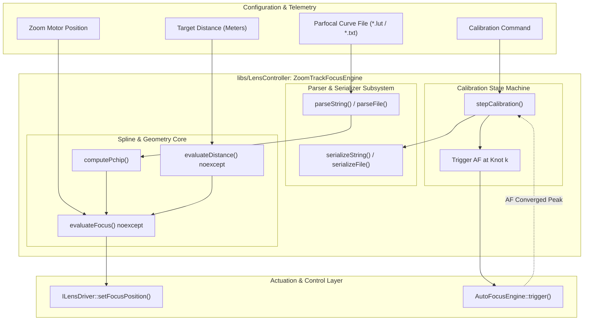
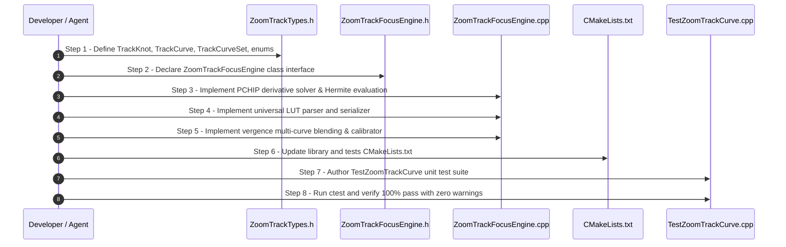

# Lens Controller Phase 3 Implementation Plan: Zoom-to-Focus (Parfocal LUT & Spline)

## 1. Executive Summary & Objectives

### 1.1 Context & Scope
Phase 3 of the **[`libs/LensController`](../libs/LensController)** library implements **`ZoomTrackFocusEngine`**—a high-reliability, real-time software parfocality engine that maintains critical optical focus across motorized zoom transitions.

In non-parfocal (varifocal) motorized zoom lenses (such as continuous optical zoom EO/IR lenses and industrial motorized optics), shifting the optical zoom lens group displaces the focal plane relative to the sensor. This focal displacement results in severe blurring and loss of target lock. **Phase 3** delivers software-driven parfocality through calibrated look-up curves (LUTs), **Monotone Cubic Hermite Spline (PCHIP)** interpolation, inverse-distance optical vergence blending, and automated curve calibration.

The engine must operate with **strictly zero dynamic heap allocations** (`noexcept`, conforming to **SEI CERT ERR55-CPP** and **MISRA C++:2023**) during real-time position evaluation, ensuring deterministic sub-microsecond execution in 60 Hz / 120 Hz optical tracking and motor control loops.

### 1.2 Target Deliverables for Phase 3
1. **Domain Structures & Value Objects ([`ZoomTrackTypes.h`](../libs/LensController/ZoomTrackTypes.h))**:
   - `TrackKnot`: Pair of strongly-typed `MotorPosition` coordinates $(z_k, f_k)$ with precomputed PCHIP slope $d_k$.
   - `TrackCurve`: Fixed-capacity array of knots ($N \le 64$) with distance metadata and validity checks.
   - `TrackCurveSet`: Multi-distance curve container ($M \le 8$) supporting near, mid, and infinity calibrations.
   - Strongly-typed enums: `InterpolationMode` (`PchipSpline`, `PiecewiseLinear`), `TrackCurveError`.
2. **Universal Multi-Curve LUT Parser & Serializer ([`ZoomTrackFocusEngine.h`](../libs/LensController/ZoomTrackFocusEngine.h), [`ZoomTrackFocusEngine.cpp`](../libs/LensController/ZoomTrackFocusEngine.cpp))**:
   - Parse and serialize standard `<N>:` / `z:` / `f:` multi-curve calibration text files.
   - Zero-allocation ASCII scanner with robust line ending (`\r\n` / `\n`), delimiter, comment (`#`), and whitespace handling conforming to **SEI CERT STR37-C**.
3. **Monotone Cubic Hermite Spline (PCHIP) Interpolator**:
   - Shape-preserving cubic Hermite interpolation guaranteeing **zero overshoot** across sharp focal gradient transitions.
   - Piecewise linear interpolation mode for minimal-complexity fallbacks.
   - Thin-lens optical vergence blending ($1/\text{Distance}$ diopter space) across multi-distance curves.
4. **Zero-Heap Real-Time Focus Evaluation (`evaluateFocus`)**:
   - $O(\log N)$ binary partition search over pre-sorted zoom knots.
   - Fully `noexcept` and zero dynamic allocation on the evaluation path.
   - Safe out-of-bounds handling (clamping to boundary knots or linear tangent extrapolation).
5. **Automated Track Curve Calibrator (`CurveCalibrator`)**:
   - Discrete stepped sweep generating $N$ zoom positions across $[z_{\text{min}}, z_{\text{max}}]$.
   - Coordinates one-shot autofocus triggers, records converged focal peaks, computes PCHIP derivatives, and activates calibrated curves.
6. **Comprehensive GoogleTest Suite ([`libs/LensController/tests/TestZoomTrackCurve.cpp`](../libs/LensController/tests/TestZoomTrackCurve.cpp))**:
   - Verification of PCHIP monotonicity and overshoot prevention against standard pathological step data.
   - Parser roundtrip testing, malformed file rejection, and boundary clamping tests.
   - Automated calibration sequence and multi-distance vergence blending tests.

---

## 2. Architecture & Design

### 2.1 System Architecture Diagram

```
+---------------------------------------------------------------------------------------------------------------+
|                                            libs/LensController                                                |
|                                                                                                               |
|   +-------------------------------------------------------------------------------------------------------+   |
|   |                                          ZoomTrackFocusEngine                                         |   |
|   |                                                                                                       |   |
|   |   +-----------------------------------+               +-------------------------------------------+   |   |
|   |   |        Curve Data Storage         |               |           PchipSplineEvaluator            |   |   |
|   |   |                                   |               |                                           |   |   |
|   |   |  - Fixed-Capacity TrackCurveSet   |               |  - Monotone Cubic Hermite Spline (PCHIP)  |   |   |
|   |   |  - Up to 8 Curves (Near..Inf)     |               |  - Zero-Overshoot Tangents (d_k)          |   |   |
|   |   |  - Up to 64 Knots per Curve       |               |  - Piecewise Linear Fallback Mode         |   |   |
|   |   |  - Precomputed Tangents (d_k)     |               |  - Diopter Blending (1 / Distance)        |   |   |
|   |   +-----------------+-----------------+               +---------------------+---------------------+   |   |
|   |                     │                                                       │                         |   |
|   |                     ▼                                                       ▼                         |   |
|   |   +-----------------------------------+               +-------------------------------------------+   |   |
|   |   |      Parfocal Curve File I/O      |               |         Real-Time Slew Evaluation         |   |   |
|   |   |                                   |               |                                           |   |   |
|   |   |  - parseFile / parseString        |               |  - evaluateFocus(zoomPos) noexcept        |   |   |
|   |   |  - serializeFile / serializeString|               |  - Binary Search: O(log N) zero-heap      |   |   |
|   |   |  - ASCII Comments & Whitespace    |               |  - Slew Rate Limiting & Out-of-Bounds     |   |   |
|   |   +-----------------+-----------------+               +---------------------+---------------------+   |   |
|   |                     │                                                       │                         |   |
|   |                     ▼                                                       ▼                         |   |
|   |   +-----------------------------------------------------------------------------------------------+   |   |
|   |   |                                 CurveCalibrator State Machine                                 |   |   |
|   |   |  - Stepped Zoom Sweeps (N Knots) ──► One-Shot AF Trigger ──► Peak Knot Registration           |   |   |
|   |   +-----------------------------------------------------------------------------------------------+   |   |
|   +-----------------------------------+-----------------------------------+-------------------------------+   |
|                                       │                                   │                                   |
|                                       ▼                                   ▼                                   |
|                       +-------------------------------+   +-------------------------------+                   |
|                       |          ILensDriver          |   |        AutoFocusEngine        |                   |
|                       |   (Hardware Motor Slew)       |   |    (Phase 4 One-Shot AF)      |                   |
|                       +-------------------------------+   +-------------------------------+                   |
+---------------------------------------------------------------------------------------------------------------+
```

### 2.2 Mermaid Subsystem Flow Diagram



---

## 3. Mathematical Foundations

### 3.1 Monotone Cubic Hermite Spline (PCHIP) Formulation
Standard natural cubic splines minimize overall curvature but suffer from severe Runge oscillations and overshoot when data exhibits sharp gradient inflections. In varifocal lenses, wide-angle positions typically have large depth of field and relatively flat focus positions, whereas telephoto positions exhibit extreme focus sensitivity. Conventional splines will dip below or rise above physical focus boundaries between knots.

PCHIP (**Piecewise Cubic Hermite Interpolating Polynomial**) guarantees **shape preservation**: if the knot data is monotonic over an interval, the interpolant is strictly monotonic, preventing defocus dips.

#### 1. Knot Setup:
Given $N$ calibrated points ordered by strictly increasing zoom positions:
$$(z_0, f_0), (z_1, f_1), \dots, (z_{N-1}, f_{N-1}), \quad \text{with } z_0 < z_1 < \dots < z_{N-1}$$
Interval lengths:
$$h_k = z_{k+1} - z_k > 0$$
Secant slopes:
$$\Delta_k = \frac{f_{k+1} - f_k}{h_k}$$

#### 2. Interior Tangent Derivatives ($d_k$):
For interior knots $k \in \{1, \dots, N-2\}$:
- If $\Delta_{k-1}$ and $\Delta_k$ have opposite signs, or either is zero (local extremum or plateau):
  $$d_k = 0$$
- If $\Delta_{k-1}$ and $\Delta_k$ share the same sign, compute the weighted harmonic mean (Fritsch-Carlson / Brodlie standard):
  $$w_1 = 2h_k + h_{k-1}, \quad w_2 = h_k + 2h_{k-1}$$
  $$d_k = \frac{w_1 + w_2}{\frac{w_1}{\Delta_{k-1}} + \frac{w_2}{\Delta_k}}$$

#### 3. Endpoint Derivatives ($d_0, d_{N-1}$):
Use the shape-preserving one-sided 3-point formula clamped by the adjacent secant:
$$d_0 = \frac{(2h_0 + h_1)\Delta_0 - h_0 \Delta_1}{h_0 + h_1}$$
- If $\text{sgn}(d_0) \ne \text{sgn}(\Delta_0)$, set $d_0 = 0$.
- If $\text{sgn}(\Delta_0) \ne \text{sgn}(\Delta_1)$ and $|d_0| > |3\Delta_0|$, clamp $d_0 = 3\Delta_0$.
Endpoint $d_{N-1}$ is computed symmetrically using $\Delta_{N-2}, \Delta_{N-3}, h_{N-2}, h_{N-3}$.

#### 4. Spline Evaluation for $z \in [z_k, z_{k+1}]$:
Let normalized sub-interval coordinate $t = \frac{z - z_k}{h_k} \in [0, 1]$.
Hermite cubic basis polynomials:
$$H_0(t) = 2t^3 - 3t^2 + 1$$
$$H_1(t) = t^3 - 2t^2 + t$$
$$H_2(t) = -2t^3 + 3t^2$$
$$H_3(t) = t^3 - t^2$$

The interpolated focus position $f(z)$ is:
$$f(z) = H_0(t) f_k + H_1(t) h_k d_k + H_2(t) f_{k+1} + H_3(t) h_k d_{k+1}$$

### 3.2 Piecewise Linear Fallback
For low-complexity verification or linear test setups:
$$f(z) = f_k + \Delta_k \cdot (z - z_k)$$

### 3.3 Diopter Vergence Multi-Distance Blending
In optical physics, focus shift as a function of target distance follows Gauss's lens law $\frac{1}{f} = \frac{1}{d_o} + \frac{1}{d_i}$. Lens displacement is linear with respect to optical vergence $V = \frac{1}{D}$ (expressed in diopters $\text{m}^{-1}$).

Given calibration curves at measured distances $D_1 < D_2 < \dots < D_M$ (where $D_M = \infty \implies V_M = 0$):
For an active target distance $D_{\text{target}}$ bracketed by curves $m$ and $m+1$ ($D_m \le D_{\text{target}} \le D_{m+1}$):
$$w = \frac{\frac{1}{D_{\text{target}}} - \frac{1}{D_{m+1}}}{\frac{1}{D_m} - \frac{1}{D_{m+1}}}$$
$$f^*(z) = (1 - w) \cdot f_{m+1}(z) + w \cdot f_m(z)$$
where $f_m(z)$ and $f_{m+1}(z)$ are evaluated using PCHIP at the current zoom position $z$.

---

## 4. Parfocal Calibration LUT File Specification

### 4.1 Syntax Specification
The calibration file uses a human-readable, robust ASCII representation:
```text
# Universal Parfocal Calibration LUT File
# Distance: Infinity
5:
z: 100, 500, 1200, 3500, 8000
f: 450, 485,  540,  690, 1020

# Distance: 10.0m
5:
z: 100, 500, 1200, 3500, 8000
f: 462, 498,  558,  715, 1065
```

### 4.2 Structural Rules & Invariant Checks
1. Lines beginning with `#` or empty lines are treated as comments and ignored.
2. Curve block header: `<N>:` specifies sample count ($2 \le N \le 64$).
3. `z:` prefix contains $N$ comma-separated unsigned 16-bit integers representing zoom motor positions.
4. `f:` prefix contains $N$ comma-separated unsigned 16-bit integers representing focus motor positions.
5. Invariant validations:
   - Sample counts for `z:` and `f:` must exactly equal $N$.
   - Zoom positions must be strictly monotonically increasing: $z_0 < z_1 < \dots < z_{N-1}$.
   - Positions must remain within 16-bit encoder limits $[0, 65535]$.

---

## 5. File & Component Breakdown

### 5.1 File Organization

| File | Primary Types | Description |
|:---|:---|:---|
| [`libs/LensController/ZoomTrackTypes.h`](../libs/LensController/ZoomTrackTypes.h) | `TrackKnot`, `TrackCurve`, `TrackCurveSet`, `InterpolationMode`, `TrackCurveError` | Strongly-typed value objects, fixed-capacity arrays, and domain error codes |
| [`libs/LensController/ZoomTrackFocusEngine.h`](../libs/LensController/ZoomTrackFocusEngine.h) | `ZoomTrackFocusEngine` | Main class header: parser, serializer, PCHIP evaluation, multi-curve blending, calibration state |
| [`libs/LensController/ZoomTrackFocusEngine.cpp`](../libs/LensController/ZoomTrackFocusEngine.cpp) | Implementation | Real-time interpolation, binary partition search, ASCII parsing and serialization |
| [`libs/LensController/tests/TestZoomTrackCurve.cpp`](../libs/LensController/tests/TestZoomTrackCurve.cpp) | GoogleTest Suite | Monotonicity verification, overshoot rejection, parser roundtrips, vergence blending tests |

### 5.2 Header Interface (`ZoomTrackTypes.h`)

```cpp
#pragma once

/// @file ZoomTrackTypes.h
/// @brief Value objects, limits, and domain structures for parfocal zoom-to-focus curves.

#include <cstddef>
#include <cstdint>

#include <array>

#include "LensTypes.h"

namespace LensControl {

/// @enum InterpolationMode
/// @brief Mathematical interpolation algorithm for zoom-to-focus evaluation.
enum class InterpolationMode : std::uint8_t {
    PchipSpline = 0U,     ///< Monotone Cubic Hermite Spline (zero overshoot)
    PiecewiseLinear = 1U  ///< Piecewise linear interpolation fallback
};

/// @enum TrackCurveError
/// @brief Status codes for parfocal curve parsing and evaluation.
enum class TrackCurveError : std::uint8_t {
    None = 0U,
    EmptyInput = 1U,
    InvalidHeader = 2U,
    CountMismatch = 3U,
    NonMonotonicZoom = 4U,
    CapacityExceeded = 5U,
    FileNotFound = 6U,
    InsufficientKnots = 7U
};

/// @struct TrackKnot
/// @brief Calibrated coordinate knot with precomputed derivative slope.
struct TrackKnot {
    MotorPosition zoom{0U};
    MotorPosition focus{0U};
    float slope{0.0F}; ///< Precalculated PCHIP derivative (df/dz)
};

/// @struct TrackCurve
/// @brief Fixed-capacity calibrated curve representing zoom-to-focus profile at a distance.
struct TrackCurve {
    static constexpr std::size_t kMaxKnots = 64U;

    std::array<TrackKnot, kMaxKnots> knots{};
    std::size_t knotCount{0U};
    float distanceMeters{0.0F}; ///< 0.0F denotes infinity

    [[nodiscard]] constexpr bool isValid() const noexcept
    {
        if (knotCount < 2U || knotCount > kMaxKnots) {
            return false;
        }
        for (std::size_t i = 1U; i < knotCount; ++i) {
            if (knots[i].zoom <= knots[i - 1U].zoom) {
                return false;
            }
        }
        return true;
    }
};

/// @struct TrackCurveSet
/// @brief Multi-distance container holding up to 8 discrete distance curves.
struct TrackCurveSet {
    static constexpr std::size_t kMaxCurves = 8U;

    std::array<TrackCurve, kMaxCurves> curves{};
    std::size_t curveCount{0U};
    std::size_t activeIndex{0U};
};

} // namespace LensControl
```

### 5.3 Engine Interface (`ZoomTrackFocusEngine.h`)
All method names are strictly under 30 characters in length:

```cpp
#pragma once

/// @file ZoomTrackFocusEngine.h
/// @brief Parfocal tracking engine with PCHIP spline evaluation and LUT parser.

#include <cstddef>
#include <cstdint>

#include <string>
#include <string_view>

#include "LensTypes.h"
#include "ZoomTrackTypes.h"

namespace LensControl {

/// @class ZoomTrackFocusEngine
/// @brief Evaluates, parses, serializes, and calibrates parfocal zoom-to-focus curves.
class ZoomTrackFocusEngine final {
public:
    ZoomTrackFocusEngine() noexcept;
    ~ZoomTrackFocusEngine() noexcept = default;

    // File I/O and Parsing
    [[nodiscard]] TrackCurveError parseString(std::string_view text) noexcept;
    [[nodiscard]] TrackCurveError parseFile(std::string_view filePath) noexcept;
    [[nodiscard]] bool serializeFile(std::string_view filePath) const noexcept;
    [[nodiscard]] std::string serializeString() const;

    // Configuration & Curve Selection
    void setMode(InterpolationMode mode) noexcept;
    [[nodiscard]] InterpolationMode mode() const noexcept;
    void setActiveCurve(std::size_t index) noexcept;
    [[nodiscard]] std::size_t activeCurve() const noexcept;
    [[nodiscard]] std::size_t curveCount() const noexcept;
    void clearCurves() noexcept;

    // Direct Curve Management
    [[nodiscard]] bool addCurve(const TrackCurve& curve) noexcept;
    [[nodiscard]] const TrackCurve* getCurve(std::size_t idx) const noexcept;

    // Zero-Heap Real-Time Evaluation (O(log N))
    [[nodiscard]] MotorPosition evaluateFocus(MotorPosition zoom) const noexcept;
    [[nodiscard]] MotorPosition evaluateDistance(MotorPosition zoom, float distanceMeters) const noexcept;

    // PCHIP Tangent Computation
    static void computePchip(TrackCurve& curve) noexcept;

    // Calibration Helpers
    void startCalib(std::size_t knotCount, MotorPosition zMin, MotorPosition zMax) noexcept;
    [[nodiscard]] bool isCalibrating() const noexcept;
    [[nodiscard]] MotorPosition nextCalibZoom() const noexcept;
    void recordCalibKnot(MotorPosition focusPos) noexcept;
    void cancelCalib() noexcept;

private:
    [[nodiscard]] MotorPosition evalPchip(const TrackCurve& curve, MotorPosition zoom) const noexcept;
    [[nodiscard]] MotorPosition evalLinear(const TrackCurve& curve, MotorPosition zoom) const noexcept;

    TrackCurveSet m_curveSet{};
    InterpolationMode m_mode{InterpolationMode::PchipSpline};

    // Calibration state
    bool m_isCalibrating{false};
    std::size_t m_calibTotalKnots{0U};
    std::size_t m_calibCurrentKnot{0U};
    MotorPosition m_calibZoomMin{0U};
    MotorPosition m_calibZoomMax{65535U};
    TrackCurve m_calibStagingCurve{};
};

} // namespace LensControl
```

---

## 6. Implementation Step-by-Step Sequence



### Step 1: Implement Value Objects & Data Structures ([`ZoomTrackTypes.h`](../libs/LensController/ZoomTrackTypes.h))
- Define `TrackKnot`, `TrackCurve`, `TrackCurveSet` with fixed-size capacities ($N=64, M=8$).
- Implement `TrackCurve::isValid()` verifying sample bounds and strict zoom monotonicity.
- Ensure strict inclusion of `<cstdint>`, `<cstddef>`, and `<array>`.

### Step 2: Implement Monotone Cubic Hermite Spline Engine ([`ZoomTrackFocusEngine.cpp`](../libs/LensController/ZoomTrackFocusEngine.cpp))
- Implement `ZoomTrackFocusEngine::computePchip(TrackCurve& curve)`:
  - Compute interval widths $h_k$ and secant slopes $\Delta_k$.
  - Compute zero-slope detection for extrema ($\Delta_{k-1} \cdot \Delta_k \le 0$).
  - Calculate weighted harmonic mean tangents $d_k$ for interior knots.
  - Calculate endpoint slopes $d_0$ and $d_{N-1}$ using clamped 3-point approximations.
- Implement `evalPchip(const TrackCurve& curve, MotorPosition zoom)`:
  - Binary search (`std::upper_bound` or custom zero-heap binary partition) to identify knot interval $[z_k, z_{k+1}]$ in $O(\log N)$ time.
  - Hermite basis evaluation $H_0(t), H_1(t), H_2(t), H_3(t)$.
  - Explicit range clamping via `std::clamp` and safe integer casting.
- Implement `evalLinear` as a lightweight alternative.

### Step 3: Implement Universal Calibration LUT Parser & Serializer
- Implement `parseString(std::string_view text)`:
  - Line-by-line scanner without dynamic string allocation.
  - Skip empty lines and comment lines starting with `#`.
  - Extract sample count `<N>:` and validate against `kMaxKnots`.
  - Parse comma-separated numbers following `z:` and `f:` tokens.
  - Enforce monotonic ordering and count equality.
  - Automatically invoke `computePchip` upon successful curve ingest.
- Implement `parseFile(std::string_view filePath)` using POSIX/Win32 file streaming.
- Implement `serializeString()` and `serializeFile()` generating standard formatted LUT files.

### Step 4: Multi-Distance Vergence Interpolator & Calibrator
- Implement `evaluateDistance(MotorPosition zoom, float distanceMeters)`:
  - For $D \le 0$ or single curve, evaluate active curve.
  - For multi-curve sets, locate adjacent distance curves using $V = 1/D$, evaluate both at current zoom, and perform linear vergence blending.
- Implement calibration coordinator:
  - `startCalib(knotCount, zMin, zMax)` calculates uniform step increments.
  - `nextCalibZoom()` provides target zoom position for current calibration step.
  - `recordCalibKnot(focusPos)` stores converged focus peak, advancing step count until complete.

### Step 5: Update Build Targets & Verify Suite
- Update [`libs/LensController/CMakeLists.txt`](../libs/LensController/CMakeLists.txt) to include `ZoomTrackFocusEngine.h` and `ZoomTrackFocusEngine.cpp`.
- Update [`libs/LensController/tests/CMakeLists.txt`](../libs/LensController/tests/CMakeLists.txt) to register `TestZoomTrackCurve`.
- Build and execute all tests across Linux and Windows environments.

---

## 7. Verification Checklist & Compliance Matrix

| Standard / Requirement | Target Constraint | Verification Method |
|:---|:---|:---|
| **Zero Heap Allocations** | SEI CERT ERR55-CPP | Code inspection of `evaluateFocus`; verify zero dynamic heap allocations on evaluation path |
| **Monotonicity & Zero Overshoot** | Shape-preserving PCHIP | Unit test with sharp step function; verify interpolant never exceeds local knot extremes |
| **Strict `<cstdint>` & `<cstddef>`** | Project Policy / IWYU | Verify direct headers, standard types `std::uint16_t`, `std::size_t`, run audit script |
| **Concise Function Names** | Checklist Rule 5 | Audit all method names; confirm strictly $< 30$ characters |
| **Relative Path Documentation** | `relative-paths-docs.md` | All links formatted as `../libs/LensController/...` without leading slashes or machine drives |
| **Zero Qt Dependencies** | Checklist Rule 4 | Pure C++17 standard library implementation; no `<Q...>` headers |
| **MISRA C++:2023 Rule 7.0.6** | Integer conversions | Explicit `static_cast` for all float-to-integer conversions with range clamping |

