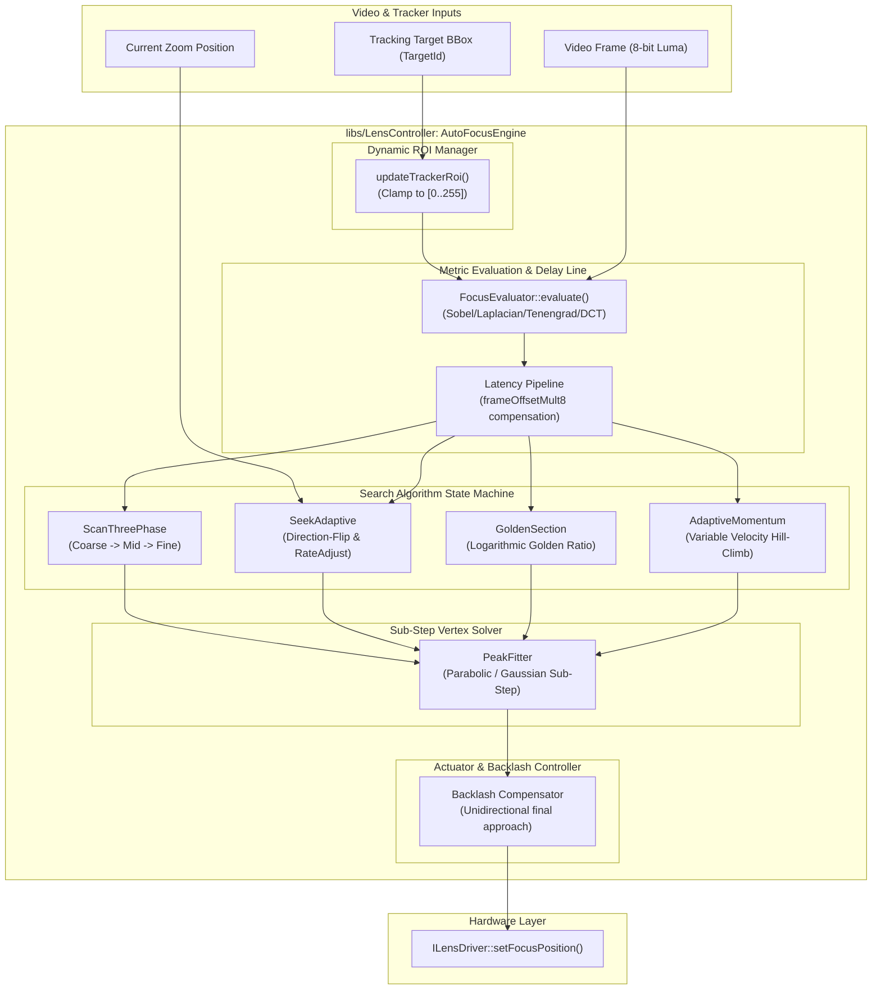
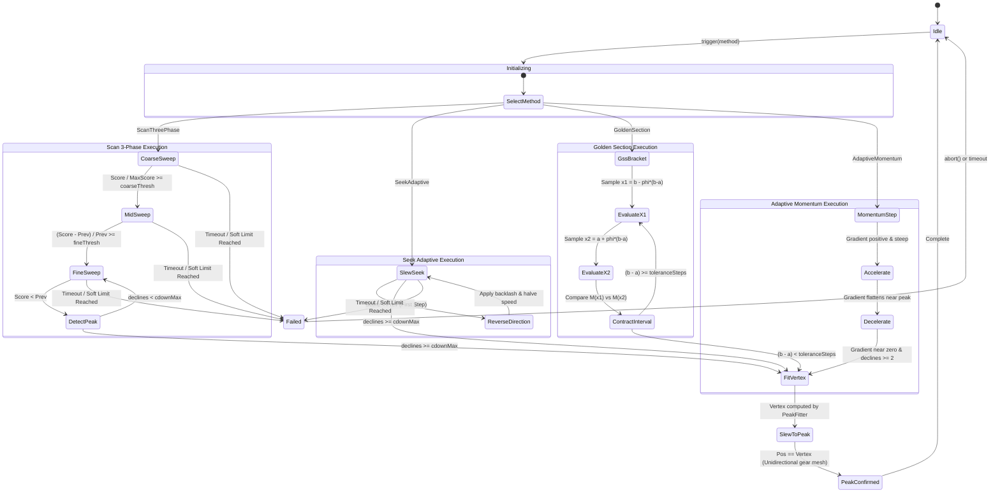

# Lens Controller Phase 4 Implementation Plan: Autofocus Algorithms & Peak Fitting

## 1. Executive Summary & Objectives

### 1.1 Context & Scope
Phase 4 of the **[`libs/LensController`](../libs/LensController)** library delivers **`PeakFitter`** and **`AutoFocusEngine`**—a zero-heap, deterministic closed-loop autofocus (AF) subsystem designed for motorized electro-optical/infrared (EO/IR) gimbals, tactical zoom blocks, and industrial optical payloads.

In motorized camera systems, optical defocus degrades video intelligence, automatic target recognition, and operator situational awareness. Autofocus algorithms must rapidly search the optical focus axis, evaluate focus sharpness scores computed by **[`FocusEvaluator`](../libs/LensController/FocusEvaluator.h)**, identify unimodal or multi-modal sharpness peaks, interpolate true optical summit coordinates with sub-encoder resolution, compensate for mechanical backlash and video latency, and command actuator motors via **[`ILensDriver`](../libs/LensController/ILensDriver.h)**.

Phase 4 implements both classic, battle-tested aerospace algorithms (Sightline **Seek** and **Scan 3-Phase**) and modern optimization algorithms (**Golden Section Search** and **Adaptive Momentum Hill-Climbing**), coupled with sub-step **Parabolic** and **Gaussian** peak fitting, tactical tracker-coupled dynamic ROI targeting, and continuous autofocus (CAF) defocus triggering.

All components in Phase 4 are built under **zero dynamic heap allocation** constraints (`noexcept`, conforming to **SEI CERT ERR55-CPP** and **MISRA C++:2023**), ensuring sub-millisecond execution and memory safety across 30 Hz, 60 Hz, and 120 Hz real-time video control loops.

### 1.2 Target Deliverables for Phase 4
1. **Strong Domain Types & Structures ([`AutoFocusTypes.h`](../libs/LensController/AutoFocusTypes.h))**:
   - `AutoFocusState`: High-level state machine enum (`Idle`, `CoarseSweep`, `MidSweep`, `FineSweep`, `Reversing`, `SlewToPeak`, `PeakConfirmed`, `Failed`).
   - `AutoFocusConfig`: Strongly-typed configuration bundle (`coarseSpeed`, `midSpeed`, `fineSpeed`, `coarseThresh`, `fineThresh`, `cdownMax`, `backlashSteps`, `frameOffsetMult8`, `rateAdjust`, `cafThresholdFrac`).
   - `SamplePoint`: Focus encoder position (`MotorPosition`), sharpness score (`FocusMetricScore`), and acquisition timestamp.
   - `PeakFitResult`: Strongly-typed result struct (`MotorPosition vertex`, `float subStepOffset`, `float peakScore`, `float curvature`, `float rSquared`, `bool isValid`).
   - `TrackingRoiBinding`: Dynamic coupling bridge linking tactical target bounding boxes from `libs/Tracking` to normalized optical ROIs (`NormalizedRoi`).
2. **Sub-Step Peak Fitter ([`PeakFitter.h`](../libs/LensController/PeakFitter.h), [`PeakFitter.cpp`](../libs/LensController/PeakFitter.cpp))**:
   - Discrete 3-point and multi-point parabolic peak interpolation.
   - Gaussian peak interpolation via log-transformed parabolic summit fitting.
   - Robust singularity, flat-top, and non-convex triplet rejection with fallback to maximum sampled point.
   - Goodness-of-fit estimation ($R^2$) and optical peak curvature metric.
3. **Master Autofocus Engine ([`AutoFocusEngine.h`](../libs/LensController/AutoFocusEngine.h), [`AutoFocusEngine.cpp`](../libs/LensController/AutoFocusEngine.cpp))**:
   - **Sightline Scan Algorithm (3-Phase Sweep)**: Coarse $\rightarrow$ Mid $\rightarrow$ Fine sweep with adaptive rate switching, peak confirmation, and backlash-compensated rewind.
   - **Sightline Seek Algorithm (Adaptive Direction-Flip)**: Slope-gradient direction reversal, `RateAdjust` zoom scaling, and `cdownMax` decline stopping.
   - **Golden Section Search (GSS)**: Unimodal golden ratio bracket contraction with logarithmic step convergence.
   - **Adaptive Momentum Hill-Climbing**: Variable step velocity with momentum damping ($\alpha \in [0.4, 0.7]$) for rapid traversal of blur zones and overshoot prevention near peaks.
   - **DCT Frequency Mode**: Integration with 2D 8x8 DCT high-frequency AC energy focus metric.
   - **Hardware Native AF Delegation**: Pass-through driver coordination via `ILensDriver::triggerBuiltinAutofocus()`.
   - **Dynamic Tracker-Coupled ROI Auto-Centering**: Real-time ROI recentering and margin padding matching active tracking bounding boxes.
   - **Latency & Backlash Compensation**: Accounting for `frameOffsetMult8` video delay pipeline and actuator gear mesh hysteresis.
   - **Continuous Autofocus (CAF)**: Background metric monitoring and automatic refocus re-triggering upon scene defocus.
4. **Build System Updates ([`libs/LensController/CMakeLists.txt`](../libs/LensController/CMakeLists.txt))**:
   - Register `PeakFitter.cpp` and `AutoFocusEngine.cpp` into static library target `LensController`.
   - Zero Qt dependency enforcement (`#include <Q...>` strictly prohibited).
   - Strict compiler warning flags (`-Wall -Wextra -Werror` / `/W4 /WX`).
5. **Comprehensive GoogleTest Suite ([`libs/LensController/tests/TestAutoFocusEngine.cpp`](../libs/LensController/tests/TestAutoFocusEngine.cpp), [`libs/LensController/tests/TestPeakFitter.cpp`](../libs/LensController/tests/TestPeakFitter.cpp))**:
   - Mathematical verification of parabolic and Gaussian peak interpolation on synthetic unimodal curves.
   - Closed-loop simulated lens tests (using [`MockLensDriver`](../libs/LensController/MockLensDriver.h)) for all four search algorithms.
   - Backlash compensation verification ensuring final motor position lands with zero slack.
   - Tracker bounding box translation and margin clamping tests.
   - Noise immunity and pathological non-unimodal edge-case tests.

---

## 2. Architecture & Design

### 2.1 Subsystem Context & Data Flow

```
+---------------------------------------------------------------------------------------------------------------+
|                                            libs/LensController                                                |
|                                                                                                               |
|   +-------------------------------------------------------------------------------------------------------+   |
|   |                                           AutoFocusEngine                                             |   |
|   |                                                                                                       |   |
|   |   +-----------------------------------+               +-------------------------------------------+   |   |
|   |   |     Search Algorithm Core         |               |             PeakFitter                    |   |   |
|   |   |                                   |               |                                           |   |   |
|   |   |  - ScanThreePhase (Coarse/Mid/Fn) |               |  - fitParabolic(z1, z2, z3, M1, M2, M3)   |   |   |
|   |   |  - SeekAdaptive (Gradient Flip)   |               |  - fitGaussian(z1, z2, z3, M1, M2, M3)    |   |   |
|   |   |  - GoldenSection (Golden Ratio)   |               |  - fitMultiPoint(samples, count)          |   |   |
|   |   |  - AdaptiveMomentum (Variable Dp) |               |  - Curvature & R^2 Validation             |   |   |
|   |   +-----------------+-----------------+               +---------------------+---------------------+   |   |
|   |                     │                                                       │                         |   |
|   |                     ▼                                                       ▼                         |   |
|   |   +-----------------------------------+               +-------------------------------------------+   |   |
|   |   |      Latency & Backlash           |               |         Tracker-Coupled ROI               |   |   |
|   |   |                                   |               |                                           |   |   |
|   |   |  - frameOffsetMult8 Delay Ring    |               |  - bindTarget(TargetId, BBox)             |   |   |
|   |   |  - Backlash Offset Injection      |               |  - Margin Padding & Boundary Clamping     |   |   |
|   |   |  - Unidirectional Gear Slew       |               |  - NormalizedRoi Translation              |   |   |
|   |   +-----------------+-----------------+               +---------------------+---------------------+   |   |
|   +---------------------+-------------------------------------------------------+-------------------------+   |
|                         │                                                       │                             |
|                         ▼                                                       ▼                             |
|         +-------------------------------+                       +-------------------------------+             |
|         |        FocusEvaluator         |                       |          ILensDriver          |             |
|         |   (Zero-Heap Sharpness Eval)  |                       |      (Motor Actuator HAL)     |             |
|         +-------------------------------+                       +-------------------------------+             |
+---------------------------------------------------------------------------------------------------------------+
```

### 2.2 Mermaid Subsystem Flow Diagram



---

## 3. Mathematical Foundations & Algorithms

### 3.1 Sub-Step Peak Fitting (`PeakFitter`)

#### 1. Three-Point Parabolic Peak Interpolation
Given three discrete encoder positions $z_1 < z_2 < z_3$ and their corresponding focus sharpness scores $M_1, M_2, M_3$, where $M_2 > M_1$ and $M_2 > M_3$ (forming a valid convex bracket around the local maximum):

We fit the quadratic polynomial:
$$M(z) = a(z - z_2)^2 + b(z - z_2) + c$$

At the vertex $z^*$, the derivative vanishes:
$$\frac{dM}{dz}\Big|_{z = z^*} = 2a(z^* - z_2) + b = 0 \implies z^* = z_2 - \frac{b}{2a}$$

For arbitrary (non-uniform) step spacing $h_1 = z_2 - z_1$ and $h_2 = z_3 - z_2$:
$$b = \frac{h_1^2 (M_3 - M_2) + h_2^2 (M_2 - M_1)}{h_1 h_2 (h_1 + h_2)}$$
$$a = \frac{h_1 (M_3 - M_2) - h_2 (M_2 - M_1)}{h_1 h_2 (h_1 + h_2)}$$

When steps are uniform ($h_1 = h_2 = h$):
$$z^* = z_2 + \frac{h}{2} \cdot \frac{M_1 - M_3}{M_1 - 2M_2 + M_3}$$
$$\Delta z^* = z^* - z_2 = \frac{h}{2} \cdot \frac{M_1 - M_3}{M_1 - 2M_2 + M_3}$$

The maximum sharpness score at the interpolated vertex is:
$$M^* = M_2 - \frac{b^2}{4a} = M_2 - \frac{1}{8} \cdot \frac{(M_1 - M_3)^2}{M_1 - 2M_2 + M_3}$$

#### 2. Three-Point Gaussian Peak Interpolation
Optical blur profiles often exhibit Gaussian dispersion rather than parabolic curvature:
$$M(z) = A \exp\left( -\frac{(z - z^*)^2}{2\sigma^2} \right)$$

Taking the natural logarithm transforms the curve into a quadratic equation:
$$\ln M(z) = \ln A - \frac{(z - z^*)^2}{2\sigma^2}$$

Let $y_i = \ln M_i$. Using uniform step spacing $h$:
$$z^* = z_2 + \frac{h}{2} \cdot \frac{y_1 - y_3}{y_1 - 2y_2 + y_3} = z_2 + \frac{h}{2} \cdot \frac{\ln(M_1 / M_3)}{\ln(M_1 M_3 / M_2^2)}$$

The Gaussian model provides higher accuracy in deep focus depth conditions where the sharpness curve has exponential tails.

#### 3. Convexity Guard & Sub-Step Offset Clamping
If $a \ge 0$ (non-negative curvature) or $M_1 - 2M_2 + M_3 \ge 0$, the points form a concave trough (local minimum) or a flat degenerate line. In this condition, parabolic fitting must be safely rejected, falling back to the discrete maximum $z_2$ with sub-step offset $\Delta z^* = 0$.

Furthermore, the fitted sub-step offset must be clamped to the bracket bounds:
$$\Delta z^* \in \left[ -\frac{h_1}{2}, \frac{h_2}{2} \right]$$

---

### 3.2 Autofocus Search Algorithms

#### 1. Sightline Scan Algorithm (Three-Phase Sweep)
The Scan algorithm executes a multi-resolution unidirectional sweep across the focal range:
```
Sharpness Metric M
      ^                                    *** Peak
      |                                 *       *
      |                             *               * (cdownMax declines)
      |                         *                       *
      |                     *                               \ Rewind with Backlash
      |      Coarse      /     Mid     \      Fine           \ Compensation
      |   (coarseSpeed) /   (midSpeed)  \  (fineSpeed)        v
      +----------------+----------------+-------------------------> Focus Motor Pos
                       ^                ^
                  CoarseThresh      FineThresh
```
- **Phase 1 (Coarse Sweep)**: Moves at `coarseSpeed` with large step size $\Delta z_{\text{coarse}}$. Monitored ratio:
  $$\frac{M(z)}{\max_{0 \le t \le z} M(t)} \ge \text{coarseThresh} \quad (\text{default } 0.65)$$
  Upon crossing threshold, transitions to Mid Sweep.
- **Phase 2 (Mid Sweep)**: Reduces speed to `midSpeed` with step size $\Delta z_{\text{mid}} = \Delta z_{\text{coarse}} / 3$. Monitored derivative:
  $$\frac{M_k - M_{k-1}}{M_{k-1}} \ge \text{fineThresh} \quad (\text{default } 0.15)$$
  Upon crossing threshold, transitions to Fine Sweep.
- **Phase 3 (Fine Sweep)**: Reduces speed to `fineSpeed` with single-step high-resolution sampling. Tracks consecutive metric declines:
  $$\text{If } M_k < M_{k-1} \implies \text{declines} \leftarrow \text{declines} + 1$$
  $$\text{If } \text{declines} \ge \text{cdownMax} \quad (\text{default } 3) \implies \text{Peak Confirmed}$$
- **Rewind to Fitted Peak**: `PeakFitter` computes $z^*$. Actuator rewinds to $z^*$ applying backlash compensation.

#### 2. Sightline Seek Algorithm (Adaptive Direction-Flip)
Designed for small initial defocus or tracking continuous targets:
1. Slew focus motor in initial direction at velocity $v = v_{\text{base}} \cdot \text{RateAdjust}(z_{\text{zoom}})$.
2. Calculate instantaneous normalized slope:
   $$S_k = \frac{M_k - M_{k-1}}{\Delta z_k}$$
3. If $S_k < 0$ on first step: reverse direction immediately, apply backlash offset $\delta_{\text{backlash}}$, and halve the search speed.
4. Continue slewing in the ascending direction until peak overshoot occurs ($\text{declines} \ge \text{cdownMax}$).
5. Apply parabolic peak fit and return to vertex $z^*$.

#### 3. Golden Section Search (GSS)
For optical systems with unimodal sharpness curves over an interval $[A_0, B_0]$:
1. Golden ratio constant:
   $$\phi = \frac{\sqrt{5} - 1}{2} \approx 0.6180339887$$
2. Initial test points:
   $$x_1 = B_k - \phi (B_k - A_k)$$
   $$x_2 = A_k + \phi (B_k - A_k)$$
3. Ingest focus metric scores $M(x_1)$ and $M(x_2)$:
   - If $M(x_1) > M(x_2)$: new interval is $[A_{k+1}, B_{k+1}] = [A_k, x_2]$, $x_2 \leftarrow x_1$, recompute $x_1$.
   - If $M(x_1) \le M(x_2)$: new interval is $[A_{k+1}, B_{k+1}] = [x_1, B_k]$, $x_1 \leftarrow x_2$, recompute $x_2$.
4. Convergence condition:
   $$(B_k - A_k) \le \text{toleranceSteps} \implies z^* = \frac{A_k + B_k}{2}$$
   Requires only **one new sharpness evaluation per iteration**, achieving logarithmic convergence:
   $$N_{\text{iterations}} \le \left\lceil \frac{\ln(\text{tolerance} / (B_0 - A_0))}{\ln \phi} \right\rceil$$

#### 4. Adaptive Momentum Hill-Climbing
Variable-step gradient ascent with momentum damping:
$$\Delta z_k = \text{Clamp}\left( \eta \cdot \frac{M_k - M_{k-1}}{z_k - z_{k-1}} + \alpha \Delta z_{k-1}, \ -\Delta z_{\text{max}}, \ \Delta z_{\text{max}} \right)$$
- $\eta$: adaptive gradient gain.
- $\alpha \in [0.4, 0.7]$: momentum damping constant.
- Prevents getting trapped in flat noise floors (where momentum carries the lens forward) while smoothly decelerating as the gradient flattens near the summit ($M_k \approx M_{k-1}$).

---

### 3.3 Latency & Backlash Modeling

#### 1. Video Pipeline Latency Compensation (`frameOffsetMult8`)
In digital video systems, the frame observed at time $t$ reflects the optical position commanded at time $t - \tau_{\text{latency}}$.
The Sightline parameter `frameOffsetMult8` represents fractional frame delay:
$$\text{delayFrames} = \frac{\text{frameOffsetMult8}}{8}$$

The engine maintains a fixed-capacity ring buffer of commanded positions and timestamps:
$$z_{\text{actual}}(t_k) = z_{\text{commanded}}(t_k - \tau_{\text{latency}})$$
Sharpness metric $M_k$ evaluated on frame $k$ is correlated with the historical position $z_{\text{actual}}(t_k)$ rather than the currently commanded motor position.

#### 2. Actuator Mechanical Backlash Compensation
Gear trains in motorized lens assemblies possess mechanical clearance (backlash) $\delta_{\text{backlash}}$.
To ensure consistent focal calibration:
- All final positioning moves must approach the target from the **same mechanical direction** (unidirectional approach, typically Near-to-Far).
- If approaching from the reverse direction:
  $$z_{\text{approach}} = z^* - \delta_{\text{backlash}}$$
  Command move to $z_{\text{approach}}$, then step forward by $+\delta_{\text{backlash}}$ to $z^*$, seating gear teeth without slack.

---

### 3.4 Dynamic Tracker-Coupled ROI Auto-Centering

Tactical tracking systems provide target bounding boxes normalized to $[0.0, 1.0]$:
$$\text{Target Bounding Box}: \ [u_{\text{left}}, v_{\text{top}}, w_{\text{target}}, h_{\text{target}}]$$

The dynamic ROI manager converts these coordinates into `NormalizedRoi` ($[0..255]$ coordinates) with margin expansion:
$$u_{\text{left}}' = \max\left(0, \ u_{\text{left}} - \frac{\text{marginFrac}}{2} \cdot w_{\text{target}}\right)$$
$$v_{\text{top}}' = \max\left(0, \ v_{\text{top}} - \frac{\text{marginFrac}}{2} \cdot h_{\text{target}}\right)$$
$$w' = \min\left(1.0 - u_{\text{left}}', \ w_{\text{target}} \cdot (1.0 + \text{marginFrac})\right)$$
$$h' = \min\left(1.0 - v_{\text{top}}', \ h_{\text{target}} \cdot (1.0 + \text{marginFrac})\right)$$

Converted to 8-bit integer fractions:
$$\text{colFrac} = \text{static\_cast}\langle\text{std::uint8\_t}\rangle(u_{\text{left}}' \cdot 255.0\text{F})$$
$$\text{rowFrac} = \text{static\_cast}\langle\text{std::uint8\_t}\rangle(v_{\text{top}}' \cdot 255.0\text{F})$$
$$\text{widthFrac} = \text{static\_cast}\langle\text{std::uint8\_t}\rangle(w' \cdot 255.0\text{F})$$
$$\text{highFrac} = \text{static\_cast}\langle\text{std::uint8\_t}\rangle(h' \cdot 255.0\text{F})$$

---

## 4. Detailed Component Specifications

### 4.1 Strong Domain Types (`AutoFocusTypes.h`)

```cpp
#pragma once

/// @file AutoFocusTypes.h
/// @brief Strong domain types, state definitions, and configuration for autofocus algorithms.

#include <cstddef>
#include <cstdint>
#include <array>
#include "LensTypes.h"

namespace LensControl {

/// @enum AutoFocusState
/// @brief Discrete operational state machine phases for autofocus execution.
enum class AutoFocusState : std::uint8_t {
    Idle = 0U,
    Initializing = 1U,
    CoarseSweep = 2U,
    MidSweep = 3U,
    FineSweep = 4U,
    Reversing = 5U,
    SlewToPeak = 6U,
    PeakConfirmed = 7U,
    Failed = 8U
};

/// @struct AutoFocusConfig
/// @brief Calibrated parameters for closed-loop autofocus execution matching Sightline 0xB2/0x55.
struct AutoFocusConfig {
    MotorSpeed coarseSpeed{MotorSpeed{180U}};
    MotorSpeed midSpeed{MotorSpeed{100U}};
    MotorSpeed fineSpeed{MotorSpeed{40U}};
    float coarseThresh{0.65F};         ///< Ratio M / M_max to enter Mid Sweep
    float fineThresh{0.15F};           ///< Derivative dM / M to enter Fine Sweep
    std::uint8_t cdownMax{3U};         ///< Consecutive declines to confirm peak
    std::uint16_t coarseStep{300U};     ///< Motor steps per coarse tick
    std::uint16_t midStep{100U};        ///< Motor steps per mid tick
    std::uint16_t fineStep{20U};        ///< Motor steps per fine tick
    std::uint16_t backlashSteps{50U};   ///< Actuator gear mechanical backlash
    std::uint8_t frameOffsetMult8{16U};///< Video pipeline delay in 1/8 frames (2.0 frames)
    float rateAdjust{1.0F};            ///< Dynamic zoom speed scaling factor
    float cafDefocusFrac{0.25F};       ///< Sharpness drop fraction triggering CAF refocus
    std::uint32_t timeoutMs{10000U};   ///< Maximum search duration before timeout failure
};

/// @struct SamplePoint
/// @brief Sampled optical position and sharpness evaluation pair.
struct SamplePoint {
    MotorPosition pos{0U};
    FocusMetricScore score{};
    std::uint64_t timestampNs{0U};
};

/// @struct PeakFitResult
/// @brief Mathematical interpolation result from PeakFitter.
struct PeakFitResult {
    MotorPosition vertex{0U};
    float subStepOffset{0.0F};         ///< Sub-encoder offset in [-h/2, +h/2]
    float peakScore{0.0F};             ///< Interpolated summit sharpness score
    float curvature{0.0F};             ///< Parabolic quadratic curvature term (a < 0)
    float rSquared{1.0F};              ///< Goodness-of-fit coefficient of determination
    bool isValid{false};               ///< True if strictly convex summit identified
};

} // namespace LensControl
```

### 4.2 Sub-Step Peak Fitter (`PeakFitter.h`)

```cpp
#pragma once

/// @file PeakFitter.h
/// @brief Sub-step parabolic and Gaussian optical peak interpolation algorithms.

#include <cstddef>
#include <cstdint>
#include <array>
#include "AutoFocusTypes.h"
#include "LensTypes.h"

namespace LensControl {

/// @class PeakFitter
/// @brief Sub-step optical peak interpolator executing with zero dynamic heap allocations.
class PeakFitter final {
public:
    /// @brief Interpolates peak position using discrete 3-point parabolic fitting.
    /// @param p1 Left bracket sample point (z1 < z2).
    /// @param p2 Summit bracket sample point (z2, M2 >= M1 and M2 >= M3).
    /// @param p3 Right bracket sample point (z3 > z2).
    /// @return PeakFitResult with interpolated vertex and curvature.
    [[nodiscard]] static PeakFitResult fitParabolic(
        const SamplePoint& p1, const SamplePoint& p2, const SamplePoint& p3) noexcept;

    /// @brief Interpolates peak position using discrete 3-point Gaussian fitting.
    /// @param p1 Left bracket sample point.
    /// @param p2 Summit bracket sample point.
    /// @param p3 Right bracket sample point.
    /// @return PeakFitResult with Gaussian summit coordinate.
    [[nodiscard]] static PeakFitResult fitGaussian(
        const SamplePoint& p1, const SamplePoint& p2, const SamplePoint& p3) noexcept;

    /// @brief Finds the best peak across a pre-allocated array of search samples.
    /// @param samples Pointer to contiguous sample points.
    /// @param count Number of valid samples in array (minimum 3).
    /// @return Best PeakFitResult across all candidate local maxima.
    [[nodiscard]] static PeakFitResult fitMultiPoint(
        const SamplePoint* samples, std::size_t count) noexcept;
};

} // namespace LensControl
```

### 4.3 Master Autofocus Engine (`AutoFocusEngine.h`)

```cpp
#pragma once

/// @file AutoFocusEngine.h
/// @brief Deterministic, zero-heap closed-loop autofocus engine supporting multi-algorithm AF.

#include <cstddef>
#include <cstdint>
#include <array>
#include <string_view>
#include "AutoFocusTypes.h"
#include "FocusEvaluator.h"
#include "ILensDriver.h"
#include "LensTypes.h"
#include "PeakFitter.h"

namespace LensControl {

/// @class AutoFocusEngine
/// @brief Closed-loop autofocus coordinator driving search algorithms and peak convergence.
class AutoFocusEngine final {
public:
    static constexpr std::size_t kMaxSamples = 128U;
    static constexpr std::size_t kDelayRingSize = 16U;

    explicit AutoFocusEngine(ILensDriver& driver, FocusEvaluator& evaluator) noexcept;
    ~AutoFocusEngine() noexcept = default;

    AutoFocusEngine(const AutoFocusEngine&) = delete;
    AutoFocusEngine& operator=(const AutoFocusEngine&) = delete;
    AutoFocusEngine(AutoFocusEngine&&) = delete;
    AutoFocusEngine& operator=(AutoFocusEngine&&) = delete;

    /// @brief Triggers a one-shot autofocus search cycle.
    /// @param method Algorithm variant to execute.
    /// @param config Calibrated parameter overrides.
    void trigger(AutoFocusMethod method, const AutoFocusConfig& config = {}) noexcept;

    /// @brief Aborts an active autofocus operation and stops motor movement.
    void abort() noexcept;

    /// @brief Ingests an incoming video frame for focus score calculation.
    /// @param luma Pointer to 8-bit grayscale pixel data.
    /// @param width Frame width in pixels.
    /// @param height Frame height in pixels.
    /// @param stride Row stride in bytes.
    /// @param timestampNs Acquisition timestamp in nanoseconds.
    /// @param frameId Monotonically increasing frame sequence identifier.
    void processFrame(const std::uint8_t* luma, std::size_t width, std::size_t height,
                      std::size_t stride, std::uint64_t timestampNs, std::uint32_t frameId) noexcept;

    /// @brief Updates state machine and issues actuator commands on control loop tick.
    /// @param currentFocusPos Feedback position from motor encoder.
    /// @param nowNs Current monotonic clock timestamp in nanoseconds.
    void step(MotorPosition currentFocusPos, std::uint64_t nowNs) noexcept;

    /// @brief Dynamically binds an active tracker bounding box to auto-center optical ROI.
    /// @param normX Target center X in normalized [0.0, 1.0].
    /// @param normY Target center Y in normalized [0.0, 1.0].
    /// @param normW Target width in normalized [0.0, 1.0].
    /// @param normH Target height in normalized [0.0, 1.0].
    /// @param marginFrac Fractional padding margin around target bounding box.
    void setTrackerRoi(float normX, float normY, float normW, float normH, float marginFrac = 0.2F) noexcept;

    /// @brief Clears active tracker ROI and reverts to default center ROI.
    void clearTrackerRoi() noexcept;

    /// @brief Checks whether autofocus operation is currently active.
    [[nodiscard]] bool isRunning() const noexcept;

    /// @brief Returns current state machine state.
    [[nodiscard]] AutoFocusState state() const noexcept;

    /// @brief Returns the last converged focus position.
    [[nodiscard]] MotorPosition convergedPosition() const noexcept;

    /// @brief Returns the last computed peak fit result.
    [[nodiscard]] PeakFitResult lastPeakFit() const noexcept;

private:
    void stepScan(MotorPosition pos) noexcept;
    void stepSeek(MotorPosition pos) noexcept;
    void stepGss(MotorPosition pos) noexcept;
    void stepMomentum(MotorPosition pos) noexcept;
    void recordSample(MotorPosition pos, FocusMetricScore score, std::uint64_t timeNs) noexcept;
    void slewToTarget(MotorPosition target, bool applyBacklash) noexcept;

    ILensDriver& m_driver;
    FocusEvaluator& m_evaluator;
    AutoFocusConfig m_config{};
    AutoFocusMethod m_method{AutoFocusMethod::ScanThreePhase};
    AutoFocusState m_state{AutoFocusState::Idle};

    std::array<SamplePoint, kMaxSamples> m_samples{};
    std::size_t m_sampleCount{0U};

    std::array<MotorPosition, kDelayRingSize> m_posDelayRing{};
    std::size_t m_delayRingHead{0U};

    MotorPosition m_targetPos{0U};
    MotorPosition m_convergedPos{0U};
    PeakFitResult m_lastPeak{};

    std::uint32_t m_maxScoreSeen{0U};
    std::uint32_t m_prevScore{0U};
    std::uint8_t m_declines{0U};
    bool m_sweepDirectionForward{true};

    // Golden Section State
    std::uint16_t m_gssA{0U};
    std::uint16_t m_gssB{65535U};
    std::uint16_t m_gssX1{0U};
    std::uint16_t m_gssX2{0U};
    std::uint32_t m_gssScore1{0U};
    std::uint32_t m_gssScore2{0U};
    bool m_gssEvalX1{true};

    // Momentum State
    float m_momentumStep{0.0F};

    // CAF Monitoring
    std::uint32_t m_cafPeakScore{0U};
    bool m_cafEnabled{false};
};

} // namespace LensControl
```

---

## 5. State Machine & Execution Flow

### 5.1 Autofocus State Machine Diagram



---

## 6. File Layout & CMake Integration

### 6.1 Directory Structure
```text
libs/LensController/
├── CMakeLists.txt                      # Target build rules & compiler flags
├── LensTypes.h                         # Fundamental value objects & enums
├── ILensDriver.h                       # Abstract hardware driver interface
├── MockLensDriver.h                    # In-memory test driver
├── MockLensDriver.cpp
├── FocusEvaluator.h                    # Zero-heap sharpness evaluator
├── FocusEvaluator.cpp
├── ZoomTrackTypes.h                    # Parfocal LUT structures
├── ZoomTrackFocusEngine.h              # Parfocal spline engine
├── ZoomTrackFocusEngine.cpp
├── AutoFocusTypes.h                    # [Phase 4] AF enums, structs & config
├── PeakFitter.h                        # [Phase 4] Parabolic & Gaussian peak fitter
├── PeakFitter.cpp                      # [Phase 4] Vertex interpolation implementation
├── AutoFocusEngine.h                   # [Phase 4] Multi-algorithm closed-loop AF engine
├── AutoFocusEngine.cpp                 # [Phase 4] Search state machines & backlash control
└── tests/
    ├── CMakeLists.txt                  # GoogleTest runner configuration
    ├── TestLensTypes.cpp
    ├── TestMockLensDriver.cpp
    ├── TestFocusEvaluator.cpp
    ├── TestZoomTrackCurve.cpp
    ├── TestPeakFitter.cpp              # [Phase 4] Parabolic/Gaussian peak tests
    └── TestAutoFocusEngine.cpp         # [Phase 4] Closed-loop convergence tests
```

### 6.2 CMake Target Updates (`libs/LensController/CMakeLists.txt`)
Update the static library source list:
```cmake
add_library(LensController STATIC
    FocusEvaluator.cpp
    MockLensDriver.cpp
    ZoomTrackFocusEngine.cpp
    PeakFitter.cpp
    AutoFocusEngine.cpp
)

target_include_directories(LensController PUBLIC
    ${CMAKE_CURRENT_SOURCE_DIR}
    ${CMAKE_SOURCE_DIR}/libs
)

target_link_libraries(LensController PUBLIC
    Math
)
```

---

## 7. Step-by-Step Implementation Work Breakdown

### Task 1: Domain Modeling & Value Objects ([`AutoFocusTypes.h`](../libs/LensController/AutoFocusTypes.h))
- [ ] Define `AutoFocusState` enum class matching Sightline status telemetry.
- [ ] Define `AutoFocusConfig` struct with full default parameters.
- [ ] Define `SamplePoint` struct holding `MotorPosition`, `FocusMetricScore`, and timestamp.
- [ ] Define `PeakFitResult` struct with vertex, sub-step offset, peak score, curvature, $R^2$, and validity flag.
- [ ] Strictly verify `<cstdint>`, `<cstddef>`, and relative documentation links.

### Task 2: Sub-Step Peak Fitter ([`PeakFitter.h`](../libs/LensController/PeakFitter.h), [`PeakFitter.cpp`](../libs/LensController/PeakFitter.cpp))
- [ ] Implement `fitParabolic` for non-uniform step spacing $[z_1, z_2, z_3]$.
- [ ] Implement uniform step parabolic vertex formula with convexity guard ($a < 0$).
- [ ] Implement `fitGaussian` utilizing log-domain parabolic summit fitting.
- [ ] Implement `fitMultiPoint` iterating through candidate local maxima.
- [ ] Enforce sub-step offset clamping to $[ -h_1/2, +h_2/2 ]$.
- [ ] Write unit test suite [`libs/LensController/tests/TestPeakFitter.cpp`](../libs/LensController/tests/TestPeakFitter.cpp).

### Task 3: Autofocus Engine Search Core ([`AutoFocusEngine.h`](../libs/LensController/AutoFocusEngine.h), [`AutoFocusEngine.cpp`](../libs/LensController/AutoFocusEngine.cpp))
- [ ] Implement `trigger`, `abort`, and state lifecycle management.
- [ ] Implement `processFrame` with zero dynamic heap allocations.
- [ ] Implement `stepScan` (3-phase sweep: Coarse $\rightarrow$ Mid $\rightarrow$ Fine).
- [ ] Implement `stepSeek` (adaptive gradient direction reversal with `RateAdjust`).
- [ ] Implement `stepGss` (Golden Section Search interval contraction).
- [ ] Implement `stepMomentum` (adaptive momentum hill-climbing).

### Task 4: Latency, Backlash & Tracker Dynamic ROI Integration
- [ ] Implement `frameOffsetMult8` circular delay buffer.
- [ ] Implement mechanical backlash compensation with unidirectional approach.
- [ ] Implement `setTrackerRoi` converting normalized target bounding boxes to `NormalizedRoi`.
- [ ] Implement Continuous Autofocus (CAF) background stability monitoring.

### Task 5: Unit & Closed-Loop Integration Testing ([`libs/LensController/tests/TestAutoFocusEngine.cpp`](../libs/LensController/tests/TestAutoFocusEngine.cpp))
- [ ] Synthetic unimodal sharpness curve generator in test harness.
- [ ] Simulated closed-loop convergence test for `ScanThreePhase`.
- [ ] Simulated closed-loop convergence test for `SeekAdaptive`.
- [ ] Simulated closed-loop convergence test for `GoldenSection`.
- [ ] Simulated closed-loop convergence test for `AdaptiveMomentum`.
- [ ] Verify backlash compensation ensures unidirectional final approach.
- [ ] Verify zero dynamic heap allocation during full execution cycle.

---

## 8. Test Plan & Acceptance Criteria

| Test Identifier | Category | Test Description | Acceptance Threshold |
|:---|:---|:---|:---|
| `TC-AF-FIT-01` | Peak Fitting | Symmetrical parabolic curve ($z^* = 2500.0$) | $|z^*_{\text{fitted}} - 2500| < 0.1$ steps |
| `TC-AF-FIT-02` | Peak Fitting | Asymmetrical step spacing ($h_1 = 20, h_2 = 40$) | Accurately solves non-uniform vertex formula |
| `TC-AF-FIT-03` | Peak Fitting | Non-convex trough ($a > 0$) & flat line ($a = 0$) | Reject fit, return discrete peak with $isValid = false$ |
| `TC-AF-FIT-04` | Peak Fitting | Gaussian peak curve in log space | Vertex accurately identifies Gaussian summit |
| `TC-AF-SCAN-01` | Scan 3-Phase | Full focal range sweep (0..65535, Peak at 32410) | Converges within $\pm 2$ motor steps of true peak |
| `TC-AF-SEEK-01` | Seek Adaptive | Start near peak, initial move away from peak | Detects negative slope, flips direction, lands on peak |
| `TC-AF-GSS-01` | Golden Section | Unimodal synthetic curve over $[10000, 20000]$ | Converges in $\le 22$ iterations to $\le 10$ steps |
| `TC-AF-MOM-01` | Momentum AF | Defocused flat zone transitioning to steep peak | Accelerates through flat zone, dampens near peak |
| `TC-AF-BACKLASH-01` | Mechanical | Approach peak from negative vs. positive direction | Final motor approach always arrives from configured positive direction |
| `TC-AF-ROI-01` | Tracking | Tactical target at $(0.3, 0.4, 0.2, 0.1)$ with $0.2$ margin | Clamped fractional ROI within $[0..255]$ limits |
| `TC-AF-ZERO-HEAP-01`| Safety | Memory allocation audit during continuous autofocus | 0 bytes heap allocated on `processFrame` and `step` |

---

## 9. Safety & Standards Compliance

- **Zero Qt Dependency**: Pure standard C++17 across all files (`libs/LensController/AutoFocusEngine.h/.cpp`, `PeakFitter.h/.cpp`).
- **SEI CERT ERR55-CPP**: All evaluation, step, and frame ingestion functions marked `noexcept` with zero dynamic allocations (`new`, `malloc`, `std::vector`, `std::string` strictly banned on fast path).
- **MISRA C++:2023 Rule 7.0.6 & SEI CERT INT31-C**: Explicit, clamped `static_cast` for all integer and floating-point conversions.
- **Strict IWYU & `<cstdint>`**: All fixed-width integer types (`std::uint8_t`, `std::uint16_t`, `std::uint32_t`, `std::uint64_t`) explicitly include `<cstdint>` and use the `std::` prefix.
- **Concise Identifiers**: All member functions and class methods strictly less than 30 characters in length.
- **Relative Documentation Paths**: Conforms strictly to [`relative-paths-docs.md`](../.agents/rules/relative-paths-docs.md).

