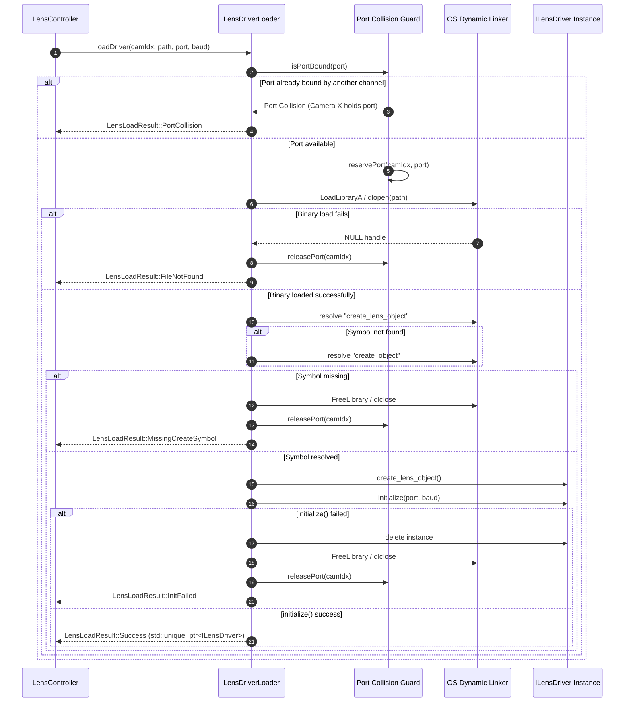

# Lens Controller Phase 5 Implementation Plan: Dynamic DLL Loader & Protocols

## 1. Executive Summary & Objectives

### 1.1 Context & Scope
Phase 5 of the **[`libs/LensController`](../libs/LensController)** library delivers the dynamic shared library plugin loader and standardized protocol driver adapters—unifying physical hardware actuation, protocol encoding, and runtime driver extensibility.

In tactical electro-optical and infrared (EO/IR) camera gimbals, optical assemblies originate from diverse manufacturers (such as Sony FCB-EV/CV zoom blocks, Tamron block cameras, Fujinon long-range CCTV lenses, and proprietary brushless motor heads). To support field-swappable optics without recompiling the master application, commercial gimbal controllers (such as Sightline Applications systems, documented in Sightline Engineering Application Note **EAN-Lens-DLL-Development.pdf** and decompiled `ILensDriver.h` interfaces) load external dynamic shared libraries (`.dll` on Windows, `.so` on Linux) at runtime. Simultaneously, systems require rock-solid built-in drivers for standard pan-tilt-zoom protocols, specifically **Sony VISCA** and **Pelco-D**.

Phase 5 implements:
1. **Dynamic Shared Library Loader ([`LensDriverLoader`](../libs/LensController/LensDriverLoader.h))**: Cross-platform runtime loader (`LoadLibraryA` on Win32, `dlopen` on POSIX) resolving standardized C factory symbols (`create_lens_object` / `create_object`), managing multi-channel serial port collision prevention across up to 4 camera channels, enforcing search path security, and guaranteeing leak-free RAII driver lifecycles.
2. **Sony VISCA Protocol Lens Driver ([`ViscaLensDriver`](../libs/LensController/ViscaLensDriver.h))**: High-performance, zero-heap adapter implementing [`ILensDriver`](../libs/LensController/ILensDriver.h) for Sony Block cameras. Generates compliant VISCA packets for variable-speed relative jog, absolute 16-bit encoder positioning, hardware-native One-Push autofocus, zoom-focus tracking mode activation, and inquiry status parsing.
3. **Pelco-D Protocol Lens Driver ([`PelcoDLensDriver`](../libs/LensController/PelcoDLensDriver.h))**: Standardized adapter implementing [`ILensDriver`](../libs/LensController/ILensDriver.h) for Pelco-D motorized lenses and motor heads. Implements standard 7-byte command generation for zoom tele/wide, focus far/near, stop motion, extended absolute positioning opcodes (0x4F, 0x4B), inquiry parsing, and checksum validation.

All implementations strictly adhere to **zero Qt dependencies**, **MISRA C++:2023**, **SEI CERT C++**, strict **IWYU & `<cstdint>`** inclusion, concise function names (<30 chars), and zero-heap execution on real-time dispatch paths (**CERT ERR55-CPP**).

### 1.2 Target Deliverables for Phase 5
1. **Dynamic Lens Driver Loader ([`LensDriverLoader.h`](../libs/LensController/LensDriverLoader.h), [`LensDriverLoader.cpp`](../libs/LensController/LensDriverLoader.cpp))**:
   - Cross-platform shared library loader wrapping `HMODULE` / `void*` with RAII.
   - C ABI factory symbol resolution (`create_lens_object`, falling back to `create_object`).
   - Multi-channel serial port collision tracker preventing duplicate COM port / UART index allocation across channels 0..3.
   - Secure directory search candidate resolution (relative, application directory, `./plugins/lens/`, system paths).
   - Structured error mapping via [`LensLoadResult`](../libs/LensController/LensTypes.h) (`Success`, `FileNotFound`, `MissingCreateSymbol`, `PortCollision`, `InitFailed`).
   - Clean shutdown sequence (`stopMotion()` $\rightarrow$ driver destructor $\rightarrow$ port release $\rightarrow$ library unload).
2. **Sony VISCA Lens Driver ([`ViscaLensDriver.h`](../libs/LensController/ViscaLensDriver.h), [`ViscaLensDriver.cpp`](../libs/LensController/ViscaLensDriver.cpp))**:
   - Implementation of [`ILensDriver`](../libs/LensController/ILensDriver.h) for VISCA protocol.
   - Variable-speed relative zoom (Wide/Tele/Stop) and focus (Near/Far/Stop).
   - Absolute 16-bit positioning (Zoom Direct `0x8x 01 04 47 ...`, Focus Direct `0x8x 01 04 48 ...`).
   - Speed transformation mapping [`MotorSpeed`](../libs/LensController/LensTypes.h) [0..255] to VISCA velocity levels [0..7].
   - Native hardware AF triggering (`0x8x 01 04 18 01 FF` One-Push, `0x8x 01 04 38 02 FF` Auto).
   - Native hardware zoom tracking configuration (`0x8x 01 04 38 ...`).
   - Inquiry frame generation and response parser updating active motor positions and limit flags.
3. **Pelco-D Lens Driver ([`PelcoDLensDriver.h`](../libs/LensController/PelcoDLensDriver.h), [`PelcoDLensDriver.cpp`](../libs/LensController/PelcoDLensDriver.cpp))**:
   - Implementation of [`ILensDriver`](../libs/LensController/ILensDriver.h) for Pelco-D protocol.
   - Standard 7-byte frame generation (`Sync 0xFF`, Address, Cmd1, Cmd2, Data1, Data2, Checksum).
   - Relative motion commands (Cmd2 Zoom Tele `0x20`, Zoom Wide `0x40`, Focus Far `0x01`, Cmd1 Focus Near `0x01`).
   - Extended absolute positioning commands (Set Zoom Position `0x4F`, Set Focus Position `0x4B`).
   - Telemetry query command generation (Query Zoom `0x5D`, Query Focus `0x57`) and response frame parsing.
   - Soft travel limit boundary clamping ([`LensRanges`](../libs/LensController/LensTypes.h)).
4. **Build System & Project Updates ([`libs/LensController/CMakeLists.txt`](../libs/LensController/CMakeLists.txt))**:
   - Register new headers and translation units into static library target `LensController`.
   - Link `ViscaCore`, `PelcoDCore`, `Math`, `Threads::Threads`, and `${CMAKE_DL_LIBS}` (on POSIX).
   - Enforce compiler warning flags (`-Wall -Wextra -Werror` / `/W4 /WX`).
5. **Comprehensive GoogleTest Suites**:
   - [`libs/LensController/tests/TestLensDriverLoader.cpp`](../libs/LensController/tests/TestLensDriverLoader.cpp): Library lifecycle, missing symbol handling, multi-channel port collision rejection, and RAII cleanup.
   - [`libs/LensController/tests/TestViscaLensDriver.cpp`](../libs/LensController/tests/TestViscaLensDriver.cpp): VISCA command generation, speed translation, absolute position encoding, inquiry response decoding, and built-in AF/tracking verification.
   - [`libs/LensController/tests/TestPelcoDLensDriver.cpp`](../libs/LensController/tests/TestPelcoDLensDriver.cpp): Pelco-D standard and extended command framing, 8-bit modulo checksum verification, query response parsing, and soft limit clamping.

---

## 2. Architecture & Design

### 2.1 Subsystem Context & Data Flow

```
+---------------------------------------------------------------------------------------------------------------+
|                                            libs/LensController                                                |
|                                                                                                               |
|   +-------------------------------------------------------------------------------------------------------+   |
|   |                                          LensController                                               |   |
|   |       (Coordinates Camera Channels 0..3, Autofocus Engine, Parfocal Curve Engine, and Drivers)        |   |
|   +-----------------------------------+-----------------------------------+-------------------------------+   |
|                                       |                                   |                                   |
|                                       ▼                                   ▼                                   |
|                       +-------------------------------+   +-------------------------------+                   |
|                       |       AutoFocusEngine         |   |     ZoomTrackFocusEngine      |                   |
|                       +---------------+---------------+   +---------------+---------------+                   |
|                                       |                                   |                                   |
|                                       +-----------------+-----------------+                                   |
|                                                         |                                                     |
|                                                         ▼                                                     |
|                                       +-----------------------------------+                                   |
|                                       |            ILensDriver            |                                   |
|                                       |   (Abstract Actuator Interface)   |                                   |
|                                       +-----------------+-----------------+                                   |
|                                                         |                                                     |
|                     +-----------------------------------+-----------------------------------+                 |
|                     |                                   |                                   |                 |
|                     ▼                                   ▼                                   ▼                 |
|       +---------------------------+       +---------------------------+       +---------------------------+   |
|       |      ViscaLensDriver      |       |      PelcoDLensDriver     |       |       MockLensDriver      |   |
|       |   (Sony Block / FCB-EV)   |       |    (Pelco-D Motor Head)   |       |     (In-Memory Mock)      |   |
|       +---------------------------+       +---------------------------+       +---------------------------+   |
|                     ▲                                   ▲                                                     |
|                     │                                   │                                                     |
|                     │     +-----------------------+     │                                                     |
|                     └─────┤   LensDriverLoader    ├─────┘                                                     |
|                           | (LoadLibrary/dlopen)  |                                                           |
|                           +-----------+-----------+                                                           |
|                                       |                                                                       |
|                                       ▼                                                                       |
|                           +-----------------------+                                                           |
|                           |   Vendor Shared Lib   |                                                           |
|                           | (slTamron.dll / .so)  |                                                           |
|                           +-----------------------+                                                           |
+---------------------------------------------------------------------------------------------------------------+
```

### 2.2 Mermaid Subsystem Hierarchy Diagram

```mermaid
flowchart TD
    subgraph ClientLayers["Application & Higher Subsystems"]
        LC["LensController (Channels 0..3)"]
        AF["AutoFocusEngine"]
        ZT["ZoomTrackFocusEngine"]
    end

    subgraph Phase5Core["libs/LensController: Phase 5 Drivers & Loader"]
        subgraph HAL["Hardware Abstraction"]
            ILD["ILensDriver<br/>(Pure Virtual Interface)"]
        end

        subgraph BuiltinDrivers["Built-in Protocol Drivers"]
            VLD["ViscaLensDriver<br/>(Sony FCB-EV / VISCA)"]
            PLD["PelcoDLensDriver<br/>(Pelco-D CCTV / Heads)"]
            MLD["MockLensDriver<br/>(Phase 1 Test Fixture)"]
        end

        subgraph LoaderSubsystem["Plugin Loader Subsystem"]
            LDL["LensDriverLoader<br/>(Multi-Channel Port Collision Guard)"]
            OS_WIN["Win32: LoadLibraryA / GetProcAddress"]
            OS_POS["POSIX: dlopen / dlsym"]
            EXT_DLL["External Vendor DLL/SO<br/>(create_lens_object)"]
        end
    end

    subgraph ProtocolLibs["Protocol Engine Dependencies"]
        VC["libs/ViscaCore<br/>(ViscaFrame / ViscaBuilder)"]
        PC["libs/PelcoDCore<br/>(PelcoDFrame / ProtocolBuilder)"]
    end

    LC --> ILD
    AF --> ILD
    ZT --> ILD
    LC --> LDL

    ILD <|.. VLD
    ILD <|.. PLD
    ILD <|.. MLD

    VLD -.->|Encodes / Decodes| VC
    PLD -.->|Encodes / Decodes| PC

    LDL -->|Resolves Symbol| EXT_DLL
    EXT_DLL -.->|Implements| ILD
    LDL --> OS_WIN
    LDL --> OS_POS
```

---

## 3. Dynamic Shared Library Loader Specification (`LensDriverLoader`)

### 3.1 Sightline EAN Interface & C Factory ABI
Per Sightline Applications **EAN-Lens-DLL-Development.pdf**, external lens shared libraries export an un-mangled `extern "C"` factory function returning a heap-allocated pointer to an object implementing the `ILensDriver` interface.

To support multiple historical revisions of vendor DLLs, the loader queries symbols in the following order:
1. `create_lens_object`: Standard modern Sightline EAN factory symbol.
2. `create_object`: Legacy fallback factory symbol.

```cpp
extern "C" {
    using CreateLensObjectFn = LensControl::ILensDriver* (*)();
}
```

### 3.2 Platform-Specific Dynamic Linker Abstraction

```
+-------------------------------------------------------------------------------+
|                       CROSS-PLATFORM DYNAMIC LOADER                           |
|                                                                               |
|   Platform             Windows (Win32)                 Linux (POSIX)          |
|   ------------------   -----------------------------   --------------------   |
|   Library Handle       HMODULE                         void*                  |
|   Open Function        LoadLibraryA(path)              dlopen(path, RTLD_NOW) |
|   Symbol Lookup        GetProcAddress(handle, sym)     dlsym(handle, sym)     |
|   Close Function       FreeLibrary(handle)             dlclose(handle)        |
|   Error Diagnostic     GetLastError()                  dlerror()              |
+-------------------------------------------------------------------------------+
```

### 3.3 Multi-Channel Serial Port Collision Prevention

```
+-------------------------------------------------------------------------------+
|                       PORT COLLISION DETECTION MATRIX                         |
|                                                                               |
|   Channel Index     Bound UART Port     Status                                |
|   -------------     ---------------     -----------------------------------   |
|   Camera 0          COM3 / UART 3       BOUND (slViscaLens.dll)               |
|   Camera 1          COM4 / UART 4       BOUND (slTamronLens.dll)              |
|   Camera 2          None (0xFF)         FREE                                  |
|   Camera 3          None (0xFF)         FREE                                  |
|                                                                               |
|   [Request]: Camera 2 requests load on COM3.                                  |
|   [Check]:   Port 3 matches Camera 0 -> REJECT!                               |
|   [Result]:  Return LensLoadResult::PortCollision (Zero hardware conflict)    |
+-------------------------------------------------------------------------------+
```

### 3.4 Mermaid Dynamic Loading Sequence Diagram



### 3.5 Class Declaration: `LensDriverLoader`

```cpp
namespace LensControl {

/// @class LensDriverLoader
/// @brief Thread-safe manager for dynamic lens driver shared libraries with port collision guard.
class LensDriverLoader final {
public:
    static constexpr std::size_t kMaxChannels = 4U;
    static constexpr std::uint8_t kInvalidPort = 0xFFU;

    LensDriverLoader() noexcept;
    ~LensDriverLoader() noexcept;

    LensDriverLoader(const LensDriverLoader&) = delete;
    LensDriverLoader& operator=(const LensDriverLoader&) = delete;
    LensDriverLoader(LensDriverLoader&&) noexcept;
    LensDriverLoader& operator=(LensDriverLoader&&) noexcept;

    /// @brief Loads an external lens driver plugin and initializes it on the target port.
    /// @param cam Channel index [0..3].
    /// @param libraryPath Path or filename of the shared library (.dll / .so).
    /// @param port UART port index (e.g. 1 for COM1 or ttyS1).
    /// @param baud Baud rate in bps (e.g. 9600, 38400, 115200).
    /// @param outDriver Output smart pointer receiving the instantiated driver.
    /// @return Status code indicating success or specific failure reason.
    [[nodiscard]] LensLoadResult loadDriver(
        CameraIndex cam,
        std::string_view libraryPath,
        std::uint8_t port,
        std::uint32_t baud,
        std::unique_ptr<ILensDriver>& outDriver) noexcept;

    /// @brief Unloads driver for channel, invoking stopMotion(), freeing instance and releasing port.
    /// @param cam Channel index [0..3].
    void unloadDriver(CameraIndex cam) noexcept;

    /// @brief Checks whether a specific COM/UART port is currently allocated to any channel.
    /// @param port Target UART index.
    /// @return True if port is actively held by a channel.
    [[nodiscard]] bool isPortBound(std::uint8_t port) const noexcept;

    /// @brief Returns the port assigned to a given camera channel, or kInvalidPort if unassigned.
    /// @param cam Channel index [0..3].
    /// @return 8-bit port identifier or 0xFF.
    [[nodiscard]] std::uint8_t boundPort(CameraIndex cam) const noexcept;

    /// @brief Releases all allocated libraries and resets port reservations.
    void reset() noexcept;

private:
    struct ChannelEntry {
        void* moduleHandle{nullptr};        ///< OS library handle (HMODULE or dlopen pointer)
        std::uint8_t port{kInvalidPort};     ///< Bound UART port index
        std::string loadedPath{};           ///< Cached path for inspection
    };

    [[nodiscard]] void* openLibrary(std::string_view path) noexcept;
    void closeLibrary(void* handle) noexcept;
    [[nodiscard]] void* resolveSymbol(void* handle, const char* symbol) noexcept;

    mutable std::mutex m_mutex{};
    std::array<ChannelEntry, kMaxChannels> m_channels{};
};

} // namespace LensControl
```

---

## 4. Sony VISCA Protocol Lens Driver Specification (`ViscaLensDriver`)

### 4.1 VISCA Protocol Framing & Opcodes
The Sony VISCA protocol transmits variable-length command packets terminated by delimiter `0xFF`:
- Header: `0x80 | (camAddress & 0x0F)` (Default camera address = 1 $\rightarrow$ `0x81`).
- Opcode category: `0x01` (Command), `0x09` (Inquiry).
- Camera block command: `0x04`.

```
+-------------------------------------------------------------------------------+
|                       SONY VISCA LENS COMMAND FRAMING                         |
|                                                                               |
|   Operation           VISCA Frame Structure                                   |
|   -----------------   -----------------------------------------------------   |
|   Zoom Stop           81 01 04 07 00 FF                                       |
|   Zoom Tele (Var)     81 01 04 07 2p FF       (p = speed 0..7)                |
|   Zoom Wide (Var)     81 01 04 07 3p FF       (p = speed 0..7)                |
|   Zoom Direct (Abs)   81 01 04 47 0p 0q 0r 0s FF  (pqrs = 16-bit pos)         |
|   Focus Stop          81 01 04 08 00 FF                                       |
|   Focus Far (Var)     81 01 04 08 2q FF       (q = speed 0..7)                |
|   Focus Near (Var)    81 01 04 08 3q FF       (q = speed 0..7)                |
|   Focus Direct (Abs)  81 01 04 48 0p 0q 0r 0s FF  (pqrs = 16-bit pos)         |
|   One-Push AF Trig    81 01 04 18 01 FF                                       |
|   AF Mode Auto        81 01 04 38 02 FF                                       |
|   AF Mode Manual      81 01 04 38 03 FF                                       |
|   Zoom Pos Inquiry    81 09 04 47 FF          (Resp: 90 50 0p 0q 0r 0s FF)    |
|   Focus Pos Inquiry   81 09 04 48 FF          (Resp: 90 50 0p 0q 0r 0s FF)    |
+-------------------------------------------------------------------------------+
```

### 4.2 Velocity Translation: `MotorSpeed` to VISCA Speed
[`MotorSpeed`](../libs/LensController/LensTypes.h) operates on a 0..255 count. VISCA optical drive commands accept speed indices 0..7:
$$v_{\text{visca}} = \text{clamp}\left( \left\lfloor \frac{v_{\text{motor}} \times 7}{255} + 0.5 \right\rfloor, \ 0, \ 7 \right)$$
For $v_{\text{motor}} = 0$, velocity is 0 (slowest creep); for $v_{\text{motor}} = 255$, velocity is 7 (maximum slew).

### 4.3 16-Bit Position Nibble Packing and Unpacking
Direct 16-bit encoder positioning requires splitting the 16-bit unsigned integer $P \in [0, 65535]$ into four 4-bit nibbles:
$$p = (P \gg 12) \ \& \ 0x0F, \quad q = (P \gg 8) \ \& \ 0x0F, \quad r = (P \gg 4) \ \& \ 0x0F, \quad s = P \ \& \ 0x0F$$
In reverse, response packet bytes $B_2, B_3, B_4, B_5$ are unpacked as:
$$P = \big((B_2 \ \& \ 0x0F) \ll 12\big) \ | \ \big((B_3 \ \& \ 0x0F) \ll 8\big) \ | \ \big((B_4 \ \& \ 0x0F) \ll 4\big) \ | \ (B_5 \ \& \ 0x0F)$$

### 4.4 Class Declaration: `ViscaLensDriver`

```cpp
namespace LensControl {

/// @class ViscaLensDriver
/// @brief Zero-heap adapter implementing ILensDriver for Sony VISCA optical blocks.
class ViscaLensDriver final : public ILensDriver {
public:
    using TransmitCallback = void (*)(const std::uint8_t* data, std::size_t len, void* userCtx);

    explicit ViscaLensDriver(std::uint8_t cameraAddress = 1U, LensRanges ranges = {}) noexcept;
    ~ViscaLensDriver() override = default;

    // --- ILensDriver Interface Methods ---
    [[nodiscard]] bool initialize(std::uint8_t port, std::uint32_t baud) noexcept override;
    void moveFocus(std::int16_t steps, MotorSpeed speed) noexcept override;
    void moveZoom(std::int16_t steps, MotorSpeed speed) noexcept override;
    void setFocusPosition(MotorPosition pos, MotorSpeed speed) noexcept override;
    void setZoomPosition(MotorPosition pos, MotorSpeed speed) noexcept override;
    void stopMotion() noexcept override;
    [[nodiscard]] MotorPosition currentFocus() const noexcept override;
    [[nodiscard]] MotorPosition currentZoom() const noexcept override;
    [[nodiscard]] std::uint8_t limitFlags() const noexcept override;
    void sendRawCommand(const std::uint8_t* data, std::size_t len) noexcept override;
    [[nodiscard]] bool hasBuiltinAutofocus() const noexcept override;
    bool triggerBuiltinAutofocus() noexcept override;
    [[nodiscard]] bool hasBuiltinZoomTracking() const noexcept override;
    bool setBuiltinZoomTracking(bool enable) noexcept override;
    [[nodiscard]] LensRanges lensRanges() const noexcept override;

    // --- Driver Specific Control & Telemetry Ingestion ---
    void setTransmitCallback(TransmitCallback cb, void* userCtx) noexcept;
    void processIncomingBytes(const std::uint8_t* data, std::size_t len) noexcept;
    [[nodiscard]] std::uint8_t cameraAddress() const noexcept;
    void setCameraAddress(std::uint8_t address) noexcept;

private:
    [[nodiscard]] static constexpr std::uint8_t toViscaSpeed(MotorSpeed speed) noexcept;
    void transmit(const std::uint8_t* data, std::size_t len) noexcept;

    std::uint8_t m_cameraAddress{1U};
    LensRanges m_ranges{};
    MotorPosition m_currentFocus{0U};
    MotorPosition m_currentZoom{0U};
    std::uint8_t m_limitFlags{0U};
    std::uint8_t m_port{0xFFU};
    std::uint32_t m_baud{9600U};
    bool m_trackingEnabled{false};

    TransmitCallback m_txCallback{nullptr};
    void* m_userCtx{nullptr};
};

} // namespace LensControl
```

---

## 5. Pelco-D Protocol Lens Driver Specification (`PelcoDLensDriver`)

### 5.1 Pelco-D Protocol Framing & Checksum
A standard Pelco-D frame consists of exactly 7 bytes:
```
+-------+---------+--------+--------+--------+--------+----------+
| Byte 0| Byte 1  | Byte 2 | Byte 3 | Byte 4 | Byte 5 | Byte 6   |
+-------+---------+--------+--------+--------+--------+----------+
|  0xFF | Address | Cmd 1  | Cmd 2  | Data 1 | Data 2 | Checksum |
+-------+---------+--------+--------+--------+--------+----------+
```
Per Pelco-D specification:
$$\text{Checksum} = \left(\sum_{i=1}^{5} \text{Byte}_i\right) \pmod{256}$$

### 5.2 Relative Motion Opcodes
- **Zoom Wide**: `Cmd 2 |= 0x40` (Bit 6)
- **Zoom Tele**: `Cmd 2 |= 0x20` (Bit 5)
- **Focus Far**: `Cmd 2 |= 0x01` (Bit 0)
- **Focus Near**: `Cmd 1 |= 0x01` (Bit 0)
- **Stop Motion**: `Cmd 1 = 0x00`, `Cmd 2 = 0x00`, `Data 1 = 0x00`, `Data 2 = 0x00`

### 5.3 Extended Absolute Positioning & Query Opcodes
- **Set Zoom Position (`0x4F`)**: `Cmd 1 = 0x00`, `Cmd 2 = 0x4F`, `Data 1 = (pos >> 8)`, `Data 2 = (pos & 0xFF)`
- **Set Focus Position (`0x4B`)**: `Cmd 1 = 0x00`, `Cmd 2 = 0x4B`, `Data 1 = (pos >> 8)`, `Data 2 = (pos & 0xFF)`
- **Query Zoom (`0x5D`)**: `Cmd 1 = 0x00`, `Cmd 2 = 0x5D`, `Data 1 = 0x00`, `Data 2 = 0x00`
  - Response: `0xFF, Addr, 0x00, 0x5D, PosHigh, PosLow, Checksum`
- **Query Focus (`0x57`)**: `Cmd 1 = 0x00`, `Cmd 2 = 0x57`, `Data 1 = 0x00`, `Data 2 = 0x00`
  - Response: `0xFF, Addr, 0x00, 0x57, PosHigh, PosLow, Checksum`

### 5.4 Class Declaration: `PelcoDLensDriver`

```cpp
namespace LensControl {

/// @class PelcoDLensDriver
/// @brief Zero-heap adapter implementing ILensDriver for Pelco-D motorized lens mechanisms.
class PelcoDLensDriver final : public ILensDriver {
public:
    using TransmitCallback = void (*)(const std::uint8_t* data, std::size_t len, void* userCtx);

    explicit PelcoDLensDriver(std::uint8_t cameraAddress = 1U, LensRanges ranges = {}) noexcept;
    ~PelcoDLensDriver() override = default;

    // --- ILensDriver Interface Methods ---
    [[nodiscard]] bool initialize(std::uint8_t port, std::uint32_t baud) noexcept override;
    void moveFocus(std::int16_t steps, MotorSpeed speed) noexcept override;
    void moveZoom(std::int16_t steps, MotorSpeed speed) noexcept override;
    void setFocusPosition(MotorPosition pos, MotorSpeed speed) noexcept override;
    void setZoomPosition(MotorPosition pos, MotorSpeed speed) noexcept override;
    void stopMotion() noexcept override;
    [[nodiscard]] MotorPosition currentFocus() const noexcept override;
    [[nodiscard]] MotorPosition currentZoom() const noexcept override;
    [[nodiscard]] std::uint8_t limitFlags() const noexcept override;
    void sendRawCommand(const std::uint8_t* data, std::size_t len) noexcept override;
    [[nodiscard]] bool hasBuiltinAutofocus() const noexcept override;
    bool triggerBuiltinAutofocus() noexcept override;
    [[nodiscard]] bool hasBuiltinZoomTracking() const noexcept override;
    bool setBuiltinZoomTracking(bool enable) noexcept override;
    [[nodiscard]] LensRanges lensRanges() const noexcept override;

    // --- Driver Specific Control & Telemetry Ingestion ---
    void setTransmitCallback(TransmitCallback cb, void* userCtx) noexcept;
    void processIncomingBytes(const std::uint8_t* data, std::size_t len) noexcept;
    [[nodiscard]] std::uint8_t cameraAddress() const noexcept;
    void setCameraAddress(std::uint8_t address) noexcept;

private:
    void sendFrame(std::uint8_t cmd1, std::uint8_t cmd2, std::uint8_t data1, std::uint8_t data2) noexcept;
    void updateLimitFlags() noexcept;

    std::uint8_t m_cameraAddress{1U};
    LensRanges m_ranges{};
    MotorPosition m_currentFocus{0U};
    MotorPosition m_currentZoom{0U};
    std::uint8_t m_limitFlags{0U};
    std::uint8_t m_port{0xFFU};
    std::uint32_t m_baud{9600U};

    TransmitCallback m_txCallback{nullptr};
    void* m_userCtx{nullptr};
};

} // namespace LensControl
```

---

## 6. File Layout & CMake Integration

### 6.1 Repository File Locations
```text
libs/LensController/
├── CMakeLists.txt                  # Updated with new sources, ViscaCore/PelcoDCore & dl libs
├── LensDriverLoader.h              # Dynamic DLL/SO loader & port collision guard
├── LensDriverLoader.cpp
├── ViscaLensDriver.h               # Sony VISCA protocol lens driver adapter
├── ViscaLensDriver.cpp
├── PelcoDLensDriver.h              # Pelco-D protocol lens driver adapter
├── PelcoDLensDriver.cpp
└── tests/
    ├── CMakeLists.txt              # Registered Phase 5 test targets
    ├── TestLensDriverLoader.cpp    # DLL loading, collision & lifecycle tests
    ├── TestViscaLensDriver.cpp     # VISCA command generation & response decoding
    └── TestPelcoDLensDriver.cpp    # Pelco-D framing, checksum & limit tests
```

### 6.2 CMake Target Updates (`libs/LensController/CMakeLists.txt`)
```cmake
add_library(LensController STATIC
    LensTypes.h
    ILensDriver.h
    MockLensDriver.h
    MockLensDriver.cpp
    FocusEvaluator.h
    FocusEvaluator.cpp
    ZoomTrackTypes.h
    ZoomTrackFocusEngine.h
    ZoomTrackFocusEngine.cpp
    AutoFocusTypes.h
    PeakFitter.h
    PeakFitter.cpp
    AutoFocusEngine.h
    AutoFocusEngine.cpp
    LensDriverLoader.h
    LensDriverLoader.cpp
    ViscaLensDriver.h
    ViscaLensDriver.cpp
    PelcoDLensDriver.h
    PelcoDLensDriver.cpp
)

target_include_directories(LensController PUBLIC
    $<BUILD_INTERFACE:${CMAKE_CURRENT_SOURCE_DIR}>
    $<BUILD_INTERFACE:${CMAKE_CURRENT_SOURCE_DIR}/..>
    $<INSTALL_INTERFACE:include>
)

target_link_libraries(LensController PUBLIC
    Math
    ViscaCore
    PelcoDCore
    Threads::Threads
    ${CMAKE_DL_LIBS}
)

apply_compiler_flags(LensController)
```

---

## 7. Step-by-Step Implementation Work Breakdown

### Task 1: Dynamic Shared Library Loader ([`LensDriverLoader.h`](../libs/LensController/LensDriverLoader.h), [`LensDriverLoader.cpp`](../libs/LensController/LensDriverLoader.cpp))
- [x] Define cross-platform dynamic library handle wrapper (`HMODULE` for Win32, `void*` for POSIX).
- [x] Implement multi-channel port collision guard verifying that no two channels share a physical UART/COM port index.
- [x] Implement candidate search path resolution (relative path, current directory, `./plugins/lens/`, system paths).
- [x] Implement C factory symbol query: first `create_lens_object`, falling back to `create_object`.
- [x] Implement RAII cleanup: `stopMotion()` call, driver deletion, port release, and library unloading.
- [x] Map all failure modes to [`LensLoadResult`](../libs/LensController/LensTypes.h).

### Task 2: Sony VISCA Protocol Driver ([`ViscaLensDriver.h`](../libs/LensController/ViscaLensDriver.h), [`ViscaLensDriver.cpp`](../libs/LensController/ViscaLensDriver.cpp))
- [x] Implement relative zoom (Tele/Wide/Stop) with 0..7 variable speed mapping.
- [x] Implement relative focus (Far/Near/Stop) with 0..7 variable speed mapping.
- [x] Implement absolute 16-bit zoom and focus positioning (`0x8x 01 04 47 ...` and `0x8x 01 04 48 ...`).
- [x] Implement hardware built-in AF trigger (One-Push AF `0x18 01` and Auto AF `0x38 02`).
- [x] Implement hardware built-in zoom tracking configuration.
- [x] Implement zero-heap telemetry parser for inquiry response packets (`0x90 0x50 ...`).
- [x] Add transmit callback bridge for test assertions and real UART transmission.

### Task 3: Pelco-D Protocol Driver ([`PelcoDLensDriver.h`](../libs/LensController/PelcoDLensDriver.h), [`PelcoDLensDriver.cpp`](../libs/LensController/PelcoDLensDriver.cpp))
- [x] Implement standard 7-byte Pelco-D framing with modulo-256 checksum calculation.
- [x] Implement relative zoom (Tele/Wide/Stop) and focus (Near/Far/Stop).
- [x] Implement extended absolute positioning commands for zoom (`0x4F`) and focus (`0x4B`).
- [x] Implement telemetry queries (`QueryZoom 0x5D`, `QueryFocus 0x57`) and response frame parsing.
- [x] Implement software limit clamping against [`LensRanges`](../libs/LensController/LensTypes.h).
- [x] Add transmit callback bridge for test assertions and real UART transmission.

### Task 4: CMake Integration & Test Setup
- [x] Update [`libs/LensController/CMakeLists.txt`](../libs/LensController/CMakeLists.txt) to include Phase 5 source files and link `ViscaCore`, `PelcoDCore`, and `${CMAKE_DL_LIBS}`.
- [x] Update [`libs/LensController/tests/CMakeLists.txt`](../libs/LensController/tests/CMakeLists.txt) to register Phase 5 unit test targets:
  - `TestLensDriverLoader`
  - `TestViscaLensDriver`
  - `TestPelcoDLensDriver`

### Task 5: Unit & Integration Testing
- [x] Author [`libs/LensController/tests/TestLensDriverLoader.cpp`](../libs/LensController/tests/TestLensDriverLoader.cpp).
- [x] Author [`libs/LensController/tests/TestViscaLensDriver.cpp`](../libs/LensController/tests/TestViscaLensDriver.cpp).
- [x] Author [`libs/LensController/tests/TestPelcoDLensDriver.cpp`](../libs/LensController/tests/TestPelcoDLensDriver.cpp).
- [x] Run full test suite ensuring 100% pass rate.
- [x] Run verification scripts (`scripts/verify_iwyu_cstdint.py`, `scripts/verify_relative_doc_paths.py`).

---

## 8. Test Plan & Acceptance Criteria

### 8.1 `TestLensDriverLoader` Suite
1. **Missing File Rejection**:
   - Querying `loadDriver(cam0, "non_existent_lens.dll", port1, 9600)` returns `LensLoadResult::FileNotFound`.
2. **Port Collision Prevention**:
   - Reserve port 3 on Camera 0.
   - Attempting to load on Camera 1 with port 3 returns `LensLoadResult::PortCollision`.
   - Freeing Camera 0 permits Camera 1 to bind port 3 successfully.
3. **Invalid Symbol Rejection**:
   - Loading a valid shared library that does not export `create_lens_object` or `create_object` returns `LensLoadResult::MissingCreateSymbol`.
4. **Lifecycle & RAII Unload**:
   - Verified that destructing the loader or calling `unloadDriver()` calls `stopMotion()` and releases library resources without memory leaks.

### 8.2 `TestViscaLensDriver` Suite
1. **Relative Motion Packets**:
   - `moveZoom(100, MotorSpeed(255))` $\rightarrow$ emits `81 01 04 07 27 FF` (Tele at max speed 7).
   - `moveZoom(-100, MotorSpeed(0))` $\rightarrow$ emits `81 01 04 07 30 FF` (Wide at min speed 0).
   - `stopMotion()` $\rightarrow$ emits `81 01 04 07 00 FF` (Zoom Stop) and `81 01 04 08 00 FF` (Focus Stop).
2. **Absolute Encoder Positioning**:
   - `setZoomPosition(MotorPosition(0x1234), MotorSpeed(128))` $\rightarrow$ emits `81 01 04 47 01 02 03 04 FF`.
   - `setFocusPosition(MotorPosition(0xABCD), MotorSpeed(128))` $\rightarrow$ emits `81 01 04 48 0A 0B 0C 0D FF`.
3. **Hardware Built-in Autofocus**:
   - `hasBuiltinAutofocus()` returns true.
   - `triggerBuiltinAutofocus()` emits One-Push AF command `81 01 04 18 01 FF`.
4. **Response Parsing**:
   - Feeding response `90 50 01 02 03 04 FF` after zoom inquiry updates `currentZoom()` to `0x1234`.

### 8.3 `TestPelcoDLensDriver` Suite
1. **Relative Motion Framing**:
   - `moveZoom(100, ...)` emits standard Pelco-D Tele frame (`Cmd 2 = 0x20`) with valid checksum.
   - `moveZoom(-100, ...)` emits standard Pelco-D Wide frame (`Cmd 2 = 0x40`) with valid checksum.
   - `moveFocus(-50, ...)` emits standard Pelco-D Focus Near frame (`Cmd 1 = 0x01`).
   - `stopMotion()` emits standard zero motion frame (`Cmd 1 = 0x00, Cmd 2 = 0x00`).
2. **Extended Absolute Positioning**:
   - `setZoomPosition(MotorPosition(0x04B0), ...)` emits `FF 01 00 4F 04 B0 Checksum`.
   - `setFocusPosition(MotorPosition(0x0258), ...)` emits `FF 01 00 4B 02 58 Checksum`.
3. **Telemetry Ingestion**:
   - Feeding 7-byte response `FF 01 00 5D 04 B0 Checksum` updates `currentZoom()` to 1200 (`0x04B0`).
4. **Soft Range Clamping**:
   - Requesting positions exceeding `lensRanges()` clamps target values to configured bounds before transmitting.

---

## 9. Safety & Standards Compliance

### 9.1 Compliance Matrix
| Standard / Rule | Requirement | Implementation Strategy in Phase 5 |
| :--- | :--- | :--- |
| **Zero Qt Dependencies** | `#include <Q...>` strictly prohibited in Core and HAL | Pure standard C++17 throughout; uses standard containers and callbacks. |
| **MISRA C++:2023 Rule 7.0.6** | No implicit signed/unsigned conversions | Explicit `static_cast` for all nibble packing, baud rate calculations, and array offsets. |
| **SEI CERT INT31-C** | Range-verified integer conversions | Clamping and explicit bounds checking on all motor positions and velocities. |
| **SEI CERT STR37-C** | Safe ASCII character comparisons | Standard string views and safe C-string handling for DLL path lookups and symbol names. |
| **SEI CERT ERR55-CPP** | Exception safety & zero dynamic heap in `noexcept` | Zero heap allocations in real-time packet formatting, parsing, and limit checking paths. |
| **IWYU & `<cstdint>` Policy** | Explicit header inclusions and `std::` scoping | Direct `#include <cstdint>`, `#include <cstddef>`, sorted canonical include blocks. |
| **Domain-Driven Design** | Zero Primitive Obsession | Wrap raw primitives into strong types (`CameraIndex`, `MotorPosition`, `MotorSpeed`, `LensRanges`). |
| **Concise Function Names** | Function identifiers strictly less than 30 characters | All methods in `LensDriverLoader`, `ViscaLensDriver`, `PelcoDLensDriver` adhere to concise naming. |
| **Documentation Relative Paths** | All links use relative paths without drive or root slashes | Compliant with [`relative-paths-docs.md`](../.agents/rules/relative-paths-docs.md). |
| **Dual Diagram Standard** | Architecture and sequence visualization | Both ASCII and Mermaid diagrams provided for subsystem structure and lifecycle flows. |

