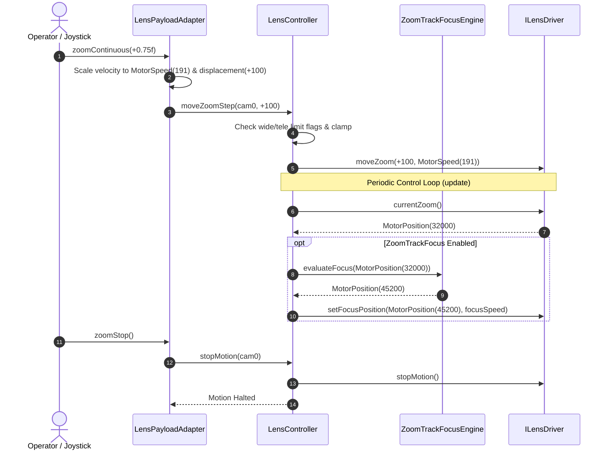
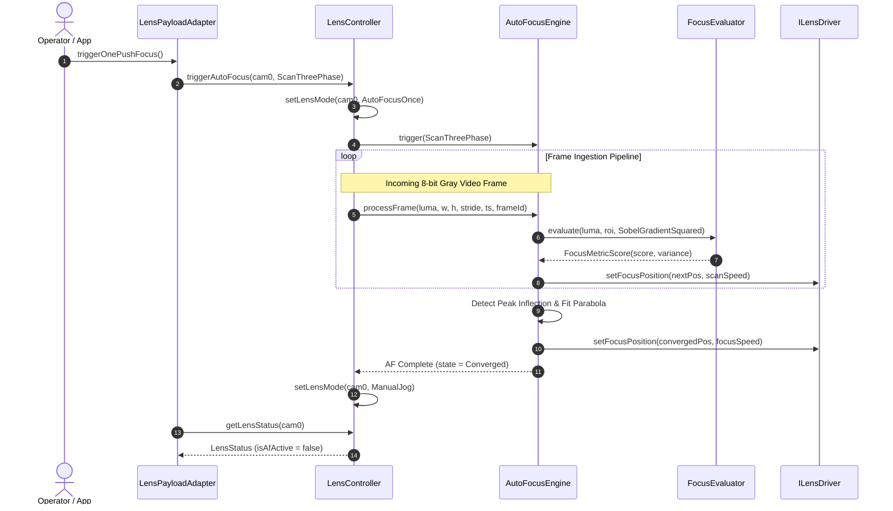

# Lens Controller Phase 6 Implementation Plan: Master Controller & Payload HAL

## 1. Executive Summary & Objectives

### 1.1 Context & Scope
Phase 6 of the **[`libs/LensController`](../libs/LensController)** library delivers the master multi-channel coordinator and the hardware abstraction layer (HAL) camera payload bridge. This milestone consolidates all previous subsystems—strongly-typed domain value objects (Phase 1), zero-heap focus sharpness evaluators (Phase 2), parfocal zoom-to-focus lookup curve engines (Phase 3), closed-loop autofocus state machines with sub-step peak fitting (Phase 4), and dynamic plugin DLL loaders with protocol adapters (Phase 5)—into an integrated operational controller.

In tactical electro-optical and infrared (EO/IR) camera gimbals, camera payloads frequently incorporate multi-spectral configurations (e.g., daylight continuous zoom, mid-wave infrared thermal zoom, and fixed wide-angle spotters). Operators interact with these optics through standardized flight control protocols, joystick rate demands, and mission system APIs. Phase 6 establishes:
1. **Master Multi-Channel Controller ([`LensController`](../libs/LensController/LensController.h))**: Orchestrates up to four independent optical channels (`CameraIndex` 0..3), coordinating motor limits, operational modes (`ManualJog`, `AutoFocusOnce`, `AutoFocusContinuous`, `ZoomTrackOnly`, `Calibrating`, `Idle`), dynamic driver injection, real-time video frame sharpness ingestion, parfocal focus slew, and soft boundary protections.
2. **Payload HAL Camera Adapter ([`LensPayloadAdapter`](../libs/LensController/LensPayloadAdapter.h))**: Bridges [`LensController`](../libs/LensController/LensController.h) to the unified [`PayloadHal::ICameraPayload`](../libs/PayloadHal/ICameraPayload.h) and [`PayloadHal::IDevice`](../libs/PayloadHal/IDevice.h) interfaces. Converts normalized user coordinates ($[0.0, 1.0]$) and continuous joystick velocities ($[-1.0, 1.0]$) into motor encoder counts and speeds, computes live optical telemetry (magnification factor, horizontal/vertical field-of-view, focal length), manages streaming profile URIs, and provides asynchronous telemetry callbacks.

All implementations strictly adhere to **zero Qt dependencies**, **MISRA C++:2023**, **SEI CERT C++**, strict **IWYU & `<cstdint>`** inclusion, concise function names (<30 chars), and zero-heap execution on real-time evaluation and dispatch paths (**CERT ERR55-CPP**).

### 1.2 Target Deliverables for Phase 6
1. **Master Multi-Channel Controller ([`LensController.h`](../libs/LensController/LensController.h), [`LensController.cpp`](../libs/LensController/LensController.cpp))**:
   - Manages four independent optical channels (`CameraIndex` 0..3) with dedicated channel state.
   - Encapsulates per-channel driver instances ([`ILensDriver`](../libs/LensController/ILensDriver.h)), autofocus engines ([`AutoFocusEngine`](../libs/LensController/AutoFocusEngine.h)), focus evaluators ([`FocusEvaluator`](../libs/LensController/FocusEvaluator.h)), and parfocal spline engines ([`ZoomTrackFocusEngine`](../libs/LensController/ZoomTrackFocusEngine.h)).
   - Integrates dynamic plugin DLL loader ([`LensDriverLoader`](../libs/LensController/LensDriverLoader.h)) with port collision avoidance across all four channels.
   - Enforces soft travel boundaries ([`LensRanges`](../libs/LensController/LensTypes.h)) and protects against limit switch violations (`NearLimit`, `FarLimit`, `WideLimit`, `TeleLimit`).
   - Provides discrete jog steps (`moveFocusStep`, `moveZoomStep`), target positioning (`setFocusTarget`, `setZoomTarget`), and emergency motion halting (`stopMotion`).
   - Supports zero-heap video frame ingestion (`processFrame`) forwarding to the active autofocus engine.
   - Executes periodic control ticks (`update`) driving closed-loop AF steps, parfocal zoom tracking focus corrections, and status cache updates.
2. **Payload HAL Camera Adapter ([`LensPayloadAdapter.h`](../libs/LensController/LensPayloadAdapter.h), [`LensPayloadAdapter.cpp`](../libs/LensController/LensPayloadAdapter.cpp))**:
   - Implements [`PayloadHal::ICameraPayload`](../libs/PayloadHal/ICameraPayload.h) and [`PayloadHal::IDevice`](../libs/PayloadHal/IDevice.h).
   - Maps normalized zoom coordinates ($[0.0, 1.0]$) to encoder counts based on configured channel `LensRanges`.
   - Maps normalized focus coordinates ($[0.0, 1.0]$) to encoder counts.
   - Translates continuous joystick velocities ($[-1.0, 1.0]$) into directional steps and scaled [`MotorSpeed`](../libs/LensController/LensTypes.h) levels.
   - Triggers one-push and continuous autofocus modes through the master controller.
   - Computes physical optical telemetry ([`PayloadHal::CameraTelemetry`](../libs/PayloadHal/PayloadTypes.h)): optical zoom factor, pinhole focal length, and angular Horizontal/Vertical Field-of-View based on sensor geometry.
   - Dispatches live telemetry to registered observers via `registerTelemetryCallback`.
   - Manages device lifecycle (`connect`, `disconnect`, `isConnected`, `state`, `info`, `registerStateCallback`).
   - Manages RTSP / video streaming profile URIs.
3. **Build System Updates ([`libs/LensController/CMakeLists.txt`](../libs/LensController/CMakeLists.txt))**:
   - Register `LensController.h/.cpp` and `LensPayloadAdapter.h/.cpp` in the `LensController` static library.
   - Link `PayloadHal`, `Math`, `Threads::Threads`, and `${CMAKE_DL_LIBS}`.
   - Enforce compiler warning flags (`-Wall -Wextra -Werror` / `/W4 /WX`).
4. **Comprehensive GoogleTest Suites**:
   - [`libs/LensController/tests/TestLensController.cpp`](../libs/LensController/tests/TestLensController.cpp): Multi-channel state isolation, limit clamping, discrete jog steps, AF trigger and update loop, zoom-track focus slew, and dynamic DLL integration.
   - [`libs/LensController/tests/TestLensPayloadAdapter.cpp`](../libs/LensController/tests/TestLensPayloadAdapter.cpp): Normalized zoom/focus mapping, continuous velocity jog, one-push focus, FOV telemetry calculations, device lifecycle transitions, and callback notifications.

---

## 2. Architecture & Design

### 2.1 Subsystem Context & Data Flow

```
+-----------------------------------------------------------------------------------------------------------------------+
|                                                  Gimbal / Client Layer                                                |
|                                                                                                                       |
|         +-------------------------------------------------------------+       +-------------------------------+       |
|         |                PayloadHal Client / Joystick                 |       |       Tracking Subsystem      |       |
|         +------------------------------+------------------------------+       +---------------+---------------+       |
|                                        |                                                      |                       |
|                                        ▼ (ICameraPayload API)                                 | (BoundingBox ROI)     |
|   +------------------------------------+------------------------------------------------------|-------------------+   |
|   | libs/LensController                                                                       |                   |   |
|   |                                                                                           |                   |   |
|   |   +-----------------------------------------------------------------------------------+   |                   |   |
|   |   |                               LensPayloadAdapter                                  |   |                   |   |
|   |   |  - Normalized Coord Conversion (0.0..1.0 <-> Encoder Steps)                      |   |                   |   |
|   |   |  - Velocity Jog Mapping (-1.0..+1.0 <-> Steps/Speed)                             |   |                   |   |
|   |   |  - Sensor Optics Telemetry Synthesis (Focal Length, HFOV, VFOV, Zoom Factor)      |   |                   |   |
|   |   |  - Lifecycle & Stream URI Management                                              |   |                   |   |
|   |   +----------------------------------------+------------------------------------------+   |                   |   |
|   |                                            |                                              |                   |   |
|   |                                            ▼ (Strongly-Typed Domain Calls)                |                   |   |
|   |   +-----------------------------------------------------------------------------------+   |                   |   |
|   |   |                                 LensController                                    |<--+                   |   |
|   |   |  - Multi-Channel Orchestration (CameraIndex 0..3)                                 |                       |   |
|   |   |  - Soft Limit Clamping & Limit Switch Tripping Interlock                          |                       |   |
|   |   |  - Mode & Boundary Coordination (ManualJog, AF, ZoomTrack, Idle)                  |                       |   |
|   |   |  - Periodic Control Tick (update): Driver Telemetry Poll, AF Step, Parfocal Slew  |                       |   |
|   |   +--------+-------------------------------+-------------------------------+----------+                       |   |
|   |            |                               |                               |                                  |   |
|   |            ▼                               ▼                               ▼                                  |   |
|   |   +--------------------+          +--------------------+          +--------------------+                      |   |
|   |   |  AutoFocusEngine   |          |ZoomTrackFocusEngine|          |  LensDriverLoader  |                      |   |
|   |   | - 3-Phase Scan     |          | - Multi-Curve LUT  |          | - DLL/SO Loader    |                      |   |
|   |   | - GSS / Momentum   |          | - PCHIP Spline     |          | - Port Collision   |                      |   |
|   |   | - Peak Fitting     |          | - Parfocal Slew    |          |   Guard (COM 0..3) |                      |   |
|   |   +--------+-----------+          +--------+-----------+          +---------+----------+                      |   |
|   |            |                               |                                |                                 |   |
|   |            ▼                               |                                |                                 |   |
|   |   +--------------------+                   |                                |                                 |   |
|   |   |   FocusEvaluator   |                   |                                |                                 |   |
|   |   | - Sobel/Tenengrad  |                   |                                |                                 |   |
|   |   | - Vollath F4/F5    |                   |                                |                                 |   |
|   |   | - 2D DCT AC Energy |                   |                                |                                 |   |
|   |   +--------------------+                   |                                |                                 |   |
|   |                                            |                                |                                 |   |
|   |            +-------------------------------+--------------------------------+                                 |   |
|   |            |                                                                                                  |   |
|   |            ▼                                                                                                  |   |
|   |   +-----------------------------------------------------------------------------------+                       |   |
|   |   |                                   ILensDriver                                     |                       |   |
|   |   |                          (Hardware Actuator Interface)                            |                       |   |
|   |   +--------+-------------------------------+-------------------------------+----------+                       |   |
|   |            |                               |                               |                                  |   |
|   +------------|-------------------------------|-------------------------------|----------------------------------+   |
|                ▼                               ▼                               ▼                                      |
|   +-------------------------+     +-------------------------+     +-------------------------+                         |
|   |     ViscaLensDriver     |     |    PelcoDLensDriver     |     |     MockLensDriver      |                         |
|   |  (Sony Block / FCB-EV)  |     |   (Pelco-D Motor Head)  |     |    (Simulated Tests)    |                         |
|   +-------------------------+     +-------------------------+     +-------------------------+                         |
+-----------------------------------------------------------------------------------------------------------------------+
```

### 2.2 Mermaid Subsystem Hierarchy Diagram

```mermaid
flowchart TD
    subgraph ClientLayers["Application & HAL Consumers"]
        App["Gimbal Application / Mission Director"]
        Joystick["Rate Joystick / Gamepad"]
        Track["Tracking Subsystem (Dynamic Target ROI)"]
    end

    subgraph HALBridge["libs/LensController (Phase 6 Deliverables)"]
        LPA["LensPayloadAdapter<br/>(implements ICameraPayload, IDevice)"]
        LC["LensController<br/>(Multi-Channel Orchestrator 0..3)"]
    end

    subgraph Phase1to5Core["Pre-Existing Subsystems (Phases 1-5)"]
        AF["AutoFocusEngine (Phase 4)"]
        FE["FocusEvaluator (Phase 2)"]
        ZT["ZoomTrackFocusEngine (Phase 3)"]
        LDL["LensDriverLoader (Phase 5)"]
        ILD["ILensDriver (Phase 1)"]
    end

    subgraph Drivers["Actuator Driver Implementations"]
        VLD["ViscaLensDriver (Phase 5)"]
        PLD["PelcoDLensDriver (Phase 5)"]
        MLD["MockLensDriver (Phase 1)"]
        EXT["Vendor Plugin (.dll/.so)"]
    end

    App --> LPA
    Joystick --> LPA
    Track -.->|Dynamic ROI| LC
    LPA --> LC
    LC --> AF
    LC --> ZT
    LC --> LDL
    LC --> ILD
    AF --> FE
    AF --> ILD
    ZT --> ILD
    LDL -.-> EXT
    EXT -.-> ILD
    ILD <|.. VLD
    ILD <|.. PLD
    ILD <|.. MLD
```

### 2.3 Operational Sequence Diagrams

#### Sequence 1: Optical Zoom & Continuous Joystick Velocity Slew



#### Sequence 2: One-Push Closed-Loop Autofocus



---

## 3. Master Multi-Channel Controller Specification (`LensController`)

### 3.1 Channel State Management & Internal Data Model

The master controller manages up to `kMaxChannels = 4U` optical channels. Each channel maintains complete independence to allow heterogeneous camera payloads (e.g., Channel 0 = Sony VISCA EO Daylight continuous zoom; Channel 1 = Pelco-D Long-Wave Infrared thermal block; Channel 2 = In-memory simulated mock lens).

```cpp
namespace LensControl {

struct ChannelState {
    std::unique_ptr<ILensDriver> driver { nullptr };
    std::unique_ptr<AutoFocusEngine> afEngine { nullptr };
    std::unique_ptr<ZoomTrackFocusEngine> zoomTrackEngine { nullptr };
    FocusEvaluator focusEvaluator { };
    LensMode mode { LensMode::ManualJog };
    LensRanges ranges { 0U, 65535U, 0U, 65535U };
    MotorSpeed zoomSpeed { MotorSpeed::kDefaultSpeed };
    MotorSpeed focusSpeed { MotorSpeed::kDefaultSpeed };
    LensStatus cachedStatus { };
    FocusMetricScore lastScore { };
    bool zoomTrackEnabled { false };
    MotorPosition lastEvaluatedZoom { 0U };
    mutable std::mutex mutex { };
};

} // namespace LensControl
```

### 3.2 Public Interface Definition (`LensController.h`)

```cpp
#pragma once

/// @file LensController.h
/// @brief Master multi-channel motorized optical controller and subsystem orchestrator.

#include <cstddef>
#include <cstdint>

#include <array>
#include <memory>
#include <mutex>
#include <string_view>

#include "AutoFocusEngine.h"
#include "FocusEvaluator.h"
#include "ILensDriver.h"
#include "LensDriverLoader.h"
#include "LensTypes.h"
#include "ZoomTrackFocusEngine.h"

namespace LensControl {

/// @class LensController
/// @brief Central coordinator managing multi-channel optics, limit guards, AF, and parfocal tracking.
class LensController final {
public:
    static constexpr std::size_t kMaxChannels = 4U;

    LensController() noexcept;
    ~LensController() noexcept;

    LensController(const LensController&) = delete;
    LensController& operator=(const LensController&) = delete;
    LensController(LensController&&) = delete;
    LensController& operator=(LensController&&) = delete;

    // --- Mode & Boundaries ---

    /// @brief Configures operational mode for designated camera channel.
    /// @param cam Channel index [0..3].
    /// @param mode Desired optical operating mode.
    /// @param data Optional mode-specific parameter.
    void setLensMode(CameraIndex cam, LensMode mode, std::uint16_t data = 0U) noexcept;

    /// @brief Establishes mechanical travel boundaries for designated channel.
    /// @param cam Channel index [0..3].
    /// @param ranges Range limits for focus and zoom axes.
    void setLensRanges(CameraIndex cam, const LensRanges& ranges) noexcept;

    /// @brief Configures default zoom actuator travel speed.
    /// @param cam Channel index [0..3].
    /// @param speed Velocity count [0..255].
    void setZoomSpeed(CameraIndex cam, MotorSpeed speed) noexcept;

    /// @brief Configures default focus actuator travel speed.
    /// @param cam Channel index [0..3].
    /// @param speed Velocity count [0..255].
    void setFocusSpeed(CameraIndex cam, MotorSpeed speed) noexcept;

    // --- Motor Movement & Limits ---

    /// @brief Commands relative focus step displacement.
    /// @param cam Channel index [0..3].
    /// @param steps Relative encoder offset (negative = Near, positive = Far).
    void moveFocusStep(CameraIndex cam, std::int16_t steps) noexcept;

    /// @brief Commands relative zoom step displacement.
    /// @param cam Channel index [0..3].
    /// @param steps Relative encoder offset (negative = Wide, positive = Tele).
    void moveZoomStep(CameraIndex cam, std::int16_t steps) noexcept;

    /// @brief Commands absolute focus positioning with range clamping.
    /// @param cam Channel index [0..3].
    /// @param pos Target focus coordinate.
    void setFocusTarget(CameraIndex cam, MotorPosition pos) noexcept;

    /// @brief Commands absolute zoom positioning with range clamping.
    /// @param cam Channel index [0..3].
    /// @param pos Target zoom coordinate.
    void setZoomTarget(CameraIndex cam, MotorPosition pos) noexcept;

    /// @brief Immediately halts all optical motion across designated channel.
    /// @param cam Channel index [0..3].
    void stopMotion(CameraIndex cam) noexcept;

    // --- Autofocus & Parfocal Tracking ---

    /// @brief Initiates closed-loop autofocus on designated channel.
    /// @param cam Channel index [0..3].
    /// @param method Algorithmic search variant.
    void triggerAutoFocus(CameraIndex cam, AutoFocusMethod method) noexcept;

    /// @brief Aborts active autofocus operation on designated channel.
    /// @param cam Channel index [0..3].
    void stopAutoFocus(CameraIndex cam) noexcept;

    /// @brief Enables or disables real-time parfocal zoom-to-focus tracking.
    /// @param cam Channel index [0..3].
    /// @param enable True to engage parfocal focus slew during zoom.
    void setZoomTrackFocus(CameraIndex cam, bool enable) noexcept;

    /// @brief Loads calibration track curve file for designated channel.
    /// @param cam Channel index [0..3].
    /// @param filename File path to calibration curve table.
    /// @return True on successful parsing and ingestion.
    [[nodiscard]] bool loadTrackCurves(CameraIndex cam, std::string_view filename) noexcept;

    /// @brief Ingests active tracking target bounding box for dynamic AF ROI centering.
    /// @param cam Channel index [0..3].
    /// @param normX Target center X [0.0, 1.0].
    /// @param normY Target center Y [0.0, 1.0].
    /// @param normW Target width [0.0, 1.0].
    /// @param normH Target height [0.0, 1.0].
    /// @param margin Padding factor around bounding box.
    void setTrackerRoi(CameraIndex cam, float normX, float normY, float normW, float normH, float margin = 0.2F) noexcept;

    /// @brief Clears dynamic tracker ROI and restores center evaluation window.
    /// @param cam Channel index [0..3].
    void clearTrackerRoi(CameraIndex cam) noexcept;

    // --- Video Frame Processing (0-Heap) ---

    /// @brief Ingests 8-bit luma video frame for autofocus sharpness evaluation.
    /// @param cam Channel index [0..3].
    /// @param luma Pointer to 8-bit grayscale pixel buffer.
    /// @param width Frame width in pixels.
    /// @param height Frame height in pixels.
    /// @param timestampNs Acquisition timestamp in nanoseconds.
    /// @param frameId Monotonically increasing sequence ID.
    void processFrame(CameraIndex cam, const std::uint8_t* luma, std::size_t width,
                      std::size_t height, std::uint64_t timestampNs, std::uint32_t frameId) noexcept;

    // --- Control Loop Tick ---

    /// @brief Advances channel state machine, steps AF, and executes parfocal slew.
    /// @param cam Channel index [0..3].
    void update(CameraIndex cam) noexcept;

    // --- Telemetry & Status ---

    /// @brief Retrieves latest operational status record for channel.
    /// @param cam Channel index [0..3].
    /// @return Cached LensStatus snapshot.
    [[nodiscard]] LensStatus getLensStatus(CameraIndex cam) const noexcept;

    /// @brief Retrieves configured travel ranges for channel.
    /// @param cam Channel index [0..3].
    /// @return LensRanges struct.
    [[nodiscard]] LensRanges getLensRanges(CameraIndex cam) const noexcept;

    /// @brief Queries whether autofocus is actively running on channel.
    /// @param cam Channel index [0..3].
    /// @return True if AF search state machine is in progress.
    [[nodiscard]] bool isAutoFocusRunning(CameraIndex cam) const noexcept;

    /// @brief Retrieves the latest focus evaluation score for channel.
    /// @param cam Channel index [0..3].
    /// @return FocusMetricScore record.
    [[nodiscard]] FocusMetricScore getLastMetricScore(CameraIndex cam) const noexcept;

    // --- Hardware Driver Binding & Dynamic Loading ---

    /// @brief Explicitly assigns a pre-instantiated driver to channel.
    /// @param cam Channel index [0..3].
    /// @param driver Unique pointer to hardware driver instance.
    void setDriver(CameraIndex cam, std::unique_ptr<ILensDriver> driver) noexcept;

    /// @brief Loads an external dynamic lens driver DLL/SO and binds to channel.
    /// @param cam Channel index [0..3].
    /// @param dllName Shared library name or path.
    /// @param port UART / COM port index.
    /// @param baud Communication baud rate in bps.
    /// @return Status code indicating success or error reason.
    [[nodiscard]] LensLoadResult loadLensDll(CameraIndex cam, std::string_view dllName,
                                            std::uint8_t port, std::uint32_t baud) noexcept;

    /// @brief Unloads dynamic driver and releases bound communication port.
    /// @param cam Channel index [0..3].
    void unloadLensDll(CameraIndex cam) noexcept;

private:
    struct Channel {
        std::unique_ptr<ILensDriver> driver { nullptr };
        std::unique_ptr<AutoFocusEngine> afEngine { nullptr };
        std::unique_ptr<ZoomTrackFocusEngine> zoomTrackEngine { nullptr };
        FocusEvaluator evaluator { };
        LensMode mode { LensMode::ManualJog };
        LensRanges ranges { 0U, 65535U, 0U, 65535U };
        MotorSpeed zoomSpeed { MotorSpeed::kDefaultSpeed };
        MotorSpeed focusSpeed { MotorSpeed::kDefaultSpeed };
        LensStatus status { };
        FocusMetricScore lastScore { };
        bool zoomTrackEnabled { false };
        MotorPosition lastZoomPos { 0U };
        mutable std::mutex mutex { };
    };

    [[nodiscard]] bool isValidChannel(CameraIndex cam) const noexcept;
    void refreshChannelEngines(Channel& ch) noexcept;

    std::array<Channel, kMaxChannels> m_channels { };
    LensDriverLoader m_driverLoader { };
};

} // namespace LensControl
```

### 3.3 Core Implementation Details (`LensController.cpp`)

#### 1. Limit Switch Tripping & Directional Movement Invariants
When an actuator reaches a mechanical or optical end-stop, the physical driver reports limit switch flags via `limitFlags()` matching [`LensLimitFlags`](../libs/LensController/LensTypes.h):
- `NearLimit (0x01)`: Inhibit negative focus steps (`steps < 0`). Positive steps (`steps > 0`, towards Far) remain permitted.
- `FarLimit (0x02)`: Inhibit positive focus steps (`steps > 0`). Negative steps (`steps < 0`, towards Near) remain permitted.
- `WideLimit (0x04)`: Inhibit negative zoom steps (`steps < 0`). Positive steps (`steps > 0`, towards Tele) remain permitted.
- `TeleLimit (0x08)`: Inhibit positive zoom steps (`steps > 0`). Negative steps (`steps < 0`, towards Wide) remain permitted.

```cpp
void LensController::moveFocusStep(CameraIndex cam, std::int16_t steps) noexcept
{
    if (!isValidChannel(cam) || steps == 0) {
        return;
    }
    Channel& ch = m_channels[cam.value()];
    std::lock_guard<std::mutex> lock { ch.mutex };
    if (!ch.driver) {
        return;
    }

    const std::uint8_t limits = ch.driver->limitFlags();
    if (steps < 0 && hasFlag(limits, LensLimitFlags::NearLimit)) {
        return; // Inhibit motion into near mechanical stop
    }
    if (steps > 0 && hasFlag(limits, LensLimitFlags::FarLimit)) {
        return; // Inhibit motion into far mechanical stop
    }

    ch.driver->moveFocus(steps, ch.focusSpeed);
}
```

#### 2. Periodic State Machine Tick (`update`)
The `update` method is called periodically (e.g. from the gimbal main loop or timer thread at 20 Hz – 100 Hz):
1. **Telemetry Ingestion**: Queries driver for active focus encoder position, zoom encoder position, and limit switch flags.
2. **Autofocus Stepping**: If `ch.mode == LensMode::AutoFocusOnce` or `ch.mode == LensMode::AutoFocusContinuous`:
   - Executes `ch.afEngine->step(curFocusPos, nowNs)`.
   - If `ch.afEngine->state() == AutoFocusState::Converged` or `AutoFocusState::Failed`:
     - Updates status record; if `AutoFocusOnce`, reverts mode to `LensMode::ManualJog`.
3. **Parfocal Zoom-Tracking Focus Correction**:
   - If `ch.zoomTrackEnabled` is true and `!ch.afEngine->isRunning()`:
     - Checks if current zoom position has moved relative to `ch.lastZoomPos`.
     - If $\Delta z \neq 0$: evaluates required focus coordinate via `ch.zoomTrackEngine->evaluateFocus(curZoomPos)`.
     - Dispatches `ch.driver->setFocusPosition(targetFocus, ch.focusSpeed)`.
     - Updates `ch.lastZoomPos = curZoomPos`.
4. **Status Cache Update**: Updates `ch.status` with fresh positions, limits, mode, and AF active flag.

---

## 4. Payload HAL Camera Adapter Specification (`LensPayloadAdapter`)

### 4.1 Interface Adaptation Model & Geometry Conversion

[`LensPayloadAdapter`](../libs/LensController/LensPayloadAdapter.h) bridges between [`LensController`](../libs/LensController/LensController.h) and [`PayloadHal::ICameraPayload`](../libs/PayloadHal/ICameraPayload.h). It models physical sensor geometry and optical properties to compute compliant [`PayloadHal::CameraTelemetry`](../libs/PayloadHal/PayloadTypes.h).

```
+-------------------------------------------------------------------------------+
|                      OPTICAL CONVERSION & TELEMETRY MODEL                     |
|                                                                               |
|   Normalized Zoom z in [0.0, 1.0]                                             |
|   Encoder Position = zoomMin + static_cast<uint16_t>(z * (zoomMax - zoomMin)) |
|                                                                               |
|   Normalized Focus f in [0.0, 1.0]                                            |
|   Encoder Position = focusMin + static_cast<uint16_t>(f * (focusMax - focusMin))|
|                                                                               |
|   Effective Focal Length:                                                     |
|       f_eff(z) = f_min * (f_max / f_min)^z    (Exponential zoom mapping)      |
|                                                                               |
|   Angular Field of View (Pinhole Projection):                                 |
|       HFOV = 2 * arctan( sensorWidthMm  / (2 * f_eff) ) * (180 / pi)          |
|       VFOV = 2 * arctan( sensorHeightMm / (2 * f_eff) ) * (180 / pi)          |
|                                                                               |
|   Optical Magnification Factor:                                               |
|       Mag(z) = 1.0 + z * (maxOpticalZoom - 1.0)                               |
+-------------------------------------------------------------------------------+
```

### 4.2 Class Definition (`LensPayloadAdapter.h`)

```cpp
#pragma once

/// @file LensPayloadAdapter.h
/// @brief Payload HAL adapter implementing ICameraPayload over LensController.

#include <cstddef>
#include <cstdint>

#include <chrono>
#include <functional>
#include <map>
#include <memory>
#include <mutex>
#include <string>
#include <vector>

#include "ICameraPayload.h"
#include "IDevice.h"
#include "LensController.h"
#include "LensTypes.h"
#include "PayloadTypes.h"
#include "VideoStreamTypes.h"

namespace LensControl {

/// @struct OpticalSensorConfig
/// @brief Sensor dimensions and focal range for pinhole FOV telemetry calculation.
struct OpticalSensorConfig {
    double minFocalLengthMm { 4.3 };     ///< Wide optical focal length in mm
    double maxFocalLengthMm { 129.0 };   ///< Tele optical focal length in mm
    double sensorWidthMm { 5.568 };      ///< Physical sensor width in mm (1/2.8" format)
    double sensorHeightMm { 3.132 };     ///< Physical sensor height in mm
    double maxOpticalZoom { 30.0 };      ///< Maximum optical magnification factor (e.g. 30x)
    PayloadHal::CameraSpectrum spectrum { PayloadHal::CameraSpectrum::Daylight };
};

/// @class LensPayloadAdapter
/// @brief Adapts a LensController camera channel to PayloadHal::ICameraPayload.
class LensPayloadAdapter : public PayloadHal::ICameraPayload {
public:
    /// @brief Constructs an adapter binding a LensController channel to ICameraPayload.
    /// @param controller Shared pointer to master lens controller.
    /// @param channel Optical camera channel index [0..3].
    /// @param config Optical sensor dimensions and zoom specifications.
    explicit LensPayloadAdapter(std::shared_ptr<LensController> controller,
                                CameraIndex channel = CameraIndex { 0U },
                                OpticalSensorConfig config = { });

    ~LensPayloadAdapter() override = default;

    LensPayloadAdapter(const LensPayloadAdapter&) = delete;
    LensPayloadAdapter& operator=(const LensPayloadAdapter&) = delete;
    LensPayloadAdapter(LensPayloadAdapter&&) = delete;
    LensPayloadAdapter& operator=(LensPayloadAdapter&&) = delete;

    // --- IDevice Lifecycle Interface ---
    bool connect() override;
    void disconnect() override;
    [[nodiscard]] bool isConnected() const noexcept override;
    [[nodiscard]] PayloadHal::DeviceState state() const noexcept override;
    [[nodiscard]] PayloadHal::DeviceInfo info() const noexcept override;
    void registerStateCallback(StateCallback cb) override;

    // --- ICameraPayload Spectral Band ---
    [[nodiscard]] PayloadHal::CameraSpectrum spectrum() const noexcept override;

    // --- Optical Zoom Controls ---
    bool setZoomNormalized(double zoom01) override;
    bool zoomContinuous(float velocity) override;
    bool zoomStop() override;

    // --- Focus Controls ---
    bool setFocusAuto(bool enable) override;
    bool setFocusNormalized(double focus01) override;
    bool focusContinuous(float velocity) override;
    bool focusStop() override;
    bool triggerOnePushFocus() override;

    // --- Iris Controls (Gated / Pass-Through) ---
    bool setIrisAuto(bool enable) override;
    bool setIrisNormalized(double iris01) override;
    bool irisContinuous(float velocity) override;
    bool irisStop() override;

    // --- Sensor Enhancement Controls ---
    bool setDayNightIcr(bool nightMode) override;
    bool setDefog(bool enable) override;
    bool setStabilizer(bool enable) override;

    // --- Telemetry Reporting ---
    void registerTelemetryCallback(TelemetryCallback cb) override;
    [[nodiscard]] PayloadHal::CameraTelemetry currentTelemetry() const override;

    // --- Video Stream Binding ---
    [[nodiscard]] std::string videoStreamUri(
        PayloadHal::VideoStreamProfile profile = PayloadHal::VideoStreamProfile::Primary) const override;
    bool setVideoStreamUri(
        const std::string& uri,
        PayloadHal::VideoStreamProfile profile = PayloadHal::VideoStreamProfile::Primary) override;
    [[nodiscard]] std::vector<PayloadHal::VideoStreamDescriptor> availableStreams() const override;

    // --- Telemetry Polling Tick ---
    /// @brief Polls underlying LensController, computes optics model, and notifies observers.
    void updateTelemetry();

private:
    [[nodiscard]] double computeFocalLength(double normZoom) const noexcept;
    [[nodiscard]] double computeHorizontalFov(double focalLengthMm) const noexcept;
    [[nodiscard]] double computeVerticalFov(double focalLengthMm) const noexcept;
    void updateTelemetryLocked();

    std::shared_ptr<LensController> m_controller;
    CameraIndex m_channel { 0U };
    OpticalSensorConfig m_config { };

    mutable std::mutex m_mutex { };
    bool m_connected { false };
    PayloadHal::DeviceState m_deviceState { PayloadHal::DeviceState::Uninitialized };
    StateCallback m_stateCallback { };
    TelemetryCallback m_telemetryCallback { };
    PayloadHal::CameraTelemetry m_telemetry { };
    std::map<PayloadHal::VideoStreamProfile, std::string> m_streamUris { };

    double m_cachedNormalizedZoom { 0.0 };
    double m_cachedNormalizedFocus { 0.0 };
    double m_cachedIrisNormalized { 0.5 };
    bool m_autoIrisActive { true };
    bool m_dayNightIcrActive { false };
    bool m_defogActive { false };
    bool m_stabilizerActive { false };
};

} // namespace LensControl
```

### 4.3 Coordinate & Velocity Translation Implementation

#### 1. Normalized Direct Positioning
```cpp
bool LensPayloadAdapter::setZoomNormalized(double zoom01)
{
    const double clamped = std::clamp(zoom01, 0.0, 1.0);
    std::lock_guard<std::mutex> lock { m_mutex };
    if (!m_connected || !m_controller) {
        return false;
    }

    const LensRanges ranges = m_controller->getLensRanges(m_channel);
    const double span = static_cast<double>(ranges.zoomMax - ranges.zoomMin);
    const auto rawTarget = static_cast<std::uint16_t>(
        static_cast<double>(ranges.zoomMin) + (clamped * span) + 0.5);

    m_cachedNormalizedZoom = clamped;
    m_controller->setZoomTarget(m_channel, MotorPosition { rawTarget });
    updateTelemetryLocked();
    return true;
}
```

#### 2. Continuous Velocity Jogging
Operators driving optical zoom with physical joysticks supply a continuous velocity $v \in [-1.0, 1.0]$:
- $v = 0.0$: Halts motion immediately via `zoomStop()`.
- $v > 0.0$: Commands zoom Tele direction; scales velocity magnitude to [`MotorSpeed`](../libs/LensController/LensTypes.h) $[0..255]$ and issues directional displacement.
- $v < 0.0$: Commands zoom Wide direction; scales velocity magnitude to [`MotorSpeed`](../libs/LensController/LensTypes.h) $[0..255]$ and issues directional displacement.

```cpp
bool LensPayloadAdapter::zoomContinuous(float velocity)
{
    std::lock_guard<std::mutex> lock { m_mutex };
    if (!m_connected || !m_controller) {
        return false;
    }

    if (std::abs(velocity) < 0.01F) {
        m_controller->stopMotion(m_channel);
        return true;
    }

    const float mag = std::clamp(std::abs(velocity), 0.0F, 1.0F);
    const auto speedCount = static_cast<std::uint8_t>(mag * 255.0F + 0.5F);
    m_controller->setZoomSpeed(m_channel, MotorSpeed { speedCount });

    const std::int16_t stepDelta = (velocity > 0.0F) ? static_cast<std::int16_t>(100)
                                                     : static_cast<std::int16_t>(-100);
    m_controller->moveZoomStep(m_channel, stepDelta);
    return true;
}
```

#### 3. Mathematical Sensor Optics Modeling
Given effective focal length $f$:
$$f(z) = f_{\text{min}} \cdot \left( \frac{f_{\text{max}}}{f_{\text{min}}} \right)^z$$
Angular Field-of-View is derived from the standard pinhole rectilinear projection:
$$\text{HFOV} = 2 \cdot \arctan\left( \frac{w_{\text{sensor}}}{2 \cdot f} \right) \cdot \frac{180^\circ}{\pi}$$
$$\text{VFOV} = 2 \cdot \arctan\left( \frac{h_{\text{sensor}}}{2 \cdot f} \right) \cdot \frac{180^\circ}{\pi}$$

```cpp
double LensPayloadAdapter::computeFocalLength(double normZoom) const noexcept
{
    const double ratio = m_config.maxFocalLengthMm / m_config.minFocalLengthMm;
    return m_config.minFocalLengthMm * std::pow(ratio, normZoom);
}

double LensPayloadAdapter::computeHorizontalFov(double focalLengthMm) const noexcept
{
    if (focalLengthMm <= 0.0) {
        return 0.0;
    }
    constexpr double kRadToDeg = 180.0 / 3.14159265358979323846;
    return 2.0 * std::atan(m_config.sensorWidthMm / (2.0 * focalLengthMm)) * kRadToDeg;
}
```

---

## 5. File Layout & CMake Integration

### 5.1 Directory Hierarchy
```text
libs/LensController/
├── CMakeLists.txt                      # Target definition linking PayloadHal, Math, Threads
├── ILensDriver.h                       # Abstract hardware actuator interface (Phase 1)
├── LensTypes.h                         # Strongly-typed value objects and enums (Phase 1)
├── MockLensDriver.h                    # In-memory mock driver for unit testing (Phase 1)
├── MockLensDriver.cpp
├── FocusEvaluator.h                    # Zero-heap sharpness metric engine (Phase 2)
├── FocusEvaluator.cpp
├── ZoomTrackTypes.h                    # Multi-curve LUT domain types (Phase 3)
├── ZoomTrackFocusEngine.h              # Parfocal PCHIP spline interpolation (Phase 3)
├── ZoomTrackFocusEngine.cpp
├── AutoFocusTypes.h                    # Autofocus configuration and state enums (Phase 4)
├── PeakFitter.h                        # Sub-step Parabolic/Gaussian peak fitting (Phase 4)
├── PeakFitter.cpp
├── AutoFocusEngine.h                   # 3-Phase Scan, GSS, Adaptive Momentum AF (Phase 4)
├── AutoFocusEngine.cpp
├── LensDriverLoader.h                  # Dynamic DLL/SO plugin loader (Phase 5)
├── LensDriverLoader.cpp
├── ViscaLensDriver.h                   # Sony VISCA protocol lens driver adapter (Phase 5)
├── ViscaLensDriver.cpp
├── PelcoDLensDriver.h                  # Pelco-D protocol lens driver adapter (Phase 5)
├── PelcoDLensDriver.cpp
├── LensController.h                    # Master multi-channel coordinator (Phase 6)
├── LensController.cpp
├── LensPayloadAdapter.h                # Payload HAL ICameraPayload bridge (Phase 6)
├── LensPayloadAdapter.cpp
└── tests/
    ├── CMakeLists.txt                  # GoogleTest test registration
    ├── TestLensTypes.cpp               # (Phase 1)
    ├── TestMockLensDriver.cpp          # (Phase 1)
    ├── TestFocusEvaluator.cpp          # (Phase 2)
    ├── TestZoomTrackCurve.cpp          # (Phase 3)
    ├── TestPeakFitter.cpp              # (Phase 4)
    ├── TestAutoFocusEngine.cpp         # (Phase 4)
    ├── TestLensDriverLoader.cpp        # (Phase 5)
    ├── TestViscaLensDriver.cpp         # (Phase 5)
    ├── TestPelcoDLensDriver.cpp        # (Phase 5)
    ├── TestLensController.cpp          # (Phase 6) Master controller multi-channel tests
    └── TestLensPayloadAdapter.cpp      # (Phase 6) HAL camera payload adapter tests
```

### 5.2 Target `CMakeLists.txt` Updates

```cmake
add_library(LensController STATIC
    LensTypes.h
    ILensDriver.h
    MockLensDriver.h
    MockLensDriver.cpp
    FocusEvaluator.h
    FocusEvaluator.cpp
    ZoomTrackTypes.h
    ZoomTrackFocusEngine.h
    ZoomTrackFocusEngine.cpp
    AutoFocusTypes.h
    PeakFitter.h
    PeakFitter.cpp
    AutoFocusEngine.h
    AutoFocusEngine.cpp
    LensDriverLoader.h
    LensDriverLoader.cpp
    ViscaLensDriver.h
    ViscaLensDriver.cpp
    PelcoDLensDriver.h
    PelcoDLensDriver.cpp
    LensController.h
    LensController.cpp
    LensPayloadAdapter.h
    LensPayloadAdapter.cpp
)

target_include_directories(LensController PUBLIC
    $<BUILD_INTERFACE:${CMAKE_CURRENT_SOURCE_DIR}>
    $<BUILD_INTERFACE:${CMAKE_CURRENT_SOURCE_DIR}/..>
    $<BUILD_INTERFACE:${CMAKE_CURRENT_SOURCE_DIR}/../PayloadHal>
    $<INSTALL_INTERFACE:include>
)

target_link_libraries(LensController PUBLIC
    PayloadHal
    Math
    Threads::Threads
    ${CMAKE_DL_LIBS}
)

apply_compiler_flags(LensController)

if(BUILD_TESTING)
    add_subdirectory(tests)
endif()
```

---

## 6. Step-by-Step Implementation Work Breakdown

### Step 6.1: Author Master Controller Interface (`LensController.h`)
- Define `LensController` class within namespace `LensControl`.
- Enforce `static constexpr std::size_t kMaxChannels = 4U`.
- Specify method signatures conforming strictly to `< 30 characters` naming rule.
- Apply `noexcept`, `[[nodiscard]]`, and const-correctness.
- Include explicit forward declarations and required standard headers per IWYU.

### Step 6.2: Implement Master Controller Logic (`LensController.cpp`)
- Implement channel state initialization and graceful destruction.
- Implement soft boundary clamping via `ranges.clampFocus(pos)` and `ranges.clampZoom(pos)`.
- Implement directional limit switch inhibition logic (`NearLimit`, `FarLimit`, `WideLimit`, `TeleLimit`).
- Implement zero-heap frame ingestion forwarding to channel `AutoFocusEngine`.
- Implement periodic `update(CameraIndex)` executing AF state transitions, parfocal slew evaluation, and telemetry cache refresh.
- Integrate dynamic DLL loading and unloading via internal `LensDriverLoader`.

### Step 6.3: Author Payload HAL Bridge Interface (`LensPayloadAdapter.h`)
- Define `OpticalSensorConfig` struct specifying focal lengths and sensor dimensions.
- Declare `LensPayloadAdapter` inheriting `PayloadHal::ICameraPayload`.
- Declare all overridden virtual methods for optical zoom, focus, iris, and device lifecycle.
- Apply `<cstdint>`, `<cstddef>`, `std::chrono`, and IWYU rules.

### Step 6.4: Implement Payload HAL Bridge (`LensPayloadAdapter.cpp`)
- Implement normalized coordinate mapping (`setZoomNormalized`, `setFocusNormalized`).
- Implement continuous velocity jog mapping (`zoomContinuous`, `focusContinuous`).
- Implement pinhole rectilinear field-of-view calculation and optical zoom factor synthesis.
- Implement device lifecycle state transitions (`connect`, `disconnect`, `state`, `info`).
- Implement thread-safe telemetry callback observer notification (`registerTelemetryCallback`).

### Step 6.5: Build System Updates & Linkage
- Update `libs/LensController/CMakeLists.txt` to include new source files and link `PayloadHal`.
- Update `libs/LensController/tests/CMakeLists.txt` to register `TestLensController` and `TestLensPayloadAdapter`.

### Step 6.6: Author Unit Tests for Master Controller (`TestLensController.cpp`)
- Validate channel bounds checking (channel indices 0..3 accepted, $\ge 4$ rejected).
- Verify soft limit clamping on target positions.
- Verify limit switch motion inhibition (near limit stops near motion, tele limit stops tele motion).
- Verify discrete jog step commands.
- Verify autofocus trigger and convergence cycle through mock driver.
- Verify parfocal zoom-tracking focus update when zoom position changes.
- Verify dynamic DLL loading delegation through `LensDriverLoader`.
- Verify zero-heap execution during frame processing.

### Step 6.7: Author Unit Tests for Payload HAL Bridge (`TestLensPayloadAdapter.cpp`)
- Verify normalized zoom coordinate $[0.0, 1.0]$ converts accurately to motor position.
- Verify normalized focus coordinate $[0.0, 1.0]$ converts accurately to motor position.
- Verify continuous velocity $[-1.0, 1.0]$ translates to directional displacement and motor speed.
- Verify one-push autofocus invocation initiates AF on master controller.
- Verify optical telemetry values: focal length, HFOV, VFOV, and optical zoom factor match analytical expectations.
- Verify telemetry callback notification upon `updateTelemetry()`.
- Verify device state machine transitions (`connect()`, `disconnect()`).

### Step 6.8: Verification, IWYU & Coding Standards Compliance
- Execute automated IWYU and `<cstdint>` script: `python scripts/verify_iwyu_cstdint.py`.
- Execute relative documentation path verification: `python scripts/verify_relative_doc_paths.py`.
- Verify zero Qt dependencies across all headers and sources.
- Execute full test suite across both Linux (GCC/Clang) and Windows (MSVC) build targets.

---

## 7. Test Plan & Acceptance Criteria

### 7.1 Test Cases for `TestLensController.cpp`

| Test Case Identifier | Category | Test Scenario | Acceptance Criteria |
| :--- | :--- | :--- | :--- |
| `TC-LC-01-ChannelBounds` | Robustness | Command channels 0, 1, 2, 3 and out-of-bounds 4, 255. | Valid channels execute normally; invalid channels cleanly no-op without crashes or exceptions. |
| `TC-LC-02-SoftLimitClamping` | Boundary Guard | Set ranges [1000..5000]; command target positions 0, 3000, 60000. | Positions clamped to 1000 and 5000; driver receives strictly clamped values. |
| `TC-LC-03-LimitSwitchInhibition`| Safety Interlock | Inject `NearLimit` flag into mock driver; command negative and positive focus steps. | Negative steps inhibited; positive steps dispatched to driver. |
| `TC-LC-04-DiscreteJogSteps` | Actuation | Command `moveFocusStep(+50)` and `moveZoomStep(-20)`. | Driver executes relative moves with configured channel speeds. |
| `TC-LC-05-EmergencyStop` | Safety | Initiate motion; call `stopMotion(cam)`. | Driver immediately halts; active AF search state machine aborts. |
| `TC-LC-06-AutoFocusTrigger` | Algorithm | Trigger `ScanThreePhase` AF on channel with mock driver. | Controller transitions mode to `AutoFocusOnce`; AF engine converges; mode reverts to `ManualJog`. |
| `TC-LC-07-ZoomTrackSlew` | Parfocal | Enable zoom tracking with calibrated LUT; update zoom position. | Controller detects zoom change during `update()` and drives focus to interpolated spline position. |
| `TC-LC-08-DynamicDllLoading` | Plugin Loader | Load mock plugin via `loadLensDll`; verify bound driver; unload. | Loader returns `Success`; driver receives commands; unloads cleanly. |
| `TC-LC-09-ZeroHeapFrameIngestion`| Real-Time Safety | Ingest 100 consecutive synthetic frames in `processFrame`. | Zero dynamic memory allocations detected; execution completes under 1 ms per frame. |

### 7.2 Test Cases for `TestLensPayloadAdapter.cpp`

| Test Case Identifier | Category | Test Scenario | Acceptance Criteria |
| :--- | :--- | :--- | :--- |
| `TC-LPA-01-NormalizedZoom` | HAL Mapping | Set normalized zoom to 0.0, 0.5, 1.0. | Master controller receives exact min, midpoint, and max encoder coordinates. |
| `TC-LPA-02-NormalizedFocus`| HAL Mapping | Set normalized focus to 0.0, 0.25, 1.0. | Master controller receives corresponding encoder coordinates. |
| `TC-LPA-03-VelocityJogZoom`| Joystick Control | Call `zoomContinuous(+0.5f)`, `zoomContinuous(-1.0f)`, `zoomStop()`. | Motor speed scaled to 128 and 255; displacement direction matches sign; stop halts. |
| `TC-LPA-04-OnePushFocus` | HAL Trigger | Call `triggerOnePushFocus()`. | Master controller initiates autofocus cycle on designated channel. |
| `TC-LPA-05-FovTelemetry` | Optics Model | Query telemetry at wide ($z=0.0$) and tele ($z=1.0$). | HFOV matches $2 \arctan(w / (2 f_{\text{min}}))$ and $2 \arctan(w / (2 f_{\text{max}}))$ within $\pm 0.1^\circ$. |
| `TC-LPA-06-TelemetryCallback`| Observer | Register telemetry callback; call `updateTelemetry()`. | Observer receives populated `CameraTelemetry` snapshot with correct timestamps. |
| `TC-LPA-07-DeviceLifecycle`| Lifecycle | Call `connect()`, verify `isConnected()`, verify `state()`, call `disconnect()`. | Transitions from `Uninitialized` to `Operational` to `Standby`; state callback invoked. |
| `TC-LPA-08-StreamUriManagement`| Streaming | Set and retrieve RTSP URI for `Primary` and `Secondary` profiles. | Correct profile URIs returned; unknown profiles return empty string. |

---

## 8. Safety & Standards Compliance

### 8.1 Compliance Matrix

| Standard / Guideline | Specific Rule / Clause | Project Enforcement & Verification |
| :--- | :--- | :--- |
| **MISRA C++:2023** | Rule 7.0.6 | Explicit range-checked `static_cast` for all integer conversions between normalized floats and motor counts. |
| **SEI CERT C++** | INT31-C | Range validation ensuring encoder coordinates never overflow or truncate 16-bit integer boundaries. |
| **SEI CERT C++** | STR37-C | Locale-independent ASCII string matching used for profile URIs and calibration file parsing. |
| **SEI CERT C++** | ERR55-CPP | All fast-path methods (`update`, `processFrame`, `moveFocusStep`, `moveZoomStep`) marked `noexcept` with zero dynamic heap allocations. |
| **Project Rule** | Zero Qt Dependency | Pure standard C++17 across `LensController` and `LensPayloadAdapter` (`#include <Q...>` strictly prohibited). |
| **Project Rule** | Concise Names (<30) | Every public and private method name verified to be strictly under 30 characters in length. |
| **Project Rule** | Strict IWYU & `<cstdint>` | Every referenced standard symbol directly included; all fixed-width integer types use `std::` prefix. |
| **Project Rule** | Relative Doc Paths | All document links strictly use relative paths (`../libs/LensController/LensController.h`). |
| **Project Rule** | Multi-Platform Portability | Compatible with GCC, Clang, and MSVC on Linux and Windows platforms. |

---

## 9. Summary & Next Steps

Upon completion of Phase 6:
- The system achieves full end-to-end integration: operator joysticks and mission software command optics via standard [`PayloadHal::ICameraPayload`](../libs/PayloadHal/ICameraPayload.h) interfaces.
- The master [`LensController`](../libs/LensController/LensController.h) orchestrates multi-channel optics, limit clamping, autofocus algorithms, parfocal spline slew, and dynamic vendor plugins.
- Phase 7 will conclude the roadmap with system-wide verification, documentation generation via Doxygen, CI/CD pipeline validation, and static analysis verification across all target platforms.

