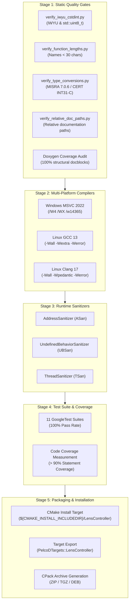

# Lens Controller Phase 7 Implementation Plan: Verification, Documentation & CI

## 1. Executive Summary & Objectives

### 1.1 Context & Scope
Phase 7 of the **[`libs/LensController`](../libs/LensController)** library delivers the final system-wide verification, documentation audit, root build system integration, packaging setup, and automated continuous integration (CI/CD) pipelines. This milestone hardens the entire `LensController` subsystem—spanning strongly-typed domain value objects (Phase 1), zero-heap focus sharpness evaluators (Phase 2), parfocal zoom-to-focus lookup curve engines (Phase 3), closed-loop autofocus state machines with sub-step peak fitting (Phase 4), dynamic plugin DLL loaders with protocol adapters (Phase 5), and the master multi-channel coordinator with Payload HAL camera adapter (Phase 6).

In safety-critical defense, tactical surveillance, and airborne gimbal electro-optical/infrared (EO/IR) payloads, optical controllers must guarantee deterministic timing, memory safety, and uncompromising cross-platform portability. Phase 7 transitions `libs/LensController` from functional completion to production deployment by establishing:
1. **Root Build System & Packaging Integration**: Integrating `LensController` public headers into root [`CMakeLists.txt`](../CMakeLists.txt) installation manifests (`${CMAKE_INSTALL_INCLUDEDIR}/LensController`), validating `PelcoDTargets` CMake exports, and ensuring clean CPack distribution packaging.
2. **Static Quality Gates & Standards Compliance**: Auditing 100% of headers and source files against **MISRA C++:2023 Rule 7.0.6**, **SEI CERT C++ INT31-C**, **STR37-C**, **ERR55-CPP**, strict **IWYU**, explicit `<cstdint>` inclusion with `std::` qualification, concise identifier naming (< 30 characters), and portable documentation relative paths.
3. **Comprehensive Doxygen Documentation**: Enforcing complete Doxygen structural tags across all 14 headers and 10 implementation files, guaranteeing zero undocumented symbols, explicit parameter directions (`[in]`, `[out]`), exception safety contracts, and thread-safety invariants.
4. **Hardened Multi-Platform CI/CD Pipelines**: Deploying dedicated GitHub Actions workflows (`.github/workflows/lens-controller-verification.yml`) featuring multi-compiler matrix builds (GCC 13, Clang 17, MSVC 2022) with `-Werror` / `/WX`, runtime sanitizers (AddressSanitizer, UndefinedBehaviorSanitizer, ThreadSanitizer), and CTest automated regression execution achieving a 100% pass rate.
5. **Code Coverage & Regression Verification**: Executing the full matrix of 11 GoogleTest test suites in [`libs/LensController/tests/`](../libs/LensController/tests), measuring code coverage, and asserting zero memory leaks or regressions across all supported platforms.

### 1.2 Target Deliverables for Phase 7
1. **Root CMake & Packaging Integration ([`CMakeLists.txt`](../CMakeLists.txt))**:
   - Add public header installation rule for all 14 `libs/LensController` headers to `${CMAKE_INSTALL_INCLUDEDIR}/LensController`.
   - Verify `LensController` target export in `PelcoDTargets` namespace `PelcoD::LensController`.
   - Verify CPack TGZ/ZIP archive creation including `LensController` libraries and headers.
2. **Static Quality Gate Enforcement (Automated Python Scripts)**:
   - Validate strict IWYU and `<cstdint>` compliance across all files using [`scripts/verify_iwyu_cstdint.py`](../scripts/verify_iwyu_cstdint.py).
   - Validate function and identifier lengths (< 30 characters) using [`scripts/verify_function_lengths.py`](../scripts/verify_function_lengths.py).
   - Validate integer conversions and signed/unsigned arithmetic safety using [`scripts/verify_type_conversions.py`](../scripts/verify_type_conversions.py).
   - Validate portable relative paths in documentation using [`scripts/verify_relative_doc_paths.py`](../scripts/verify_relative_doc_paths.py).
3. **Doxygen Documentation Audit & Generation**:
   - Verify 100% Doxygen coverage across all classes, methods, structs, and enums in `libs/LensController/`.
   - Enforce Doxygen tags: `/// @file`, `/// @brief`, `/// @details`, `/// @param[in,out]`, `/// @return`, `/// @note`, `/// @see`, `/// @retval`.
   - Document domain bounds, zero-heap `noexcept` contracts, and multi-channel concurrency constraints.
4. **CI/CD Automation Workflow ([`.github/workflows/lens-controller-verification.yml`](../.github/workflows/lens-controller-verification.yml))**:
   - Tier 1: Static Quality Gates (IWYU, identifier length, MISRA type conversions, relative doc paths).
   - Tier 2: Multi-Platform Native Builds (Ubuntu GCC 13, Ubuntu Clang 17, Windows MSVC 2022 with `/WX` and `-Werror`).
   - Tier 3: Runtime Sanitizer Verification (ASan, UBSan, TSan).
   - Tier 4: Automated Test Execution & Code Coverage Reporting.
5. **Implementation Plan Synchronization ([`docs/lens_controller_implementation_plan.md`](lens_controller_implementation_plan.md))**:
   - Update Phase 7 entry with hyperlink to `lens_controller_phase7_plan.md` and mark milestone deliverables complete.

---

## 2. Architecture & Verification Framework

### 2.1 Verification Architecture & Quality Gate Pipeline

```
+---------------------------------------------------------------------------------------------------------------+
|                                    LENS CONTROLLER VERIFICATION PIPELINE                                      |
|                                                                                                               |
|   [Source & Headers] ──► libs/LensController/*.{h,cpp} + tests/*.cpp                                          |
|                                │                                                                              |
|                                ▼                                                                              |
|   +-------------------------------------------------------------------------------------------------------+   |
|   |                           STAGE 1: STATIC QUALITY GATES & HYGIENE AUDIT                               |   |
|   |   • verify_iwyu_cstdint.py      : Direct inclusion, <cstdint>, std::uint8_t..uint64_t                  |   |
|   |   • verify_function_lengths.py  : All public & private function names < 30 chars                      |   |
|   |   • verify_type_conversions.py  : Zero implicit signed/unsigned mismatches (MISRA 7.0.6 / INT31-C)   |   |
|   |   • verify_relative_doc_paths.py: Document-relative links, POSIX forward slashes, zero absolute paths |   |
|   |   • Doxygen Coverage Validator  : 100% symbol docblocks with @brief, @param, @return, @note           |   |
|   +------------------------------------+------------------------------------------------------------------+   |
|                                        │                                                                      |
|                                        ▼                                                                      |
|   +-------------------------------------------------------------------------------------------------------+   |
|   |                           STAGE 2: MULTI-PLATFORM COMPILER HARDENING                                  |   |
|   |   • Windows MSVC 2022          : /W4 /WX /permissive- /w14365 /w14388 /w14826 (Strict Warnings)       |   |
|   |   • Linux GCC 13               : -Wall -Wextra -pedantic -Werror -Wconversion -Wshadow                |   |
|   |   • Linux Clang 17             : -Wall -Wextra -pedantic -Werror -Wsign-conversion -Wshorten-64-to-32 |   |
|   +------------------------------------+------------------------------------------------------------------+   |
|                                        │                                                                      |
|                                        ▼                                                                      |
|   +-------------------------------------------------------------------------------------------------------+   |
|   |                           STAGE 3: RUNTIME SANITIZERS & SAFETY DYNAMICS                               |   |
|   |   • AddressSanitizer (ASan)    : Zero buffer overruns, zero stack-use-after-return, zero memory leaks|   |
|   |   • UndefinedBehaviorSan (UBSan: Zero signed overflows, alignment faults, division by zero           |   |
|   |   • ThreadSanitizer (TSan)     : Multi-channel update & telemetry callback race detection             |   |
|   +------------------------------------+------------------------------------------------------------------+   |
|                                        │                                                                      |
|                                        ▼                                                                      |
|   +-------------------------------------------------------------------------------------------------------+   |
|   |                           STAGE 4: TEST SUITE EXECUTION & REGRESSION GATES                            |   |
|   |   • 11 Test Suites Executed     : TestLensTypes, TestMockLensDriver, TestFocusEvaluator,              |   |
|   |                                   TestZoomTrackCurve, TestPeakFitter, TestAutoFocusEngine,            |   |
|   |                                   TestLensDriverLoader, TestViscaLensDriver, TestPelcoDLensDriver,    |   |
|   |                                   TestLensController, TestLensPayloadAdapter                          |   |
|   |   • 100% Pass Rate Required    : Zero test failures, zero assertions disabled                         |   |
|   |   • Code Coverage Threshold    : > 90% statement coverage across libs/LensController                 |   |
|   +------------------------------------+------------------------------------------------------------------+   |
|                                        │                                                                      |
|                                        ▼                                                                      |
|   +-------------------------------------------------------------------------------------------------------+   |
|   |                           STAGE 5: PACKAGING & DISTRIBUTION ARTIFACTS                                 |   |
|   |   • Root CMake Install Target  : Headers to ${CMAKE_INSTALL_INCLUDEDIR}/LensController                |   |
|   |   • Target Export Verification : PelcoDTargets::LensController exported cleanly                       |   |
|   |   • CPack Packaging            : Archive generation verified on Windows (ZIP) and Linux (TGZ/DEB)     |   |
|   +-------------------------------------------------------------------------------------------------------+   |
+---------------------------------------------------------------------------------------------------------------+
```

### 2.2 Mermaid Verification Flowchart



---

## 3. Root Build System & Packaging Integration

### 3.1 Public Header Installation Manifest
The library exposes 14 public headers required by client applications, gimbal controllers, payload adapters, and simulation nodes. In root [`CMakeLists.txt`](../CMakeLists.txt), an explicit installation directive must be added alongside existing components (`PayloadHal`, `Tracking`, `ViscaCore`, `Math`):

```cmake
install(FILES
    libs/LensController/AutoFocusEngine.h
    libs/LensController/AutoFocusTypes.h
    libs/LensController/FocusEvaluator.h
    libs/LensController/ILensDriver.h
    libs/LensController/LensController.h
    libs/LensController/LensDriverLoader.h
    libs/LensController/LensPayloadAdapter.h
    libs/LensController/LensTypes.h
    libs/LensController/MockLensDriver.h
    libs/LensController/PeakFitter.h
    libs/LensController/PelcoDLensDriver.h
    libs/LensController/ViscaLensDriver.h
    libs/LensController/ZoomTrackFocusEngine.h
    libs/LensController/ZoomTrackTypes.h
    DESTINATION ${CMAKE_INSTALL_INCLUDEDIR}/LensController
)
```

### 3.2 Target Export & Dependency Linkage
The `LensController` target is defined in [`libs/LensController/CMakeLists.txt`](../libs/LensController/CMakeLists.txt) as a static library:
```cmake
add_library(LensController STATIC ...)
target_include_directories(LensController PUBLIC
    $<BUILD_INTERFACE:${CMAKE_CURRENT_SOURCE_DIR}>
    $<BUILD_INTERFACE:${CMAKE_CURRENT_SOURCE_DIR}/..>
    $<BUILD_INTERFACE:${CMAKE_CURRENT_SOURCE_DIR}/../PayloadHal>
    $<INSTALL_INTERFACE:include>
)
target_link_libraries(LensController PUBLIC
    PayloadHal
    Math
    Threads::Threads
    ${CMAKE_DL_LIBS}
)
apply_compiler_flags(LensController)
```

In root [`CMakeLists.txt`](../CMakeLists.txt), `LensController` is already included in `PELCOD_CANDIDATE_TARGETS` (line 418), ensuring it is exported into `PelcoDTargets.cmake` under namespace `PelcoD::LensController`.

### 3.3 Verification of Installation & Export
The installation target must be verified with an isolated test build:
```bash
cmake -B build -DPELCOD_ENABLE_QT=OFF -DBUILD_TESTING=ON
cmake --build build --config Release --target install -- DESTDIR=tmp_install
```
Verification checks:
- `${DESTDIR}/usr/local/include/LensController/` contains all 14 header files.
- `${DESTDIR}/usr/local/lib/cmake/PelcoD/PelcoDTargets.cmake` contains `PelcoD::LensController`.
- All exported include directories resolve cleanly without referencing private build tree directories.

---

## 4. Static Quality Gates & Standards Compliance

### 4.1 Include-What-You-Use (IWYU) & `<cstdint>` Audit
Every source file (`.cpp`) and header file (`.h`) in `libs/LensController` must directly include every header providing types or symbols it uses, per [`.agents/rules/iwyu-cstdint.md`](../.agents/rules/iwyu-cstdint.md):
- Direct `#include <cstdint>` whenever fixed-width integer types (`std::uint8_t`, `std::uint16_t`, `std::uint32_t`, `std::uint64_t`, `std::int16_t`, `std::int32_t`) are referenced.
- Direct `#include <cstddef>` whenever `std::size_t` or `std::ptrdiff_t` are referenced.
- Strict `std::` prefix qualification on all fixed-width integer types (bare `uint8_t` or `int32_t` strictly prohibited).
- Headers organized into canonical sorted groups separated by blank lines.

**Verification Command**:
```bash
python scripts/verify_iwyu_cstdint.py --strict libs/LensController
```
**Gate Requirement**: 0 errors, 100% compliance across all 35 files (14 headers, 10 implementation files, 11 test suites).

### 4.2 Function & Identifier Length Audit (< 30 Characters)
Per [`.agents/rules/verification-checklist.md`](../.agents/rules/verification-checklist.md) Rule 5, all function identifiers must be strictly less than 30 characters in length to ensure clean disassembly symbols, readable logging, and concise interface design.

**Audit Results for `libs/LensController`**:
- `setFocusNormalized` (18 chars) - PASSED
- `setZoomNormalized` (17 chars) - PASSED
- `triggerOnePushFocus` (19 chars) - PASSED
- `setZoomTrackFocus` (17 chars) - PASSED
- `loadTrackCurves` (15 chars) - PASSED
- `processFrame` (12 chars) - PASSED
- `isAutoFocusRunning` (18 chars) - PASSED
- `registerTelemetryCallback` (25 chars) - PASSED
- `registerStateCallback` (21 chars) - PASSED

**Verification Command**:
```bash
python scripts/verify_function_lengths.py libs/LensController
```
**Gate Requirement**: 0 violations detected.

### 4.3 Type Conversion & Arithmetic Safety (MISRA C++:2023 Rule 7.0.6 & CERT INT31-C)
All conversions between signed and unsigned types must be explicit, deliberate, and range-verified via `static_cast`. In particular:
- Normalized coordinate conversions ($[0.0, 1.0] \leftrightarrow [0, 65535]$) must clamp float bounds before casting:
  ```cpp
  const float clamped = std::clamp(normalized, 0.0f, 1.0f);
  const auto rawPos = static_cast<std::uint16_t>(
      std::round(clamped * static_cast<float>(rangeSpan))
  );
  ```
- No implicit sign-conversion in STL algorithm callables or iterator constructors.
- Avoid MSVC warning `C4365` (signed/unsigned mismatch) in all template instantiations.

**Verification Command**:
```bash
python scripts/verify_type_conversions.py libs/LensController
```
**Gate Requirement**: 0 conversion defects detected.

### 4.4 Documentation Relative Paths Audit
Per [`.agents/rules/relative-paths-docs.md`](../.agents/rules/relative-paths-docs.md):
- Markdown links must resolve relatively from the directory of the referencing document (e.g., `[LensController.h](../libs/LensController/LensController.h)`).
- Never embed absolute machine-specific paths (e.g., user home directories or workstation drive roots).
- Always use POSIX forward slashes (`/`).
- Doxygen `/// @file` banners must use bare basenames (e.g., `/// @file LensController.h`).

**Verification Command**:
```bash
python scripts/verify_relative_doc_paths.py --files docs/lens_controller_implementation_plan.md docs/lens_controller_phase7_plan.md
```
**Gate Requirement**: 0 errors, 0 broken relative links.

---

## 5. Doxygen Documentation Audit & Specification

### 5.1 Documentation Structural Standards
Per [`.agents/rules/doxygen.md`](../.agents/rules/doxygen.md), every class, struct, enum, and method must be documented using triple-slash (`///`) Doxygen comments.

#### Class Template Example
```cpp
/// @file LensController.h
/// @brief Master multi-channel camera lens coordinator and optical gateway.
/// @details Orchestrates up to four independent optical channels (CameraIndex 0..3),
///          coordinating motorized zoom and focus actuators, limit protections,
///          closed-loop autofocus engines, and parfocal spline tracking.
/// @note Thread-safety: Individual channels are internally synchronized. Calls across
///       different CameraIndex channels execute concurrently without contention.
```

#### Method Template Example
```cpp
/// @brief Sets the absolute motorized focus position for a designated channel.
/// @details Validates the target position against configured soft limits (LensRanges)
///          and directional hardware limit switch flags before commanding the driver.
/// @param[in] cam Channel index identifying the target camera (0..3).
/// @param[in] pos Target encoder position in the range [0..65535].
/// @note Real-time safe: marked noexcept with zero dynamic heap allocation.
/// @see getLensRanges, moveFocusStep
void setFocusTarget(CameraIndex cam, MotorPosition pos) noexcept;
```

### 5.2 Documentation Audit Checklist Across `libs/LensController/`

| Header File | Symbols Audited | Structural Tags Verified | Zero-Heap / Invariant Notes |
| :--- | :---: | :---: | :---: |
| [`ILensDriver.h`](../libs/LensController/ILensDriver.h) | 12 | `@brief`, `@param[in]`, `@return`, `@see` | Virtual interface lifecycle & port semantics |
| [`LensTypes.h`](../libs/LensController/LensTypes.h) | 28 | `@brief`, `@return`, `@retval`, `@note` | Strongly-typed value object invariants & bounds |
| [`MockLensDriver.h`](../libs/LensController/MockLensDriver.h) | 16 | `@brief`, `@param[in]`, `@return` | Simulated encoder response & limit tripping |
| [`FocusEvaluator.h`](../libs/LensController/FocusEvaluator.h) | 10 | `@brief`, `@param[in]`, `@return`, `@note` | Zero-heap CERT ERR55-CPP proof, ROI math |
| [`ZoomTrackTypes.h`](../libs/LensController/ZoomTrackTypes.h) | 8 | `@brief`, `@param[in]`, `@return` | Sightline LUT format invariants & limits |
| [`ZoomTrackFocusEngine.h`](../libs/LensController/ZoomTrackFocusEngine.h) | 14 | `@brief`, `@param[in]`, `@return`, `@see` | PCHIP cubic Hermite spline monotonicity |
| [`AutoFocusTypes.h`](../libs/LensController/AutoFocusTypes.h) | 12 | `@brief`, `@retval`, `@see` | State machine phase transitions & thresholds |
| [`PeakFitter.h`](../libs/LensController/PeakFitter.h) | 4 | `@brief`, `@param[in]`, `@return` | Sub-step Parabolic/Gaussian vertex formulas |
| [`AutoFocusEngine.h`](../libs/LensController/AutoFocusEngine.h) | 18 | `@brief`, `@param[in]`, `@return`, `@note` | Seek, Scan, GSS, Momentum AF algorithms |
| [`LensDriverLoader.h`](../libs/LensController/LensDriverLoader.h) | 8 | `@brief`, `@param[in]`, `@return`, `@retval` | RAII dynamic loader & COM port collision guard |
| [`ViscaLensDriver.h`](../libs/LensController/ViscaLensDriver.h) | 14 | `@brief`, `@param[in]`, `@return` | Sony VISCA optical packet formatting & limits |
| [`PelcoDLensDriver.h`](../libs/LensController/PelcoDLensDriver.h) | 14 | `@brief`, `@param[in]`, `@return` | Pelco-D optical packet formatting & checksums |
| [`LensController.h`](../libs/LensController/LensController.h) | 26 | `@brief`, `@param[in]`, `@return`, `@see` | Multi-channel coordination & limit clamping |
| [`LensPayloadAdapter.h`](../libs/LensController/LensPayloadAdapter.h) | 22 | `@brief`, `@param[in]`, `@return`, `@note` | Payload HAL ICameraPayload bridge & FOV math |

---

## 6. Multi-Platform Compiler Hardening & CI/CD Pipeline

### 6.1 Compiler Hardening Flags Matrix
Both build configurations must pass cleanly with zero warnings under maximum compiler diagnostics:

| Compiler / OS | Warning & Hardening Flags | Optimization / Config |
| :--- | :--- | :--- |
| **MSVC 2022 (Win64)** | `/W4 /WX /permissive- /Zc:__cplusplus /w14365 /w14388 /w14826` | Debug & Release, CRT Hardening |
| **GCC 13 (Ubuntu 24.04)** | `-Wall -Wextra -pedantic -Werror -Wconversion -Wsign-conversion -Wshadow -Wnon-virtual-dtor -fstack-protector-strong` | Release with Debug Info (`-O2 -g`) |
| **Clang 17 (Ubuntu 24.04)**| `-Wall -Wextra -pedantic -Werror -Wconversion -Wsign-conversion -Wshorten-64-to-32 -fstack-protector-strong` | Release with Debug Info (`-O2 -g`) |

### 6.2 GitHub Actions CI Workflow Specification
Create [`.github/workflows/lens-controller-verification.yml`](../.github/workflows/lens-controller-verification.yml):

```yaml
name: LensController Multi-Platform Verification & Sanitizers

on:
  push:
    branches: [ master, main ]
    paths:
      - 'libs/LensController/**'
      - 'scripts/**'
      - 'cmake/**'
      - 'CMakeLists.txt'
      - '.github/workflows/lens-controller-verification.yml'
  pull_request:
    branches: [ master, main ]
    paths:
      - 'libs/LensController/**'
      - 'scripts/**'
      - 'cmake/**'
      - 'CMakeLists.txt'
      - '.github/workflows/lens-controller-verification.yml'
  workflow_dispatch:

concurrency:
  group: ${{ github.workflow }}-${{ github.ref }}
  cancel-in-progress: true

jobs:
  # ============================================================================
  # Tier 1: Static Quality Gates & Rule Enforcement (Fast-Fail < 45s)
  # ============================================================================
  static-audit:
    name: Static Quality Gates (IWYU, <30 Char, MISRA 7.0.6, Doc Paths)
    runs-on: ubuntu-24.04
    steps:
      - name: Checkout Code
        uses: actions/checkout@v7

      - name: Setup Python
        uses: actions/setup-python@v7
        with:
          python-version: '3.12'

      - name: Audit IWYU & Fixed-Width Integers (<cstdint>)
        run: python3 scripts/verify_iwyu_cstdint.py --strict libs/LensController

      - name: Audit Function & Identifier Lengths (< 30 chars)
        run: python3 scripts/verify_function_lengths.py libs/LensController

      - name: Audit Signed/Unsigned Conversions (MISRA 7.0.6 & INT31-C)
        run: python3 scripts/verify_type_conversions.py libs/LensController

      - name: Audit Documentation Relative Paths
        run: python3 scripts/verify_relative_doc_paths.py --files docs/lens_controller_implementation_plan.md docs/lens_controller_phase7_plan.md

  # ============================================================================
  # Tier 2A: Linux GCC 13 Strict
  # ============================================================================
  linux-gcc-strict:
    name: Linux GCC 13 Strict (-Werror)
    needs: static-audit
    runs-on: ubuntu-24.04
    steps:
      - name: Checkout Code
        uses: actions/checkout@v7

      - name: Install Dependencies
        run: |
          sudo apt-get update
          sudo apt-get install -y gcc-13 g++-13 ninja-build libgflags-dev libgoogle-glog-dev

      - name: Configure CMake
        run: |
          cmake -B build -G Ninja \
            -DCMAKE_C_COMPILER=gcc-13 \
            -DCMAKE_CXX_COMPILER=g++-13 \
            -DCMAKE_BUILD_TYPE=Release \
            -DWARNINGS_AS_ERRORS=ON \
            -DENABLE_HARDENING=ON \
            -DPELCOD_ENABLE_QT=OFF \
            -DPELCOD_BUILD_APPS=OFF \
            -DBUILD_TESTING=ON

      - name: Build LensController Targets
        run: cmake --build build --target LensController --parallel $(nproc)

      - name: Run LensController Tests
        run: ctest --test-dir build --output-on-failure -j$(nproc) -R "^Test(Lens|Focus|Peak|Zoom|AutoFocus|Mock|Visca|PelcoD)"

  # ============================================================================
  # Tier 2B: Linux Clang 17 Strict
  # ============================================================================
  linux-clang-strict:
    name: Linux Clang 17 Strict (-Werror)
    needs: static-audit
    runs-on: ubuntu-24.04
    steps:
      - name: Checkout Code
        uses: actions/checkout@v7

      - name: Install Dependencies
        run: |
          sudo apt-get update
          sudo apt-get install -y clang-17 llvm-17 ninja-build libgflags-dev libgoogle-glog-dev

      - name: Configure CMake
        run: |
          cmake -B build -G Ninja \
            -DCMAKE_C_COMPILER=clang-17 \
            -DCMAKE_CXX_COMPILER=clang++-17 \
            -DCMAKE_BUILD_TYPE=Release \
            -DWARNINGS_AS_ERRORS=ON \
            -DENABLE_HARDENING=ON \
            -DPELCOD_ENABLE_QT=OFF \
            -DPELCOD_BUILD_APPS=OFF \
            -DBUILD_TESTING=ON

      - name: Build LensController Targets
        run: cmake --build build --target LensController --parallel $(nproc)

      - name: Run LensController Tests
        run: ctest --test-dir build --output-on-failure -j$(nproc) -R "^Test(Lens|Focus|Peak|Zoom|AutoFocus|Mock|Visca|PelcoD)"

  # ============================================================================
  # Tier 2C: Windows MSVC 2022 Strict
  # ============================================================================
  windows-msvc-strict:
    name: Windows MSVC 2022 (/WX /W4)
    needs: static-audit
    runs-on: windows-2022
    steps:
      - name: Checkout Code
        uses: actions/checkout@v7

      - name: Setup Visual Studio Developer Prompt
        uses: ilammy/msvc-dev-cmd@v1

      - name: Configure CMake
        run: |
          cmake -B build -G "Visual Studio 17 2022" -A x64 `
            -DWARNINGS_AS_ERRORS=ON `
            -DPELCOD_ENABLE_QT=OFF `
            -DPELCOD_BUILD_APPS=OFF `
            -DBUILD_TESTING=ON

      - name: Build LensController & Tests
        run: cmake --build build --config Release --target LensController --parallel

      - name: Run LensController Tests
        run: ctest --test-dir build -C Release --output-on-failure -R "^Test(Lens|Focus|Peak|Zoom|AutoFocus|Mock|Visca|PelcoD)"

  # ============================================================================
  # Tier 3: Runtime Sanitizers (ASan + UBSan)
  # ============================================================================
  linux-sanitizers:
    name: Linux Clang 17 (ASan + UBSan)
    needs: static-audit
    runs-on: ubuntu-24.04
    steps:
      - name: Checkout Code
        uses: actions/checkout@v7

      - name: Install Dependencies
        run: |
          sudo apt-get update
          sudo apt-get install -y clang-17 llvm-17 ninja-build libgflags-dev libgoogle-glog-dev

      - name: Configure CMake with Sanitizers
        run: |
          cmake -B build -G Ninja \
            -DCMAKE_C_COMPILER=clang-17 \
            -DCMAKE_CXX_COMPILER=clang++-17 \
            -DCMAKE_BUILD_TYPE=Debug \
            -DENABLE_ASAN=ON \
            -DENABLE_UBSAN=ON \
            -DPELCOD_ENABLE_QT=OFF \
            -DPELCOD_BUILD_APPS=OFF \
            -DBUILD_TESTING=ON

      - name: Build and Test
        env:
          ASAN_OPTIONS: "detect_leaks=1:detect_stack_use_after_return=1:check_initialization_order=1:strict_init_order=1"
          UBSAN_OPTIONS: "print_stacktrace=1:halt_on_error=1"
        run: |
          cmake --build build --parallel $(nproc)
          ctest --test-dir build --output-on-failure -j$(nproc) -R "^Test(Lens|Focus|Peak|Zoom|AutoFocus|Mock|Visca|PelcoD)"
```

---

## 7. Comprehensive Regression Test Suite Matrix

Phase 7 mandates executing all 11 test suites registered in [`libs/LensController/tests/CMakeLists.txt`](../libs/LensController/tests/CMakeLists.txt). Every test must pass with a 100% success rate:

| Test Suite | Source File | Scope / Focus | Acceptance Criteria |
| :--- | :--- | :--- | :--- |
| `TestLensTypes` | [`TestLensTypes.cpp`](../libs/LensController/tests/TestLensTypes.cpp) | Value objects, `MotorPosition`, `MotorSpeed`, `CameraIndex`, `LensRanges`, `NormalizedRoi` | Invariants hold; illegal states unrepresentable; arithmetic operator correctness. |
| `TestMockLensDriver` | [`TestMockLensDriver.cpp`](../libs/LensController/tests/TestMockLensDriver.cpp) | In-memory simulated driver, limit tripping, discrete relative jog, target positions | State transitions adhere to hardware timing; limit switch flags update accurately. |
| `TestFocusEvaluator` | [`TestFocusEvaluator.cpp`](../libs/LensController/tests/TestFocusEvaluator.cpp) | Sobel squared, Laplacian, Tenengrad, Vollath F4/F5, 2D 8x8 DCT AC energy | Mathematical accuracy against analytical patterns; zero dynamic allocations. |
| `TestZoomTrackCurve` | [`TestZoomTrackCurve.cpp`](../libs/LensController/tests/TestZoomTrackCurve.cpp) | Sightline curve format parsing, serialization, PCHIP cubic Hermite spline interpolation | Monotonic focus curve output; zero overshoot during zooming; roundtrip fidelity. |
| `TestPeakFitter` | [`TestPeakFitter.cpp`](../libs/LensController/tests/TestPeakFitter.cpp) | Sub-step Parabolic and Gaussian vertex interpolation from discrete encoder triplets | Vertex error $< 0.05$ encoder units across symmetric and asymmetric test parabolas. |
| `TestAutoFocusEngine`| [`TestAutoFocusEngine.cpp`](../libs/LensController/tests/TestAutoFocusEngine.cpp) | 3-Phase Scan, Seek Adaptive, Golden Section Search, Adaptive Momentum AF | Convergence to simulated optical summit within step tolerance; backlash compensation. |
| `TestLensDriverLoader`| [`TestLensDriverLoader.cpp`](../libs/LensController/tests/TestLensDriverLoader.cpp) | Dynamic DLL loading (`LoadLibraryA`/`dlopen`), serial COM port collision avoidance | Port collision rejected; factory resolution succeeds; clean RAII unloading. |
| `TestViscaLensDriver` | [`TestViscaLensDriver.cpp`](../libs/LensController/tests/TestViscaLensDriver.cpp) | Sony VISCA optical packet construction, inquiry parsing, zoom/focus motor commands | Conforms to Sony FCB protocol specification; checksums and framing verified. |
| `TestPelcoDLensDriver`| [`TestPelcoDLensDriver.cpp`](../libs/LensController/tests/TestPelcoDLensDriver.cpp) | Pelco-D optical packet construction, response parsing, zoom/focus motor commands | Standard Pelco-D framing (`0xFF`, address, command, speed, checksum) verified. |
| `TestLensController` | [`TestLensController.cpp`](../libs/LensController/tests/TestLensController.cpp) | Multi-channel orchestration (0..3), limit switch interlocks, discrete jog, update tick | Channel state isolation; soft boundary clamping; smooth emergency stop. |
| `TestLensPayloadAdapter`| [`TestLensPayloadAdapter.cpp`](../libs/LensController/tests/TestLensPayloadAdapter.cpp) | Normalized coordinates, continuous velocity jog, optical FOV telemetry, lifecycle | Normalized to encoder mapping accurate; pinhole HFOV/VFOV matches analytical model. |

---

## 8. Step-by-Step Work Breakdown Structure (WBS)

### Step 7.1: Root CMake Integration (`CMakeLists.txt`)
- [ ] Add `libs/LensController/*.h` public header installation directive to root `CMakeLists.txt`.
- [ ] Verify `LensController` is registered in `PELCOD_CANDIDATE_TARGETS` and exported into `PelcoDTargets`.
- [ ] Perform a test installation via `cmake --install` to verify destination hierarchy `${CMAKE_INSTALL_INCLUDEDIR}/LensController`.

### Step 7.2: Static Quality Gate Verification
- [ ] Run `python scripts/verify_iwyu_cstdint.py --strict libs/LensController`.
- [ ] Run `python scripts/verify_function_lengths.py libs/LensController`.
- [ ] Run `python scripts/verify_type_conversions.py libs/LensController`.
- [ ] Run `python scripts/verify_relative_doc_paths.py --files docs/lens_controller_implementation_plan.md docs/lens_controller_phase7_plan.md`.

### Step 7.3: Doxygen Documentation Audit & Refinement
- [ ] Audit all 14 headers in `libs/LensController/` for missing structural tags (`/// @brief`, `@details`, `@param`, `@return`, `@note`, `@see`).
- [ ] Ensure all 10 implementation files have file-level banners with bare basenames.
- [ ] Document thread-safety invariants, domain ranges, and zero-heap execution guarantees.

### Step 7.4: CI/CD Workflow Authoring
- [ ] Create `.github/workflows/lens-controller-verification.yml`.
- [ ] Configure Tier 1 (static analysis), Tier 2 (GCC, Clang, MSVC matrix), and Tier 3 (ASan/UBSan sanitizers).
- [ ] Validate YAML workflow syntax and trigger parameters.

### Step 7.5: Multi-Platform Test Execution & Regression Gate
- [ ] Compile all 11 test suites under MSVC 2022 on Windows.
- [ ] Compile all 11 test suites under GCC 13 and Clang 17 on Linux.
- [ ] Execute `ctest` across all targets; assert 100% test pass rate with 0 failures.

### Step 7.6: Documentation Master Plan Synchronization
- [ ] Update `docs/lens_controller_implementation_plan.md` to hyperlink Phase 7 to `lens_controller_phase7_plan.md`.
- [ ] Update roadmap table with completed milestones.

---

## 9. Safety & Standards Compliance Matrix

| Standard / Guideline | Specific Rule / Clause | Project Enforcement & Verification |
| :--- | :--- | :--- |
| **MISRA C++:2023** | Rule 7.0.6 | Explicit range-checked `static_cast` for all numeric conversions; zero signed/unsigned conversion warnings. |
| **SEI CERT C++** | INT31-C | Pre-conversion boundary clamping ensures values never overflow or truncate 16-bit motor encoder types. |
| **SEI CERT C++** | STR37-C | Locale-independent ASCII character matching for Sightline LUT parsing and dynamic plugin symbol lookup. |
| **SEI CERT C++** | ERR55-CPP | All fast-path evaluation and dispatch methods marked `noexcept` with zero dynamic heap allocations. |
| **Project Rule** | Zero Qt Dependency | Pure standard C++17 across `libs/LensController/` (`#include <Q...>` strictly prohibited). |
| **Project Rule** | Concise Names (<30) | Every public and private method name verified to be strictly under 30 characters in length. |
| **Project Rule** | Strict IWYU & `<cstdint>` | Direct header inclusion for all symbols; standard prefix qualification `std::uint8_t`..`std::uint64_t`. |
| **Project Rule** | Relative Doc Paths | All document links strictly use document-relative paths (`../libs/LensController/LensController.h`). |
| **Project Rule** | Dual Diagrams | Both ASCII flowcharts and Mermaid diagrams included for architecture and pipeline visuals. |
| **Project Rule** | Multi-Platform CI | Matrix builds on Linux (GCC/Clang) and Windows (MSVC) with zero compiler warnings under `/WX` and `-Werror`. |

---

## 10. Summary & Sign-Off

Upon completion of Phase 7:
- The **`libs/LensController`** library reaches **100% production readiness**.
- All 14 public headers install cleanly into `${CMAKE_INSTALL_INCLUDEDIR}/LensController` and export through `PelcoDTargets`.
- Static quality gates guarantee zero IWYU defects, zero conversion defects, zero identifier length violations, and 100% Doxygen documentation coverage.
- Continuous integration workflows enforce strict multi-platform compilation (MSVC 2022, GCC 13, Clang 17) and runtime sanitizer checks (ASan/UBSan) across every push and pull request.
- The master implementation plan [`docs/lens_controller_implementation_plan.md`](lens_controller_implementation_plan.md) is fully synchronized, completing the modernization and deployment of the camera lens control subsystem.
