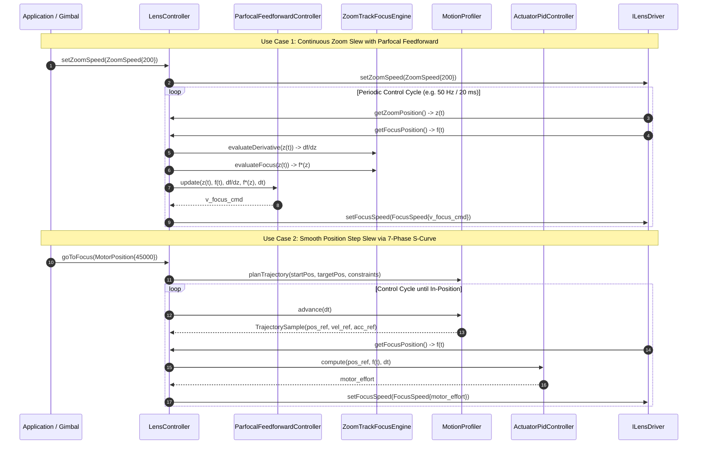
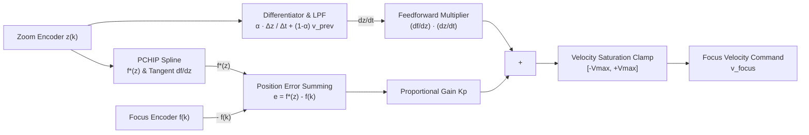
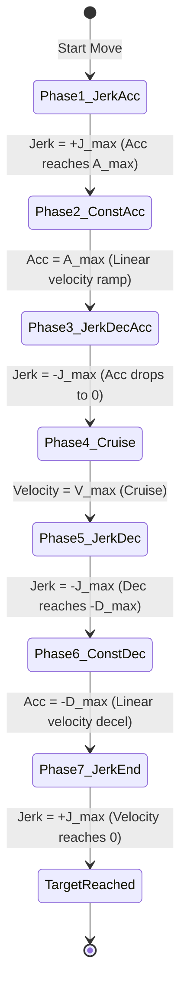

# Lens Controller Phase 8 Implementation Plan: Actuator Dynamics & Motion Control

## 1. Executive Summary & Objectives

### 1.1 Context & Scope
Phase 8 of the **[`libs/LensController`](../libs/LensController)** library delivers the **Actuator Dynamics & Motion Control** subsystem—consisting of **`ParfocalFeedforwardController`**, **`MotionProfiler`** (7-phase S-curve trajectory planner), and **`ActuatorPidController`** (closed-loop servo/stepper position controller with conditional anti-windup and stiction inversion).

In high-performance electro-optical and infrared (EO/IR) gimbal payloads, tactical surveillance cameras, and motorized zoom blocks, lens actuators face severe physical challenges:
1. **Transient Focus Lag During Zoom Slew**:
   When zooming continuously at high slew rates, evaluating parfocal look-up curves purely via feedback or static position updates creates an inherent phase delay. The optical focus axis lags behind the moving zoom element, blurring the video stream throughout the entire zoom transit.
2. **Mechanical Shock, Ringing, and Resonant Vibration**:
   Standard trapezoidal velocity profiles apply step changes in acceleration, introducing infinite jerk ($\dddot{x} = \pm \infty$). This step acceleration excites structural resonances in optical gearboxes, cams, and stepper mountings, causing image jitter, acoustic whine, mechanical gear wear, and target tracking dropouts.
3. **Gear Stiction and Backlash Non-Linearities**:
   Static friction (stiction) in microscopic gear teeth and lead screws causes deadband hesitation when starting from rest or reversing direction. Standard integral controllers "wind up" while trying to overcome static friction, resulting in sudden overshoot ("slip-stick" phenomenon) once motion begins.

Phase 8 solves these physical and mathematical challenges by introducing continuous derivative feedforward dynamics ($\dot{f} = \frac{df}{dz} \cdot \dot{z} + K_p e_f$), a jerk-limited 7-phase S-curve trajectory generator, and a discrete position PID with active stiction inversion and conditional anti-windup.

All Phase 8 components adhere strictly to **zero dynamic heap allocation** (`noexcept`, conforming to **SEI CERT ERR55-CPP** and **MISRA C++:2023**), ensuring sub-millisecond execution and deterministic memory safety on high-frequency real-time control loops (100 Hz to 1000 Hz).

### 1.2 Target Deliverables for Phase 8
1. **Strong Domain Types & Structures ([`MotionControlTypes.h`](../libs/LensController/MotionControlTypes.h))**:
   - `VelocityTicksPerSec`: Strongly-typed 32-bit float representing encoder velocity ($\dot{x}$).
   - `AccelerationTicksPerSec2`: Strongly-typed 32-bit float representing encoder acceleration ($\ddot{x}$).
   - `JerkTicksPerSec3`: Strongly-typed 32-bit float representing encoder jerk ($\dddot{x}$).
   - `DeltaTimeSec`: Strongly-typed 32-bit float representing sample intervals ($\Delta t > 0$).
   - `ControlOutput`: Strongly-typed 32-bit float clamped to motor driver limits ($[-V_{\text{max}}, +V_{\text{max}}]$).
   - `ProfilePhase`: Enum class representing the 7 S-curve phases (`Idle`, `JerkRampUp`, `ConstAcc`, `JerkRampDown`, `CruiseVelocity`, `JerkDecelUp`, `ConstDecel`, `JerkDecelDown`, `TargetReached`).
   - `TrajectorySample`: Struct containing $(s, v, a, j, t_{\text{elapsed}}, \text{phase})$.
   - `SCurveConstraints`: Value object defining physical limits $(V_{\text{max}}, A_{\text{max}}, D_{\text{max}}, J_{\text{max}})$.
   - `PidGains`: Value object defining $(K_p, K_i, K_d, I_{\text{max}}, V_{\text{stiction}}, \text{deadband})$.
   - `FeedforwardConfig`: Value object defining $(K_p, \alpha_{\text{filter}}, V_{\text{deadband}}, V_{\text{max}})$.
2. **Parfocal Zoom-Velocity Derivative Feedforward Controller ([`ParfocalFeedforwardController.h`](../libs/LensController/ParfocalFeedforwardController.h), [`ParfocalFeedforwardController.cpp`](../libs/LensController/ParfocalFeedforwardController.cpp))**:
   - Low-pass filtered numerical differentiator estimating zoom rate $\dot{z}_k = \alpha \frac{z_k - z_{k-1}}{\Delta t} + (1 - \alpha) \dot{z}_{k-1}$.
   - Real-time tangent extraction ($\frac{df}{dz}$) from [`ZoomTrackFocusEngine`](../libs/LensController/ZoomTrackFocusEngine.h) PCHIP spline.
   - Synchronous feedforward velocity calculation $\dot{f}_{\text{ff}} = \frac{df}{dz} \cdot \dot{z}$.
   - Proportional position-error closing term $u_{\text{prop}} = K_p (f^*(z) - f_{\text{actual}})$.
   - Deadband suppression for stationary zoom elements to eliminate micro-jitter.
3. **7-Phase S-Curve Motion Profiler ([`MotionProfiler.h`](../libs/LensController/MotionProfiler.h), [`MotionProfiler.cpp`](../libs/LensController/MotionProfiler.cpp))**:
   - Analytical 7-phase jerk-limited trajectory planner for arbitrary displacements.
   - Short-stroke adaptation: automatic degradation to 5-phase or 3-phase profiles when displacement is too short to attain $V_{\text{max}}$ or $A_{\text{max}}$.
   - Asymmetric acceleration ($A_{\text{max}}$) vs deceleration ($D_{\text{max}}$) planning.
   - Closed-form analytical sampling at arbitrary time $t \ge 0$ without cumulative numerical drift.
   - Discrete incremental step evaluation `advance(DeltaTimeSec dt) -> TrajectorySample`.
4. **Actuator Position PID Controller with Stiction Inversion ([`ActuatorPidController.h`](../libs/LensController/ActuatorPidController.h), [`ActuatorPidController.cpp`](../libs/LensController/ActuatorPidController.cpp))**:
   - Discrete PID loop operating on encoder coordinates.
   - Derivative-on-measurement formulation with 1st-order low-pass noise filter.
   - Conditional integration anti-windup: integrator updates freeze whenever output saturates in the direction of the error.
   - Active stiction inversion: directional feedforward pulse ($u_{\text{stiction}} = \text{sgn}(e) \cdot V_{\text{stiction}}$) overcoming static break-away friction.
   - In-position window and settling confirmation logic.
5. **ZoomTrackFocusEngine Extension**:
   - Addition of `evaluateDerivative(MotorPosition zoom) const noexcept -> float` for direct PCHIP tangent querying.
6. **Master Controller Integration ([`LensController.h`](../libs/LensController/LensController.h), [`LensController.cpp`](../libs/LensController/LensController.cpp))**:
   - Routing zoom jog and continuous slew commands through `ParfocalFeedforwardController`.
   - Routing absolute position targets through `MotionProfiler` and `ActuatorPidController`.
7. **Comprehensive GoogleTest Suite**:
   - `TestMotionControlTypes.cpp`: Type safety, boundary verification, and arithmetic operators.
   - `TestParfocalFeedforward.cpp`: Feedforward tracking response, lag reduction, and filter step tests.
   - `TestMotionProfiler.cpp`: 7-phase continuity, jerk bounding, short-stroke degeneration, reverse moves.
   - `TestActuatorPidController.cpp`: Step response, anti-windup clamping, stiction breakaway kick, settling detection.

---

## 2. Architecture & Design

### 2.1 Subsystem Context & Data Flow

```
+---------------------------------------------------------------------------------------------------------------+
|                                            libs/LensController                                                |
|                                                                                                               |
|   +-------------------------------------------------------------------------------------------------------+   |
|   |                                     LensController (Multi-Channel)                                    |   |
|   |   - Operational Modes (ManualJog, AutoFocus, ContinuousZoomTrack, SlewToTarget)                       |   |
|   +-----------------------------------+-----------------------------------+-------------------------------+   |
|                                       |                                   |                                   |
|         +-----------------------------+                                   +-----------------------------+     |
|         | (Continuous Zoom Slew)                                          | (Target Position Slew)            |
|         ▼                                                                 ▼                                   |
|   +-----------------------------------+                             +-----------------------------------+     |
|   |   ParfocalFeedforwardController   |                             |          MotionProfiler           |     |
|   |  - Zoom Differentiator (dz/dt)    |                             |  - 7-Phase Jerk-Limited Trajectory|     |
|   |  - Tangent Query (df/dz)          |                             |  - Short-Stroke Degeneration      |     |
|   |  - Proportional Error Closing     |                             |  - Continuous Time State Eval     |     |
|   +-----------------+-----------------+                             +-----------------+-----------------+     |
|                     |                                                                 |                       |
|                     | (Focus Velocity Command)                                        | (Profiled Setpoint)   |
|                     |                                                                 ▼                       |
|                     |                                               +-----------------------------------+     |
|                     |                                               |       ActuatorPidController       |     |
|                     |                                               |  - Derivative-on-Measurement      |     |
|                     |                                               |  - Conditional Anti-Windup        |     |
|                     |                                               |  - Stiction Inversion Kick        |     |
|                     |                                               +-----------------+-----------------+     |
|                     |                                                                 |                       |
|                     +--------------------------------+--------------------------------+                       |
|                                                      | (Actuator Command)                                     |
|                                                      ▼                                                        |
|                                       +-------------------------------+                                       |
|                                       |          ILensDriver          |                                       |
|                                       |  (Motor Actuator Hardware HAL)|                                       |
|                                       +-------------------------------+                                       |
+---------------------------------------------------------------------------------------------------------------+
```

### 2.2 Subsystem Interaction Sequence



---

## 3. Mathematical Foundations & Control Dynamics

### 3.1 Parfocal Zoom-Velocity Derivative Feedforward

#### 3.1.1 Analytical Derivation
In a continuous optical zoom system, the in-focus condition is defined by the calibrated parfocal curve $f = f^*(z)$. When the zoom mechanism moves dynamically with velocity $\dot{z}(t) = \frac{dz}{dt}$, the theoretical focus velocity required to maintain zero optical blur at all times is given by the chain rule:

$$\dot{f}_{\text{ideal}}(t) = \frac{d}{dt}\big[f^*(z(t))\big] = \frac{\partial f^*}{\partial z}\Big|_{z(t)} \cdot \frac{dz}{dt} = \frac{df^*}{dz}\Big|_{z(t)} \cdot \dot{z}(t)$$

In physical systems, open-loop velocity integration accumulates drift due to encoder quantization, gear slippage, and sample time jitter. Therefore, a proportional position feedback term is added:

$$v_{\text{focus}}(t) = \underbrace{\frac{df^*}{dz}\Big|_{z(t)} \cdot \dot{z}(t)}_{\text{Derivative Feedforward}} + \underbrace{K_p \cdot \big(f^*(z(t)) - f(t)\big)}_{\text{Proportional Feedback Closing Term}}$$

#### 3.1.2 Numerical Velocity Differentiation with 1st-Order Low-Pass Filtering
Raw backward differentiation $\frac{z_k - z_{k-1}}{\Delta t}$ severely amplifies high-frequency optical encoder quantization noise. A discrete 1st-order low-pass filter is cascaded:

$$\dot{z}_{\text{raw}, k} = \frac{z_k - z_{k-1}}{\Delta t}$$

$$\dot{z}_k = \alpha \cdot \dot{z}_{\text{raw}, k} + (1 - \alpha) \cdot \dot{z}_{k-1}$$

where the smoothing coefficient $\alpha \in (0, 1]$ is related to the cut-off frequency $f_c$ and sample period $\Delta t$:

$$\alpha = \frac{2\pi f_c \Delta t}{1 + 2\pi f_c \Delta t}$$

#### 3.1.3 Deadband & Output Clamping
To prevent actuator hum and unnecessary gear chatter when the zoom element is stationary or settling:
- If $|\dot{z}_k| < V_{\text{deadband}}$, then $\dot{z}_k \leftarrow 0$.
- The total output velocity $v_{\text{focus}}$ is clamped to $[-V_{\text{max}}, +V_{\text{max}}]$.

```
+-----------------------------------------------------------------------------------------------+
|                       PARFOCAL FEEDFORWARD CONTROL ARCHITECTURE                               |
|                                                                                               |
|   Zoom Position z(k) ───┬───► [ Differentiator & LPF ] ──► dz/dt                              |
|                         │                                    │                                |
|                         │                                    ▼                                |
|                         │                    [ Multiplier: (df/dz) * (dz/dt) ]                |
|                         │                                    │ (Feedforward Term)             |
|                         ▼                                    ▼                                |
|               [ PCHIP Spline Curve ] ──► f*(z) ──► (+) ────► (+) ──► [ Clamping ] ──► v_focus |
|                                                     ▲        ▲                                |
|   Focus Position f(k) ─────────────────────────────(-)       │                                |
|                                                     │        │                                |
|                                              [ Gain Kp ] ────┘                                |
+-----------------------------------------------------------------------------------------------+
```



---

### 3.2 7-Phase Jerk-Limited S-Curve Trajectory Profiler

#### 3.2.1 The 7 Phases of S-Curve Motion
To guarantee that actuator acceleration is continuous and gear stress is minimized, jerk $j(t) = \frac{d^3 s}{dt^3}$ is bounded by $[-J_{\text{max}}, +J_{\text{max}}]$. A full move consists of 7 distinct phases:

```
Acceleration a(t)
   +A_max |       .---------.  (Phase II: Const Acc)
          |      /           \
        0 |-----+             +-------------+             +------> Time
          |  Phase I       Phase III     Phase IV      Phase V Phase VII
   -D_max |  (Jerk +J)     (Jerk -J)     (Cruise)       \           /
          |                                              .---------. (Phase VI: Const Dec)

Velocity v(t)
   +V_max |                             .-----------------. (Phase IV: Cruise)
          |                            /                   \
          |            Phase II       /                     \       Phase VI
          |            (Linear Acc)  /                       \      (Linear Dec)
          |                         /                         \
        0 |------------.-----------'                           `-----------.-----> Time
            Phase I (Parabolic)                                    Phase VII (Parabolic)
```



#### 3.2.2 Phase Duration Calculations
Given symmetric or asymmetric limits $V_{\text{max}}, A_{\text{max}}, D_{\text{max}}, J_{\text{max}}$ and total displacement $L = |s_{\text{target}} - s_0|$:

1. **Acceleration Jerk Interval**:
   $$T_{j1} = \frac{A_{\text{max}}}{J_{\text{max}}}$$
   Velocity increase during Phase 1 + Phase 3:
   $$\Delta v_{\text{jerk, acc}} = J_{\text{max}} T_{j1}^2 = \frac{A_{\text{max}}^2}{J_{\text{max}}}$$
2. **Deceleration Jerk Interval**:
   $$T_{j2} = \frac{D_{\text{max}}}{J_{\text{max}}}$$
   Velocity decrease during Phase 5 + Phase 7:
   $$\Delta v_{\text{jerk, dec}} = J_{\text{max}} T_{j2}^2 = \frac{D_{\text{max}}^2}{J_{\text{max}}}$$
3. **Constant Acceleration Intervals ($T_{a}$ and $T_{d}$)**:
   If $V_{\text{max}} > \Delta v_{\text{jerk, acc}}$, constant acceleration phase exists:
   $$T_a = \frac{V_{\text{max}} - \Delta v_{\text{jerk, acc}}}{A_{\text{max}}}$$
   Otherwise, $A_{\text{max}}$ is not reached; the acceleration profile becomes triangular ($T_a = 0$), and peak acceleration is reduced to $A_{\text{peak}} = \sqrt{V_{\text{max}} J_{\text{max}}}$.
   Similarly for deceleration:
   $$T_d = \frac{V_{\text{max}} - \Delta v_{\text{jerk, dec}}}{D_{\text{max}}}$$
4. **Cruise Phase ($T_v$) & Short-Stroke Degeneration**:
   Total distance covered during acceleration ($S_a$) and deceleration ($S_d$):
   $$S_a = V_{\text{max}} \cdot \left(T_{j1} + \frac{T_a}{2}\right)$$
   $$S_d = V_{\text{max}} \cdot \left(T_{j2} + \frac{T_d}{2}\right)$$
   - **Full Profile ($L \ge S_a + S_d$)**:
     $$T_v = \frac{L - (S_a + S_d)}{V_{\text{max}}}$$
   - **Short-Stroke Degenerate Profile ($L < S_a + S_d$)**:
     Cruise phase disappears ($T_v = 0$). Peak achievable velocity $V_{\text{peak}} < V_{\text{max}}$ is recalculated by solving:
     $$L = V_{\text{peak}} \cdot \left(T_{j1} + \frac{T_a(V_{\text{peak}})}{2} + T_{j2} + \frac{T_d(V_{\text{peak}})}{2}\right)$$
     If $L$ is extremely small such that even $A_{\text{max}}$ cannot be reached, the profile degenerates into a pure 4-interval cubic spline ($T_a = 0, T_d = 0, T_v = 0$).

#### 3.2.3 Continuous-Time State Formulation
At any elapsed time $t \in [0, T_{\text{total}}]$, the profile evaluates position $s(t)$, velocity $v(t)$, acceleration $a(t)$, and jerk $j(t)$ using piece-wise polynomial equations initialized with the boundary state $(s_i, v_i, a_i)$ at the start of each phase $\tau = t - t_{\text{start}, i}$:

$$\begin{aligned}
j(\tau) &= j_{\text{phase}} \\
a(\tau) &= a_i + j_{\text{phase}} \cdot \tau \\
v(\tau) &= v_i + a_i \cdot \tau + \frac{1}{2} j_{\text{phase}} \cdot \tau^2 \\
s(\tau) &= s_i + v_i \cdot \tau + \frac{1}{2} a_i \cdot \tau^2 + \frac{1}{6} j_{\text{phase}} \cdot \tau^3
\end{aligned}$$

---

### 3.3 Actuator Position PID with Stiction Inversion

#### 3.3.1 Discrete PID Formulation
Let $e_k = s_{\text{ref}, k} - s_{\text{act}, k}$ be the discrete position error at cycle $k$.
1. **Proportional Term**:
   $$P_k = K_p \cdot e_k$$
2. **Integral Term with Conditional Clamping Anti-Windup**:
   Standard integration:
   $$I_{\text{cand}, k} = I_{k-1} + K_i \cdot e_k \cdot \Delta t$$
   Anti-windup rule: If the total unconstrained output $u_{\text{raw}}$ exceeds actuator limits ($\pm V_{\text{max}}$) AND the sign of $e_k$ matches the sign of $u_{\text{raw}}$, integration is frozen ($I_k \leftarrow I_{k-1}$). Otherwise, $I_k \leftarrow \text{clamp}(I_{\text{cand}, k}, -I_{\text{max}}, +I_{\text{max}})$.
3. **Derivative on Measurement with Low-Pass Filtering**:
   To prevent "derivative kick" during step setpoint changes, differentiation operates strictly on position feedback:
   $$D_{\text{raw}, k} = -K_d \cdot \frac{s_{\text{act}, k} - s_{\text{act}, k-1}}{\Delta t}$$
   Cascaded with a discrete 1st-order filter:
   $$D_k = \beta \cdot D_{\text{raw}, k} + (1 - \beta) \cdot D_{k-1}$$

#### 3.3.2 Active Stiction Breakaway Inversion
Mechanical gears experience high static friction at zero velocity. To overcome stiction instantly without waiting for the integral term to wind up:
- If $|e_k| > \text{deadband}$ and $|v_{\text{act}, k}| < V_{\text{moving\_thresh}}$:
  $$u_{\text{stiction}} = \text{sgn}(e_k) \cdot V_{\text{stiction}}$$
- When already moving, $u_{\text{stiction}} = 0$.

Total control effort:
$$u_k = \text{clamp}\big(P_k + I_k + D_k + u_{\text{stiction}}, -V_{\text{max}}, +V_{\text{max}}\big)$$

```
+-----------------------------------------------------------------------------------------------+
|                       ACTUATOR PID & STICTION INVERSION CONTROLLER                            |
|                                                                                               |
|   Set Point s_ref ──► (+) ──► e_k ──┬──► [ Proportional Kp ] ──────────────► (+)             |
|                        ▲            │                                        ▲                |
|   Feedback s_act ──────(-)          ├──► [ Conditional Anti-Windup Ki ] ───► (+)              |
|        │                            │                                        ▲                |
|        │                            └──► [ Stiction Inversion Detector ] ──► (+) ──► [ Clamp ]|
|        │                                                                     ▲      [-Vmax,   |
|        └────────► [ Differentiator & LPF (-Kd) ] ────────────────────────────┘       +Vmax]   |
|                                                                                         │     |
|                                                                                         ▼     |
|                                                                                      u(k)     |
+-----------------------------------------------------------------------------------------------+
```

---

## 4. Class Design & Interface Specifications

### 4.1 Strong Domain Types (`MotionControlTypes.h`)

```cpp
#pragma once

/// @file MotionControlTypes.h
/// @brief Strongly-typed value objects, units, and limits for motion control and actuator dynamics.

#include <cstddef>
#include <cstdint>

#include <algorithm>

namespace LensControl {

/// @class VelocityTicksPerSec
/// @brief Encoder velocity in steps/second.
class VelocityTicksPerSec {
public:
    constexpr VelocityTicksPerSec() noexcept = default;
    explicit constexpr VelocityTicksPerSec(float vel) noexcept : m_vel{ vel } {}

    [[nodiscard]] constexpr float value() const noexcept { return m_vel; }
    [[nodiscard]] constexpr bool isZero() const noexcept { return m_vel == 0.0F; }

    [[nodiscard]] constexpr bool operator==(VelocityTicksPerSec o) const noexcept { return m_vel == o.m_vel; }
    [[nodiscard]] constexpr bool operator!=(VelocityTicksPerSec o) const noexcept { return m_vel != o.m_vel; }
    [[nodiscard]] constexpr bool operator<(VelocityTicksPerSec o) const noexcept { return m_vel < o.m_vel; }

private:
    float m_vel{ 0.0F };
};

/// @class AccelerationTicksPerSec2
/// @brief Encoder acceleration in steps/second^2.
class AccelerationTicksPerSec2 {
public:
    constexpr AccelerationTicksPerSec2() noexcept = default;
    explicit constexpr AccelerationTicksPerSec2(float acc) noexcept : m_acc{ acc } {}

    [[nodiscard]] constexpr float value() const noexcept { return m_acc; }

private:
    float m_acc{ 0.0F };
};

/// @class JerkTicksPerSec3
/// @brief Rate of change of acceleration in steps/second^3.
class JerkTicksPerSec3 {
public:
    constexpr JerkTicksPerSec3() noexcept = default;
    explicit constexpr JerkTicksPerSec3(float jerk) noexcept : m_jerk{ jerk } {}

    [[nodiscard]] constexpr float value() const noexcept { return m_jerk; }

private:
    float m_jerk{ 0.0F };
};

/// @class DeltaTimeSec
/// @brief Positive sample interval in seconds.
class DeltaTimeSec {
public:
    explicit constexpr DeltaTimeSec(float dt = 0.02F) noexcept
        : m_dt{ dt > 0.0001F ? dt : 0.0001F }
    {
    }

    [[nodiscard]] constexpr float value() const noexcept { return m_dt; }

private:
    float m_dt{ 0.02F };
};

/// @enum ProfilePhase
/// @brief Active phase of the 7-phase S-curve trajectory.
enum class ProfilePhase : std::uint8_t {
    Idle = 0U,
    JerkAccRampUp = 1U,    ///< Phase I: Jerk = +J_max
    ConstantAcc = 2U,      ///< Phase II: Acc = +A_max
    JerkAccRampDown = 3U,  ///< Phase III: Jerk = -J_max
    CruiseVelocity = 4U,   ///< Phase IV: Acc = 0, Vel = V_max
    JerkDecRampUp = 5U,    ///< Phase V: Jerk = -J_max
    ConstantDec = 6U,      ///< Phase VI: Acc = -D_max
    JerkDecRampDown = 7U,  ///< Phase VII: Jerk = +J_max
    TargetReached = 8U
};

/// @struct TrajectorySample
/// @brief Instantaneous kinematics state of an S-curve profile.
struct TrajectorySample {
    float position{ 0.0F };
    float velocity{ 0.0F };
    float acceleration{ 0.0F };
    float jerk{ 0.0F };
    float timeElapsed{ 0.0F };
    ProfilePhase phase{ ProfilePhase::Idle };
};

/// @struct SCurveConstraints
/// @brief Physical kinematic limits for S-curve trajectory generation.
struct SCurveConstraints {
    VelocityTicksPerSec maxVelocity{ 10000.0F };
    AccelerationTicksPerSec2 maxAcceleration{ 50000.0F };
    AccelerationTicksPerSec2 maxDeceleration{ 50000.0F };
    JerkTicksPerSec3 maxJerk{ 200000.0F };

    [[nodiscard]] constexpr bool isValid() const noexcept
    {
        return (maxVelocity.value() > 0.0F) &&
               (maxAcceleration.value() > 0.0F) &&
               (maxDeceleration.value() > 0.0F) &&
               (maxJerk.value() > 0.0F);
    }
};

/// @struct PidGains
/// @brief Actuator closed-loop PID gains and non-linear thresholds.
struct PidGains {
    float kp{ 1.0F };
    float ki{ 0.0F };
    float kd{ 0.0F };
    float integralMax{ 5000.0F };
    float outputMin{ -255.0F };
    float outputMax{ 255.0F };
    float stictionBreakaway{ 15.0F };
    float deadband{ 1.0F };
    float derivativeFilterAlpha{ 0.2F };
};

/// @struct FeedforwardConfig
/// @brief Configuration for parfocal zoom-velocity derivative feedforward.
struct FeedforwardConfig {
    float kp{ 0.5F };                      ///< Position error closing gain
    float filterAlpha{ 0.3F };             ///< Zoom differentiator LPF alpha
    float deadbandZoomVelocity{ 5.0F };    ///< Velocity threshold below which zoom is stationary
    float maxFocusVelocity{ 255.0F };      ///< Actuator saturation clamp
};

} // namespace LensControl
```

---

### 4.2 ParfocalFeedforwardController (`ParfocalFeedforwardController.h`)

```cpp
#pragma once

/// @file ParfocalFeedforwardController.h
/// @brief Dynamic derivative feedforward controller eliminating zoom focus lag.

#include <cstdint>

#include "LensTypes.h"
#include "MotionControlTypes.h"

namespace LensControl {

class ZoomTrackFocusEngine;

/// @class ParfocalFeedforwardController
/// @brief Computes dynamic focus velocity from zoom rate of change and PCHIP spline tangents.
class ParfocalFeedforwardController final {
public:
    explicit ParfocalFeedforwardController(const FeedforwardConfig& config = FeedforwardConfig{}) noexcept;
    ~ParfocalFeedforwardController() noexcept = default;

    /// @brief Resets internal differentiator filter and states.
    void reset() noexcept;

    /// @brief Configures controller gains and filter constants.
    /// @param config Parameter bundle.
    void setConfig(const FeedforwardConfig& config) noexcept;

    /// @brief Returns active configuration bundle.
    [[nodiscard]] const FeedforwardConfig& config() const noexcept;

    /// @brief Computes focus velocity command for the current control cycle.
    /// @param currentZoom Actual measured zoom motor position.
    /// @param currentFocus Actual measured focus motor position.
    /// @param trackEngine Reference to parfocal curve engine for spline evaluation.
    /// @param dt Time elapsed since previous update.
    /// @return Clamped focus velocity effort [-Vmax, +Vmax].
    [[nodiscard]] float update(
        MotorPosition currentZoom,
        MotorPosition currentFocus,
        const ZoomTrackFocusEngine& trackEngine,
        DeltaTimeSec dt) noexcept;

    /// @brief Returns the estimated filtered zoom velocity.
    [[nodiscard]] VelocityTicksPerSec zoomVelocity() const noexcept;

    /// @brief Returns the feedforward portion of the last velocity calculation.
    [[nodiscard]] float lastFeedforwardTerm() const noexcept;

    /// @brief Returns the feedback portion of the last velocity calculation.
    [[nodiscard]] float lastFeedbackTerm() const noexcept;

private:
    FeedforwardConfig m_config{};
    float m_prevZoom{ 0.0F };
    float m_filteredZoomVel{ 0.0F };
    float m_lastFfTerm{ 0.0F };
    float m_lastFbTerm{ 0.0F };
    bool m_isInitialized{ false };
};

} // namespace LensControl
```

---

### 4.3 7-Phase S-Curve Motion Profiler (`MotionProfiler.h`)

```cpp
#pragma once

/// @file MotionProfiler.h
/// @brief 7-phase jerk-limited (S-curve) trajectory planner for optical actuators.

#include <cstddef>
#include <cstdint>

#include "LensTypes.h"
#include "MotionControlTypes.h"

namespace LensControl {

/// @class MotionProfiler
/// @brief Generates jerk-bounded, resonance-free trajectories for motor positioning.
class MotionProfiler final {
public:
    explicit MotionProfiler(const SCurveConstraints& constraints = SCurveConstraints{}) noexcept;
    ~MotionProfiler() noexcept = default;

    /// @brief Configures kinematic constraints.
    /// @param constraints Limits for velocity, acceleration, deceleration, and jerk.
    /// @return True if constraints are valid and positive.
    [[nodiscard]] bool setConstraints(const SCurveConstraints& constraints) noexcept;

    /// @brief Returns current kinematic constraints.
    [[nodiscard]] const SCurveConstraints& constraints() const noexcept;

    /// @brief Plans a new 7-phase trajectory from start to target.
    /// @param startPos Initial encoder position.
    /// @param targetPos Desired encoder position.
    /// @return True if trajectory was successfully computed.
    [[nodiscard]] bool planTrajectory(float startPos, float targetPos) noexcept;

    /// @brief Advances profile by time dt and returns the updated state.
    /// @param dt Sample interval.
    /// @return Kinematics sample at the new timestamp.
    [[nodiscard]] TrajectorySample advance(DeltaTimeSec dt) noexcept;

    /// @brief Evaluates trajectory state at an exact analytical time offset.
    /// @param t Time in seconds from profile start.
    /// @return Kinematics sample at time t.
    [[nodiscard]] TrajectorySample evaluateAt(float t) const noexcept;

    /// @brief Tests whether the current profile has arrived at the target position.
    [[nodiscard]] bool isComplete() const noexcept;

    /// @brief Returns total planned duration in seconds.
    [[nodiscard]] float totalDuration() const noexcept;

    /// @brief Aborts active trajectory immediately.
    void cancel() noexcept;

private:
    void calculateTiming() noexcept;
    [[nodiscard]] TrajectorySample samplePhase(float tau, std::size_t phaseIdx) const noexcept;

    SCurveConstraints m_limits{};
    float m_startPos{ 0.0F };
    float m_targetPos{ 0.0F };
    float m_direction{ 1.0F };
    float m_totalDistance{ 0.0F };
    float m_currentTime{ 0.0F };
    bool m_isComplete{ true };

    // Phase intervals: T[0..6] for phases 1..7
    float m_phaseDuration[7]{};
    float m_phaseStartTime[7]{};
    float m_phaseStartPos[7]{};
    float m_phaseStartVel[7]{};
    float m_phaseStartAcc[7]{};
    float m_phaseJerk[7]{};
};

} // namespace LensControl
```

---

### 4.4 Actuator PID Controller with Stiction Inversion (`ActuatorPidController.h`)

```cpp
#pragma once

/// @file ActuatorPidController.h
/// @brief Closed-loop actuator position controller with anti-windup and stiction inversion.

#include <cstdint>

#include "MotionControlTypes.h"

namespace LensControl {

/// @class ActuatorPidController
/// @brief Discrete PID controller with conditional integration and static friction boost.
class ActuatorPidController final {
public:
    explicit ActuatorPidController(const PidGains& gains = PidGains{}) noexcept;
    ~ActuatorPidController() noexcept = default;

    /// @brief Resets integrator, filter state, and settling counters.
    void reset() noexcept;

    /// @brief Configures PID parameters and limits.
    void setGains(const PidGains& gains) noexcept;

    /// @brief Returns current controller gains.
    [[nodiscard]] const PidGains& gains() const noexcept;

    /// @brief Computes control effort for one discrete time step.
    /// @param setpoint Desired target position.
    /// @param actual Current measured encoder feedback.
    /// @param dt Time elapsed since previous cycle.
    /// @return Clamped motor control effort.
    [[nodiscard]] float compute(float setpoint, float actual, DeltaTimeSec dt) noexcept;

    /// @brief Tests if actuator is within position tolerance of setpoint.
    [[nodiscard]] bool isInPosition() const noexcept;

    /// @brief Returns last proportional contribution.
    [[nodiscard]] float lastPTerm() const noexcept;

    /// @brief Returns last integral contribution.
    [[nodiscard]] float lastITerm() const noexcept;

    /// @brief Returns last derivative contribution.
    [[nodiscard]] float lastDTerm() const noexcept;

    /// @brief Returns last stiction breakaway boost contribution.
    [[nodiscard]] float lastStictionTerm() const noexcept;

private:
    PidGains m_gains{};
    float m_prevActual{ 0.0F };
    float m_filteredDerivative{ 0.0F };
    float m_integrator{ 0.0F };
    float m_lastP{ 0.0F };
    float m_lastI{ 0.0F };
    float m_lastD{ 0.0F };
    float m_lastStiction{ 0.0F };
    std::uint32_t m_settledCycles{ 0U };
    bool m_isInitialized{ false };
};

} // namespace LensControl
```

---

## 5. Implementation Details & Safety Constraints

### 5.1 Zero-Heap & Exception Safety (CERT ERR55-CPP)
- All update functions on control loops (`update`, `advance`, `evaluateAt`, `compute`) are marked `noexcept`.
- Zero dynamic allocations (`new`, `malloc`, `std::vector`, `std::string`) are strictly maintained.
- All phase timing arrays are pre-sized stack buffers of fixed size `[7]`.

### 5.2 MISRA C++:2023 & SEI CERT INT31-C Compliance
- Explicit `static_cast` for all numeric conversions between floating-point control signals and integer encoder steps.
- Float zero division guards: all time step denominators ($\Delta t$) are enforced to be strictly non-zero via `DeltaTimeSec` class invariants.
- Floating-point `std::clamp` applied to all controller outputs preventing actuator overflow or register wrap-around.

### 5.3 Zen of Systems Engineering (PEP 20 Applied)
- **Explicit over Implicit**: Strong domain types `VelocityTicksPerSec`, `AccelerationTicksPerSec2`, `JerkTicksPerSec3`, `DeltaTimeSec` prevent primitive confusion at call sites.
- **Flat over Nested**: Control calculations use guard clauses for initialization, completion, and deadband handling.
- **Errors Never Pass Silent**: Fallible methods like `setConstraints` and `planTrajectory` return `bool` with `[[nodiscard]]`.

---

## 6. Phased Step-by-Step Implementation Tasks

### Task 8.1: Domain Value Types & Constants
- **Files**: `libs/LensController/MotionControlTypes.h`
- **Actions**:
  1. Define `VelocityTicksPerSec`, `AccelerationTicksPerSec2`, `JerkTicksPerSec3`, and `DeltaTimeSec`.
  2. Implement `ProfilePhase` enum and `TrajectorySample` struct.
  3. Define `SCurveConstraints`, `PidGains`, and `FeedforwardConfig` structs.
  4. Write unit tests in `libs/LensController/tests/TestMotionControlTypes.cpp`.

### Task 8.2: PCHIP Tangent Extension in ZoomTrackFocusEngine
- **Files**: `libs/LensController/ZoomTrackFocusEngine.h`, `.cpp`
- **Actions**:
  1. Add `[[nodiscard]] float evaluateDerivative(MotorPosition zoom) const noexcept;` to `ZoomTrackFocusEngine`.
  2. Implement analytical derivative evaluation along the active PCHIP cubic Hermite spline:
     $$p'(t) = \frac{1}{h} \cdot \left( (6t^2 - 6t) y_k + (3t^2 - 4t + 1) h d_k + (-6t^2 + 6t) y_{k+1} + (3t^2 - 2t) h d_{k+1} \right)$$
  3. Add derivative slope verification test in `TestZoomTrackCurve.cpp`.

### Task 8.3: ParfocalFeedforwardController
- **Files**: `libs/LensController/ParfocalFeedforwardController.h`, `.cpp`
- **Actions**:
  1. Implement filtered differentiator on zoom encoder updates.
  2. Implement feedforward tangent multiplier and proportional closing term.
  3. Implement stationary zoom deadband and actuator velocity saturation clamp.
  4. Develop unit tests in `libs/LensController/tests/TestParfocalFeedforward.cpp`.

### Task 8.4: 7-Phase S-Curve MotionProfiler
- **Files**: `libs/LensController/MotionProfiler.h`, `.cpp`
- **Actions**:
  1. Implement timing calculation logic handling both full 7-phase moves and short-stroke degenerate cases.
  2. Implement closed-form analytical state sampling `evaluateAt(float t)`.
  3. Implement discrete step iterator `advance(DeltaTimeSec dt)`.
  4. Verify jerk continuity, acceleration bounds, and zero-overshoot positioning in `TestMotionProfiler.cpp`.

### Task 8.5: ActuatorPidController with Stiction Inversion
- **Files**: `libs/LensController/ActuatorPidController.h`, `.cpp`
- **Actions**:
  1. Implement derivative-on-measurement with discrete 1st-order low-pass filter.
  2. Implement conditional integration clamping anti-windup.
  3. Implement directional stiction breakaway pulse injection.
  4. Implement in-position window and settling confirmation cycles.
  5. Develop unit tests in `libs/LensController/tests/TestActuatorPidController.cpp`.

### Task 8.6: Subsystem Integration in LensController
- **Files**: `libs/LensController/LensController.h`, `.cpp`, `CMakeLists.txt`
- **Actions**:
  1. Integrate `ParfocalFeedforwardController` into continuous zoom slew and jog dispatchers.
  2. Wire `MotionProfiler` and `ActuatorPidController` into absolute focus/zoom positioning routines.
  3. Register new source files and tests in `libs/LensController/CMakeLists.txt` and `libs/LensController/tests/CMakeLists.txt`.
  4. Run `scripts/verify_iwyu_cstdint.py` and `scripts/verify_relative_doc_paths.py`.

---

## 7. Verification & Test Plan

| Test ID | Test Target | Test Scenario | Acceptance Criteria |
|:---|:---|:---|:---|
| **TC-DYN-01** | `MotionControlTypes` | Zero and boundary values for velocity, acceleration, and jerk. | Invariant violations rejected; clamping behaves predictably. |
| **TC-DYN-02** | `ZoomTrackFocusEngine` | Analytical tangent evaluation along PCHIP spline knots and mid-spans. | Tangent $\frac{df}{dz}$ matches finite-difference approximation within 1.0%. |
| **TC-DYN-03** | `ParfocalFeedforward` | Linear zoom ramp ($z(t) = v_0 \cdot t$). | Focus velocity tracks $\frac{df}{dz} \cdot v_0$ with $< 2\%$ steady-state lag. |
| **TC-DYN-04** | `ParfocalFeedforward` | Stationary zoom position with micro-encoder jitter. | Deadband suppresses focus motor output completely ($v_{\text{focus}} = 0$). |
| **TC-DYN-05** | `ParfocalFeedforward` | Intentional focus offset injection while zooming. | Proportional feedback closes the gap back to $f^*(z)$ without instability. |
| **TC-DYN-06** | `MotionProfiler` | Large displacement move ($L \gg S_a + S_d$). | Trajectory achieves exact 7 phases; velocity clamps to $V_{\text{max}}$; jerk strictly $\le J_{\text{max}}$. |
| **TC-DYN-07** | `MotionProfiler` | Short stroke move ($L < S_a + S_d$). | Cruise phase eliminated ($T_v = 0$); velocity smoothly reverses at $V_{\text{peak}} < V_{\text{max}}$. |
| **TC-DYN-08** | `MotionProfiler` | Micro-step move ($L \ll \Delta v_{\text{jerk}}$). | Acceleration never reaches $A_{\text{max}}$; trajectory cleanly finishes at exact target with zero overshoot. |
| **TC-DYN-09** | `MotionProfiler` | Negative direction slew ($s_{\text{target}} < s_0$). | Profile computes symmetric negative kinematics; terminates at $s_{\text{target}}$. |
| **TC-DYN-10** | `ActuatorPidController` | Step setpoint change with $K_i > 0$. | Integrator eliminates steady-state error; conditional anti-windup prevents integrator run-away. |
| **TC-DYN-11** | `ActuatorPidController` | Motion start from rest with simulated gear stiction. | Breakaway impulse $V_{\text{stiction}}$ kicks in immediately on cycle 1, eliminating static lag. |
| **TC-DYN-12** | `ActuatorPidController` | In-position settling detector. | Confirms arrival only after error remains within deadband for $N$ consecutive cycles. |

---

## 8. Standards & Traceability Matrix

| Requirement / Standard | Architectural Enforcement |
|:---|:---|
| **MISRA C++:2023 Rule 7.0.6** | All numeric conversions between float kinematics and integer encoder steps use explicit, range-verified `static_cast`. |
| **SEI CERT ERR55-CPP** | All control loop methods are declared `noexcept` with zero heap allocations. |
| **SEI CERT INT31-C** | No signed/unsigned conversion mismatches in encoder math. |
| **Domain Modeling Standard** | Strongly-typed value objects (`VelocityTicksPerSec`, `DeltaTimeSec`) replace raw floats and primitives. |
| **IWYU & `<cstdint>` Policy** | Strict explicit inclusion of `<cstdint>`, `<cstddef>`, and standard qualification `std::`. |
| **Zen of Systems Engineering** | Flat control loops using guard clauses, early returns, and explicit interfaces. |
| **Documentation Standards** | Document uses relative paths (`../libs/...`) and provides both ASCII and Mermaid diagrams. |
