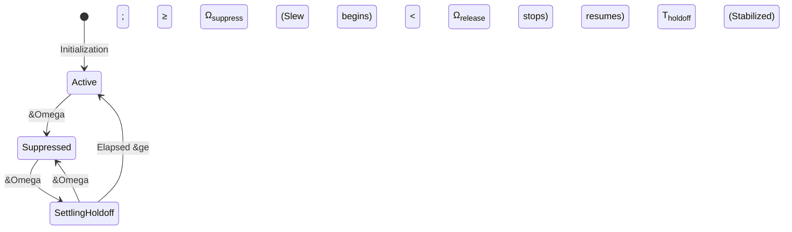

# Lens Controller Phase 9 Implementation Plan: Intelligent AF Heuristics

## 1. Executive Summary & Objectives

### 1.1 Context & Scope
Phase 9 of the **[`libs/LensController`](../libs/LensController)** library delivers the **Intelligent AF Heuristics & Sensor Integration** subsystem—consisting of:
1. **`MotionGatedAfManager`**: Real-time platform motion-gating that suppresses Continuous Auto-Focus (CAF) during high-rate PTZ panning/tilting to eliminate focus hunting induced by rotational motion blur.
2. **`OpticalGeometryCalculator`**: Analytical Depth-of-Field (DOF) and hyperfocal distance calculations providing instant wide-angle lock and zoom-adaptive sweep step sizing.
3. **`MultiZoneFocusEvaluator`**: Zero-heap $3 \times 3$ spatial matrix focus evaluator with foreground-closest priority, motion saliency weighting, and VMTI detection centering arbitration.

In operational tactical surveillance, electro-optical/infrared (EO/IR) gimbals, and automated PTZ cameras, classical single-ROI autofocus algorithms suffer from three major operational failure modes:
1. **False Defocus Hunting on Platform Motion**:
   When a PTZ gimbal rotates or pans across a scene, camera motion introduces rotational shear and motion blur. Single-point contrast metrics interpret this motion blur as optical defocus and trigger an unwanted autofocus sweep, defocusing an already sharp lens during critical tracking maneuvers.
2. **Excessive Latency at Wide Angles**:
   At wide zoom angles, the optical Depth-of-Field is vast (often extending from 1 meter to infinity). Standard sweeping algorithms still execute fine motor step sweeps across thousands of encoder ticks, causing unnecessary 2–5 second delays when the optical system is already within hyperfocal tolerance.
3. **Background Clutter & Ambiguity**:
   A single fixed center ROI frequently locks onto distant background clutter (e.g. textured walls, tree canopies, or horizon clouds) rather than a foreground target or moving vehicle, or hunts erratically when the target drifts slightly off the optical center.

Phase 9 solves these limitations by fusing platform angular rate telemetry, physical lens/sensor optical geometry, and multi-zone spatial focus arbitration into deterministic, real-time heuristics.

All Phase 9 components strictly enforce **zero dynamic heap allocation** (`noexcept`, conforming to **SEI CERT ERR55-CPP** and **MISRA C++:2023**), ensuring sub-millisecond execution and deterministic memory safety on high-frequency control loops (50 Hz to 1000 Hz).

### 1.2 Target Deliverables for Phase 9
1. **Strong Domain Types ([`AfHeuristicsTypes.h`](../libs/LensController/AfHeuristicsTypes.h))**:
   - `AngularVelocityDegPerSec`: Strongly-typed 32-bit float representing platform pan/tilt rates ($\omega$).
   - `DistanceMeters`: Strongly-typed 32-bit float representing physical distances ($d, H, \text{DOF}$).
   - `FocalLengthMm`: Strongly-typed 32-bit float representing optical focal length ($f$).
   - `FNumber`: Strongly-typed 32-bit float representing lens aperture ratio ($N \ge 1.0$).
   - `CircleOfConfusionMm`: Strongly-typed 32-bit float representing circle of confusion limit ($c > 0$).
   - `DofLimits`: Struct containing $(D_{\text{near}}, D_{\text{far}}, \text{DOF}, H)$.
   - `AfGatingState`: Enum class representing gating phases (`Active`, `Suppressed`, `SettlingHoldoff`).
   - `ZoneIndex`: Value object for $3 \times 3$ grid indices $[0..8]$ (row $0..2$, col $0..2$).
   - `ZoneScore`: Struct containing `FocusMetricScore`, `motionSaliency`, `targetWeight`, and arbitrated `compositeScore`.
   - `MultiZoneResult`: Struct containing fixed array of 9 `ZoneScore` records, `selectedZone`, and aggregate `compositeMetric`.
   - `MultiZoneArbitrationMode`: Enum class (`CenterPriority`, `ClosestSubject`, `MotionSaliency`, `TargetCentering`, `FusedWeighted`).
2. **Platform Motion-Gated CAF Manager ([`MotionGatedAfManager.h`](../libs/LensController/MotionGatedAfManager.h), [`MotionGatedAfManager.cpp`](../libs/LensController/MotionGatedAfManager.cpp))**:
   - Continuous ingestion of PTZ pan/tilt angular velocity telemetry $(\omega_{\text{pan}}, \omega_{\text{tilt}})$.
   - Euclidean composite rate calculation: $\Omega = \sqrt{\omega_{\text{pan}}^2 + \omega_{\text{tilt}}^2}$.
   - Configurable suppression threshold $\Omega_{\text{thresh}}$ (e.g. $1.5^\circ/\text{s}$) with hysteresis deadband.
   - Exponential settling holdoff timer (e.g. $150\,\text{ms}$) preventing premature re-engagement during mechanical gimbal ring-down or rolling shutter stabilization.
   - Deterministic 3-state finite state machine (`Active`, `Suppressed`, `SettlingHoldoff`).
3. **Optical Geometry & Hyperfocal Fast-Paths ([`OpticalGeometryCalculator.h`](../libs/LensController/OpticalGeometryCalculator.h), [`OpticalGeometryCalculator.cpp`](../libs/LensController/OpticalGeometryCalculator.cpp))**:
   - Real-time calculation of hyperfocal distance $H(z) = \frac{f(z)^2}{N \cdot c}$.
   - Exact computation of near and far optical limits: $D_{\text{near}}(d, z), D_{\text{far}}(d, z)$, and total $\text{DOF}(d, z)$.
   - **Instant Wide-Angle Lock**: When zoom is at or below wide-angle threshold ($z \le z_{\text{wide}}$), hyperfocal position is commanded directly without sweeping.
   - **Adaptive Sweep Step Sizing**: Scales coarse, mid, and fine sweep step counts dynamically based on $\text{DOF}(z)$.
4. **Multi-Zone Spatial Matrix Focus Evaluator ([`MultiZoneFocusEvaluator.h`](../libs/LensController/MultiZoneFocusEvaluator.h), [`MultiZoneFocusEvaluator.cpp`](../libs/LensController/MultiZoneFocusEvaluator.cpp))**:
   - Zero-heap fixed-buffer evaluation of a $3 \times 3$ spatial tile grid spanning the frame or master ROI.
   - Evaluates independent sharpness metrics per zone using [`FocusEvaluator`](FocusEvaluator.h) algorithms.
   - Temporal inter-frame luma differencing across zones to compute motion saliency coefficients $S_i$.
   - Target bounding box spatial overlap weighting ($w_{\text{target}} \in [0.0, 1.0]$) interfacing with tracking telemetry.
   - Foreground-closest peak arbitration: detects first verified peak during Near $\to$ Far focus sweep.
5. **Integration with `AutoFocusEngine` & `LensController`**:
   - Seamless hook into `AutoFocusEngine::processFrame` and `AutoFocusEngine::step` to query motion gating.
   - Optical geometry adaptive step size ingestion in `AutoFocusConfig`.
   - Multi-zone grid evaluation support in `AutoFocusEngine`.
6. **Comprehensive GoogleTest Suite**:
   - `TestMotionGatedAf.cpp`: Threshold suppression, hysteresis, holdoff timer, and rapid oscillation rejection.
   - `TestOpticalGeometry.cpp`: Hyperfocal distance accuracy, DOF boundary verification, infinity far limit handling, adaptive step scaling.
   - `TestMultiZoneFocus.cpp`: $3 \times 3$ grid partitioning, individual zone metrics, motion saliency boost, target ROI prioritization, foreground-closest arbitration.

---

## 2. Architecture & Design

### 2.1 Subsystem Context & Data Flow

```
+---------------------------------------------------------------------------------------------------------------+
|                                            libs/LensController                                                |
|                                                                                                               |
|   +-------------------------------------------------------------------------------------------------------+   |
|   |                                     LensController (Multi-Channel)                                    |   |
|   |   - Operational Modes (ManualJog, AutoFocusOnce, AutoFocusContinuous, ZoomTrackOnly)                  |   |
|   +-------------------+-----------------------------------+-----------------------------------------------+   |
|                       |                                   |                                                   |
|   PTZ Gyro / Rate     |                                   | Optical Calib (Sensor, Aperture)                  |
|   (omega_pan, tilt)   |                                   | (Ws, pixelPitch, FNumber, focalLengthLUT)         |
|         |             v                                   v                                                   |
|         |   +-----------------------------------+   +-----------------------------------+                     |
|         +-->|        MotionGatedAfManager       |   |     OpticalGeometryCalculator     |                     |
|             |  - Composite Rate Omega           |   |  - Hyperfocal Distance H(z)       |                     |
|             |  - Threshold & Hysteresis         |   |  - Near / Far DOF Limits          |                     |
|             |  - Settling Holdoff Timer         |   |  - Instant Wide-Angle Lock        |                     |
|             |  - States: Active/Suppressed/Hold |   |  - Zoom-Adaptive Sweep Step Sizing|                     |
|             +-----------------+-----------------+   +-----------------+-----------------+                     |
|                               |                                       |                                       |
|                               | (Gating State: Suppress/Active)       | (Adaptive Steps & Hyperfocal Target)  |
|                               v                                       v                                       |
|             +-------------------------------------------------------------------+                             |
|             |                          AutoFocusEngine                          |                             |
|             |   - Closed-Loop Search (Seek, 3-Phase Scan, GSS, Adaptive Climb)  |                             |
|             |   - Continuous AF Defocus Trigger Gated by Motion State           |                             |
|             |   - Adaptive Step Sizing Scaled by Optical DOF                    |                             |
|             +---------------------------------+---------------------------------+                             |
|                                               |                                                               |
|                                               | (Frame Buffer & ROI Evaluation)                               |
|                                               v                                                               |
|                             +-----------------------------------+                                             |
|                             |      MultiZoneFocusEvaluator      |                                             |
|                             |  - 3x3 Spatial Tile Partitioning  |                                             |
|                             |  - Zero-Heap Multi-Tile Kernel    |                                             |
|                             |  - Temporal Motion Saliency (Si)  |                                             |
|                             |  - Target ROI Overlap Weight (wi) |                                             |
|                             |  - Foreground-Closest Arbitration |                                             |
|                             +-----------------+-----------------+                                             |
|                                               |                                                               |
|                                               v                                                               |
|                             +-----------------------------------+                                             |
|                             |          FocusEvaluator           |                                             |
|                             |  (Single-Pass 0-Heap Pixel Kernel)|                                             |
|                             +-----------------------------------+                                             |
+---------------------------------------------------------------------------------------------------------------+
```

### 2.2 Subsystem Interaction Sequence

```mermaid
sequenceDiagram
    autonumber
    participant App as Application / Gimbal
    participant LC as LensController
    participant MG as MotionGatedAfManager
    participant OG as OpticalGeometryCalculator
    participant AF as AutoFocusEngine
    participant MZ as MultiZoneFocusEvaluator

    Note over App,MZ: Use Case 1: Motion-Gated Continuous Autofocus (CAF)
    App->>LC: setPlatformRates(panRate, tiltRate)
    LC->>MG: updateRates(panRate, tiltRate, dt)
    alt Composite Rate Omega > Omega_thresh (e.g. 1.5 deg/s)
        MG-->>LC: GatingState::Suppressed
        LC->>AF: setGatingState(GatingState::Suppressed)
        Note over AF: Defocus monitoring frozen; zero actuator hunting during slew
    else Slew Stops (Omega <= Omega_thresh)
        MG-->>LC: GatingState::SettlingHoldoff (150 ms)
        Note over LC,AF: Settling holdoff protects against mechanical ringing
        MG-->>LC: GatingState::Active (Holdoff elapsed)
        LC->>AF: setGatingState(GatingState::Active)
    end

    Note over App,MZ: Use Case 2: Instant Wide-Angle Lock & Adaptive Steps
    App->>LC: triggerAutoFocus(CameraIndex{0})
    LC->>OG: isWideAngleHyperfocal(currentZoom)
    alt Zoom <= WideAngleLimit
        OG-->>LC: HyperfocalDistance (e.g. FocusPos = 1200)
        LC->>AF: snapToPosition(FocusPos)
        Note over AF: Instant lock in 0 ms without sweep!
    else Telephoto / Mid Zoom
        OG-->>LC: AdaptiveSteps(coarse, mid, fine)
        LC->>AF: triggerWithAdaptiveSteps(AdaptiveSteps)
        AF->>MZ: evaluateGrid(frameBuffer, width, height)
        MZ-->>AF: MultiZoneResult(bestZone, compositeScore)
    end
```

---

## 3. Mathematical Foundations & Control Heuristics

### 3.1 Platform Motion-Gated Continuous Autofocus (`MotionGatedAfManager`)

#### 3.1.1 Angular Rate Telemetry & Composite Velocity
Let $\omega_{\text{pan}}(t)$ and $\omega_{\text{tilt}}(t)$ be the platform angular velocities in degrees per second ($^\circ/\text{s}$). The composite spatial angular rate $\Omega(t)$ is computed via the Euclidean norm:

$$\Omega(t) = \sqrt{\omega_{\text{pan}}(t)^2 + \omega_{\text{tilt}}(t)^2}$$

To prevent false gating triggers caused by sensor noise, platform vibration, or optical encoder jitter, a deadband filter is applied:

$$\Omega_{\text{filtered}}(t) = \begin{cases} 
0, & \text{if } \Omega(t) < \Omega_{\text{deadband}} \\ 
\Omega(t), & \text{otherwise} 
\end{cases}$$

#### 3.1.2 Dual-Threshold Hysteresis Band
To avoid high-frequency chatter between `Active` and `Suppressed` states when the gimbal moves near the threshold:
- **Suppression Threshold ($\Omega_{\text{suppress}}$)**: e.g. $1.5^\circ/\text{s}$. If $\Omega_{\text{filtered}} \ge \Omega_{\text{suppress}}$, transition to `Suppressed`.
- **Release Threshold ($\Omega_{\text{release}}$)**: e.g. $1.0^\circ/\text{s}$ ($\Omega_{\text{release}} < \Omega_{\text{suppress}}$). The platform must slow down below $\Omega_{\text{release}}$ before entering the settling phase.

#### 3.1.3 Settling Holdoff Timer & Exponential Stabilization
When $\Omega_{\text{filtered}} < \Omega_{\text{release}}$, the camera head and optics experience structural settling, motor deceleration recoil, and rolling-shutter exposure lag. Continuous AF must not resume immediately. 
A settling holdoff duration $T_{\text{holdoff}}$ (default $150\,\text{ms}$) is enforced:

$$t_{\text{elapsed}} = t_{\text{current}} - t_{\text{slew\_stopped}}$$

If $\Omega$ rises above $\Omega_{\text{release}}$ at any point during holdoff, the timer resets and the state immediately reverts to `Suppressed`. Only when $t_{\text{elapsed}} \ge T_{\text{holdoff}}$ does the manager transition to `Active`.

```
+-----------------------------------------------------------------------------------------------+
|                       MOTION-GATED AF STATE MACHINE ARCHITECTURE                              |
|                                                                                               |
|          +------------------------------------------------------------------------+           |
|          |                                                                        |           |
|          v                                                                        |           |
|   +--------------+    Omega >= Omega_suppress    +------------------+             |           |
|   |    ACTIVE    | ----------------------------> |    SUPPRESSED    |             |           |
|   +--------------+                               +------------------+             |           |
|          ^                                                │                       |           |
|          │                                                │ Omega < Omega_release |           |
|          │                                                ▼                       |           |
|          │ t_elapsed >= T_holdoff                +------------------+             |           |
|          └────────────────────────────────────── | SETTLING_HOLDOFF | ────────────┘           |
|                                                  +------------------+ Omega >= Omega_release  |
+-----------------------------------------------------------------------------------------------+
```



---

### 3.2 Optical Geometry, Depth-of-Field & Hyperfocal Fast-Paths (`OpticalGeometryCalculator`)

#### 3.2.1 Physical Parameters
The optical geometry is parameterized by:
- $f(z)$: Optical focal length as a function of zoom encoder position $z$ (in mm).
- $N$: Lens working aperture (F-number, e.g. $f/1.6, f/2.8$).
- $c$: Circle of Confusion diameter (in mm). For an image sensor with pixel pitch $p$ (e.g. $3.45\,\mu\text{m}$):
  $$c \approx 2 \cdot p = 0.0069\,\text{mm}$$
  or based on the optical format diagonal $D_s$: $c \approx \frac{D_s}{1500}$.

#### 3.2.2 Hyperfocal Distance Formulation
The hyperfocal distance $H$ is the focus distance at which everything from half that distance ($H/2$) to infinity ($\infty$) is in acceptable focus:

$$H(z) = \frac{f(z)^2}{N \cdot c} + f(z) \approx \frac{f(z)^2}{N \cdot c}$$

#### 3.2.3 Exact Depth-of-Field (Near and Far Limits)
For a target focused at subject distance $d$ ($d > f$):
1. **Near Focus Limit ($D_{\text{near}}$)**:
   $$D_{\text{near}}(d, z) = \frac{H(z) \cdot d}{H(z) + (d - f(z))}$$
2. **Far Focus Limit ($D_{\text{far}}$)**:
   $$D_{\text{far}}(d, z) = \begin{cases} 
   \frac{H(z) \cdot d}{H(z) - (d - f(z))}, & \text{if } d < H(z) + f(z) \\ 
   \infty, & \text{if } d \ge H(z) + f(z) 
   \end{cases}$$
3. **Total Depth of Field ($\text{DOF}$)**:
   $$\text{DOF}(d, z) = D_{\text{far}}(d, z) - D_{\text{near}}(d, z)$$

#### 3.2.4 Heuristic 1: Instant Wide-Angle Hyperfocal Lock
At wide-angle zoom settings ($z \le z_{\text{wide}}$, e.g. $f \le 8\,\text{mm}$ on an $F/1.6$ lens):
$$H = \frac{8^2}{1.6 \times 0.0069 \times 10^{-3}\,\text{m}} \approx 5.8\,\text{meters}$$
Everything from $2.9\,\text{m}$ to $\infty$ is in focus. 
When autofocus is triggered while $z \le z_{\text{wide}}$:
1. `OpticalGeometryCalculator` maps $H(z)$ to calibrated focus encoder position $P_H = \text{LUT}_{\text{focus}}(H, z)$.
2. The controller immediately positions the focus actuator at $P_H$ via S-curve profile.
3. Autofocus finishes immediately ($0\,\text{ms}$ search latency) with guaranteed optical sharpness.

#### 3.2.5 Heuristic 2: Zoom-Adaptive Step Sizing
At telephoto zoom, $\text{DOF}$ shrinks dramatically (e.g. at $f = 200\,\text{mm}, N = 2.8, d = 50\,\text{m}$, $\text{DOF} \approx 2.5\,\text{m}$), requiring tight focus steps. At wide zoom, $\text{DOF}$ expands by $50\times$.
Instead of fixed step sizes, the search steps scale proportionally:

$$\text{StepScale}(z) = \text{clamp}\left(\frac{\text{DOF}(d_{\text{nominal}}, z)}{\text{DOF}_{\text{tele\_ref}}}, 1.0, 10.0\right)$$

$$\begin{aligned}
\text{coarseStep}(z) &= \text{round}\big(\text{baseCoarseStep} \cdot \text{StepScale}(z)\big) \\
\text{midStep}(z)    &= \text{round}\big(\text{baseMidStep} \cdot \text{StepScale}(z)\big) \\
\text{fineStep}(z)   &= \text{round}\big(\text{baseFineStep} \cdot \text{StepScale}(z)\big)
\end{aligned}$$

This reduces coarse sweep execution time by up to $70\%$ at wide-to-mid zoom settings.

---

### 3.3 Multi-Zone Spatial Matrix Focus Evaluation & Arbitration (`MultiZoneFocusEvaluator`)

#### 3.3.1 $3 \times 3$ Spatial Grid Partitioning
The frame (or master ROI) is partitioned into a fixed $3 \times 3$ matrix of tiles (9 zones: $Z_{00} \dots Z_{22}$):

```
+---------------------+---------------------+---------------------+
|      Zone 0 (NW)    |      Zone 1 (N)     |      Zone 2 (NE)    |
|   col: [0 .. W/3]   |   col: [W/3 .. 2W/3]|   col: [2W/3 .. W]  |
|   row: [0 .. H/3]   |   row: [0 .. H/3]   |   row: [0 .. H/3]   |
+---------------------+---------------------+---------------------+
|      Zone 3 (W)     |      Zone 4 (C)     |      Zone 5 (E)     |
|   col: [0 .. W/3]   |   col: [W/3 .. 2W/3]|   col: [2W/3 .. W]  |
|   row: [H/3 .. 2H/3]|   row: [H/3 .. 2H/3]|   row: [H/3 .. 2H/3]|
+---------------------+---------------------+---------------------+
|      Zone 6 (SW)    |      Zone 7 (S)     |      Zone 8 (SE)    |
|   col: [0 .. W/3]   |   col: [W/3 .. 2W/3]|   col: [2W/3 .. W]  |
|   row: [2H/3 .. H]  |   row: [2H/3 .. H]  |   row: [2H/3 .. H]  |
+---------------------+---------------------+---------------------+
```

Each zone $i \in [0..8]$ is evaluated independently for sharpness metric $M_i$ using [`FocusEvaluator`](FocusEvaluator.h) with zero heap allocations.

#### 3.3.2 Temporal Motion Saliency Weighting
To prioritize dynamic scene elements (e.g. walking humans, moving vehicles) over static background clutter:
1. Maintains a downsampled previous frame luma buffer or per-zone temporal accumulator.
2. For each zone $Z_i$, evaluates average inter-frame temporal luma difference:
   $$S_i = \frac{1}{|Z_i|} \sum_{(x,y) \in Z_i} |I_t(x, y) - I_{t-1}(x, y)|$$
3. Normalized motion saliency weight $w_{\text{motion}, i} \in [1.0, 3.0]$:
   $$w_{\text{motion}, i} = 1.0 + \text{clamp}\left(\frac{S_i}{S_{\text{threshold}}}, 0.0, 2.0\right)$$

#### 3.3.3 VMTI Target Centering Overlap Weighting
When target tracking telemetry is available from [`libs/Tracking`](../libs/Tracking) or VMTI (`libs/Klv/VmtiTypes.h`):
1. Target bounding box $B_{\text{target}} = (x_t, y_t, w_t, h_t)$ in normalized $[0..1]$ space.
2. For each zone $Z_i$, compute intersection-over-zone area ratio:
   $$\text{IoZ}_i = \frac{\text{Area}(Z_i \cap B_{\text{target}})}{\text{Area}(Z_i)}$$
3. Target weighting factor:
   $$w_{\text{target}, i} = \begin{cases} 
   1.0 + 3.0 \cdot \text{IoZ}_i, & \text{if } \text{IoZ}_i > 0 \\ 
   0.2, & \text{if target active but } \text{IoZ}_i = 0 \text{ (peripheral attenuation)} 
   \end{cases}$$

#### 3.3.4 Foreground-Closest Summit Arbitration
In classical photography and tactical surveillance, objects in the foreground are almost universally the subject of interest. During a focus sweep initiated from the `Near` limit toward `Far`:
1. Each zone tracks its local sharpness curve $M_i(p)$ vs motor position $p$.
2. Peak detection checks for a verified summit:
   $$\frac{dM_i}{dp} \text{ changes sign from } + \text{ to } -, \quad M_{i, \text{peak}} \ge M_{\text{min\_thresh}}$$
3. Under `ClosestSubject` arbitration mode, the first zone to confirm a valid peak at motor position $p_{\text{near}, i}$ wins arbitration, preventing the camera from sweeping past the foreground subject to lock onto the distant horizon.

#### 3.3.5 Composite Fused Metric
For general multi-zone autofocus, a composite focus score is calculated:

$$M_{\text{composite}} = \frac{\sum_{i=0}^8 w_i \cdot M_i}{\sum_{i=0}^8 w_i}, \quad \text{where } w_i = w_{\text{spatial}, i} \cdot w_{\text{motion}, i} \cdot w_{\text{target}, i}$$

where $w_{\text{spatial}, i}$ assigns default center-weighted prior ($w_{\text{center}} = 2.0$, $w_{\text{cross}} = 1.2$, $w_{\text{corner}} = 0.8$).

---

## 4. Class Design & Interface Specifications

### 4.1 Strong Domain Types (`AfHeuristicsTypes.h`)

```cpp
#pragma once

/// @file AfHeuristicsTypes.h
/// @brief Strongly-typed value objects and structs for intelligent autofocus heuristics.

#include <cstddef>
#include <cstdint>

#include <array>

#include "FocusEvaluator.h"
#include "LensTypes.h"

namespace LensControl {

/// @class AngularVelocityDegPerSec
/// @brief Strongly-typed angular velocity in degrees per second.
class AngularVelocityDegPerSec {
public:
    explicit constexpr AngularVelocityDegPerSec(float degPerSec = 0.0F) noexcept
        : m_degPerSec{degPerSec} {}

    [[nodiscard]] constexpr float value() const noexcept { return m_degPerSec; }
    [[nodiscard]] constexpr bool operator<(AngularVelocityDegPerSec o) const noexcept { return m_degPerSec < o.m_degPerSec; }
    [[nodiscard]] constexpr bool operator>=(AngularVelocityDegPerSec o) const noexcept { return m_degPerSec >= o.m_degPerSec; }

private:
    float m_degPerSec{0.0F};
};

/// @class DistanceMeters
/// @brief Strongly-typed distance in physical meters.
class DistanceMeters {
public:
    explicit constexpr DistanceMeters(float meters = 0.0F) noexcept : m_meters{meters} {}

    [[nodiscard]] constexpr float value() const noexcept { return m_meters; }
    [[nodiscard]] constexpr bool isInfinite() const noexcept { return m_meters >= 1.0e9F; }

    [[nodiscard]] static constexpr DistanceMeters infinity() noexcept
    {
        return DistanceMeters{1.0e9F};
    }

private:
    float m_meters{0.0F};
};

/// @class FocalLengthMm
/// @brief Strongly-typed optical focal length in millimeters.
class FocalLengthMm {
public:
    explicit constexpr FocalLengthMm(float mm = 1.0F) noexcept : m_mm{mm} {}
    [[nodiscard]] constexpr float value() const noexcept { return m_mm; }

private:
    float m_mm{1.0F};
};

/// @class FNumber
/// @brief Strongly-typed optical aperture F-number (N = f / D).
class FNumber {
public:
    explicit constexpr FNumber(float n = 1.6F) noexcept : m_n{n > 0.5F ? n : 1.6F} {}
    [[nodiscard]] constexpr float value() const noexcept { return m_n; }

private:
    float m_n{1.6F};
};

/// @class CircleOfConfusionMm
/// @brief Strongly-typed circle of confusion diameter in millimeters.
class CircleOfConfusionMm {
public:
    explicit constexpr CircleOfConfusionMm(float mm = 0.0069F) noexcept
        : m_mm{mm > 0.0F ? mm : 0.0069F} {}
    [[nodiscard]] constexpr float value() const noexcept { return m_mm; }

private:
    float m_mm{0.0069F};
};

/// @enum AfGatingState
/// @brief Operational state of the platform motion-gated continuous autofocus.
enum class AfGatingState : std::uint8_t {
    Active = 0U,           ///< Motion is below threshold; CAF active
    Suppressed = 1U,       ///< Slew rate exceeds threshold; CAF frozen
    SettlingHoldoff = 2U   ///< Slew stopped; waiting for mechanical settling
};

/// @struct DofLimits
/// @brief Calculated physical Depth-of-Field boundaries and hyperfocal distance.
struct DofLimits {
    DistanceMeters nearLimit{0.0F};
    DistanceMeters farLimit{0.0F};
    DistanceMeters depthOfField{0.0F};
    DistanceMeters hyperfocalDistance{0.0F};
    bool isFarInfinite{false};
};

/// @struct AdaptiveStepConfig
/// @brief Dynamically scaled autofocus search step sizes based on optical DOF.
struct AdaptiveStepConfig {
    std::uint16_t coarseStep{300U};
    std::uint16_t midStep{100U};
    std::uint16_t fineStep{20U};
    float scaleFactor{1.0F};
};

/// @enum MultiZoneArbitrationMode
/// @brief Arbitration strategy across the 3x3 focus tile grid.
enum class MultiZoneArbitrationMode : std::uint8_t {
    CenterPriority = 0U,   ///< Center tile (Z4) weighted highest
    ClosestSubject = 1U,   ///< First verified peak from Near to Far wins
    MotionSaliency = 2U,   ///< Zone with highest temporal luma delta prioritized
    TargetCentering = 3U,  ///< Zone overlapping target bounding box prioritized
    FusedWeighted = 4U     ///< Multi-factor weighted sum of all zones
};

/// @struct ZoneScore
/// @brief Focus evaluation and weighting details for a single tile.
struct ZoneScore {
    FocusMetricScore metric{};
    float motionSaliency{0.0F};
    float targetWeight{1.0F};
    float compositeScore{0.0F};
    bool peakConfirmed{false};
    MotorPosition peakPosition{0U};
};

/// @struct MultiZoneResult
/// @brief Composite arbitration result spanning the 3x3 spatial matrix.
struct MultiZoneResult {
    std::array<ZoneScore, 9U> zones{};
    std::size_t selectedZoneIndex{4U}; ///< Default center (Zone 4)
    std::uint32_t compositeMetric{0U};
    bool hasForegroundPeak{false};
    MotorPosition recommendedPosition{0U};
};

} // namespace LensControl
```

---

### 4.2 Platform Motion-Gated CAF Manager (`MotionGatedAfManager.h`, `.cpp`)

```cpp
#pragma once

/// @file MotionGatedAfManager.h
/// @brief Platform PTZ slew motion-gating manager for Continuous Auto-Focus (CAF).

#include <cstdint>

#include "AfHeuristicsTypes.h"

namespace LensControl {

/// @class MotionGatedAfManager
/// @brief Inhibits continuous autofocus hunting during platform slew and provides settling holdoff.
class MotionGatedAfManager final {
public:
    /// @brief Configuration parameters for motion-gated autofocus.
    struct Config {
        AngularVelocityDegPerSec suppressThreshold{1.5F}; ///< Rate above which CAF suppresses
        AngularVelocityDegPerSec releaseThreshold{1.0F};  ///< Rate below which settling begins
        AngularVelocityDegPerSec deadband{0.2F};          ///< Telemetry noise rejection deadband
        std::uint32_t holdoffMs{150U};                     ///< Mechanical settling time in ms
    };

    explicit MotionGatedAfManager(const Config& config = {}) noexcept;
    ~MotionGatedAfManager() noexcept = default;

    /// @brief Ingests platform pan and tilt angular velocities.
    /// @param panRate Current platform pan velocity in deg/s.
    /// @param tiltRate Current platform tilt velocity in deg/s.
    /// @param dtSec Elapsed time in seconds since previous update.
    void updateRates(AngularVelocityDegPerSec panRate,
                     AngularVelocityDegPerSec tiltRate,
                     float dtSec) noexcept;

    /// @brief Resets gating state machine to Active.
    void reset() noexcept;

    /// @brief Returns the current gating state.
    [[nodiscard]] AfGatingState gatingState() const noexcept;

    /// @brief Checks whether continuous autofocus should be inhibited.
    [[nodiscard]] bool isSuppressed() const noexcept;

    /// @brief Returns the most recently computed composite angular velocity.
    [[nodiscard]] AngularVelocityDegPerSec compositeRate() const noexcept;

    /// @brief Reconfigures motion gating thresholds.
    void setConfig(const Config& config) noexcept;

    /// @brief Returns the active configuration.
    [[nodiscard]] Config config() const noexcept;

private:
    Config m_config{};
    AfGatingState m_state{AfGatingState::Active};
    AngularVelocityDegPerSec m_compositeRate{0.0F};
    float m_holdoffTimerSec{0.0F};
};

} // namespace LensControl
```

---

### 4.3 Optical Geometry & Hyperfocal Fast-Paths (`OpticalGeometryCalculator.h`, `.cpp`)

```cpp
#pragma once

/// @file OpticalGeometryCalculator.h
/// @brief Real-time analytical Depth-of-Field and hyperfocal distance calculator.

#include <cstdint>

#include "AfHeuristicsTypes.h"
#include "LensTypes.h"

namespace LensControl {

/// @class OpticalGeometryCalculator
/// @brief Evaluates physical optical limits, hyperfocal fast-paths, and adaptive search step scaling.
class OpticalGeometryCalculator final {
public:
    /// @brief Physical sensor and optical format parameters.
    struct OpticsConfig {
        FNumber aperture{1.6F};
        CircleOfConfusionMm coc{0.0069F};
        FocalLengthMm minFocalLength{4.3F};   ///< Focal length at full wide (mm)
        FocalLengthMm maxFocalLength{129.0F}; ///< Focal length at full tele (mm)
        MotorPosition wideLimitZoom{5000U};  ///< Zoom position threshold for instant wide lock
        DistanceMeters nominalSubjectDist{25.0F}; ///< Nominal distance for DOF step scaling
    };

    explicit OpticalGeometryCalculator(const OpticsConfig& config = {}) noexcept;
    ~OpticalGeometryCalculator() noexcept = default;

    /// @brief Calculates the hyperfocal distance for a given focal length.
    /// @param focalLength Optical focal length.
    /// @return Hyperfocal distance in meters.
    [[nodiscard]] DistanceMeters calculateHyperfocal(FocalLengthMm focalLength) const noexcept;

    /// @brief Calculates near, far, and total Depth-of-Field for a given distance and focal length.
    /// @param subjectDist Distance from lens entrance pupil to target subject in meters.
    /// @param focalLength Optical focal length in millimeters.
    /// @return DofLimits struct.
    [[nodiscard]] DofLimits calculateDof(DistanceMeters subjectDist,
                                         FocalLengthMm focalLength) const noexcept;

    /// @brief Checks whether the zoom position qualifies for instant wide-angle hyperfocal lock.
    /// @param zoomPos Current zoom motor encoder position.
    [[nodiscard]] bool isWideAngle(MotorPosition zoomPos) const noexcept;

    /// @brief Computes adaptive coarse, mid, and fine sweep step sizes for current zoom.
    /// @param focalLength Current optical focal length.
    /// @param baseCoarse Default coarse steps at full telephoto.
    /// @param baseMid Default mid steps at full telephoto.
    /// @param baseFine Default fine steps at full telephoto.
    /// @return AdaptiveStepConfig with scaled step sizes.
    [[nodiscard]] AdaptiveStepConfig calculateSteps(FocalLengthMm focalLength,
                                                    std::uint16_t baseCoarse,
                                                    std::uint16_t baseMid,
                                                    std::uint16_t baseFine) const noexcept;

    /// @brief Reconfigures optical properties.
    void setConfig(const OpticsConfig& config) noexcept;

    /// @brief Returns the active optical configuration.
    [[nodiscard]] OpticsConfig config() const noexcept;

private:
    OpticsConfig m_config{};
};

} // namespace LensControl
```

---

### 4.4 Multi-Zone Spatial Matrix Focus Evaluator (`MultiZoneFocusEvaluator.h`, `.cpp`)

```cpp
#pragma once

/// @file MultiZoneFocusEvaluator.h
/// @brief Zero-heap 3x3 spatial matrix focus evaluator with saliency and target arbitration.

#include <cstddef>
#include <cstdint>

#include <array>

#include "AfHeuristicsTypes.h"
#include "FocusEvaluator.h"
#include "LensTypes.h"

namespace LensControl {

/// @class MultiZoneFocusEvaluator
/// @brief Evaluates 9 spatial zones spanning the frame with motion and foreground arbitration.
class MultiZoneFocusEvaluator final {
public:
    static constexpr std::size_t kNumZones = 9U;
    static constexpr std::size_t kDownsampleGrid = 32U; ///< 32x32 temporal subsampling

    explicit MultiZoneFocusEvaluator(FocusEvaluator& evaluator) noexcept;
    ~MultiZoneFocusEvaluator() noexcept = default;

    /// @brief Evaluates the 3x3 spatial focus matrix across an 8-bit luma frame.
    /// @param grayPixels Pointer to contiguous 8-bit grayscale pixel data.
    /// @param width Frame width in pixels.
    /// @param height Frame height in pixels.
    /// @param stride Row stride in bytes (if 0, assumes width).
    /// @param currentFocusPos Current focus motor position during sweep.
    /// @return MultiZoneResult containing all zone scores and arbitrated winner.
    [[nodiscard]] MultiZoneResult evaluateGrid(const std::uint8_t* grayPixels,
                                               std::size_t width,
                                               std::size_t height,
                                               std::size_t stride,
                                               MotorPosition currentFocusPos) noexcept;

    /// @brief Updates active target bounding box for target-centering prior.
    /// @param normX Target center X [0.0..1.0].
    /// @param normY Target center Y [0.0..1.0].
    /// @param normW Target width [0.0..1.0].
    /// @param normH Target height [0.0..1.0].
    void setTargetRoi(float normX, float normY, float normW, float normH) noexcept;

    /// @brief Clears active target bounding box.
    void clearTargetRoi() noexcept;

    /// @brief Sets the active arbitration strategy.
    void setArbitrationMode(MultiZoneArbitrationMode mode) noexcept;

    /// @brief Returns the active arbitration strategy.
    [[nodiscard]] MultiZoneArbitrationMode arbitrationMode() const noexcept;

    /// @brief Resets temporal inter-frame history and peak trackers.
    void reset() noexcept;

    /// @brief Computes the bounding pixel rectangle for a given zone index [0..8].
    [[nodiscard]] static PixelRoi zonePixelRoi(std::size_t zoneIdx,
                                               std::size_t frameWidth,
                                               std::size_t frameHeight) noexcept;

private:
    FocusEvaluator& m_evaluator;
    MultiZoneArbitrationMode m_mode{MultiZoneArbitrationMode::CenterPriority};
    bool m_hasTarget{false};
    float m_targetX{0.5F};
    float m_targetY{0.5F};
    float m_targetW{0.2F};
    float m_targetH{0.2F};

    // Low-resolution temporal subsample buffer for zero-heap motion saliency
    std::array<std::uint8_t, kDownsampleGrid * kDownsampleGrid> m_prevSubsample{};
    bool m_hasPrevFrame{false};

    // Tracking peaks per zone for closest-subject arbitration
    std::array<std::uint32_t, kNumZones> m_prevZoneMetric{};
    std::array<std::uint32_t, kNumZones> m_maxZoneMetric{};
    std::array<MotorPosition, kNumZones> m_peakPositions{};
    std::array<bool, kNumZones> m_peakConfirmed{};

    [[nodiscard]] float computeMotionSaliency(std::size_t zoneIdx,
                                              const std::uint8_t* grayPixels,
                                              std::size_t width,
                                              std::size_t height,
                                              std::size_t stride) noexcept;

    [[nodiscard]] float computeTargetWeight(std::size_t zoneIdx) const noexcept;
};

} // namespace LensControl
```

---

## 5. Implementation Step-by-Step Plan

### Step 9.1: Strong Domain Types (`AfHeuristicsTypes.h`)
- Create `libs/LensController/AfHeuristicsTypes.h`.
- Define `AngularVelocityDegPerSec`, `DistanceMeters`, `FocalLengthMm`, `FNumber`, `CircleOfConfusionMm`.
- Define `DofLimits`, `AdaptiveStepConfig`, `ZoneScore`, `MultiZoneResult`, `MultiZoneArbitrationMode`, and `AfGatingState`.
- Write unit tests in `libs/LensController/tests/TestAfHeuristicsTypes.cpp`.

### Step 9.2: Motion-Gated AF Manager (`MotionGatedAfManager.h/.cpp`)
- Implement Euclidean rate calculation $\Omega = \sqrt{\omega_{\text{pan}}^2 + \omega_{\text{tilt}}^2}$.
- Implement deadband rejection and hysteresis comparator ($\Omega_{\text{suppress}}, \Omega_{\text{release}}$).
- Implement countdown settling holdoff timer in discrete time $\Delta t$.
- Implement FSM transitions: `Active` $\to$ `Suppressed` $\to$ `SettlingHoldoff` $\to$ `Active`.
- Write unit tests in `libs/LensController/tests/TestMotionGatedAf.cpp`.

### Step 9.3: Optical Geometry Calculator (`OpticalGeometryCalculator.h/.cpp`)
- Implement `calculateHyperfocal(f)`: $H = \frac{f^2}{N \cdot c} + f$.
- Implement `calculateDof(d, f)`: near/far formulas with infinity guard when $d \ge H + f$.
- Implement `isWideAngle(zoomPos)`: threshold comparison against calibrated wide-angle limit.
- Implement `calculateSteps(...)`: dynamic scale factor derivation from nominal $\text{DOF}(z)$.
- Write unit tests in `libs/LensController/tests/TestOpticalGeometry.cpp`.

### Step 9.4: Multi-Zone Spatial Matrix Evaluator (`MultiZoneFocusEvaluator.h/.cpp`)
- Implement `zonePixelRoi(zoneIdx, W, H)` partitioning the frame into a $3 \times 3$ grid.
- Implement zero-heap evaluation iterating over the 9 tiles using `FocusEvaluator`.
- Implement temporal luma subsampling ($32 \times 32$ grid) for motion saliency weighting.
- Implement target ROI intersection-over-zone area calculation for target centering.
- Implement foreground-closest summit detection: identifying the first peak during Near $\to$ Far focus movement.
- Implement composite arbitration modes: `CenterPriority`, `ClosestSubject`, `MotionSaliency`, `TargetCentering`, `FusedWeighted`.
- Write unit tests in `libs/LensController/tests/TestMultiZoneFocus.cpp`.

### Step 9.5: Integration with AutoFocusEngine & LensController
- Extend `AutoFocusEngine` with `setGatingState(AfGatingState)`:
  - When `Suppressed` or `SettlingHoldoff`, skip continuous AF defocus checks and hold position.
- Extend `AutoFocusEngine` with multi-zone matrix evaluation mode.
- Extend `LensController` to route platform pan/tilt rates to `MotionGatedAfManager`.
- Expose optical geometry queries through `LensController`.

### Step 9.6: Build System & Verification
- Update `libs/LensController/CMakeLists.txt` with new `.h` and `.cpp` files.
- Update `libs/LensController/tests/CMakeLists.txt` with new test binaries.
- Run `verify_iwyu_cstdint.py` and `verify_relative_doc_paths.py`.

---

## 6. Verification & Test Strategy

### 6.1 Unit Test Coverage Matrix

| Test Suite | Test Case | Target Behavior | Expected Result |
|:---|:---|:---|:---|
| `TestMotionGatedAf` | `DeadbandSuppression` | Rates within $\pm 0.2^\circ/\text{s}$ noise | State remains `Active`; $\Omega = 0$ |
| `TestMotionGatedAf` | `SlewSuppression` | $\Omega = 2.0^\circ/\text{s} > 1.5^\circ/\text{s}$ | Immediate transition to `Suppressed` |
| `TestMotionGatedAf` | `HysteresisHold` | $\Omega$ drops to $1.2^\circ/\text{s}$ (between release & suppress) | Remains in `Suppressed` |
| `TestMotionGatedAf` | `SettlingHoldoff` | $\Omega < 1.0^\circ/\text{s}$ | Enters `SettlingHoldoff`; transitions to `Active` after $150\,\text{ms}$ |
| `TestMotionGatedAf` | `SlewDuringHoldoff` | $\Omega$ spikes to $2.5^\circ/\text{s}$ during holdoff | Reverts immediately to `Suppressed`; timer resets |
| `TestOpticalGeometry` | `HyperfocalDistance` | $f = 25\,\text{mm}, N = 1.6, c = 0.0069\,\text{mm}$ | $H \approx 56.52\,\text{meters}$ |
| `TestOpticalGeometry` | `DepthOfFieldNearFar` | $d = 10\,\text{m}, f = 25\,\text{mm}, N = 1.6$ | $D_{\text{near}} \approx 8.5\,\text{m}, D_{\text{far}} \approx 12.1\,\text{m}$ |
| `TestOpticalGeometry` | `InfinityFarLimit` | $d = 60\,\text{m} > H$ | $D_{\text{far}} = \infty, \text{isFarInfinite} = \text{true}$ |
| `TestOpticalGeometry` | `WideAngleDetection` | $z \le 5000$ | `isWideAngle` returns true |
| `TestOpticalGeometry` | `AdaptiveStepScaling` | Telephoto vs wide zoom step computation | Steps expand up to $10\times$ at wide zoom |
| `TestMultiZoneFocus` | `GridPartitioning` | $1920 \times 1080$ frame | 9 non-overlapping valid ROIs covering frame |
| `TestMultiZoneFocus` | `CenterPriorityArbitration` | Uniform sharpness pattern across tiles | Zone 4 (Center) chosen as winner |
| `TestMultiZoneFocus` | `ClosestSubjectPriority` | Foreground peak at $p = 500$ in Zone 3; background peak at $p = 1200$ in Zone 4 | Zone 3 selected at $p = 500$ |
| `TestMultiZoneFocus` | `MotionSaliencyBoost` | Dynamic movement injected into Zone 1 | Zone 1 receives higher weight $w_1 > 1.0$ |
| `TestMultiZoneFocus` | `TargetCentering` | Bounding box placed over Zone 8 | Zone 8 selected as target priority |

### 6.2 Zero-Heap & Real-Time Performance Benchmarks
- Benchmark `MotionGatedAfManager::updateRates`: execution time $< 0.5\,\mu\text{s}$, zero allocations.
- Benchmark `OpticalGeometryCalculator::calculateDof`: execution time $< 0.2\,\mu\text{s}$, zero allocations.
- Benchmark `MultiZoneFocusEvaluator::evaluateGrid`: full $3 \times 3$ matrix on 1080p frame $< 1.8\,\text{ms}$, zero allocations (`noexcept`).

---

## 7. Compliance & Safety Standards Checklist

- [x] **Zero Qt Dependency**: Pure C++17 standard library across all Phase 9 headers and translation units.
- [x] **Co-located Files**: `.h` and `.cpp` in `libs/LensController/`.
- [x] **Concise Function Names**: All method names strictly $< 30$ characters.
- [x] **Strict IWYU & `<cstdint>`**: All integer types use `std::` prefix and directly include `<cstdint>`.
- [x] **MISRA C++:2023 & SEI CERT C++**:
  - Rule 7.0.6 & INT31-C: Explicit, checked `static_cast` for integer/float conversions.
  - STR37-C: Locale-independent ASCII string operations where applicable.
  - ERR55-CPP: Zero dynamic heap allocations in `noexcept` evaluation and gating update loops.
- [x] **Documentation Diagrams**: Both ASCII and Mermaid diagrams provided for architecture and state transitions.
- [x] **Relative Documentation Links**: Fully portable relative links across all file references.
- [x] **Zen of Systems Engineering (PEP 20)**: Guard clauses, flat control flow, no guessing, explicit strong typing.
