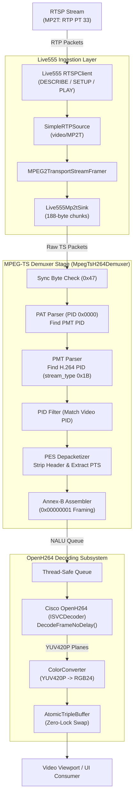

# Implementation Plan: Live555 MP2T (MPEG-2 TS) to H.264 Elementary Stream Demuxing

## Executive Summary
This document provides the architectural design, component breakdown, and step-by-step implementation plan for adding **MPEG-2 Transport Stream (`MP2T` / RFC 2250)** support to the **Live555 + OpenH264** low-latency RTSP video decoder backend ([Live555Decoder](../libs/Video/Live555Decoder.h)).

Currently, [Live555RTSPClient](../libs/Video/Live555RTSPClient.cpp#L149-L153) strictly accepts direct RFC 6184 RTP H.264 elementary streams (`codecName() == "H264"`). Streaming encoders and cameras (such as Sightline SLA hardware encoders, broadcast servers, and IP cameras) frequently package H.264 video inside an **MPEG-2 Transport Stream** container (SDP `m=video ... RTP/AVP 33` or `a=rtpmap:33 MP2T/90000`) to multiplex video with KLV telemetry (MISB 0601 / SMPTE 336M).

This plan introduces a lightweight, zero-allocation in-memory **MPEG-TS to Annex-B Demuxer** ([MpegTsH264Demuxer](../libs/Video/MpegTsH264Demuxer.h)) that demultiplexes incoming 188-byte TS packets, strips PES headers, and feeds raw Annex-B H.264 NAL units directly into Cisco's OpenH264 decoder with minimal latency (<1ms demuxing overhead).

---

## 1. Architectural Overview & Data Flow

### ASCII Pipeline Diagram
```
[ RTSP Server / Camera (e.g., rtsp://10.10.10.64:554/net0) ]
                            │
                            │ RTP Packets (Payload Type 33: MP2T / RFC 2250)
                            ▼
+───────────────────────────────────────────────────────────────────────────+
| Live555 RTSP Network Thread                                               |
|   - Live555RTSPClient: Recognizes SDP codec "MP2T" alongside "H264"       |
|   - SimpleRTPSource: Ingests RTP PT 33 datagrams                          |
|   - MPEG2TransportStreamFramer: Validates 188-byte boundaries & PCR       |
|   - Live555Mp2tSink: Captures TS chunks into buffer (e.g. 7 * 188 = 1316B)|
+───────────────────────────────────────────────────────────────────────────+
                            │
                            │ 188-byte TS Packet Chunks
                            ▼
+───────────────────────────────────────────────────────────────────────────+
| MpegTsH264Demuxer (libs/Video/MpegTsH264Demuxer.h)                        |
|   1. Sync byte validation (0x47) & packet framing                         |
|   2. Parse PAT (PID 0x0000) -> Discover PMT PID                           |
|   3. Parse PMT -> Discover Video PID with stream_type == 0x1B (H.264 AVC) |
|   4. Discard non-video PIDs (e.g., Audio, KLV metadata on separate PIDs)  |
|   5. Handle Adaptation Field (skip stuffing & PCR)                        |
|   6. Strip PES packet header (on PUSI = 1) and extract PTS timestamp      |
|   7. Reassemble Elementary Stream payload into Annex-B NAL units          |
+───────────────────────────────────────────────────────────────────────────+
                            │
                            │ Annex-B NALUs (0x00000001 + SPS / PPS / IDR / non-IDR)
                            ▼
+───────────────────────────────────────────────────────────────────────────+
| Live555Decoder NALU Queue (Thread-Safe Ring Buffer)                       |
+───────────────────────────────────────────────────────────────────────────+
                            │
                            │ Annex-B NALU Byte Stream
                            ▼
+───────────────────────────────────────────────────────────────────────────+
| OpenH264 Decoder Thread (Live555Decoder::decodeNextFrame)                 |
|   - ISVCDecoder::DecodeFrameNoDelay()                                     |
|   - Output: Planar YUV420P frames                                         |
|   - ColorConverter: YUV420P -> RGB24 / BGR24 SIMD conversion              |
|   - BaseVideoDecoder::publishFrame(): Updates AtomicTripleBuffer          |
+───────────────────────────────────────────────────────────────────────────+
                            │
                            ▼
[ Consumer UI / Video Widget (FovPanTiltViewer / QQuickItem / Braille) ]
```

### Mermaid Pipeline Diagram


---

## 2. Technical Specifications & Demuxing Rules

### 2.1 Transport Stream Packet Header Parsing
Every MPEG-TS packet is strictly 188 bytes beginning with sync byte `0x47`:
- **Byte 0:** Sync byte (`0x47`).
- **Byte 1:**
  - Bit 7: Transport Error Indicator (`TEI`). If `1`, drop packet immediately.
  - Bit 6: Payload Unit Start Indicator (`PUSI`). If `1`, indicates the start of a PES packet or PSI table.
  - Bit 5: Transport Priority.
  - Bits 4-0: PID (high 5 bits).
- **Byte 2:** PID (low 8 bits). Total 13-bit PID.
- **Byte 3:**
  - Bits 7-6: Transport Scrambling Control (TSC). If non-zero, packet is encrypted; discard.
  - Bits 5-4: Adaptation Field Control (`AFC`):
    - `0b01`: Payload only.
    - `0b10`: Adaptation field only (no payload, skip).
    - `0b11`: Adaptation field followed by payload.
  - Bits 3-0: Continuity Counter (`CC`). Used to detect dropped packets.

### 2.2 Table Discovery (PAT & PMT)
1. **Program Association Table (PAT):**
   - PID is always `0x0000`.
   - Contains list of `program_number` $\rightarrow$ `program_map_PID`.
   - Skip network PID (`program_number == 0`); save the first valid program PMT PID.
2. **Program Map Table (PMT):**
   - Ingested on the discovered `program_map_PID`.
   - Iterates elementary streams:
     - Check `stream_type`:
       - `0x1B`: H.264 / AVC video (Target elementary stream).
       - `0x24`: H.265 / HEVC video (Future expansion).
       - `0x06` or `0x15`: Private data / KLV metadata (ignored by video demuxer; optionally passed to KLV extractor).
   - Save the detected video PID: `m_videoPid`.

### 2.3 PES Header Parsing & PTS Extraction
When `PID == m_videoPid`:
1. If `PUSI == 1`:
   - Preceding PES packet is complete; flush accumulated bytes to `m_naluCallback`.
   - Verify PES start code prefix: `0x00 0x00 0x01`.
   - Stream ID: bytes `0xE0` - `0xEF` indicate video stream.
   - Byte 7 contains PTS/DTS flags:
     - If `(flags & 0x80) != 0`: 33-bit PTS is present in bytes 9-13.
     - Convert 90 kHz PTS to seconds: $\text{ptsSeconds} = \frac{\text{PTS}}{90000.0}$.
   - Skip full PES header: `9 + PES_header_data_length`.
2. Accumulate payload bytes into an elementary stream reassembly buffer.
3. H.264 elementary streams in MPEG-TS PES packets are natively formatted with Annex-B start codes (`00 00 01` or `00 00 00 01`). The demuxer ensures valid NAL unit boundaries before dispatching to OpenH264.

---

## 3. Component Breakdown & Source Layout

All files reside in `libs/Video/` adhering to the project's directory co-location rules:

| File Path | Responsibility |
| :--- | :--- |
| [MpegTsH264Demuxer.h](../libs/Video/MpegTsH264Demuxer.h) | Interface for streaming 188-byte TS packet parsing, PAT/PMT discovery, PES extraction, and Annex-B delivery. |
| [MpegTsH264Demuxer.cpp](../libs/Video/MpegTsH264Demuxer.cpp) | Implementation of TS parser, adaptation field skipping, and zero-allocation payload buffering. |
| [Live555Mp2tSink.h](../libs/Video/Live555Mp2tSink.h) | Live555 `MediaSink` receiving MPEG-2 TS packets and driving `MpegTsH264Demuxer`. |
| [Live555Mp2tSink.cpp](../libs/Video/Live555Mp2tSink.cpp) | Buffer management, Live555 frame reception callback, and teardown logic. |
| [Live555RTSPClient.h](../libs/Video/Live555RTSPClient.h) | Updated to support both `RtspStreamType::H264` and `RtspStreamType::Mp2t`. |
| [Live555RTSPClient.cpp](../libs/Video/Live555RTSPClient.cpp) | Updated `setupNextSubsession()` to accept `"MP2T"` and configure `Live555Mp2tSink`. |
| [TestMpegTsH264Demuxer.cpp](../libs/Video/tests/TestMpegTsH264Demuxer.cpp) | Unit tests verifying PAT/PMT discovery, PES extraction, and PTS conversion. |

---

## 4. Class Design & Header Interfaces

### 4.1 `MpegTsH264Demuxer.h`
```cpp
#pragma once

/// @file MpegTsH264Demuxer.h
/// @brief Zero-allocation streaming MPEG-2 Transport Stream demuxer for H.264 elementary streams.

#include <cstddef>
#include <cstdint>

#include <functional>
#include <optional>
#include <vector>

namespace Video {

/// @class MpegTsH264Demuxer
/// @brief Demultiplexes 188-byte MPEG-2 Transport Stream packets to extract H.264 Annex-B NAL units.
class MpegTsH264Demuxer {
public:
    /// @brief TS packet fixed size in bytes.
    static constexpr std::size_t kTsPacketSize { 188U };

    /// @brief TS packet sync byte (0x47).
    static constexpr std::uint8_t kTsSyncByte { 0x47U };

    /// @brief H.264 AVC stream type identifier in PMT.
    static constexpr std::uint8_t kStreamTypeH264 { 0x1BU };

    /// @brief Callback invoked when a complete Annex-B NAL unit or frame is ready for decoding.
    using NaluCallback = std::function<void(const std::uint8_t* data, std::size_t size, double ptsSeconds)>;

    /// @brief Constructs demuxer with designated NALU output callback.
    /// @param[in] callback Function invoked per complete Annex-B slice/frame.
    explicit MpegTsH264Demuxer(NaluCallback callback);

    /// @brief Destructor.
    ~MpegTsH264Demuxer() = default;

    /// @brief Ingests arbitrary chunks of TS stream data (re-syncs to 0x47 boundaries).
    /// @param[in] data Pointer to raw byte buffer.
    /// @param[in] size Number of bytes available.
    /// @return Number of NAL units dispatched.
    [[nodiscard]] std::size_t processData(const std::uint8_t* data, std::size_t size);

    /// @brief Ingests a single 188-byte aligned TS packet.
    /// @param[in] packet Pointer to 188-byte buffer starting with 0x47.
    /// @return Number of NAL units dispatched.
    [[nodiscard]] std::size_t processPacket(const std::uint8_t* packet);

    /// @brief Resets demuxer internal state, PID caches, and reassembly buffers.
    void reset() noexcept;

    /// @brief Manually specifies the video elementary stream PID (bypassing PAT/PMT auto-discovery).
    /// @param[in] pid 13-bit video PID.
    void setVideoPid(std::uint16_t pid) noexcept;

    /// @brief Queries currently discovered video PID.
    /// @return Video PID if discovered, std::nullopt otherwise.
    [[nodiscard]] std::optional<std::uint16_t> videoPid() const noexcept;

private:
    void parsePat(const std::uint8_t* payload, std::size_t size);
    void parsePmt(const std::uint8_t* payload, std::size_t size);
    void parsePesPacket(const std::uint8_t* payload, std::size_t size, bool pusi);
    void flushPesBuffer();

    NaluCallback m_naluCallback;
    std::optional<std::uint16_t> m_pmtPid { std::nullopt };
    std::optional<std::uint16_t> m_videoPid { std::nullopt };
    std::uint8_t m_lastContinuity { 0xFFU };

    std::vector<std::uint8_t> m_streamBuffer;
    std::vector<std::uint8_t> m_pesBuffer;
    double m_currentPts { 0.0 };
};

} // namespace Video
```

### 4.2 `Live555Mp2tSink.h`
```cpp
#pragma once

/// @file Live555Mp2tSink.h
/// @brief Live555 MediaSink subclass receiving MPEG-2 TS packets and driving MpegTsH264Demuxer.

#if defined(PELCOD_HAS_LIVE555)

#include <cstddef>
#include <cstdint>
#include <functional>
#include <memory>
#include <vector>

#include <liveMedia.hh>

#include "MpegTsH264Demuxer.h"

namespace Video {

/// @class Live555Mp2tSink
/// @brief MediaSink for receiving RTP MP2T streams and demuxing H.264 elementary streams.
class Live555Mp2tSink : public MediaSink {
public:
    /// @brief Callback invoked when a complete Annex-B NAL unit is extracted.
    using NaluCallback = MpegTsH264Demuxer::NaluCallback;

    /// @brief Factory creating a new instance of Live555Mp2tSink.
    /// @param[in] env Live555 usage environment.
    /// @param[in] callback Output NALU callback.
    /// @param[in] bufferSize Internal receive buffer size (defaults to 7 * 188 = 1316 bytes).
    /// @return Pointer to newly allocated Live555Mp2tSink.
    [[nodiscard]] static Live555Mp2tSink* createNew(
        UsageEnvironment& env, NaluCallback callback, std::size_t bufferSize = 1316U);

    /// @brief Continues playing/receiving frames from the upstream source.
    /// @return True if receiving started successfully.
    Boolean continuePlaying() override;

private:
    Live555Mp2tSink(UsageEnvironment& env, NaluCallback callback, std::size_t bufferSize);
    ~Live555Mp2tSink() override = default;

    static void afterGettingFrame(void* clientData, unsigned frameSize, unsigned numTruncatedBytes,
        struct timeval presentationTime, unsigned durationInMicroseconds);

    void handleFrame(unsigned frameSize, unsigned numTruncatedBytes, struct timeval presentationTime);

    MpegTsH264Demuxer m_demuxer;
    std::vector<std::uint8_t> m_buffer;
};

} // namespace Video

#endif // PELCOD_HAS_LIVE555
```

---

## 5. Live555RTSPClient Integration

Modify [Live555RTSPClient.cpp](../libs/Video/Live555RTSPClient.cpp) around line 144:

```cpp
void Live555RTSPClient::setupNextSubsession()
{
    if (!m_subsessionIter) {
        return;
    }

    m_subsession = m_subsessionIter->next();
    if (m_subsession != nullptr) {
        if (std::strcmp(m_subsession->mediumName(), "video") != 0) {
            setupNextSubsession();
            return;
        }

        const bool isH264 { std::strcmp(m_subsession->codecName(), "H264") == 0 };
        const bool isMp2t { std::strcmp(m_subsession->codecName(), "MP2T") == 0 };

        if (!isH264 && !isMp2t) {
            LOG(WARNING) << "Live555RTSPClient: Skipping unsupported video codec: " << m_subsession->codecName();
            setupNextSubsession();
            return;
        }

        m_isMp2t = isMp2t;

        if (isH264) {
            extractSpropParams(m_subsession);
        }

        if (!m_subsession->initiate()) {
            LOG(ERROR) << "Live555RTSPClient: Failed to initiate subsession: " << envir().getResultMsg();
            setupNextSubsession();
        } else {
            const Boolean streamUsingTCP { (m_transport == RtspTransportMode::Tcp) ? True : False };
            sendSetupCommand(*m_subsession, continueAfterSETUP, False, streamUsingTCP, False, m_authenticator.get());
        }
        return;
    }

    LOG(ERROR) << "Live555RTSPClient: No suitable H.264 or MP2T video subsession found in stream.";
    if (m_statusCallback) {
        m_statusCallback(false, "No suitable H.264 or MP2T video subsession found in stream");
    }
}
```

In `handleSetup()`:
```cpp
if (m_isMp2t) {
    m_subsession->sink = Live555Mp2tSink::createNew(envir(), m_naluCallback);
} else {
    m_subsession->sink = Live555H264Sink::createNew(envir(), m_naluCallback);
}
```

---

## 6. Implementation & Rollout Steps

```
Step 1: MpegTsH264Demuxer Unit Implementation (TDD)
  ├── Implement libs/Video/MpegTsH264Demuxer.h
  ├── Implement libs/Video/MpegTsH264Demuxer.cpp
  └── Create libs/Video/tests/TestMpegTsH264Demuxer.cpp
      ├── Test sync byte finding (0x47)
      ├── Test PAT parsing (PID 0 -> PMT PID)
      ├── Test PMT parsing (Stream Type 0x1B -> Video PID)
      ├── Test PES header extraction and PTS calculation
      └── Test multi-packet Annex-B reassembly

Step 2: Live555Mp2tSink Implementation
  ├── Implement libs/Video/Live555Mp2tSink.h
  ├── Implement libs/Video/Live555Mp2tSink.cpp
  └── Register in libs/Video/CMakeLists.txt under PELCOD_ENABLE_LIVE555

Step 3: Live555RTSPClient & Live555Decoder Updates
  ├── Add m_isMp2t state to Live555RTSPClient
  ├── Update setupNextSubsession() to accept MP2T
  └── Instantiate Live555Mp2tSink in handleSetup()

Step 4: Integration Testing & Verification
  ├── Run ctest on VideoTestSuite
  ├── Verify against synthetic MP2T stream
  └── Verify with real RTSP test source: rtsp://10.10.10.64:554/net0
```

---

## 7. Verification Checklist & Compliance

- [ ] Zero raw `new` / `delete` in application code (managed via smart pointers and Live555 `Medium::close`).
- [ ] Headers use `#pragma once` as the first non-comment line.
- [ ] Direct `#include <cstdint>` and `#include <cstddef>` present in all new files (IWYU).
- [ ] All integer types strictly qualified with `std::` (`std::uint8_t`, `std::size_t`).
- [ ] Zero Qt dependencies inside `libs/Video/` core demuxers.
- [ ] Public API fully documented with complete Doxygen comments.
- [ ] Full unit test coverage in `TestMpegTsH264Demuxer.cpp`.
- [ ] Clean build with zero warnings under `-Wall -Wextra -pedantic` and `/W4`.
