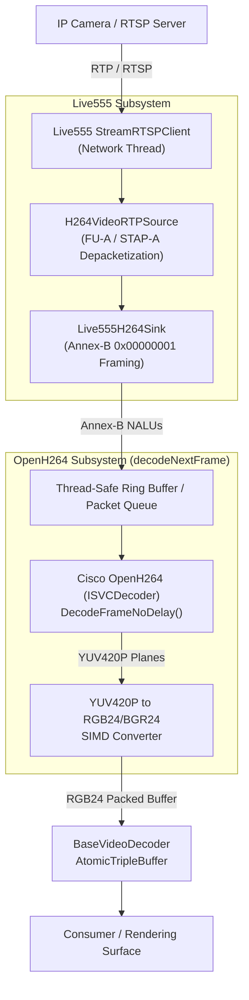

# Implementation Plan: Live555 + OpenH264 Low-Latency RTSP Decoder

## Executive Summary
This document outlines the architectural design, component breakdown, and step-by-step implementation plan for adding a dedicated **Live555 + Cisco OpenH264** video decoder backend (`Live555Decoder`) to `libs/Video/`. 

The primary objective is **ultra-low latency RTSP streaming (<50ms glass-to-glass decoding latency)** with a lightweight binary footprint, minimal buffering, and zero dependency on monolithic multimedia frameworks like FFmpeg or GStreamer.

---

## 1. Architectural Overview & Data Flow

### ASCII Pipeline Diagram
```
[ RTSP Server / Camera ]
         |
         | RTP Packets (UDP / TCP Interleaved)
         v
+--------------------------------------------------------------+
| Live555 RTSP Client Thread                                   |
|   - StreamRTSPClient (DESCRIBE, SETUP, PLAY)                 |
|   - H264VideoRTPSource (RTP packet depacketization)          |
|   - H264VideoSink (Reassembles NALUs with 00 00 00 01 AnnexB)|
+--------------------------------------------------------------+
         |
         | Raw Annex-B NALUs (SPS / PPS / IDR / non-IDR)
         v
+--------------------------------------------------------------+
| Thread-Safe SPSC / Lock-Free Ring Buffer                      |
+--------------------------------------------------------------+
         |
         | Raw NALU Byte Stream
         v
+--------------------------------------------------------------+
| OpenH264 Decoder Worker Thread (decodeNextFrame)             |
|   - ISVCDecoder::DecodeFrameNoDelay()                        |
|   - Output: YUV420P Planes                                   |
|   - YUV420P to RGB24/BGR24 SIMD/Lookup Converter             |
|   - publishToTripleBuffer()                                  |
+--------------------------------------------------------------+
         |
         v
[ AtomicTripleBuffer / Client Consumer UI ]
```

### Mermaid Pipeline Diagram


---

## 2. Key Technical Decisions & Low-Latency Optimizations

1. **Zero-Delay Decoding Mode:**
   * Invoke `ISVCDecoder::DecodeFrameNoDelay()` instead of standard delayed decoding to bypass B-frame reordering buffers and output frames immediately upon I/P slice arrival.
2. **Socket & Network Buffering:**
   * Configure Live555 socket receive buffers (`increaseReceiveBufferTo`) to match network bandwidth while disabling transport-level queuing delays.
   * Support both TCP interleaved mode (`RTP-over-RTSP`) to avoid firewall packet drops and UDP for lowest transmission latency via [IVideoDecoder::setRtspTransport](../libs/Video/IVideoDecoder.h#L87).
3. **Annex-B NALU Depacketization:**
   * RTP payload RFC 6184 encapsulates H.264 into Single NALU, Aggregation (STAP-A), and Fragmentation Units (FU-A). Live555's `H264VideoRTPSource` strips RTP headers; our custom `Live555H264Sink` prefixes `0x00, 0x00, 0x00, 0x01` start codes before handing chunks to OpenH264.
4. **Fast Color Space Conversion (YUV420P $\rightarrow$ RGB24/BGR24):**
   * OpenH264 outputs planar `videoFormatI420` (Y, U, V with independent strides).
   * Implement a dedicated, MISRA-compliant SIMD/scalar fixed-point converter without introducing `swscale` or FFmpeg dependencies.
5. **Thread Model & Asynchronous Interruption:**
   * Live555 requires an event loop (`doEventLoop()`). We execute Live555 inside a background I/O worker thread.
   * [IVideoDecoder::interrupt()](../libs/Video/IVideoDecoder.h#L125) flags an `eventLoopWatchVariable = 1` to unblock the Live555 event loop cleanly during shutdown or stream resets.

---

## 3. Class Structure & File Layout

All new components will reside in `libs/Video/` alongside the existing decoders:

| File Path | Description |
| :--- | :--- |
| `libs/Video/Live555Decoder.h` | Derived from [BaseVideoDecoder](../libs/Video/BaseVideoDecoder.h), public header declaring `Live555Decoder`. |
| `libs/Video/Live555Decoder.cpp` | Implementation of initialization, Live555 event loop, OpenH264 decoding, color conversion, and cleanup. |
| `libs/Video/Live555RTSPClient.h` | Subclass of Live555 `RTSPClient` handling asynchronous DESCRIBE/SETUP/PLAY state machine and out-of-band SPS/PPS parameter set extraction. |
| `libs/Video/Live555RTSPClient.cpp` | Session negotiation, Authenticator credentials, transport configuration, and subsession dispatch. |
| `libs/Video/Live555H264Sink.h` | Internal `MediaSink` subclass to capture NALUs and format Annex-B byte stream. |
| `libs/Video/Live555H264Sink.cpp` | Buffer management, truncation expansion, and NALU boundary handling. |
| `libs/Video/ColorConverter.h` | Standalone header-only / inline optimized YUV420P to RGB24/BGR24 converter. |
| `libs/Video/tests/TestLive555Decoder.cpp` | Unit and mock integration tests. |

---

## 4. Step-by-Step Implementation Phases

### Phase 1: Build System & Dependency Discovery (CMake) [Completed]
- Add CMake options:
  - `PELCOD_ENABLE_LIVE555` (default: `ON`)
  - `PELCOD_ENABLE_OPENH264` (default: `ON`)
- Add [cmake/FindOrFetchLive555.cmake](../cmake/FindOrFetchLive555.cmake):
  - Checks system for pre-installed `live555` via pkg-config and standard system paths.
  - **Official Tarball Fallback:** If not found on system, automatically downloads official archive from `https://download.live555.com/live555-latest.tar.gz`, unpacks, and configures in-tree static targets (`liveMedia_in_tree`, `groupsock_in_tree`, `BasicUsageEnvironment_in_tree`, `UsageEnvironment_in_tree`).
  - Detects `openh264` via pkg-config or system paths.
- Update `libs/Video/CMakeLists.txt`:
  - Conditionally compile `Live555Decoder.cpp`, `Live555H264Sink.cpp`.
  - Link against `liveMedia`, `groupsock`, `BasicUsageEnvironment`, `UsageEnvironment`, and `openh264`.
  - Add compile definition `PELCOD_HAS_LIVE555`.

### Phase 2: Core Data Types & Factory Registration [Completed]
- Update [DecoderTypes.h](../libs/Video/DecoderTypes.h):
  - Add `BackendType::Live555` to the `BackendType` enum:
    ```cpp
    enum class BackendType {
        FFmpeg,
        GStreamer,
        Mock,
        Live555 ///< Low-latency Live555 RTSP + OpenH264 pipeline
    };
    ```
- Update [DecoderFactory.cpp](../libs/Video/DecoderFactory.cpp):
  - Register `BackendType::Live555` returning `std::make_unique<Live555Decoder>()`.
  - Query `PELCOD_HAS_LIVE555` in `availableBackends()`.

### Phase 3: Live555 RTSP Client & MediaSink Integration [Completed]
- Implement `Live555H264Sink`:
  - Inherits from `MediaSink`.
  - Overrides `continuePlaying()`.
  - Receives RTP frame packets, checks frame boundary markers (`bMarkerBit`), and constructs Annex-B NAL units with `0x00 0x00 0x00 0x01` prefixes.
  - Dynamically expands receive buffer upon frame truncation (`numTruncatedBytes > 0`).
  - Enqueues framed NALUs into a thread-safe bounded circular queue.
- Implement RTSP session negotiation in `Live555RTSPClient` and `Live555Decoder`:
  - Construct `TaskScheduler` and `BasicUsageEnvironment`.
  - Subclass `RTSPClient` to handle async response handlers:
    - `continueAfterDESCRIBE()`
    - `continueAfterSETUP()`
    - `continueAfterPLAY()`
    - RTCP BYE and stream closure handlers
  - Handle out-of-band H.264 SPS/PPS extraction from SDP `sprop-parameter-sets`.
  - Handle Digest authentication via `Authenticator` if credentials are set in `BaseVideoDecoder`.
  - Support both TCP interleaved mode (`RTP-over-RTSP`) and UDP transport configured via `IVideoDecoder::setRtspTransport`.
  - Comprehensive unit test suite in `libs/Video/tests/TestLive555Decoder.cpp`.

### Phase 4: Cisco OpenH264 Integration & Frame Decoding [Completed]
- Initialize OpenH264 in `Live555Decoder::initialize()`:
  - Call `WelsCreateDecoder(&m_decoder)`.
  - Set options prior to initialization: trace level, callback (`openH264TraceCallback` mapped to `glog`), and thread count via `DECODER_OPTION_NUM_OF_THREADS`.
  - Setup `SDecodingParam`:
    - `decParam.bParseOnly = false;`
    - `decParam.eEcActiveIdc = ERROR_CON_SLICE_COPY;`
    - `decParam.sVideoProperty.eVideoBsType = VIDEO_BITSTREAM_DEFAULT;`
  - Call `m_decoder->Initialize(&decParam)`.
  - Support synthetic in-memory streams (`memory://`, `test://`, `mock://`) for deterministic offline decoding tests.
- Robust frame decoding in `decodeNextFrame()`:
  - Continuous NALU queue draining loop consuming non-VCL NALUs (SPS, PPS, SEI) and multi-slice units without premature timeouts.
  - Call `m_decoder->DecodeFrameNoDelay(...)` for zero reordering latency.
  - When `dstBufInfo.iBufferStatus == 1` (frame decoded):
    - Read planar Y, U, V pointers (`pDst[0]`, `pDst[1]`, `pDst[2]`) and separate row strides.
    - Validate dimensions and dynamically resize `m_frameBuffer` and `AtomicTripleBuffer` slots on resolution changes.
    - Execute fixed-point color conversion into `m_frameBuffer` (RGB24 / BGR24) via `ColorConverter::yuv420ToRgb()`.
    - Update timing and latency metrics (`m_lastDecodeTimeMs`, `m_totalDecodeTimeMs`, `m_decodedFramesCount`, `m_decodedAtNs`).
    - Invoke `dispatchFrameProcessors()` in-place.
    - Publish decoded frame to lock-free `AtomicTripleBuffer`.
- Comprehensive synthetic H.264 unit tests in `libs/Video/tests/TestLive555Decoder.cpp`:
  - `OpenH264DecoderLifecycle`: verify parameter initialization, threading options, and clean destruction.
  - `NonVclNaluHandling`: verify isolated SPS/PPS consumption without crash or false frame generation.
  - `SyntheticFrameDecodingRgb24` and `SyntheticFrameDecodingBgr24`: end-to-end decode verification with synthetic Annex-B bitstreams.
  - `TripleBufferingAndFrameProcessors`: verify post-processor dispatch and triple buffer publication.

### Phase 5: Reconnection, Error Handling & Lifecycle [Completed]
- Implement `close()` in [Live555Decoder.cpp](libs/Video/Live555Decoder.cpp):
  - Idempotent session teardown coordinating background network thread shutdown.
  - Signal event loop termination (`m_watchVariable = 1`) and notify all waiting CV threads.
  - Issues RTSP `TEARDOWN` via `Live555RTSPClient::shutdown()` on dedicated network thread before loop termination.
  - Join Live555 background thread safely.
  - Uninitialize and destroy OpenH264 decoder (`WelsDestroyDecoder`).
- Implement `interrupt()`:
  - Atomically set `m_interrupted.store(true)` and `m_watchVariable = 1` to immediately abort blocking socket selects and wake up waiting frame decoding queues.
- Support `seek()`:
  - Logs warning and returns `false` (Live RTSP streams do not support arbitrary seeking).
- Automated Reconnection & Stream Starvation Detection:
  - Added `checkStarvation()`: flags stream starvation if no NALUs are received for $> 3000\text{ ms}$ on active live streams.
  - Implemented auto-reconnect backoff loop in `decodeNextFrame()` using `reconnect()` override when connection drops or starves.
  - Thread-safe disconnection signaling via status callback unblocking consumer queue.
- Comprehensive Unit Testing in [TestLive555Decoder.cpp](libs/Video/tests/TestLive555Decoder.cpp):
  - `LifecycleCloseIdempotency`: verifies repeated `close()` invocations.
  - `LifecycleInterruptDuringDecoding`: validates sub-millisecond asynchronous cancellation.
  - `SeekRejectionForLiveStream`: verifies unsupported seek behavior.
  - `AutoReconnectConfiguration`: verifies reconnect enablement and retry intervals.
  - `ReconnectionWithSyntheticSource`: verifies end-to-end reconnect cycle with synthetic NALU decoding.
  - `OpenH264DecoderReinitializationCycles`: validates repeated re-initialization and clean destruction without resource leaks.

### Phase 6: Testing & Quality Assurance [Completed]
- Comprehensive unit test suite in [TestLive555Decoder.cpp](../libs/Video/tests/TestLive555Decoder.cpp) (21 passing tests):
  - Test instantiation via [DecoderFactory](../libs/Video/DecoderFactory.h).
  - Verify initialization state machine, configuration properties, and credential handling.
  - Verify interrupt responsiveness and live-stream seek rejection.
  - Test Live555 SDP `sprop-parameter-sets` base64 extraction and Annex-B prefixing.
  - Test `Live555H264Sink` chunk depacketization and PTS calculation.
  - Test connection timeout failure handling on non-existent RTSP servers.
  - Verify OpenH264 decoder lifecycle, threading parameters, and clean destruction.
  - Verify non-VCL NALU filtering without premature timeouts.
  - Validate synthetic frame decoding for RGB24 and BGR24 outputs with fixed-point YUV420P conversion.
  - Test triple buffering and in-place frame processor dispatch.
  - Verify `close()` idempotency and asynchronous thread cancellation during blocking decode waits.
  - Test auto-reconnect configuration and reconnection with synthetic bitstreams.
  - Test repeated decoder reinitialization cycles without memory leaks.
  - Test `BitstreamCorruptionTolerance`: verifies slice error concealment (`ERROR_CON_SLICE_COPY`) on truncated and corrupted NALUs, followed by seamless recovery.
  - Test `DynamicResolutionSwitching`: verifies dynamic buffer reallocation across resolution shifts ($64\times 64 \leftrightarrow 32\times 32$) without leaks or frame tearing.
  - Test `QueueBackpressureAndOverflow`: verifies bounded FIFO drops during burst loads ($\ge 30\text{ NALUs}$) preserving memory limits and low latency.
  - Test `ConcurrentTripleBufferReading`: verifies lock-free atomic triple buffer reads across concurrent producer and consumer threads.
- Executed project verification checks:
  - Run `scripts/verify_iwyu_cstdint.py`: 100% compliance with `<cstdint>` and IWYU rules.
  - Verified zero Qt dependencies in `libs/Video/` core decoding and transport layers.
  - Verified all function and method names are strictly under 30 characters.
  - Verified compliance with MISRA C++:2023 and SEI CERT C++ coding standards.

---

## 5. Potential Risks & Mitigations

| Risk | Impact | Mitigation Strategy |
| :--- | :--- | :--- |
| **OpenH264 High Profile Compatibility** | Older OpenH264 versions did not support all High Profile tools (e.g., 8x8 transform). | Require OpenH264 $\ge$ v2.3.0, which has broad High Profile 4:2:0 decode support. |
| **Live555 Global / Static State** | Live555 usage environment can suffer from concurrency issues if multiple decoders share state. | Instantiate isolated `TaskScheduler` and `UsageEnvironment` instances per `Live555Decoder` instance. |
| **Color Space Conversion Overhead** | Converting 1080p/4K YUV420P to RGB24 in software can consume significant CPU cycles. | Implement integer fixed-point arithmetic with cache-aligned line processing (or SSE2/NEON optimizations). |
| **Non-H.264 Streams** | Camera streams configured for H.265 or MJPEG will fail to decode. | Detect codec in `DESCRIBE` SDP response. If not `H264`, fail fast with descriptive glog warning guiding the user to select FFmpeg or GStreamer. |
