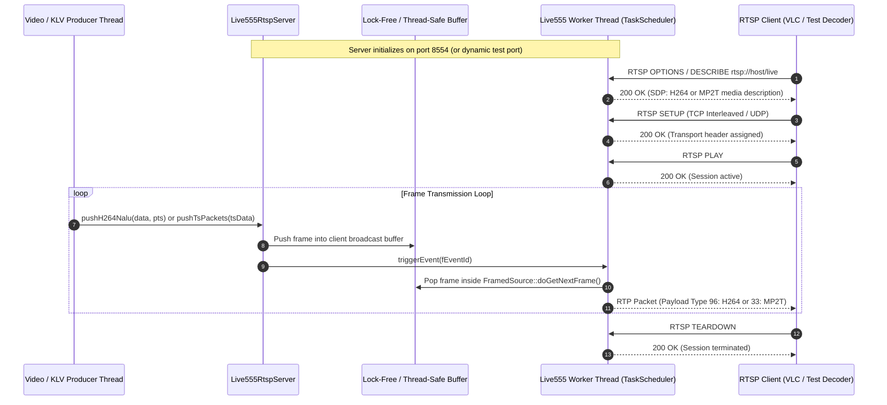

# Implementation Plan: Production & Testing Live555 RTSP Streaming Server

## Executive Summary
This document defines the architectural specification, component design, and phased implementation plan for an embedded, high-performance **Live555 RTSP Streaming Server** ([Live555RtspServer](../libs/Video/Live555RtspServer.h)).

The server serves two critical operational roles:
1. **Production RTSP Egress (STANAG 4609 / H.264 Broadcast):** Allows downstream tactical clients (VLC, ATAK, QGroundControl, media recorders, C2 mission displays) to pull live streams on-demand over unicast UDP or interleaved TCP. It supports both raw **RFC 6184 H.264 elementary streams** and **RFC 2250 MPEG-2 Transport Streams (`MP2T`)** carrying synchronized MISB ST 0601 / ST 1607 KLV metadata.
2. **Deterministic In-Process Testing & Mocking:** Provides a lightweight, thread-safe test fixture for unit and integration testing [Live555Decoder](../libs/Video/Live555Decoder.h), [Live555RTSPClient](../libs/Video/Live555RTSPClient.h), and UI widgets without relying on physical cameras, external daemons, or network access.

---

## 1. Architectural Overview & Data Flow

### ASCII Pipeline Diagram
```
+---------------------------------------------------------------------------------------------------------+
|                                     PRODUCER SUBSYSTEM                                                  |
|                                                                                                         |
|  [ Live Camera / Video Pipeline ]                  [ MpegTsKlvMuxer (STANAG 4609) ]                     |
|           │ (H.264 NALUs)                                     │ (188-byte TS Packets)                   |
|           ▼                                                   ▼                                         |
|  +---------------------------------------------------------------------------------------------------+  |
|  | Live555RtspServer::pushH264Nalu(...)           Live555RtspServer::pushTsPackets(...)              |  |
|  +---------------------------------------------------------------------------------------------------+  |
+--------------------------------------------------│------------------------------------------------------+
                                                   │ Thread-safe queue / triggerEvent()
                                                   ▼
+---------------------------------------------------------------------------------------------------------+
|                                  LIVE555 SERVER WORKER THREAD                                           |
|                                                                                                         |
|  +----------------------------------+                   +----------------------------------+            |
|  | Live555H264LiveSource            |                   | Live555Mp2tLiveSource            |            |
|  | (Custom FramedSource for H.264)  |                   | (Custom FramedSource for MP2T)   |            |
|  +-----------------+----------------+                   +-----------------+----------------+            |
|                    │                                                      │                             |
|                    ▼                                                      ▼                             |
|  +----------------------------------+                   +----------------------------------+            |
|  | Live555H264Subsession            |                   | Live555Mp2tSubsession            |            |
|  | (OnDemandServerMediaSubsession)  |                   | (OnDemandServerMediaSubsession)  |            |
|  +-----------------+----------------+                   +-----------------+----------------+            |
|                    │                                                      │                             |
|                    └──────────────────────────┬───────────────────────────┘                             |
|                                               ▼                                                         |
|                               +-------------------------------+                                         |
|                               | Live555 RTSPServer Instance   |                                         |
|                               | (rtsp://0.0.0.0:8554/<stream>)|                                         |
|                               +---------------+---------------+                                         |
+-----------------------------------------------│---------------------------------------------------------+
                                                │ RTSP / RTP / RTCP
                                                ├─────────────────────────────────┐
                                                ▼                                 ▼
                               +---------------------------------+  +-----------------------------------+
                               | Production Client (VLC / ATAK)  |  | Unit Test (Live555Decoder Loopback)|
                               | TCP Interleaved or UDP Unicast  |  | In-Process Hermetic Test Harness  |
                               +---------------------------------+  +-----------------------------------+
```

### Mermaid Architecture & Sequence Diagram



---

## 2. Key Requirements & Features

### 2.1 Dual-Mode Operation
1. **Production Mode:**
   - Mount endpoints: `rtsp://<host>:<port>/live` (H.264) and `rtsp://<host>:<port>/stanag4609.ts` (MPEG-TS + KLV).
   - High throughput, low latency (< 10 ms queuing delay).
   - Multiple concurrent clients (up to 16 simultaneous viewers).
   - Support for dynamic SPS/PPS extraction and SDP `sprop-parameter-sets` generation.
   - Digest and Basic authentication database support (`UserAuthenticationDatabase`).
2. **Unit / Integration Testing Mode:**
   - Ephemeral port binding (`port = 0` or dynamic allocation) to prevent `EADDRINUSE` conflicts during parallel `ctest -j` execution.
   - In-memory synthetic frame feeding (zero disk I/O, zero network dependencies).
   - Deterministic frame pacing and teardown injection to test reconnects, packet loss, and buffer overflow.

### 2.2 Protocol Compliance
- **RTSP 1.0 (RFC 2326)**: Standard RTSP command handling (`OPTIONS`, `DESCRIBE`, `SETUP`, `PLAY`, `PAUSE`, `TEARDOWN`, `GET_PARAMETER`).
- **RTP H.264 (RFC 6184)**: Direct packetization of NAL units with Single NAL unit packets, Non-interleaved mode, and FU-A fragmentation.
- **RTP MP2T (RFC 2250)**: Streaming 188-byte MPEG-2 Transport Stream packets over RTP payload type 33 (7 TS packets = 1316 bytes per RTP payload).
- **Transport Types**:
  - RTP over UDP (unicast).
  - Interleaved RTP/RTCP over RTSP TCP connection (channel 0/1).

---

## 3. Core Component Design

### 3.1 Component Breakdown

| Component | Responsibility | Target File |
| :--- | :--- | :--- |
| `Live555RtspServer` | Public lifecycle manager, endpoint configuration, thread orchestration, and producer ingest API. | `libs/Video/Live555RtspServer.h`, `libs/Video/Live555RtspServer.cpp` |
| `Live555H264LiveSource` | Custom `FramedSource` pulling H.264 NALUs from the thread-safe broadcast queue and serving them to Live555 framers. | `libs/Video/Live555H264LiveSource.h`, `libs/Video/Live555H264LiveSource.cpp` |
| `Live555Mp2tLiveSource` | Custom `FramedSource` pulling 188-byte TS packets for RFC 2250 RTP transmission. | `libs/Video/Live555Mp2tLiveSource.h`, `libs/Video/Live555Mp2tLiveSource.cpp` |
| `Live555LiveSubsession` | Subclasses `OnDemandServerMediaSubsession` to create discrete framers and RTP sinks for connected clients. | `libs/Video/Live555LiveSubsession.h`, `libs/Video/Live555LiveSubsession.cpp` |
| `RtspServerConfig` | Configuration structure (port, credentials, stream endpoints, max clients, transport preferences). | `libs/Video/RtspServerConfig.h` |

---

### 3.2 Threading & Inter-Thread Synchronization
Live555 is fundamentally single-threaded, using a cooperative event loop driven by `TaskScheduler`. External producers (camera threads, KLV muxing threads) must **never** call Live555 methods directly.

**Thread Synchronization Strategy:**
1. **Thread-Safe Ring Buffer:** Producers push NALUs or TS packets into a bounded ring buffer protected by a spinlock or lightweight mutex.
2. **TaskScheduler Event Trigger:** When new data is queued, the producer calls `TaskScheduler::triggerEvent(fEventTriggerId, this)`.
3. `triggerEvent()` wakes up `BasicTaskScheduler::SingleStep()`, which schedules `Live555H264LiveSource::deliverFrame()` inside the Live555 thread.
4. **Zero-Copy / Memory Efficiency:** Frames are held in reference-counted buffer blocks (`std::shared_ptr<const std::vector<std::uint8_t>>`) so multiple connected RTSP clients read the exact same memory without duplicate copies.

---

## 4. API Design & Class Interfaces

### 4.1 Configuration Structure (`RtspServerConfig.h`)

```cpp
#pragma once

#include <cstdint>
#include <optional>
#include <string>

namespace Video {

/// @enum RtspStreamType
/// @brief Format of the stream delivered by the subsession.
enum class RtspStreamType : std::uint8_t {
    H264ElementaryStream, ///< RFC 6184 H.264 elementary stream
    Mpeg2TransportStream  ///< RFC 2250 MPEG-2 TS (STANAG 4609 compliant)
};

/// @struct RtspServerConfig
/// @brief Configuration settings for Live555RtspServer.
struct RtspServerConfig {
    std::uint16_t port { 8554U };                      ///< RTSP listening port (0 for ephemeral)
    std::string streamPath { "live" };                 ///< URL path (e.g., "live" -> rtsp://host:port/live)
    RtspStreamType streamType { RtspStreamType::H264ElementaryStream };
    std::size_t maxClients { 16U };                    ///< Maximum concurrent RTSP clients
    std::size_t queueCapacityFrames { 30U };           ///< Ingest buffer depth before drop
    std::optional<std::string> username {};            ///< Optional Digest/Basic username
    std::optional<std::string> password {};            ///< Optional Digest/Basic password
    std::string realm { "PelcoD_RTSP_Server" };        ///< Authentication realm
    bool enableMulticast { false };                    ///< Enable multicast RTP egress
    std::string multicastAddress { "239.255.0.1" };    ///< Multicast target address
    std::uint16_t multicastPort { 5004U };             ///< Multicast target RTP port
};

} // namespace Video
```

---

### 4.2 Main Server Interface (`Live555RtspServer.h`)

```cpp
#pragma once

#include <cstddef>
#include <cstdint>
#include <memory>
#include <string>
#include <vector>

#include "RtspServerConfig.h"

namespace Video {

/// @class Live555RtspServer
/// @brief High-performance embedded RTSP streaming server based on Live555.
/// @details Thread-safe interface allowing video and metadata producers to publish
///          live H.264 or MPEG-TS streams to connected RTSP clients and unit test fixtures.
class Live555RtspServer final {
public:
    /// @brief Constructs server with specified configuration.
    /// @param[in] config Server configuration settings.
    explicit Live555RtspServer(RtspServerConfig config);

    /// @brief Destructor. Stops server and joins worker thread.
    ~Live555RtspServer();

    // Prevent copy/move to maintain strict RAII thread ownership
    Live555RtspServer(const Live555RtspServer&) = delete;
    Live555RtspServer& operator=(const Live555RtspServer&) = delete;
    Live555RtspServer(Live555RtspServer&&) = delete;
    Live555RtspServer& operator=(Live555RtspServer&&) = delete;

    /// @brief Starts RTSP server on background worker thread.
    /// @return True if server started and bound successfully to port.
    [[nodiscard]] bool start();

    /// @brief Stops RTSP server, closes all client sessions, and joins thread.
    void stop();

    /// @brief Checks if server is actively listening and running.
    /// @return True if running.
    [[nodiscard]] bool isRunning() const noexcept;

    /// @brief Retrieves the actual bound listening port (useful when port 0 was specified).
    /// @return Listening port number.
    [[nodiscard]] std::uint16_t listeningPort() const noexcept;

    /// @brief Retrieves full RTSP URL for client connection.
    /// @param[in] host Hostname or IP to format (defaults to "127.0.0.1").
    /// @return Full URL (e.g. "rtsp://127.0.0.1:8554/live").
    [[nodiscard]] std::string getUrl(const std::string& host = "127.0.0.1") const;

    /// @brief Ingests raw Annex-B H.264 NAL unit for client broadcast.
    /// @details Thread-safe; can be called from any producer thread.
    /// @param[in] naluData Pointer to NAL unit buffer (including or excluding start code).
    /// @param[in] naluSize Size of NAL unit in bytes.
    /// @param[in] ptsSeconds Presentation timestamp in seconds (0.0 for immediate).
    /// @return True if successfully queued; false if queue overflowed.
    [[nodiscard]] bool pushH264Nalu(const std::uint8_t* naluData, std::size_t naluSize, double ptsSeconds = 0.0);

    /// @brief Ingests pre-multiplexed MPEG-2 TS packets (e.g., from MpegTsKlvMuxer).
    /// @details Thread-safe; input size must be a multiple of 188 bytes.
    /// @param[in] tsData Pointer to TS buffer.
    /// @param[in] tsSize Total size in bytes (must be N * 188).
    /// @return True if successfully queued; false on invalid size or overflow.
    [[nodiscard]] bool pushTsPackets(const std::uint8_t* tsData, std::size_t tsSize);

    /// @brief Retrieves current connected client count.
    /// @return Active RTSP client count.
    [[nodiscard]] std::size_t activeClientCount() const noexcept;

private:
    class Impl;
    std::unique_ptr<Impl> m_impl;
};

} // namespace Video
```

---

## 5. Detailed Step-by-Step Implementation Plan

### Step 1: Configuration & In-Memory Data Structures [Completed]
> [!NOTE]
> Detailed specification and implementation plan: [live555_rtsp_server_step1_implementation_plan.md](live555_rtsp_server_step1_implementation_plan.md)

- [x] Create `libs/Video/RtspServerConfig.h` and `libs/Video/RtspServerConfig.cpp`.
- [x] Implement `libs/Video/Live555FrameTypes.h`.
- [x] Implement `libs/Video/Live555FrameQueue.h` and `libs/Video/Live555FrameQueue.cpp` (thread-safe, bounded FIFO ring buffer supporting multi-reader fan-out).
- [x] Register files in `libs/Video/CMakeLists.txt`.
- [x] Create unit tests in `libs/Video/tests/TestLive555FrameQueue.cpp`.

### Step 2: Custom Live555 `FramedSource` Subclasses [Completed]
> [!NOTE]
> Detailed specification and implementation plan: [live555_rtsp_server_step2_implementation_plan.md](live555_rtsp_server_step2_implementation_plan.md)

- [x] Create `libs/Video/Live555H264LiveSource.h` and `.cpp`:
  - Inherits from `FramedSource`.
  - Implements `doGetNextFrame()`.
  - Handles NALU fragmentation and delivery pacing without blocking the scheduler.
- [x] Create `libs/Video/Live555Mp2tLiveSource.h` and `.cpp`:
  - Bundles 7 TS packets (1316 bytes) per RTP call for optimal MTU fit.
  - Implements `doGetNextFrame()`.

### Step 3: Custom Live555 `ServerMediaSubsession` Subclasses
- [ ] Create `libs/Video/Live555LiveSubsession.h` and `.cpp`:
  - Inherits from `OnDemandServerMediaSubsession`.
  - Overrides `createNewStreamSource()` to instantiate `Live555H264LiveSource` or `Live555Mp2tLiveSource`.
  - Overrides `createNewRTPSink()` returning `H264VideoRTPSink` or `SimpleRTPSink` (payload 33).
  - Overrides `getAuxSDPLine()` to supply `sprop-parameter-sets` for direct H.264 playback without initial artifacts.

### Step 4: `Live555RtspServer` Orchestrator Implementation
- [ ] Implement `Live555RtspServer.cpp`:
  - Uses PIMPL pattern to shield client code and tests from raw Live555 headers.
  - Instantiates `BasicTaskScheduler` and `BasicUsageEnvironment`.
  - Sets up `RTSPServer::createNew()`.
  - Registers `ServerMediaSession` with the custom subsessions.
  - Configures `UserAuthenticationDatabase` if credentials are provided.
  - Runs event loop in worker thread; responds to `TaskScheduler::triggerEvent`.

### Step 5: CMake Registration
- [ ] Update `libs/Video/CMakeLists.txt` to include new server sources when `PELCOD_ENABLE_LIVE555` is enabled.
- [ ] Apply hardening flags and warnings (`apply_compiler_flags(Video)`).

---

## 6. Testing & Verification Strategy

### 6.1 Unit Tests (`libs/Video/tests/TestLive555RtspServer.cpp`)
1. **Lifecycle & Port Binding:**
   - Verify server starts and stops cleanly with zero leaks.
   - Verify dynamic port allocation (`port = 0`) reports a valid non-zero port.
2. **H.264 Loopback Streaming Test:**
   - Instantiate `Live555RtspServer` on ephemeral port.
   - Push synthetic SPS, PPS, IDR frames from test memory.
   - Connect [Live555Decoder](../libs/Video/Live555Decoder.h) to `server.getUrl()`.
   - Validate received frame dimensions and pixel buffer.
3. **MPEG-2 TS Loopback Streaming Test:**
   - Push synthetic TS packets (PAT, PMT, Video PID) to `Live555RtspServer`.
   - Connect [Live555Decoder](../libs/Video/Live555Decoder.h) configured for MP2T.
   - Verify [Live555Mp2tSink](../libs/Video/Live555Mp2tSink.h) and [MpegTsH264Demuxer](../libs/Video/MpegTsH264Demuxer.h) demux and decode cleanly.
4. **Authentication Test:**
   - Configure server with credentials (`operator` / `pass123`).
   - Connect client with wrong password -> expect rejection.
   - Connect client with valid credentials -> expect stream playback.
5. **Multi-Client Concurrency Test:**
   - Connect 3 concurrent `Live555Decoder` instances to the same server.
   - Verify all 3 decoders receive frames concurrently without frame drops or memory leaks.

### 6.2 External Client Verification
- Verify stream ingestion with external clients:
  - `ffplay -rtsp_transport tcp rtsp://127.0.0.1:8554/live`
  - `vlc rtsp://127.0.0.1:8554/stanag4609.ts`

---

## 7. Standards Compliance & Checklist

- [ ] **MISRA C++:2023 / SEI CERT C++**: Zero raw `new` / `delete` in public API; RAII memory management; explicit type casts.
- [ ] **IWYU & `<cstdint>`**: All integer types qualified with `std::` (`std::uint8_t`, `std::size_t`); explicit `<cstdint>` and `<cstddef>` inclusions.
- [ ] **Zero Qt Dependencies**: Pure modern C++17 within `libs/Video/` core.
- [ ] **Doxygen Documentation**: Full templates (`/// @brief`, `@details`, `@param`, `@return`) for all public interfaces.
- [ ] **Cross-Platform**: Clean build and test execution on Linux and Windows.
- [ ] **Clean Compiler Output**: Compiles with zero warnings under `-Wall -Wextra -pedantic` (`-Werror`) and `/W4`.
