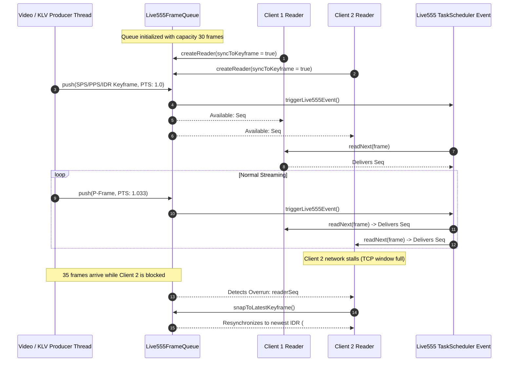

# Implementation Plan: Step 1 - Configuration & In-Memory Data Structures (Live555 RTSP Server)

## Executive Summary
This document specifies the detailed technical design, threading architecture, and step-by-step implementation tasks for **Step 1: Configuration & In-Memory Data Structures** of the [Live555 RTSP Streaming Server](live555_rtsp_server_implementation_plan.md).

The primary objective of Step 1 is to construct a **thread-safe, high-throughput, multi-reader fan-out circular ring buffer** ([Live555FrameQueue](../libs/Video/Live555FrameQueue.h)) and a comprehensive **server configuration specification** ([RtspServerConfig.h](../libs/Video/RtspServerConfig.h)). This establishes the foundational zero-copy memory pipeline between external video/metadata producers (camera threads, STANAG 4609 multiplexers) and multiple concurrent Live555 client sessions.

---

## 1. Architectural Overview & Data Structures

### 1.1 The Multi-Reader Fan-Out Problem
In a live RTSP egress server, a single camera or STANAG 4609 multiplexer produces one live stream (e.g., 30 or 60 fps). However, $N$ independent RTSP clients (VLC, ATAK, QGroundControl, test decoders) can connect simultaneously.
* In Live555, each client connection spawns an independent `FramedSource` instance that pulls frames on demand when its socket/MTU is ready.
* A traditional FIFO queue (such as SPSC or MPSC) would consume frames upon the first client read, starving all other clients.
* Copying frame payloads for each client wastes CPU cache and memory bandwidth.

**Solution:** A **Multi-Reader Monotonic Circular Ring Buffer** where:
1. Payloads are stored once as `std::shared_ptr<const std::vector<std::uint8_t>>`.
2. Each queued item carries a monotonic 64-bit sequence ID (`sequenceNumber`), presentation timestamp (`ptsSeconds`), and keyframe indicator (`isKeyFrame`).
3. Each client attaches a lightweight `FrameQueueReader` tracker holding its own `lastReadSequence`.
4. Slow or late-joining clients detect overflows and instantly recover by snapping forward to the most recent keyframe (IDR/SPS/PPS) to avoid decoding artifacts.

---

### 1.2 ASCII Data Structure & Ring Buffer Architecture

```
+-----------------------------------------------------------------------------------------------------------------+
| PRODUCER THREAD (Camera / MpegTsKlvMuxer)                                                                       |
|   pushFrame(data, pts, isKeyFrame)                                                                              |
+-------------------------------------------------------│---------------------------------------------------------+
                                                        ▼
+-----------------------------------------------------------------------------------------------------------------+
| Live555FrameQueue (Circular Ring Buffer of size N = 30)                                                         |
|                                                                                                                 |
|   Head Sequence: #1042                                                     Tail Sequence: #1013                |
|   +-----------+-----------+-----------+-----------+ ... +-----------+-----------+-----------+-----------+       |
|   | Slot 1013 | Slot 1014 | Slot 1015 | Slot 1016 |     | Slot 1039 | Slot 1040 | Slot 1041 | Slot 1042 |       |
|   | (P-Frame) | (P-Frame) | (IDR/Key) | (P-Frame) |     | (P-Frame) | (IDR/Key) | (P-Frame) | (P-Frame) |       |
|   +-----------+-----------+-----------+-----------+ ... +-----------+-----------+-----------+-----------+       |
|         ▲                                                        ▲                                              |
|         │                                                        │                                              |
|         │ Reader 2 (Slow/Lagging Client)                         │ Reader 1 (Fast Client)                       |
|         │ lastReadSequence: #1012                                │ lastReadSequence: #1039                      |
|         │ (Warning: Overrun imminent -> snap to Key #1040)       │ (Reads Slot 1040 immediately)                |
+---------│--------------------------------------------------------│----------------------------------------------+
          ▼                                                        ▼
+----------------------------------+                     +----------------------------------+
| Live555H264LiveSource (Client 2) |                     | Live555H264LiveSource (Client 1) |
+----------------------------------+                     +----------------------------------+
```

---

### 1.3 Mermaid Thread Interaction & Lifecycle Diagram



---

## 2. Component Design & Class Interfaces

### 2.1 Configuration Header: `libs/Video/RtspServerConfig.h`

`RtspServerConfig` encapsulates all operational, transport, and authentication parameters for the server.

```cpp
#pragma once

#include <cstddef>
#include <cstdint>
#include <optional>
#include <string>

namespace Video {

/// @enum RtspStreamType
/// @brief Payload encapsulation format for RTSP sessions.
enum class RtspStreamType : std::uint8_t {
    H264ElementaryStream = 0U, ///< RFC 6184 H.264 elementary stream (video/H264)
    Mpeg2TransportStream = 1U  ///< RFC 2250 MPEG-2 TS carrying STANAG 4609 (video/MP2T)
};

/// @enum RtspTransportProtocol
/// @brief Allowed network delivery protocols for client sessions.
enum class RtspTransportProtocol : std::uint8_t {
    All = 0U,                  ///< Permit both UDP Unicast and TCP Interleaved
    TcpOnly = 1U,              ///< Restrict to TCP Interleaved (firewall/NAT traversal)
    UdpOnly = 2U               ///< Restrict to UDP Unicast (lowest latency LAN)
};

/// @struct RtspServerConfig
/// @brief Complete configuration parameters for Live555RtspServer.
struct RtspServerConfig {
    std::uint16_t port { 8554U };                      ///< RTSP server listen port (0 for ephemeral test port)
    std::string streamPath { "live" };                 ///< URL mount point path (e.g. "live" -> rtsp://host:port/live)
    std::string streamName { "Live Stream" };          ///< Descriptive stream name for SDP
    std::string streamInfo { "PelcoD RTSP Server" };   ///< Session description text for SDP
    RtspStreamType streamType { RtspStreamType::H264ElementaryStream };
    RtspTransportProtocol transport { RtspTransportProtocol::All };
    std::size_t maxClients { 16U };                    ///< Maximum simultaneous client connections
    std::size_t queueCapacity { 30U };                 ///< In-memory ring buffer frame capacity
    std::optional<std::string> username {};            ///< Optional RTSP authentication username
    std::optional<std::string> password {};            ///< Optional RTSP authentication password
    std::string realm { "PelcoD_RTSP_Server" };        ///< Authentication realm for Digest/Basic
    bool enableMulticast { false };                    ///< Enable multicast RTP egress
    std::string multicastAddress { "239.255.0.1" };    ///< Multicast group destination IP
    std::uint16_t multicastPort { 5004U };             ///< Multicast group destination RTP port
    std::uint8_t multicastTtl { 16U };                 ///< Multicast TTL hop limit

    /// @brief Validates configuration fields for sanity and bounds.
    /// @return True if configuration is valid and ready to bind.
    [[nodiscard]] bool validate() const noexcept;
};

} // namespace Video
```

---

### 2.2 Data Types & Queue Frame Slot: `libs/Video/Live555FrameTypes.h`

```cpp
#pragma once

#include <cstddef>
#include <cstdint>
#include <chrono>
#include <memory>
#include <vector>

namespace Video {

/// @struct QueuedFrame
/// @brief Immutable reference-counted frame unit stored in the ring buffer.
struct QueuedFrame {
    std::shared_ptr<const std::vector<std::uint8_t>> data { nullptr }; ///< Frame payload
    double ptsSeconds { 0.0 };                                        ///< Presentation timestamp (seconds)
    bool isKeyFrame { false };                                        ///< True if SPS/PPS/IDR or TS PAT/PMT/IDR
    std::uint64_t sequenceNumber { 0U };                              ///< Monotonically increasing sequence ID
    std::chrono::steady_clock::time_point arrivalTime {};             ///< Host arrival time for latency tracking
};

/// @struct FrameQueueStats
/// @brief Telemetry metrics for queue performance and client consumption.
struct FrameQueueStats {
    std::uint64_t totalPushed { 0U };     ///< Total frames submitted by producer
    std::uint64_t totalDropped { 0U };    ///< Frames dropped due to lagging readers
    std::size_t currentDepth { 0U };      ///< Current frame count stored in ring buffer
    std::size_t activeReaders { 0U };     ///< Currently attached reader instances
    std::uint64_t latestSequence { 0U };  ///< Latest sequence number queued
    std::uint64_t oldestSequence { 0U };  ///< Oldest valid sequence number still in buffer
};

} // namespace Video
```

---

### 2.3 Frame Queue & Multi-Reader Fan-Out: `libs/Video/Live555FrameQueue.h`

```cpp
#pragma once

#include <cstddef>
#include <cstdint>
#include <functional>
#include <memory>
#include <mutex>
#include <optional>
#include <vector>

#include "Live555FrameTypes.h"

namespace Video {

class FrameQueueReader;

/// @class Live555FrameQueue
/// @brief Thread-safe, bounded, multi-reader circular ring buffer for live frame broadcasting.
/// @details Supports single or multiple concurrent producer threads pushing frames,
///          while permitting multiple independent readers (each corresponding to an active
///          RTSP client session) to poll frames without copying payloads.
class Live555FrameQueue final {
public:
    /// @brief Callback signature for waking up Live555 TaskScheduler.
    using EventTriggerFunc = std::function<void()>;

    /// @brief Constructs queue with bounded maximum capacity.
    /// @param[in] capacity Maximum number of frames retained in circular buffer (minimum 2).
    explicit Live555FrameQueue(std::size_t capacity = 30U);

    ~Live555FrameQueue() = default;

    // Non-copyable, non-movable to ensure stable reference semantics
    Live555FrameQueue(const Live555FrameQueue&) = delete;
    Live555FrameQueue& operator=(const Live555FrameQueue&) = delete;
    Live555FrameQueue(Live555FrameQueue&&) = delete;
    Live555FrameQueue& operator=(Live555FrameQueue&&) = delete;

    /// @brief Sets an asynchronous trigger callback invoked when a new frame is queued.
    /// @param[in] trigger Callback invoking TaskScheduler::triggerEvent().
    void setEventTrigger(EventTriggerFunc trigger);

    /// @brief Enqueues a new frame into the circular ring buffer.
    /// @param[in] frameData Raw byte buffer of NALU or TS packets.
    /// @param[in] size Size of frame buffer in bytes.
    /// @param[in] ptsSeconds Presentation timestamp in seconds.
    /// @param[in] isKeyFrame True if frame contains SPS/PPS/IDR or TS PAT/PMT/IDR.
    /// @return True on success, false if size == 0 or invalid.
    [[nodiscard]] bool push(
        const std::uint8_t* frameData, std::size_t size, double ptsSeconds, bool isKeyFrame);

    /// @brief Enqueues a pre-shared frame buffer into the circular ring buffer (zero-copy).
    /// @param[in] sharedData Shared pointer to immutable payload.
    /// @param[in] ptsSeconds Presentation timestamp in seconds.
    /// @param[in] isKeyFrame True if frame contains keyframe markers.
    /// @return True on success.
    [[nodiscard]] bool push(
        std::shared_ptr<const std::vector<std::uint8_t>> sharedData,
        double ptsSeconds,
        bool isKeyFrame);

    /// @brief Creates an attached reader instance for an RTSP client subsession.
    /// @param[in] syncToKeyframe If true, reader skips immediately to newest keyframe.
    /// @return Unique pointer to the reader.
    [[nodiscard]] std::unique_ptr<FrameQueueReader> createReader(bool syncToKeyframe = true);

    /// @brief Clears all queued frames and resets sequence numbers.
    void clear();

    /// @brief Queries current queue metrics and telemetry.
    /// @return Current queue statistics snapshot.
    [[nodiscard]] FrameQueueStats getStats() const;

    /// @brief Returns the maximum capacity of the ring buffer.
    [[nodiscard]] std::size_t capacity() const noexcept;

private:
    friend class FrameQueueReader;

    /// @brief Internal read method called by FrameQueueReader.
    [[nodiscard]] std::optional<QueuedFrame> readNext(
        std::uint64_t& readerSeq, bool& droppedFrames, bool syncToKeyframe);

    mutable std::mutex m_mutex {};
    std::size_t m_capacity { 30U };
    std::vector<QueuedFrame> m_ringBuffer {};
    std::size_t m_headIndex { 0U };
    std::size_t m_count { 0U };
    std::uint64_t m_nextSequence { 1U };
    std::uint64_t m_latestKeyframeSequence { 0U };
    std::uint64_t m_totalPushed { 0U };
    std::uint64_t m_totalDropped { 0U };
    std::size_t m_activeReaders { 0U };
    EventTriggerFunc m_eventTrigger {};
};

/// @class FrameQueueReader
/// @brief RAII reader handle tracking individual client consumption progress.
class FrameQueueReader final {
public:
    explicit FrameQueueReader(Live555FrameQueue& queue, bool syncToKeyframe);
    ~FrameQueueReader();

    FrameQueueReader(const FrameQueueReader&) = delete;
    FrameQueueReader& operator=(const FrameQueueReader&) = delete;
    FrameQueueReader(FrameQueueReader&&) noexcept;
    FrameQueueReader& operator=(FrameQueueReader&&) noexcept;

    /// @brief Reads the next available frame in sequence.
    /// @param[out] outDropped Set to true if reader fell behind ring buffer and dropped frames.
    /// @return Optional frame containing payload, or std::nullopt if no new frames are ready.
    [[nodiscard]] std::optional<QueuedFrame> getNextFrame(bool& outDropped);

    /// @brief Forces the reader to resynchronize with the most recent keyframe.
    void syncToLatestKey();

    /// @brief Retrieves the last read sequence number.
    [[nodiscard]] std::uint64_t lastSequence() const noexcept;

private:
    Live555FrameQueue* m_queue { nullptr };
    std::uint64_t m_readerSequence { 0U };
    bool m_requireKeyframeSync { true };
};

} // namespace Video
```

---

## 3. Detailed Implementation Steps

### Task 1.1: Implement `RtspServerConfig.h` & `RtspServerConfig.cpp` [Completed]
- **Location**: `libs/Video/RtspServerConfig.h`, `libs/Video/RtspServerConfig.cpp`
- **Actions**:
  - [x] Define `RtspStreamType` and `RtspTransportProtocol` enums.
  - [x] Implement `RtspServerConfig::validate()`:
    - `port <= 65535` (allow 0 for test dynamic binding).
    - `streamPath` non-empty and contains no whitespace or illegal URL characters (`?`, `#`, `&`).
    - `maxClients >= 1` and `maxClients <= 128`.
    - `queueCapacity >= 2` and `queueCapacity <= 1000`.
    - If `enableMulticast` is true: validate `multicastAddress` is within IPv4 class D range (`224.0.0.0` to `239.255.255.255`) and `multicastPort != 0`.

### Task 1.2: Implement `Live555FrameTypes.h` [Completed]
- **Location**: `libs/Video/Live555FrameTypes.h`
- **Actions**:
  - [x] Define `QueuedFrame` and `FrameQueueStats`.
  - [x] Include `<cstdint>`, `<cstddef>`, `<memory>`, `<vector>`, `<chrono>`.
  - [x] Ensure zero raw pointers for payloads (`std::shared_ptr<const std::vector<std::uint8_t>>`).

### Task 1.3: Implement `Live555FrameQueue.h` & `Live555FrameQueue.cpp` [Completed]
- **Location**: `libs/Video/Live555FrameQueue.h`, `libs/Video/Live555FrameQueue.cpp`
- **Actions**:
  - [x] Implement circular buffer indexing using sequence numbers and modulo mapping.
  - [x] Manage monotonic sequence IDs starting from 1.
  - [x] Implement `push()` with deep copy and `push()` with shared pointer.
  - [x] Track `m_latestKeyframeSequence` to allow instant keyframe snapping on connect or overrun.
  - [x] Implement `FrameQueueReader::getNextFrame()`:
    - If `readerSeq < oldestSeq`, mark `outDropped = true`, count dropped frames, and advance reader to `m_latestKeyframeSequence`.
    - Retrieve frame from ring buffer slot, increment `readerSeq`, and return `QueuedFrame`.
    - If reader is caught up to latest, return `std::nullopt`.
  - [x] When `setEventTrigger()` callback is provided, invoke it unconditionally after pushing.

### Task 1.4: Register in `libs/Video/CMakeLists.txt` [Completed]
- **Location**: `libs/Video/CMakeLists.txt`
- **Actions**:
  - [x] Add `RtspServerConfig.h`, `RtspServerConfig.cpp`, `Live555FrameTypes.h`, `Live555FrameQueue.h`, `Live555FrameQueue.cpp` to `PELCOD_VIDEO_SOURCES`.

### Task 1.5: Unit Testing & Verification [Completed]
- **Location**: `libs/Video/tests/TestLive555FrameQueue.cpp`
- **Actions**:
  - [x] Implement unit test suite verifying:
    1. `ConfigValidation`: valid vs. invalid ports, empty stream paths, and invalid multicast IPs.
    2. `SingleProducerSingleConsumer`: push 10 frames, read 10 frames sequentially; verify sequence numbers and PTS.
    3. `MultiReaderFanOut`: 3 readers independently read the same 50 frames; verify zero data divergence.
    4. `LaggingReaderOverrunRecovery`: produce 40 frames into capacity 20 queue; verify reader detects drop and resyncs to latest keyframe.
    5. `ConcurrentPushAndRead`: 1 high-speed producer thread and 4 consumer threads pushing 1000 frames under thread sanitizer / Valgrind.
    6. `EventTriggerFiring`: verify trigger callback is called on every push.

---

## 4. Verification Checklist & Compliance

| Requirement | Implementation Verification |
| :--- | :--- |
| **MISRA C++:2023 / SEI CERT** | Zero raw `new` / `delete`. All memory managed via `std::unique_ptr` and `std::shared_ptr`. |
| **IWYU & `<cstdint>`** | Every header includes `<cstdint>` and `<cstddef>`. All integers use `std::` (`std::uint8_t`, `std::uint64_t`, `std::size_t`). |
| **Zero Qt Dependencies** | Zero `#include <Q...>` in `libs/Video/`. |
| **Thread Safety** | Circular queue operations protected by `std::mutex`; atomic counters for reader state. |
| **Co-located Files** | `RtspServerConfig.h` and `.cpp`, `Live555FrameQueue.h` and `.cpp` co-located in `libs/Video/`. |
| **Zero Compiler Warnings** | Compiles cleanly with zero warnings under `-Wall -Wextra -pedantic` (`-Werror`) and `/W4`. |
