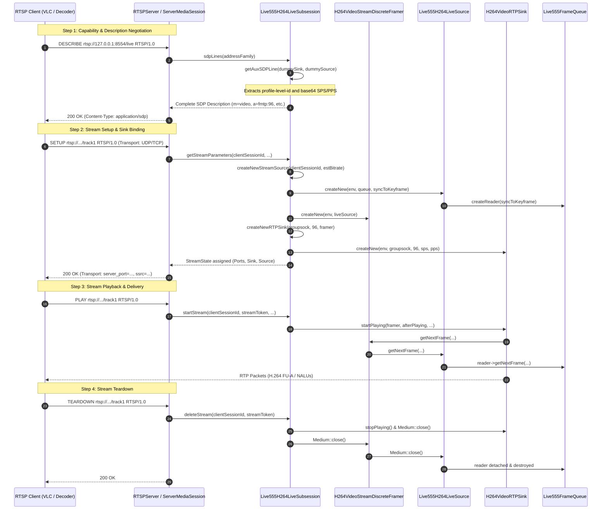

# Implementation Plan: Step 3 - Custom Live555 ServerMediaSubsession Subclasses (Live555 RTSP Server)

## Executive Summary
This document specifies the architectural design, protocol mechanics, and step-by-step implementation tasks for **Step 3: Custom Live555 `ServerMediaSubsession` Subclasses** of the [Live555 RTSP Streaming Server](live555_rtsp_server_implementation_plan.md).

Step 3 bridges the in-memory circular ring buffer ([Live555FrameQueue](../libs/Video/Live555FrameQueue.h)) and custom frame sources ([Live555H264LiveSource](../libs/Video/Live555H264LiveSource.h), [Live555Mp2tLiveSource](../libs/Video/Live555Mp2tLiveSource.h)) with Live555's RTSP server session management by implementing dedicated `OnDemandServerMediaSubsession` subclasses in `libs/Video`:
1. [Live555LiveSubsession](../libs/Video/Live555LiveSubsession.h): Abstract base subsession encapsulating shared queue references, estimated bitrate telemetry, and polymorphic factory dispatching.
2. [Live555H264LiveSubsession](../libs/Video/Live555LiveSubsession.h): Specializes `OnDemandServerMediaSubsession` for RFC 6184 H.264 streaming, creating discrete framers (`H264VideoStreamDiscreteFramer`), dynamic payload RTP sinks (`H264VideoRTPSink`), and generating SDP `sprop-parameter-sets` via `getAuxSDPLine()`.
3. [Live555Mp2tLiveSubsession](../libs/Video/Live555LiveSubsession.h): Specializes `OnDemandServerMediaSubsession` for RFC 2250 MPEG-2 Transport Stream (STANAG 4609) egress, directly pairing `Live555Mp2tLiveSource` with `SimpleRTPSink` on static payload type 33.

---

## 1. Architectural Overview & Session Lifecycle

### 1.1 RTSP Subsession Integration Pipeline (ASCII Diagram)

```
+-------------------------------------------------------------------------------------------------------------------+
| RTSP CLIENT (VLC / ATAK / Live555Decoder Test Harness)                                                            |
|   1. DESCRIBE rtsp://host/live.sdp                                                                                |
|   2. SETUP rtsp://host/live.sdp/track1 (Transport: RTP/AVP/UDP or RTP/AVP/TCP interleaved)                       |
|   3. PLAY rtsp://host/live.sdp/track1                                                                             |
|   4. TEARDOWN rtsp://host/live.sdp/track1                                                                         |
+-------------------------------------------------------------------------------------------------------------------+
                                   │                              │
                                   ▼ (RTSP Commands)              ▼ (RTP Packets)
+-------------------------------------------------------------------------------------------------------------------+
| Live555 RTSPServer Instance & ServerMediaSession                                                                   |
|   - ServerMediaSession holds 1..N ServerMediaSubsession objects                                                    |
+-------------------------------------------------------------------------------------------------------------------+
                                   │
                                   ▼
+-------------------------------------------------------------------------------------------------------------------+
| Live555LiveSubsession (Base Class : OnDemandServerMediaSubsession)                                                |
|   Holds shared reference to Live555FrameQueue & stream configuration                                             |
+--------------------------------------------------+----------------------------------------------------------------+
                                                   │
                   ┌───────────────────────────────┴───────────────────────────────┐
                   ▼                                                               ▼
+--------------------------------------------------+ +--------------------------------------------------------------+
| Live555H264LiveSubsession                        | | Live555Mp2tLiveSubsession                                    |
|                                                  | |                                                              |
| [sdpLines() / getAuxSDPLine()]:                  | | [sdpLines()]:                                                |
|   - Formats "a=fmtp:96 packetization-mode=1;     | |   - Formats "m=video 0 RTP/AVP 33"                           |
|      profile-level-id=...;sprop-parameter-sets=" | |   - RFC 2250 standard static payload type 33 (no aux line)  |
|                                                  | |                                                              |
| [createNewStreamSource(sessionId)]:              | | [createNewStreamSource(sessionId)]:                          |
|   - Spawns Live555H264LiveSource (FrameQueue)    | |   - Spawns Live555Mp2tLiveSource (FrameQueue)                |
|   - Wraps with H264VideoStreamDiscreteFramer     | |   - Slices to 7 TS packets (1316 bytes, MTU safe)            |
|                                                  | |                                                              |
| [createNewRTPSink(groupsock, payloadType)]:      | | [createNewRTPSink(groupsock, payloadType)]:                  |
|   - Instantiates H264VideoRTPSink (Payload 96)   | |   - Instantiates SimpleRTPSink (Payload 33, 90 kHz)          |
+--------------------------------------------------+ +--------------------------------------------------------------+
```

---

### 1.2 Mermaid Sequence Diagram: RTSP Session Establishment & Teardown



---

## 2. Technical Challenges & Protocol Mechanics

### 2.1 Independent Client Fan-Out & `OnDemandServerMediaSubsession`
- In Live555, `OnDemandServerMediaSubsession` supports two operational paradigms:
  1. `reuseFirstSource == True`: The first connected client starts a single source and sink; subsequent clients join the same multicast or unicast socket.
  2. `reuseFirstSource == False` (Unicast On-Demand): Every connecting client triggers a call to `createNewStreamSource(clientSessionId, ...)` and `createNewRTPSink(...)`, maintaining an independent `StreamState` record per client session.
- **The Design:** `Live555LiveSubsession` sets `reuseFirstSource = False`. Each RTSP client session instantiates its own `Live555H264LiveSource` or `Live555Mp2tLiveSource`. Because each source owns an independent [FrameQueueReader](../libs/Video/Live555FrameQueue.h), different clients can consume at different network latencies, negotiate different transport types (UDP vs interleaved TCP), and reconnect without disrupting other active viewers.

### 2.2 Discrete Framing vs. Stream Parsing
- Standard Live555 H.264 file streaming uses `H264VideoStreamFramer`, which parses an unstructured byte stream searching for start codes (`0x000001` / `0x00000001`), performing memory reallocations and emulation-prevention byte scanning on every chunk.
- In our pipeline, [Live555H264LiveSource](../libs/Video/Live555H264LiveSource.h) already yields discrete, complete NAL units stripped of start codes.
- **The Solution:** [Live555H264LiveSubsession](../libs/Video/Live555LiveSubsession.h) wraps the source with `H264VideoStreamDiscreteFramer::createNew(envir(), liveSource)`. This preserves NAL unit boundaries, eliminates redundant byte scanning, and directly feeds `H264VideoRTPSink`.

### 2.3 Dynamic SPS/PPS SDP Parameter Sets Generation (`getAuxSDPLine`)
- RFC 6184 specifies that the SDP media description for H.264 should include an `a=fmtp:` attribute line containing:
  ```text
  a=fmtp:96 packetization-mode=1;profile-level-id=42E01F;sprop-parameter-sets=Z0LAHtoCwPRA,aM48gA==
  ```
  Where `profile-level-id` represents the 3-byte profile/constraint/level from SPS without emulation prevention bytes, and `sprop-parameter-sets` is a comma-separated list of base64-encoded SPS and PPS NAL units.
- Tactical receivers (such as ATAK, VLC, and hardware mission recorders) often require these parameter sets in the SDP during the initial `DESCRIBE` phase so that video decoding can initialize before keyframes arrive over RTP.
- **The Solution:**
  1. `Live555H264LiveSubsession` provides explicit `setSpsPps(sps, pps)` APIs allowing external encoders or producers to inject parameters directly.
  2. In `createNewRTPSink()`, if SPS/PPS are available, the subsession instantiates `H264VideoRTPSink::createNew(envir(), rtpGroupsock, rtpPayloadType, sps.data(), sps.size(), pps.data(), pps.size())`.
  3. In `getAuxSDPLine()`, the subsession queries `rtpSink->auxSDPLine()`. If unavailable, it calculates the Base64 representations and `profile-level-id` directly.
  4. If SPS and PPS have not yet been observed or configured, `getAuxSDPLine()` cleanly returns `nullptr` without hanging the event loop, allowing in-band SPS/PPS delivery in the RTP stream.

### 2.4 RFC 2250 MPEG-2 Transport Stream (MP2T) Configuration
- For STANAG 4609 compliant egress (multiplexed H.264 video and MISB ST 0601 / ST 1607 KLV metadata), clients connect to `rtsp://<host>:<port>/stanag4609.ts`.
- In RFC 2250, MPEG-2 TS packets are transmitted over standard static RTP payload type 33 with a 90 kHz clock rate.
- **The Solution:**
  - `Live555Mp2tLiveSubsession::createNewRTPSink()` instantiates `SimpleRTPSink::createNew(envir(), rtpGroupsock, 33, 90000, "video", "MP2T", 1, True, False)`.
  - The `doNormalMBitRule` parameter is set to `False` because MP2T streams do not use the RTP marker ('M') bit.
  - `Live555Mp2tLiveSubsession::createNewStreamSource()` directly returns `Live555Mp2tLiveSource`, which already enforces 7-packet (1316-byte) MTU-safe slicing.

---

## 3. Class Design & Header Interface

### 3.1 `Live555LiveSubsession.h` Specification

```cpp
#pragma once

/// @file Live555LiveSubsession.h
/// @brief Live555 OnDemandServerMediaSubsession subclasses for live H.264 and MPEG-2 TS streaming.

#if defined(PELCOD_HAS_LIVE555)

#include "Live555FrameTypes.h"
#include "RtspServerConfig.h"

#include <cstddef>
#include <cstdint>

#include <memory>
#include <vector>

#include <OnDemandServerMediaSubsession.hh>

namespace Video {

class Live555FrameQueue;

/// @class Live555LiveSubsession
/// @brief Abstract base subsession managing shared frame queue and client session lifecycle.
/// @details Extends Live555 OnDemandServerMediaSubsession, binding video/metadata frame queues
///          to unicast RTP/RTCP transport pipelines.
class Live555LiveSubsession : public OnDemandServerMediaSubsession {
public:
    /// @brief Factory creating the appropriate subsession based on RtspStreamType.
    /// @param[in] env Live555 usage environment.
    /// @param[in] queue Shared frame queue providing live packets.
    /// @param[in] streamType Target stream format (H264ElementaryStream or Mpeg2TransportStream).
    /// @param[in] syncToKeyframe True if clients synchronize to newest keyframe on connect.
    /// @param[in] estBitrateKbps Estimated stream bitrate in kbps (0 for default).
    /// @return Pointer to newly allocated Live555LiveSubsession.
    [[nodiscard]] static Live555LiveSubsession* createNew(
        UsageEnvironment& env,
        Live555FrameQueue& queue,
        RtspStreamType streamType,
        bool syncToKeyframe = true,
        unsigned estBitrateKbps = 0U);

    /// @brief Retrieves the stream type handled by this subsession.
    /// @return Format enum.
    [[nodiscard]] RtspStreamType streamType() const noexcept;

    /// @brief Retrieves current estimated bitrate in kbps.
    /// @return Estimated bitrate.
    [[nodiscard]] unsigned estimatedBitrateKbps() const noexcept;

    /// @brief Updates estimated bitrate in kbps.
    /// @param[in] estBitrateKbps New bitrate estimate.
    void setEstimatedBitrate(unsigned estBitrateKbps) noexcept;

    /// @brief Retrieves reference to parent frame queue.
    /// @return Reference to frame queue.
    [[nodiscard]] Live555FrameQueue& frameQueue() noexcept;

protected:
    /// @brief Protected constructor per Live555 Medium conventions.
    /// @param[in] env Live555 usage environment.
    /// @param[in] queue Shared frame queue.
    /// @param[in] streamType Handled stream format.
    /// @param[in] syncToKeyframe True if client readers sync to keyframe.
    /// @param[in] estBitrateKbps Initial estimated bitrate.
    Live555LiveSubsession(
        UsageEnvironment& env,
        Live555FrameQueue& queue,
        RtspStreamType streamType,
        bool syncToKeyframe,
        unsigned estBitrateKbps);

    /// @brief Destructor.
    ~Live555LiveSubsession() override = default;

    Live555FrameQueue& m_queue;
    RtspStreamType m_streamType { RtspStreamType::H264ElementaryStream };
    bool m_syncToKeyframe { true };
    unsigned m_estimatedBitrateKbps { 2000U };
};

/// @class Live555H264LiveSubsession
/// @brief OnDemandServerMediaSubsession for RFC 6184 H.264 live elementary streams.
/// @details Creates H264VideoStreamDiscreteFramer and H264VideoRTPSink, managing
///          SPS/PPS parameter caching and SDP fmtp generation.
class Live555H264LiveSubsession : public Live555LiveSubsession {
public:
    /// @brief Factory creating a new Live555H264LiveSubsession instance.
    /// @param[in] env Live555 usage environment.
    /// @param[in] queue Shared frame queue providing H.264 NALUs.
    /// @param[in] syncToKeyframe True if client readers sync to newest IDR.
    /// @param[in] estBitrateKbps Estimated bitrate in kbps (default 2000 kbps).
    /// @return Pointer to newly allocated Live555H264LiveSubsession.
    [[nodiscard]] static Live555H264LiveSubsession* createNew(
        UsageEnvironment& env,
        Live555FrameQueue& queue,
        bool syncToKeyframe = true,
        unsigned estBitrateKbps = 2000U);

    /// @brief Explicitly configures SPS and PPS parameter sets for SDP generation.
    /// @param[in] sps Raw SPS NAL unit buffer (excluding start code).
    /// @param[in] spsSize Size of SPS buffer in bytes.
    /// @param[in] pps Raw PPS NAL unit buffer (excluding start code).
    /// @param[in] ppsSize Size of PPS buffer in bytes.
    void setSpsPps(
        const std::uint8_t* sps, std::size_t spsSize,
        const std::uint8_t* pps, std::size_t ppsSize);

    /// @brief Explicitly configures SPS and PPS parameter sets from byte vectors.
    /// @param[in] sps Vector containing SPS NAL unit.
    /// @param[in] pps Vector containing PPS NAL unit.
    void setSpsPps(
        const std::vector<std::uint8_t>& sps,
        const std::vector<std::uint8_t>& pps);

    /// @brief Checks if valid SPS and PPS parameter sets are currently cached.
    /// @return True if both SPS and PPS are present.
    [[nodiscard]] bool hasSpsPps() const noexcept;

protected:
    /// @brief Protected constructor per Live555 Medium conventions.
    Live555H264LiveSubsession(
        UsageEnvironment& env,
        Live555FrameQueue& queue,
        bool syncToKeyframe,
        unsigned estBitrateKbps);

    /// @brief Destructor releasing cached SDP lines.
    ~Live555H264LiveSubsession() override;

    /// @brief Creates discrete framer wrapping Live555H264LiveSource.
    /// @param[in] clientSessionId Client session ID assigned by server.
    /// @param[out] estBitrate Populated with estimated bitrate in kbps.
    /// @return Pointer to newly created H264VideoStreamDiscreteFramer.
    FramedSource* createNewStreamSource(
        unsigned clientSessionId, unsigned& estBitrate) override;

    /// @brief Creates RFC 6184 H264VideoRTPSink.
    /// @param[in] rtpGroupsock Groupsock socket pair for RTP transport.
    /// @param[in] rtpPayloadTypeIfDynamic RTP payload format number (typically 96).
    /// @param[in] inputSource Pointer to upstream FramedSource.
    /// @return Pointer to newly created H264VideoRTPSink.
    RTPSink* createNewRTPSink(
        Groupsock* rtpGroupsock,
        unsigned char rtpPayloadTypeIfDynamic,
        FramedSource* inputSource) override;

    /// @brief Generates or returns cached fmtp SDP parameter line.
    /// @param[in] rtpSink Active or dummy RTPSink.
    /// @param[in] inputSource Active or dummy FramedSource.
    /// @return Formatted SDP string or nullptr if parameters unavailable.
    char const* getAuxSDPLine(
        RTPSink* rtpSink, FramedSource* inputSource) override;

private:
    std::vector<std::uint8_t> m_sps {};
    std::vector<std::uint8_t> m_pps {};
    char* m_auxSDPLine { nullptr };
};

/// @class Live555Mp2tLiveSubsession
/// @brief OnDemandServerMediaSubsession for RFC 2250 MPEG-2 TS live transport streams.
/// @details Directly feeds Live555Mp2tLiveSource to SimpleRTPSink on payload type 33.
class Live555Mp2tLiveSubsession : public Live555LiveSubsession {
public:
    /// @brief Factory creating a new Live555Mp2tLiveSubsession instance.
    /// @param[in] env Live555 usage environment.
    /// @param[in] queue Shared frame queue providing MPEG-2 TS packets.
    /// @param[in] syncToKeyframe True if client readers sync to newest PAT/PMT/IDR.
    /// @param[in] estBitrateKbps Estimated bitrate in kbps (default 5000 kbps).
    /// @return Pointer to newly allocated Live555Mp2tLiveSubsession.
    [[nodiscard]] static Live555Mp2tLiveSubsession* createNew(
        UsageEnvironment& env,
        Live555FrameQueue& queue,
        bool syncToKeyframe = true,
        unsigned estBitrateKbps = 5000U);

protected:
    /// @brief Protected constructor per Live555 Medium conventions.
    Live555Mp2tLiveSubsession(
        UsageEnvironment& env,
        Live555FrameQueue& queue,
        bool syncToKeyframe,
        unsigned estBitrateKbps);

    /// @brief Destructor.
    ~Live555Mp2tLiveSubsession() override = default;

    /// @brief Creates Live555Mp2tLiveSource instance reading from queue.
    /// @param[in] clientSessionId Client session ID assigned by server.
    /// @param[out] estBitrate Populated with estimated bitrate in kbps.
    /// @return Pointer to newly created Live555Mp2tLiveSource.
    FramedSource* createNewStreamSource(
        unsigned clientSessionId, unsigned& estBitrate) override;

    /// @brief Creates RFC 2250 SimpleRTPSink on payload format 33.
    /// @param[in] rtpGroupsock Groupsock socket pair for RTP transport.
    /// @param[in] rtpPayloadTypeIfDynamic Unused for static payload format 33.
    /// @param[in] inputSource Pointer to upstream FramedSource.
    /// @return Pointer to newly created SimpleRTPSink.
    RTPSink* createNewRTPSink(
        Groupsock* rtpGroupsock,
        unsigned char rtpPayloadTypeIfDynamic,
        FramedSource* inputSource) override;

    /// @brief Returns nullptr (RFC 2250 MP2T does not require aux SDP lines).
    /// @return nullptr.
    char const* getAuxSDPLine(
        RTPSink* rtpSink, FramedSource* inputSource) override;
};

} // namespace Video

#endif // PELCOD_HAS_LIVE555
```

---

## 4. Implementation Details (`Live555LiveSubsession.cpp`)

### 4.1 Base Class Implementation
- Initializes `OnDemandServerMediaSubsession(env, False /* reuseFirstSource = False */)`.
- Implements polymorphic `Live555LiveSubsession::createNew` selecting between H.264 and MP2T based on `streamType`.
- Implements property accessors (`streamType()`, `estimatedBitrateKbps()`, `setEstimatedBitrate()`, `frameQueue()`).

### 4.2 H.264 Subsession Implementation
- `createNewStreamSource`:
  ```cpp
  FramedSource* Live555H264LiveSubsession::createNewStreamSource(
      unsigned /*clientSessionId*/, unsigned& estBitrate)
  {
      estBitrate = m_estimatedBitrateKbps;
      auto* liveSource = Live555H264LiveSource::createNew(envir(), m_queue, m_syncToKeyframe);
      if (liveSource == nullptr) {
          return nullptr;
      }
      return H264VideoStreamDiscreteFramer::createNew(envir(), liveSource);
  }
  ```
- `createNewRTPSink`:
  ```cpp
  RTPSink* Live555H264LiveSubsession::createNewRTPSink(
      Groupsock* rtpGroupsock,
      unsigned char rtpPayloadTypeIfDynamic,
      FramedSource* /*inputSource*/)
  {
      if (!m_sps.empty() && !m_pps.empty()) {
          return H264VideoRTPSink::createNew(
              envir(), rtpGroupsock, rtpPayloadTypeIfDynamic,
              m_sps.data(), static_cast<unsigned>(m_sps.size()),
              m_pps.data(), static_cast<unsigned>(m_pps.size()));
      }
      return H264VideoRTPSink::createNew(envir(), rtpGroupsock, rtpPayloadTypeIfDynamic);
  }
  ```
- `getAuxSDPLine`:
  ```cpp
  char const* Live555H264LiveSubsession::getAuxSDPLine(
      RTPSink* rtpSink, FramedSource* /*inputSource*/)
  {
      if (m_auxSDPLine != nullptr) {
          return m_auxSDPLine;
      }

      if (rtpSink != nullptr) {
          char const* auxLine = rtpSink->auxSDPLine();
          if (auxLine != nullptr) {
              m_auxSDPLine = strDup(auxLine);
              return m_auxSDPLine;
          }
      }

      if (!m_sps.empty() && !m_pps.empty()) {
          // Compute Base64 parameter strings and profile-level-id
          // Format "a=fmtp:%d packetization-mode=1;profile-level-id=%06X;sprop-parameter-sets=%s,%s\r\n"
      }

      return nullptr;
  }
  ```
- `setSpsPps`:
  - Copies provided SPS and PPS byte buffers into `m_sps` and `m_pps`.
  - Safely invalidates previous `m_auxSDPLine` via `delete[] m_auxSDPLine; m_auxSDPLine = nullptr;`.
  - Invalidate cached `fSDPLines` via `delete[] fSDPLines; fSDPLines = nullptr;` so subsequent RTSP `DESCRIBE` requests regenerate the SDP with updated parameters.

### 4.3 MPEG-2 TS Subsession Implementation
- `createNewStreamSource`:
  ```cpp
  FramedSource* Live555Mp2tLiveSubsession::createNewStreamSource(
      unsigned /*clientSessionId*/, unsigned& estBitrate)
  {
      estBitrate = m_estimatedBitrateKbps;
      return Live555Mp2tLiveSource::createNew(envir(), m_queue, m_syncToKeyframe);
  }
  ```
- `createNewRTPSink`:
  ```cpp
  RTPSink* Live555Mp2tLiveSubsession::createNewRTPSink(
      Groupsock* rtpGroupsock,
      unsigned char /*rtpPayloadTypeIfDynamic*/,
      FramedSource* /*inputSource*/)
  {
      return SimpleRTPSink::createNew(
          envir(), rtpGroupsock, 33, 90000, "video", "MP2T", 1, True, False);
  }
  ```
- `getAuxSDPLine`:
  ```cpp
  char const* Live555Mp2tLiveSubsession::getAuxSDPLine(
      RTPSink* /*rtpSink*/, FramedSource* /*inputSource*/)
  {
      return nullptr;
  }
  ```

---

## 5. Detailed Step-by-Step Implementation Tasks

### Task 1: Create Header Interface (`libs/Video/Live555LiveSubsession.h`)
- [x] Add `#pragma once` and include guards for `PELCOD_HAS_LIVE555`.
- [x] Explicitly include `<cstddef>`, `<cstdint>`, `<memory>`, `<vector>`, `<OnDemandServerMediaSubsession.hh>`, `"Live555FrameTypes.h"`, `"RtspServerConfig.h"`.
- [x] Declare `Live555LiveSubsession`, `Live555H264LiveSubsession`, and `Live555Mp2tLiveSubsession`.
- [x] Annotate all public member functions with full Doxygen templates (`/// @brief`, `@details`, `@param`, `@return`).
- [x] Apply `[[nodiscard]]` to all factories, getters, and query methods.
- [x] Ensure all function names are strictly under 30 characters.

### Task 2: Implement Logic (`libs/Video/Live555LiveSubsession.cpp`)
- [x] Include companion header `"Live555LiveSubsession.h"`.
- [x] Explicitly include standard C and C++ library headers in canonical alphabetical groups: `<cstddef>`, `<cstdint>`, `<cstdio>`, `<cstring>`, `<memory>`, `<string>`, `<vector>`.
- [x] Include Live555 headers: `<Base64.hh>`, `<GroupsockHelper.hh>`, `<H264VideoRTPSink.hh>`, `<H264VideoStreamDiscreteFramer.hh>`, `<SimpleRTPSink.hh>`.
- [x] Include project local headers: `"Live555FrameQueue.h"`, `"Live555H264LiveSource.h"`, `"Live555Mp2tLiveSource.h"`.
- [x] Implement base class construction and polymorphic `createNew()`.
- [x] Implement `Live555H264LiveSubsession` source creation, sink creation, parameter caching, and SDP formatting.
- [x] Implement `Live555Mp2tLiveSubsession` source and sink instantiation on payload 33.
- [x] Enforce zero leaks on `m_auxSDPLine` across destruction and updates.

### Task 3: CMake Registration
- [x] Update [libs/Video/CMakeLists.txt](../libs/Video/CMakeLists.txt) to include:
  ```cmake
  Live555LiveSubsession.h
  Live555LiveSubsession.cpp
  ```
  Inside the `if(PELCOD_ENABLE_LIVE555 AND LIVE555_FOUND AND OPENH264_FOUND)` block.

### Task 4: Comprehensive Unit Testing (`libs/Video/tests/TestLive555Subsession.cpp`)
- [x] Create [libs/Video/tests/TestLive555Subsession.cpp](../libs/Video/tests/TestLive555Subsession.cpp).
- [x] Test 1: Subsession Creation & Lifecycle:
  - Create `Live555H264LiveSubsession` and `Live555Mp2tLiveSubsession`.
  - Validate stream format, estimated bitrate, and cleanup via `Medium::close()`.
- [x] Test 2: Polymorphic Subsession Factory:
  - Call `Live555LiveSubsession::createNew` with `H264ElementaryStream` and `Mpeg2TransportStream`.
  - Verify returned object types and parameters.
- [x] Test 3: H.264 SDP Description Generation:
  - Call `sdpLines()` on `Live555H264LiveSubsession`.
  - Validate SDP string format: `m=video 0 RTP/AVP 96`, `c=IN IP4 0.0.0.0`, `a=control:track1`.
- [x] Test 4: H.264 Parameter Sets & fmtp SDP Line:
  - Configure SPS (`67 42 C0 1F ...`) and PPS (`68 CE 3C 80`).
  - Verify `hasSpsPps()` returns true.
  - Call `sdpLines()`.
  - Assert SDP contains `a=fmtp:96 packetization-mode=1;profile-level-id=42C01F;sprop-parameter-sets=...`.
- [x] Test 5: MPEG-2 TS SDP Description:
  - Call `sdpLines()` on `Live555Mp2tLiveSubsession`.
  - Assert SDP contains `m=video 0 RTP/AVP 33` (RFC 2250 static payload type 33).
- [x] Test 6: Stream Source & Discrete Framer Instantiation:
  - Invoke `createNewStreamSource()` for both subsessions.
  - Verify H.264 returns `H264VideoStreamDiscreteFramer`.
  - Verify MP2T returns `Live555Mp2tLiveSource`.
  - Clean up created sources with `Medium::close()`.
- [x] Register test in [libs/Video/tests/CMakeLists.txt](../libs/Video/tests/CMakeLists.txt).

### Task 5: Master Plan Document Cross-Reference
- [x] Update [live555_rtsp_server_implementation_plan.md](live555_rtsp_server_implementation_plan.md) Step 3 with a note linking to this specification document.

---

## 6. Verification & Standards Compliance Checklist

- [x] **MISRA C++:2023 / SEI CERT C++**:
  - Live555 `Medium` subclassing rules observed (protected constructors/destructors, static `createNew()`).
  - Clean RAII management for internal buffers (`std::vector`, `std::unique_ptr`).
  - Explicit casts (`static_cast`).
- [x] **IWYU & `<cstdint>` Policy**:
  - All fixed-width integer types explicitly scoped (`std::uint8_t`, `std::uint16_t`, `std::uint32_t`, `std::size_t`).
  - `#include <cstdint>` and `#include <cstddef>` present in both header and source.
  - Canonical include ordering verified.
  - Automated verification script passes:
    ```bash
    python3 scripts/verify_iwyu_cstdint.py --files libs/Video/Live555LiveSubsession.h libs/Video/Live555LiveSubsession.cpp
    ```
- [x] **Zero Qt Dependencies**: `libs/Video` contains zero Qt headers or linkage.
- [x] **Function Name Length**: All function names strictly less than 30 characters.
- [x] **Compiler Cleanliness**: Zero warnings under `-Wall -Wextra -pedantic` (`-Werror`) and `/W4` on MSVC.
- [x] **Cross-Platform Portability**: Builds and executes deterministically on both Linux and Windows.
