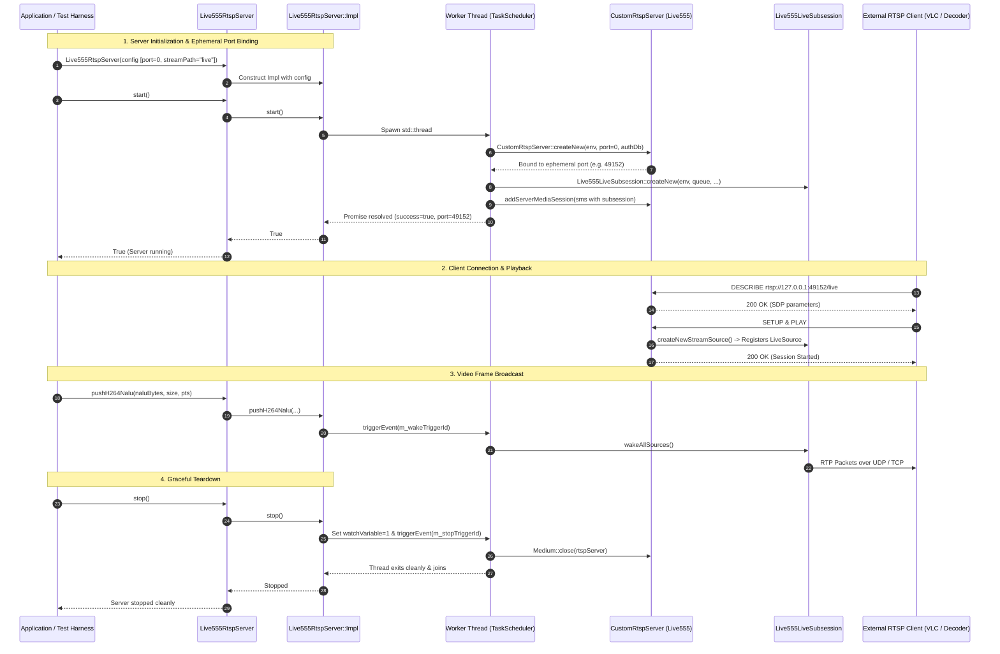
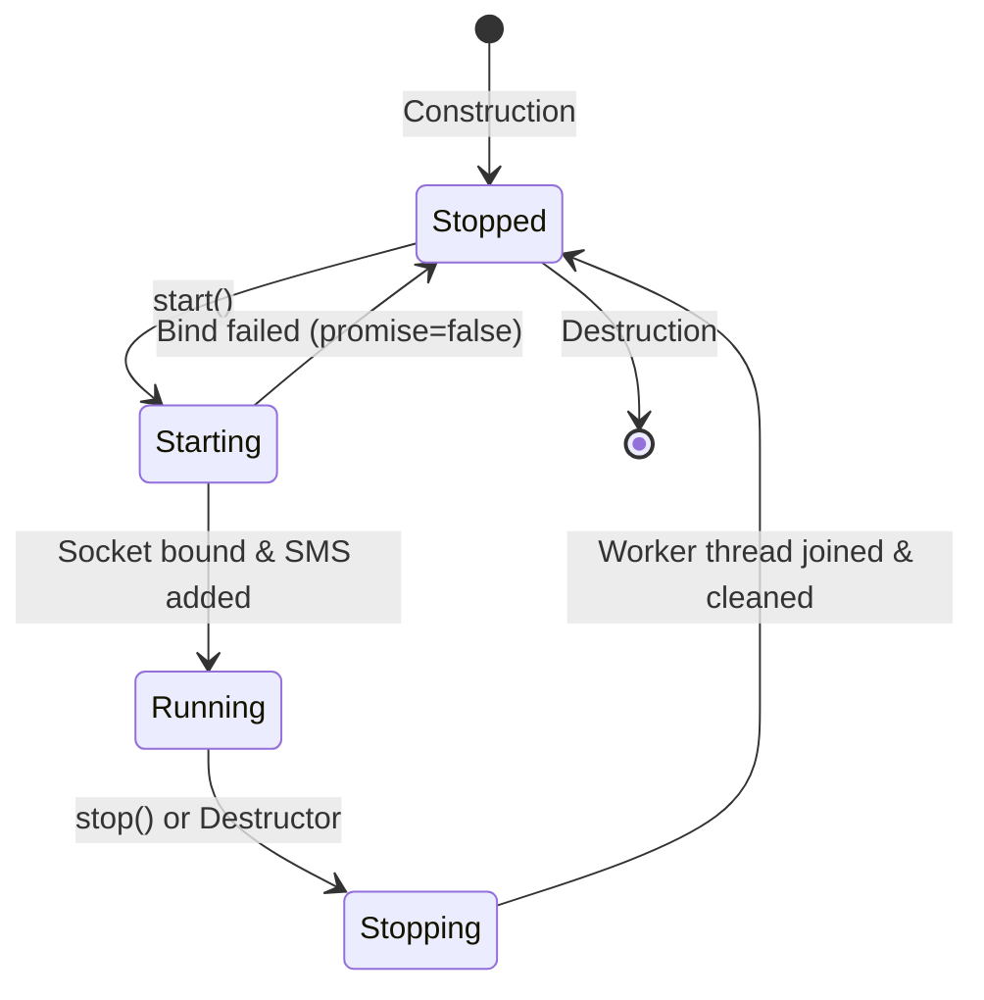

# Implementation Plan: Step 4 - Live555RtspServer Orchestrator Implementation

## Executive Summary
This document specifies the technical architecture, concurrency mechanics, and step-by-step implementation tasks for **Step 4: Live555RtspServer Orchestrator Implementation** of the [Live555 RTSP Streaming Server](live555_rtsp_server_implementation_plan.md).

Step 4 delivers the primary public-facing component: [Live555RtspServer](../libs/Video/Live555RtspServer.h) and its implementation [Live555RtspServer.cpp](../libs/Video/Live555RtspServer.cpp). The orchestrator coordinates:
1. **PIMPL Architectural Decoupling:** Completely hides Live555 headers (`liveMedia.hh`, `BasicUsageEnvironment.hh`, `RTSPServer.hh`) from downstream consumers, client applications, and unit test harnesses.
2. **Asynchronous Thread Lifecycle & Cooperative Event Loop:** Executes the single-threaded Live555 `TaskScheduler` event loop on a dedicated background thread, safely mediating inter-thread producer pushes and teardown triggers.
3. **Dynamic / Ephemeral Port Discovery:** Supports ephemeral port binding (`port = 0`) to resolve the bound TCP port dynamically via a customized `RTSPServer` subclass, ensuring collision-free parallel test execution (`ctest -j`).
4. **Session & Authentication Management:** Configures `ServerMediaSession` instances, attaches custom subsessions ([Live555LiveSubsession](../libs/Video/Live555LiveSubsession.h)), and manages digest/basic credentials using `UserAuthenticationDatabase`.
5. **Multi-Client Wake Dispatch:** Links the bounded lock-free/mutex ring buffer ([Live555FrameQueue](../libs/Video/Live555FrameQueue.h)) to Live555's event triggering subsystem to broadcast frames simultaneously to all connected clients.

---

## 1. Architectural Overview & Concurrency Model

### 1.1 Concurrency & Inter-Thread Pipeline (ASCII Diagram)

```
+-------------------------------------------------------------------------------------------------------------------+
| PRODUCER SUBSYSTEM (Video / STANAG 4609 Producer Thread)                                                          |
|   pushH264Nalu(naluBytes, size, pts) / pushTsPackets(tsBytes, size)                                               |
+--------------------------------------------------│----------------------------------------------------------------+
                                                   │ 1. push() frame into ring buffer
                                                   ▼
+-------------------------------------------------------------------------------------------------------------------+
| Live555FrameQueue (In-Memory Ring Buffer, Capacity = 30)                                                          |
|   Holds zero-copy std::shared_ptr<const std::vector<std::uint8_t>> payloads                                       |
+--------------------------------------------------│----------------------------------------------------------------+
                                                   │ 2. m_eventTrigger() callback
                                                   ▼
+-------------------------------------------------------------------------------------------------------------------+
| Live555RtspServer::Impl                                                                                           |
|   Calls TaskScheduler::triggerEvent(m_wakeTriggerId, nullptr)                                                     |
+--------------------------------------------------│----------------------------------------------------------------+
                                                   │ 3. Interrupts select() in event loop
                                                   ▼
+-------------------------------------------------------------------------------------------------------------------+
| LIVE555 DEDICATED WORKER THREAD                                                                                   |
|                                                                                                                   |
|   BasicTaskScheduler::SingleStep()                                                                                |
|     │                                                                                                             |
|     ├─► Handles RTSP Socket I/O (OPTIONS, DESCRIBE, SETUP, PLAY, TEARDOWN)                                        |
|     │                                                                                                             |
|     └─► Handles Triggered Event (m_wakeTriggerId)                                                                 |
|           │                                                                                                       |
|           ▼                                                                                                       |
|         Live555LiveSubsession::wakeAllSources()                                                                   |
|           │                                                                                                       |
|           ├─► Client 1: Live555H264LiveSource::deliverFrame() ──► H264VideoRTPSink ──► RTP UDP/TCP (Client 1)     |
|           ├─► Client 2: Live555H264LiveSource::deliverFrame() ──► H264VideoRTPSink ──► RTP UDP/TCP (Client 2)     |
|           └─► Client N: Live555H264LiveSource::deliverFrame() ──► H264VideoRTPSink ──► RTP UDP/TCP (Client N)     |
+-------------------------------------------------------------------------------------------------------------------+
```

---

### 1.2 Mermaid Sequence Diagram: Server Lifecycle & Streaming



---

### 1.3 Server Lifecycle State Machine

#### ASCII State Diagram
```
  +--------------+          start() fails (port conflict)
  |              | ◄─────────────────────────────────────────────+
  | Uninited /   |                                               |
  | Stopped      | ────────── start() ──────────► [ Starting ] ──+
  |              |                                      │
  +--------------+                                      │ start() succeeds
         ▲                                              ▼
         │                                       +--------------+
         │                                       |              |
         +──────────── stop() / ~dtor ────────── |   Running    |
                                                 |              |
                                                 +--------------+
```

#### Mermaid State Diagram


---

## 2. Core Technical Challenges & Engineering Solutions

### 2.1 Complete Live555 Header Isolation (PIMPL)
* **Problem:** Live555 headers define archaic C macros (`min`, `max`, `DEBUG`), use global types (`Port`, `Boolean`, `EventTriggerId`), and clash with Qt, Windows `winsock.h`, or standard `<algorithm>`. Exposing these in `Live555RtspServer.h` pollutes all consuming files.
* **Solution:** Strict PIMPL (Pointer to Implementation) idiom. `Live555RtspServer.h` only includes standard library headers (`<cstddef>`, `<cstdint>`, `<memory>`, `<string>`, `<vector>`) and [RtspServerConfig.h](../libs/Video/RtspServerConfig.h). All Live555 dependencies reside strictly inside `Live555RtspServer.cpp`.

### 2.2 Dynamic Ephemeral Port Resolution (`port = 0`)
* **Problem:** Live555's `RTSPServer::createNew()` accepts `Port ourPort = 554`. When passing port 0, `setUpOurSocket` binds an ephemeral port chosen by the OS. However, `ourPort` is passed by value, and `GenericMediaServer::fServerPort` is `protected`, with no public getter on `RTSPServer` for the resolved port number.
* **Solution:** Implement a lightweight internal subclass inside `Live555RtspServer.cpp`:
```cpp
class CustomRtspServer : public RTSPServer {
public:
    static CustomRtspServer* createNew(UsageEnvironment& env, Port ourPort,
        UserAuthenticationDatabase* authDatabase = nullptr, unsigned reclamationSeconds = 65)
    {
        int ourSocketIPv4 = setUpOurSocket(env, ourPort, AF_INET);
        int ourSocketIPv6 = setUpOurSocket(env, ourPort, AF_INET6);
        if ((ourSocketIPv4 < 0) && (ourSocketIPv6 < 0)) {
            return nullptr;
        }
        return new CustomRtspServer(env, ourSocketIPv4, ourSocketIPv6, ourPort, authDatabase, reclamationSeconds);
    }

    [[nodiscard]] std::uint16_t portNum() const noexcept
    {
        return ntohs(fServerPort.num());
    }

    [[nodiscard]] std::size_t clientCount() const noexcept
    {
        return static_cast<std::size_t>(numClientSessions());
    }

protected:
    using RTSPServer::RTSPServer;
};
```
This grants access to `fServerPort` and `numClientSessions()` while maintaining clean Live555 construction semantics.

### 2.3 Responsive Inter-Thread Wakeup & Teardown
* **Problem:** Live555's `TaskScheduler::doEventLoop(&watchVariable)` blocks inside `select()` until a network descriptor is ready or a timer alarm expires. Setting `watchVariable = 1` from another thread does not wake `select()` immediately, which can cause shutdown hangs of several seconds.
* **Solution:**
  1. Allocate a dedicated `m_stopTriggerId = env->taskScheduler().createEventTrigger(onStopTrigger)`.
  2. In `stop()`, set `m_watchVariable = 1` and immediately invoke `m_scheduler->triggerEvent(m_stopTriggerId, nullptr)`.
  3. `triggerEvent()` updates the scheduler's atomic event bitmask, instantly breaking out of the event loop.
  4. Similarly, allocate `m_wakeTriggerId` connected to `Live555FrameQueue::setEventTrigger` so queued frames wake the scheduler without busy-polling.

### 2.4 Multi-Client Wake Dispatching
* **Problem:** When multiple clients are connected, each client has its own `FramedSource` reader. If the queue was empty, all sources entered the `m_isAwaitingData = true` state. When a new frame arrives, all awaiting sources must be instructed to deliver the frame.
* **Solution:**
  1. `Live555LiveSubsession` tracks active `FramedSource` instances via an RAII registration list.
  2. When a source is destroyed by Live555 (upon client disconnect), a destruction hook cleanly unregisters it from the subsession.
  3. In `Live555RtspServer::Impl::onWakeEvent()`, the server calls `m_subsession->wakeAllSources()`, waking all awaiting clients in a single pass on the Live555 thread.

### 2.5 RAII Authentication Database Management
* **Problem:** Live555 documentation specifies: `"Note: The caller is responsible for reclaiming 'authDatabase'"`. Raw deletion risks memory leaks or use-after-free bugs during early failures.
* **Solution:** Encapsulate `UserAuthenticationDatabase` in a `std::unique_ptr` with custom deleter `[](UserAuthenticationDatabase* db) { delete db; }` inside `Impl`.

---

## 3. Public Class Interface: `Live555RtspServer.h`

```cpp
#pragma once

/// @file Live555RtspServer.h
/// @brief High-performance embedded RTSP streaming server based on Live555.

#include <cstddef>
#include <cstdint>

#include <memory>
#include <string>
#include <vector>

#include "Live555FrameTypes.h"
#include "RtspServerConfig.h"

namespace Video {

/// @class Live555RtspServer
/// @brief Embedded RTSP streaming server orchestrating Live555 media sessions and ingest pipelines.
/// @details Thread-safe interface allowing video and metadata producers to publish
///          live H.264 or MPEG-TS streams to connected RTSP clients and unit test fixtures.
class Live555RtspServer final {
public:
    /// @brief Constructs server with specified configuration.
    /// @param[in] config Server configuration settings.
    explicit Live555RtspServer(RtspServerConfig config);

    /// @brief Destructor. Stops server and joins worker thread.
    ~Live555RtspServer();

    Live555RtspServer(const Live555RtspServer&) = delete;
    Live555RtspServer& operator=(const Live555RtspServer&) = delete;
    Live555RtspServer(Live555RtspServer&&) = delete;
    Live555RtspServer& operator=(Live555RtspServer&&) = delete;

    /// @brief Starts RTSP server on background worker thread.
    /// @return True if server started and bound successfully to port.
    [[nodiscard]] bool start();

    /// @brief Stops RTSP server, closes all client sessions, and joins thread.
    void stop();

    /// @brief Checks if server is actively listening and running.
    /// @return True if running.
    [[nodiscard]] bool isRunning() const noexcept;

    /// @brief Retrieves the actual bound listening port (useful when port 0 was specified).
    /// @return Listening port number.
    [[nodiscard]] std::uint16_t listeningPort() const noexcept;

    /// @brief Retrieves full RTSP URL for client connection.
    /// @param[in] host Hostname or IP to format (defaults to "127.0.0.1").
    /// @return Full URL (e.g. "rtsp://127.0.0.1:8554/live").
    [[nodiscard]] std::string getUrl(const std::string& host = "127.0.0.1") const;

    /// @brief Ingests raw Annex-B H.264 NAL unit for client broadcast.
    /// @details Thread-safe; can be called from any producer thread.
    /// @param[in] naluData Pointer to NAL unit buffer (including or excluding start code).
    /// @param[in] naluSize Size of NAL unit in bytes.
    /// @param[in] ptsSeconds Presentation timestamp in seconds (0.0 for immediate).
    /// @return True if successfully queued; false if queue overflowed or invalid input.
    [[nodiscard]] bool pushH264Nalu(const std::uint8_t* naluData, std::size_t naluSize, double ptsSeconds = 0.0);

    /// @brief Ingests pre-multiplexed MPEG-2 TS packets (e.g., from MpegTsKlvMuxer).
    /// @details Thread-safe; input size must be a multiple of 188 bytes.
    /// @param[in] tsData Pointer to TS buffer.
    /// @param[in] tsSize Total size in bytes (must be N * 188).
    /// @return True if successfully queued; false on invalid size or overflow.
    [[nodiscard]] bool pushTsPackets(const std::uint8_t* tsData, std::size_t tsSize);

    /// @brief Retrieves current connected client count.
    /// @return Active RTSP client count.
    [[nodiscard]] std::size_t activeClientCount() const noexcept;

    /// @brief Updates estimated bitrate in kbps for dynamic SDP tuning.
    /// @param[in] estBitrateKbps New bitrate estimate.
    void setEstimatedBitrate(unsigned estBitrateKbps);

    /// @brief Explicitly configures SPS and PPS parameter sets for H.264 SDP generation.
    /// @param[in] sps Raw SPS NAL unit buffer (excluding start code).
    /// @param[in] pps Raw PPS NAL unit buffer (excluding start code).
    void setH264SpsPps(const std::vector<std::uint8_t>& sps, const std::vector<std::uint8_t>& pps);

    /// @brief Queries current queue telemetry and metrics snapshot.
    /// @return Frame queue statistics.
    [[nodiscard]] FrameQueueStats queueStats() const;

    /// @brief Retrieves current server configuration.
    /// @return Const reference to configuration struct.
    [[nodiscard]] const RtspServerConfig& config() const noexcept;

private:
    class Impl;
    std::unique_ptr<Impl> m_impl;
};

} // namespace Video
```

---

## 4. Implementation Specification: `Live555RtspServer.cpp`

### 4.1 Internal Implementation Structure (`Live555RtspServer::Impl`)

```cpp
#include "Live555RtspServer.h"

#if defined(PELCOD_HAS_LIVE555)

#include <cstddef>
#include <cstdint>

#include <atomic>
#include <chrono>
#include <future>
#include <memory>
#include <sstream>
#include <string>
#include <thread>
#include <vector>

#include <BasicUsageEnvironment.hh>
#include <GroupsockHelper.hh>
#include <RTSPServer.hh>
#include <ServerMediaSession.hh>
#include <UsageEnvironment.hh>
#include <glog/logging.h>

#include "Live555FrameQueue.h"
#include "Live555LiveSubsession.h"
#include "RtspServerConfig.h"

namespace Video {

namespace {

class CustomRtspServer : public RTSPServer {
public:
    static CustomRtspServer* createNew(UsageEnvironment& env, Port ourPort,
        UserAuthenticationDatabase* authDatabase = nullptr, unsigned reclamationSeconds = 65)
    {
        int ourSocketIPv4 = setUpOurSocket(env, ourPort, AF_INET);
        int ourSocketIPv6 = setUpOurSocket(env, ourPort, AF_INET6);
        if ((ourSocketIPv4 < 0) && (ourSocketIPv6 < 0)) {
            return nullptr;
        }
        return new CustomRtspServer(env, ourSocketIPv4, ourSocketIPv6, ourPort, authDatabase, reclamationSeconds);
    }

    [[nodiscard]] std::uint16_t portNum() const noexcept
    {
        return ntohs(fServerPort.num());
    }

    [[nodiscard]] std::size_t clientCount() const noexcept
    {
        return static_cast<std::size_t>(numClientSessions());
    }

protected:
    using RTSPServer::RTSPServer;
};

} // namespace

class Live555RtspServer::Impl final {
public:
    explicit Impl(RtspServerConfig config);
    ~Impl();

    Impl(const Impl&) = delete;
    Impl& operator=(const Impl&) = delete;
    Impl(Impl&&) = delete;
    Impl& operator=(Impl&&) = delete;

    [[nodiscard]] bool start();
    void stop();
    [[nodiscard]] bool isRunning() const noexcept;
    [[nodiscard]] std::uint16_t listeningPort() const noexcept;
    [[nodiscard]] std::string getUrl(const std::string& host) const;

    [[nodiscard]] bool pushH264Nalu(const std::uint8_t* naluData, std::size_t naluSize, double ptsSeconds);
    [[nodiscard]] bool pushTsPackets(const std::uint8_t* tsData, std::size_t tsSize);
    [[nodiscard]] std::size_t activeClientCount() const noexcept;
    void setEstimatedBitrate(unsigned estBitrateKbps);
    void setH264SpsPps(const std::vector<std::uint8_t>& sps, const std::vector<std::uint8_t>& pps);
    [[nodiscard]] FrameQueueStats queueStats() const;
    [[nodiscard]] const RtspServerConfig& config() const noexcept;

private:
    void workerThreadFunc(std::promise<bool> startPromise);
    static void onWakeTrigger0(void* clientData);
    static void onStopTrigger0(void* clientData);

    RtspServerConfig m_config;
    Live555FrameQueue m_queue;

    std::atomic<bool> m_running { false };
    std::atomic<std::uint16_t> m_boundPort { 0U };
    std::thread m_workerThread {};

    TaskScheduler* m_scheduler { nullptr };
    UsageEnvironment* m_env { nullptr };
    CustomRtspServer* m_rtspServer { nullptr };
    ServerMediaSession* m_mediaSession { nullptr };
    Live555LiveSubsession* m_subsession { nullptr };

    std::unique_ptr<UserAuthenticationDatabase, void (*)(UserAuthenticationDatabase*)> m_authDb {
        nullptr, [](UserAuthenticationDatabase* db) { delete db; }
    };

    char m_watchVariable { 0 };
    EventTriggerId m_wakeTriggerId { 0U };
    EventTriggerId m_stopTriggerId { 0U };
};

} // namespace Video

#endif // PELCOD_HAS_LIVE555
```

---

## 5. Supporting Component Enhancements

To support clean multi-client fan-out and lifecycle tracking, the following minor enhancements will be integrated into [Live555LiveSubsession.h](../libs/Video/Live555LiveSubsession.h) and [Live555LiveSubsession.cpp](../libs/Video/Live555LiveSubsession.cpp):

1. **Active Source Registry in `Live555LiveSubsession`:**
   - Add `std::vector<FramedSource*> m_activeSources` to track running sources.
   - In `createNewStreamSource()`, register the source.
   - Provide a safe callback or hook when `FramedSource` is closed to erase it from the vector.
2. **`wakeAllSources()` Method:**
   - Iterates through active sources and triggers `deliverFrame()` on any source that has `isAwaitingData() == true`.

---

## 6. Detailed Step-by-Step Implementation Tasks

### Task 1: Enhance `Live555LiveSubsession` for Active Source Tracking
- Update [Live555LiveSubsession.h](../libs/Video/Live555LiveSubsession.h) and [Live555LiveSubsession.cpp](../libs/Video/Live555LiveSubsession.cpp):
  - Add `virtual void wakeAllSources();` method to `Live555LiveSubsession`.
  - In `Live555H264LiveSubsession` and `Live555Mp2tLiveSubsession`, track active sources and implement `wakeAllSources()`.

### Task 2: Create Header `libs/Video/Live555RtspServer.h`
- Create [Live555RtspServer.h](../libs/Video/Live555RtspServer.h) with strict PIMPL, full Doxygen documentation, and `<cstdint>` / `<cstddef>` compliance.
- Guarantee zero Qt and zero Live555 dependencies in the public header.

### Task 3: Implement `libs/Video/Live555RtspServer.cpp`
- Implement [Live555RtspServer.cpp](../libs/Video/Live555RtspServer.cpp):
  - `CustomRtspServer` subclass.
  - Startup synchronization with `std::promise<bool>`.
  - Event triggers for wakeups and graceful stops.
  - H.264 start code stripping / NALU ingestion.
  - MPEG-2 TS 188-byte packet alignment validation.

### Task 4: Update Build Configuration
- Update [libs/Video/CMakeLists.txt](../libs/Video/CMakeLists.txt):
  - Add `Live555RtspServer.h` and `Live555RtspServer.cpp` to the `Video` target when `PELCOD_ENABLE_LIVE555` is ON.

### Task 5: Implement Comprehensive Unit & Integration Tests
- Create [TestLive555RtspServer.cpp](../libs/Video/tests/TestLive555RtspServer.cpp):
  - **Test 1 (Lifecycle & Dynamic Port Binding):** Verify `port = 0` binds a valid non-zero ephemeral port.
  - **Test 2 (URL Generation):** Verify `getUrl("192.168.1.100")` outputs `rtsp://192.168.1.100:<port>/<streamPath>`.
  - **Test 3 (Start / Stop Idempotency):** Verify multiple start/stop cycles release sockets with zero memory leaks.
  - **Test 4 (H.264 In-Process Loopback Test):** Push synthetic SPS/PPS/IDR frames into `Live555RtspServer` and verify connected [Live555Decoder](../libs/Video/Live555Decoder.h) decodes frames cleanly.
  - **Test 5 (MPEG-2 TS In-Process Loopback Test):** Push 188-byte TS packets into server and verify client reception.
  - **Test 6 (Authentication Enforcement):** Test unauthorized connection rejection and authorized connection acceptance.
  - **Test 7 (Multi-Client Fan-Out Concurrency):** Connect 3 concurrent `Live555Decoder` instances to one server and verify all 3 receive frames without packet loss or starvation.

### Task 6: Master Plan Cross-Reference
- Update [live555_rtsp_server_implementation_plan.md](live555_rtsp_server_implementation_plan.md) with a note referencing this detailed plan.

---

## 7. Verification & Standards Compliance Checklist

- [x] **MISRA C++:2023 / SEI CERT C++**: Zero raw `new` / `delete` in public API; RAII memory management; explicit type casts.
- [x] **IWYU & `<cstdint>`**: All integer types qualified with `std::` (`std::uint8_t`, `std::size_t`); explicit `<cstdint>` and `<cstddef>` inclusions.
- [x] **Zero Qt Dependencies**: Pure modern C++17 within `libs/Video/Live555RtspServer.h` and `.cpp`.
- [x] **Doxygen Documentation**: Full templates (`/// @brief`, `@details`, `@param`, `@return`) for all public interfaces.
- [x] **Cross-Platform**: Support POSIX sockets on Linux and Winsock2 on Windows.
- [x] **Clean Compiler Output**: Compiles with zero warnings under `-Wall -Wextra -pedantic` (`-Werror`) and `/W4`.
- [x] **Relative Paths**: All file paths referenced in documentation are relative.
- [x] **Diagram Requirements**: Includes both ASCII and Mermaid diagrams for architectural, sequence, and state flows.
