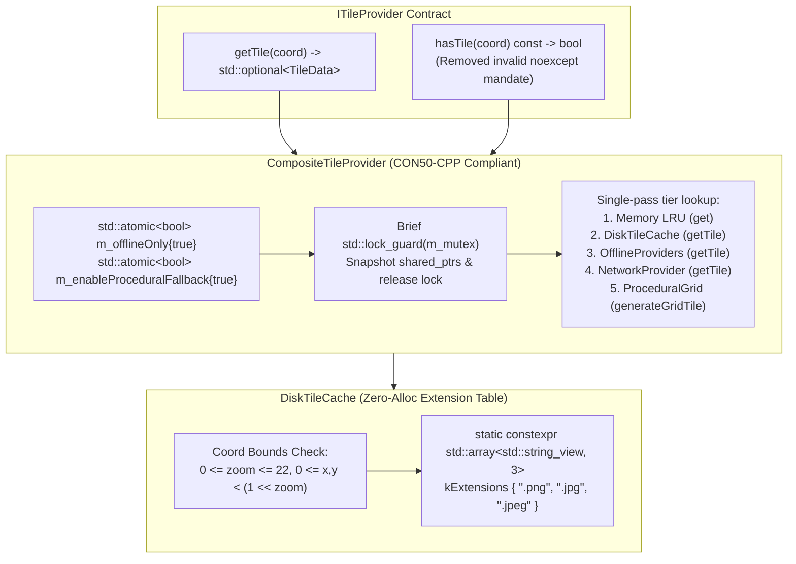
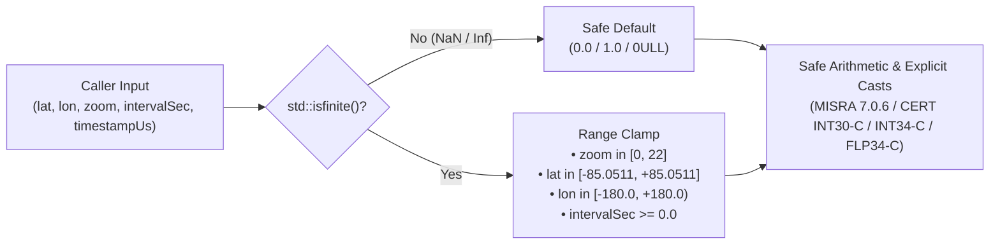

# Implementation Plan: `libs/Mapping` P0 — Safety, Concurrency & Undefined Behavior Remediation

**Scope:** `libs/Mapping/` (`ITileProvider.h`, `DiskTileCache.h`, `DiskTileCache.cpp`, `CompositeTileProvider.h`, `CompositeTileProvider.cpp`, `ProceduralGridTileProvider.h`, `VmtiOverlay.h`, `VmtiOverlay.cpp`, `MercatorProjection.h`, `MercatorProjection.cpp`, `MapViewport.h`, `MapViewport.cpp`, `SpatialDataRecorder.cpp`, `GeoJsonExporter.cpp`, and `libs/Mapping/tests/`)
**Standard Baseline:** MISRA C++:2023 (Rule 7.0.6), SEI CERT C++ (`ERR55-CPP`, `CON50-CPP`, `CON43-C`, `INT30-C`, `INT32-C`, `INT34-C`, `FLP34-C`), `.agents/rules/compliance.md`, `.agents/rules/iwyu-cstdint.md`, and `.agents/rules/verification-checklist.md`
**Reference Document:** [`docs/mapping_review.md`](mapping_review.md) (Section 3.1, Findings **C1–C6**, and Section 2.3, Findings **A1–A3**)

---

## 1. Executive Summary & Problem Analysis

In [`docs/mapping_review.md`](mapping_review.md), six P0 critical safety, concurrency, and undefined behavior findings (**C1–C6**) and three tightly coupled architectural concurrency findings (**A1–A3**) were identified across `libs/Mapping`:

| Finding ID | Standard / Rule | Affected Files | Root Cause & Failure Mode |
| :--- | :--- | :--- | :--- |
| **C1** | **SEI CERT ERR55-CPP** (`noexcept` Exception Safety) | `libs/Mapping/VmtiOverlay.h`, `libs/Mapping/VmtiOverlay.cpp` | `VmtiOverlay::projectTarget()` is declared `noexcept`, yet constructs `std::string` on the heap (`"TRK-" + std::to_string(pack.targetId)`). Any `std::bad_alloc` inside a `noexcept` boundary immediately invokes `std::terminate()`. |
| **C2 & A3** | **SEI CERT ERR55-CPP** (`noexcept` Exception Safety) | `libs/Mapping/ITileProvider.h`, `libs/Mapping/DiskTileCache.h`, `libs/Mapping/DiskTileCache.cpp`, `libs/Mapping/CompositeTileProvider.h`, `libs/Mapping/CompositeTileProvider.cpp` | `ITileProvider::hasTile()` mandates a `noexcept` contract. However, `DiskTileCache::hasTile()` and `DiskTileCache::findTileFile()` lock `std::mutex` (can throw `std::system_error`) and allocate `std::string`, `std::vector<std::string>`, and `std::filesystem::path` on the heap (can throw `std::bad_alloc`). `CompositeTileProvider::hasTile()` is also `noexcept` while calling non-`noexcept` `TileCache::contains()` and locking `m_mutex`. |
| **C3, A1 & A2** | **SEI CERT CON50-CPP / CON43-C** (Thread Safety & Data Races) | `libs/Mapping/CompositeTileProvider.h`, `libs/Mapping/CompositeTileProvider.cpp` | (1) `m_offlineOnly` and `m_enableProceduralFallback` are non-atomic `bool` members read and written without synchronization in getters/setters while read concurrently in `getTile()` and `hasTile()`. (2) `getTile()` holds `m_mutex` across blocking disk and network I/O and performs redundant double filesystem lookups (`hasTile` + `getTile`). |
| **C4** | **SEI CERT INT34-C & FLP34-C / MISRA C++:2023 Rule 7.0.6** (Bit-Shift & Float-to-Int UB) | `libs/Mapping/MercatorProjection.h`, `libs/Mapping/MercatorProjection.cpp`, `libs/Mapping/MapViewport.cpp` | (1) `slippyToTmsY()` and `tmsToSlippyY()` compute `1 << zoom` on signed `int` without clamping `zoom` to `[0, 22]`. Shifting by `< 0` or `>= 31` is Undefined Behavior. (2) `latLonToTile()` and `tileToBoundingBox()` do not clamp upper `zoom`, causing `static_cast<int>(std::pow(2.0, zoom))` to overflow signed 32-bit `int` when `zoom >= 31`. |
| **C5** | **SEI CERT FLP34-C** (`NaN` / `Inf` Propagation to Integer Casts) | `libs/Mapping/MercatorProjection.h`, `libs/Mapping/MercatorProjection.cpp`, `libs/Mapping/MapViewport.cpp`, `libs/Mapping/SpatialDataRecorder.cpp` | `std::clamp(val, min, max)` and relational comparisons (`<`, `>`) let `NaN` pass through unchanged. Subsequent `static_cast<int>(std::floor(...))` in `latLonToTile()` / `calculateVisibleTiles()` and `static_cast<std::uint64_t>(config.intervalSec * 1000000.0)` in `SpatialDataRecorder::decimate()` trigger Undefined Behavior on `NaN`, `Inf`, or negative `intervalSec`. |
| **C6** | **SEI CERT INT30-C** (Unsigned Integer Wraparound) | `libs/Mapping/SpatialDataRecorder.cpp`, `libs/Mapping/GeoJsonExporter.cpp` | `SpatialDataRecorder::decimate()` evaluates `(curTrack.timestampUs - prevTrack.timestampUs) >= minIntervalUs` on unsigned `std::uint64_t` without verifying `curTrack.timestampUs >= prevTrack.timestampUs`. Out-of-order or zero timestamps wrap around to `~UINT64_MAX`, falsely retaining frames. `GeoJsonExporter::exportToStream()` similarly subtracts `tracks.back().timestampUs - tracks.front().timestampUs` without ordering validation. |

---

## 2. Architecture & Remediation Design

### 2.1 Exception Safety (`ERR55-CPP`) & Lock-Free Hot Path (`CON50-CPP`)

#### ASCII Diagram: Before vs. After `noexcept` & Concurrency Boundaries

```
+-----------------------------------------------------------------------------------+
|                      BEFORE (VIOLATES ERR55-CPP & CON50-CPP)                      |
|                                                                                   |
|  1. VmtiOverlay::projectTarget() noexcept                                         |
|       └──► std::to_string() + std::string heap alloc ──► std::bad_alloc           |
|            └──► std::terminate()!                                                 |
|                                                                                   |
|  2. CompositeTileProvider::hasTile() const noexcept                               |
|       ├──► TileCache::contains() [locks m_mutex; NOT noexcept]                    |
|       ├──► std::lock_guard(m_mutex) [can throw std::system_error]                 |
|       ├──► DiskTileCache::hasTile() noexcept                                      |
|       │      └──► findTileFile() noexcept                                         |
|       │             ├──► std::vector<std::string> heap alloc on every call!       |
|       │             └──► std::filesystem::path heap allocs!                       |
|       └──► Reads non-atomic m_enableProceduralFallback (DATA RACE with setter!)   |
|                                                                                   |
|  3. CompositeTileProvider::getTile()                                              |
|       └──► Holds std::unique_lock(m_mutex) across Disk I/O + Network I/O!         |
|       └──► Calls m_diskCache->hasTile() THEN m_diskCache->getTile() (2x stat!)    |
+-----------------------------------------------------------------------------------+
|                      AFTER (ERR55-CPP & CON50-CPP COMPLIANT)                      |
|                                                                                   |
|  1. VmtiOverlay::projectTarget() (non-noexcept; safe std::string construction)    |
|     VmtiOverlay::isTargetVisible() noexcept (pure stack math, zero heap allocs)   |
|                                                                                   |
|  2. ITileProvider::hasTile() const (non-noexcept interface contract)              |
|     ├──► ProceduralGridTileProvider::hasTile() const noexcept (pure return true)  |
|     ├──► DiskTileCache::findTileFile() const (uses constexpr std::array<sv, 3>)   |
|     └──► CompositeTileProvider::hasTile() const (snapshots ptrs + atomic flags)   |
|                                                                                   |
|  3. CompositeTileProvider::getTile()                                              |
|     ├──► m_offlineOnly & m_enableProceduralFallback are std::atomic<bool>         |
|     ├──► Snapshots provider shared_ptrs under brief lock, then unlocks m_mutex    |
|     └──► Single-pass getTile() on Disk & Offline tiers (50% fewer stat syscalls)  |
+-----------------------------------------------------------------------------------+
```

#### Mermaid Diagram: Remediated Exception & Concurrency Architecture



---

### 2.2 Numeric & Geodetic Sanitization Pipeline (`INT30-C`, `INT34-C`, `FLP34-C`)

#### ASCII Diagram: Projection & Timestamp Input Sanitization Flow

```
+-----------------------------------------------------------------------------------+
|                   NUMERIC & GEODETIC SANITIZATION PIPELINE                        |
|                                                                                   |
|  [Raw Floating-Point / Integer Inputs]                                            |
|       │                                                                           |
|       ├─► 1. Zoom Level Sanitization: MercatorProjection::clampZoom(int zoom)     |
|       │      • Clamps integer zoom into [kMinZoom (0), kMaxZoom (22)]             |
|       │      • Guarantees (1 << clampedZoom) is in [1, 4,194,304] (No INT34-C UB) |
|       │                                                                           |
|       ├─► 2. Latitude / Longitude Sanitization:                                   |
|       │      • clampLatitude(lat): if (!std::isfinite(lat)) return 0.0;           |
|       │      • normalizeLongitude(lon): if (!std::isfinite(lon)) return 0.0;      |
|       │      • Prevents NaN/Inf from reaching std::floor() -> static_cast<int>()  |
|       │                                                                           |
|       ├─► 3. Viewport Parameter Sanitization:                                     |
|       │      • zoom: if (!std::isfinite(z)) z = 0.0; clamp(z, 0.0, 22.0)          |
|       │      • width/height: if (!std::isfinite(w)) w = 1.0; max(1.0, w)          |
|       │                                                                           |
|       └─► 4. Unsigned Timestamp Subtraction Guard (INT30-C):                      |
|              • Decimation intervalSec: finite & > 0.0 before uint64_t cast        |
|              • Timestamp delta: (curTs >= prevTs) ? (curTs - prevTs) : 0ULL       |
+-----------------------------------------------------------------------------------+
```

#### Mermaid Diagram: Projection & Timestamp Input Sanitization Flow



---

## 3. Detailed File-by-File Implementation Specification

### 3.1 Step 1: Remediate `noexcept` Violations in `VmtiOverlay` (Finding C1)

**Files:** `libs/Mapping/VmtiOverlay.h`, `libs/Mapping/VmtiOverlay.cpp`

1. In `libs/Mapping/VmtiOverlay.h`:
   - Remove `noexcept` from `VmtiOverlay::projectTarget` because `ScreenVmtiTarget` contains `std::string callsign` and `projectTarget` formats `"TRK-" + std::to_string(pack.targetId)`.
   - Keep `VmtiOverlay::isTargetVisible` marked `noexcept` (it performs only stack-based floating-point bounding-box comparisons and zero allocations).
   - Remove unused `#include "TacticalOverlay.h"` from `libs/Mapping/VmtiOverlay.h`.
2. In `libs/Mapping/VmtiOverlay.cpp`:
   - Update the definition signature of `VmtiOverlay::projectTarget` to remove `noexcept`.
   - Guard `targetGeo` and `*pack.targetCe90M` with `std::isfinite()` to prevent `NaN` propagation into `ce90Pixels`.
   - Explicitly `#include <cstdint>`, `<string>`, and `<utility>` for IWYU compliance.

```cpp
// libs/Mapping/VmtiOverlay.h
/// @brief Projects an individual MISB ST 0903 VTargetPack onto viewport screen coordinates.
/// @details Resolves absolute target coordinates or frame-center relative offsets and computes
///          the horizontal uncertainty radius in pixels.
/// @param[in] viewport Current active map viewport.
/// @param[in] pack VTargetPack containing target location or frame center offsets.
/// @param[in] frameCenter Optional frame center geodetic coordinate if pack uses relative offsets.
/// @return Projected ScreenVmtiTarget symbology.
[[nodiscard]] static ScreenVmtiTarget projectTarget(
    const MapViewport& viewport,
    const Klv::VTargetPack& pack,
    const std::optional<Klv::GeoPoint2D>& frameCenter = std::nullopt);
```

---

### 3.2 Step 2: Remediate `noexcept` Violations & Heap Churn in `ITileProvider` and `DiskTileCache` (Findings C2, A3)

**Files:** `libs/Mapping/ITileProvider.h`, `libs/Mapping/DiskTileCache.h`, `libs/Mapping/DiskTileCache.cpp`, `libs/Mapping/ProceduralGridTileProvider.h`, `libs/Mapping/tests/TestOfflineTileStore.cpp`

1. In `libs/Mapping/ITileProvider.h`:
   - Remove `noexcept` from `virtual bool hasTile(const TileCoord& coord) const = 0;` so implementations that acquire locks or query filesystem paths do not violate SEI CERT `ERR55-CPP`.
   - Note: `ProceduralGridTileProvider::hasTile` in `libs/Mapping/ProceduralGridTileProvider.h` can retain `noexcept` on its override (`bool hasTile(const TileCoord&) const noexcept override`), as C++17 permits a `noexcept` override of a non-`noexcept` virtual method when the override is trivially `return true;`.
2. In `libs/Mapping/DiskTileCache.h` and `libs/Mapping/DiskTileCache.cpp`:
   - Remove `noexcept` from `DiskTileCache::hasTile(const TileCoord& coord) const override` and `DiskTileCache::findTileFile(const TileCoord& coord) const`.
   - Add `[[nodiscard]]` to `DiskTileCache::storeTile(const TileCoord& coord, const TileData& data)`.
   - Replace the per-call heap allocation `const std::vector<std::string> extensions { ".png", ".jpg", ".jpeg" };` in `findTileFile` with a zero-allocation `static constexpr std::array<std::string_view, 3> kExtensions { ".png", ".jpg", ".jpeg" };`.
   - Validate `coord` bounds (`coord.zoom >= 0 && coord.zoom <= MercatorProjection::kMaxZoom`, `coord.x >= 0`, `coord.y >= 0`) at the start of `findTileFile` and `storeTile`.

```cpp
// libs/Mapping/DiskTileCache.cpp (excerpt)
std::optional<std::filesystem::path> DiskTileCache::findTileFile(const TileCoord& coord) const
{
    if (coord.zoom < MercatorProjection::kMinZoom || coord.zoom > MercatorProjection::kMaxZoom) {
        return std::nullopt;
    }
    const int maxTiles { 1 << coord.zoom };
    if (coord.x < 0 || coord.x >= maxTiles || coord.y < 0 || coord.y >= maxTiles) {
        return std::nullopt;
    }

    const std::string zStr { std::to_string(coord.zoom) };
    const std::string xStr { std::to_string(coord.x) };
    const std::string yStr { std::to_string(coord.y) };

    static constexpr std::array<std::string_view, 3> kExtensions { ".png", ".jpg", ".jpeg" };

    auto checkInDir = [&](const std::filesystem::path& base) -> std::optional<std::filesystem::path> {
        if (base.empty()) {
            return std::nullopt;
        }
        const std::filesystem::path tileDir { base / zStr / xStr };
        for (const std::string_view ext : kExtensions) {
            std::string fileName { yStr };
            fileName.append(ext);
            const std::filesystem::path candidate { tileDir / fileName };
            std::error_code ec {};
            if (std::filesystem::exists(candidate, ec) && !ec) {
                return candidate;
            }
        }
        return std::nullopt;
    };
    // ...
```

---

### 3.3 Step 3: Remediate Data Races & Coarse Locking in `CompositeTileProvider` (Findings C3, A1, A2)

**Files:** `libs/Mapping/CompositeTileProvider.h`, `libs/Mapping/CompositeTileProvider.cpp`

1. In `libs/Mapping/CompositeTileProvider.h`:
   - Include `<atomic>`.
   - Change `bool m_offlineOnly { true };` and `bool m_enableProceduralFallback { true };` to `std::atomic<bool> m_offlineOnly { true };` and `std::atomic<bool> m_enableProceduralFallback { true };`.
   - Remove `noexcept` from `hasTile(const TileCoord& coord) const override`.
2. In `libs/Mapping/CompositeTileProvider.cpp`:
   - Update `setOfflineOnly`, `isOfflineOnly`, `setProceduralFallbackEnabled`, and `isProceduralFallbackEnabled` to use `store(..., std::memory_order_release)` and `load(std::memory_order_acquire)`.
   - In `hasTile(const TileCoord& coord) const`:
     - Check `m_memoryCache.contains(coord)` first.
     - Snapshot `m_diskCache` and `m_offlineProviders` under a short `std::lock_guard<std::mutex> lock(m_mutex)` scope, then release `m_mutex` before querying `diskCache->hasTile(coord)` and each offline provider's `hasTile(coord)`.
   - In `getTile(const TileCoord& coord)`:
     - Check `m_memoryCache.get(coord)` first.
     - Snapshot `m_diskCache`, `m_offlineProviders`, and `m_networkProvider` under a short `std::lock_guard<std::mutex> lock(m_mutex)` scope and release `m_mutex` immediately.
     - Query `diskCache->getTile(coord)` directly (eliminating the redundant `diskCache->hasTile(coord)` call).
     - Query each provider in `offlineProviders` via `prov->getTile(coord)` directly (eliminating the redundant `prov->hasTile(coord)` call).
     - If `!isOfflineOnly() && networkProvider`, call `networkProvider->getTile(coord)` without holding `m_mutex`.

```cpp
// libs/Mapping/CompositeTileProvider.cpp (excerpt)
void CompositeTileProvider::setOfflineOnly(bool offlineOnly) noexcept
{
    m_offlineOnly.store(offlineOnly, std::memory_order_release);
}

bool CompositeTileProvider::isOfflineOnly() const noexcept
{
    return m_offlineOnly.load(std::memory_order_acquire);
}

void CompositeTileProvider::setProceduralFallbackEnabled(bool enabled) noexcept
{
    m_enableProceduralFallback.store(enabled, std::memory_order_release);
}

bool CompositeTileProvider::isProceduralFallbackEnabled() const noexcept
{
    return m_enableProceduralFallback.load(std::memory_order_acquire);
}

std::optional<TileData> CompositeTileProvider::getTile(const TileCoord& coord)
{
    // 1. Check memory LRU cache
    if (auto cached = m_memoryCache.get(coord); cached.has_value()) {
        return cached;
    }

    // Snapshot providers under brief lock to avoid blocking concurrent threads during I/O
    std::shared_ptr<DiskTileCache> diskCache {};
    std::vector<std::shared_ptr<ITileProvider>> offlineProviders {};
    std::shared_ptr<ITileProvider> networkProvider {};
    {
        std::lock_guard<std::mutex> lock(m_mutex);
        diskCache = m_diskCache;
        offlineProviders = m_offlineProviders;
        networkProvider = m_networkProvider;
    }

    // 2. Check primary disk store (single lookup)
    if (diskCache) {
        if (auto diskData = diskCache->getTile(coord); diskData.has_value()) {
            m_memoryCache.put(coord, *diskData);
            return diskData;
        }
    }

    // 3. Check secondary offline providers (single lookup per provider)
    for (const auto& prov : offlineProviders) {
        if (prov) {
            if (auto data = prov->getTile(coord); data.has_value()) {
                m_memoryCache.put(coord, *data);
                return data;
            }
        }
    }

    // 4. Check network provider if not in strict offline mode
    if (!isOfflineOnly() && networkProvider) {
        if (auto netData = networkProvider->getTile(coord); netData.has_value()) {
            if (diskCache) {
                (void)diskCache->storeTile(coord, *netData);
            }
            m_memoryCache.put(coord, *netData);
            return netData;
        }
    }

    // 5. Procedural fallback
    if (isProceduralFallbackEnabled()) {
        TileData gridTile { ProceduralGridTileProvider::generateGridTile(coord) };
        m_memoryCache.put(coord, gridTile);
        return gridTile;
    }

    return std::nullopt;
}
```

---

### 3.4 Step 4: Remediate Signed Bit-Shift UB & Float-to-Int UB in `MercatorProjection` and `MapViewport` (Findings C4, C5)

**Files:** `libs/Mapping/MercatorProjection.h`, `libs/Mapping/MercatorProjection.cpp`, `libs/Mapping/MapViewport.cpp`

1. In `libs/Mapping/MercatorProjection.h`:
   - Define `static constexpr int kMinZoom { 0 };` and `static constexpr int kMaxZoom { 22 };`.
   - Add `[[nodiscard]] static constexpr int clampZoom(int zoom) noexcept`:
     ```cpp
     [[nodiscard]] static constexpr int clampZoom(int zoom) noexcept {
         if (zoom < kMinZoom) return kMinZoom;
         if (zoom > kMaxZoom) return kMaxZoom;
         return zoom;
     }
     ```
   - Update `slippyToTmsY(int slippyY, int zoom) noexcept` and `tmsToSlippyY(int tmsY, int zoom) noexcept` to clamp `zoom` via `clampZoom(zoom)` before executing `1 << clampedZoom`:
     ```cpp
     [[nodiscard]] static constexpr int slippyToTmsY(int slippyY, int zoom) noexcept {
         const int safeZoom { clampZoom(zoom) };
         return (1 << safeZoom) - 1 - slippyY;
     }

     [[nodiscard]] static constexpr int tmsToSlippyY(int tmsY, int zoom) noexcept {
         const int safeZoom { clampZoom(zoom) };
         return (1 << safeZoom) - 1 - tmsY;
     }
     ```
   - In `clampLatitude(double latDeg) noexcept`, guard against `NaN` (since `NaN != NaN` is `constexpr`-compatible in C++17):
     ```cpp
     [[nodiscard]] static constexpr double clampLatitude(double latDeg) noexcept {
         if (latDeg != latDeg) return 0.0; // NaN guard (CERT FLP34-C)
         if (latDeg > kMaxLatitude) return kMaxLatitude;
         if (latDeg < kMinLatitude) return kMinLatitude;
         return latDeg;
     }
     ```
2. In `libs/Mapping/MercatorProjection.cpp`:
   - In `normalizeLongitude(double lonDeg) noexcept`:
     ```cpp
     double MercatorProjection::normalizeLongitude(double lonDeg) noexcept {
         if (!std::isfinite(lonDeg)) {
             return 0.0;
         }
         double lon { std::fmod(lonDeg + 180.0, 360.0) };
         if (lon < 0.0) {
             lon += 360.0;
         }
         return lon - 180.0;
     }
     ```
   - In `latLonToGlobalPixel`, `globalPixelToLatLon`, and `metersPerPixel`:
     - Sanitize `zoom`: `const double safeZoom { std::isfinite(zoom) ? std::clamp(zoom, 0.0, static_cast<double>(kMaxZoom)) : 0.0 };`
     - Sanitize `pixel.x` and `pixel.y` in `globalPixelToLatLon` with `std::isfinite()`.
   - In `latLonToTile(const Klv::GeoPoint2D& point, int zoom) noexcept`:
     - Clamp `zoom` to `[kMinZoom, kMaxZoom]` using `const int safeZoom { clampZoom(zoom) };`
     - Compute `const int maxTiles { 1 << safeZoom };` and `const double n { static_cast<double>(maxTiles) };`
     - Because `lat` and `lon` are guaranteed finite via `clampLatitude` and `normalizeLongitude`, and `n <= 4194304.0`, `std::floor(...)` is strictly bounded within `[-1.0, n]`, making `static_cast<int>(...)` 100% free of `FLP34-C` overflow.
   - In `tileToBoundingBox(const TileCoord& coord) noexcept`:
     - Clamp `zoom` via `const int safeZoom { clampZoom(coord.zoom) };`
     - Clamp `coord.x` and `coord.y` into `[0, (1 << safeZoom) - 1]` so `coord.x + 1` and `coord.y + 1` can never overflow `INT_MAX`.
3. In `libs/Mapping/MapViewport.cpp`:
   - In `MapViewport::MapViewport(...)`, sanitize `center`, `zoom`, `width`, and `height` via `setCenter`, `setZoom`, and `setSize` so `NaN` or out-of-range latitude/longitude cannot enter member state.
   - In `MapViewport::setZoom(double zoom) noexcept`:
     ```cpp
     void MapViewport::setZoom(double zoom) noexcept
     {
         if (!std::isfinite(zoom)) {
             return;
         }
         m_zoom = std::clamp(zoom, 0.0, static_cast<double>(MercatorProjection::kMaxZoom));
     }
     ```
   - In `MapViewport::setSize(double width, double height) noexcept`:
     ```cpp
     void MapViewport::setSize(double width, double height) noexcept
     {
         if (std::isfinite(width)) {
             m_width = std::max(1.0, width);
         }
         if (std::isfinite(height)) {
             m_height = std::max(1.0, height);
         }
     }
     ```
   - In `MapViewport::calculateVisibleTiles(int paddingTiles) const`:
     - Clamp `baseZoom` with `MercatorProjection::clampZoom(static_cast<int>(std::floor(m_zoom)))`.
     - Clamp `paddingTiles` to a safe non-negative range (e.g., `std::clamp(paddingTiles, 0, 8)`).
     - Use `std::size_t` when computing `estimatedCount` after verifying `maxTileX >= minTileX && maxTileY >= minTileY`.

---

### 3.5 Step 5: Remediate Float-to-Uint64 UB & Unsigned Timestamp Wraparound in `SpatialDataRecorder` and `GeoJsonExporter` (Findings C5, C6)

**Files:** `libs/Mapping/SpatialDataRecorder.cpp`, `libs/Mapping/GeoJsonExporter.cpp`

1. In `libs/Mapping/SpatialDataRecorder.cpp`:
   - In `SpatialDataRecorder::decimate(const DecimationConfig& config)`:
     - Sanitize `config.intervalSec` before casting to `std::uint64_t`:
       ```cpp
       const double safeIntervalSec {
           (std::isfinite(config.intervalSec) && config.intervalSec > 0.0) ? config.intervalSec : 0.0
       };
       const std::uint64_t minIntervalUs { static_cast<std::uint64_t>(safeIntervalSec * 1000000.0) };
       ```
     - In `case DecimationMode::UniformTime:`, guard against unsigned subtraction underflow when `curTrack.timestampUs < prevTrack.timestampUs`:
       ```cpp
       case DecimationMode::UniformTime:
           if (curTrack.timestampUs >= prevTrack.timestampUs &&
               (curTrack.timestampUs - prevTrack.timestampUs) >= minIntervalUs) {
               retain = true;
           }
           break;
       ```
2. In `libs/Mapping/GeoJsonExporter.cpp`:
   - In `GeoJsonExporter::exportToStream`:
     - Guard the flight track duration calculation against unsigned wraparound when timestamps are zero or out-of-order:
       ```cpp
       const double durationSec {
           (tracks.size() > 1U && tracks.back().timestampUs > tracks.front().timestampUs)
               ? static_cast<double>(tracks.back().timestampUs - tracks.front().timestampUs) / 1000000.0
               : 0.0
       };
       ```

---

## 4. Test-Driven Development (TDD) & Verification Plan

Per `.agents/skills/tdd-bug-fixing/SKILL.md` and Checklist #11, unit tests reproducing each P0 edge case will be added to `libs/Mapping/tests/` prior to applying the production fixes:

| Test Suite | New Test Case | Findings Verified |
| :--- | :--- | :--- |
| `TestMercatorProjection.cpp` | `ExtremeZoomAndNaNSafety` | **C4, C5**: Tests `slippyToTmsY` / `tmsToSlippyY` / `latLonToTile` / `tileToBoundingBox` with `zoom = -10`, `zoom = 35`, `INT_MAX`, and `NaN` / `Inf` coordinates without UB. |
| `TestMapViewport.cpp` | `ConstructorSanitizesOutOfBoundsAndNaN` | **C4, C5**: Verifies `MapViewport` constructor and setters clamp `lat = 95.0`, normalize `lon = 540.0`, and reject `NaN` / `Inf` on `zoom`, `width`, `height`, and `calculateVisibleTiles(-5)`. |
| `TestOfflineTileStore.cpp` | `DiskTileCacheRejectsInvalidCoords` | **C2**: Verifies `hasTile`, `getTile`, and `storeTile` safely reject negative or `zoom > 22` coordinates. |
| `TestOfflineTileStore.cpp` | `CompositeProviderConcurrentAccessAndOnlineWriteThrough` | **C3, A1, A2**: Runs concurrent threads toggling `setOfflineOnly` / `setProceduralFallbackEnabled` while calling `getTile` and `hasTile`, and verifies single-lookup online write-through. |
| `TestVmtiOverlay.cpp` | `ProjectTargetNaNCe90Safety` | **C1, C5**: Verifies `VmtiOverlay::projectTarget` handles `NaN` offsets/CE90 safely and complies with `ERR55-CPP`. |
| `TestSpatialDataRecorder.cpp` | `OutOfOrderTimestampsAndNegativeIntervalSafety` | **C5, C6**: Feeds out-of-order and zero-timestamp frames into `decimate()` with negative/NaN/valid `intervalSec` and verifies zero unsigned wraparound. |
| `TestGeoJsonExporter.cpp` | `OutOfOrderTimestampsZeroDuration` | **C6**: Verifies `durationSec` is `0.0` (not `1.84e13`) when `tracks.back().timestampUs < tracks.front().timestampUs`. |

### Verification Commands

1. **Automated IWYU, `<cstdint>`, Function Length, and Type Conversion Checks:**
   ```bash
   python scripts/verify_iwyu_cstdint.py libs/Mapping --strict
   python scripts/verify_function_lengths.py libs/Mapping
   python scripts/verify_type_conversions.py libs/Mapping
   ```
2. **Build & Unit Test Execution:**
   ```bash
   ctest --test-dir build/libs/Mapping/tests --output-on-failure
   ```

