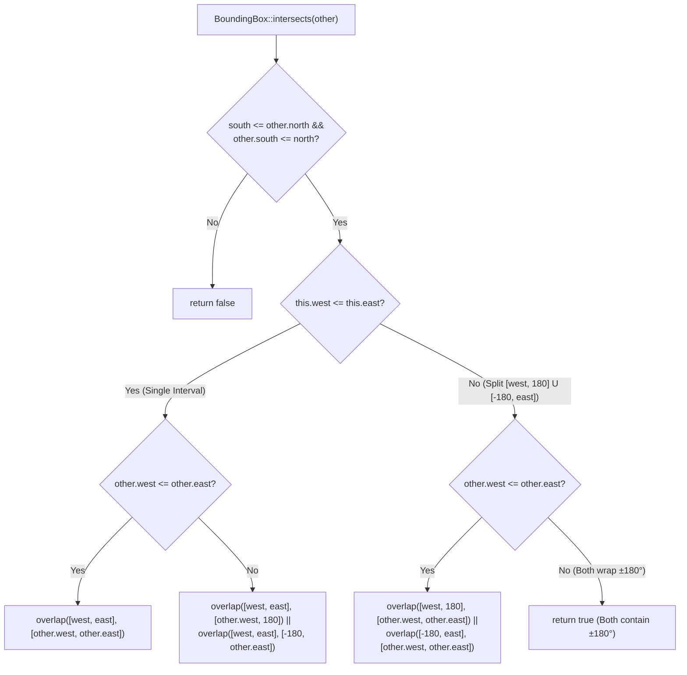
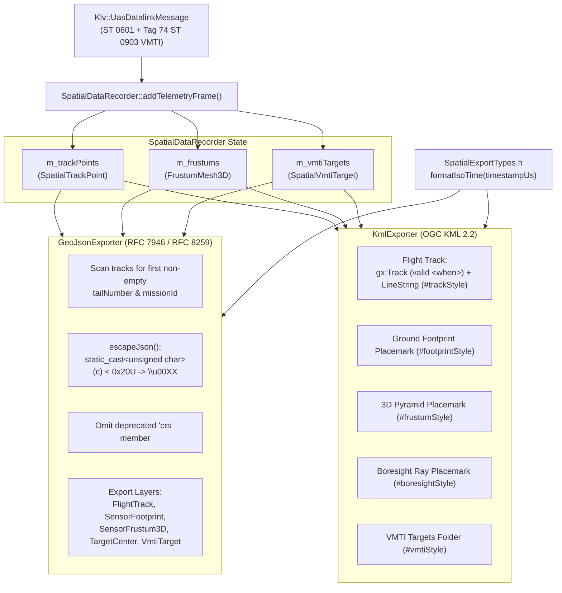

# Implementation Plan: `libs/Mapping` P1 — Functional Completeness & Standard Conformance

**Scope:** `libs/Mapping/` (`GeoTypes.h`, `MapViewport.cpp`, `DiskTileCache.cpp`, `SpatialExportTypes.h`, `SpatialDataRecorder.h`, `SpatialDataRecorder.cpp`, `GeoJsonExporter.cpp`, `KmlExporter.cpp`, and `libs/Mapping/tests/`)
**Standard Baseline:** MISRA C++:2023 (Rule 7.0.6), SEI CERT C++ (`STR37-C`, `INT30-C`, `FIO04-C`, `ERR55-CPP`), OGC KML 2.2 (`kml22gx.xsd`), RFC 7946 (GeoJSON), RFC 8259 (JSON), MISB ST 0601 / ST 0903 (VMTI), `.agents/rules/compliance.md`, `.agents/rules/iwyu-cstdint.md`, and `.agents/rules/verification-checklist.md`
**Reference Document:** [`docs/mapping_review.md`](mapping_review.md) (Section 3.2, Findings **H1–H5**, and Section 2.3, Findings **A4–A5**)

---

## 1. Executive Summary & Problem Analysis

Following completion of the Phase 1 (P0) safety, concurrency, and undefined behavior remediation in [`docs/mapping_p0_safety_concurrency_plan.md`](mapping_p0_safety_concurrency_plan.md), five High-Severity functional correctness and GIS standard conformance findings (**H1–H5**) and two architectural completeness findings (**A4–A5**) remain for Phase 2 (P1):

| Finding ID | Category / Standard | Affected Files | Current State & Remaining Defect |
| :--- | :--- | :--- | :--- |
| **H1** | **WGS-84 Geodesy / Anti-Meridian Math** | `libs/Mapping/GeoTypes.h` | `BoundingBox::contains()` handles anti-meridian wrap (`west > east`), but `BoundingBox::intersects()` evaluates `!(other.south > north \|\| other.north < south \|\| other.west > east \|\| other.east < west)`. Whenever `this` or `other` spans the $\pm 180^\circ$ date line (`west > east`), `intersects()` returns false negatives. |
| **H2** | **Viewport Invariant & World-Span Bounding Box** | `libs/Mapping/MapViewport.cpp` | Constructor normalization was remediated in P0 (`MapViewport` now invokes `setCenter()`, `setZoom()`, and `setSize()`). However, `MapViewport::visibleBoundingBox()` does not clamp longitude range to `[-180.0, 180.0]` when the viewport width exceeds the full world pixel width (`m_width >= 2^zoom * m_tileSize`), causing `normalizeLongitude` wrap artifacts. |
| **H3** | **Filesystem Crash Safety & Payload Cap** | `libs/Mapping/DiskTileCache.cpp` | `isValidTileCoord()` and the 16 MB read cap (`kMaxTileFileBytes`) were added in P0. However, `DiskTileCache::storeTile()` still truncates the destination file in-place (`std::ios::trunc`) instead of writing to a temporary file and atomically renaming, and does not enforce `kMaxTileFileBytes` on outbound writes. |
| **H4** | **OGC KML 2.2 Styling, Boresight Guard & `gx:Track` Schema** | `libs/Mapping/KmlExporter.cpp` | (1) `<Style id="footprintStyle">` and `<Style id="boresightStyle">` are emitted in `<Document>` but never referenced because all frustum geometries share a single `<Placemark>` bound to `#frustumStyle`. (2) Line 234 gates the `Sensor Frustums` folder on `(config.enableVolumetricPyramid \|\| config.enableGroundFootprint)`, silently dropping boresight rays when only `enableBoresightRay` is enabled. (3) `<gx:Track>` emits invalid empty `<when></when>` tags when `timestampUs == 0U`. |
| **H5** | **RFC 7946 GeoJSON & RFC 8259 Escaping** | `libs/Mapping/GeoJsonExporter.cpp` | (1) `escapeJson()` only escapes `\"`, `\\`, `\b`, `\f`, `\n`, `\r`, `\t`, leaving control bytes `0x00`–`0x1F` unescaped in violation of RFC 8259 §7. (2) Emits the obsolete pre-RFC 7946 `"crs"` member prohibited by RFC 7946 §4. (3) Reads `tailNumber` and `missionId` solely from `tracks.front()`, losing metadata if Tags 3/4 arrive on a subsequent packet. |
| **A4** | **MISB ST 0903 VMTI Spatial Recording & Export** | `libs/Mapping/SpatialExportTypes.h`, `libs/Mapping/SpatialDataRecorder.h`, `libs/Mapping/SpatialDataRecorder.cpp`, `libs/Mapping/GeoJsonExporter.cpp`, `libs/Mapping/KmlExporter.cpp` | `VmtiOverlay` renders live 2D screen targets, but `SpatialDataRecorder`, `GeoJsonExporter`, and `KmlExporter` ignore `UasDatalinkMessage::vmti` (Tag 74), leaving moving target detections out of exported KML and GeoJSON mission products. |
| **A5** | **Duplicated Time Formatting Logic** | `libs/Mapping/SpatialExportTypes.h`, `libs/Mapping/GeoJsonExporter.cpp`, `libs/Mapping/KmlExporter.cpp` | `formatIsoTime(std::uint64_t)` is duplicated identically across `GeoJsonExporter.cpp` and `KmlExporter.cpp`. |

---

## 2. Architecture & Standard Conformance Design

### 2.1 Anti-Meridian Bounding Box Intersection (`H1`, `H2`)

When a geographic bounding box crosses the $\pm 180^\circ$ International Date Line, its western boundary is positive (e.g., $+170^\circ\text{E}$) and its eastern boundary is negative (e.g., $-170^\circ\text{W}$), yielding `west > east`.

- A normal bounding box (`west <= east`) spans a single continuous longitude interval $[W, E]$.
- An anti-meridian-crossing bounding box (`west > east`) spans the union of two disjoint longitude intervals: $[W, +180^\circ] \cup [-180^\circ, E]$.

#### ASCII Diagram: Anti-Meridian Longitude Interval Decomposition

```
+-----------------------------------------------------------------------------------+
|                 ANTI-MERIDIAN BOUNDING BOX INTERSECTION (H1)                      |
|                                                                                   |
|  Case 1: Standard Box (west <= east, e.g., [10.0, 40.0])                          |
|  -180°                     0°         10°     40°                        +180°    |
|    |-----------------------|-----------|=======|---------------------------|      |
|                                        [W     E]                                  |
|                                                                                   |
|  Case 2: Date-Line-Crossing Box (west > east, e.g., [170.0, -170.0])              |
|  -180°   -170°                        0°                         170°    +180°    |
|    |=======|---------------------------|---------------------------|=======|      |
|    [-180° E]                                                       [W +180°]      |
|                                                                                   |
|  Intersection Rule:                                                               |
|    1. Latitude intervals [south, north] and [other.south, other.north] overlap    |
|    2. At least one longitude sub-interval of `this` overlaps with `other`         |
+-----------------------------------------------------------------------------------+
```

#### Mermaid Diagram: `BoundingBox::intersects()` Decision Flow



---

### 2.2 Spatial Export Pipeline: KML 2.2, RFC 7946 GeoJSON & VMTI Integration (`H4`, `H5`, `A4`, `A5`)

#### ASCII Diagram: Unified 4D Spatial Recording & Standards-Compliant Export Pipeline

```
+-----------------------------------------------------------------------------------+
|                UNIFIED SPATIAL RECORDING & GIS EXPORT PIPELINE                    |
|                                                                                   |
|  [Klv::UasDatalinkMessage (MISB ST 0601 + ST 0903 VMTI)]                          |
|         │                                                                         |
|         ▼                                                                         |
|  +-----------------------------------------------------------------------------+  |
|  | SpatialDataRecorder                                                         |  |
|  |  • m_trackPoints : std::vector<SpatialTrackPoint> (Platform 3D + Attitude)  |  |
|  |  • m_frustums    : std::vector<FrustumMesh3D>     (Apex, 4 Corners, LOS)    |  |
|  |  • m_vmtiTargets : std::vector<SpatialVmtiTarget> (Resolved ST 0903 Packs)  |  |
|  +--------------------------------------+--------------------------------------+  |
|                                         │                                         |
|                     ┌───────────────────┴───────────────────┐                     |
|                     ▼                                       ▼                     |
|  +-------------------------------------+ +-------------------------------------+  |
|  | GeoJsonExporter (RFC 7946 + 8259)   | | KmlExporter (OGC KML 2.2 + gx)      |  |
|  |  • No legacy "crs" object           | |  • Distinct styled Placemarks:      |  |
|  |  • Full \u00XX control char escape  | |    - #footprintStyle (Ground Base)  |  |
|  |  • First non-empty tail/mission ID  | |    - #frustumStyle   (3D Pyramid)   |  |
|  |  • Layers:                          | |    - #boresightStyle (LOS Ray)      |  |
|  |    1. FlightTrack (LineString)      | |    - #vmtiStyle      (VMTI Targets) |  |
|  |    2. SensorFootprint (Polygon)     | |  • Boresight-only folder guard      |  |
|  |    3. SensorFrustum3D (MultiPolygon)| |  • Valid <when> ISO-8601 in gx:Track|  |
|  |    4. TargetCenter (Point)          | |  • Shared formatIsoTime() utility   |  |
|  |    5. VmtiTarget (Point)            | |                                     |  |
|  +-------------------------------------+ +-------------------------------------+  |
+-----------------------------------------------------------------------------------+
```

#### Mermaid Diagram: Remediated Spatial Export Architecture



---

## 3. Detailed File-by-File Implementation Specification

### 3.1 Step 1: Fix Anti-Meridian Intersection in `GeoTypes.h` & World-Span Viewport Box in `MapViewport.cpp` (Findings H1, H2)

**Files:** `libs/Mapping/GeoTypes.h`, `libs/Mapping/MapViewport.cpp`

1. In `libs/Mapping/GeoTypes.h`:
   - Add a `constexpr` helper `intervalsOverlap(double aMin, double aMax, double bMin, double bMax) noexcept` inside `BoundingBox` (or private `static constexpr` helper) to test closed 1D interval overlap (`aMin <= bMax && bMin <= aMax`).
   - Update `BoundingBox::intersects(const BoundingBox& other) const noexcept` to handle anti-meridian wrapping (`west > east`) for both `this` and `other`:
     ```cpp
     [[nodiscard]] constexpr bool intersects(const BoundingBox& other) const noexcept
     {
         if (other.south > north || other.north < south) {
             return false;
         }
         const bool thisWraps { west > east };
         const bool otherWraps { other.west > other.east };
         if (!thisWraps && !otherWraps) {
             return intervalsOverlap(west, east, other.west, other.east);
         }
         if (thisWraps && !otherWraps) {
             return intervalsOverlap(west, 180.0, other.west, other.east)
                 || intervalsOverlap(-180.0, east, other.west, other.east);
         }
         if (!thisWraps && otherWraps) {
             return intervalsOverlap(west, east, other.west, 180.0)
                 || intervalsOverlap(west, east, -180.0, other.east);
         }
         // Both boxes cross the +-180 deg anti-meridian; both contain +-180 deg.
         return true;
     }
     ```
   - Add `[[nodiscard]]` to `std::hash<Mapping::TileCoord>::operator()` on line 106 (resolving Checklist #8 / M5 in `GeoTypes.h`).
2. In `libs/Mapping/MapViewport.cpp`:
   - In `MapViewport::visibleBoundingBox() const noexcept`:
     - Compute `const double mapDimension { static_cast<double>(m_tileSize) * std::pow(2.0, m_zoom) };`.
     - If `m_width >= mapDimension`, set `west = -180.0` and `east = 180.0` so a zoomed-out viewport covering $\ge 360^\circ$ of longitude reports the full world longitude span instead of wrapped aliases.

---

### 3.2 Step 2: Atomic Write-Rename & Outbound Size Cap in `DiskTileCache` (Finding H3)

**Files:** `libs/Mapping/DiskTileCache.cpp`

1. Extract `inline constexpr std::streamoff kMaxTileFileBytes { 16 * 1024 * 1024 };` into the anonymous namespace of `libs/Mapping/DiskTileCache.cpp` so both `getTile()` and `storeTile()` share the exact same 16 MB limit.
2. In `DiskTileCache::storeTile(const TileCoord& coord, const TileData& data)`:
   - Reject empty or oversized payloads before touching the filesystem:
     ```cpp
     if (!isValidTileCoord(coord) || data.bytes.empty()
         || data.bytes.size() > static_cast<std::size_t>(kMaxTileFileBytes)) {
         return false;
     }
     ```
   - Write to a temporary sibling file `const std::filesystem::path tempFile { dirPath / (yStr + ext + ".tmp") };`:
     ```cpp
     const std::filesystem::path targetFile { dirPath / (yStr + ext) };
     const std::filesystem::path tempFile { dirPath / (yStr + ext + ".tmp") };
     {
         std::ofstream file(tempFile, std::ios::binary | std::ios::trunc);
         if (!file.is_open()) {
             return false;
         }
         file.write(
             reinterpret_cast<const char*>(data.bytes.data()),
             static_cast<std::streamsize>(data.bytes.size()));
         file.flush();
         if (!file.good()) {
             file.close();
             std::error_code rmEc {};
             std::filesystem::remove(tempFile, rmEc);
             return false;
         }
     }
     std::filesystem::rename(tempFile, targetFile, ec);
     if (ec) {
         std::error_code rmEc {};
         std::filesystem::remove(tempFile, rmEc);
         return false;
     }
     return true;
     ```

---

### 3.3 Step 3: Shared ISO-8601 Utility & VMTI Target Recording (Findings A4, A5)

**Files:** `libs/Mapping/SpatialExportTypes.h`, `libs/Mapping/SpatialDataRecorder.h`, `libs/Mapping/SpatialDataRecorder.cpp`

1. In `libs/Mapping/SpatialExportTypes.h`:
   - Add a shared `[[nodiscard]] inline std::string formatIsoTime(std::uint64_t timestampUs)` function (using `gmtime_s` on `_WIN32` and `gmtime_r` on POSIX, with `<cstdio>` and `<ctime>` included directly per IWYU) to eliminate duplication between `GeoJsonExporter.cpp` and `KmlExporter.cpp` (**A5**).
   - Define `struct SpatialVmtiTarget` to represent a time-stamped, geodetically resolved MISB ST 0903 target observation (**A4**):
     ```cpp
     /// @struct SpatialVmtiTarget
     /// @brief Time-stamped 3D geodetic target observation decoded from MISB ST 0903 VMTI.
     struct SpatialVmtiTarget {
         std::uint64_t timestampUs { 0U }; ///< Epoch microseconds (Tag 2)
         std::uint32_t targetId { 0U };    ///< VTargetPack unique target identifier
         SpatialPoint3D position {};       ///< Resolved target WGS-84 position (lat, lon, HAE)
         double ce90M { 0.0 };             ///< Horizontal circular error 90% (meters)
         double le90M { 0.0 };             ///< Vertical linear error 90% (meters)
         std::uint8_t confidence { 0U };   ///< Target confidence [0, 100]%
         std::uint8_t status { 0U };       ///< Detection status (1=Moving, 2=Stopped)
     };
     ```
   - Add `bool enableVmtiTargets { true };` and `ColorRgba vmtiColor { 255U, 140U, 0U, 255U };` to `KmlConfig`, and `bool includeVmtiTargets { true };` to `GeoJsonConfig`.
2. In `libs/Mapping/SpatialDataRecorder.h` and `libs/Mapping/SpatialDataRecorder.cpp`:
   - Add `std::vector<SpatialVmtiTarget> m_vmtiTargets {};` and `[[nodiscard]] const std::vector<SpatialVmtiTarget>& vmtiTargets() const noexcept;`.
   - In `SpatialDataRecorder::addTelemetryFrame(const Klv::UasDatalinkMessage& msg)`:
     - When `msg.vmti.has_value()`, iterate over `msg.vmti->targets` and resolve each target's geodetic location:
       - Prefer `pack.targetLocation` (`lat, lon, alt`).
       - Otherwise, if `pack.locationOffsetDeg.has_value()` and `msg.frameCenterLatDeg.has_value()` / `msg.frameCenterLonDeg.has_value()`, resolve `lat = *msg.frameCenterLatDeg + pack.locationOffsetDeg->latitudeDeg` and `lon = *msg.frameCenterLonDeg + pack.locationOffsetDeg->longitudeDeg`, with altitude `pack.heightAboveEllipsoidM.value_or(groundElev)`.
       - Verify `std::isfinite()` on resolved coordinates (`lat in [-90.0, 90.0]`, `lon in [-180.0, 180.0]`) and append a `SpatialVmtiTarget` entry with timestamp `msg.vmti->precisionTimeStampUs.value_or(timestamp)`.
   - Clear `m_vmtiTargets` in `SpatialDataRecorder::clear() noexcept`.

---

### 3.4 Step 4: Remediate RFC 7946 GeoJSON Conformance & RFC 8259 Escaping in `GeoJsonExporter` (Findings H5, A4, A5)

**Files:** `libs/Mapping/GeoJsonExporter.cpp`

1. **Complete RFC 8259 §7 Control Character Escaping (`H5.1`):**
   - Update `escapeJson(const std::string& input)` to convert each `char c` via `const auto uc { static_cast<unsigned char>(c) };` (satisfying **MISRA C++:2023 Rule 7.0.6** and **SEI CERT STR37-C**).
   - Escape all control characters `uc < 0x20U` not covered by two-character short escapes (`\b`, `\f`, `\n`, `\r`, `\t`) as 6-character `\u00XX` sequences using a `constexpr` hex table:
     ```cpp
     [[nodiscard]] std::string escapeJson(const std::string& input)
     {
         static constexpr std::array<char, 16> kHex {
             '0', '1', '2', '3', '4', '5', '6', '7',
             '8', '9', 'a', 'b', 'c', 'd', 'e', 'f'
         };
         std::string out {};
         out.reserve(input.size() + 8U);
         for (const char c : input) {
             const auto uc { static_cast<unsigned char>(c) };
             switch (c) {
             case '"':
                 out += "\\\"";
                 break;
             case '\\':
                 out += "\\\\";
                 break;
             case '\b':
                 out += "\\b";
                 break;
             case '\f':
                 out += "\\f";
                 break;
             case '\n':
                 out += "\\n";
                 break;
             case '\r':
                 out += "\\r";
                 break;
             case '\t':
                 out += "\\t";
                 break;
             default:
                 if (uc < 0x20U) {
                     out += "\\u00";
                     out += kHex[static_cast<std::size_t>((uc >> 4U) & 0x0FU)];
                     out += kHex[static_cast<std::size_t>(uc & 0x0FU)];
                 } else {
                     out += c;
                 }
                 break;
             }
         }
         return out;
     }
     ```
2. **Remove Obsolete Pre-RFC 7946 `"crs"` Object (`H5.2`):**
   - Remove lines 104–107 (`"crs": { "type": "name", "properties": { "name": "urn:ogc:def:crs:OGC:1.3:CRS84" } }`) from `GeoJsonExporter::exportToStream()` so output strictly conforms to RFC 7946 §4.
3. **Scan Track Points for First Non-Empty `tailNumber` and `missionId` (`H5.3`):**
   - Add a helper that scans `tracks` for the first non-empty `tailNumber` and first non-empty `missionId` rather than reading only `tracks.front()`.
4. **Export VMTI Targets Layer (`A4`):**
   - When `config.includeVmtiTargets` is true, iterate over `recorder.vmtiTargets()` and emit `"layer": "VmtiTarget"` Point features with `"targetId"`, `"timestampUs"`, `"timestampIso"`, `"confidence"`, `"ce90M"`, and `"status"`.

---

### 3.5 Step 5: Remediate OGC KML 2.2 Styling, Boresight Guard & `<gx:Track>` Schema in `KmlExporter` (Findings H4, A4, A5)

**Files:** `libs/Mapping/KmlExporter.cpp`

1. **Valid `<when>` Elements in `<gx:Track>` (`H4.3`):**
   - In `<gx:Track>`, OGC KML 2.2 `kml22gx.xsd` requires every `<when>` element to contain a valid `xs:dateTime` and requires the number of `<when>` elements to either be `0` (untimestamped track) or match the number of `<gx:coord>` elements.
   - Check if any track point has `timestampUs > 0U`. If timestamps are present, format `timestampUs == 0U` points as `"1970-01-01T00:00:00.000Z"` (or the previous valid timestamp) so `<when>` is never empty (`<when></when>`); if no track points have timestamps (`all timestampUs == 0U`), omit `<when>` tags entirely inside `<gx:Track>`.
2. **Include `config.enableBoresightRay` in the `Sensor Frustums` Folder Guard (`H4.2`):**
   - Update line 234 to:
     ```cpp
     if (!frustums.empty()
         && (config.enableVolumetricPyramid || config.enableGroundFootprint || config.enableBoresightRay)) {
     ```
3. **Bind `#footprintStyle`, `#frustumStyle`, and `#boresightStyle` to Distinct `<Placemark>` Elements (`H4.1`):**
   - Inside `Sensor Frustums`, instead of wrapping all three geometry types in a single `<Placemark>` with `<styleUrl>#frustumStyle</styleUrl>`, emit separate `<Placemark>` elements per enabled sub-layer for each frame `i` (with shared `<TimeSpan>` helper `writeTimeSpan(os, frustums, i, config.enableTimeSpan)`):
     - **Ground Footprint `<Placemark>`** (when `config.enableGroundFootprint && fr.valid`):
       - `<name>Footprint #i</name>`
       - `<styleUrl>#footprintStyle</styleUrl>`
       - `<Polygon>` ground base ring (`fr.base[0..3]`).
     - **3D Frustum Pyramid `<Placemark>`** (when `config.enableVolumetricPyramid && fr.valid`):
       - `<name>Frustum #i</name>`
       - `<styleUrl>#frustumStyle</styleUrl>`
       - `<MultiGeometry>` containing the 4 triangular side walls (`Apex -> C1 -> C2`, etc.).
     - **Boresight Ray `<Placemark>`** (when `config.enableBoresightRay && fr.hasTargetCenter`):
       - `<name>Boresight #i</name>`
       - `<styleUrl>#boresightStyle</styleUrl>`
       - `<LineString>` from `fr.apex` to `fr.targetCenter` (works even when 4-corner footprint `fr.valid` is false!).
4. **Export VMTI Targets Folder (`A4`):**
   - Emit `<Style id="vmtiStyle">` using `config.vmtiColor.toKmlColor()`.
   - When `config.enableVmtiTargets && !recorder.vmtiTargets().empty()`, emit a `<Folder><name>VMTI Targets</name>...</Folder>` containing `<Placemark>` elements with `<styleUrl>#vmtiStyle</styleUrl>`, optional `<TimeStamp><when>...</when></TimeStamp>`, and `<Point><altitudeMode>absolute</altitudeMode><coordinates>...</coordinates></Point>`.

---

## 4. Test-Driven Development (TDD) & Verification Plan

Per `.agents/skills/tdd-bug-fixing/SKILL.md` and Verification Checklist #11, failing unit tests will be written first for each P1 defect before applying the implementation changes:

| Test Suite | New Test Case | Findings Verified |
| :--- | :--- | :--- |
| `TestMercatorProjection.cpp` | `BoundingBoxIntersectsAntiMeridian` | **H1**: Verifies `BoundingBox::intersects()` across all 4 combinations of normal (`west <= east`) and date-line-crossing (`west > east`) boxes, plus non-overlapping latitudes. |
| `TestMapViewport.cpp` | `WorldSpanVisibleBoundingBox` | **H2**: Verifies `visibleBoundingBox()` at zoom 0 with `width = 1024` clamps to `[-180.0, 180.0]` and straddling $\pm 180^\circ$ at zoom 5 produces a valid anti-meridian box that intersects date-line tiles. |
| `TestOfflineTileStore.cpp` | `DiskTileCacheAtomicOverwriteAndSizeCap` | **H3**: Verifies `storeTile()` atomically replaces an existing tile without leaving `.tmp` artifacts, rejects oversized buffers (`> 16 MB`), and `getTile()` rejects empty/oversized files. |
| `TestKmlExporter.cpp` | `DistinctStyleBindingsAndBoresightOnlyExport` | **H4**: Verifies `#footprintStyle`, `#frustumStyle`, and `#boresightStyle` are each bound to their respective `<Placemark>`, verifies boresight-only export (`enableVolumetricPyramid = false`, `enableGroundFootprint = false`, `enableBoresightRay = true`) emits the `Boresight #0` placemark, and verifies `timestampUs == 0U` never emits empty `<when></when>`. |
| `TestGeoJsonExporter.cpp` | `Rfc7946NoCrsControlCharEscapingAndDelayedMetadata` | **H5**: Verifies `"crs"` is absent, control chars (`\x01`, `\x1f`, quotes, UTF-8 bytes `>= 0x80`) are escaped per RFC 8259 without corrupting UTF-8, and `tailNumber`/`missionId` are discovered when present only on the second telemetry frame. |
| `TestSpatialDataRecorder.cpp`, `TestGeoJsonExporter.cpp`, `TestKmlExporter.cpp` | `VmtiTargetRecordingAndExport` | **A4, A5**: Verifies MISB ST 0903 `VTargetPack` entries (both absolute `targetLocation` and frame-center `locationOffsetDeg`) are recorded by `SpatialDataRecorder` and exported into GeoJSON (`VmtiTarget`) and KML (`VMTI Targets`). |

---

## 5. Compliance & Verification Commands

1. **Automated Compliance Scripts (IWYU, `<cstdint>`, Function Length, Type Conversions):**
   ```bash
   python scripts/verify_iwyu_cstdint.py libs/Mapping --strict
   python scripts/verify_function_lengths.py libs/Mapping
   python scripts/verify_type_conversions.py libs/Mapping
   ```
2. **Build & CTest Execution:**
   ```bash
   cmake --build build --target TestMercatorProjection TestMapViewport TestTileCache TestOfflineTileStore TestTacticalOverlay TestVmtiOverlay TestSpatialDataRecorder TestGeoJsonExporter TestKmlExporter
   ctest --test-dir build/libs/Mapping/tests --output-on-failure
   ```

