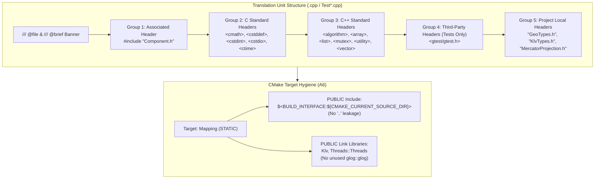

# Implementation Plan: `libs/Mapping` P2 — IWYU, Doxygen, Checklist & Code Hygiene

**Scope:** `libs/Mapping/` (13 headers, 10 implementation files, `CMakeLists.txt`) and `libs/Mapping/tests/` (9 unit test suites, `CMakeLists.txt`)
**Standard Baseline:** MISRA C++:2023 (Rule 7.0.6), SEI CERT C++ (`ERR55-CPP`, `STR37-C`), `.agents/rules/compliance.md`, `.agents/rules/iwyu-cstdint.md`, `.agents/rules/verification-checklist.md`, `.agents/skills/iwyu-cstdint/SKILL.md`, and `.agents/skills/doxygen-docs/SKILL.md`
**Reference Document:** [`docs/mapping_review.md`](mapping_review.md) (Section 2.3 Finding **A6**, Section 3.3 Findings **M1–M6**, and Section 5.2 Unit Test Gaps)

---

## 1. Executive Summary & Current Baseline

Following completion of Phase 1 (P0) in [`docs/mapping_p0_safety_concurrency_plan.md`](mapping_p0_safety_concurrency_plan.md) and Phase 2 (P1) in [`docs/mapping_p1_functional_conformance_plan.md`](mapping_p1_functional_conformance_plan.md), all safety-critical undefined behavior, concurrency, and GIS protocol conformance findings (**C1–C6**, **H1–H5**, **A1–A5**) are resolved.

Phase 3 (P2) addresses the remaining code hygiene, Include-What-You-Use (IWYU), Doxygen documentation, CMake target encapsulation, and unit test coverage items (**M1–M6**, **A6**, and Section 5.2):

| Finding ID | Rule / Checklist Item | Current Post-P1 State | Remaining P2 Remediation Scope |
| :--- | :--- | :--- | :--- |
| **M1** | **IWYU Rule 2.5** (Prune Unused Includes) | Pruned `<cmath>` from `MercatorProjection.h`, `<optional>` from `MapViewport.h`, and `"TacticalOverlay.h"` from `VmtiOverlay.h` in P0. | Remove unused `<string>` and `<utility>` from `libs/Mapping/TacticalOverlay.h`; remove unused `<vector>`, `"GeoTypes.h"`, and `"KlvTypes.h"` from `libs/Mapping/SpatialExportTypes.h`. |
| **M2** | **IWYU Rule 2.1 & 2.2** (Direct Symbol Inclusion) | Remediated `DiskTileCache.cpp`, `CompositeTileProvider.cpp`, and `SpatialDataRecorder.cpp` in P0/P1. | Add missing direct includes to `TileCache.h` (`<utility>`), `TileCache.cpp` (`<list>`, `<unordered_map>`, `<utility>`), `ProceduralGridTileProvider.cpp` (`<cstddef>`, `<vector>`), `TacticalOverlay.cpp` (`<array>`), `VmtiOverlay.cpp` (`"MercatorProjection.h"`), `GeoJsonExporter.cpp` (`<cstdint>`), and all 9 unit test files in `libs/Mapping/tests/`. |
| **M3** | **IWYU Rule 3** (Canonical 5-Group Include Order) | 12 library files sorted in P0/P1. | Reorder `#include` directives into the canonical 5 alphabetized groups across `TileCache.h`, `ProceduralGridTileProvider.h`, `TacticalOverlay.h`, `TacticalOverlay.cpp`, and all 9 test files in `libs/Mapping/tests/`. |
| **M4** | **Checklist #7** (Explicit `{}` Initialization) | Added `{}` member initializers to `VisibleTile`, `DiskTileCache`, and `CompositeTileProvider` in P0. | Add `{}` member initializers to `TileCache` (`libs/Mapping/TileCache.h`), and enforce `{}` uniform initialization on local variables in `TileCache.cpp`, `ProceduralGridTileProvider.cpp`, `TacticalOverlay.cpp`, and `libs/Mapping/tests/`. |
| **M5** | **Checklist #8** (`[[nodiscard]]` Attribute) | Added `[[nodiscard]]` to `DiskTileCache::storeTile()` and `std::hash<Mapping::TileCoord>::operator()` in P0/P1. | Add `[[nodiscard]]` to `TileCache::remove(const TileCoord& coord)` in `libs/Mapping/TileCache.h`. |
| **M6** | **Checklist #9** (Doxygen Completeness) | Added `/// @file` banners to 5 `.cpp` files in P0/P1. | Add `/// @file` and `/// @brief` banners to `TileCache.cpp`, `ProceduralGridTileProvider.cpp`, `TacticalOverlay.cpp`, `TestTileCache.cpp`, and `TestTacticalOverlay.cpp`. Complete `@details`, `@param[in]`, and `@return` tags across all 13 headers in `libs/Mapping/`. |
| **A6** | **CMake Target Hygiene** | Unmodified since initial review. | Remove unused `glog::glog` and parent directory `$<BUILD_INTERFACE:${CMAKE_CURRENT_SOURCE_DIR}/..>` from `PUBLIC` target properties in `libs/Mapping/CMakeLists.txt`; clean up redundant include paths in `libs/Mapping/tests/CMakeLists.txt`. |
| **Sec 5.2** | **Unit Test Coverage Gaps** | 15 P0/P1 regression tests added (53 total tests). | Add 7 new unit tests covering `HeadingThreshold` decimation across $359^\circ \leftrightarrow 1^\circ$, `TileCache::setCapacity()` eviction, fractional zoom & anti-meridian visible tiles, multi-revolution longitude normalization, `.jpg` MIME & empty file rejection, and `exportToFile()` / XML & JSON escaping. |

---

## 2. Target Architecture & Hygiene Model

### 2.1 Canonical 5-Group IWYU Dependency Graph

Every translation unit (`.cpp`) and header (`.h`) in `libs/Mapping` and `libs/Mapping/tests` must strictly follow the 5-group canonical include ordering defined in `.agents/rules/iwyu-cstdint.md`:

1. **Group 1 — Associated Header:** `#include "MyClass.h"` (in `.cpp` and test files)
2. **Group 2 — C Standard Library Headers:** `<cmath>`, `<cstddef>`, `<cstdint>`, `<cstdio>`, `<ctime>`
3. **Group 3 — C++ Standard Library Headers:** `<algorithm>`, `<array>`, `<atomic>`, `<filesystem>`, `<fstream>`, `<functional>`, `<iomanip>`, `<limits>`, `<list>`, `<memory>`, `<mutex>`, `<optional>`, `<ostream>`, `<sstream>`, `<string>`, `<string_view>`, `<system_error>`, `<thread>`, `<type_traits>`, `<unordered_map>`, `<utility>`, `<vector>`
4. **Group 4 — Third-Party Library Headers:** `<gtest/gtest.h>` (in `libs/Mapping/tests/` only; zero third-party or Qt includes in `libs/Mapping/`)
5. **Group 5 — Project Local Headers:** `"DiskTileCache.h"`, `"GeoTypes.h"`, `"ITileProvider.h"`, `"KlvGeodesy.h"`, `"KlvTypes.h"`, `"MapViewport.h"`, `"MercatorProjection.h"`, `"ProceduralGridTileProvider.h"`, `"SpatialDataRecorder.h"`, `"SpatialExportTypes.h"`, `"TacticalOverlay.h"`, `"TileCache.h"`, `"VmtiOverlay.h"`, `"VmtiTypes.h"`

#### ASCII Diagram: Canonical 5-Group Include Architecture & CMake Encapsulation

```
+-----------------------------------------------------------------------------------+
|                 CANONICAL 5-GROUP IWYU & CMAKE TARGET ENCAPSULATION               |
|                                                                                   |
|  +-----------------------------------------------------------------------------+  |
|  | Translation Unit (.cpp / Test*.cpp)                                         |  |
|  |                                                                             |  |
|  |  /// @file Component.cpp                                                    |  |
|  |  /// @brief Concise file responsibility summary.                            |  |
|  |                                                                             |  |
|  |  1. [Associated Header]     #include "Component.h"                          |  |
|  |                                                                             |  |
|  |  2. [C Standard Library]    #include <cmath> / <cstddef> / <cstdint>        |  |
|  |                                                                             |  |
|  |  3. [C++ Standard Library]  #include <algorithm> / <utility> / <vector>     |  |
|  |                                                                             |  |
|  |  4. [Third-Party (Tests)]   #include <gtest/gtest.h>                        |  |
|  |                                                                             |  |
|  |  5. [Project Local Headers] #include "GeoTypes.h" / "KlvTypes.h"            |  |
|  +--------------------------------------+--------------------------------------+  |
|                                         |                                         |
|                                         v                                         |
|  +-----------------------------------------------------------------------------+  |
|  | libs/Mapping/CMakeLists.txt (Target: Mapping)                               |  |
|  |  • PUBLIC Include: $<BUILD_INTERFACE:${CMAKE_CURRENT_SOURCE_DIR}>           |  |
|  |    (Removed parent `..` leak from PUBLIC interface)                         |  |
|  |  • PUBLIC Links:   Klv, Threads::Threads                                    |  |
|  |    (Removed unused `glog::glog` dependency)                                 |  |
|  +-----------------------------------------------------------------------------+  |
+-----------------------------------------------------------------------------------+
```

#### Mermaid Diagram: Canonical 5-Group Include Architecture & CMake Encapsulation



---

## 3. Detailed File-by-File Implementation Specification

### 3.1 Step 1: Header IWYU Pruning, Ordering, `[[nodiscard]]`, `{}` Init & Full Doxygen (`M1`, `M2`, `M3`, `M4`, `M5`, `M6`)

#### 1. `libs/Mapping/GeoTypes.h`
- **Doxygen (`M6`):** Add `@details` to `ScreenPoint`, `ScreenRect`, `TileCoord`, `BoundingBox`, `TileData`, and `std::hash<Mapping::TileCoord>::operator()`, plus inline `///<` member descriptions for `TileData`.

#### 2. `libs/Mapping/MercatorProjection.h`
- **Doxygen (`M6`):** Add `@details` to `clampZoom`, `clampLatitude`, `normalizeLongitude`, `latLonToGlobalPixel`, `globalPixelToLatLon`, `latLonToTile`, `tileToBoundingBox`, `slippyToTmsY`, `tmsToSlippyY`, and `metersPerPixel`.
- **Style:** Add braces `{ ... }` around single-line `if` statements in `clampZoom()` and `clampLatitude()` for consistency with project style.

#### 3. `libs/Mapping/MapViewport.h`
- **Doxygen (`M6`):** Add `@brief` and `@details` to default constructor `MapViewport() = default;` and add `@details` to all public methods (`MapViewport(...)`, `setCenter`, `center`, `setZoom`, `zoom`, `setSize`, `width`, `height`, `setTileSize`, `tileSize`, `pan`, `zoomBy`, `geoToScreen`, `screenToGeo`, `visibleBoundingBox`, `calculateVisibleTiles`).

#### 4. `libs/Mapping/ITileProvider.h`
- **Doxygen (`M6`):** Add `@brief` / `@details` to `virtual ~ITileProvider() = default;` and `@details` to `ITileProvider`, `getTile`, `hasTile`, and `providerName`.

#### 5. `libs/Mapping/TileCache.h`
- **IWYU (`M2`, `M3`):**
  - Add missing `#include <utility>` (required for `std::pair<TileCoord, TileData>`).
  - Reorder includes into canonical groups:
    ```cpp
    #include <cstddef>

    #include <list>
    #include <mutex>
    #include <optional>
    #include <unordered_map>
    #include <utility>

    #include "GeoTypes.h"
    ```
- **Initialization (`M4`):** Initialize all private members with `{}`:
  ```cpp
  std::size_t m_capacity { kDefaultCapacity };
  mutable std::mutex m_mutex {};
  std::list<std::pair<TileCoord, TileData>> m_lruList {};
  std::unordered_map<TileCoord, std::list<std::pair<TileCoord, TileData>>::iterator> m_cacheMap {};
  ```
- **Attributes (`M5`):** Add `[[nodiscard]]` to `bool remove(const TileCoord& coord);`.
- **Doxygen (`M6`):** Document constructor `explicit TileCache(std::size_t capacity = kDefaultCapacity) noexcept;` and destructor, and add `@details` and `@return` to `get`, `put`, `contains`, `remove`, `clear`, `size`, `capacity`, and `setCapacity`.

#### 6. `libs/Mapping/DiskTileCache.h`
- **Doxygen (`M6`):** Add `@details` to `DiskTileCache` class, constructor, `addSearchDirectory`, `getTile`, `hasTile`, `storeTile`, `providerName`, `primaryDirectory`, and private `findTileFile`.

#### 7. `libs/Mapping/ProceduralGridTileProvider.h`
- **IWYU (`M3`):** Reorder `#include <optional>` and `#include <string>` (Group 3) before `#include "ITileProvider.h"` (Group 5), and add `#include "GeoTypes.h"` directly for `TileCoord` and `TileData`.
- **Doxygen (`M6`):** Add `@brief`, `@details`, `@param[in]`, and `@return` to `ProceduralGridTileProvider()`, `getTile`, `hasTile`, `providerName`, and `generateGridTile`.

#### 8. `libs/Mapping/CompositeTileProvider.h`
- **IWYU (`M2`):** Add `#include "GeoTypes.h"` directly in Group 5 for `TileCoord` and `TileData`.
- **Doxygen (`M6`):** Add `@details` to constructor and all public methods (`setDiskCache`, `addOfflineProvider`, `setNetworkProvider`, `setOfflineOnly`, `isOfflineOnly`, `setProceduralFallbackEnabled`, `isProceduralFallbackEnabled`, `getTile`, `hasTile`, `providerName`, `memoryCache`).

#### 9. `libs/Mapping/TacticalOverlay.h`
- **IWYU (`M1`, `M3`):**
  - Remove unused `#include <string>` and `#include <utility>`.
  - Reorder `#include <array>` (Group 3) before `#include "GeoTypes.h"`, `#include "KlvTypes.h"`, and `#include "MapViewport.h"` (Group 5).
- **Doxygen (`M6`):** Add `@details` to `ScreenFrustum`, `ScreenVector`, `TacticalOverlay`, `projectFrustum`, `projectHeadingVector`, `projectLineOfSight`, and `isFrustumVisible`.

#### 10. `libs/Mapping/VmtiOverlay.h`
- **Doxygen (`M6`):** Add `@details` to `ScreenVmtiTarget`, `VmtiOverlay`, `projectTargetSeries`, and `isTargetVisible`.

#### 11. `libs/Mapping/SpatialExportTypes.h`
- **IWYU (`M1`):** Remove unused `#include <vector>`, `#include "GeoTypes.h"`, and `#include "KlvTypes.h"`.
- **Doxygen (`M6`):** Add `@details` to `SpatialPoint3D`, `SpatialTrackPoint`, `FrustumMesh3D`, `SpatialVmtiTarget`, `ColorRgba`, `ColorRgba::toKmlColor()`, `ColorRgba::toHexColor()`, `DecimationMode`, `DecimationConfig`, `KmlConfig`, and `GeoJsonConfig`.

#### 12. `libs/Mapping/SpatialDataRecorder.h`, `libs/Mapping/GeoJsonExporter.h`, `libs/Mapping/KmlExporter.h`
- **Doxygen (`M6`):** Complete `@details` tags on all remaining methods (`clear`, `decimate`, `trackPoints`, `frustums`, `vmtiTargets`, `size`, `empty`, `exportToStream`, `exportToFile`).

---

### 3.2 Step 2: Source (`.cpp`) IWYU, `/// @file` Banners & `{}` Initialization (`M2`, `M3`, `M4`, `M6`)

| Source File | Required IWYU & Hygiene Updates |
| :--- | :--- |
| `libs/Mapping/MercatorProjection.cpp` | Add `#include "GeoTypes.h"` and `#include "KlvTypes.h"` to Group 5 (directly uses `ScreenPoint`, `TileCoord`, `BoundingBox`, `Klv::GeoPoint2D`). |
| `libs/Mapping/MapViewport.cpp` | Add `#include "GeoTypes.h"`, `#include "KlvTypes.h"`, and `#include "MercatorProjection.h"` to Group 5. |
| `libs/Mapping/TileCache.cpp` | 1. Add `/// @file TileCache.cpp` and `/// @brief` banner (`M6`).<br/>2. Add direct includes: `<list>`, `<unordered_map>`, `<utility>`, and `"GeoTypes.h"` (`M2`, `M3`).<br/>3. Use `{}` initialization for `m_capacity`, `it`, and `oldest` (`M4`). |
| `libs/Mapping/DiskTileCache.cpp` | Add `#include "GeoTypes.h"` to Group 5 (directly uses `TileCoord` and `TileData`). |
| `libs/Mapping/ProceduralGridTileProvider.cpp` | 1. Add `/// @file ProceduralGridTileProvider.cpp` and `/// @brief` banner (`M6`).<br/>2. Add `<cstddef>` (for `std::size_t`), `<vector>`, and `"GeoTypes.h"` (`M2`, `M3`).<br/>3. Convert all local variables (`kTileDim`, `header`, `tile`, RGB constants, loop counters, `isCrossCenter`, `isGridLine`) to `{}` initialization (`M4`). |
| `libs/Mapping/CompositeTileProvider.cpp` | Add `#include "DiskTileCache.h"`, `#include "GeoTypes.h"`, `#include "ITileProvider.h"`, and `#include "TileCache.h"` to Group 5. |
| `libs/Mapping/TacticalOverlay.cpp` | 1. Add `/// @file TacticalOverlay.cpp` and `/// @brief` banner (`M6`).<br/>2. Separate Group 2 (`<cmath>`, `<cstddef>`) from Group 3 (`<algorithm>`, `<array>`) and add Group 5 (`"GeoTypes.h"`, `"KlvTypes.h"`, `"MapViewport.h"`) (`M2`, `M3`).<br/>3. Convert all local variables (`sf`, `mapDimension`, `i`, `dx`, `sv`, `headingRad`, `minX`, `maxX`, `minY`, `maxY`) to `{}` initialization (`M4`). |
| `libs/Mapping/VmtiOverlay.cpp` | Add Group 5 direct includes: `"GeoTypes.h"`, `"KlvTypes.h"`, `"MapViewport.h"`, `"MercatorProjection.h"`, and `"VmtiTypes.h"` (`M2`, `M3`). |
| `libs/Mapping/SpatialDataRecorder.cpp` | Add `"KlvTypes.h"`, `"SpatialExportTypes.h"`, and `"VmtiTypes.h"` to Group 5 (`M2`, `M3`). |
| `libs/Mapping/GeoJsonExporter.cpp` | Add `<cstdint>` to Group 2 and `"SpatialDataRecorder.h"`, `"SpatialExportTypes.h"` to Group 5 (`M2`, `M3`). |
| `libs/Mapping/KmlExporter.cpp` | Add `"SpatialDataRecorder.h"` and `"SpatialExportTypes.h"` to Group 5 (`M2`, `M3`). |

---

### 3.3 Step 3: CMake Build Encapsulation (`A6`)

**Files:** `libs/Mapping/CMakeLists.txt`, `libs/Mapping/tests/CMakeLists.txt`

1. In `libs/Mapping/CMakeLists.txt`:
   - Remove `$<BUILD_INTERFACE:${CMAKE_CURRENT_SOURCE_DIR}/..>` from `target_include_directories(Mapping PUBLIC ...)` so `Mapping` does not pollute downstream targets with the top-level `libs/` directory.
   - Remove unused `glog::glog` from `target_link_libraries(Mapping PUBLIC ...)`.
   ```cmake
   target_include_directories(Mapping PUBLIC
       $<BUILD_INTERFACE:${CMAKE_CURRENT_SOURCE_DIR}>
       $<INSTALL_INTERFACE:include>
   )

   target_link_libraries(Mapping PUBLIC
       Klv
       Threads::Threads
   )
   ```
2. In `libs/Mapping/tests/CMakeLists.txt`:
   - Remove the redundant `target_include_directories(${test_name} PRIVATE ${CMAKE_CURRENT_SOURCE_DIR}/..)` block because linking `Mapping` already provides `libs/Mapping` via its `PUBLIC` build interface.

---

### 3.4 Step 4: Unit Test Hygiene & Coverage Expansion (`M2`, `M3`, `M4`, `M6`, Section 5.2)

1. **IWYU, `/// @file` Banners & `{}` Initialization Across All 9 Test Files:**
   - Add `/// @file` and `/// @brief` banners to `libs/Mapping/tests/TestTileCache.cpp` and `libs/Mapping/tests/TestTacticalOverlay.cpp`.
   - Organize all 9 test files into strict 5-group include order (Associated header first, C headers, C++ headers, `<gtest/gtest.h>`, Project headers).
   - Replace uninitialized / `=` local variable declarations with `{}` initialization.

2. **New Unit Tests Addressing All Remaining Section 5.2 Gaps:**

| Test Suite | New Test Case | Coverage Gap Addressed |
| :--- | :--- | :--- |
| `TestMercatorProjection.cpp` | `NormalizeLongitudeMultiRevolution` | Tests `MercatorProjection::normalizeLongitude()` across multi-revolution positive and negative angles (`+540.0`, `-720.0`, `+180.0`, `-180.0`, `+360.0`). |
| `TestMapViewport.cpp` | `FractionalZoomAndAntiMeridianVisibleTiles` | Tests `MapViewport::calculateVisibleTiles()` at fractional zoom (`zoom = 10.5`, verifying `baseZoom = 10` and `scaledTileSize = 256 * sqrt(2)`) and straddling the $\pm 180^\circ$ anti-meridian (`lon = 179.9`, verifying wrapped tile X indices in `[0, 2^zoom - 1]`). |
| `TestTileCache.cpp` | `SetCapacityEvictsOldestEntries` | Tests `TileCache::setCapacity()` shrinking a 5-element cache to 2 elements and verifying that the 3 least-recently-used entries are evicted while the 2 most-recently-used entries are retained; also tests `setCapacity(0)` clamping to `1`. |
| `TestOfflineTileStore.cpp` | `DiskTileCacheJpegMimeAndEmptyFileRejection` | Tests storing and loading a `image/jpeg` (`.jpg`) tile and verifying MIME type detection, plus verifying that a 0-byte corrupt tile file on disk is rejected by `getTile()`. |
| `TestSpatialDataRecorder.cpp` | `HeadingThresholdDecimationAcrossWrapBoundary` | Tests `DecimationMode::HeadingThreshold` across the $359^\circ \leftrightarrow 1^\circ$ compass wrap-around boundary (`angularDiff(359.0, 1.0) == 2.0`), verifying small wrap-around jitter is filtered while a $15^\circ$ heading change is retained. |
| `TestGeoJsonExporter.cpp` | `ExportToFileAndSpecialCharEscaping` | Tests `GeoJsonExporter::exportToFile()` writing to disk and reading back, invalid file path failure (`false`), and escaping of `\"`, `\\`, `\n`, and `\t` in string properties. |
| `TestKmlExporter.cpp` | `ExportToFileAndXmlEntityEscaping` | Tests `KmlExporter::exportToFile()` writing to disk and reading back, invalid file path failure (`false`), and XML entity escaping (`&amp;`, `&lt;`, `&gt;`, `&quot;`, `&apos;`) in `documentName` and `documentDescription`. |

---

## 4. Verification & Compliance Matrix

Upon implementation of Steps 1–4, all 18 items of `.agents/rules/verification-checklist.md` will transition to **100% Pass**:

```bash
# 1. Verify strict IWYU and <cstdint> compliance across all 34 files in libs/Mapping
python scripts/verify_iwyu_cstdint.py libs/Mapping --strict

# 2. Verify all function names are strictly < 30 characters
python scripts/verify_function_lengths.py libs/Mapping

# 3. Verify STL algorithm value_type and explicit integer conversions (MISRA 7.0.6 / CERT INT31-C)
python scripts/verify_type_conversions.py libs/Mapping

# 4. Build Mapping and downstream consumers (MappingQt, VideoFilters) + all 9 test suites
cmake --build build --target Mapping MappingQt VideoFilters TestMercatorProjection TestMapViewport TestTileCache TestOfflineTileStore TestTacticalOverlay TestVmtiOverlay TestSpatialDataRecorder TestGeoJsonExporter TestKmlExporter

# 5. Execute complete Mapping unit test suite (60 / 60 test cases)
ctest --test-dir build/libs/Mapping/tests --output-on-failure
```

