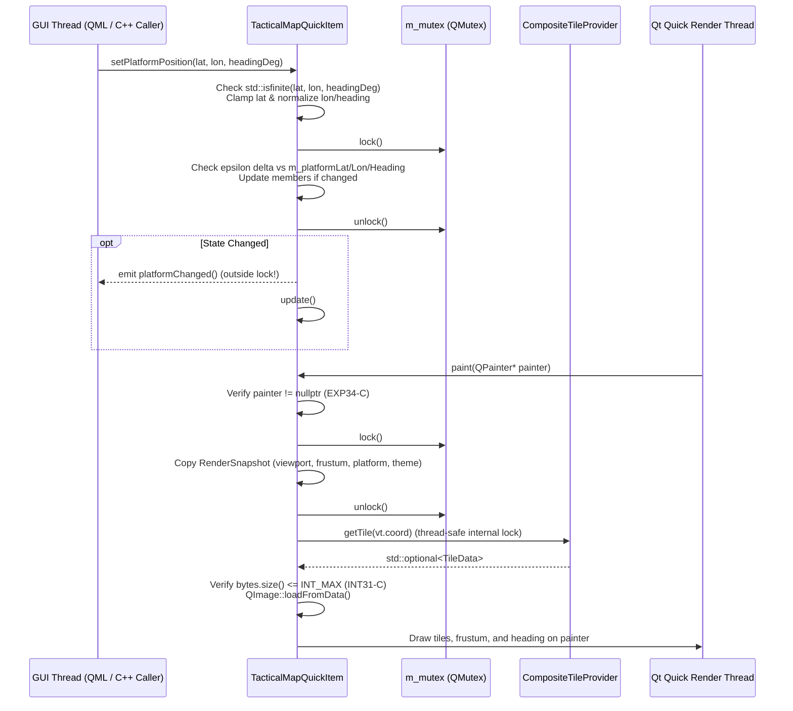
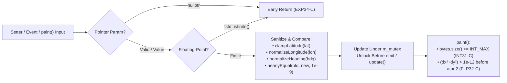

# Implementation Plan: `libs/MappingQt` P0 — Safety, Concurrency & Undefined Behavior Remediation

**Scope:** `libs/MappingQt/` (`TacticalMapQuickItem.h`, `TacticalMapQuickItem.cpp`, and `libs/MappingQt/tests/TestTacticalMapQuickItem.cpp`)
**Standard Baseline:** MISRA C++:2023 (Rule 7.0.6), SEI CERT C++ (`CON50-CPP`, `CON43-C`, `ERR55-CPP`, `EXP34-C`, `INT31-C`, `FLP32-C`, `FLP34-C`), `.agents/rules/compliance.md`, `.agents/rules/iwyu-cstdint.md`, and `.agents/rules/verification-checklist.md`
**Reference Document:** [`docs/mapping_qt_review.md`](mapping_qt_review.md) (Section 3.1, Findings **C1–C5**, and Section 2.3, Finding **A1**)

---

## 1. Executive Summary & Problem Analysis

In [`docs/mapping_qt_review.md`](mapping_qt_review.md), five P0 critical safety, concurrency, and undefined behavior findings (**C1–C5**) and one coupled architectural synchronization finding (**A1**) were identified in `libs/MappingQt`:

| Finding ID | Standard / Rule | Affected Files | Root Cause & Failure Mode |
| :--- | :--- | :--- | :--- |
| **C1 & A1** | **SEI CERT CON50-CPP / CON43-C** (Thread Safety & Data Races) | `libs/MappingQt/TacticalMapQuickItem.h`, `libs/MappingQt/TacticalMapQuickItem.cpp` | `TacticalMapQuickItem::paint(QPainter*)` locks `m_mutex` on the Qt Quick render thread (`QSG_RENDER_LOOP=threaded`) and reads `m_showFrustum`, `m_hasFrustum`, `m_frustum` (64-byte `Klv::FrustumCorners`), `m_themeColor` (`QColor`), `m_showHeading`, `m_platformLat`, `m_platformLon`, and `m_platformHeading`. However, none of the getters or setters for those 9 members lock `m_mutex` on the GUI thread. Concurrent GUI writes and render-thread reads cause torn 64-byte struct reads and C++17 data-race Undefined Behavior. Additionally, holding `m_mutex` during `emit` or throughout `QPainter` rasterization risks deadlock and stalls the GUI thread. |
| **C2** | **SEI CERT ERR55-CPP** (`noexcept` Exception Safety) | `libs/MappingQt/TacticalMapQuickItem.h`, `libs/MappingQt/TacticalMapQuickItem.cpp` | 29 method declarations (getters, setters, and `Q_INVOKABLE` helpers) are marked `noexcept` despite locking `QMutex`, calling `QQuickItem::update()`, or emitting Qt signals (`emit centerChanged()`, `emit platformChanged()`, etc.). In Qt 6, signal emission synchronously executes connected QML/JavaScript bindings and C++ slots or heap-allocates `QMetaCallEvent` for queued connections. Any exception escaping a `noexcept` method immediately invokes `std::terminate()`. |
| **C3** | **SEI CERT EXP34-C** (Null Pointer Dereference) | `libs/MappingQt/TacticalMapQuickItem.cpp` | `TacticalMapQuickItem::paint(QPainter* painter)` dereferences `painter` at line 321 (`painter->setRenderHint(...)`) without checking `painter != nullptr`. Mouse and wheel event handlers (`mousePressEvent`, `mouseMoveEvent`, `mouseReleaseEvent`, `wheelEvent`) similarly dereference `event` without a null check. |
| **C4** | **MISRA C++:2023 Rule 7.0.6 & SEI CERT INT31-C** (Safe Integer Conversions) | `libs/MappingQt/TacticalMapQuickItem.cpp` | Line 333 passes `static_cast<int>(tileData->bytes.size())` to `QImage::loadFromData()` without verifying that `tileData->bytes.size()` (`std::size_t`) is $\le \text{INT\_MAX}$, risking signed integer truncation/wraparound on oversized buffers. |
| **C5** | **SEI CERT FLP34-C & FLP32-C** (`NaN` / `Inf` Propagation & Domain Errors) | `libs/MappingQt/TacticalMapQuickItem.cpp` | Telemetry and frustum setters (`setPlatformLatitude`, `setPlatformLongitude`, `setPlatformHeading`, `setPlatformPosition`, `setFrustum`) accept `NaN`/`Inf` without `std::isfinite()` validation. Because `setPlatformLatitude(double lat)` checks `if (m_platformLat != lat)`, passing `NaN` evaluates `NaN != NaN` as `true` on every call, triggering an infinite `platformChanged()` / `update()` loop and propagating `NaN` into `TacticalOverlay::projectHeadingVector()` and `std::atan2(dy, dx)` in `paint()`. |

---

## 2. Architecture & Remediation Design

### 2.1 Thread-Safe State Synchronization & Render Snapshot (`CON50-CPP`, `ERR55-CPP`)

#### ASCII Diagram: Before vs. After Synchronization & `noexcept` Boundaries

```
+-----------------------------------------------------------------------------------+
|                      BEFORE (VIOLATES CON50-CPP & ERR55-CPP)                      |
|                                                                                   |
|  GUI Thread:                                                                      |
|  • setFrustum(...) noexcept ──► Mutates 64-byte m_frustum WITHOUT m_mutex!        |
|  • setPlatformLatitude(NaN) noexcept                                              |
|       ├──► (m_platformLat != NaN) is ALWAYS true!                                 |
|       ├──► Mutates m_platformLat WITHOUT m_mutex!                                 |
|       └──► emit platformChanged() inside noexcept ──► QML/Slot throw ──► TERMINATE|
|                                                                                   |
|  Qt Quick Render Thread:                                                          |
|  • paint(QPainter* painter)                                                       |
|       ├──► Dereferences painter without nullptr check (EXP34-C)                   |
|       ├──► Locks m_mutex for ENTIRE tile decode + QPainter draw pass              |
|       ├──► static_cast<int>(bytes.size()) without INT_MAX check (INT31-C)         |
|       └──► Reads m_frustum, m_platformLat/Lon/Heading, m_themeColor (DATA RACE!)  |
+-----------------------------------------------------------------------------------+
|                      AFTER (CON50-CPP & ERR55-CPP COMPLIANT)                      |
|                                                                                   |
|  GUI Thread (Non-noexcept Setters & Invokables):                                  |
|  1. Validate std::isfinite() on all double inputs (reject NaN/Inf immediately)    |
|  2. Clamp/normalize lat, lon, zoom, and heading                                   |
|  3. Lock m_mutex in a narrow scope:                                               |
|     - Compare against current state (epsilon 1e-9 for doubles)                    |
|     - Update member state only if changed                                         |
|  4. Unlock m_mutex BEFORE calling emit *Changed() and update()                    |
|                                                                                   |
|  Qt Quick Render Thread: paint(QPainter* painter)                                 |
|  1. Guard: if (painter == nullptr) return;                                        |
|  2. Lock m_mutex briefly:                                                         |
|     - Copy RenderSnapshot (m_viewport, flags, platform, frustum, m_themeColor)    |
|  3. Unlock m_mutex before tile retrieval, QImage::loadFromData, and QPainter draw |
|  4. Verify tileData->bytes.size() <= INT_MAX before static_cast<int>              |
|  5. Guard std::atan2(dy, dx) against zero-length vector (dx == 0 && dy == 0)      |
+-----------------------------------------------------------------------------------+
```

#### Mermaid Diagram: Remediated GUI-to-Render Synchronization & Snapshot Flow



---

### 2.2 Numeric, Geodetic & Pointer Sanitization Pipeline (`EXP34-C`, `INT31-C`, `FLP32-C`, `FLP34-C`)

#### ASCII Diagram: Input Validation & Arithmetic Guard Flow

```
+-----------------------------------------------------------------------------------+
|                  MAPPINGQT INPUT & ARITHMETIC SANITIZATION PIPELINE               |
|                                                                                   |
|  [Incoming API / Event / Render Call]                                             |
|       │                                                                           |
|       ├─► 1. Pointer Parameter Validation (CERT EXP34-C):                         |
|       │      • paint(painter): if (painter == nullptr) return;                    |
|       │      • mouse*Event / wheelEvent(event): if (event == nullptr) return;     |
|       │                                                                           |
|       ├─► 2. Floating-Point Input Validation (CERT FLP34-C):                      |
|       │      • Reject !std::isfinite(val) on all lat, lon, zoom, heading, x, y    |
|       │      • Clamp lat via MercatorProjection::clampLatitude(lat)               |
|       │      • Normalize lon via MercatorProjection::normalizeLongitude(lon)      |
|       │      • Normalize headingDeg into [0.0, 360.0) via normalizeHeading()      |
|       │      • Guard double equality with nearlyEqual(a, b, 1e-9)                 |
|       │                                                                           |
|       ├─► 3. Trigonometric Domain Protection (CERT FLP32-C):                      |
|       │      • Before std::atan2(dy, dx), check (dx * dx + dy * dy) > 1e-12       |
|       │                                                                           |
|       └─► 4. Buffer Size Conversion Guard (MISRA 7.0.6 / CERT INT31-C):           |
|              • Check tileData->bytes.size() <= numeric_limits<int>::max()         |
|                before static_cast<int>(tileData->bytes.size())                    |
+-----------------------------------------------------------------------------------+
```

#### Mermaid Diagram: Input Validation & Arithmetic Guard Flow



---

## 3. Detailed File-by-File Implementation Specification

### 3.1 Step 1: Remove Invalid `noexcept` Qualifiers & Add `[[nodiscard]]` in `TacticalMapQuickItem.h` (Finding C2)

**File:** `libs/MappingQt/TacticalMapQuickItem.h`

1. Remove `noexcept` from all 29 member declarations that lock `m_mutex`, call `QQuickItem::update()`, or emit Qt signals (`centerLatitude`, `setCenterLatitude`, `centerLongitude`, `setCenterLongitude`, `setCenter`, `zoom`, `setZoom`, `isOfflineOnly`, `setOfflineOnly`, `showFrustum`, `setShowFrustum`, `showHeading`, `setShowHeading`, `showGrid`, `setShowGrid`, `platformLatitude`, `setPlatformLatitude`, `platformLongitude`, `setPlatformLongitude`, `platformHeading`, `setPlatformHeading`, `setPlatformPosition`, both `setFrustum` overloads, `clearFrustum`, `themeColor`, `setThemeColor`, `geoToScreen`, `screenToGeo`).
2. Add `[[nodiscard]]` to `geoToScreen(double lat, double lon) const` and `screenToGeo(double x, double y) const`.

```cpp
// libs/MappingQt/TacticalMapQuickItem.h (excerpt)
public:
    explicit TacticalMapQuickItem(QQuickItem* parent = nullptr);
    ~TacticalMapQuickItem() override = default;

    // Center coordinates
    [[nodiscard]] double centerLatitude() const;
    void setCenterLatitude(double lat);

    [[nodiscard]] double centerLongitude() const;
    void setCenterLongitude(double lon);

    Q_INVOKABLE void setCenter(double lat, double lon);

    // Zoom level
    [[nodiscard]] double zoom() const;
    void setZoom(double z);

    // Offline configuration
    [[nodiscard]] bool isOfflineOnly() const;
    void setOfflineOnly(bool offline);

    Q_INVOKABLE void setOfflineDirectory(const QString& directoryPath);

    // Tactical overlay controls
    [[nodiscard]] bool showFrustum() const;
    void setShowFrustum(bool show);

    [[nodiscard]] bool showHeading() const;
    void setShowHeading(bool show);

    [[nodiscard]] bool showGrid() const;
    void setShowGrid(bool show);

    // Platform telemetry
    [[nodiscard]] double platformLatitude() const;
    void setPlatformLatitude(double lat);

    [[nodiscard]] double platformLongitude() const;
    void setPlatformLongitude(double lon);

    [[nodiscard]] double platformHeading() const;
    void setPlatformHeading(double headingDeg);

    Q_INVOKABLE void setPlatformPosition(double lat, double lon, double headingDeg);

    // Sensor footprint frustum
    Q_INVOKABLE void setFrustum(double tlLat, double tlLon,
                                double trLat, double trLon,
                                double brLat, double brLon,
                                double blLat, double blLon);

    void setFrustum(const Klv::FrustumCorners& frustum);
    void clearFrustum();

    // Color theme
    [[nodiscard]] QColor themeColor() const;
    void setThemeColor(const QColor& color);

    // Geographic <-> Screen coordinate conversions
    [[nodiscard]] Q_INVOKABLE QPointF geoToScreen(double lat, double lon) const;
    [[nodiscard]] Q_INVOKABLE QPointF screenToGeo(double x, double y) const;
```

---

### 3.2 Step 2: Add Floating-Point Sanitization Helpers & Full `m_mutex` Synchronization in `TacticalMapQuickItem.cpp` (Findings C1, C2, C5)

**File:** `libs/MappingQt/TacticalMapQuickItem.cpp`

1. Include `<cmath>`, `<limits>`, and `"MercatorProjection.h"`.
2. Add an anonymous namespace with deterministic, `noexcept` floating-point sanitization helpers:
   - `nearlyEqual(double a, double b, double eps = 1e-9) noexcept`
   - `normalizeHeading(double headingDeg) noexcept` (normalizes finite degrees into `[0.0, 360.0)`)
   - `isValidGeoPoint(const Klv::GeoPoint2D& pt) noexcept`
   - `isValidFrustum(const Klv::FrustumCorners& f) noexcept`
   - ` sanitizeGeoPoint(const Klv::GeoPoint2D& pt) noexcept`
3. Synchronize **every** getter and setter (`showFrustum`, `setShowFrustum`, `showHeading`, `setShowHeading`, `showGrid`, `setShowGrid`, `platformLatitude`, `setPlatformLatitude`, `platformLongitude`, `setPlatformLongitude`, `platformHeading`, `setPlatformHeading`, `setPlatformPosition`, `setFrustum` [both overloads], `clearFrustum`, `themeColor`, `setThemeColor`) with `QMutexLocker locker(&m_mutex);`.
4. Ensure every setter checks whether the sanitized value actually differs from the current member value under `m_mutex`, unlocks `m_mutex`, and only then calls `emit ...Changed()` and `update()`.

```cpp
// libs/MappingQt/TacticalMapQuickItem.cpp (excerpt)
namespace {

constexpr double kCoordEpsilon { 1e-9 };

[[nodiscard]] bool nearlyEqual(double a, double b, double eps = kCoordEpsilon) noexcept
{
    return std::abs(a - b) <= eps;
}

[[nodiscard]] double normalizeHeading(double headingDeg) noexcept
{
    if (!std::isfinite(headingDeg)) {
        return 0.0;
    }
    double norm { std::fmod(headingDeg, 360.0) };
    if (norm < 0.0) {
        norm += 360.0;
    }
    return norm;
}

[[nodiscard]] bool isValidFrustum(const Klv::FrustumCorners& frustum) noexcept
{
    return std::isfinite(frustum.topLeft.latitudeDeg) && std::isfinite(frustum.topLeft.longitudeDeg)
        && std::isfinite(frustum.topRight.latitudeDeg) && std::isfinite(frustum.topRight.longitudeDeg)
        && std::isfinite(frustum.bottomRight.latitudeDeg) && std::isfinite(frustum.bottomRight.longitudeDeg)
        && std::isfinite(frustum.bottomLeft.latitudeDeg) && std::isfinite(frustum.bottomLeft.longitudeDeg);
}

[[nodiscard]] Klv::GeoPoint2D sanitizePoint(double lat, double lon) noexcept
{
    return {
        Mapping::MercatorProjection::clampLatitude(lat),
        Mapping::MercatorProjection::normalizeLongitude(lon)
    };
}

} // namespace
```

```cpp
// Synchronized & Sanitized Telemetry / Frustum Setters (excerpt)
double TacticalMapQuickItem::platformLatitude() const
{
    QMutexLocker locker(&m_mutex);
    return m_platformLat;
}

void TacticalMapQuickItem::setPlatformLatitude(double lat)
{
    if (!std::isfinite(lat)) {
        return;
    }
    const double clampedLat { Mapping::MercatorProjection::clampLatitude(lat) };
    {
        QMutexLocker locker(&m_mutex);
        if (nearlyEqual(m_platformLat, clampedLat)) {
            return;
        }
        m_platformLat = clampedLat;
    }
    emit platformChanged();
    update();
}

double TacticalMapQuickItem::platformLongitude() const
{
    QMutexLocker locker(&m_mutex);
    return m_platformLon;
}

void TacticalMapQuickItem::setPlatformLongitude(double lon)
{
    if (!std::isfinite(lon)) {
        return;
    }
    const double normLon { Mapping::MercatorProjection::normalizeLongitude(lon) };
    {
        QMutexLocker locker(&m_mutex);
        if (nearlyEqual(m_platformLon, normLon)) {
            return;
        }
        m_platformLon = normLon;
    }
    emit platformChanged();
    update();
}

double TacticalMapQuickItem::platformHeading() const
{
    QMutexLocker locker(&m_mutex);
    return m_platformHeading;
}

void TacticalMapQuickItem::setPlatformHeading(double headingDeg)
{
    if (!std::isfinite(headingDeg)) {
        return;
    }
    const double normHeading { normalizeHeading(headingDeg) };
    {
        QMutexLocker locker(&m_mutex);
        if (nearlyEqual(m_platformHeading, normHeading)) {
            return;
        }
        m_platformHeading = normHeading;
    }
    emit platformChanged();
    update();
}

void TacticalMapQuickItem::setPlatformPosition(double lat, double lon, double headingDeg)
{
    if (!std::isfinite(lat) || !std::isfinite(lon) || !std::isfinite(headingDeg)) {
        return;
    }
    const double clampedLat { Mapping::MercatorProjection::clampLatitude(lat) };
    const double normLon { Mapping::MercatorProjection::normalizeLongitude(lon) };
    const double normHeading { normalizeHeading(headingDeg) };
    {
        QMutexLocker locker(&m_mutex);
        if (nearlyEqual(m_platformLat, clampedLat)
            && nearlyEqual(m_platformLon, normLon)
            && nearlyEqual(m_platformHeading, normHeading)) {
            return;
        }
        m_platformLat = clampedLat;
        m_platformLon = normLon;
        m_platformHeading = normHeading;
    }
    emit platformChanged();
    update();
}

void TacticalMapQuickItem::setFrustum(const Klv::FrustumCorners& frustum)
{
    if (!isValidFrustum(frustum)) {
        return;
    }
    Klv::FrustumCorners sanitized {};
    sanitized.topLeft = sanitizePoint(frustum.topLeft.latitudeDeg, frustum.topLeft.longitudeDeg);
    sanitized.topRight = sanitizePoint(frustum.topRight.latitudeDeg, frustum.topRight.longitudeDeg);
    sanitized.bottomRight = sanitizePoint(frustum.bottomRight.latitudeDeg, frustum.bottomRight.longitudeDeg);
    sanitized.bottomLeft = sanitizePoint(frustum.bottomLeft.latitudeDeg, frustum.bottomLeft.longitudeDeg);

    {
        QMutexLocker locker(&m_mutex);
        m_frustum = sanitized;
        m_hasFrustum = true;
    }
    update();
}

void TacticalMapQuickItem::clearFrustum()
{
    {
        QMutexLocker locker(&m_mutex);
        if (!m_hasFrustum) {
            return;
        }
        m_hasFrustum = false;
    }
    update();
}
```

---

### 3.3 Step 3: Snapshot-Based `paint()` with Null-Pointer, Integer-Range & `atan2` Domain Guards (Findings C1, A1, C3, C4, C5)

**File:** `libs/MappingQt/TacticalMapQuickItem.cpp`

1. Guard `mousePressEvent`, `mouseMoveEvent`, `mouseReleaseEvent`, `wheelEvent`, and `paint` against `nullptr` pointer arguments (**C3 / CERT EXP34-C**).
2. In `TacticalMapQuickItem::paint(QPainter* painter)`:
   - Define a local `RenderSnapshot` struct and copy `m_viewport`, `m_showFrustum`, `m_hasFrustum`, `m_frustum`, `m_showHeading`, `m_platformLat`, `m_platformLon`, `m_platformHeading`, and `m_themeColor` under a brief `QMutexLocker locker(&m_mutex)` scope, then release `m_mutex` before performing tile retrieval, image decoding, and `QPainter` drawing (**C1, A1**).
   - Before calling `img.loadFromData()`, verify `tileData->bytes.size() <= static_cast<std::size_t>(std::numeric_limits<int>::max())` (**C4 / MISRA 7.0.6 & CERT INT31-C**).
   - Before calling `std::atan2(dy, dx)`, verify `(dx * dx + dy * dy) > 1e-12` (**C5 / CERT FLP32-C**).

```cpp
// libs/MappingQt/TacticalMapQuickItem.cpp (excerpt)
void TacticalMapQuickItem::paint(QPainter* painter)
{
    if (painter == nullptr) {
        return;
    }

    struct RenderSnapshot {
        Mapping::MapViewport viewport;
        bool showFrustum { true };
        bool hasFrustum { false };
        Klv::FrustumCorners frustum {};
        bool showHeading { true };
        double platformLat { 0.0 };
        double platformLon { 0.0 };
        double platformHeading { 0.0 };
        QColor themeColor {};
    };

    RenderSnapshot snap {
        Mapping::MapViewport({ 0.0, 0.0 }, 1.0, 1.0, 1.0)
    };
    {
        QMutexLocker locker(&m_mutex);
        snap.viewport = m_viewport;
        snap.showFrustum = m_showFrustum;
        snap.hasFrustum = m_hasFrustum;
        snap.frustum = m_frustum;
        snap.showHeading = m_showHeading;
        snap.platformLat = m_platformLat;
        snap.platformLon = m_platformLon;
        snap.platformHeading = m_platformHeading;
        snap.themeColor = m_themeColor;
    }

    painter->setRenderHint(QPainter::Antialiasing, true);
    painter->setRenderHint(QPainter::SmoothPixmapTransform, true);

    // 1. Draw base tactical background
    painter->fillRect(boundingRect(), QColor(14, 18, 24));

    // 2. Render visible tiles (m_tileProvider is internally thread-safe)
    const auto visibleTiles = snap.viewport.calculateVisibleTiles(1);
    constexpr auto kMaxIntSize { static_cast<std::size_t>(std::numeric_limits<int>::max()) };

    for (const auto& vt : visibleTiles) {
        const auto tileData = m_tileProvider.getTile(vt.coord);
        if (tileData && !tileData->bytes.empty() && tileData->bytes.size() <= kMaxIntSize) {
            QImage img {};
            if (img.loadFromData(tileData->bytes.data(), static_cast<int>(tileData->bytes.size()))) {
                const QRectF destRect(vt.screenRect.x, vt.screenRect.y, vt.screenRect.width, vt.screenRect.height);
                painter->drawImage(destRect, img);
            }
        }
    }

    // 3. Render tactical optical footprint frustum
    if (snap.showFrustum && snap.hasFrustum) {
        const auto sf = Mapping::TacticalOverlay::projectFrustum(snap.viewport, snap.frustum);
        QPolygonF poly {};
        for (std::size_t i { 0U }; i < 4U; ++i) {
            poly << QPointF(sf.corners[i].x, sf.corners[i].y);
        }

        QColor fillColor { snap.themeColor };
        fillColor.setAlpha(45);
        painter->setBrush(QBrush(fillColor));

        const QPen borderPen(snap.themeColor, 2.0);
        painter->setPen(borderPen);
        painter->drawPolygon(poly);

        painter->setPen(QPen(Qt::white, 1.5));
        for (std::size_t i { 0U }; i < 4U; ++i) {
            const QPointF pt(sf.corners[i].x, sf.corners[i].y);
            painter->drawLine(QPointF(pt.x() - 4.0, pt.y()), QPointF(pt.x() + 4.0, pt.y()));
            painter->drawLine(QPointF(pt.x(), pt.y() - 4.0), QPointF(pt.x(), pt.y() + 4.0));
        }
    }

    // 4. Render platform marker and heading arrow
    if (snap.showHeading) {
        const auto sv = Mapping::TacticalOverlay::projectHeadingVector(
            snap.viewport, { snap.platformLat, snap.platformLon }, snap.platformHeading, 35.0);

        const QPointF origin(sv.origin.x, sv.origin.y);
        const QPointF tip(sv.tip.x, sv.tip.y);

        painter->setBrush(Qt::NoBrush);
        painter->setPen(QPen(snap.themeColor, 2.0));
        painter->drawEllipse(origin, 7.0, 7.0);

        painter->setPen(QPen(snap.themeColor, 1.5, Qt::SolidLine));
        painter->drawLine(origin, tip);

        const double dx { tip.x() - origin.x() };
        const double dy { tip.y() - origin.y() };
        if ((dx * dx + dy * dy) > 1e-12) {
            const double angle { std::atan2(dy, dx) };
            constexpr double kHeadLen { 8.0 };
            constexpr double kHeadAngle { 0.5 };

            const QPointF arrowP1(
                tip.x() - kHeadLen * std::cos(angle - kHeadAngle),
                tip.y() - kHeadLen * std::sin(angle - kHeadAngle));
            const QPointF arrowP2(
                tip.x() - kHeadLen * std::cos(angle + kHeadAngle),
                tip.y() - kHeadLen * std::sin(angle + kHeadAngle));

            QPolygonF arrowHead {};
            arrowHead << tip << arrowP1 << arrowP2;
            painter->setBrush(QBrush(snap.themeColor));
            painter->drawPolygon(arrowHead);
        }
    }
}
```

---

## 4. Test-Driven Development (TDD) & Verification Plan

Per `.agents/skills/tdd-bug-fixing/SKILL.md` and Checklist #11, unit tests reproducing each P0 safety and concurrency defect will be added to `libs/MappingQt/tests/TestTacticalMapQuickItem.cpp` prior to applying the production fixes:

| Test Suite | New Test Case | Findings Verified |
| :--- | :--- | :--- |
| `TestTacticalMapQuickItem.cpp` | `NullPointerSafetyInPaintAndEvents` | **C3 (`EXP34-C`)**: Calls `paint(nullptr)` and verifies no crash or null-pointer dereference occurs, and renders into a valid `QImage`-backed `QPainter`. |
| `TestTacticalMapQuickItem.cpp` | `NaNAndInfiniteInputsRejectedWithoutSignalLoop` | **C5 (`FLP34-C`, `FLP32-C`)**: Passes `NaN` and `±Inf` to `setCenter`, `setCenterLatitude`, `setCenterLongitude`, `setZoom`, `setPlatformLatitude`, `setPlatformLongitude`, `setPlatformHeading`, `setPlatformPosition`, and `setFrustum`, verifying via `QSignalSpy` that zero signals are emitted and state remains finite. |
| `TestTacticalMapQuickItem.cpp` | `ConcurrentGuiMutationAndRenderThreadPaint` | **C1 & A1 (`CON50-CPP`, `CON43-C`)**: Spawns worker threads concurrently mutating frustum corners, platform telemetry, viewport center/zoom, and theme color while calling `paint(&painter)` on an offscreen `QImage` buffer to verify data-race freedom and lock-order safety. |
| `TestTacticalMapQuickItem.cpp` | `ReentrantSlotInSignalDoesNotDeadlock` | **C1 & C2 (`CON50-CPP`, `ERR55-CPP`)**: Connects a slot to `centerChanged`, `zoomChanged`, `platformChanged`, and `themeColorChanged` that synchronously queries getters (`centerLatitude()`, `platformLatitude()`, `themeColor()`) to prove `m_mutex` is released before signal emission. |

### Verification Commands

1. **Automated IWYU, `<cstdint>`, Function Length, and Type Conversion Checks:**
   ```bash
   python scripts/verify_iwyu_cstdint.py libs/MappingQt --strict
   python scripts/verify_function_lengths.py libs/MappingQt
   python scripts/verify_type_conversions.py libs/MappingQt
   ```
2. **Build & Unit Test Execution:**
   ```bash
   cmake --build build --target MappingQt TestTacticalMapQuickItem
   ctest --test-dir build/libs/MappingQt/tests --output-on-failure
   ```

