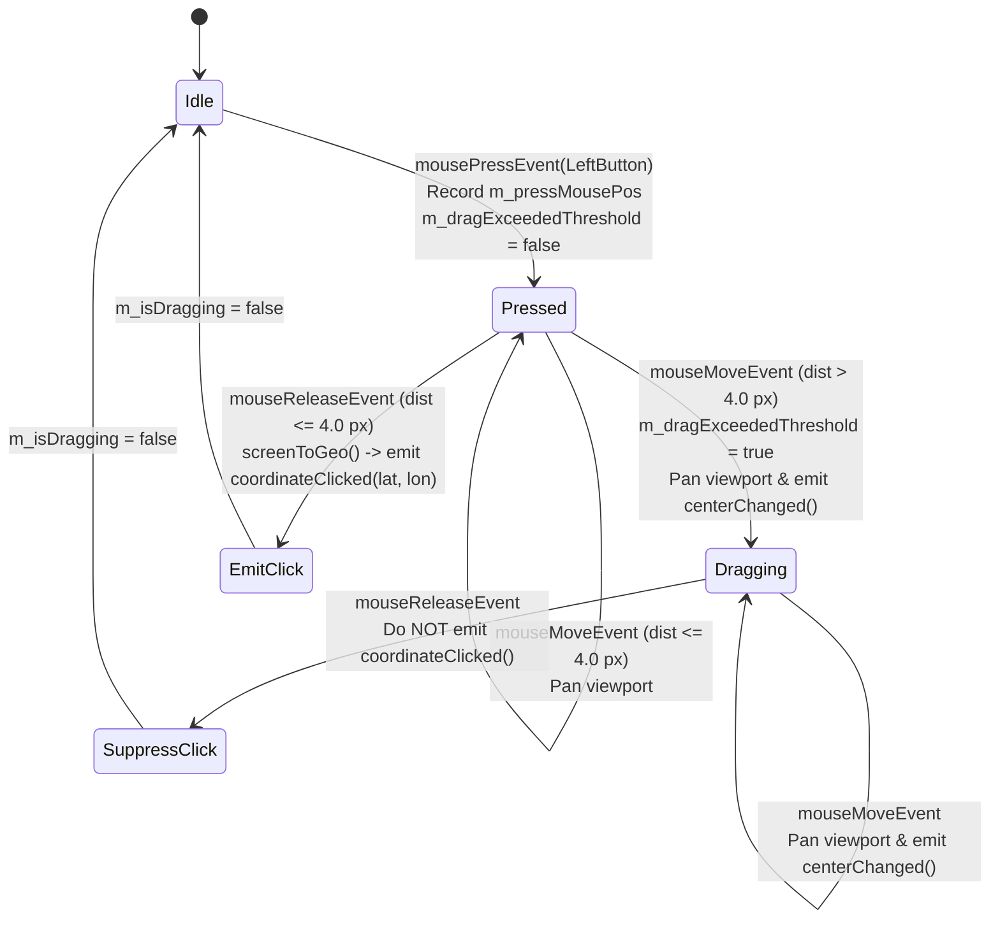
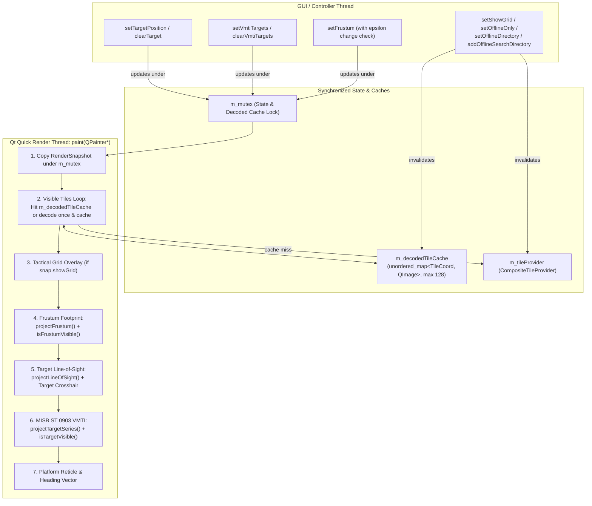

# Implementation Plan: `libs/MappingQt` P1 — Functional Completeness, UX & Performance

**Scope:** `libs/MappingQt/` (`TacticalMapQuickItem.h`, `TacticalMapQuickItem.cpp`, and `libs/MappingQt/tests/TestTacticalMapQuickItem.cpp`)
**Standard Baseline:** MISRA C++:2023 (Rule 7.0.6), SEI CERT C++ (`CON50-CPP`, `ERR55-CPP`, `EXP34-C`, `INT31-C`, `FLP32-C`, `FLP34-C`), `.agents/rules/compliance.md`, `.agents/rules/iwyu-cstdint.md`, and `.agents/rules/verification-checklist.md`
**Reference Document:** [`docs/mapping_qt_review.md`](mapping_qt_review.md) (Section 2.3, Findings **A2–A6**, Section 3.2, Findings **H1–H6**, and Section 6, Phase 2)

---

## 1. Executive Summary & P1 Problem Analysis

In [`docs/mapping_qt_review.md`](mapping_qt_review.md), six high-severity functional completeness, UX, and performance findings (**H1–H6**) and five corresponding architectural gaps (**A2–A6**) were identified in `libs/MappingQt`:

| Finding ID | Category | Affected Files | Root Cause & Operational Impact |
| :--- | :--- | :--- | :--- |
| **H1 & A3** | **Broken Feature (`showGrid` Dead Property)** | `libs/MappingQt/TacticalMapQuickItem.h`, `libs/MappingQt/TacticalMapQuickItem.cpp` | `showGrid` is exposed via `Q_PROPERTY(bool showGrid READ showGrid WRITE setShowGrid NOTIFY showGridChanged)` and stored in `m_showGrid`, but `m_showGrid` is never wired to `m_tileProvider.setProceduralFallbackEnabled()` or referenced in `paint()`. Toggling `showGrid` in QML has zero visual or functional effect. |
| **H2 & A4** | **UX / Control Defect (Pan Drag Triggers PTZ Slew)** | `libs/MappingQt/TacticalMapQuickItem.cpp` | `mousePressEvent()` emits `coordinateClicked(geo.x(), geo.y())` immediately on `Qt::LeftButton` button-down before determining whether the operator is clicking a point or dragging to pan the map. In `app-video-qt` (`qml/Main.qml`, `qml/TacticalMapPanel.qml`), every map pan gesture slews the PTZ camera to the drag start coordinate. |
| **H3 & A2** | **Render Thread Performance Bottleneck (Per-Frame Tile Decoding)** | `libs/MappingQt/TacticalMapQuickItem.h`, `libs/MappingQt/TacticalMapQuickItem.cpp` | On every `paint()` invocation (30–60 FPS during panning or live telemetry updates), `TacticalMapQuickItem` retrieves compressed PNG/JPEG/PPM byte buffers from `m_tileProvider.getTile(vt.coord)` and decompresses all 12–20 visible tiles synchronously via `QImage::loadFromData()` on the Qt Quick render thread. |
| **H4 & A5** | **Missing `libs/Mapping` Overlay Capabilities & Offline Store Controls** | `libs/MappingQt/TacticalMapQuickItem.h`, `libs/MappingQt/TacticalMapQuickItem.cpp` | 1. `paint()` does not call `Mapping::TacticalOverlay::isFrustumVisible()` to cull off-screen footprints.<br/>2. Lacks target ground coordinate & optical line-of-sight rendering (`Mapping::TacticalOverlay::projectLineOfSight()`).<br/>3. Lacks MISB ST 0903 moving target overlay integration (`Mapping::VmtiOverlay::projectTargetSeries()` & `isTargetVisible()`).<br/>4. `setOfflineDirectory("")` constructs `DiskTileCache("")` instead of resetting `m_diskCache` to `nullptr`, and lacks `addOfflineSearchDirectory()`. |
| **H5** | **Incomplete Idempotency / Change-Detection Guards** | `libs/MappingQt/TacticalMapQuickItem.cpp` | While numeric setters now check `nearlyEqual()`, `setFrustum()` unconditionally overwrites `m_frustum` and calls `update()` even when identical frustum coordinates are supplied at 30 Hz. |
| **H6 & A6** | **Linker Trap: Declared `static void registerQmlTypes()` Never Defined** | `libs/MappingQt/TacticalMapQuickItem.h`, `libs/MappingQt/TacticalMapQuickItem.cpp` | `TacticalMapQuickItem::registerQmlTypes()` is declared as a `static` member in `TacticalMapQuickItem.h`, while `TacticalMapQuickItem.cpp` only defines the free function `MappingQt::registerQmlTypes()`. Calling `TacticalMapQuickItem::registerQmlTypes()` causes an unresolved symbol linker error (`LNK2019` / `undefined reference`). |

---

## 2. Target Architecture & Remediation Design

### 2.1 Click-vs-Drag Gesture State Machine (Findings H2 & A4)

To prevent map panning from inadvertently slewing the PTZ turret, left-button mouse interactions are governed by a deterministic 4-pixel Euclidean deadband state machine:

- **Press (`mousePressEvent`):** Record `m_pressMousePos = event->position()`, `m_lastMousePos = event->position()`, `m_isDragging = true`, and `m_dragExceededThreshold = false`. Do **not** emit `coordinateClicked()`.
- **Move (`mouseMoveEvent`):** Compute squared Euclidean distance from `m_pressMousePos`:
  $$\Delta d^2 = (x - x_{\text{press}})^2 + (y - y_{\text{press}})^2$$
  If $\Delta d^2 > 16.0\text{ px}^2$ ($4.0\text{ px}$ radius), set `m_dragExceededThreshold = true`. Pan the viewport by `event->position() - m_lastMousePos`, emit `centerChanged()`, and schedule `update()`.
- **Release (`mouseReleaseEvent`):** Compute final displacement from `m_pressMousePos`. Clear `m_isDragging = false`. Emit `coordinateClicked(geo.x(), geo.y())` **if and only if** `!m_dragExceededThreshold` and final $\Delta d^2 \le 16.0\text{ px}^2$.

#### ASCII Diagram: Click-to-Slew vs. Pan Drag Discrimination State Machine

```
+-----------------------------------------------------------------------------------+
|               MOUSE LEFT-BUTTON CLICK-VS-DRAG DISCRIMINATION FSM                  |
|                                                                                   |
|   [Idle]                                                                          |
|     │                                                                             |
|     │ mousePressEvent(LeftButton)                                                 |
|     │ • m_pressMousePos = pos, m_lastMousePos = pos                               |
|     │ • m_isDragging = true, m_dragExceededThreshold = false                      |
|     ▼                                                                             |
|   [Pressed / Potential Click] ───────────────────────────┐                        |
|     │                                                    │                        |
|     │ mouseMoveEvent (|pos - m_pressMousePos| <= 4.0 px) │ mouseReleaseEvent      |
|     │ • Pan viewport by delta                            │ (|pos - press| <= 4px  |
|     │ • Keep m_dragExceededThreshold = false             │  && !exceeded)         |
|     ▼                                                    ▼                        |
|   [Dragging (|pos - m_pressMousePos| > 4.0 px)]     [Emit coordinateClicked()]    |
|     │ • m_dragExceededThreshold = true                   │                        |
|     │ • Pan viewport by delta + emit centerChanged()     │                        |
|     │                                                    │                        |
|     └──► mouseReleaseEvent(LeftButton) ──────────────────┴──► [Idle]              |
|          • Suppress coordinateClicked()!                                          |
+-----------------------------------------------------------------------------------+
```

#### Mermaid Diagram: Click-to-Slew vs. Pan Drag Discrimination State Machine



---

### 2.2 Bounded Decoded `QImage` Tile Cache & Full Overlay Render Pipeline (Findings H1, H3, H4, A2, A3, A5)

To eliminate synchronous PNG/JPEG/PPM decompression on the Qt Quick render thread during `paint()`:
1. **Bounded Decoded `QImage` Cache:** `TacticalMapQuickItem` maintains an in-memory cache (`m_decodedTileCache` + FIFO/LRU eviction queue `m_decodedTileOrder`, capped at `kMaxDecodedTiles = 128U`) mapping `Mapping::TileCoord` to decoded `QImage` instances (which are implicitly shared in Qt via copy-on-write atomic reference counting).
2. **Cache Invalidation Discipline:** Whenever tile provider configuration changes (`setOfflineOnly()`, `setOfflineDirectory()`, `addOfflineSearchDirectory()`, or `setShowGrid()`), both `m_tileProvider.memoryCache().clear()` and `m_decodedTileCache` are cleared under lock so stale tiles are never drawn.
3. **Complete Tactical Symbology Pipeline:**
   - **Layer 1 — Base Fill & Visible Tiles:** Blit decoded `QImage` tiles from `m_decodedTileCache` (or decode once on cache miss via `m_tileProvider.getTile(vt.coord)`).
   - **Layer 2 — Tactical Coordinate Grid (`showGrid`):** Wire `setShowGrid(bool)` to `m_tileProvider.setProceduralFallbackEnabled(show)` and draw a subtle tactical coordinate grid overlay in `paint()` when `snap.showGrid` is `true`.
   - **Layer 3 — Culled Sensor Footprint Frustum (`isFrustumVisible`):** Project via `TacticalOverlay::projectFrustum()` and test `TacticalOverlay::isFrustumVisible(sf, viewportRect)` before rasterizing the polygon and corner reticles.
   - **Layer 4 — Target Line-of-Sight & Reticle (`projectLineOfSight`):** When `snap.hasTarget` is `true`, project the boresight vector from platform to target via `TacticalOverlay::projectLineOfSight()`, drawing a dashed LOS ray and target crosshair marker.
   - **Layer 5 — MISB ST 0903 VMTI Targets (`VmtiOverlay`):** When `snap.hasVmti` is `true`, project targets via `VmtiOverlay::projectTargetSeries()`, cull off-screen targets via `VmtiOverlay::isTargetVisible()`, and draw CE90 uncertainty circles, target bounding boxes, and track callsigns (`TRK-xxx`).
   - **Layer 6 — Platform Marker & Heading Vector:** Render the platform circular reticle and heading vector arrowhead.

#### ASCII Diagram: P1 Non-Blocking Snapshot, Decoded Tile Cache & Multi-Layer Render Pipeline

```
+---------------------------------------------------------------------------------------+
|                   P1 TACTICALMAPQUICKITEM RENDER & CACHE ARCHITECTURE                 |
|                                                                                       |
|  GUI / Controller Thread                          Qt Quick Render Thread: paint()     |
|  ───────────────────────                          ───────────────────────────────     |
|  • setShowGrid(show)                              1. Guard painter != nullptr         |
|    ├─► m_tileProvider.setProceduralFallback(show) 2. Lock m_mutex briefly:            |
|    ├─► m_tileProvider.memoryCache().clear()          ├─► Copy RenderSnapshot          |
|    └─► clearDecodedTileCache()                       │   (viewport, frustum, target,  |
|  • setOfflineDirectory(path)                         │    vmtiSet, platform, flags)   |
|    ├─► Empty? m_diskCache = nullptr                  └─► Unlock m_mutex               |
|    └─► Valid? make_shared<DiskTileCache>(path)    3. Layer 1 (Tiles):                 |
|  • setTargetPosition(lat, lon) / clearTarget()       ├─► Lookup m_decodedTileCache    |
|  • setVmtiTargets(vmti) / clearVmtiTargets()         └─► Miss: getTile() + decode     |
|                                                   4. Layer 2: Tactical Grid Overlay   |
|                                                   5. Layer 3: Culled Frustum Polygon  |
|                                                   6. Layer 4: Target LOS + Reticle    |
|                                                   7. Layer 5: Culled ST 0903 VMTI     |
|                                                   8. Layer 6: Platform & Heading      |
+---------------------------------------------------------------------------------------+
```

#### Mermaid Diagram: P1 Non-Blocking Snapshot, Decoded Tile Cache & Multi-Layer Render Pipeline



---

## 3. Detailed File-by-File Implementation Specification

### 3.1 Step 1: Expand `libs/MappingQt/TacticalMapQuickItem.h` API & State

**File:** `libs/MappingQt/TacticalMapQuickItem.h`

1. **Add Target Position Properties & Invokables (Finding H4):**
   - `Q_PROPERTY(bool hasTarget READ hasTarget NOTIFY targetChanged)`
   - `Q_PROPERTY(double targetLatitude READ targetLatitude NOTIFY targetChanged)`
   - `Q_PROPERTY(double targetLongitude READ targetLongitude NOTIFY targetChanged)`
   - `[[nodiscard]] bool hasTarget() const;`
   - `[[nodiscard]] double targetLatitude() const;`
   - `[[nodiscard]] double targetLongitude() const;`
   - `Q_INVOKABLE void setTargetPosition(double lat, double lon);`
   - `Q_INVOKABLE void clearTarget();`
   - Signal: `void targetChanged();`
2. **Add MISB ST 0903 VMTI Overlay API (Finding H4):**
   - Include `"VmtiTypes.h"` (or `<cstddef>` and `"VmtiTypes.h"`).
   - `void setVmtiTargets(const Klv::VmtiLocalSet& vmti);`
   - `Q_INVOKABLE void clearVmtiTargets();`
   - `[[nodiscard]] std::size_t vmtiTargetCount() const;`
3. **Add Secondary Offline Search Directory Support (Finding H4):**
   - `Q_INVOKABLE void addOfflineSearchDirectory(const QString& directoryPath);`
4. **Add Decoded `QImage` Cache & Click-vs-Drag Tracking Members (Findings H2, H3):**
   - `static constexpr std::size_t kMaxDecodedTiles { 128U };`
   - `std::unordered_map<Mapping::TileCoord, QImage> m_decodedTileCache {};`
   - `std::deque<Mapping::TileCoord> m_decodedTileOrder {};`
   - `void clearDecodedTileCacheLocked();`
   - `[[nodiscard]] QImage findOrDecodeTile(const Mapping::TileCoord& coord);`
   - Mouse state:
     - `bool m_isDragging { false };`
     - `bool m_dragExceededThreshold { false };`
     - `QPointF m_pressMousePos {};`
     - `QPointF m_lastMousePos {};`

```cpp
// libs/MappingQt/TacticalMapQuickItem.h (key additions excerpt)
    Q_PROPERTY(bool hasTarget READ hasTarget NOTIFY targetChanged)
    Q_PROPERTY(double targetLatitude READ targetLatitude NOTIFY targetChanged)
    Q_PROPERTY(double targetLongitude READ targetLongitude NOTIFY targetChanged)

public:
    // Offline configuration
    [[nodiscard]] bool isOfflineOnly() const;
    void setOfflineOnly(bool offline);

    Q_INVOKABLE void setOfflineDirectory(const QString& directoryPath);
    Q_INVOKABLE void addOfflineSearchDirectory(const QString& directoryPath);

    // Target line-of-sight telemetry
    [[nodiscard]] bool hasTarget() const;
    [[nodiscard]] double targetLatitude() const;
    [[nodiscard]] double targetLongitude() const;
    Q_INVOKABLE void setTargetPosition(double lat, double lon);
    Q_INVOKABLE void clearTarget();

    // MISB ST 0903 VMTI moving target overlays
    void setVmtiTargets(const Klv::VmtiLocalSet& vmti);
    Q_INVOKABLE void clearVmtiTargets();
    [[nodiscard]] std::size_t vmtiTargetCount() const;
```

---

### 3.2 Step 2: Implement P1 Fixes in `libs/MappingQt/TacticalMapQuickItem.cpp`

**File:** `libs/MappingQt/TacticalMapQuickItem.cpp`

#### 3.2.1 Wire `showGrid` & Offline Store Management (Findings H1, H4)

```cpp
TacticalMapQuickItem::TacticalMapQuickItem(QQuickItem* parent)
    : QQuickPaintedItem(parent)
    , m_viewport({ 37.9838, 23.7275 }, 12.0, 800.0, 600.0)
    , m_diskCache { nullptr }
    , m_tileProvider { m_diskCache }
{
    m_tileProvider.setProceduralFallbackEnabled(m_showGrid);
    setAcceptedMouseButtons(Qt::LeftButton | Qt::RightButton);
    setAcceptHoverEvents(true);
    setAntialiasing(true);
}

void TacticalMapQuickItem::setOfflineOnly(bool offline)
{
    {
        QMutexLocker locker(&m_mutex);
        if (m_tileProvider.isOfflineOnly() == offline) {
            return;
        }
        m_tileProvider.setOfflineOnly(offline);
        clearDecodedTileCacheLocked();
    }
    emit offlineOnlyChanged();
    update();
}

void TacticalMapQuickItem::setOfflineDirectory(const QString& directoryPath)
{
    const QString trimmed { directoryPath.trimmed() };
    {
        QMutexLocker locker(&m_mutex);
        if (trimmed.isEmpty()) {
            m_diskCache.reset();
            m_tileProvider.setDiskCache(nullptr);
        } else {
            m_diskCache = std::make_shared<Mapping::DiskTileCache>(trimmed.toStdString());
            m_tileProvider.setDiskCache(m_diskCache);
        }
        m_tileProvider.memoryCache().clear();
        clearDecodedTileCacheLocked();
    }
    update();
}

void TacticalMapQuickItem::addOfflineSearchDirectory(const QString& directoryPath)
{
    const QString trimmed { directoryPath.trimmed() };
    if (trimmed.isEmpty()) {
        return;
    }
    {
        QMutexLocker locker(&m_mutex);
        if (m_diskCache != nullptr) {
            m_diskCache->addSearchDirectory(trimmed.toStdString());
        } else {
            auto secondaryCache = std::make_shared<Mapping::DiskTileCache>(trimmed.toStdString());
            m_tileProvider.addOfflineProvider(secondaryCache);
        }
        m_tileProvider.memoryCache().clear();
        clearDecodedTileCacheLocked();
    }
    update();
}

void TacticalMapQuickItem::setShowGrid(bool show)
{
    {
        QMutexLocker locker(&m_mutex);
        if (m_showGrid == show) {
            return;
        }
        m_showGrid = show;
        m_tileProvider.setProceduralFallbackEnabled(show);
        m_tileProvider.memoryCache().clear();
        clearDecodedTileCacheLocked();
    }
    emit showGridChanged();
    update();
}
```

#### 3.2.2 Target Position, VMTI Targets & Frustum Change Detection (Findings H4, H5)

```cpp
bool TacticalMapQuickItem::hasTarget() const
{
    QMutexLocker locker(&m_mutex);
    return m_hasTarget;
}

double TacticalMapQuickItem::targetLatitude() const
{
    QMutexLocker locker(&m_mutex);
    return m_targetLat;
}

double TacticalMapQuickItem::targetLongitude() const
{
    QMutexLocker locker(&m_mutex);
    return m_targetLon;
}

void TacticalMapQuickItem::setTargetPosition(double lat, double lon)
{
    if (!std::isfinite(lat) || !std::isfinite(lon)) {
        return;
    }
    const double clampedLat { Mapping::MercatorProjection::clampLatitude(lat) };
    const double normLon { Mapping::MercatorProjection::normalizeLongitude(lon) };
    {
        QMutexLocker locker(&m_mutex);
        if (m_hasTarget && nearlyEqual(m_targetLat, clampedLat) && nearlyEqual(m_targetLon, normLon)) {
            return;
        }
        m_targetLat = clampedLat;
        m_targetLon = normLon;
        m_hasTarget = true;
    }
    emit targetChanged();
    update();
}

void TacticalMapQuickItem::clearTarget()
{
    {
        QMutexLocker locker(&m_mutex);
        if (!m_hasTarget) {
            return;
        }
        m_hasTarget = false;
    }
    emit targetChanged();
    update();
}

void TacticalMapQuickItem::setVmtiTargets(const Klv::VmtiLocalSet& vmti)
{
    {
        QMutexLocker locker(&m_mutex);
        m_vmtiSet = vmti;
        m_hasVmti = !vmti.targets.empty();
    }
    update();
}

void TacticalMapQuickItem::clearVmtiTargets()
{
    {
        QMutexLocker locker(&m_mutex);
        if (!m_hasVmti && m_vmtiSet.targets.empty()) {
            return;
        }
        m_vmtiSet.targets.clear();
        m_hasVmti = false;
    }
    update();
}

std::size_t TacticalMapQuickItem::vmtiTargetCount() const
{
    QMutexLocker locker(&m_mutex);
    return m_vmtiSet.targets.size();
}
```

And in `setFrustum(const Klv::FrustumCorners& frustum)`, add a helper `nearlyEqualFrustum(m_frustum, sanitized)` so identical frustum updates do not trigger redundant scene-graph repaints (**H5**).

#### 3.2.3 Click-vs-Drag Mouse Event Handlers (Finding H2)

```cpp
void TacticalMapQuickItem::mousePressEvent(QMouseEvent* event)
{
    if (event == nullptr) {
        return;
    }
    if (event->button() == Qt::LeftButton) {
        m_isDragging = true;
        m_dragExceededThreshold = false;
        m_pressMousePos = event->position();
        m_lastMousePos = event->position();
        event->accept();
    } else {
        QQuickPaintedItem::mousePressEvent(event);
    }
}

void TacticalMapQuickItem::mouseMoveEvent(QMouseEvent* event)
{
    if (event == nullptr) {
        return;
    }
    if (m_isDragging && (event->buttons() & Qt::LeftButton)) {
        const QPointF totalDelta { event->position() - m_pressMousePos };
        constexpr double kClickDeadbandSq { 16.0 }; // 4.0 px Euclidean radius
        if ((totalDelta.x() * totalDelta.x() + totalDelta.y() * totalDelta.y()) > kClickDeadbandSq) {
            m_dragExceededThreshold = true;
        }

        const QPointF stepDelta { event->position() - m_lastMousePos };
        m_lastMousePos = event->position();

        if (!nearlyEqual(stepDelta.x(), 0.0) || !nearlyEqual(stepDelta.y(), 0.0)) {
            {
                QMutexLocker locker(&m_mutex);
                m_viewport.pan(stepDelta.x(), stepDelta.y());
            }
            emit centerChanged();
            update();
        }
        event->accept();
    } else {
        QQuickPaintedItem::mouseMoveEvent(event);
    }
}

void TacticalMapQuickItem::mouseReleaseEvent(QMouseEvent* event)
{
    if (event == nullptr) {
        return;
    }
    if (event->button() == Qt::LeftButton) {
        const bool wasDragging { m_isDragging };
        const QPointF totalDelta { event->position() - m_pressMousePos };
        constexpr double kClickDeadbandSq { 16.0 };
        const bool withinClickDeadband {
            !m_dragExceededThreshold
            && ((totalDelta.x() * totalDelta.x() + totalDelta.y() * totalDelta.y()) <= kClickDeadbandSq)
        };

        m_isDragging = false;
        m_dragExceededThreshold = false;

        if (wasDragging && withinClickDeadband) {
            const QPointF geo { screenToGeo(event->position().x(), event->position().y()) };
            emit coordinateClicked(geo.x(), geo.y());
        }
        event->accept();
    } else {
        QQuickPaintedItem::mouseReleaseEvent(event);
    }
}
```

#### 3.2.4 Bounded Decoded `QImage` Cache & Multi-Layer `paint()` (Findings H1, H3, H4)

```cpp
void TacticalMapQuickItem::clearDecodedTileCacheLocked()
{
    m_decodedTileCache.clear();
    m_decodedTileOrder.clear();
}

QImage TacticalMapQuickItem::findOrDecodeTile(const Mapping::TileCoord& coord)
{
    {
        QMutexLocker locker(&m_mutex);
        const auto it = m_decodedTileCache.find(coord);
        if (it != m_decodedTileCache.end()) {
            return it->second;
        }
    }

    constexpr auto kMaxIntSize { static_cast<std::size_t>(std::numeric_limits<int>::max()) };
    const auto tileData = m_tileProvider.getTile(coord);
    if (!tileData || tileData->bytes.empty() || tileData->bytes.size() > kMaxIntSize) {
        return QImage {};
    }

    QImage decoded {};
    if (!decoded.loadFromData(tileData->bytes.data(), static_cast<int>(tileData->bytes.size()))) {
        return QImage {};
    }

    {
        QMutexLocker locker(&m_mutex);
        if (m_decodedTileCache.find(coord) == m_decodedTileCache.end()) {
            if (m_decodedTileOrder.size() >= kMaxDecodedTiles) {
                const Mapping::TileCoord oldest { m_decodedTileOrder.front() };
                m_decodedTileOrder.pop_front();
                m_decodedTileCache.erase(oldest);
            }
            m_decodedTileOrder.push_back(coord);
            m_decodedTileCache.emplace(coord, decoded);
        }
    }
    return decoded;
}
```

In `TacticalMapQuickItem::paint(QPainter* painter)`:
1. Snapshot `m_viewport`, `m_showGrid`, `m_showFrustum`, `m_hasFrustum`, `m_frustum`, `m_showHeading`, `m_platformLat`, `m_platformLon`, `m_platformHeading`, `m_hasTarget`, `m_targetLat`, `m_targetLon`, `m_hasVmti`, `m_vmtiSet`, and `m_themeColor` under `m_mutex`.
2. Draw visible tiles using `findOrDecodeTile(vt.coord)`.
3. If `snap.showGrid` is `true`, draw tactical grid lines spaced every `64.0` pixels using `QColor(30, 42, 56, 120)`.
4. If `snap.showFrustum && snap.hasFrustum`, compute `sf = Mapping::TacticalOverlay::projectFrustum(snap.viewport, snap.frustum)` and check `Mapping::TacticalOverlay::isFrustumVisible(sf, viewportRect)` before drawing the footprint polygon and corner reticles.
5. If `snap.hasTarget`, compute `los = Mapping::TacticalOverlay::projectLineOfSight(snap.viewport, { snap.platformLat, snap.platformLon }, { snap.targetLat, snap.targetLon })`, draw a dashed line from `los.origin` to `los.tip`, and draw a tactical crosshair reticle at `los.tip`.
6. If `snap.hasVmti`, compute `targets = Mapping::VmtiOverlay::projectTargetSeries(snap.viewport, snap.vmtiSet, frameCenter)` and for each target passing `Mapping::VmtiOverlay::isTargetVisible(t, viewportRect)`, draw its CE90 radius circle, target indicator box, and callsign label.
7. If `snap.showHeading`, draw the platform circular reticle and heading vector arrowhead.

#### 3.2.5 Static `TacticalMapQuickItem::registerQmlTypes()` Definition (Finding H6)

```cpp
void TacticalMapQuickItem::registerQmlTypes()
{
    MappingQt::registerQmlTypes();
}
```

---

## 4. Test-Driven Development (TDD) & Verification Plan

Per `.agents/skills/tdd-bug-fixing/SKILL.md` and Checklist #11, unit tests reproducing each P1 functional, UX, and performance requirement will be added to `libs/MappingQt/tests/TestTacticalMapQuickItem.cpp` first:

| Test Suite | New Test Case | Findings Verified |
| :--- | :--- | :--- |
| `TestTacticalMapQuickItem.cpp` | `ShowGridControlsProceduralFallbackAndOverlay` | **H1 & A3**: Verifies that `setShowGrid(false)` disables `m_tileProvider` procedural fallback and changes offscreen `paint()` output compared to `setShowGrid(true)`, and emits `showGridChanged` only on state change. |
| `TestTacticalMapQuickItem.cpp` | `MouseClickEmitsCoordinateClickedWhilePanDragDoesNot` | **H2 & A4**: Synthesizes `QMouseEvent` press/move/release sequences. Verifies that a stationary click ($\le 4\text{ px}$) emits `coordinateClicked` once on release, while a pan drag ($50\text{ px}$) pans the viewport (`centerChanged`) and emits **zero** `coordinateClicked` signals. |
| `TestTacticalMapQuickItem.cpp` | `DecodedTileCacheAvoidsRedundantDecompressionAndInvalidates` | **H3 & A2**: Paints multiple frames at the same viewport and verifies cached tile rendering, plus cache invalidation when `setShowGrid()` or `setOfflineDirectory()` is called. |
| `TestTacticalMapQuickItem.cpp` | `TargetLineOfSightAndVmtiOverlaysRenderAndCullOffscreen` | **H4 & A5**: Exercises `setTargetPosition`/`clearTarget`, `setVmtiTargets`/`clearVmtiTargets`, off-screen frustum culling (`isFrustumVisible`), and `setOfflineDirectory("")` / `addOfflineSearchDirectory()`. |
| `TestTacticalMapQuickItem.cpp` | `IdempotentSettersDoNotEmitDuplicateSignals` | **H5**: Uses `QSignalSpy` across all signals (`centerChanged`, `zoomChanged`, `offlineOnlyChanged`, `showFrustumChanged`, `showHeadingChanged`, `showGridChanged`, `platformChanged`, `targetChanged`, `themeColorChanged`) to verify zero duplicate emissions when assigning identical values. |
| `TestTacticalMapQuickItem.cpp` | `StaticAndFreeRegisterQmlTypesLinkAndInstantiateInQml` | **H6 & A6**: Calls both `TacticalMapQuickItem::registerQmlTypes()` and `MappingQt::registerQmlTypes()` to verify linker resolution and QML type registration. |

### Verification Commands

1. **Automated IWYU, `<cstdint>`, Function Length, and Type Conversion Checks:**
   ```bash
   python scripts/verify_iwyu_cstdint.py libs/MappingQt --strict
   python scripts/verify_function_lengths.py libs/MappingQt
   python scripts/verify_type_conversions.py libs/MappingQt
   ```
2. **Build & Unit Test Execution:**
   ```bash
   cmake --build build --target MappingQt TestTacticalMapQuickItem
   ctest --test-dir build/libs/MappingQt/tests --output-on-failure
   ```

