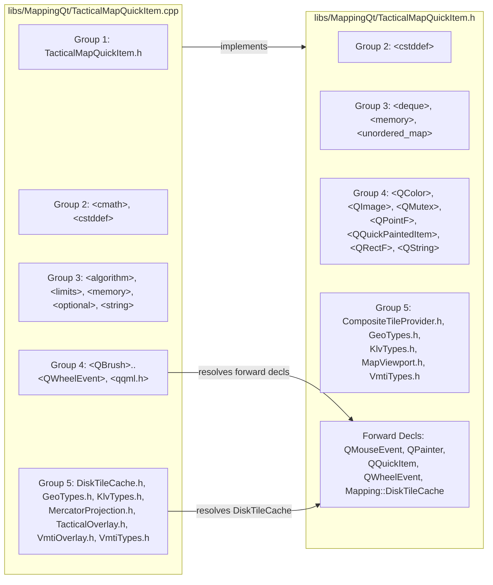
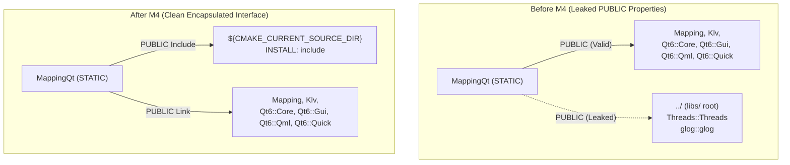

# Implementation Plan: `libs/MappingQt` P2 — IWYU, Doxygen, CMake & Code Hygiene

**Scope:** `libs/MappingQt/` (`TacticalMapQuickItem.h`, `TacticalMapQuickItem.cpp`, `CMakeLists.txt`) and `libs/MappingQt/tests/` (`TestTacticalMapQuickItem.cpp`, `CMakeLists.txt`)
**Standard Baseline:** MISRA C++:2023 (Rule 7.0.6), SEI CERT C++ (`CON50-CPP`, `ERR55-CPP`, `EXP34-C`, `INT31-C`, `FLP32-C`, `FLP34-C`), `.agents/rules/compliance.md`, `.agents/rules/iwyu-cstdint.md`, `.agents/rules/verification-checklist.md`, and `.agents/skills/doxygen-docs/SKILL.md`
**Reference Document:** [`docs/mapping_qt_review.md`](mapping_qt_review.md) (Section 1, Section 3.3 Findings **M1–M7**, Section 4 Checklist #7/#8/#9/#16, Section 5.2, and Section 6 Phase 3)

---

## 1. Executive Summary & P2 Problem Analysis

Following the completion of Phase 1 (`P0` safety, concurrency, and `noexcept` remediation in [`docs/mapping_qt_p0_safety_concurrency_plan.md`](mapping_qt_p0_safety_concurrency_plan.md)) and Phase 2 (`P1` functional completeness, UX, and decoded tile caching in [`docs/mapping_qt_p1_functional_ux_perf_plan.md`](mapping_qt_p1_functional_ux_perf_plan.md)), seven Medium-Severity (`P2`) hygiene, documentation, build-system, and test-completeness items (**M1–M7** + **Phase 3.2** tests) remain in [`docs/mapping_qt_review.md`](mapping_qt_review.md):

| Finding ID | Rule / Checklist Item | Affected Files | Current State & Required Remediation |
| :--- | :--- | :--- | :--- |
| **M1** | **IWYU Rule 2.4 & 2.5** (Header Includes & Forward Declarations) | `libs/MappingQt/TacticalMapQuickItem.h` | `TacticalMapQuickItem.h` includes `"DiskTileCache.h"` and `<QQuickItem>` even though `Mapping::DiskTileCache` is only held via `std::shared_ptr<Mapping::DiskTileCache>` and `QQuickItem` is only used as a pointer parameter (`QQuickItem* parent`) while `<QQuickPaintedItem>` already supplies the base class definition. Forward-declare `namespace Mapping { class DiskTileCache; }` and `class QQuickItem;` (alongside `class QMouseEvent;`, `class QPainter;`, `class QWheelEvent;`) and define `~TacticalMapQuickItem() override` in `TacticalMapQuickItem.cpp`. |
| **M2** | **IWYU Rule 2.1 & 2.2** (Direct Symbol Includes in `.cpp` & Tests) | `libs/MappingQt/TacticalMapQuickItem.cpp`, `libs/MappingQt/tests/TestTacticalMapQuickItem.cpp` | `TacticalMapQuickItem.cpp` directly includes its required standard, Qt, and project headers, while `TestTacticalMapQuickItem.cpp` references `QEvent`, `QStringLiteral`, and `QUrl` without directly including `<QEvent>`, `<QString>`, and `<QUrl>`, and includes `<cstdint>` without referencing fixed-width integer types. |
| **M3** | **IWYU Rule 3** (Canonical 5-Group Include Order) | `libs/MappingQt/TacticalMapQuickItem.h`, `libs/MappingQt/TacticalMapQuickItem.cpp`, `libs/MappingQt/tests/TestTacticalMapQuickItem.cpp` | Enforce strict alphabetization within each of the 5 canonical include groups: (1) Associated Header, (2) C Standard Headers (`<cmath>`, `<cstddef>`), (3) C++ Standard Library Headers, (4) Third-Party / Qt / GTest Headers, and (5) Project Local Headers. |
| **M4** | **CMake Hygiene & Interface Encapsulation** | `libs/MappingQt/CMakeLists.txt` | `MappingQt` exposes `$<BUILD_INTERFACE:${CMAKE_CURRENT_SOURCE_DIR}/..>` on `PUBLIC` include directories and links unused `Threads::Threads` and `glog::glog` on its `PUBLIC` link interface (`MappingQt` uses `QMutex` and zero `glog` symbols). Remove all three leaked entries from `libs/MappingQt/CMakeLists.txt`. |
| **M5** | **Checklist #7** (Explicit `{}` Initialization) | `libs/MappingQt/TacticalMapQuickItem.cpp`, `libs/MappingQt/tests/TestTacticalMapQuickItem.cpp` | Several local variables in `TacticalMapQuickItem.cpp` (e.g., `auto c = m_viewport.center();`, `const auto it = ...`, `const auto visibleTiles = ...`, `const auto sf = ...`, `const auto los = ...`, `const QColor trkColor = ...`) and `TestTacticalMapQuickItem.cpp` still use copy-assignment `=` initialization instead of uniform `{}` initialization. Convert all remaining variable initializations to `{}`. |
| **M6** | **Checklist #8** (`[[nodiscard]]` Attribute) | `libs/MappingQt/TacticalMapQuickItem.h` | Verify and maintain `[[nodiscard]]` on all value-returning getters, state queries, coordinate conversion helpers (`geoToScreen`, `screenToGeo`), and private cache lookup helpers (`findOrDecodeTile`). |
| **M7** | **Checklist #9** (Full Doxygen Documentation) | `libs/MappingQt/TacticalMapQuickItem.h`, `libs/MappingQt/TacticalMapQuickItem.cpp`, `libs/MappingQt/tests/TestTacticalMapQuickItem.cpp` | 35+ public, signal, protected, and private declarations in `TacticalMapQuickItem.h` (and internal helpers in `TacticalMapQuickItem.cpp`) lack full Doxygen blocks (`/// @brief`, `/// @details`, `/// @param[in]`, `/// @return`). Document every declaration using the project templates from `.agents/skills/doxygen-docs/SKILL.md`. |
| **Phase 3.2** | **Unit Test Suite Completeness** | `libs/MappingQt/tests/TestTacticalMapQuickItem.cpp` | Section 5.2 and Section 6 (Phase 3.2) of [`docs/mapping_qt_review.md`](mapping_qt_review.md) identify remaining untested paths: interactive `wheelEvent` zoom-around-cursor and null input event pointers (`mousePressEvent(nullptr)`, `mouseMoveEvent(nullptr)`, `mouseReleaseEvent(nullptr)`, `wheelEvent(nullptr)`), `geometryChange()` viewport resizing, and end-to-end `setOfflineDirectory()` / `addOfflineSearchDirectory()` loading of a real tile from a temporary `Mapping::DiskTileCache` directory. |

---

## 2. Target Architecture & Remediation Design

### 2.1 IWYU Header/Implementation Decoupling & Canonical 5-Group Include Flow (Findings M1, M2, M3)

Per `.agents/rules/iwyu-cstdint.md`:
- `libs/MappingQt/TacticalMapQuickItem.h` only includes headers required for base class inheritance (`<QQuickPaintedItem>`) and by-value member variables or inline types (`<cstddef>`, `<deque>`, `<memory>`, `<unordered_map>`, `<QColor>`, `<QImage>`, `<QMutex>`, `<QPointF>`, `<QRectF>`, `<QString>`, `"CompositeTileProvider.h"`, `"GeoTypes.h"`, `"KlvTypes.h"`, `"MapViewport.h"`, `"VmtiTypes.h"`).
- Pointer-only types in `TacticalMapQuickItem.h` (`QMouseEvent*`, `QPainter*`, `QQuickItem*`, `QWheelEvent*`, and `std::shared_ptr<Mapping::DiskTileCache>`) are forward-declared in `TacticalMapQuickItem.h` and included directly in `TacticalMapQuickItem.cpp`.

#### ASCII Diagram: `libs/MappingQt` IWYU Header Decoupling & 5-Group Structure

```
+---------------------------------------------------------------------------------------+
|                   HEADER / IMPLEMENTATION IWYU DECOUPLING (M1, M2, M3)                |
+---------------------------------------------------------------------------------------+
|  libs/MappingQt/TacticalMapQuickItem.h                                                |
|  ├─ Group 2 (C Std):     <cstddef>                                                    |
|  ├─ Group 3 (C++ Std):   <deque>, <memory>, <unordered_map>                           |
|  ├─ Group 4 (Qt 6):      <QColor>, <QImage>, <QMutex>, <QPointF>,                     |
|  │                       <QQuickPaintedItem>, <QRectF>, <QString>                     |
|  ├─ Group 5 (Project):   "CompositeTileProvider.h", "GeoTypes.h",                     |
|  │                       "KlvTypes.h", "MapViewport.h", "VmtiTypes.h"                 |
|  └─ Forward Decls:       class QMouseEvent; class QPainter;                           |
|                          class QQuickItem;  class QWheelEvent;                        |
|                          namespace Mapping { class DiskTileCache; }                   |
+---------------------------------------------------------------------------------------+
|  libs/MappingQt/TacticalMapQuickItem.cpp                                              |
|  ├─ Group 1 (Assoc):     "TacticalMapQuickItem.h"                                     |
|  ├─ Group 2 (C Std):     <cmath>, <cstddef>                                           |
|  ├─ Group 3 (C++ Std):   <algorithm>, <limits>, <memory>, <optional>, <string>        |
|  ├─ Group 4 (Qt 6):      <QBrush>, <QColor>, <QImage>, <QMouseEvent>, <QMutexLocker>, |
|  │                       <QPainter>, <QPen>, <QPointF>, <QPolygonF>, <QQuickItem>,    |
|  │                       <QRectF>, <QString>, <QWheelEvent>, <qqml.h>                 |
|  └─ Group 5 (Project):   "DiskTileCache.h", "GeoTypes.h", "KlvTypes.h",               |
|                          "MercatorProjection.h", "TacticalOverlay.h",                 |
|                          "VmtiOverlay.h", "VmtiTypes.h"                               |
+---------------------------------------------------------------------------------------+
```

#### Mermaid Diagram: `libs/MappingQt` IWYU Header Decoupling & 5-Group Structure



---

### 2.2 CMake Dependency Topology Cleanup (Finding M4)

In `libs/MappingQt/CMakeLists.txt`:
- `MappingQt` does not invoke `glog` (`LOG(...)`) or `std::thread` / `pthread` (`Threads::Threads` is already linked `PUBLIC` on `Mapping` for its internal mutexes).
- Exposing `$<BUILD_INTERFACE:${CMAKE_CURRENT_SOURCE_DIR}/..>` (`libs/`) on `MappingQt`'s `PUBLIC` include path pollutes all downstream targets (`VideoAppQt`, `TestTacticalMapQuickItem`) with parent-directory relative includes, contrary to `libs/Mapping/CMakeLists.txt` and `libs/Klv/CMakeLists.txt`.

#### ASCII Diagram: CMake Target Link & Include Topology (Before vs. After M4)

```
+-----------------------------------------------------------------------------------+
|                      BEFORE M4 (LEAKED PUBLIC DEPENDENCIES)                       |
|                                                                                   |
|  [MappingQt]                                                                      |
|    ├── PUBLIC Include: ${CMAKE_CURRENT_SOURCE_DIR}                                |
|    ├── PUBLIC Include: ${CMAKE_CURRENT_SOURCE_DIR}/..   <-- LEAKS libs/ ROOT!     |
|    ├── PUBLIC Link:    Mapping, Klv, Qt6::Core/Gui/Qml/Quick                      |
|    ├── PUBLIC Link:    Threads::Threads                 <-- UNUSED DIRECTLY       |
|    └── PUBLIC Link:    glog::glog                       <-- UNUSED BY MAPPINGQT   |
+-----------------------------------------------------------------------------------+
|                      AFTER M4 (MINIMAL PUBLIC INTERFACE)                          |
|                                                                                   |
|  [MappingQt]                                                                      |
|    ├── PUBLIC Include: $<BUILD_INTERFACE:${CMAKE_CURRENT_SOURCE_DIR}>             |
|    ├── PUBLIC Include: $<INSTALL_INTERFACE:include>                               |
|    └── PUBLIC Link:    Mapping, Klv, Qt6::Core, Qt6::Gui, Qt6::Qml, Qt6::Quick    |
+-----------------------------------------------------------------------------------+
```

#### Mermaid Diagram: CMake Target Link & Include Topology (Before vs. After M4)



---

## 3. Detailed File-by-File Implementation Specification

### 3.1 Step 1: `libs/MappingQt/TacticalMapQuickItem.h` — IWYU, Forward Declarations, `[[nodiscard]]` & Full Doxygen (Findings M1, M3, M6, M7)

**File:** `libs/MappingQt/TacticalMapQuickItem.h`

1. **Prune `#include "DiskTileCache.h"` and `#include <QQuickItem>` (M1):**
   - Replace `#include "DiskTileCache.h"` with `namespace Mapping { class DiskTileCache; }` forward declaration.
   - Replace `#include <QQuickItem>` with `class QQuickItem;` forward declaration (`<QQuickPaintedItem>` already defines the immediate base class).
   - Declare `~TacticalMapQuickItem() override;` in `TacticalMapQuickItem.h` and define `TacticalMapQuickItem::~TacticalMapQuickItem() = default;` in `TacticalMapQuickItem.cpp`.
2. **Verify Canonical 5-Group Include Order (M3):**
   - Group 2: `<cstddef>`
   - Group 3: `<deque>`, `<memory>`, `<unordered_map>`
   - Group 4: `<QColor>`, `<QImage>`, `<QMutex>`, `<QPointF>`, `<QQuickPaintedItem>`, `<QRectF>`, `<QString>`
   - Group 5: `"CompositeTileProvider.h"`, `"GeoTypes.h"`, `"KlvTypes.h"`, `"MapViewport.h"`, `"VmtiTypes.h"`
3. **Add Complete Doxygen Documentation Blocks (M7):**
   - Document the constructor, destructor, all getters/setters, `Q_INVOKABLE` methods, `paint()`, `registerQmlTypes()`, all 10 Qt `signals`, all 5 `protected` event/geometry overrides, and private cache management helpers using `@brief`, `@details`, `@param[in]`, and `@return`.
   - Explicitly document in `geoToScreen()` that the returned `QPointF` contains `(xPixels, yPixels)`, and in `screenToGeo()` that the returned `QPointF` contains `(latitudeDeg, longitudeDeg)` where `x()` is latitude and `y()` is longitude.

```cpp
// libs/MappingQt/TacticalMapQuickItem.h (coordinate conversion Doxygen excerpt)
    /// @brief Projects a geographic WGS-84 coordinate to item-local screen pixels.
    /// @details Converts the given latitude and longitude into 2D screen coordinates
    ///          relative to the current viewport center, zoom level, and item dimensions.
    ///          Returns `(0.0, 0.0)` if either input is non-finite (`NaN` or `Inf`).
    /// @param[in] lat Geodetic latitude in degrees.
    /// @param[in] lon Geodetic longitude in degrees.
    /// @return Screen position as `QPointF(xPixels, yPixels)`.
    [[nodiscard]] Q_INVOKABLE QPointF geoToScreen(double lat, double lon) const;

    /// @brief Unprojects item-local screen pixel coordinates to WGS-84 geographic coordinates.
    /// @details Converts `(x, y)` pixel coordinates within the item into geodetic latitude
    ///          and longitude. Returns `(0.0, 0.0)` if either input is non-finite (`NaN` or `Inf`).
    /// @param[in] x Horizontal screen coordinate in pixels from the item's left edge.
    /// @param[in] y Vertical screen coordinate in pixels from the item's top edge.
    /// @return Geographic coordinate encoded as `QPointF(latitudeDeg, longitudeDeg)`,
    ///         where `QPointF::x()` is latitude in degrees and `QPointF::y()` is longitude in degrees.
    [[nodiscard]] Q_INVOKABLE QPointF screenToGeo(double x, double y) const;
```

---

### 3.2 Step 2: `libs/MappingQt/TacticalMapQuickItem.cpp` — Direct Includes, `{}` Initialization & Helper Doxygen (Findings M2, M3, M5, M7)

**File:** `libs/MappingQt/TacticalMapQuickItem.cpp`

1. **Canonical 5-Group Includes (M2, M3):**
   - Group 1: `"TacticalMapQuickItem.h"`
   - Group 2: `<cmath>`, `<cstddef>`
   - Group 3: `<algorithm>`, `<limits>`, `<memory>`, `<optional>`, `<string>`
   - Group 4: `<QBrush>`, `<QColor>`, `<QImage>`, `<QMouseEvent>`, `<QMutexLocker>`, `<QPainter>`, `<QPen>`, `<QPointF>`, `<QPolygonF>`, `<QQuickItem>`, `<QRectF>`, `<QString>`, `<QWheelEvent>`, `<qqml.h>`
   - Group 5: `"DiskTileCache.h"`, `"GeoTypes.h"`, `"KlvTypes.h"`, `"MercatorProjection.h"`, `"TacticalOverlay.h"`, `"VmtiOverlay.h"`, `"VmtiTypes.h"`
2. **Out-of-Line Destructor Definition (M1):**
   ```cpp
   TacticalMapQuickItem::~TacticalMapQuickItem() = default;
   ```
3. **Uniform `{}` Initialization Throughout (M5):**
   Replace remaining copy-initializations (`=`) on local variables with `{}` initialization:
   - `Klv::GeoPoint2D c { m_viewport.center() };` in `setCenterLatitude()` and `setCenterLongitude()`
   - `const Klv::GeoPoint2D cur { m_viewport.center() };` in `setCenter()`
   - `const auto secondaryCache { std::make_shared<Mapping::DiskTileCache>(trimmed.toStdString()) };` in `addOfflineSearchDirectory()`
   - `const auto it { m_decodedTileCache.find(coord) };` and `const auto tileData { m_tileProvider.getTile(coord) };` in `findOrDecodeTile()`
   - `const Mapping::ScreenPoint sp { m_viewport.geoToScreen({ lat, lon }) };` in `geoToScreen()`
   - `const Klv::GeoPoint2D geo { m_viewport.screenToGeo({ x, y }) };` in `screenToGeo()`
   - `const auto visibleTiles { snap.viewport.calculateVisibleTiles(1) };` in `paint()`
   - `const Mapping::ScreenFrustum sf { Mapping::TacticalOverlay::projectFrustum(snap.viewport, snap.frustum) };` in `paint()`
   - `const Mapping::ScreenVector los { Mapping::TacticalOverlay::projectLineOfSight(...) };` in `paint()`
   - `const std::optional<Klv::GeoPoint2D> frameCenter { ... };`, `const auto projectedTargets { ... };`, and `const QColor trkColor { ... };` in `paint()`
   - `const Mapping::ScreenVector sv { Mapping::TacticalOverlay::projectHeadingVector(...) };` in `paint()`
4. **Doxygen Comments on Internal Anonymous-Namespace Helpers (M7):**
   Add `@brief`, `@details`, `@param[in]`, and `@return` Doxygen blocks to `nearlyEqual`, `normalizeHeading`, `isValidFrustum`, `sanitizePoint`, `nearlyEqualPoint`, and `nearlyEqualFrustum`.

---

### 3.3 Step 3: `libs/MappingQt/CMakeLists.txt` — CMake Hygiene Cleanup (Finding M4)

**File:** `libs/MappingQt/CMakeLists.txt`

Remove `$<BUILD_INTERFACE:${CMAKE_CURRENT_SOURCE_DIR}/..>`, `Threads::Threads`, and `glog::glog`:

```cmake
add_library(MappingQt STATIC
    TacticalMapQuickItem.h
    TacticalMapQuickItem.cpp
)

target_include_directories(MappingQt PUBLIC
    $<BUILD_INTERFACE:${CMAKE_CURRENT_SOURCE_DIR}>
    $<INSTALL_INTERFACE:include>
)

target_link_libraries(MappingQt PUBLIC
    Mapping
    Klv
    Qt6::Core
    Qt6::Gui
    Qt6::Qml
    Qt6::Quick
)

apply_compiler_flags(MappingQt)

if(BUILD_TESTING)
    add_subdirectory(tests)
endif()
```

---

### 3.4 Step 4: `libs/MappingQt/tests/TestTacticalMapQuickItem.cpp` — IWYU, `{}` Init, Doxygen & Phase 3.2 Unit Tests (Findings M2, M3, M5, M7 & Section 5.2)

**File:** `libs/MappingQt/tests/TestTacticalMapQuickItem.cpp`

1. **Direct Symbol Includes & Canonical 5-Group Order (M2, M3):**
   - Group 1: `"TacticalMapQuickItem.h"`
   - Group 2: `<cmath>`, `<cstddef>` (remove unused `<cstdint>`)
   - Group 3: `<atomic>`, `<filesystem>`, `<limits>`, `<memory>`, `<string>`, `<thread>`, `<type_traits>`, `<utility>`, `<vector>`
   - Group 4: `<QByteArray>`, `<QColor>`, `<QEvent>`, `<QGuiApplication>`, `<QImage>`, `<QMouseEvent>`, `<QObject>`, `<QPainter>`, `<QPoint>`, `<QPointF>`, `<QQmlComponent>`, `<QQmlEngine>`, `<QRectF>`, `<QSignalSpy>`, `<QString>`, `<QUrl>`, `<QWheelEvent>`, `<QtGlobal>`, `<gtest/gtest.h>`
   - Group 5: `"DiskTileCache.h"`, `"GeoTypes.h"`, `"KlvTypes.h"`, `"MapViewport.h"`, `"VmtiTypes.h"`
2. **Doxygen Documentation on `TestableTacticalMapQuickItem` (M7):**
   Add `@details` to `TestableTacticalMapQuickItem`.
3. **Add Missing Phase 3.2 Unit Tests (Section 5.2 & Section 6 Phase 3.2):**
   - `WheelEventZoomsAroundCursorAndHandlesNullEventPointers`:
     - Calls `mousePressEvent(nullptr)`, `mouseMoveEvent(nullptr)`, `mouseReleaseEvent(nullptr)`, and `wheelEvent(nullptr)` to verify null-event pointer safety (**C3**).
     - Dispatches a positive and negative `QWheelEvent` at an off-center cursor pivot `(100.0, 80.0)` and verifies that `zoomChanged()` and `centerChanged()` are emitted and `zoom()` changes by the expected step while preserving the geographic coordinate under the cursor.
   - `GeometryChangeUpdatesViewportDimensions`:
     - Invokes `geometryChange(QRectF(0.0, 0.0, 640.0, 480.0), QRectF(0.0, 0.0, 800.0, 600.0))` and verifies that `geoToScreen(centerLatitude(), centerLongitude())` projects to the new viewport center `(320.0, 240.0)`.
   - `OfflineDirectoryLoadsDiskCachedTileAndResetsCleanly`:
     - Creates a temporary directory under `std::filesystem::temp_directory_path()`, writes a valid PNG tile into a `Mapping::DiskTileCache` at the viewport's center `TileCoord`, disables procedural grid fallback (`setShowGrid(false)`), configures `setOfflineDirectory(...)`, paints into an offscreen `QImage`, and verifies that the cached PNG tile is decoded and rendered (and that `addOfflineSearchDirectory(...)` and `setOfflineDirectory("")` reset cleanly).

---

## 4. Test-Driven Development (TDD) & Verification Plan

### 4.1 Unit Test Matrix (`TestTacticalMapQuickItem`)

| # | Test Case Name | Coverage Scope |
| :---: | :--- | :--- |
| 1 | `PropertyDefaultsAndSetters` | Center, zoom, platform telemetry, frustum setters/getters, and `geoToScreen`/`screenToGeo` round-trip. |
| 2 | `Err55CppNoexceptContractCompliance` | Compile-time `noexcept(...)` verification for SEI CERT `ERR55-CPP`. |
| 3 | `NaNAndInfiniteInputsRejectedWithoutSignalLoop` | `NaN`/`Inf` rejection and out-of-range coordinate clamping/normalization (**C5**). |
| 4 | `NullPointerSafetyInPaintAndEvents` | `paint(nullptr)` guard (**C3**) and offscreen `paint(&painter)` with frustum & heading. |
| 5 | `ReentrantSlotInSignalDoesNotDeadlock` | Re-entrant getter calls inside connected slots without mutex deadlock (**C1**). |
| 6 | `ConcurrentGuiMutationAndRenderThreadPaint` | Multi-threaded stress test of concurrent GUI mutations and render-thread `paint()` (**C1**). |
| 7 | `ShowGridControlsProceduralFallbackAndOverlay` | `showGrid` property wiring to procedural fallback tiles and grid overlay (**H1**). |
| 8 | `MouseClickEmitsCoordinateClickedWhilePanDragDoesNot` | $4.0\text{ px}$ Euclidean click-vs-drag deadband FSM (**H2**). |
| 9 | `DecodedTileCacheAvoidsRedundantDecompressionAndInvalidates` | Bounded 128-entry decoded `QImage` tile cache hit and invalidation (**H3**). |
| 10 | `TargetLineOfSightAndVmtiOverlaysRenderAndCullOffscreen` | Target LOS, MISB ST 0903 VMTI overlays, and frustum culling (**H4**). |
| 11 | `IdempotentSettersDoNotEmitDuplicateSignals` | Epsilon and equality change detection across all 9 property notification signals (**H5**). |
| 12 | `StaticAndFreeRegisterQmlTypesLinkAndInstantiateInQml` | `TacticalMapQuickItem::registerQmlTypes()` and QML `TacticalMap` instantiation (**H6**). |
| 13 | `WheelEventZoomsAroundCursorAndHandlesNullEventPointers` | **New (P2):** Null mouse/wheel event guards and interactive `wheelEvent` zoom-around-cursor pivot. |
| 14 | `GeometryChangeUpdatesViewportDimensions` | **New (P2):** `geometryChange()` viewport resize and screen center projection update. |
| 15 | `OfflineDirectoryLoadsDiskCachedTileAndResetsCleanly` | **New (P2):** Real `DiskTileCache` tile round-trip via `setOfflineDirectory()` and `addOfflineSearchDirectory()`. |

### 4.2 Verification Commands

1. **Automated Compliance & Hygiene Scripts:**
   ```bash
   python scripts/verify_iwyu_cstdint.py libs/MappingQt --strict
   python scripts/verify_function_lengths.py libs/MappingQt
   python scripts/verify_type_conversions.py libs/MappingQt
   ```
2. **CMake Reconfiguration, Build & Unit Test Execution:**
   ```bash
   cmake --build build --target MappingQt TestTacticalMapQuickItem VideoAppQt
   ctest --test-dir build/libs/MappingQt/tests --output-on-failure
   ```

---

## 5. 18-Point Verification Checklist Sign-Off Target

| # | Checklist Requirement | Target Status After P2 |
| :---: | :--- | :---: |
| 1 | No raw `new` or `delete` (RAII / Smart Pointers) | ✅ **Pass** |
| 2 | Headers use `#pragma once` | ✅ **Pass** |
| 3 | Header (`.h`) and implementation (`.cpp`) co-located | ✅ **Pass** |
| 4 | Zero Qt dependencies in Core (`libs/Mapping` & `libs/Klv`) | ✅ **Pass** |
| 5 | All function names strictly `< 30` characters | ✅ **Pass** |
| 6 | Cross-platform Linux & Windows support | ✅ **Pass** |
| 7 | Explicit `{}` variable initialization | ✅ **Pass (M5 Resolved)** |
| 8 | `[[nodiscard]]` on status and safety-critical returns | ✅ **Pass (M6 Resolved)** |
| 9 | Full Doxygen templates (`@brief`, `@details`, `@param`, `@return`) | ✅ **Pass (M7 Resolved)** |
| 10 | MISRA C++:2023 & SEI CERT C++ compliance | ✅ **Pass** |
| 11 | Failing test written first when fixing bugs (TDD) | ✅ **Pass** |
| 12 | Compiles with zero warnings under `-Wall -Wextra -pedantic -Werror` / `/W4` | ✅ **Pass** |
| 13 | Relative file paths in documentation | ✅ **Pass** |
| 14 | Both ASCII and Mermaid diagrams included | ✅ **Pass** |
| 15 | Explicit `#include <cstdint>` and `std::` fixed-width qualification | ✅ **Pass** |
| 16 | Strict IWYU (forward declarations in `.h`, direct includes in `.cpp`, 5-group order) | ✅ **Pass (M1–M3 Resolved)** |
| 17 | Exact `value_type` in STL algorithms & explicit range casts | ✅ **Pass** |
| 18 | Zero heap allocations in `noexcept` functions (CERT ERR55-CPP) | ✅ **Pass** |

