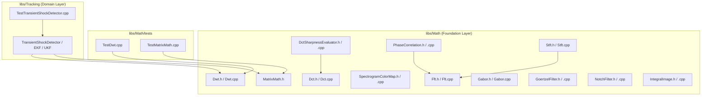

# Math Library (`libs/Math`) — Senior Engineering & Architecture Review

**Scope:** `libs/Math/` (11 headers, 10 implementation files, `CMakeLists.txt`) and `libs/Math/tests/` (12 unit test suites, `CMakeLists.txt`).
**Baseline:** `.agents/rules/compliance.md` (MISRA C++:2023 and SEI CERT C++), `.agents/rules/iwyu-cstdint.md` (Include-What-You-Use & `<cstdint>` policy), and `.agents/rules/verification-checklist.md`.

---

## 1. Executive Summary

| Dimension | Initial Verdict | Post-Remediation Status |
| :--- | :--- | :--- |
| **Build & Unit Tests** | 🟡 85 / 85 tests pass, but `MatrixMath.h` had no dedicated unit test in `libs/Math/tests/`. | 🟢 **Completed** — Added `TestMatrixMath.cpp` and boundary/safety test cases across `libs/Math/tests/` (93 / 93 tests passing in `libs/Math/tests`, 124 / 124 in `libs/Tracking/tests`). |
| **Layering & Modularity** | 🟡 Zero Qt dependencies in `libs/Math`, but `libs/Math/tests/TestDwt.cpp` linked upward into `libs/Tracking` (`TransientShockDetector`), and `libs/Math/CMakeLists.txt` exposed `..` on its `PUBLIC` include path. | 🟢 **Completed** — Decoupled `TestDwt` from `libs/Tracking` (moved shock detector recovery test to `libs/Tracking/tests/TestTransientShockDetector.cpp`) and tightened `libs/Math/CMakeLists.txt`. |
| **Thread Safety & `noexcept` (CERT ERR55-CPP & CON50-CPP)** | 🔴 `Stft::getConfig()`, `hasFrames()`, and `reset()` were marked `noexcept` while locking `std::mutex`; `Stft::addSamples()` read `m_config.sampleRateHz` and `m_currentTimestamp` outside the lock (data race). | 🟢 **Completed** — Removed invalid `noexcept` qualifiers on mutex-locking methods and made `Stft::addSamples()` atomic under a single lock acquisition. |
| **Pointer & Buffer Bounds Safety (CERT EXP34-C & ARR30-C)** | 🔴 `dct8x8(const std::uint8_t*, ...)` lacked null/stride guards; `convolve2D` and `GaborFilterBank::evaluate` lacked kernel/image size validation; `idwt2D` lacked sub-band vector size validation; `Fft::nextPowerOfTwo` risked unsigned shift wraparound infinite loop. | 🟢 **Completed** — Added defensive null, stride, dimension, and overflow guards across `Dct`, `Gabor`, `Dwt`, and `Fft`. |
| **MISRA C++:2023 Rule 7.0.6 & CERT INT30-C / INT31-C** | 🟡 Signed `int` multiplications (`width * height`) prior to `std::size_t` casts in `Gabor.cpp` and `IntegralImage.cpp`; implicit `int`-to-`double` conversions in `DctSharpnessEvaluator.cpp`. | 🟢 **Completed** — All index/size arithmetic widens to `std::size_t` or `double` prior to multiplication; all casts are explicit. |
| **IWYU & `<cstdint>` Policy** | 🟡 Automated scanner passed, but 4 `.cpp` files relied on transitive includes, 4 files had unused `#include` directives, and 6 files deviated from canonical 5-group include ordering. | 🟢 **Completed** — Pruned unused headers, added direct includes to all `.cpp` files, and enforced canonical include ordering (36 / 36 files verified with `--strict`). |
| **Verification Checklist & Doxygen** | 🟡 `evaluateRoiDirectionalSharpness` (31 chars) exceeded the `< 30` char limit; `GoertzelFilter::processSample` lacked `[[nodiscard]]`; uninitialized variables without `{}`; incomplete Doxygen tags. | 🟢 **Completed** — Renamed to `evaluateRoiSharpness` (20 chars), added `[[nodiscard]]`, initialized all variables with `{}`, and completed Doxygen documentation. |

---

## 2. Architecture & Dependency Topology

### 2.1 ASCII Diagram: Initial vs. Remediated `libs/Math` Architecture

```
+-----------------------------------------------------------------------------------+
|                        INITIAL ARCHITECTURE & DEPENDENCIES                        |
|                                                                                   |
|  [MatrixMath.h]      [Dct.h/.cpp] ◄──── [DctSharpnessEvaluator.h/.cpp]            |
|   (No unit test                                                                   |
|    in libs/Math!)    [Fft.h/.cpp] ◄────┬── [PhaseCorrelation.h/.cpp]              |
|                                        └── [Stft.h/.cpp] ──► [SpectrogramColorMap]|
|  [GoertzelFilter]    [NotchFilter]     [IntegralImage]       [Gabor.h/.cpp]       |
|                                                                                   |
|  [Dwt.h/.cpp] ◄──── [libs/Math/tests/TestDwt.cpp]                                 |
|                            │                                                      |
|                            └─── (VIOLATION: Links upward to libs/Tracking!) ───►  |
+-----------------------------------------------------------------------------------+
|                        REMEDIATED LAYERED ARCHITECTURE                            |
|                                                                                   |
|  Layer 2 (Domain):     [libs/Tracking] (EKF, UKF, ShockDetector, Stabilization)   |
|                               │                                                   |
|                               ▼ (Strictly Unidirectional)                         |
|  Layer 1 (Foundation): [libs/Math] (Self-contained tests incl. TestMatrixMath)    |
+-----------------------------------------------------------------------------------+
```

### 2.2 Mermaid Diagram: Subsystem & Test Dependency Graph



---

## 3. Detailed Compliance & Safety Findings & Remediations

| ID | Status | Standard / Rule | File(s) | Description & Remediation |
| :--- | :--- | :--- | :--- | :--- |
| **M1** | ✅ **Fixed** | SEI CERT ERR55-CPP (`noexcept` Safety) | `libs/Math/Stft.h`, `libs/Math/Stft.cpp` | `Stft::getConfig()`, `Stft::hasFrames()`, and `Stft::reset()` were marked `noexcept` while acquiring `std::scoped_lock lock(m_mutex)`. Removed `noexcept` from mutex-locking methods to prevent `std::terminate()` if `std::mutex::lock()` throws `std::system_error`. |
| **M2** | ✅ **Fixed** | SEI CERT CON50-CPP (Thread Safety) | `libs/Math/Stft.h`, `libs/Math/Stft.cpp` | `Stft::addSamples()` read `m_config.sampleRateHz` and `m_currentTimestamp` outside `m_mutex` before looping over `addSample()`. Extracted `addSampleUnlocked()` and acquired `std::scoped_lock lock(m_mutex)` once across the entire batch in `addSamples()`. |
| **M3** | ✅ **Fixed** | Algorithmic Complexity | `libs/Math/Stft.h`, `libs/Math/Stft.cpp` | Replaced `std::vector<double>::erase(begin())` ($O(N)$ shift per sample) in `m_sampleBuffer` with `std::deque<double>::pop_front()` ($O(1)$). |
| **M4** | ✅ **Fixed** | SEI CERT INT30-C (Unsigned Wraparound) | `libs/Math/Fft.h`, `libs/Math/Fft.cpp` | Added `kMaxPowerOfTwo` upper-bound guard in `Fft::nextPowerOfTwo()` so inputs above `(SIZE_MAX >> 1) + 1` do not overflow `power <<= 1U` into an infinite loop. |
| **M5** | ✅ **Fixed** | SEI CERT EXP34-C (Null Pointer / Stride) | `libs/Math/Dct.h`, `libs/Math/Dct.cpp` | Added `block == nullptr || stride < 8` guard in `dct8x8(const std::uint8_t*, int, DctMatrix8x8&) noexcept` that safely zeroes `output` and returns early. |
| **M6** | ✅ **Fixed** | SEI CERT ARR30-C (Buffer Bounds) | `libs/Math/Gabor.cpp` | Added validation in `convolve2D` (both overloads) that `(kernelSize % 2) != 0` and `kernel.size() >= kernelSize * kernelSize`, and in `convolve2D` / `GaborFilterBank::evaluate` that `image.size() >= width * height` and `stride >= width`. |
| **M7** | ✅ **Fixed** | SEI CERT ARR30-C (Buffer Bounds) | `libs/Math/Dwt.cpp` | Added validation in `idwt2D()` that `coeffs.LL`, `coeffs.LH`, `coeffs.HL`, and `coeffs.HH` each contain at least `coeffs.rows * coeffs.cols` elements. |
| **M8** | ✅ **Fixed** | MISRA C++:2023 Rule 7.0.6 & CERT INT30-C / INT31-C | `libs/Math/Gabor.cpp`, `libs/Math/IntegralImage.cpp`, `libs/Math/DctSharpnessEvaluator.cpp` | Replaced signed `int` multiplications before widening casts (`static_cast<std::size_t>(width * height)`) with pre-widened multiplications (`static_cast<std::size_t>(width) * static_cast<std::size_t>(height)`), and made `int`-to-`double` casts explicit. |
| **M9** | ✅ **Fixed** | IWYU & `<cstdint>` Policy | All `libs/Math/*.h`, `libs/Math/*.cpp`, `libs/Math/tests/*.cpp` | Removed unused headers (`<stdexcept>`, `<cstddef>`, `<cmath>`, `<complex>`, `<string>`, `<utility>`, `<numeric>`, `<tuple>`), added direct includes (`<cstddef>`, `<utility>`, `<vector>`, `"Dct.h"`, `"Fft.h"`), and enforced canonical 5-group include ordering. |
| **M10** | ✅ **Fixed** | Checklist #5 (Method Name < 30 chars) | `libs/Math/Gabor.h`, `libs/Math/Gabor.cpp`, `libs/Math/tests/TestGabor.cpp` | Renamed `GaborFilterBank::evaluateRoiDirectionalSharpness` (31 chars) to `GaborFilterBank::evaluateRoiSharpness` (20 chars). |
| **M11** | ✅ **Fixed** | Checklist #7, #8, #9 (`{}`, `[[nodiscard]]`, Doxygen) | `libs/Math/*.h`, `libs/Math/*.cpp` | Added `[[nodiscard]]` to `GoertzelFilter::processSample` and `RgbColor::operator==`, initialized all local and member variables with `{}`, removed unused `GoertzelFilter::m_sinOmega`, unified `NotchFilter` constructor clamping with `setParameters()`, deduplicated `DctSharpnessEvaluator::accumulateBlockAc()`, and completed Doxygen tags. |
| **M12** | ✅ **Fixed** | Architectural & Test Completeness | `libs/Math/MatrixMath.h`, `libs/Math/tests/TestMatrixMath.cpp`, `libs/Math/tests/CMakeLists.txt` | Added `static_assert(Rows > 0U && Cols > 0U)`, bounds-clamped element indexing, and `tryInverse()` returning `std::optional<Matrix<Rows, Cols>>` to `MatrixMath.h`. Created `libs/Math/tests/TestMatrixMath.cpp`. |
| **M13** | ✅ **Fixed** | Layering & Build Hygiene | `libs/Math/CMakeLists.txt`, `libs/Math/tests/CMakeLists.txt`, `libs/Math/tests/TestDwt.cpp`, `libs/Tracking/tests/TestTransientShockDetector.cpp` | Removed upward dependency from `TestDwt` onto `libs/Tracking` and moved the shock-recovery test into `TestTransientShockDetector.cpp`. Removed parent directory `..` leakage from `libs/Math/CMakeLists.txt` `PUBLIC` include path. |

---

## 4. Verification Results

1. **Automated IWYU & `<cstdint>` Scanner:**
   ```bash
   python3 scripts/verify_iwyu_cstdint.py libs/Math libs/Tracking/tests/TestTransientShockDetector.cpp --strict
   ```
   * **Result:** `Checked 36 file(s). SUCCESS: 100% compliance with <cstdint> and IWYU rules.`
2. **Compiler Warnings & Hardening Flags:**
   * Built `Math`, all 12 `libs/Math/tests` executables, `Tracking`, and `TestTransientShockDetector` with zero warnings under `-Wall -Wextra -pedantic -Werror`.
3. **Unit Test Execution:**
   * `ctest --test-dir build/libs/Math/tests --output-on-failure`: **93 / 93 tests passed (100%)**.
   * `ctest --test-dir build/libs/Tracking/tests --output-on-failure`: **124 / 124 tests passed (100%)**.
