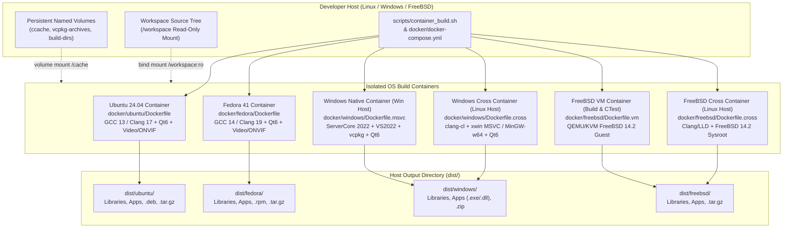
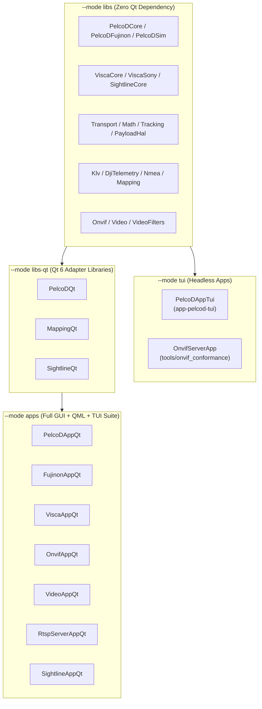
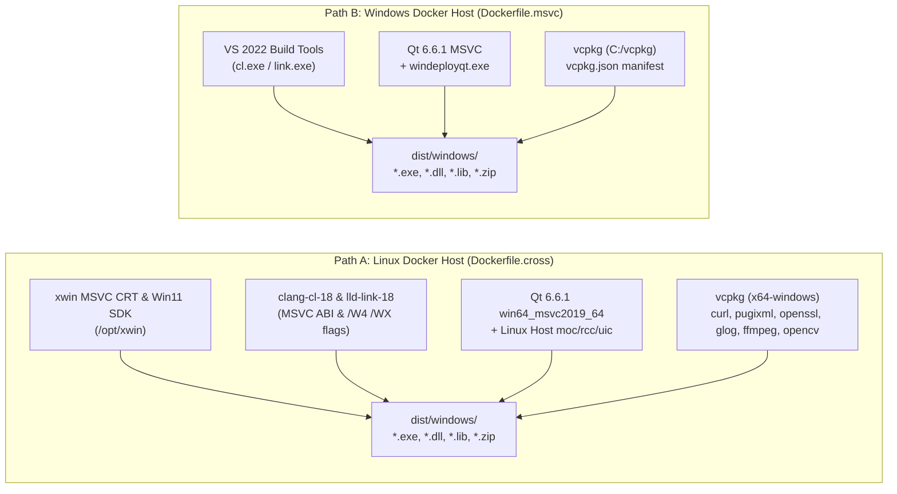
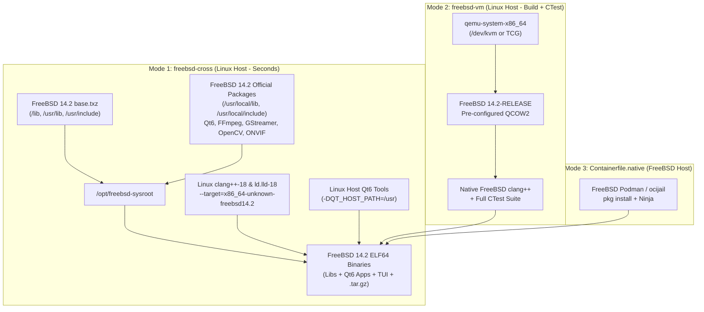

# Implementation Plan: Multi-OS Containerized Build Infrastructure (Ubuntu, Fedora, Windows, FreeBSD)

**Scope:** Multi-platform Docker/OCI build containers (`docker/ubuntu/`, `docker/fedora/`, `docker/windows/`, `docker/freebsd/`), Multi-container orchestration (`docker/docker-compose.yml`), Cross-compilation CMake toolchains (`docker/windows/toolchain-*.cmake`, `docker/freebsd/toolchain-freebsd14.cmake`), Host build automation CLI (`scripts/container_build.sh`), Inside-container build/test/package runner (`docker/common/entrypoint-build.sh`), CPack multi-format packaging (`CMakeLists.txt`), and FreeBSD POSIX/BSD portability remediation (`libs/Transport/SerialTransport.cpp`, `libs/Transport/UdpTransport.cpp`, `libs/Transport/TcpTransport.cpp`, `libs/Video/DeviceEnumerator.cpp`).  
**Standard Baseline:** MISRA C++:2023 (Rule 7.0.6), SEI CERT C++ (INT31-C, STR37-C, ERR55-CPP), Include-What-You-Use (IWYU) & `<cstdint>` Policy, POSIX.1-2017 / BSD Socket & Termios Portability, MSVC Security Development Lifecycle (`/W4 /WX /guard:cf /CETCOMPAT`), ELF Hardening (`-fstack-protector-strong`, `-fcf-protection=full`, `_FORTIFY_SOURCE=3`, Full RELRO), Project Rules in [`.agents/rules/`](../.agents/rules/).  
**Reference Documents:** [`CMakeLists.txt`](../CMakeLists.txt), [`cmake/CompilerFlags.cmake`](../cmake/CompilerFlags.cmake), [`cmake/FindOrFetchLive555.cmake`](../cmake/FindOrFetchLive555.cmake), [`vcpkg.json`](../vcpkg.json), [`scripts/build.sh`](../scripts/build.sh), [`docs/onvif_p4_phase5_ci_sanitizers_plan.md`](onvif_p4_phase5_ci_sanitizers_plan.md).

---

## 1. Executive Summary & Architectural Motivation

While GitHub Actions workflows (`.github/workflows/onvif-verification.yml`, `.github/workflows/windows-msvc.yml`, `.github/workflows/fuzzing.yml`) provide cloud-hosted continuous integration on push and pull requests, developers and release engineers require **local, deterministic, hermetic build containers** to compile all **PelcoD-Controller** libraries, GUI/TUI applications, unit tests, and redistributable packages across four target operating systems without relying on GitHub-hosted runners or polluting the host workstation:

1. **Ubuntu (`ubuntu:24.04` LTS)** — Debian-family Linux target with GCC 13 & Clang 17, full Qt 6 Widgets/Quick/QML stack, ONVIF, FFmpeg, GStreamer, OpenCV, OpenH264, and Live555, producing `.deb` and `.tar.gz` artifacts.
2. **Fedora (`fedora:41`)** — Red Hat / RPM-family Linux target with cutting-edge GCC 14 & Clang 19 compilers, Qt 6.7+, multimedia backends, and `rpm-build`, producing `.rpm` and `.tar.gz` artifacts.
3. **Windows (`x86_64`)** — Dual-mode containerization supporting both:
   - **Linux-Hosted Windows Cross-Compilation (`docker/windows/Dockerfile.cross`)**: Allows a Linux workstation to compile native 64-bit Windows `.exe` and `.dll` binaries using either **Clang-CL (`clang-cl` + `lld-link`) with the official Microsoft Visual C++ CRT & Windows SDK (`xwin`)** or **LLVM-MinGW (`x86_64-w64-mingw32`)**, complete with `vcpkg` and Qt 6.
   - **Native Windows Server Core Container (`docker/windows/Dockerfile.msvc`)**: Runs on Windows Docker hosts (`mcr.microsoft.com/windows/servercore:ltsc2022`) with Visual Studio 2022 Build Tools, `vcpkg`, Qt 6.6.1, and `windeployqt`.
4. **FreeBSD (`FreeBSD 14.2-RELEASE amd64`)** — Multi-mode containerization addressing the kernel boundary between Linux and FreeBSD:
   - **Linux-Hosted Clang/LLD FreeBSD Sysroot Cross-Container (`docker/freebsd/Dockerfile.cross`)**: Exploits Clang and LLD's built-in multi-target architecture (`--target=x86_64-unknown-freebsd14.2 --sysroot=/opt/freebsd-sysroot`) populated with official FreeBSD 14.2 `base.txz` and `pkg` binary packages (`qt6-base`, `qt6-declarative`, `ffmpeg`, `gstreamer1`, `opencv`, `openh264`, `liveMedia`, `curl`, `pugixml`, `glog`, `gflags`, `googletest`) plus host-side Qt `moc`/`rcc`/`uic` tools (`QT_HOST_PATH`) for near-instant native-speed builds on a Linux Docker host.
   - **Linux-Hosted QEMU/KVM FreeBSD VM Container (`docker/freebsd/Dockerfile.vm`)**: Boots an official FreeBSD 14.2 QCOW2 guest inside Docker (using `/dev/kvm` hardware virtualization when available) to compile and execute the full **CTest unit test suite** on a genuine FreeBSD kernel.
   - **Native FreeBSD Containerfile (`docker/freebsd/Containerfile.native`)**: Runs directly on a FreeBSD host via FreeBSD `podman` / `ocijail`.

```
+-----------------------------------------------------------------------------------------------------------------------+
|                                 MULTI-OS CONTAINERIZATION CAPABILITY MATRIX                                           |
+----------------+----------------------------------+----------------------------------+--------------------------------+
| Target OS      | Container Image / Mode           | Compiler & SDK Stack             | Produced Artifacts (`dist/`)   |
+----------------+----------------------------------+----------------------------------+--------------------------------+
| Ubuntu 24.04   | docker/ubuntu/Dockerfile         | GCC 13 / Clang 17, Ninja, Qt 6.4 | lib*.a/.so, 9 apps,            |
| (Linux x86_64) | (Native Linux OCI Container)     | FFmpeg, GStreamer, OpenCV, ONVIF | PelcoDController-*.deb, *.tgz  |
+----------------+----------------------------------+----------------------------------+--------------------------------+
| Fedora 41      | docker/fedora/Dockerfile         | GCC 14 / Clang 19, Ninja, Qt 6.7 | lib*.a/.so, 9 apps,            |
| (Linux x86_64) | (Native Linux OCI Container)     | FFmpeg, GStreamer, OpenCV, ONVIF | PelcoDController-*.rpm, *.tgz  |
+----------------+----------------------------------+----------------------------------+--------------------------------+
| Windows x64    | 1) docker/windows/Dockerfile.cross| 1) clang-cl 18 + lld-link + xwin | *.lib/*.dll, 9 *.exe apps,     |
|                |    (Runs on Linux Docker Host)   |    MSVC SDK OR LLVM-MinGW + Qt6  | deployed Qt6 DLLs/plugins,     |
|                | 2) docker/windows/Dockerfile.msvc| 2) MSVC 2022 + vcpkg + Qt 6.6.1  | PelcoDController-win64.zip     |
|                |    (Runs on Windows Docker Host) |    on Windows Server Core 2022   |                                |
+----------------+----------------------------------+----------------------------------+--------------------------------+
| FreeBSD 14.2   | 1) docker/freebsd/Dockerfile.cross| 1) Clang 18 + LLD (--target=     | FreeBSD ELF64 lib*.a/.so,      |
| (amd64)        |    (Linux Host Sysroot Cross)    |    x86_64-unknown-freebsd14.2)   | 9 FreeBSD ELF64 apps,          |
|                | 2) docker/freebsd/Dockerfile.vm  | 2) Native FreeBSD Clang 18 in    | PelcoDController-freebsd.tgz   |
|                |    (Linux Host QEMU/KVM + CTest) |    QEMU/KVM + CTest execution    |                                |
|                | 3) Containerfile.native          | 3) Native FreeBSD Podman / Jail  |                                |
+----------------+----------------------------------+----------------------------------+--------------------------------+
```

---

## 2. System Architecture & Container Execution Flow

### 2.1 High-Level Container Orchestration

#### ASCII Diagram: Host-to-Container Build & Artifact Pipeline

```
+---------------------------------------------------------------------------------------------------+
|                           DEVELOPER WORKSTATION / ORCHESTRATOR                                    |
|                     ./scripts/container_build.sh  |  docker compose                               |
+---------------+-------------------------+-------------------------+-------------------------------+
                |                         |                         |
                v                         v                         v
+-----------------------+   +-----------------------+   +-------------------------------------------+
|   LINUX CONTAINERS    |   |  WINDOWS CONTAINERS   |   |           FREEBSD CONTAINERS              |
|  (Native OCI Kernel)  |   |                       |   |                                           |
|                       |   |  Mode A (Linux Host): |   |  Mode A (Linux Host - Fast Cross Build):  |
| 1. Ubuntu 24.04       |   |  windows-cross        |   |  freebsd-cross                            |
|    - GCC 13 / Clang 17|   |  - clang-cl + lld-link|   |  - clang++ --target=x86_64-freebsd14.2    |
|    - Qt 6.4+ (apt)    |   |    + xwin MSVC CRT/SDK|   |  - FreeBSD 14.2 base.txz + pkg sysroot    |
|    - FFmpeg/GStreamer |   |    OR LLVM-MinGW      |   |  - Linux QT_HOST_PATH (moc / rcc / uic)   |
|    - OpenCV/OpenH264  |   |  - vcpkg + Qt6 win64  |   |                                           |
|    - Output: .deb/.tgz|   |                       |   |  Mode B (Linux Host - Full Build + Test): |
|                       |   |  Mode B (Win Host):   |   |  freebsd-vm (QEMU/KVM inside Docker)      |
| 2. Fedora 41          |   |  windows-msvc         |   |  - FreeBSD 14.2-RELEASE QCOW2 image       |
|    - GCC 14 / Clang 19|   |  - ServerCore 2022    |   |  - Native clang++ 18, pkg, CTest          |
|    - Qt 6.7+ (dnf)    |   |  - VS 2022 BuildTools |   |                                           |
|    - FFmpeg/GStreamer |   |  - vcpkg + aqtinstall |   |  Mode C (FreeBSD Host):                   |
|    - Output: .rpm/.tgz|   |  - Output: .zip/.exe  |   |  Containerfile.native (Podman/Bastille)   |
+-----------+-----------+   +-----------+-----------+   +---------------------+---------------------+
            |                           |                                     |
            +---------------------------+-------------------------------------+
                                        |
                                        v
+---------------------------------------------------------------------------------------------------+
|                        VOLUME-MOUNTED ARTIFACT & BUILD OUTPUTS                                    |
|  dist/ubuntu/        dist/fedora/        dist/windows/        dist/freebsd/                       |
|  - bin/ & lib/       - bin/ & lib/       - bin/*.exe & *.dll  - bin/ & lib/                       |
|  - include/          - include/          - include/           - include/                          |
|  - *.deb, *.tar.gz   - *.rpm, *.tar.gz   - *.zip bundle       - *.tar.gz                          |
+---------------------------------------------------------------------------------------------------+
```

#### Mermaid Diagram: Host-to-Container Build & Artifact Pipeline



---

### 2.2 Library & Application Build Graph Inside Each Container

Every container supports four selectable **Build Modes** (`BUILD_MODE=libs|libs-qt|tui|apps`) controlled via environment variables or CLI flags, allowing developers to build only the core C++17 libraries, headless TUI/server tools, or the complete Qt 6 GUI application suite:

#### ASCII Diagram: Selectable Build Modes & Target Tiers

```
+---------------------------------------------------------------------------------------------------+
|                             CONTAINER BUILD TARGET HIERARCHY                                      |
+---------------------------------------------------------------------------------------------------+
|                                                                                                   |
|  [ Tier 1: Core & Protocol C++17 Libraries (Zero Qt Dependency) ]  <--- (--mode libs)             |
|    • Math          • Transport      • PelcoDCore     • PelcoDFujinon  • PelcoDSim                 |
|    • ViscaCore     • ViscaSony      • Klv            • DjiTelemetry   • Nmea                      |
|    • Tracking      • Mapping        • SightlineCore  • PayloadHal     • Onvif                     |
|    • Video         • VideoFilters                                                                 |
|                                            │                                                      |
|                     ┌──────────────────────┴──────────────────────┐                               |
|                     ▼                                             ▼                               |
|  [ Tier 2A: Headless Executables ]             [ Tier 2B: Qt 6 Adapter Libraries ]                |
|    (--mode tui)                                  (--mode libs-qt)                                 |
|    • PelcoDAppTui (app-pelcod-tui)               • PelcoDQt      (libs/PelcoDQt)                  |
|    • OnvifServerApp (tools/onvif_conformance)    • MappingQt     (libs/MappingQt)                 |
|                                                  • SightlineQt   (libs/SightlineQt)               |
|                                                                   │                               |
|                                                                   ▼                               |
|                                                [ Tier 3: Qt 6 GUI & QML Applications ]            |
|                                                  (--mode apps [DEFAULT])                          |
|                                                  • PelcoDAppQt     (app-pelcod-qt)                |
|                                                  • FujinonAppQt    (app-fujinon-qt)               |
|                                                  • ViscaAppQt      (app-visca-qt)                 |
|                                                  • OnvifAppQt      (app-onvif-qt)                 |
|                                                  • VideoAppQt      (app-video-qt)                 |
|                                                  • RtspServerAppQt (app-rtsp-server-qt)           |
|                                                  • SightlineAppQt  (app-sightline-qt)             |
+---------------------------------------------------------------------------------------------------+
```

#### Mermaid Diagram: Selectable Build Modes & Target Tiers



---

## 3. Phase 1: Codebase Portability Prerequisites (FreeBSD & Cross-Compilation)

Before building the FreeBSD container, four existing source files require surgical updates because they currently assume `#ifndef _WIN32` implies Linux (`__linux__`) and directly `#include <linux/...>` kernel headers that do not exist on FreeBSD.

### 3.1 Summary of Source Portability Findings

| File | Current Linux Assumption | FreeBSD / Non-Linux Remediation |
| :--- | :--- | :--- |
| [`libs/Transport/SerialTransport.cpp`](../libs/Transport/SerialTransport.cpp) | Unconditionally includes `<linux/serial.h>` under `#ifndef _WIN32`; uses `struct serial_icounter_struct` and `TIOCGICOUNT`; only scans `/dev/ttyUSB*` on `__linux__`. | Guard `<linux/serial.h>` and `TIOCGICOUNT` with `#ifdef __linux__`. Keep `FIONREAD` and `TIOCMGET` for all POSIX/BSD systems. Add `#elif defined(__FreeBSD__)` device scan for `cuaU*`, `cuau*`, `ttyU*`, `ttyu*`. |
| [`libs/Transport/UdpTransport.cpp`](../libs/Transport/UdpTransport.cpp) | Unconditionally includes `<linux/sockios.h>` under `#ifndef _WIN32` for `SIOCINQ`. | Guard `<linux/sockios.h>` with `#ifdef __linux__`; include `<sys/filio.h>` under `#ifdef __FreeBSD__`. Use `SIOCINQ` if defined, else fall back to `FIONREAD`. |
| [`libs/Transport/TcpTransport.cpp`](../libs/Transport/TcpTransport.cpp) | Unconditionally includes `<linux/sockios.h>` under `#ifndef _WIN32`; accesses Linux-specific `struct tcp_info` fields (`tcpi_total_retrans`, `tcpi_unacked`, `tcpi_lost`, `tcpi_reordering`, `tcpi_ca_state`). | Guard `<linux/sockios.h>` with `#ifdef __linux__` and include `<sys/filio.h>` on `#ifdef __FreeBSD__`. Map FreeBSD `tcp_info` fields (`tcpi_snd_rexmitpack`, `__tcpi_unacked`, `__tcpi_lost`, `__tcpi_reordering`, `__tcpi_ca_state`) under `#elif defined(__FreeBSD__)`. |
| [`libs/Video/DeviceEnumerator.cpp`](../libs/Video/DeviceEnumerator.cpp) | Unconditionally includes `<linux/videodev2.h>` under `#ifndef _WIN32`. | Guard `<linux/videodev2.h>` and V4L2 `ioctl` probing with `#if defined(__linux__) || __has_include(<linux/videodev2.h>)` so FreeBSD works both with `v4l_compat` installed and without it. |
| [`CMakeLists.txt`](../CMakeLists.txt) | Hardcodes `set(CPACK_GENERATOR "TGZ;DEB")`. | Dynamically select `CPACK_GENERATOR` by OS/distro (`DEB;TGZ` on Ubuntu/Debian, `RPM;TGZ` on Fedora/RHEL, `ZIP` on Windows, `TGZ` on FreeBSD) unless overridden via `-DCPACK_GENERATOR=...`. |

### 3.2 Exact Code Changes for Phase 1

#### 3.2.1 [`libs/Transport/SerialTransport.cpp`](../libs/Transport/SerialTransport.cpp)

```cpp
// In header includes (lines 6-18):
#ifndef _WIN32
#include <cerrno>
#include <cstdint>
#include <cstring>
#include <fcntl.h>
#ifdef __linux__
#include <linux/serial.h>
#endif
#include <poll.h>
#include <sys/ioctl.h>
#include <sys/stat.h>
#include <sys/types.h>
#include <termios.h>
#include <unistd.h>
#endif
```

```cpp
// In SerialTransport::enumeratePorts() (after #elif defined(__APPLE__) block):
#elif defined(__FreeBSD__)
    // Scan /dev for standard FreeBSD UART and USB serial device nodes
    try {
        if (std::filesystem::exists("/dev")) {
            for (const auto& entry : std::filesystem::directory_iterator("/dev")) {
                const std::string filename = entry.path().filename().string();
                if (filename.rfind("cuaU", 0) == 0 || filename.rfind("cuau", 0) == 0
                    || filename.rfind("ttyU", 0) == 0 || filename.rfind("ttyu", 0) == 0) {
                    if (filename.find(".init") == std::string::npos
                        && filename.find(".lock") == std::string::npos) {
                        const std::string fullPath = entry.path().string();
                        if (std::find(ports.begin(), ports.end(), fullPath) == ports.end()) {
                            ports.push_back(fullPath);
                        }
                    }
                }
            }
        }
    } catch (const std::filesystem::filesystem_error& ex) {
        LOG(WARNING) << "SerialTransport: failed to iterate /dev: " << ex.what();
    } catch (const std::exception& ex) {
        LOG(WARNING) << "SerialTransport: unexpected error during /dev scan: " << ex.what();
    } catch (...) {
        LOG(WARNING) << "SerialTransport: unknown exception during /dev scan";
    }
```

```cpp
// In SerialTransport::queryKernelStats() (lines 639-663):
#else
#ifdef __linux__
    struct serial_icounter_struct icount { };
    if (::ioctl(handle, TIOCGICOUNT, &icount) == 0) {
        stats.supported = true;
        stats.rxBytesDriver = static_cast<std::uint64_t>(std::max(0, icount.rx));
        stats.txBytesDriver = static_cast<std::uint64_t>(std::max(0, icount.tx));
        stats.framingErrors = static_cast<std::uint64_t>(std::max(0, icount.frame));
        stats.fifoOverruns = static_cast<std::uint64_t>(std::max(0, icount.overrun) + std::max(0, icount.buf_overrun));
        stats.parityErrors = static_cast<std::uint64_t>(std::max(0, icount.parity));
        stats.breakCount = static_cast<std::uint64_t>(std::max(0, icount.brk));
    }
#endif

    int inQueue = 0;
    if (::ioctl(handle, FIONREAD, &inQueue) == 0 && inQueue >= 0) {
        stats.queuedRxBytes = static_cast<std::uint32_t>(std::max(0, inQueue));
        stats.supported = true;
    }

    int modemStatus = 0;
    if (::ioctl(handle, TIOCMGET, &modemStatus) == 0) {
        stats.ctsHold = ((modemStatus & TIOCM_CTS) == 0);
        stats.dsrHold = ((modemStatus & TIOCM_DSR) == 0);
        stats.supported = true;
    }
#endif
```

#### 3.2.2 [`libs/Transport/UdpTransport.cpp`](../libs/Transport/UdpTransport.cpp)

```cpp
// In header includes (lines 11-16):
#ifndef _WIN32
#ifdef __linux__
#include <linux/sockios.h>
#elif defined(__FreeBSD__)
#include <sys/filio.h>
#endif
#include <string>
#include <sys/ioctl.h>
#include <vector>
#endif
```

```cpp
// In UdpTransport::queryKernelStats() (lines 320-327):
    int pending = 0;
#if defined(SIOCINQ)
    if (::ioctl(sock, SIOCINQ, &pending) == 0 && pending >= 0) {
        stats.queuedRxBytes = static_cast<std::uint32_t>(pending);
        stats.supported = true;
    }
#elif defined(FIONREAD)
    if (::ioctl(sock, FIONREAD, &pending) == 0 && pending >= 0) {
        stats.queuedRxBytes = static_cast<std::uint32_t>(pending);
        stats.supported = true;
    }
#endif
```

#### 3.2.3 [`libs/Transport/TcpTransport.cpp`](../libs/Transport/TcpTransport.cpp)

```cpp
// In header includes (lines 11-18):
#ifdef _WIN32
#include <mstcpip.h>
#else
#ifdef __linux__
#include <linux/sockios.h>
#elif defined(__FreeBSD__)
#include <sys/filio.h>
#endif
#include <string>
#include <sys/ioctl.h>
#include <vector>
#endif
```

```cpp
// In TcpTransport::queryKernelStats() (lines 324-354):
#else
    struct tcp_info info { };
    socklen_t len = sizeof(info);
    if (::getsockopt(sock, IPPROTO_TCP, TCP_INFO, &info, &len) == 0) {
        stats.supported = true;
        stats.rttUs = info.tcpi_rtt;
        stats.rttVarUs = info.tcpi_rttvar;
        stats.sndCwnd = info.tcpi_snd_cwnd;
#if defined(__linux__)
        stats.totalRetrans = info.tcpi_total_retrans;
        stats.unackedSegments = info.tcpi_unacked;
        stats.lostSegments = info.tcpi_lost;
        stats.reorderMetric = info.tcpi_reordering;
        stats.caState = info.tcpi_ca_state;
#elif defined(__FreeBSD__)
        stats.totalRetrans = info.tcpi_snd_rexmitpack;
        stats.unackedSegments = info.__tcpi_unacked;
        stats.lostSegments = info.__tcpi_lost;
        stats.reorderMetric = info.__tcpi_reordering;
        stats.caState = info.__tcpi_ca_state;
#endif
    }

    int unsent = 0;
#ifdef SIOCOUTQ
    if (::ioctl(sock, SIOCOUTQ, &unsent) == 0 && unsent >= 0) {
        stats.queuedTxBytes = static_cast<std::uint32_t>(unsent);
        stats.supported = true;
    }
#endif

    int unread = 0;
#if defined(SIOCINQ)
    if (::ioctl(sock, SIOCINQ, &unread) == 0 && unread >= 0) {
        stats.queuedRxBytes = static_cast<std::uint32_t>(unread);
        stats.supported = true;
    }
#elif defined(FIONREAD)
    if (::ioctl(sock, FIONREAD, &unread) == 0 && unread >= 0) {
        stats.queuedRxBytes = static_cast<std::uint32_t>(unread);
        stats.supported = true;
    }
#endif
#endif
```

#### 3.2.4 [`libs/Video/DeviceEnumerator.cpp`](../libs/Video/DeviceEnumerator.cpp)

```cpp
// Guard V4L2 header and enumeration with __has_include(<linux/videodev2.h>):
#if !defined(_WIN32) && (defined(__linux__) || __has_include(<linux/videodev2.h>))
#define PELCOD_HAS_V4L2 1
#include <dirent.h>
#include <fcntl.h>
#include <linux/videodev2.h>
#include <sys/ioctl.h>
#include <unistd.h>
#endif
```

---

## 4. Phase 2: Repository Layout & Shared Container Scripts

### 4.1 Directory Hierarchy

```text
docker/
├── README.md                          # Complete documentation & container usage reference
├── docker-compose.yml                 # Service definitions for ubuntu, fedora, windows, freebsd
├── common/
│   ├── entrypoint-build.sh            # Unified inside-container build, test, install & CPack runner
│   └── fetch-live555.sh               # Pre-fetches and verifies Live555 tarball into /opt/cache/live555
├── ubuntu/
│   └── Dockerfile                     # Ubuntu 24.04 LTS container definition
├── fedora/
│   └── Dockerfile                     # Fedora 41 container definition
├── windows/
│   ├── Dockerfile.cross               # Linux-hosted Windows x64 cross-compilation container
│   ├── Dockerfile.msvc                # Native Windows Server Core LTSC 2022 MSVC container
│   ├── toolchain-clang-cl-xwin.cmake  # CMake toolchain for Clang-CL + lld-link + xwin MSVC SDK
│   └── toolchain-mingw64.cmake        # CMake toolchain for LLVM-MinGW x86_64-w64-mingw32
└── freebsd/
    ├── Dockerfile.cross               # Linux-hosted FreeBSD 14.2 Clang/LLD sysroot cross-container
    ├── Dockerfile.vm                  # Linux-hosted QEMU/KVM FreeBSD 14.2 VM build & CTest container
    ├── Containerfile.native           # Native FreeBSD 14.2 container for Podman / Bastille on FreeBSD
    ├── bootstrap-freebsd-sysroot.sh   # Populates /opt/freebsd-sysroot from FreeBSD 14.2 base.txz + pkg
    └── toolchain-freebsd14.cmake      # CMake toolchain for x86_64-unknown-freebsd14.2
scripts/
└── container_build.sh                 # Host CLI orchestrator script
```

### 4.2 Unified Container Entrypoint (`docker/common/entrypoint-build.sh`)

The entrypoint script runs inside all POSIX-hosted containers (`ubuntu`, `fedora`, `windows-cross`, `freebsd-cross`) and accepts environment variables passed by `scripts/container_build.sh` or `docker compose`:

- `TARGET_OS`: `ubuntu` | `fedora` | `windows` | `freebsd`
- `BUILD_MODE`: `libs` | `libs-qt` | `tui` | `apps` (default: `apps`)
- `BUILD_CONFIG`: `Release` | `Debug` | `RelWithDebInfo` | `MinSizeRel` (default: `Release`)
- `COMPILER_FAMILY`: `gcc` | `clang` | `clang-cl` | `mingw`
- `CMAKE_TARGET`: optional specific target (e.g., `PelcoDCore`, `Onvif`, `SightlineAppQt`, or `all`)
- `RUN_TESTS`: `true` | `false` (executes `ctest` under `xvfb-run -a` for headless Qt GUI/QML tests)
- `RUN_PACKAGE`: `true` | `false` (executes `cmake --install` and `cpack` into `/workspace/dist/${TARGET_OS}`)
- `ENABLE_HARDENING`: `ON` | `OFF` (default: `ON`)
- `WARNINGS_AS_ERRORS`: `ON` | `OFF` (default: `ON`)

```bash
#!/usr/bin/env bash
# docker/common/entrypoint-build.sh
set -euo pipefail

TARGET_OS="${TARGET_OS:-ubuntu}"
BUILD_MODE="${BUILD_MODE:-apps}"
BUILD_CONFIG="${BUILD_CONFIG:-Release}"
COMPILER_FAMILY="${COMPILER_FAMILY:-default}"
CMAKE_TARGET="${CMAKE_TARGET:-}"
RUN_TESTS="${RUN_TESTS:-false}"
RUN_PACKAGE="${RUN_PACKAGE:-true}"
CLEAN_BUILD="${CLEAN_BUILD:-false}"
WARNINGS_AS_ERRORS="${WARNINGS_AS_ERRORS:-ON}"
ENABLE_HARDENING="${ENABLE_HARDENING:-ON}"
PARALLEL_JOBS="${PARALLEL_JOBS:-$(nproc 2>/dev/null || sysctl -n hw.ncpu 2>/dev/null || echo 4)}"

WORKSPACE_DIR="${WORKSPACE_DIR:-/workspace}"
BUILD_ROOT="${BUILD_ROOT:-/build/${TARGET_OS}-${BUILD_MODE}-${BUILD_CONFIG}}"
INSTALL_PREFIX="${INSTALL_PREFIX:-${WORKSPACE_DIR}/dist/${TARGET_OS}}"

export CCACHE_DIR="${CCACHE_DIR:-/cache/ccache}"
export QT_QPA_PLATFORM="offscreen"

if [ "${CLEAN_BUILD}" = "true" ] && [ -d "${BUILD_ROOT}" ]; then
    rm -rf "${BUILD_ROOT}"
fi
mkdir -p "${BUILD_ROOT}" "${INSTALL_PREFIX}" "${CCACHE_DIR}"

# Seed Live555 tarball into build directory so offline container runs never need network access
if [ -f "/opt/cache/live555/live555-latest.tar.gz" ]; then
    mkdir -p "${BUILD_ROOT}/_deps/live555"
    cp -f "/opt/cache/live555/live555-latest.tar.gz" "${BUILD_ROOT}/_deps/live555/live555-latest.tar.gz"
fi

# Map BUILD_MODE to CMake feature flags
case "${BUILD_MODE}" in
    libs)
        ENABLE_QT="OFF"
        BUILD_APPS="OFF"
        ;;
    libs-qt)
        ENABLE_QT="ON"
        BUILD_APPS="OFF"
        ;;
    tui)
        ENABLE_QT="OFF"
        BUILD_APPS="ON"
        ;;
    apps|all)
        ENABLE_QT="ON"
        BUILD_APPS="ON"
        ;;
    *)
        echo "[ERROR] Unsupported BUILD_MODE='${BUILD_MODE}' (expected: libs, libs-qt, tui, apps)" >&2
        exit 1
        ;;
esac

CMAKE_ARGS=(
    -S "${WORKSPACE_DIR}"
    -B "${BUILD_ROOT}"
    -G Ninja
    -DCMAKE_BUILD_TYPE="${BUILD_CONFIG}"
    -DCMAKE_INSTALL_PREFIX="${INSTALL_PREFIX}"
    -DCMAKE_CXX_COMPILER_LAUNCHER=ccache
    -DCMAKE_C_COMPILER_LAUNCHER=ccache
    -DPELCOD_ENABLE_QT="${ENABLE_QT}"
    -DPELCOD_BUILD_APPS="${BUILD_APPS}"
    -DPELCOD_ENABLE_ONVIF=ON
    -DPELCOD_ENABLE_VIDEO=ON
    -DPELCOD_ENABLE_DJI=ON
    -DBUILD_TESTING=ON
    -DWARNINGS_AS_ERRORS="${WARNINGS_AS_ERRORS}"
    -DENABLE_HARDENING="${ENABLE_HARDENING}"
)

# Apply OS/compiler specific toolchain settings
if [ -n "${CMAKE_TOOLCHAIN_FILE:-}" ]; then
    CMAKE_ARGS+=(-DCMAKE_TOOLCHAIN_FILE="${CMAKE_TOOLCHAIN_FILE}")
fi
if [ -n "${QT_HOST_PATH:-}" ]; then
    CMAKE_ARGS+=(-DQT_HOST_PATH="${QT_HOST_PATH}")
fi

cmake "${CMAKE_ARGS[@]}"

if [ -n "${CMAKE_TARGET}" ]; then
    cmake --build "${BUILD_ROOT}" --target "${CMAKE_TARGET}" --parallel "${PARALLEL_JOBS}"
else
    cmake --build "${BUILD_ROOT}" --parallel "${PARALLEL_JOBS}"
fi

if [ "${RUN_TESTS}" = "true" ]; then
    if command -v xvfb-run >/dev/null 2>&1; then
        xvfb-run -a ctest --test-dir "${BUILD_ROOT}" --output-on-failure --parallel "${PARALLEL_JOBS}"
    else
        ctest --test-dir "${BUILD_ROOT}" --output-on-failure --parallel "${PARALLEL_JOBS}"
    fi
fi

if [ "${RUN_PACKAGE}" = "true" ] && [ -z "${CMAKE_TARGET}" ]; then
    cmake --install "${BUILD_ROOT}"
    (
        cd "${BUILD_ROOT}"
        cpack -B "${INSTALL_PREFIX}/packages"
    )
fi
```

---

## 5. Phase 3: Linux Build Containers (Ubuntu 24.04 & Fedora 41)

### 5.1 Ubuntu 24.04 Container (`docker/ubuntu/Dockerfile`)

```dockerfile
# syntax=docker/dockerfile:1
FROM ubuntu:24.04

LABEL org.opencontainers.image.title="PelcoD-Controller Ubuntu 24.04 Builder"
LABEL org.opencontainers.image.description="Hermetic build container for PelcoD-Controller libraries and apps on Ubuntu 24.04 LTS"

ENV DEBIAN_FRONTEND=noninteractive
ENV TARGET_OS=ubuntu

RUN apt-get update && apt-get install -y --no-install-recommends \
    build-essential \
    gcc-13 \
    g++-13 \
    clang-17 \
    lld-17 \
    llvm-17 \
    cmake \
    ninja-build \
    ccache \
    pkg-config \
    git \
    curl \
    ca-certificates \
    python3 \
    dpkg-dev \
    file \
    xvfb \
    xauth \
    # Core, Logging & Unit Test Dependencies
    libgflags-dev \
    libgoogle-glog-dev \
    libgtest-dev \
    libgmock-dev \
    # ONVIF Dependencies
    libcurl4-openssl-dev \
    libssl-dev \
    libpugixml-dev \
    # Video & Filter Dependencies (FFmpeg, GStreamer, OpenCV, OpenH264, V4L2)
    libavcodec-dev \
    libavformat-dev \
    libavutil-dev \
    libswscale-dev \
    libgstreamer1.0-dev \
    libgstreamer-plugins-base1.0-dev \
    libopencv-dev \
    libopenh264-dev \
    libv4l-dev \
    # Qt 6 Widgets, Quick, QML & Test Dependencies
    qt6-base-dev \
    qt6-base-dev-tools \
    qt6-declarative-dev \
    qt6-declarative-dev-tools \
    qml6-module-qtquick \
    qml6-module-qtquick-controls \
    qml6-module-qtquick-layouts \
    qml6-module-qtquick-templates \
    qml6-module-qtquick-window \
    libgl1-mesa-dev \
    libxkbcommon-dev \
    && rm -rf /var/lib/apt/lists/*

# Pre-cache Live555 tarball for offline repeatability
COPY common/fetch-live555.sh /usr/local/bin/fetch-live555.sh
RUN chmod +x /usr/local/bin/fetch-live555.sh && /usr/local/bin/fetch-live555.sh

COPY common/entrypoint-build.sh /usr/local/bin/entrypoint-build.sh
RUN chmod +x /usr/local/bin/entrypoint-build.sh

WORKDIR /workspace
ENTRYPOINT ["/usr/local/bin/entrypoint-build.sh"]
```

### 5.2 Fedora 41 Container (`docker/fedora/Dockerfile`)

```dockerfile
# syntax=docker/dockerfile:1
FROM fedora:41

LABEL org.opencontainers.image.title="PelcoD-Controller Fedora 41 Builder"
LABEL org.opencontainers.image.description="Hermetic build container for PelcoD-Controller libraries and apps on Fedora 41"

ENV TARGET_OS=fedora

RUN dnf install -y \
    gcc \
    gcc-c++ \
    clang \
    lld \
    llvm \
    cmake \
    ninja-build \
    ccache \
    pkgconf-pkg-config \
    git \
    curl \
    ca-certificates \
    python3 \
    rpm-build \
    file \
    xorg-x11-server-Xvfb \
    xorg-x11-xauth \
    # Core, Logging & Unit Test Dependencies
    gflags-devel \
    glog-devel \
    gtest-devel \
    gmock-devel \
    # ONVIF Dependencies
    libcurl-devel \
    openssl-devel \
    pugixml-devel \
    # Video & Filter Dependencies
    ffmpeg-free-devel \
    gstreamer1-devel \
    gstreamer1-plugins-base-devel \
    opencv-devel \
    openh264-devel \
    libv4l-devel \
    # Qt 6 Widgets, Quick, QML & Test Dependencies
    qt6-qtbase-devel \
    qt6-qtdeclarative-devel \
    mesa-libGL-devel \
    libxkbcommon-devel \
    && dnf clean all

COPY common/fetch-live555.sh /usr/local/bin/fetch-live555.sh
RUN chmod +x /usr/local/bin/fetch-live555.sh && /usr/local/bin/fetch-live555.sh

COPY common/entrypoint-build.sh /usr/local/bin/entrypoint-build.sh
RUN chmod +x /usr/local/bin/entrypoint-build.sh

WORKDIR /workspace
ENTRYPOINT ["/usr/local/bin/entrypoint-build.sh"]
```

---

## 6. Phase 4: Windows Build Containers (Cross-Compile on Linux & Native Windows Server Core)

### 6.1 Dual-Path Windows Container Architecture

#### ASCII Diagram: Windows Container Build Paths

```
+---------------------------------------------------------------------------------------------------+
|                                   WINDOWS BUILD CONTAINER MODES                                   |
+---------------------------------------------------------------------------------------------------+
|                                                                                                   |
|  PATH A: Linux Docker Host (`docker/windows/Dockerfile.cross`)                                    |
|  ┌─────────────────────────────────────────────────────────────────────────────────────────────┐  |
|  │ Base: ubuntu:24.04                                                                          │  |
|  │  • Toolchain 1 (MSVC ABI): clang-cl-18 + lld-link-18 + llvm-rc-18                           │  |
|  │    - Uses `xwin` to download official MSVC CRT + Windows 11 SDK into /opt/xwin              │  |
|  │    - Preserves `/W4 /WX /we4365 /guard:cf` flags from `cmake/CompilerFlags.cmake`           │  |
|  │    - Links against `x64-windows` vcpkg packages and `win64_msvc2019_64` Qt 6.6.1            │  |
|  │  • Toolchain 2 (MinGW ABI): LLVM-MinGW (`x86_64-w64-mingw32-clang++`)                       │  |
|  │    - Links against `x64-mingw-dynamic` vcpkg packages + Wine64 for optional test execution  │  |
|  └─────────────────────────────────────────────────────────────────────────────────────────────┘  |
|                                                                                                   |
|  PATH B: Native Windows Docker Host (`docker/windows/Dockerfile.msvc`)                            |
|  ┌─────────────────────────────────────────────────────────────────────────────────────────────┐  |
|  │ Base: mcr.microsoft.com/windows/servercore:ltsc2022                                         │  |
|  │  • Visual Studio 2022 Build Tools (VCTools, cl.exe, link.exe, Ninja, CMake)                 │  |
|  │  • vcpkg (`C:\vcpkg`) with pre-built `vcpkg.json` manifest dependencies                     │  |
|  │  • Qt 6.6.1 (`C:\Qt\6.6.1\msvc2019_64`) + `windeployqt.exe` bundle generation               │  |
|  └─────────────────────────────────────────────────────────────────────────────────────────────┘  |
+---------------------------------------------------------------------------------------------------+
```

#### Mermaid Diagram: Windows Container Build Paths



### 6.2 `docker/windows/toolchain-clang-cl-xwin.cmake`

```cmake
set(CMAKE_SYSTEM_NAME Windows)
set(CMAKE_SYSTEM_PROCESSOR AMD64)

set(XWIN_DIR "/opt/xwin/splat")

set(CMAKE_C_COMPILER clang-cl-18)
set(CMAKE_CXX_COMPILER clang-cl-18)
set(CMAKE_LINKER lld-link-18)
set(CMAKE_RC_COMPILER llvm-rc-18)
set(CMAKE_MT llvm-mt-18)

set(XWIN_COMPILE_FLAGS
    "/imsvc${XWIN_DIR}/crt/include /imsvc${XWIN_DIR}/sdk/include/ucrt /imsvc${XWIN_DIR}/sdk/include/um /imsvc${XWIN_DIR}/sdk/include/shared -Wno-unused-command-line-argument"
)
set(XWIN_LINK_FLAGS
    "/libpath:${XWIN_DIR}/crt/lib/x86_64 /libpath:${XWIN_DIR}/sdk/lib/um/x86_64 /libpath:${XWIN_DIR}/sdk/lib/ucrt/x86_64"
)

set(CMAKE_C_FLAGS_INIT "${XWIN_COMPILE_FLAGS}")
set(CMAKE_CXX_FLAGS_INIT "${XWIN_COMPILE_FLAGS}")
set(CMAKE_EXE_LINKER_FLAGS_INIT "${XWIN_LINK_FLAGS}")
set(CMAKE_SHARED_LINKER_FLAGS_INIT "${XWIN_LINK_FLAGS}")
set(CMAKE_MODULE_LINKER_FLAGS_INIT "${XWIN_LINK_FLAGS}")

# Use Linux host Qt tools (moc, rcc, uic) while linking Windows target Qt6 libraries
set(QT_HOST_PATH "/usr" CACHE PATH "Host Qt6 installation for moc/rcc/uic")
set(CMAKE_FIND_ROOT_PATH "/opt/qt6-win/6.6.1/msvc2019_64" "/opt/vcpkg/installed/x64-windows")
set(CMAKE_FIND_ROOT_PATH_MODE_PROGRAM NEVER)
set(CMAKE_FIND_ROOT_PATH_MODE_LIBRARY ONLY)
set(CMAKE_FIND_ROOT_PATH_MODE_INCLUDE ONLY)
```

---

## 7. Phase 5: FreeBSD Build Containers (`FreeBSD 14.2-RELEASE`)

### 7.1 Multi-Mode FreeBSD Container Strategy

Because Docker on a Linux host shares the Linux kernel, running a FreeBSD container image directly via `runc` would invoke Linux system calls with FreeBSD's `libc`, which fails unless cross-compiled or virtualized. Our architecture provides **three complementary FreeBSD container profiles**:

#### ASCII Diagram: FreeBSD Container Execution Modes

```
+---------------------------------------------------------------------------------------------------+
|                                   FREEBSD 14.2 CONTAINER MODES                                    |
+---------------------------------------------------------------------------------------------------+
|                                                                                                   |
|  MODE 1: `freebsd-cross` (`docker/freebsd/Dockerfile.cross`) — Fast Build on Linux Host           |
|  ┌─────────────────────────────────────────────────────────────────────────────────────────────┐  |
|  │ • Runs in standard Linux Docker with zero VM boot overhead.                                 │  |
|  │ • `bootstrap-freebsd-sysroot.sh` downloads FreeBSD 14.2 `base.txz` + official FreeBSD `pkg` │  |
|  │   packages (`qt6-base`, `qt6-declarative`, `curl`, `openssl`, `pugixml`, `glog`, `gflags`,  │  |
|  │   `googletest`, `ffmpeg`, `gstreamer1`, `opencv`, `openh264`, `liveMedia`) into             │  |
|  │   `/opt/freebsd-sysroot`.                                                                   │  |
|  │ • Compiles with `clang++-18 --target=x86_64-unknown-freebsd14.2 --sysroot=/opt/freebsd-sysroot`│
|  │   and links with `ld.lld-18`.                                                               │  |
|  │ • Uses Linux host `moc`/`rcc`/`uic` via `-DQT_HOST_PATH=/usr` to build all Qt6 GUI apps!    │  |
|  └─────────────────────────────────────────────────────────────────────────────────────────────┘  |
|                                                                                                   |
|  MODE 2: `freebsd-vm` (`docker/freebsd/Dockerfile.vm`) — Native Build + CTest on Linux Host       |
|  ┌─────────────────────────────────────────────────────────────────────────────────────────────┐  |
|  │ • Boots official `FreeBSD-14.2-RELEASE-amd64.qcow2` inside Docker via `qemu-system-x86_64`  │  |
|  │   (uses `/dev/kvm` hardware acceleration when available, or TCG software emulation).        │  |
|  │ • Syncs `/workspace` into the FreeBSD VM over SSH/rsync, runs native FreeBSD `cmake`,       │  |
|  │   `ninja`, `ctest`, and `cpack`, and copies `dist/freebsd/` back to the host.               │  |
|  └─────────────────────────────────────────────────────────────────────────────────────────────┘  |
|                                                                                                   |
|  MODE 3: `Containerfile.native` (`docker/freebsd/Containerfile.native`) — Native FreeBSD Host     |
|  ┌─────────────────────────────────────────────────────────────────────────────────────────────┐  |
|  │ • For FreeBSD hosts running `podman` + `ocijail`.                                           │  |
|  │ • Installs dependencies via `pkg install -y` and runs `entrypoint-build.sh` natively.       │  |
|  └─────────────────────────────────────────────────────────────────────────────────────────────┘  |
+---------------------------------------------------------------------------------------------------+
```

#### Mermaid Diagram: FreeBSD Container Execution Modes



### 7.2 `docker/freebsd/toolchain-freebsd14.cmake`

```cmake
set(CMAKE_SYSTEM_NAME FreeBSD)
set(CMAKE_SYSTEM_VERSION 14.2)
set(CMAKE_SYSTEM_PROCESSOR x86_64)

set(FREEBSD_SYSROOT "/opt/freebsd-sysroot")
set(CMAKE_SYSROOT "${FREEBSD_SYSROOT}")

set(FREEBSD_TARGET_TRIPLE "x86_64-unknown-freebsd14.2")

set(CMAKE_C_COMPILER clang-18)
set(CMAKE_CXX_COMPILER clang++-18)
set(CMAKE_C_COMPILER_TARGET "${FREEBSD_TARGET_TRIPLE}")
set(CMAKE_CXX_COMPILER_TARGET "${FREEBSD_TARGET_TRIPLE}")

set(FREEBSD_COMMON_FLAGS "-isystem ${FREEBSD_SYSROOT}/usr/local/include")
set(FREEBSD_LINKER_FLAGS "-fuse-ld=lld-18 -L${FREEBSD_SYSROOT}/usr/local/lib -Wl,-rpath-link,${FREEBSD_SYSROOT}/lib:${FREEBSD_SYSROOT}/usr/lib:${FREEBSD_SYSROOT}/usr/local/lib:${FREEBSD_SYSROOT}/usr/local/lib/qt6")

set(CMAKE_C_FLAGS_INIT "${FREEBSD_COMMON_FLAGS}")
set(CMAKE_CXX_FLAGS_INIT "${FREEBSD_COMMON_FLAGS}")
set(CMAKE_EXE_LINKER_FLAGS_INIT "${FREEBSD_LINKER_FLAGS}")
set(CMAKE_SHARED_LINKER_FLAGS_INIT "${FREEBSD_LINKER_FLAGS}")

# Configure pkg-config to resolve solely inside the FreeBSD sysroot
set(ENV{PKG_CONFIG_DIR} "")
set(ENV{PKG_CONFIG_LIBDIR} "${FREEBSD_SYSROOT}/usr/local/libdata/pkgconfig:${FREEBSD_SYSROOT}/usr/libdata/pkgconfig")
set(ENV{PKG_CONFIG_SYSROOT_DIR} "${FREEBSD_SYSROOT}")

# Use Linux host moc/rcc/uic while linking FreeBSD Qt6 target libraries
set(QT_HOST_PATH "/usr" CACHE PATH "Linux host Qt6 tools for FreeBSD cross-compilation")

set(CMAKE_FIND_ROOT_PATH "${FREEBSD_SYSROOT}" "${FREEBSD_SYSROOT}/usr/local")
set(CMAKE_FIND_ROOT_PATH_MODE_PROGRAM NEVER)
set(CMAKE_FIND_ROOT_PATH_MODE_LIBRARY ONLY)
set(CMAKE_FIND_ROOT_PATH_MODE_INCLUDE ONLY)
set(CMAKE_FIND_ROOT_PATH_MODE_PACKAGE ONLY)
```

---

## 8. Phase 6: Orchestration (`docker-compose.yml` & `scripts/container_build.sh`)

### 8.1 `docker/docker-compose.yml`

Provides named services and persistent cache volumes (`pelcod-ccache`, `pelcod-build`) so incremental rebuilds across all four OSes take only seconds:

```yaml
services:
  ubuntu:
    build:
      context: .
      dockerfile: ubuntu/Dockerfile
    image: pelcod-builder:ubuntu-24.04
    environment:
      - TARGET_OS=ubuntu
      - BUILD_MODE=${BUILD_MODE:-apps}
      - BUILD_CONFIG=${BUILD_CONFIG:-Release}
      - RUN_TESTS=${RUN_TESTS:-false}
      - RUN_PACKAGE=${RUN_PACKAGE:-true}
      - CMAKE_TARGET=${CMAKE_TARGET:-}
    volumes:
      - ..:/workspace
      - pelcod-ccache:/cache/ccache
      - pelcod-build-ubuntu:/build

  fedora:
    build:
      context: .
      dockerfile: fedora/Dockerfile
    image: pelcod-builder:fedora-41
    environment:
      - TARGET_OS=fedora
      - BUILD_MODE=${BUILD_MODE:-apps}
      - BUILD_CONFIG=${BUILD_CONFIG:-Release}
      - RUN_TESTS=${RUN_TESTS:-false}
      - RUN_PACKAGE=${RUN_PACKAGE:-true}
      - CMAKE_TARGET=${CMAKE_TARGET:-}
    volumes:
      - ..:/workspace
      - pelcod-ccache:/cache/ccache
      - pelcod-build-fedora:/build

  windows:
    build:
      context: .
      dockerfile: windows/Dockerfile.cross
    image: pelcod-builder:windows-cross
    environment:
      - TARGET_OS=windows
      - BUILD_MODE=${BUILD_MODE:-apps}
      - BUILD_CONFIG=${BUILD_CONFIG:-Release}
      - RUN_TESTS=${RUN_TESTS:-false}
      - RUN_PACKAGE=${RUN_PACKAGE:-true}
      - CMAKE_TARGET=${CMAKE_TARGET:-}
    volumes:
      - ..:/workspace
      - pelcod-ccache:/cache/ccache
      - pelcod-build-windows:/build

  freebsd:
    build:
      context: .
      dockerfile: freebsd/Dockerfile.cross
    image: pelcod-builder:freebsd-14.2-cross
    environment:
      - TARGET_OS=freebsd
      - BUILD_MODE=${BUILD_MODE:-apps}
      - BUILD_CONFIG=${BUILD_CONFIG:-Release}
      - RUN_TESTS=false
      - RUN_PACKAGE=${RUN_PACKAGE:-true}
      - CMAKE_TARGET=${CMAKE_TARGET:-}
      - CMAKE_TOOLCHAIN_FILE=/opt/freebsd-toolchain/toolchain-freebsd14.cmake
      - QT_HOST_PATH=/usr
    volumes:
      - ..:/workspace
      - pelcod-ccache:/cache/ccache
      - pelcod-build-freebsd:/build

  freebsd-vm:
    build:
      context: .
      dockerfile: freebsd/Dockerfile.vm
    image: pelcod-builder:freebsd-14.2-vm
    devices:
      - /dev/kvm:/dev/kvm
    environment:
      - TARGET_OS=freebsd
      - BUILD_MODE=${BUILD_MODE:-apps}
      - BUILD_CONFIG=${BUILD_CONFIG:-Release}
      - RUN_TESTS=${RUN_TESTS:-true}
      - RUN_PACKAGE=${RUN_PACKAGE:-true}
    volumes:
      - ..:/workspace

volumes:
  pelcod-ccache:
  pelcod-build-ubuntu:
  pelcod-build-fedora:
  pelcod-build-windows:
  pelcod-build-freebsd:
```

### 8.2 Host CLI Wrapper (`scripts/container_build.sh`)

`scripts/container_build.sh` provides a single ergonomic CLI interface on the host machine:

```text
Usage:
    ./scripts/container_build.sh [OPTIONS]

Options:
    --os <list>           Target OS list (comma-separated) or "all":
                          ubuntu, fedora, windows, freebsd, freebsd-vm (default: all)
    --mode <mode>         Build scope:
                          "libs"    - Core C++17 libraries only (no Qt, no apps)
                          "libs-qt" - Core + Qt 6 adapter libraries (no apps)
                          "tui"     - Core libraries + PelcoDAppTui + OnvifServerApp
                          "apps"    - All libraries + all Qt 6 GUI/QML & TUI apps (default)
    --config <cfg>        Release (default), Debug, RelWithDebInfo, MinSizeRel
    --target <name>       Build only a specific CMake target (e.g. PelcoDCore, SightlineAppQt)
    --run-tests           Execute CTest suite inside the container after building
    --no-package          Skip cmake --install and CPack archive generation
    --clean               Wipe the container build directory before configuring
    --rebuild-image       Force rebuilding the Docker image(s) before running
    -j, --jobs <N>        Number of parallel build jobs inside the container
```

---

## 9. Verification & Compliance Checklist

Before completing implementation, every modified C++ file and container script will be verified against the project's safety and quality gates:

1. **MISRA C++:2023 & SEI CERT C++ Compliance**:
   - Explicit `std::` fixed-width integers (`std::uint8_t`, `std::uint32_t`, `std::uint64_t`) and `#include <cstdint>` in all modified files.
   - Zero implicit signed/unsigned conversions (`python3 scripts/verify_type_conversions.py`).
   - Function and identifier lengths strictly `< 30` characters (`python3 scripts/verify_function_lengths.py`).
   - Include-What-You-Use audit (`python3 scripts/verify_iwyu_cstdint.py --strict`).
2. **Documentation & Diagram Completeness**:
   - All file paths in documentation are strictly relative.
   - Both ASCII and Mermaid diagrams are provided for every architectural view.
3. **End-to-End Container Build Verification**:
   - Build and test `ubuntu` and `fedora` containers producing `.deb`, `.rpm`, and `.tar.gz` packages.
   - Build `windows` cross-container producing `.exe`, `.dll`, and `.zip` packages.
   - Build `freebsd` cross-container producing FreeBSD 14.2 ELF64 libraries, executables, and `.tar.gz` packages, verified via `file` / `readelf -h`.

