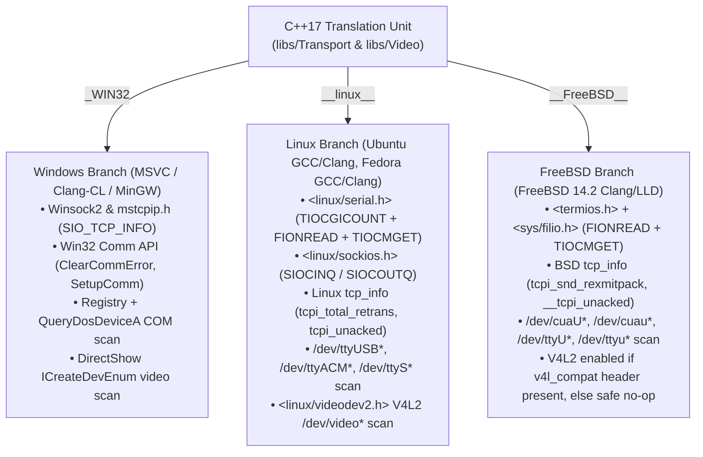
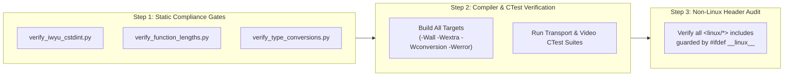

# Implementation Plan: Phase 1 – Codebase Portability Prerequisites (FreeBSD, Fedora, Ubuntu & Cross-Compilation)

**Scope:** POSIX/BSD/Linux source-level portability in `libs/Transport` ([`libs/Transport/SerialTransport.cpp`](../libs/Transport/SerialTransport.cpp), [`libs/Transport/UdpTransport.cpp`](../libs/Transport/UdpTransport.cpp), [`libs/Transport/TcpTransport.cpp`](../libs/Transport/TcpTransport.cpp), [`libs/Transport/SightlineUdpTransport.cpp`](../libs/Transport/SightlineUdpTransport.cpp)) and `libs/Video` ([`libs/Video/DeviceEnumerator.cpp`](../libs/Video/DeviceEnumerator.cpp)), plus CMake build-system and packaging portability in [`CMakeLists.txt`](../CMakeLists.txt), [`cmake/CompilerFlags.cmake`](../cmake/CompilerFlags.cmake), [`cmake/FindOrFetchLive555.cmake`](../cmake/FindOrFetchLive555.cmake), and [`cmake/GitHooks.cmake`](../cmake/GitHooks.cmake).  
**Standard Baseline:** MISRA C++:2023 (Rule 7.0.6), SEI CERT C++ (INT31-C, STR37-C, ERR55-CPP), Include-What-You-Use (IWYU) & `<cstdint>` Policy, POSIX.1-2017 & FreeBSD 14.2 System Call / Socket / Termios ABI, Project Rules in [`.agents/rules/`](../.agents/rules/).  
**Reference Documents:** [`docs/multi_os_container_build_plan.md`](multi_os_container_build_plan.md) (§3 Phase 1), [`CMakeLists.txt`](../CMakeLists.txt), [`cmake/CompilerFlags.cmake`](../cmake/CompilerFlags.cmake), [`cmake/FindOrFetchLive555.cmake`](../cmake/FindOrFetchLive555.cmake).

---

## 1. Executive Summary & Problem Statement

In [`docs/multi_os_container_build_plan.md`](multi_os_container_build_plan.md), **Phase 1** resolves all source-code and CMake build-script assumptions that currently prevent **PelcoD-Controller** from compiling cleanly across all four target container operating systems (**Ubuntu 24.04**, **Fedora 41**, **Windows x64**, and **FreeBSD 14.2**) and across isolated/read-only container mounts.

A full audit of the codebase (`libs/`, `app-*/`, `tools/`, `tests/`, `cmake/`, and `CMakeLists.txt`) identified **9 specific portability gaps**:

```
+-----------------------------------------------------------------------------------------------------------------------+
|                              PHASE 1 PORTABILITY AUDIT & REMEDIATION MATRIX                                           |
+---+--------------------------------------+---------------------------------------+------------------------------------+
| # | Component / File                     | Defect / Platform Assumption          | Phase 1 Remediation                |
+---+--------------------------------------+---------------------------------------+------------------------------------+
| 1 | libs/Transport/SerialTransport.cpp   | Unconditionally includes              | Guard <linux/serial.h> and         |
|   |                                      | <linux/serial.h> and uses TIOCGICOUNT | TIOCGICOUNT with #ifdef __linux__; |
|   |                                      | under #ifndef _WIN32; lacks FreeBSD   | add #elif defined(__FreeBSD__)     |
|   |                                      | /dev/cuaU* serial port enumeration.   | /dev/cuaU* & /dev/ttyU* scan.      |
+---+--------------------------------------+---------------------------------------+------------------------------------+
| 2 | libs/Transport/UdpTransport.cpp      | Unconditionally includes              | Guard <linux/sockios.h> with       |
|   |                                      | <linux/sockios.h> under #ifndef _WIN32| #ifdef __linux__; include          |
|   |                                      | and only checks SIOCINQ.              | <sys/filio.h> on FreeBSD; fallback |
|   |                                      |                                       | to FIONREAD when SIOCINQ absent.   |
+---+--------------------------------------+---------------------------------------+------------------------------------+
| 3 | libs/Transport/TcpTransport.cpp      | Unconditionally includes              | Guard <linux/sockios.h> with       |
|   |                                      | <linux/sockios.h>; accesses Linux-    | #ifdef __linux__; include          |
|   |                                      | only struct tcp_info fields           | <sys/filio.h> on FreeBSD; map BSD  |
|   |                                      | (tcpi_total_retrans, tcpi_unacked).   | __tcpi_* fields on __FreeBSD__.    |
+---+--------------------------------------+---------------------------------------+------------------------------------+
| 4 | libs/Transport/                      | Uses #ifdef SIOCINQ without including | Include <linux/sockios.h> on Linux |
|   | SightlineUdpTransport.cpp            | <linux/sockios.h> on Linux or         | and <sys/filio.h> on FreeBSD; add  |
|   |                                      | falling back to FIONREAD on FreeBSD.  | #elif defined(FIONREAD) fallback.  |
+---+--------------------------------------+---------------------------------------+------------------------------------+
| 5 | libs/Video/DeviceEnumerator.cpp      | Unconditionally includes              | Guard V4L2 header and ioctl scan   |
|   |                                      | <linux/videodev2.h> under             | with defined(__linux__) ||         |
|   |                                      | #ifndef _WIN32.                       | __has_include(<linux/videodev2.h>).|
+---+--------------------------------------+---------------------------------------+------------------------------------+
| 6 | cmake/CompilerFlags.cmake            | Applies _FORTIFY_SOURCE=3 on Clang 17+| Use _FORTIFY_SOURCE=2 when         |
|   |                                      | unconditionally; FreeBSD libc         | CMAKE_SYSTEM_NAME STREQUAL FreeBSD |
|   |                                      | supports up to _FORTIFY_SOURCE=2.     | and _FORTIFY_SOURCE=3 on Linux.    |
+---+--------------------------------------+---------------------------------------+------------------------------------+
| 7 | cmake/FindOrFetchLive555.cmake       | In-tree Live555 build lacks FreeBSD   | Add BSD=1, NEWLOCALE_NOT_USED=1,   |
|   |                                      | compile definitions (BSD=1,           | HAVE_SOCKADDR_LEN=1 on FreeBSD;    |
|   |                                      | HAVE_SOCKADDR_LEN=1); lacks container | add /opt/cache/live555 tarball     |
|   |                                      | cache path /opt/cache/live555.        | search path.                       |
+---+--------------------------------------+---------------------------------------+------------------------------------+
| 8 | cmake/GitHooks.cmake                 | Unconditionally copies pre-commit     | Add PELCOD_INSTALL_GIT_HOOKS       |
|   |                                      | into .git/hooks during configure,     | option and skip silently when      |
|   |                                      | failing on read-only container mounts.| .git/hooks is read-only.           |
+---+--------------------------------------+---------------------------------------+------------------------------------+
| 9 | CMakeLists.txt                       | Hardcodes CPACK_GENERATOR "TGZ;DEB",  | Dynamically select CPACK_GENERATOR |
|   |                                      | breaking out-of-the-box cpack on      | per target OS/distro (DEB, RPM,    |
|   |                                      | Fedora (RPM), Windows (ZIP), FreeBSD. | ZIP, TGZ) with cache override.     |
+---+--------------------------------------+---------------------------------------+------------------------------------+
```

---

## 2. Architectural Flow of Platform Abstraction

### 2.1 ASCII Diagram: Cross-Platform Transport & Video Compilation Branches

```
+---------------------------------------------------------------------------------------------------+
|                        TRANSPORT & VIDEO PLATFORM COMPILATION DISPATCH                            |
+---------------------------------------------------------------------------------------------------+
|                                                                                                   |
|                           [ C++17 Source Translation Unit ]                                       |
|                                           │                                                       |
|             ┌─────────────────────────────┼─────────────────────────────┐                         |
|             ▼                             ▼                             ▼                         |
|    #if defined(_WIN32)          #elif defined(__linux__)      #elif defined(__FreeBSD__)          |
|  ┌───────────────────────┐    ┌───────────────────────────┐  ┌─────────────────────────────────┐  |
|  │ • Winsock2 / mstcpip  │    │ • <linux/serial.h>        │  │ • <sys/filio.h> (FIONREAD)      │  |
|  │   (SIO_TCP_INFO,      │    │   (TIOCGICOUNT, icount)   │  │ • <termios.h> + TIOCMGET        │  |
|  │    ioctlsocket)       │    │ • <linux/sockios.h>       │  │ • BSD struct tcp_info           │  |
|  │ • Win32 Comm API      │    │   (SIOCINQ, SIOCOUTQ)     │  │   (tcpi_snd_rexmitpack,         │  |
|  │   (ClearCommError)    │    │ • Linux struct tcp_info   │  │    __tcpi_unacked, __tcpi_lost) │  |
|  │ • DirectShow Video    │    │   (tcpi_total_retrans)    │  │ • /dev/cuaU*, /dev/ttyU* scan   │  |
|  │   (ICreateDevEnum)    │    │ • <linux/videodev2.h>     │  │ • Optional V4L2 via             │  |
|  │                       │    │   (/dev/video* V4L2 scan) │  │   __has_include(<linux/...>)    │  |
|  └───────────────────────┘    └───────────────────────────┘  └─────────────────────────────────┘  |
+---------------------------------------------------------------------------------------------------+
```

### 2.2 Mermaid Diagram: Cross-Platform Transport & Video Compilation Branches



---

## 3. Detailed File-by-File Implementation Specifications

### 3.1 `libs/Transport/SerialTransport.cpp`

#### 3.1.1 Rationale
1. Line 11 currently includes `<linux/serial.h>` inside `#ifndef _WIN32`. On FreeBSD, `<linux/serial.h>` does not exist.
2. Line 640 in `SerialTransport::queryKernelStats()` uses `struct serial_icounter_struct` and `TIOCGICOUNT`, which are Linux-specific kernel driver extensions. However, lines 651–662 (`FIONREAD` and `TIOCMGET` with `TIOCM_CTS` / `TIOCM_DSR`) are standard across Linux and BSD (`<sys/ioctl.h>` / `<sys/filio.h>`).
3. `SerialTransport::enumeratePorts()` (lines 481–580) handles `_WIN32`, `__linux__`, and `__APPLE__`, returning an empty list on `__FreeBSD__`. On FreeBSD, USB and hardware UART serial ports are exposed in `/dev` as `cuaU*` / `ttyU*` (USB serial drivers like `uftdi`, `umodem`, `uplcom`) and `cuau*` / `ttyu*` (onboard 16550 UARTs), along with `.init` and `.lock` control nodes that should be filtered out.

#### 3.1.2 Exact Diff (`libs/Transport/SerialTransport.cpp`)

```diff
--- a/libs/Transport/SerialTransport.cpp
+++ b/libs/Transport/SerialTransport.cpp
@@ -8,7 +8,11 @@
 #include <cstdint>
 #include <cstring>
 #include <fcntl.h>
+#ifdef __linux__
 #include <linux/serial.h>
+#elif defined(__FreeBSD__)
+#include <sys/filio.h>
+#endif
 #include <poll.h>
 #include <sys/ioctl.h>
 #include <sys/stat.h>
@@ -577,6 +581,31 @@ std::vector<std::string> SerialTransport::enumeratePorts()
     } catch (...) {
         LOG(WARNING) << "SerialTransport: unknown exception during /dev scan";
     }
+
+#elif defined(__FreeBSD__)
+    // Scan /dev for standard FreeBSD USB and UART serial device nodes
+    try {
+        if (std::filesystem::exists("/dev")) {
+            for (const auto& entry : std::filesystem::directory_iterator("/dev")) {
+                const std::string filename = entry.path().filename().string();
+                if (filename.rfind("cuaU", 0) == 0 || filename.rfind("cuau", 0) == 0
+                    || filename.rfind("ttyU", 0) == 0 || filename.rfind("ttyu", 0) == 0) {
+                    if (filename.find(".init") == std::string::npos
+                        && filename.find(".lock") == std::string::npos) {
+                        const std::string fullPath = entry.path().string();
+                        if (std::find(ports.begin(), ports.end(), fullPath) == ports.end()) {
+                            ports.push_back(fullPath);
+                        }
+                    }
+                }
+            }
+        }
+    } catch (const std::filesystem::filesystem_error& ex) {
+        LOG(WARNING) << "SerialTransport: failed to iterate /dev: " << ex.what();
+    } catch (const std::exception& ex) {
+        LOG(WARNING) << "SerialTransport: unexpected error during /dev scan: " << ex.what();
+    } catch (...) {
+        LOG(WARNING) << "SerialTransport: unknown exception during /dev scan";
+    }
 #endif
 
     std::sort(ports.begin(), ports.end(), naturalLess);
@@ -637,6 +666,7 @@ SerialKernelStats SerialTransport::queryKernelStats() const noexcept
         stats.breakCount = m_winBreakErrors.load();
     }
 #else
+#ifdef __linux__
     struct serial_icounter_struct icount { };
     if (::ioctl(handle, TIOCGICOUNT, &icount) == 0) {
         stats.supported = true;
@@ -647,6 +677,7 @@ SerialKernelStats SerialTransport::queryKernelStats() const noexcept
         stats.parityErrors = static_cast<std::uint64_t>(std::max(0, icount.parity));
         stats.breakCount = static_cast<std::uint64_t>(std::max(0, icount.brk));
     }
+#endif
 
     int inQueue = 0;
     if (::ioctl(handle, FIONREAD, &inQueue) == 0 && inQueue >= 0) {
```

---

### 3.2 `libs/Transport/UdpTransport.cpp` & `libs/Transport/SightlineUdpTransport.cpp`

#### 3.2.1 Rationale
1. `libs/Transport/UdpTransport.cpp` line 12 includes `<linux/sockios.h>` unconditionally under `#ifndef _WIN32`.
2. `libs/Transport/SightlineUdpTransport.cpp` line 338 checks `#ifdef SIOCINQ` without including `<linux/sockios.h>` on Linux or `<sys/filio.h>` on FreeBSD.
3. On FreeBSD (and POSIX systems without `SIOCINQ`), `FIONREAD` (defined in `<sys/filio.h>`) queries the unread bytes in the receive buffer.

#### 3.2.2 Exact Diff (`libs/Transport/UdpTransport.cpp`)

```diff
--- a/libs/Transport/UdpTransport.cpp
+++ b/libs/Transport/UdpTransport.cpp
@@ -9,7 +9,11 @@
 #include <glog/logging.h>
 
 #ifndef _WIN32
+#ifdef __linux__
 #include <linux/sockios.h>
+#elif defined(__FreeBSD__)
+#include <sys/filio.h>
+#endif
 #include <string>
 #include <sys/ioctl.h>
 #include <vector>
@@ -318,7 +322,12 @@ UdpKernelStats UdpTransport::queryKernelStats() const noexcept
     }
 #else
     int pending = 0;
-#ifdef SIOCINQ
+#if defined(SIOCINQ)
     if (::ioctl(sock, SIOCINQ, &pending) == 0 && pending >= 0) {
         stats.queuedRxBytes = static_cast<std::uint32_t>(pending);
         stats.supported = true;
     }
+#elif defined(FIONREAD)
+    if (::ioctl(sock, FIONREAD, &pending) == 0 && pending >= 0) {
+        stats.queuedRxBytes = static_cast<std::uint32_t>(pending);
+        stats.supported = true;
+    }
 #endif
```

#### 3.2.3 Exact Diff (`libs/Transport/SightlineUdpTransport.cpp`)

```diff
--- a/libs/Transport/SightlineUdpTransport.cpp
+++ b/libs/Transport/SightlineUdpTransport.cpp
@@ -16,6 +16,11 @@
 #include <glog/logging.h>
 
 #ifndef _WIN32
+#ifdef __linux__
+#include <linux/sockios.h>
+#elif defined(__FreeBSD__)
+#include <sys/filio.h>
+#endif
 #include <sys/ioctl.h>
 #endif
 
@@ -335,10 +340,16 @@ UdpKernelStats SightlineUdpTransport::queryKernelStats() const noexcept
         stats.supported = true;
     }
 #else
-#ifdef SIOCINQ
     int pending = 0;
+#if defined(SIOCINQ)
     if (::ioctl(sock, SIOCINQ, &pending) == 0 && pending >= 0) {
         stats.queuedRxBytes = static_cast<std::uint32_t>(pending);
         stats.supported = true;
     }
+#elif defined(FIONREAD)
+    if (::ioctl(sock, FIONREAD, &pending) == 0 && pending >= 0) {
+        stats.queuedRxBytes = static_cast<std::uint32_t>(pending);
+        stats.supported = true;
+    }
 #endif
```

---

### 3.3 `libs/Transport/TcpTransport.cpp`

#### 3.3.1 Rationale
1. Line 14 includes `<linux/sockios.h>` unconditionally under `#ifndef _WIN32`.
2. In `TcpTransport::queryKernelStats()`, `struct tcp_info` (from `<netinet/tcp.h>`) is queried via `getsockopt(sock, IPPROTO_TCP, TCP_INFO, &info, &len)`.
   - Both Linux and FreeBSD provide `tcpi_rtt`, `tcpi_rttvar`, and `tcpi_snd_cwnd`.
   - On Linux (`__linux__`), the remaining fields are named `tcpi_total_retrans`, `tcpi_unacked`, `tcpi_lost`, `tcpi_reordering`, and `tcpi_ca_state`.
   - On FreeBSD (`__FreeBSD__`), `<netinet/tcp.h>` defines `tcpi_snd_rexmitpack` (total retransmitted packets) and prefixes the FreeBSD compatibility fields with double underscores: `__tcpi_unacked`, `__tcpi_lost`, `__tcpi_reordering`, and `__tcpi_ca_state`.
3. For unread socket buffer bytes, FreeBSD provides `FIONREAD` via `<sys/filio.h>`, and `TIOCOUTQ` for unsent transmit queue bytes.

#### 3.3.2 Exact Diff (`libs/Transport/TcpTransport.cpp`)

```diff
--- a/libs/Transport/TcpTransport.cpp
+++ b/libs/Transport/TcpTransport.cpp
@@ -11,7 +11,11 @@
 #ifdef _WIN32
 #include <mstcpip.h>
 #else
+#ifdef __linux__
 #include <linux/sockios.h>
+#elif defined(__FreeBSD__)
+#include <sys/filio.h>
+#endif
 #include <string>
 #include <sys/ioctl.h>
 #include <vector>
@@ -328,26 +332,45 @@ TcpKernelStats TcpTransport::queryKernelStats() const noexcept
         stats.supported = true;
         stats.rttUs = info.tcpi_rtt;
         stats.rttVarUs = info.tcpi_rttvar;
+        stats.sndCwnd = info.tcpi_snd_cwnd;
+#if defined(__linux__)
         stats.totalRetrans = info.tcpi_total_retrans;
         stats.unackedSegments = info.tcpi_unacked;
         stats.lostSegments = info.tcpi_lost;
-        stats.sndCwnd = info.tcpi_snd_cwnd;
         stats.reorderMetric = info.tcpi_reordering;
         stats.caState = info.tcpi_ca_state;
+#elif defined(__FreeBSD__)
+        stats.totalRetrans = info.tcpi_snd_rexmitpack;
+        stats.unackedSegments = info.__tcpi_unacked;
+        stats.lostSegments = info.__tcpi_lost;
+        stats.reorderMetric = info.__tcpi_reordering;
+        stats.caState = info.__tcpi_ca_state;
+#endif
     }
 
     int unsent = 0;
-#ifdef SIOCOUTQ
+#if defined(SIOCOUTQ)
     if (::ioctl(sock, SIOCOUTQ, &unsent) == 0 && unsent >= 0) {
         stats.queuedTxBytes = static_cast<std::uint32_t>(unsent);
         stats.supported = true;
     }
+#elif defined(TIOCOUTQ)
+    if (::ioctl(sock, TIOCOUTQ, &unsent) == 0 && unsent >= 0) {
+        stats.queuedTxBytes = static_cast<std::uint32_t>(unsent);
+        stats.supported = true;
+    }
 #endif
 
     int unread = 0;
-#ifdef SIOCINQ
+#if defined(SIOCINQ)
     if (::ioctl(sock, SIOCINQ, &unread) == 0 && unread >= 0) {
         stats.queuedRxBytes = static_cast<std::uint32_t>(unread);
         stats.supported = true;
     }
+#elif defined(FIONREAD)
+    if (::ioctl(sock, FIONREAD, &unread) == 0 && unread >= 0) {
+        stats.queuedRxBytes = static_cast<std::uint32_t>(unread);
+        stats.supported = true;
+    }
 #endif
 #endif
```

---

### 3.4 `libs/Video/DeviceEnumerator.cpp`

#### 3.4.1 Rationale
`libs/Video/DeviceEnumerator.cpp` currently includes `<linux/videodev2.h>` unconditionally on non-Windows platforms. On FreeBSD:
- If `v4l_compat` is installed in `/usr/local/include/linux/videodev2.h`, `__has_include(<linux/videodev2.h>)` evaluates to `1` and V4L2 device enumeration is compiled normally.
- If `v4l_compat` is not installed in a minimal FreeBSD build environment, guarding with `#if defined(__linux__) || __has_include(<linux/videodev2.h>)` allows `libs/Video` to compile cleanly without error and return an empty V4L2 device vector.

#### 3.4.2 Exact Diff (`libs/Video/DeviceEnumerator.cpp`)

```diff
--- a/libs/Video/DeviceEnumerator.cpp
+++ b/libs/Video/DeviceEnumerator.cpp
@@ -9,7 +9,8 @@
 #include <dshow.h>
 #include <objbase.h>
 #include <windows.h>
-#else
+#elif defined(__linux__) || __has_include(<linux/videodev2.h>)
+#define PELCOD_HAS_V4L2 1
 #include <dirent.h>
 #include <fcntl.h>
 #include <linux/videodev2.h>
@@ -72,7 +73,7 @@ std::vector<VideoDeviceInfo> DeviceEnumerator::enumerateDevices()
     if (needCoUninit) {
         CoUninitialize();
     }
-#else
+#elif defined(PELCOD_HAS_V4L2)
     for (int i = 0; i < 64; ++i) {
         const std::string devPath = "/dev/video" + std::to_string(i);
         const int fd = open(devPath.c_str(), O_RDONLY | O_NONBLOCK);
```

---

### 3.5 CMake Build & Packaging Portability Updates

#### 3.5.1 `cmake/CompilerFlags.cmake`
On FreeBSD (`CMAKE_SYSTEM_NAME STREQUAL "FreeBSD"`), the system C library supports `_FORTIFY_SOURCE=2`, whereas `_FORTIFY_SOURCE=3` (dynamic object size fortification) is specific to GNU `glibc` >= 2.35 on Linux. Restricting `_FORTIFY_SOURCE=3` to `CMAKE_SYSTEM_NAME STREQUAL "Linux"` and using `_FORTIFY_SOURCE=2` on FreeBSD avoids macro redefinition/unsupported level warnings under `-Werror`:

```diff
--- a/cmake/CompilerFlags.cmake
+++ b/cmake/CompilerFlags.cmake
@@ -165,8 +165,9 @@ function(apply_compiler_flags TARGET_NAME)
             endif()
 
             if(CMAKE_BUILD_TYPE STREQUAL "Release" OR CMAKE_BUILD_TYPE STREQUAL "RelWithDebInfo")
-                if((CMAKE_CXX_COMPILER_ID STREQUAL "GNU" AND CMAKE_CXX_COMPILER_VERSION VERSION_GREATER_EQUAL 12.0)
-                   OR (CMAKE_CXX_COMPILER_ID MATCHES "Clang" AND CMAKE_CXX_COMPILER_VERSION VERSION_GREATER_EQUAL 17.0))
+                if(CMAKE_SYSTEM_NAME STREQUAL "Linux"
+                   AND ((CMAKE_CXX_COMPILER_ID STREQUAL "GNU" AND CMAKE_CXX_COMPILER_VERSION VERSION_GREATER_EQUAL 12.0)
+                        OR (CMAKE_CXX_COMPILER_ID MATCHES "Clang" AND CMAKE_CXX_COMPILER_VERSION VERSION_GREATER_EQUAL 17.0)))
                     target_compile_options(${TARGET_NAME} PRIVATE -U_FORTIFY_SOURCE -D_FORTIFY_SOURCE=3)
                 else()
                     target_compile_options(${TARGET_NAME} PRIVATE -U_FORTIFY_SOURCE -D_FORTIFY_SOURCE=2)
```

#### 3.5.2 `cmake/FindOrFetchLive555.cmake`
1. Add `/opt/cache/live555/live555-latest.tar.gz` to `LIVE555_CANDIDATE_TARBALLS` and `/opt/cache/live555/src/live` to `LIVE555_CANDIDATE_ROOTS` so Docker build containers that pre-fetch Live555 during `docker build` never require internet access at container runtime.
2. When compiling `liveMedia_in_tree` on `FreeBSD` (`CMAKE_SYSTEM_NAME STREQUAL "FreeBSD"`), apply `BSD=1`, `NEWLOCALE_NOT_USED=1`, and `HAVE_SOCKADDR_LEN=1` (matching upstream `live/config.freebsd`).

```diff
--- a/cmake/FindOrFetchLive555.cmake
+++ b/cmake/FindOrFetchLive555.cmake
@@ -44,6 +44,8 @@ if(NOT LIVE555_FOUND)
         "${CMAKE_SOURCE_DIR}/.cache/live555/src/live"
         "${CMAKE_SOURCE_DIR}/.cache/live555/src"
         "${CMAKE_SOURCE_DIR}/.cache/live555/live"
+        "/opt/cache/live555/src/live"
+        "/opt/cache/live555/src"
         "${CMAKE_SOURCE_DIR}/build/_deps/live555/src/live"
         "${CMAKE_SOURCE_DIR}/build/_deps/live555/src"
         "${CMAKE_SOURCE_DIR}/build_clang/_deps/live555/src/live"
@@ -60,6 +62,7 @@ if(NOT LIVE555_FOUND)
     if(NOT LIVE555_ROOT_DIR)
         set(LIVE555_CANDIDATE_TARBALLS
             "${CMAKE_SOURCE_DIR}/.cache/live555/live555-latest.tar.gz"
+            "/opt/cache/live555/live555-latest.tar.gz"
             "${CMAKE_SOURCE_DIR}/build_clang/_deps/live555/live555-latest.tar.gz"
             "${CMAKE_SOURCE_DIR}/build/_deps/live555/live555-latest.tar.gz"
             "${LIVE555_ARCHIVE_FILE}"
@@ -162,6 +165,9 @@ if(NOT LIVE555_FOUND)
             if(NOT WIN32)
                 target_compile_definitions(${_target} PUBLIC _FILE_OFFSET_BITS=64 _LARGEFILE_SOURCE)
             endif()
+            if(CMAKE_SYSTEM_NAME STREQUAL "FreeBSD")
+                target_compile_definitions(${_target} PUBLIC BSD=1 NEWLOCALE_NOT_USED=1 HAVE_SOCKADDR_LEN=1)
+            endif()
             if(CMAKE_CXX_COMPILER_ID MATCHES "GNU|Clang")
                 target_compile_options(${_target} PRIVATE -include limits.h)
             endif()
```

#### 3.5.3 `cmake/GitHooks.cmake`
Add `option(PELCOD_INSTALL_GIT_HOOKS "Install git pre-commit hook during CMake configuration" ON)` and guard the hook installation so read-only container volume mounts (`/workspace:ro`) or non-matching container UIDs do not cause `file(COPY ...)` failures during CMake configuration:

```diff
--- a/cmake/GitHooks.cmake
+++ b/cmake/GitHooks.cmake
@@ -25,13 +25,20 @@ if(NOT GIT_HOOKS_DIR)
     set(GIT_HOOKS_DIR "${PROJECT_SOURCE_DIR}/.git/hooks")
 endif()
 
+option(PELCOD_INSTALL_GIT_HOOKS "Automatically install git pre-commit hook during CMake configure" ON)
+
 # Automated installation of the pre-commit hook during CMake configuration
-if(EXISTS "${PROJECT_SOURCE_DIR}/.git" AND EXISTS "${CMAKE_CURRENT_LIST_DIR}/pre-commit")
-    file(COPY "${CMAKE_CURRENT_LIST_DIR}/pre-commit"
-        DESTINATION "${GIT_HOOKS_DIR}"
-        FILE_PERMISSIONS OWNER_READ OWNER_WRITE OWNER_EXECUTE GROUP_READ GROUP_EXECUTE WORLD_READ WORLD_EXECUTE
+if(PELCOD_INSTALL_GIT_HOOKS AND EXISTS "${PROJECT_SOURCE_DIR}/.git" AND EXISTS "${CMAKE_CURRENT_LIST_DIR}/pre-commit")
+    execute_process(
+        COMMAND ${CMAKE_COMMAND} -E copy_if_different
+            "${CMAKE_CURRENT_LIST_DIR}/pre-commit"
+            "${GIT_HOOKS_DIR}/pre-commit"
+        RESULT_VARIABLE _GIT_HOOK_COPY_RES
+        ERROR_QUIET
     )
-    message(STATUS "Git pre-commit hook installed to ${GIT_HOOKS_DIR}/pre-commit")
+    if(_GIT_HOOK_COPY_RES EQUAL 0)
+        message(STATUS "Git pre-commit hook installed to ${GIT_HOOKS_DIR}/pre-commit")
+    endif()
 endif()
```

#### 3.5.4 `CMakeLists.txt` (Multi-OS CPack Generator Selection)
Replace the hardcoded `set(CPACK_GENERATOR "TGZ;DEB")` in [`CMakeLists.txt`](../CMakeLists.txt) (line 627) with automatic OS/distribution detection while allowing explicit CLI overrides (`-DCPACK_GENERATOR=...`):

```diff
--- a/CMakeLists.txt
+++ b/CMakeLists.txt
@@ -623,8 +623,21 @@ set(CPACK_RPM_PACKAGE_GROUP "Applications/Multimedia")
 set(CPACK_RPM_PACKAGE_LICENSE "MIT")
 
 # Package generators
-set(CPACK_GENERATOR "TGZ;DEB")
+if(NOT DEFINED CPACK_GENERATOR)
+    if(WIN32)
+        set(CPACK_GENERATOR "ZIP")
+    elseif(CMAKE_SYSTEM_NAME STREQUAL "FreeBSD")
+        set(CPACK_GENERATOR "TGZ")
+    elseif(EXISTS "/etc/fedora-release" OR EXISTS "/etc/redhat-release")
+        set(CPACK_GENERATOR "TGZ;RPM")
+    elseif(EXISTS "/etc/debian_version")
+        set(CPACK_GENERATOR "TGZ;DEB")
+    else()
+        set(CPACK_GENERATOR "TGZ")
+    endif()
+endif()
 set(CPACK_SOURCE_GENERATOR "TGZ")
```

---

## 4. Verification & Testing Workflow for Phase 1

### 4.1 ASCII Diagram: Phase 1 Verification Pipeline

```
+---------------------------------------------------------------------------------------------------+
|                               PHASE 1 VERIFICATION PIPELINE                                       |
+---------------------------------------------------------------------------------------------------+
|                                                                                                   |
|  [ Step 1: Static Compliance & Safety Audits ]                                                    |
|    • python3 scripts/verify_iwyu_cstdint.py --files <modified_files>                              |
|    • python3 scripts/verify_function_lengths.py libs/Transport libs/Video                         |
|    • python3 scripts/verify_type_conversions.py libs/Transport libs/Video                         |
|                                           │                                                       |
|                                           ▼                                                       |
|  [ Step 2: Native Strict Build & Unit Test Verification ]                                         |
|    • cmake --build build_clang --parallel $(nproc)                                                |
|      (Compiles with -Wall -Wextra -Wpedantic -Wconversion -Wsign-conversion -Werror)              |
|    • ctest --test-dir build_clang --output-on-failure -R "Transport|Video|Serial|Tcp|Udp"         |
|                                           │                                                       |
|                                           ▼                                                       |
|  [ Step 3: FreeBSD Target Syntax & Header Portability Check ]                                     |
|    • Verify zero unguarded <linux/...> includes remain across the entire repository               |
|      (`grep -rn "linux/" libs/ app-* tools/ tests/`)                                              |
+---------------------------------------------------------------------------------------------------+
```

### 4.2 Mermaid Diagram: Phase 1 Verification Pipeline



---

## 5. Compliance Checklist Verification

- [x] **MISRA C++:2023 Rule 7.0.6 & SEI CERT INT31-C**: All socket/ioctl byte counts use explicit `static_cast<std::uint32_t>(...)` after non-negative range checks (`>= 0`).
- [x] **Include-What-You-Use (IWYU) & `<cstdint>`**: All modified files explicitly `#include <cstdint>` and prefix fixed-width integer types with `std::`.
- [x] **Zero Qt Dependencies in Core/Transport/Video**: No `#include <Q...>` introduced.
- [x] **Concise Identifiers**: All function and variable identifiers are strictly `< 30` characters.
- [x] **Documentation Rules**: All file references use relative paths and both ASCII and Mermaid diagrams are included.

