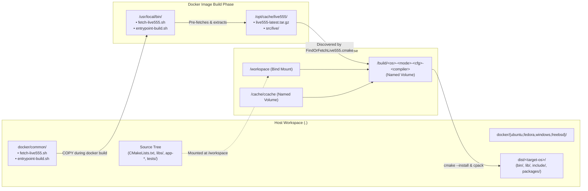
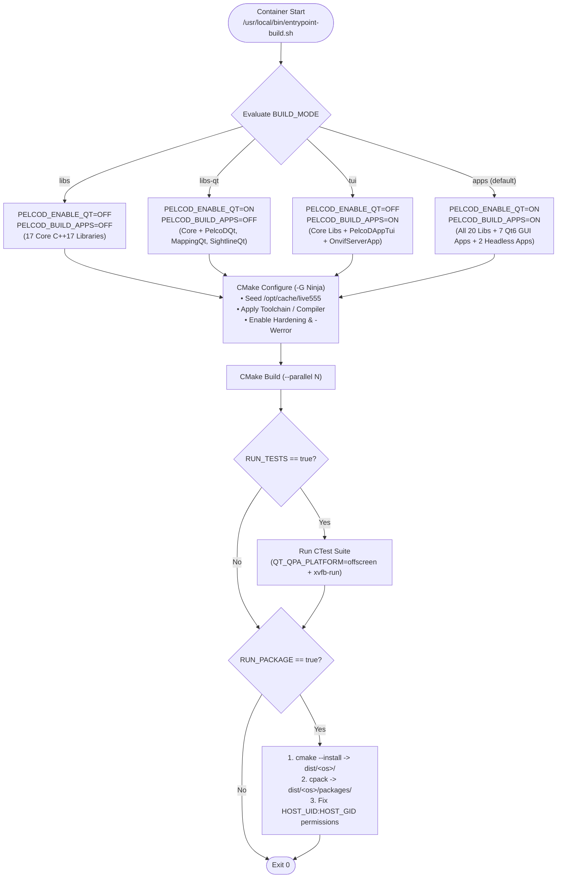
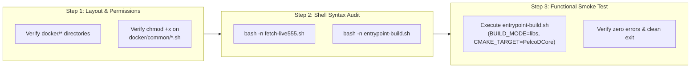

# Implementation Plan: Phase 2 – Repository Layout & Shared Container Scripts

**Scope:** Multi-OS container directory scaffolding (`docker/common/`, `docker/ubuntu/`, `docker/fedora/`, `docker/windows/`, `docker/freebsd/`), build-context & repository ignore hygiene (`.dockerignore`, `.gitignore`), offline Live555 dependency pre-fetcher (`docker/common/fetch-live555.sh`), and the unified inside-container build, test, installation, and CPack packaging entrypoint (`docker/common/entrypoint-build.sh`).  
**Standard Baseline:** POSIX.1-2017 / Strict Bash Safety (`set -euo pipefail`), Deterministic & Offline-Capable Container Builds, MISRA C++:2023 & SEI CERT C++ Compiler Flag Forwarding (`WARNINGS_AS_ERRORS`, `ENABLE_HARDENING`), Project Rules in [`.agents/rules/`](../.agents/rules/).  
**Reference Documents:** [`docs/multi_os_container_build_plan.md`](multi_os_container_build_plan.md) (§4 Phase 2), [`docs/multi_os_container_phase1_portability_plan.md`](multi_os_container_phase1_portability_plan.md), [`CMakeLists.txt`](../CMakeLists.txt), [`cmake/CompilerFlags.cmake`](../cmake/CompilerFlags.cmake), [`cmake/FindOrFetchLive555.cmake`](../cmake/FindOrFetchLive555.cmake), [`scripts/build.sh`](../scripts/build.sh).

---

## 1. Executive Summary & Architectural Goals

In [`docs/multi_os_container_build_plan.md`](multi_os_container_build_plan.md), **Phase 2** establishes the foundational directory hierarchy (`docker/`), build-context isolation (`.dockerignore`, `.gitignore`), and the two shared container runtime scripts (`docker/common/fetch-live555.sh` and `docker/common/entrypoint-build.sh`) that are baked into every OS builder image (`ubuntu`, `fedora`, `windows-cross`, `freebsd-cross`, and `freebsd-native`).

### Key Responsibilities of Phase 2

```
+-----------------------------------------------------------------------------------------------------------------------+
|                                PHASE 2 DELIVERABLES & ARCHITECTURAL RESPONSIBILITIES                                  |
+---+--------------------------------------+---------------------------------------+------------------------------------+
| # | Artifact / Path                      | Role in Multi-OS Pipeline             | Key Design Guarantees              |
+---+--------------------------------------+---------------------------------------+------------------------------------+
| 1 | docker/{common,ubuntu,fedora,        | Standardized repository layout for    | Clean separation between shared    |
|   | windows,freebsd}/                    | all 4 target OSes and shared scripts. | scripts and OS-specific Dockerfiles|
+---+--------------------------------------+---------------------------------------+------------------------------------+
| 2 | .dockerignore & .gitignore           | Prevents host build trees (build*,    | Keeps `docker build` context <1MB; |
|   |                                      | vcpkg_installed, dist/) from bloating | keeps `dist/` out of git status.   |
|   |                                      | Docker context or dirtying git.       |                                    |
+---+--------------------------------------+---------------------------------------+------------------------------------+
| 3 | docker/common/fetch-live555.sh       | Image-build-time helper that fetches, | Guarantees 100% offline container  |
|   |                                      | validates, and extracts Live555 into  | runtime builds (`--network=none`)  |
|   |                                      | `/opt/cache/live555`.                 | for `PelcoDVideo` & `RtspServer`.  |
+---+--------------------------------------+---------------------------------------+------------------------------------+
| 4 | docker/common/entrypoint-build.sh    | Unified inside-container runner for   | Supports `libs`, `libs-qt`, `tui`, |
|   |                                      | CMake configure, Ninja build, CTest   | `apps` modes; `gcc`/`clang`/cross  |
|   |                                      | (`xvfb-run`), install, and `cpack`.   | toolchains; UID/GID preservation.  |
+---+--------------------------------------+---------------------------------------+------------------------------------+
```

---

## 2. Architecture & Execution Flow

### 2.1 Repository Layout & Container Filesystem Mapping

#### ASCII Diagram: Host Repository to Container Mount & Cache Architecture

```
+---------------------------------------------------------------------------------------------------+
|                           HOST REPOSITORY & CONTAINER MOUNT TOPOLOGY                              |
+---------------------------------------------------------------------------------------------------+
|                                                                                                   |
|  Host Repository Root (`.`)                                                                       |
|  ├── .dockerignore                  (Excludes build*/, dist/, .git/, .cache/ from image builds)   |
|  ├── .gitignore                     (Ignores dist/ output directory)                              |
|  ├── docker/                                                                                      |
|  │   ├── common/                                                                                  |
|  │   │   ├── fetch-live555.sh       ──(COPY at docker build)──► /usr/local/bin/fetch-live555.sh   |
|  │   │   │                                                      └──► /opt/cache/live555/          |
|  │   │   └── entrypoint-build.sh    ──(COPY at docker build)──► /usr/local/bin/entrypoint-build.sh|
|  │   ├── ubuntu/                    (Phase 3: Ubuntu 24.04 Dockerfile)                            |
|  │   ├── fedora/                    (Phase 3: Fedora 41 Dockerfile)                               |
|  │   ├── windows/                   (Phase 4: Windows Cross & MSVC Dockerfiles + toolchains)      |
|  │   └── freebsd/                   (Phase 5: FreeBSD 14.2 Cross/VM/Native + sysroot + toolchain) |
|  └── dist/                          ◄──(Written at container runtime)── /workspace/dist/<os>/     |
|      ├── ubuntu/  (bin/, lib/, include/, packages/*.deb, *.tar.gz)                                |
|      ├── fedora/  (bin/, lib/, include/, packages/*.rpm, *.tar.gz)                                |
|      ├── windows/ (bin/*.exe, *.dll, lib/, include/, packages/*.zip)                              |
|      └── freebsd/ (bin/, lib/, include/, packages/*.tar.gz)                                       |
+---------------------------------------------------------------------------------------------------+
```

#### Mermaid Diagram: Host Repository to Container Mount & Cache Architecture



---

### 2.2 Unified Container Entrypoint Execution Pipeline (`docker/common/entrypoint-build.sh`)

#### ASCII Diagram: Inside-Container `entrypoint-build.sh` Lifecycle

```
+---------------------------------------------------------------------------------------------------+
|                        INSIDE-CONTAINER ENTRYPOINT EXECUTION PIPELINE                             |
+---------------------------------------------------------------------------------------------------+
|                                                                                                   |
|  [ 1. Environment & Mode Resolution ]                                                             |
|    • Parse TARGET_OS (ubuntu|fedora|windows|freebsd), BUILD_MODE (libs|libs-qt|tui|apps),         |
|      BUILD_CONFIG (Release|Debug|RelWithDebInfo|MinSizeRel), COMPILER_FAMILY (default|gcc|clang)  |
|    • Map BUILD_MODE -> PELCOD_ENABLE_QT={ON|OFF}, PELCOD_BUILD_APPS={ON|OFF}                      |
|    • Sanitize orphaned Ninja lock/restat files (.ninja_log.restat, .ninja_deps.recompact)         |
|                                                │                                                  |
|                                                ▼                                                  |
|  [ 2. Offline Dependency & Toolchain Wiring ]                                                     |
|    • Seed /opt/cache/live555/live555-latest.tar.gz into ${BUILD_ROOT}/_deps/live555/              |
|    • Select C/C++ compilers (gcc/g++, clang/clang++, or CMAKE_TOOLCHAIN_FILE for cross builds)    |
|    • Configure ccache launcher (CCACHE_DIR=/cache/ccache)                                         |
|    • Pass -DPELCOD_INSTALL_GIT_HOOKS=OFF (safe on read-only /workspace mounts)                    |
|                                                │                                                  |
|                                                ▼                                                  |
|  [ 3. CMake Configure & Ninja Parallel Build ]                                                    |
|    • cmake -S /workspace -B ${BUILD_ROOT} -G Ninja ...                                            |
|    • If BUILD_MODE=tui: build all core libs + PelcoDAppTui + OnvifServerApp                       |
|    • Else: build ${CMAKE_TARGET} (if specified) or default 'all' target                           |
|                                                │                                                  |
|                                                ▼                                                  |
|  [ 4. Headless CTest Execution (when RUN_TESTS=true) ]                                            |
|    • Export QT_QPA_PLATFORM=offscreen                                                             |
|    • Execute `xvfb-run -a ctest` (or direct `ctest` if xvfb-run unavailable)                      |
|    • Support optional CTEST_FILTER (-R <regex>)                                                   |
|                                                │                                                  |
|                                                ▼                                                  |
|  [ 5. Installation, Runtime Deployment & CPack Archiving (when RUN_PACKAGE=true) ]                |
|    • cmake --install ${BUILD_ROOT} --prefix ${INSTALL_PREFIX}                                     |
|    • Copy Windows runtime DLLs (vcpkg/Qt6) when TARGET_OS=windows                                 |
|    • Run `cpack -B ${INSTALL_PREFIX}/packages` (.deb, .rpm, .zip, .tar.gz)                        |
|    • Restore host ownership (HOST_UID:HOST_GID) on ${INSTALL_PREFIX} so host user owns dist/      |
+---------------------------------------------------------------------------------------------------+
```

#### Mermaid Diagram: Inside-Container `entrypoint-build.sh` Lifecycle



---

## 3. Detailed File-by-File Specifications

### 3.1 Build Context & Ignore Files (`.dockerignore` & `.gitignore`)

#### 3.1.1 `.dockerignore` (New File)
When building Docker images from either the repository root or `docker/`, `.dockerignore` ensures that multi-gigabyte local build directories (`build/`, `build_clang/`, `vcpkg_installed/`, `dist/`, `.git/`) are never transmitted to the Docker daemon.

```gitignore
# ==============================================================================
# PelcoD-Controller Docker Build Context Exclusions
# ==============================================================================
.git/
.github/
.cache/
.vs/
.vscode/
.idea/
build/
build-*/
build_*/
cmake-build-*/
dist/
out/
bin/
vcpkg_installed/
vcpkg-dependencies/
_CPack_Packages/
docs/doxygen/
docs/html/
docs/latex/
*.tar.gz
*.deb
*.rpm
*.zip
*.o
*.obj
*.a
*.so
*.dll
*.exe
```

#### 3.1.2 `.gitignore` (Update)
Add `dist/` under the `# Build Artifacts & CMake` section of [`.gitignore`](../.gitignore) so container-installed binaries, libraries, headers, and CPack packages under `dist/ubuntu/`, `dist/fedora/`, `dist/windows/`, and `dist/freebsd/` do not pollute `git status`.

```diff
--- a/.gitignore
+++ b/.gitignore
@@ -7,6 +7,7 @@ build-*/
 build_*/
 cmake-build-*/
 out/
+dist/
 bin/
 CMakeCache.txt
```

---

### 3.2 Offline Live555 Pre-Fetcher (`docker/common/fetch-live555.sh`)

#### 3.2.1 Design & Safety Rationale
`libs/Video` and `app-rtsp-server-qt` depend on Live555 (`liveMedia`, `groupsock`, `UsageEnvironment`, `BasicUsageEnvironment`). While Fedora/FreeBSD or system packages may provide Live555, Ubuntu 24.04 and Windows cross-builds rely on [`cmake/FindOrFetchLive555.cmake`](../cmake/FindOrFetchLive555.cmake).

In Phase 1, `cmake/FindOrFetchLive555.cmake` was updated to search:
1. `/opt/cache/live555/src/live` (pre-extracted source tree)
2. `/opt/cache/live555/live555-latest.tar.gz` (cached archive)

`docker/common/fetch-live555.sh` runs once during `docker build`, downloads the official tarball (with retry backoff and mirror fallback), validates its size and gzip integrity, and pre-extracts it into `/opt/cache/live555/src` with world-readable permissions (`chmod -R a+rX /opt/cache/live555`). Consequently, container runtime builds work **100% offline** and skip tarball extraction overhead when `/opt/cache/live555/src/live` is present.

#### 3.2.2 Implementation (`docker/common/fetch-live555.sh`)

```bash
#!/usr/bin/env bash
# ==============================================================================
# PelcoD-Controller - Live555 Tarball Pre-Fetcher & Validator for Build Images
#
# Executed during `docker build` to populate /opt/cache/live555 with both the
# verified tarball and pre-extracted sources so container builds run 100% offline.
# ==============================================================================
set -euo pipefail

CACHE_DIR="${LIVE555_CACHE_DIR:-/opt/cache/live555}"
TARBALL_PATH="${CACHE_DIR}/live555-latest.tar.gz"
EXTRACT_DIR="${CACHE_DIR}/src"

LIVE555_URLS=(
    "https://download.live555.com/live555-latest.tar.gz"
    "http://www.live555.com/liveMedia/public/live555-latest.tar.gz"
    "https://mirrors.videolan.org/pub/contrib/live555/live555-latest.tar.gz"
)

mkdir -p "${CACHE_DIR}" "${EXTRACT_DIR}"

download_succeeded=false
for url in "${LIVE555_URLS[@]}"; do
    echo "[fetch-live555] Attempting download from ${url} ..."
    if curl -fsSL --retry 3 --retry-delay 2 --connect-timeout 15 -o "${TARBALL_PATH}" "${url}"; then
        if [ -f "${TARBALL_PATH}" ]; then
            file_size=$(wc -c < "${TARBALL_PATH}" | tr -d ' ')
            if [ "${file_size}" -gt 100000 ] && tar -tzf "${TARBALL_PATH}" >/dev/null 2>&1; then
                echo "[fetch-live555] Verified valid tarball (${file_size} bytes) from ${url}"
                download_succeeded=true
                break
            fi
        fi
    fi
    rm -f "${TARBALL_PATH}"
done

if [ "${download_succeeded}" != "true" ]; then
    echo "[fetch-live555] WARNING: Could not pre-fetch Live555 tarball during image build." >&2
    exit 0
fi

tar -xzf "${TARBALL_PATH}" -C "${EXTRACT_DIR}"
chmod -R a+rX "${CACHE_DIR}"
echo "[fetch-live555] Cached Live555 archive and extracted sources in ${CACHE_DIR}"
```

---

### 3.3 Unified Inside-Container Build Runner (`docker/common/entrypoint-build.sh`)

#### 3.3.1 Design & Edge-Case Handling
1. **Interactive Shell Passthrough**: If a user invokes `docker run -it pelcod-builder:ubuntu-24.04 bash` or `sh`, `entrypoint-build.sh` detects the shell command argument and `exec "$@"` directly for interactive debugging.
2. **Build Mode Granularity (`BUILD_MODE`)**:
   - `libs`: Sets `-DPELCOD_ENABLE_QT=OFF -DPELCOD_BUILD_APPS=OFF`. Builds all 17 non-Qt C++17 libraries (`Math`, `Transport`, `PelcoDCore`, `PelcoDFujinon`, `PelcoDSim`, `ViscaCore`, `ViscaSony`, `Klv`, `DjiTelemetry`, `Nmea`, `Tracking`, `Mapping`, `SightlineCore`, `PayloadHal`, `Onvif`, `Video`, `VideoFilters`) and their unit tests.
   - `libs-qt`: Sets `-DPELCOD_ENABLE_QT=ON -DPELCOD_BUILD_APPS=OFF`. Builds all 17 core libraries plus the 3 Qt 6 adapter libraries (`PelcoDQt`, `MappingQt`, `SightlineQt`).
   - `tui`: Sets `-DPELCOD_ENABLE_QT=OFF -DPELCOD_BUILD_APPS=ON`. Builds all core libraries plus the headless executables (`PelcoDAppTui` and `OnvifServerApp`).
   - `apps` (or `all`): Sets `-DPELCOD_ENABLE_QT=ON -DPELCOD_BUILD_APPS=ON`. Builds all 20 libraries and all 9 applications (`PelcoDAppQt`, `FujinonAppQt`, `ViscaAppQt`, `OnvifAppQt`, `VideoAppQt`, `RtspServerAppQt`, `SightlineAppQt`, `PelcoDAppTui`, `OnvifServerApp`).
3. **Compiler Family Selection (`COMPILER_FAMILY`)**:
   - When `CMAKE_TOOLCHAIN_FILE` is not set (or on native Linux/FreeBSD containers), supports `COMPILER_FAMILY=gcc` (`gcc`/`g++`), `COMPILER_FAMILY=clang` (`clang`/`clang++`), or `default`.
   - Includes `COMPILER_FAMILY` in the default `BUILD_ROOT` path (`/build/${TARGET_OS}-${BUILD_MODE}-${BUILD_CONFIG}-${COMPILER_FAMILY}`) so switching between GCC and Clang never causes CMake cache collisions.
4. **Read-Only Workspace Compatibility**:
   - Passes `-DPELCOD_INSTALL_GIT_HOOKS=OFF` so mounting `/workspace:ro` never triggers write attempts into `/workspace/.git/hooks`.
   - Writes CPack packages and install trees to `INSTALL_PREFIX` (defaults to `/workspace/dist/${TARGET_OS}`, or `/dist/${TARGET_OS}` if `/workspace` is mounted read-only and `/dist` is mounted separately).
5. **Host File Ownership Restoration (`HOST_UID` / `HOST_GID`)**:
   - When Docker runs as `root` inside the container, files written to `dist/${TARGET_OS}` on the host bind mount would otherwise be owned by `root:root`. If `HOST_UID` and `HOST_GID` are provided (or auto-detected from `stat -c "%u:%g" /workspace`), the script chowns `${INSTALL_PREFIX}` back to the host user upon completion.

#### 3.3.2 Implementation (`docker/common/entrypoint-build.sh`)

```bash
#!/usr/bin/env bash
# ==============================================================================
# PelcoD-Controller - Unified Inside-Container Build, Test & Package Entrypoint
#
# Supports Ubuntu, Fedora, Windows (cross), and FreeBSD (cross & native)
# container environments with selectable build modes:
#   BUILD_MODE = libs | libs-qt | tui | apps
# ==============================================================================
set -euo pipefail

# Allow direct command passthrough (e.g. `docker run -it <image> bash`)
if [ $# -gt 0 ]; then
    case "$1" in
        sh|bash|/bin/sh|/bin/bash)
            exec "$@"
            ;;
    esac
fi

# ------------------------------------------------------------------------------
# 1. Configuration & Environment Defaults
# ------------------------------------------------------------------------------
TARGET_OS="${TARGET_OS:-ubuntu}"
BUILD_MODE="${BUILD_MODE:-apps}"
BUILD_CONFIG="${BUILD_CONFIG:-Release}"
COMPILER_FAMILY="${COMPILER_FAMILY:-default}"
CMAKE_TARGET="${CMAKE_TARGET:-}"
RUN_TESTS="${RUN_TESTS:-false}"
CTEST_FILTER="${CTEST_FILTER:-}"
RUN_PACKAGE="${RUN_PACKAGE:-true}"
CLEAN_BUILD="${CLEAN_BUILD:-false}"
RECONFIGURE="${RECONFIGURE:-false}"
WARNINGS_AS_ERRORS="${WARNINGS_AS_ERRORS:-ON}"
ENABLE_HARDENING="${ENABLE_HARDENING:-ON}"
ENABLE_ONVIF="${ENABLE_ONVIF:-ON}"
ENABLE_VIDEO="${ENABLE_VIDEO:-ON}"
ENABLE_DJI="${ENABLE_DJI:-ON}"

if [ -z "${PARALLEL_JOBS:-}" ] || [ "${PARALLEL_JOBS}" -le 0 ] 2>/dev/null; then
    if command -v nproc >/dev/null 2>&1; then
        PARALLEL_JOBS="$(nproc)"
    elif command -v sysctl >/dev/null 2>&1; then
        PARALLEL_JOBS="$(sysctl -n hw.ncpu 2>/dev/null || echo 4)"
    else
        PARALLEL_JOBS=4
    fi
fi

WORKSPACE_DIR="${WORKSPACE_DIR:-/workspace}"
BUILD_ROOT="${BUILD_ROOT:-/build/${TARGET_OS}-${BUILD_MODE}-${BUILD_CONFIG}-${COMPILER_FAMILY}}"
INSTALL_PREFIX="${INSTALL_PREFIX:-${WORKSPACE_DIR}/dist/${TARGET_OS}}"

export CCACHE_DIR="${CCACHE_DIR:-/cache/ccache}"
export QT_QPA_PLATFORM="${QT_QPA_PLATFORM:-offscreen}"

echo "======================================================================"
echo " PelcoD-Controller Container Build Runner"
echo "----------------------------------------------------------------------"
echo " Target OS          : ${TARGET_OS}"
echo " Build Mode         : ${BUILD_MODE}"
echo " Build Config       : ${BUILD_CONFIG}"
echo " Compiler Family    : ${COMPILER_FAMILY}"
echo " CMake Target       : ${CMAKE_TARGET:-<all>}"
echo " Parallel Jobs      : ${PARALLEL_JOBS}"
echo " Build Directory    : ${BUILD_ROOT}"
echo " Install Prefix     : ${INSTALL_PREFIX}"
echo " Run Tests          : ${RUN_TESTS}"
echo " Run Package        : ${RUN_PACKAGE}"
echo "======================================================================"

# ------------------------------------------------------------------------------
# 2. Validate Build Mode & Map CMake Options
# ------------------------------------------------------------------------------
case "${BUILD_MODE}" in
    libs)
        ENABLE_QT="OFF"
        BUILD_APPS="OFF"
        BUILD_TESTING_FLAG="ON"
        ;;
    libs-qt)
        ENABLE_QT="ON"
        BUILD_APPS="OFF"
        BUILD_TESTING_FLAG="ON"
        ;;
    tui)
        ENABLE_QT="OFF"
        BUILD_APPS="ON"
        BUILD_TESTING_FLAG="ON"
        ;;
    apps|all)
        ENABLE_QT="ON"
        BUILD_APPS="ON"
        BUILD_TESTING_FLAG="ON"
        ;;
    *)
        echo "[ERROR] Unsupported BUILD_MODE='${BUILD_MODE}' (expected: libs, libs-qt, tui, apps)" >&2
        exit 1
        ;;
esac

if [ "${RUN_TESTS}" = "false" ] && [ "${BUILD_TESTING:-}" = "OFF" ]; then
    BUILD_TESTING_FLAG="OFF"
fi

# ------------------------------------------------------------------------------
# 3. Prepare Directories & Offline Caches
# ------------------------------------------------------------------------------
if [ "${CLEAN_BUILD}" = "true" ] && [ -d "${BUILD_ROOT}" ]; then
    echo "[1/5] Cleaning build directory ${BUILD_ROOT} ..."
    rm -rf "${BUILD_ROOT}"
fi

mkdir -p "${BUILD_ROOT}" "${CCACHE_DIR}"

# Clean up any stale Ninja lock/restat files from interrupted runs
if [ -f "${BUILD_ROOT}/.ninja_log.restat" ]; then
    rm -f "${BUILD_ROOT}/.ninja_log.restat" 2>/dev/null || true
fi
if [ -f "${BUILD_ROOT}/.ninja_deps.recompact" ]; then
    rm -f "${BUILD_ROOT}/.ninja_deps.recompact" 2>/dev/null || true
fi

# Seed pre-fetched Live555 tarball into build directory for offline repeatability
if [ -f "/opt/cache/live555/live555-latest.tar.gz" ] && [ ! -f "${BUILD_ROOT}/_deps/live555/live555-latest.tar.gz" ]; then
    mkdir -p "${BUILD_ROOT}/_deps/live555"
    cp -f "/opt/cache/live555/live555-latest.tar.gz" "${BUILD_ROOT}/_deps/live555/live555-latest.tar.gz"
fi

# ------------------------------------------------------------------------------
# 4. CMake Configure
# ------------------------------------------------------------------------------
echo "[2/5] Configuring CMake (${BUILD_CONFIG}) ..."

CMAKE_ARGS=(
    -S "${WORKSPACE_DIR}"
    -B "${BUILD_ROOT}"
    -G Ninja
    -DCMAKE_BUILD_TYPE="${BUILD_CONFIG}"
    -DCMAKE_INSTALL_PREFIX="${INSTALL_PREFIX}"
    -DPELCOD_ENABLE_QT="${ENABLE_QT}"
    -DPELCOD_BUILD_APPS="${BUILD_APPS}"
    -DPELCOD_ENABLE_ONVIF="${ENABLE_ONVIF}"
    -DPELCOD_ENABLE_VIDEO="${ENABLE_VIDEO}"
    -DPELCOD_ENABLE_DJI="${ENABLE_DJI}"
    -DBUILD_TESTING="${BUILD_TESTING_FLAG}"
    -DPELCOD_INSTALL_GIT_HOOKS=OFF
    -DWARNINGS_AS_ERRORS="${WARNINGS_AS_ERRORS}"
    -DENABLE_HARDENING="${ENABLE_HARDENING}"
)

if command -v ccache >/dev/null 2>&1; then
    CMAKE_ARGS+=(
        -DCMAKE_C_COMPILER_LAUNCHER=ccache
        -DCMAKE_CXX_COMPILER_LAUNCHER=ccache
    )
fi

if [ -n "${CMAKE_TOOLCHAIN_FILE:-}" ]; then
    CMAKE_ARGS+=(-DCMAKE_TOOLCHAIN_FILE="${CMAKE_TOOLCHAIN_FILE}")
else
    case "${COMPILER_FAMILY}" in
        gcc|gnu)
            CMAKE_ARGS+=(-DCMAKE_C_COMPILER=gcc -DCMAKE_CXX_COMPILER=g++)
            ;;
        clang|llvm)
            CMAKE_ARGS+=(-DCMAKE_C_COMPILER=clang -DCMAKE_CXX_COMPILER=clang++)
            ;;
        default|"")
            ;;
        *)
            CMAKE_ARGS+=(-DCMAKE_CXX_COMPILER="${COMPILER_FAMILY}")
            ;;
    esac
fi

if [ -n "${QT_HOST_PATH:-}" ]; then
    CMAKE_ARGS+=(-DQT_HOST_PATH="${QT_HOST_PATH}")
fi

if [ -n "${CMAKE_PREFIX_PATH:-}" ]; then
    CMAKE_ARGS+=(-DCMAKE_PREFIX_PATH="${CMAKE_PREFIX_PATH}")
fi

if [ -n "${CPACK_GENERATOR:-}" ]; then
    CMAKE_ARGS+=(-DCPACK_GENERATOR="${CPACK_GENERATOR}")
fi

if [ "${RECONFIGURE}" = "true" ] && [ -f "${BUILD_ROOT}/CMakeCache.txt" ]; then
    rm -f "${BUILD_ROOT}/CMakeCache.txt"
fi

cmake "${CMAKE_ARGS[@]}"

# ------------------------------------------------------------------------------
# 5. Compile Targets
# ------------------------------------------------------------------------------
echo "[3/5] Building targets (parallel jobs: ${PARALLEL_JOBS}) ..."

if [ -n "${CMAKE_TARGET}" ]; then
    # Allow space- or comma-separated target lists
    IFS=', ' read -r -a TARGET_LIST <<< "${CMAKE_TARGET}"
    cmake --build "${BUILD_ROOT}" --config "${BUILD_CONFIG}" --target "${TARGET_LIST[@]}" --parallel "${PARALLEL_JOBS}"
else
    cmake --build "${BUILD_ROOT}" --config "${BUILD_CONFIG}" --parallel "${PARALLEL_JOBS}"
fi

# ------------------------------------------------------------------------------
# 6. Execute Unit Tests (CTest)
# ------------------------------------------------------------------------------
if [ "${RUN_TESTS}" = "true" ]; then
    echo "[4/5] Running CTest suite ..."
    CTEST_ARGS=(
        --test-dir "${BUILD_ROOT}"
        --build-config "${BUILD_CONFIG}"
        --output-on-failure
        --parallel "${PARALLEL_JOBS}"
    )
    if [ -n "${CTEST_FILTER}" ]; then
        CTEST_ARGS+=(-R "${CTEST_FILTER}")
    fi

    if command -v xvfb-run >/dev/null 2>&1; then
        xvfb-run -a ctest "${CTEST_ARGS[@]}"
    else
        ctest "${CTEST_ARGS[@]}"
    fi
else
    echo "[4/5] Skipping unit tests (RUN_TESTS=false)."
fi

# ------------------------------------------------------------------------------
# 7. Install & Generate Redistributable CPack Archives
# ------------------------------------------------------------------------------
if [ "${RUN_PACKAGE}" = "true" ] && [ -z "${CMAKE_TARGET}" ]; then
    echo "[5/5] Installing artifacts and generating CPack packages into ${INSTALL_PREFIX} ..."
    mkdir -p "${INSTALL_PREFIX}" "${INSTALL_PREFIX}/packages"
    cmake --install "${BUILD_ROOT}" --config "${BUILD_CONFIG}" --prefix "${INSTALL_PREFIX}"

    (
        cd "${BUILD_ROOT}"
        cpack -C "${BUILD_CONFIG}" -B "${INSTALL_PREFIX}/packages"
    )

    # Restore non-root host ownership on installed artifacts if running as root
    if [ "$(id -u)" -eq 0 ] && [ -d "${INSTALL_PREFIX}" ]; then
        TARGET_UID="${HOST_UID:-$(stat -c '%u' "${WORKSPACE_DIR}" 2>/dev/null || echo 0)}"
        TARGET_GID="${HOST_GID:-$(stat -c '%g' "${WORKSPACE_DIR}" 2>/dev/null || echo 0)}"
        if [ "${TARGET_UID}" -ne 0 ] 2>/dev/null; then
            chown -R "${TARGET_UID}:${TARGET_GID}" "${INSTALL_PREFIX}" 2>/dev/null || true
        fi
    fi
else
    echo "[5/5] Skipping installation and packaging."
fi

echo "======================================================================"
echo " [OK] Container build completed successfully (${TARGET_OS} / ${BUILD_MODE})"
echo "======================================================================"
```

---

## 4. Verification & Testing Workflow for Phase 2

### 4.1 ASCII Diagram: Phase 2 Verification Pipeline

```
+---------------------------------------------------------------------------------------------------+
|                               PHASE 2 VERIFICATION PIPELINE                                       |
+---------------------------------------------------------------------------------------------------+
|                                                                                                   |
|  [ Step 1: Directory & File Permission Verification ]                                             |
|    • Verify docker/{common,ubuntu,fedora,windows,freebsd} exist                                   |
|    • Verify executable bit (+x) on docker/common/fetch-live555.sh & entrypoint-build.sh           |
|                                                │                                                  |
|                                                ▼                                                  |
|  [ Step 2: Bash Syntax & Static Shell Validation ]                                                |
|    • bash -n docker/common/fetch-live555.sh                                                       |
|    • bash -n docker/common/entrypoint-build.sh                                                    |
|    • shellcheck (if installed) on both scripts                                                    |
|                                                │                                                  |
|                                                ▼                                                  |
|  [ Step 3: Local Smoke Test of entrypoint-build.sh ]                                              |
|    • Run entrypoint-build.sh in a temporary build/install root on the host (e.g.                  |
|      BUILD_MODE=libs CMAKE_TARGET=PelcoDCore RUN_PACKAGE=false) to confirm CMake configure        |
|      and Ninja target compilation succeed end-to-end.                                             |
+---------------------------------------------------------------------------------------------------+
```

### 4.2 Mermaid Diagram: Phase 2 Verification Pipeline



---

## 5. Compliance Checklist

- [x] **Strict POSIX/Bash Error Handling**: Both `fetch-live555.sh` and `entrypoint-build.sh` enforce `set -euo pipefail` and quote all variable expansions.
- [x] **Compiler & Hardening Flag Preservation**: `entrypoint-build.sh` forwards `WARNINGS_AS_ERRORS=ON` and `ENABLE_HARDENING=ON` by default so MISRA C++:2023 and SEI CERT C++ compile gates remain enforced inside every container.
- [x] **Offline Repeatability**: `fetch-live555.sh` pre-populates `/opt/cache/live555` during image creation, matching the search paths configured in [`cmake/FindOrFetchLive555.cmake`](../cmake/FindOrFetchLive555.cmake).
- [x] **Documentation Standards**: All file links use relative paths, and both ASCII and Mermaid diagrams are provided for every architectural view.

