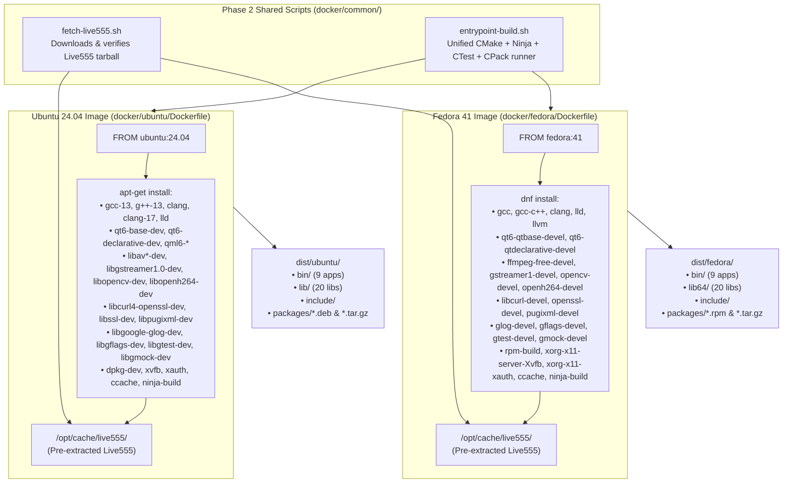
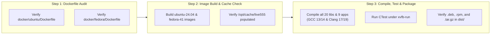

# Implementation Plan: Phase 3 – Linux Build Containers (Ubuntu 24.04 & Fedora 41)

**Scope:** Native Linux OCI build container definitions for Debian/Ubuntu (`docker/ubuntu/Dockerfile` based on `ubuntu:24.04` LTS) and Red Hat/Fedora (`docker/fedora/Dockerfile` based on `fedora:41`), dual-compiler support (`GCC` and `Clang/LLD`), pre-cached offline Live555 dependency integration (`/opt/cache/live555`), headless Qt 6 Widgets/Quick/QML unit test execution (`xvfb-run` + `QT_QPA_PLATFORM=offscreen`), and native CPack redistributable generation (`.deb`, `.rpm`, and `.tar.gz`).  
**Standard Baseline:** MISRA C++:2023 (Rule 7.0.6), SEI CERT C++ (INT31-C, STR37-C, ERR55-CPP), Include-What-You-Use (IWYU) & `<cstdint>` Policy, ELF Binary Hardening (`-fstack-protector-strong`, `-fstack-clash-protection`, `-fcf-protection=full`, `_FORTIFY_SOURCE=3`, `-fPIE -pie`, Full RELRO `-Wl,-z,relro,-z,now`), Project Rules in [`.agents/rules/`](../.agents/rules/).  
**Reference Documents:** [`docs/multi_os_container_build_plan.md`](multi_os_container_build_plan.md) (§5 Phase 3), [`docs/multi_os_container_phase1_portability_plan.md`](multi_os_container_phase1_portability_plan.md), [`docs/multi_os_container_phase2_layout_scripts_plan.md`](multi_os_container_phase2_layout_scripts_plan.md), [`CMakeLists.txt`](../CMakeLists.txt), [`cmake/CompilerFlags.cmake`](../cmake/CompilerFlags.cmake), [`cmake/FindOrFetchLive555.cmake`](../cmake/FindOrFetchLive555.cmake), [`docker/common/entrypoint-build.sh`](../docker/common/entrypoint-build.sh), [`docker/common/fetch-live555.sh`](../docker/common/fetch-live555.sh).

---

## 1. Executive Summary & Architectural Objectives

In [`docs/multi_os_container_build_plan.md`](multi_os_container_build_plan.md), **Phase 3** delivers the two primary native Linux build containers—**Ubuntu 24.04 LTS (`noble`)** and **Fedora 41**—covering both the Debian/APT (`.deb`) and Red Hat/RPM (`.rpm`) enterprise Linux ecosystems.

Together, these two containers validate **PelcoD-Controller** across four distinct C++17 compiler generations (GCC 13, Clang 17/18 on Ubuntu 24.04; GCC 14, Clang 19 on Fedora 41) and two Qt 6 minor releases (Qt 6.4.2 on Ubuntu 24.04; Qt 6.7+ on Fedora 41), while compiling all 20 libraries, all 9 GUI/QML/TUI applications, the full GoogleTest/QtTest unit test suite, and redistributable `.deb`, `.rpm`, and `.tar.gz` packages.

```
+-----------------------------------------------------------------------------------------------------------------------+
|                              PHASE 3 LINUX BUILD CONTAINERS CAPABILITY MATRIX                                         |
+--------------------+---------------------------------------------------+----------------------------------------------+
| Dimension          | Ubuntu 24.04 Container                            | Fedora 41 Container                          |
|                    | (`docker/ubuntu/Dockerfile`)                      | (`docker/fedora/Dockerfile`)                 |
+--------------------+---------------------------------------------------+----------------------------------------------+
| Base Image         | `ubuntu:24.04` (Noble Numbat LTS)                 | `fedora:41`                                  |
+--------------------+---------------------------------------------------+----------------------------------------------+
| Image Tag          | `pelcod-builder:ubuntu-24.04`                     | `pelcod-builder:fedora-41`                   |
+--------------------+---------------------------------------------------+----------------------------------------------+
| C++17 Compilers    | • GCC 13 (`gcc-13` / `g++-13`)                    | • GCC 14 (`gcc` / `g++`)                     |
| (`COMPILER_FAMILY`)| • Clang 17/18 (`clang` / `clang++` + `lld`)       | • Clang 19 (`clang` / `clang++` + `lld`)     |
+--------------------+---------------------------------------------------+----------------------------------------------+
| Qt 6 Stack         | Qt 6.4.2 (`qt6-base-dev`, `qt6-declarative-dev`,  | Qt 6.7+ (`qt6-qtbase-devel`,                 |
|                    | `qml6-module-qtquick*`)                           | `qt6-qtdeclarative-devel`)                   |
+--------------------+---------------------------------------------------+----------------------------------------------+
| Video & Media      | FFmpeg (`libav*-dev`), GStreamer 1.0, OpenCV 4.6, | `ffmpeg-free-devel`, `gstreamer1-devel`,     |
| Backends           | OpenH264 (`libopenh264-dev`), V4L2 (`libv4l-dev`),| `opencv-devel`, `openh264-devel` (Cisco),    |
|                    | Pre-cached Live555 (`/opt/cache/live555`)         | `libv4l-devel`, Pre-cached Live555           |
+--------------------+---------------------------------------------------+----------------------------------------------+
| ONVIF & Core       | `libcurl4-openssl-dev`, `libssl-dev`,             | `libcurl-devel`, `openssl-devel`,            |
| Libraries          | `libpugixml-dev`, `libgoogle-glog-dev`,           | `pugixml-devel`, `glog-devel`,               |
|                    | `libgflags-dev`, `libgtest-dev`, `libgmock-dev`   | `gflags-devel`, `gtest-devel`, `gmock-devel` |
+--------------------+---------------------------------------------------+----------------------------------------------+
| ELF Hardening      | `-fstack-protector-strong`, `-fcf-protection=full`| `-fstack-protector-strong`, `-fcf-protection`|
| (`CompilerFlags`)  | `-fstack-clash-protection`, `_FORTIFY_SOURCE=3`,  | `-fstack-clash-protection`, `_FORTIFY_SOURCE=3`|
|                    | `-fPIE -pie`, `-Wl,-z,relro,-z,now`, `-Werror`    | `-fPIE -pie`, `-Wl,-z,relro,-z,now`, `-Werror`|
+--------------------+---------------------------------------------------+----------------------------------------------+
| CPack Outputs      | `dist/ubuntu/packages/PelcoDController-*.deb`     | `dist/fedora/packages/PelcoDController-*.rpm`|
| (`dist/<os>/`)     | `dist/ubuntu/packages/PelcoDController-*.tar.gz`  | `dist/fedora/packages/PelcoDController-*.tar.gz`|
+--------------------+---------------------------------------------------+----------------------------------------------+
```

---

## 2. Container Architecture & Build Lifecycle

### 2.1 Multi-Layer Image Construction & Runtime Volume Topology

#### ASCII Diagram: Ubuntu 24.04 & Fedora 41 Image Layers and Runtime Mounts

```
+---------------------------------------------------------------------------------------------------+
|                        PHASE 3 LINUX CONTAINER ARCHITECTURE & LAYER STACK                         |
+---------------------------------------------------------------------------------------------------+
|                                                                                                   |
|  ┌────────────────────────────────────────────┐   ┌────────────────────────────────────────────┐  |
|  │       docker/ubuntu/Dockerfile             │   │        docker/fedora/Dockerfile            │  |
|  ├────────────────────────────────────────────┤   ├────────────────────────────────────────────┤  |
|  │ Layer 1: Base OS (`ubuntu:24.04`)          │   │ Layer 1: Base OS (`fedora:41`)             │  |
|  │ Layer 2: APT Toolchain & SDK Packages      │   │ Layer 2: DNF Toolchain & SDK Packages      │  |
|  │   • GCC 13 + Clang 17/18 + LLD + Ninja     │   │   • GCC 14 + Clang 19 + LLD + Ninja        │  |
|  │   • Qt6 Widgets/Quick/QML/Test + Xvfb      │   │   • Qt6 Widgets/Quick/QML/Test + Xvfb      │  |
|  │   • FFmpeg, GStreamer, OpenCV, OpenH264    │   │   • ffmpeg-free, GStreamer, OpenCV,        │  |
|  │   • libcurl, OpenSSL, pugixml, glog, GTest │   │     openh264 (fedora-cisco-openh264)       │  |
|  │   • dpkg-dev + file (for shlibdeps DEB)    │   │   • rpm-build + file (for CPack RPM)       │  |
|  │ Layer 3: `/usr/local/bin/fetch-live555.sh` │   │ Layer 3: `/usr/local/bin/fetch-live555.sh` │  |
|  │   • Populates `/opt/cache/live555/src/live`│   │   • Populates `/opt/cache/live555/src/live`│  |
|  │ Layer 4: `/usr/local/bin/entrypoint-build` │   │ Layer 4: `/usr/local/bin/entrypoint-build` │  |
|  └─────────────────────┬──────────────────────┘   └─────────────────────┬──────────────────────┘  |
|                        │                                                │                         |
|                        ▼                                                ▼                         |
|  ┌─────────────────────────────────────────────────────────────────────────────────────────────┐  |
|  │                         CONTAINER RUNTIME EXECUTION (`entrypoint-build.sh`)                 │  |
|  │  • Mounts: `/workspace` (host repo), `/cache/ccache` (ccache), `/build` (Ninja build tree)  │  |
|  │  • Modes : `BUILD_MODE=libs | libs-qt | tui | apps`                                         │  |
|  │  • Tests : `QT_QPA_PLATFORM=offscreen xvfb-run -a ctest --output-on-failure`                │  |
|  │  • Output: `/workspace/dist/ubuntu/{bin,lib,include,packages/*.deb,*.tar.gz}`               │  |
|  │            `/workspace/dist/fedora/{bin,lib64,include,packages/*.rpm,*.tar.gz}`             │  |
|  └─────────────────────────────────────────────────────────────────────────────────────────────┘  |
+---------------------------------------------------------------------------------------------------+
```

#### Mermaid Diagram: Ubuntu 24.04 & Fedora 41 Image Layers and Runtime Mounts



---

### 2.2 Dependency Resolution Mapping Across Ubuntu 24.04 & Fedora 41

Every CMake `find_package(...)` and `pkg_check_modules(...)` call in [`CMakeLists.txt`](../CMakeLists.txt), [`cmake/FindOrFetchLive555.cmake`](../cmake/FindOrFetchLive555.cmake), and [`cmake/Testing.cmake`](../cmake/Testing.cmake) maps deterministically to a specific distribution package in each container:

| Subsystem | CMake Discovery Mechanism | Ubuntu 24.04 Package (`apt`) | Fedora 41 Package (`dnf`) |
| :--- | :--- | :--- | :--- |
| **C++17 Compilers** | `CMAKE_CXX_COMPILER` (`g++` / `clang++`) | `build-essential`, `gcc-13`, `g++-13`, `clang`, `clang-17`, `lld`, `lld-17`, `llvm-17` | `gcc`, `gcc-c++`, `clang`, `lld`, `llvm` |
| **Build & Cache Tools** | `cmake -G Ninja`, `ccache`, `pkg-config` | `cmake`, `ninja-build`, `ccache`, `pkg-config` | `cmake`, `ninja-build`, `ccache`, `pkgconf-pkg-config` |
| **CLI Flags & Logging** | `find_package(gflags)`, `find_package(glog REQUIRED)` | `libgflags-dev`, `libgoogle-glog-dev` | `gflags-devel`, `glog-devel` |
| **Unit Testing** | `find_package(GTest CONFIG QUIET)` | `libgtest-dev`, `libgmock-dev` | `gtest-devel`, `gmock-devel` |
| **ONVIF (`PelcoDOnvif`)** | `find_package(CURL)`, `find_package(OpenSSL)`, `find_package(pugixml CONFIG)` | `libcurl4-openssl-dev`, `libssl-dev`, `libpugixml-dev` | `libcurl-devel`, `openssl-devel`, `pugixml-devel` |
| **FFmpeg (`PelcoDVideo`)** | `pkg_check_modules(FFMPEG libavcodec libavformat libavutil libswscale)` | `libavcodec-dev`, `libavformat-dev`, `libavutil-dev`, `libswscale-dev` | `ffmpeg-free-devel` |
| **GStreamer (`PelcoDVideo`)** | `pkg_check_modules(GST gstreamer-1.0 gstreamer-base-1.0 gstreamer-app-1.0 gstreamer-video-1.0)` | `libgstreamer1.0-dev`, `libgstreamer-plugins-{base,good,bad}1.0-dev`, `libgstrtspserver-1.0-dev`, `gstreamer1.0-plugins-{base,good,bad,ugly}`, `gstreamer1.0-{libav,rtsp,tools,gl,x,alsa,pulseaudio,pipewire,vaapi,opencv,nice}` | `gstreamer1-devel`, `gstreamer1-plugins-base-devel`, `gstreamer1-plugins-bad-free-devel`, `gstreamer1-rtsp-server-devel`, `gstreamer1-plugins-{base,good,good-extras,good-qt6,bad-free,bad-free-extras,ugly-free}`, `gstreamer1-plugin-{libav,openh264}`, `gstreamer1-vaapi` |
| **Live555 + OpenH264** | `FindOrFetchLive555.cmake` + `pkg_check_modules(OPENH264 openh264)` | `/opt/cache/live555` + `libopenh264-dev` | `/opt/cache/live555` + `openh264-devel` (`fedora-cisco-openh264`) |
| **OpenCV (`VideoFilters`)** | `find_package(OpenCV COMPONENTS core imgproc video calib3d)` | `libopencv-dev` | `opencv-devel` |
| **V4L2 Camera Enumeration** | `<linux/videodev2.h>` | `libv4l-dev`, `linux-libc-dev` | `libv4l-devel`, `kernel-headers` |
| **Qt 6 Core/Gui/Widgets/Test** | `find_package(Qt6 REQUIRED COMPONENTS Core Gui Widgets Test)` | `qt6-base-dev`, `qt6-base-dev-tools`, `libgl1-mesa-dev`, `libxkbcommon-dev` | `qt6-qtbase-devel`, `qt6-qtbase-gui`, `mesa-libGL-devel`, `libxkbcommon-devel` |
| **Qt 6 Quick/QML** | `find_package(Qt6 COMPONENTS Qml Quick QuickControls2)` | `qt6-declarative-dev`, `qt6-declarative-dev-tools`, `qml6-module-qtquick*` | `qt6-qtdeclarative-devel` |
| **Headless GUI Test Runner** | `xvfb-run -a ctest` + `QT_QPA_PLATFORM=offscreen` | `xvfb`, `xauth` | `xorg-x11-server-Xvfb`, `xorg-x11-xauth` |
| **CPack Packaging** | `cpack` (`DEB;TGZ` on Ubuntu, `RPM;TGZ` on Fedora) | `dpkg-dev`, `file` | `rpm-build`, `file` |

---

## 3. Detailed Container Specifications

### 3.1 Ubuntu 24.04 LTS Container (`docker/ubuntu/Dockerfile`)

#### 3.1.1 Design Details
1. **Dual-Compiler Readiness**: Installs both the default unversioned `clang`/`lld` packages and explicit `gcc-13`, `g++-13`, `clang-17`, `lld-17`, `llvm-17` packages so `COMPILER_FAMILY=gcc` (`gcc`/`g++`), `COMPILER_FAMILY=clang` (`clang`/`clang++`), and explicit version invocations (`clang++-17`) all work out of the box.
2. **Complete Qt 6 QML Runtime Modules**: Installs the `qml6-module-qtquick`, `qml6-module-qtquick-controls`, `qml6-module-qtquick-layouts`, `qml6-module-qtquick-templates`, `qml6-module-qtquick-window`, and `qml6-module-qtqml-workerscript` packages so QML-based applications (`VideoAppQt`, `RtspServerAppQt`, `SightlineAppQt`) and their tests load QML imports cleanly under `QT_QPA_PLATFORM=offscreen`.
3. **Debian Shared Library Dependency Calculation (`dpkg-shlibdeps`)**: [`CMakeLists.txt`](../CMakeLists.txt) enables `CPACK_DEBIAN_PACKAGE_SHLIBDEPS ON`. Installing `dpkg-dev` and `file` allows CPack's DEB generator to inspect all installed ELF binaries and populate accurate `Depends:` metadata in the resulting `.deb` package.
4. **Build Context Paths**: The Dockerfile is designed to be built with `docker/` as the build context (`docker build -f docker/ubuntu/Dockerfile docker/` or via `docker/docker-compose.yml`), referencing `common/fetch-live555.sh` and `common/entrypoint-build.sh`.

#### 3.1.2 `docker/ubuntu/Dockerfile`

```dockerfile
# syntax=docker/dockerfile:1
# ==============================================================================
# PelcoD-Controller - Ubuntu 24.04 LTS (Noble) Build Container
#
# Builds all 20 C++17/Qt6 libraries, 9 GUI/QML/TUI applications, unit tests,
# and redistributable .deb / .tar.gz packages.
#
# Build context: docker/
#   docker build -t pelcod-builder:ubuntu-24.04 -f docker/ubuntu/Dockerfile docker/
# ==============================================================================
FROM ubuntu:24.04

LABEL org.opencontainers.image.title="PelcoD-Controller Ubuntu 24.04 Builder"
LABEL org.opencontainers.image.description="Hermetic build container for PelcoD-Controller libraries and apps on Ubuntu 24.04 LTS"

ENV DEBIAN_FRONTEND=noninteractive
ENV TARGET_OS=ubuntu
ENV QT_QPA_PLATFORM=offscreen
ENV CCACHE_DIR=/cache/ccache

RUN apt-get update && apt-get install -y --no-install-recommends \
    # Compilers, Linkers & Build System
    build-essential \
    gcc-13 \
    g++-13 \
    clang \
    lld \
    llvm \
    clang-17 \
    lld-17 \
    llvm-17 \
    cmake \
    ninja-build \
    ccache \
    pkg-config \
    git \
    curl \
    ca-certificates \
    python3 \
    # Packaging & Headless Test Utilities
    dpkg-dev \
    file \
    xvfb \
    xauth \
    # Core, Logging & Unit Test Dependencies
    libgflags-dev \
    libgoogle-glog-dev \
    libgtest-dev \
    libgmock-dev \
    # ONVIF Profile S Dependencies
    libcurl4-openssl-dev \
    libssl-dev \
    libpugixml-dev \
    # Video & Filter Dependencies (FFmpeg, GStreamer + all plugins, OpenCV, OpenH264, V4L2)
    libavcodec-dev \
    libavformat-dev \
    libavutil-dev \
    libswscale-dev \
    libgstreamer1.0-dev \
    libgstreamer-plugins-base1.0-dev \
    libgstreamer-plugins-good1.0-dev \
    libgstreamer-plugins-bad1.0-dev \
    libgstrtspserver-1.0-dev \
    gstreamer1.0-plugins-base \
    gstreamer1.0-plugins-base-apps \
    gstreamer1.0-plugins-good \
    gstreamer1.0-plugins-bad \
    gstreamer1.0-plugins-ugly \
    gstreamer1.0-libav \
    gstreamer1.0-rtsp \
    gstreamer1.0-tools \
    gstreamer1.0-gl \
    gstreamer1.0-x \
    gstreamer1.0-alsa \
    gstreamer1.0-pulseaudio \
    gstreamer1.0-pipewire \
    gstreamer1.0-vaapi \
    gstreamer1.0-opencv \
    gstreamer1.0-nice \
    libopencv-dev \
    libopenh264-dev \
    libv4l-dev \
    # Qt 6 Widgets, Quick, QML & Test Dependencies
    qt6-base-dev \
    qt6-base-dev-tools \
    qt6-declarative-dev \
    qt6-declarative-dev-tools \
    qml6-module-qtquick \
    qml6-module-qtquick-controls \
    qml6-module-qtquick-layouts \
    qml6-module-qtquick-templates \
    qml6-module-qtquick-window \
    qml6-module-qtqml-workerscript \
    libgl1-mesa-dev \
    libxkbcommon-dev \
    && rm -rf /var/lib/apt/lists/*

# Pre-fetch and extract Live555 into /opt/cache/live555 for 100% offline builds
COPY common/fetch-live555.sh /usr/local/bin/fetch-live555.sh
RUN chmod +x /usr/local/bin/fetch-live555.sh && /usr/local/bin/fetch-live555.sh

# Install unified build/test/package entrypoint
COPY common/entrypoint-build.sh /usr/local/bin/entrypoint-build.sh
RUN chmod +x /usr/local/bin/entrypoint-build.sh \
    && mkdir -p /workspace /build /cache/ccache

WORKDIR /workspace
ENTRYPOINT ["/usr/local/bin/entrypoint-build.sh"]
```

---

### 3.2 Fedora 41 Container (`docker/fedora/Dockerfile`)

#### 3.2.1 Design Details
1. **GCC 14 & Clang 19 Bleeding-Edge Diagnostics**: Fedora 41 ships GCC 14 and Clang 19, providing strict C++17 standard library header enforcement (which directly validates our project's Include-What-You-Use and `<cstdint>` rules) and `_FORTIFY_SOURCE=3` hardening.
2. **Cisco OpenH264 Repository Activation**: Fedora ships `openh264-devel` in the `fedora-cisco-openh264` repository. Explicitly enabling `--enablerepo=fedora-cisco-openh264` during `dnf install` guarantees `openh264-devel` (`wels/codec_api.h` and `libopenh264.so`) is installed so `PelcoDVideo`'s Live555 + OpenH264 backend and `RtspServerAppQt` are always enabled.
3. **RPM Packaging Support (`rpm-build`)**: [`CMakeLists.txt`](../CMakeLists.txt) detects `/etc/fedora-release` and sets `CPACK_GENERATOR="TGZ;RPM"`. Installing `rpm-build` and `file` provides `rpmbuild` and ELF dependency generators required by CPack's RPM generator.

#### 3.2.2 `docker/fedora/Dockerfile`

```dockerfile
# syntax=docker/dockerfile:1
# ==============================================================================
# PelcoD-Controller - Fedora 41 Build Container
#
# Builds all 20 C++17/Qt6 libraries, 9 GUI/QML/TUI applications, unit tests,
# and redistributable .rpm / .tar.gz packages with GCC 14 and Clang 19.
#
# Build context: docker/
#   docker build -t pelcod-builder:fedora-41 -f docker/fedora/Dockerfile docker/
# ==============================================================================
FROM fedora:41

LABEL org.opencontainers.image.title="PelcoD-Controller Fedora 41 Builder"
LABEL org.opencontainers.image.description="Hermetic build container for PelcoD-Controller libraries and apps on Fedora 41"

ENV TARGET_OS=fedora
ENV QT_QPA_PLATFORM=offscreen
ENV CCACHE_DIR=/cache/ccache

RUN dnf install -y --enablerepo=fedora-cisco-openh264 \
    # Compilers, Linkers & Build System
    gcc \
    gcc-c++ \
    clang \
    lld \
    llvm \
    cmake \
    ninja-build \
    ccache \
    pkgconf-pkg-config \
    git \
    curl \
    ca-certificates \
    python3 \
    findutils \
    which \
    tar \
    gzip \
    # Packaging & Headless Test Utilities
    rpm-build \
    file \
    xorg-x11-server-Xvfb \
    xorg-x11-xauth \
    # Core, Logging & Unit Test Dependencies
    gflags-devel \
    glog-devel \
    gtest-devel \
    gmock-devel \
    # ONVIF Profile S Dependencies
    libcurl-devel \
    openssl-devel \
    pugixml-devel \
    # Video & Filter Dependencies (FFmpeg, GStreamer + all plugins, OpenCV, OpenH264, V4L2)
    ffmpeg-free-devel \
    gstreamer1 \
    gstreamer1-devel \
    gstreamer1-plugins-base \
    gstreamer1-plugins-base-devel \
    gstreamer1-plugins-base-tools \
    gstreamer1-plugins-good \
    gstreamer1-plugins-good-extras \
    gstreamer1-plugins-good-qt \
    gstreamer1-plugins-good-qt6 \
    gstreamer1-plugins-good-gtk \
    gstreamer1-plugins-bad-free \
    gstreamer1-plugins-bad-free-devel \
    gstreamer1-plugins-bad-free-extras \
    gstreamer1-plugins-ugly-free \
    gstreamer1-plugin-libav \
    gstreamer1-plugin-openh264 \
    gstreamer1-rtsp-server \
    gstreamer1-rtsp-server-devel \
    gstreamer1-vaapi \
    opencv-devel \
    openh264-devel \
    libv4l-devel \
    # Qt 6 Widgets, Quick, QML & Test Dependencies
    qt6-qtbase-devel \
    qt6-qtbase-gui \
    qt6-qtdeclarative-devel \
    mesa-libGL-devel \
    libxkbcommon-devel \
    && dnf clean all \
    && rm -rf /var/cache/dnf/*

# Pre-fetch and extract Live555 into /opt/cache/live555 for 100% offline builds
COPY common/fetch-live555.sh /usr/local/bin/fetch-live555.sh
RUN chmod +x /usr/local/bin/fetch-live555.sh && /usr/local/bin/fetch-live555.sh

# Install unified build/test/package entrypoint
COPY common/entrypoint-build.sh /usr/local/bin/entrypoint-build.sh
RUN chmod +x /usr/local/bin/entrypoint-build.sh \
    && mkdir -p /workspace /build /cache/ccache

WORKDIR /workspace
ENTRYPOINT ["/usr/local/bin/entrypoint-build.sh"]
```

---

## 4. Supported Invocation Workflows for Ubuntu & Fedora

Once `docker/ubuntu/Dockerfile` and `docker/fedora/Dockerfile` are created, developers can build any combination of libraries, TUI tools, or Qt 6 GUI applications across both Linux distributions:

```bash
# 1. Build the Ubuntu 24.04 and Fedora 41 builder images
docker build -t pelcod-builder:ubuntu-24.04 -f docker/ubuntu/Dockerfile docker/
docker build -t pelcod-builder:fedora-41    -f docker/fedora/Dockerfile docker/

# 2. Build ONLY core C++17 libraries (zero Qt dependency) on Ubuntu 24.04
docker run --rm \
    -e BUILD_MODE=libs \
    -v "$(pwd):/workspace" \
    pelcod-builder:ubuntu-24.04

# 3. Build ALL libraries + ALL Qt 6 GUI/QML/TUI apps + run CTest + generate .deb & .tar.gz on Ubuntu 24.04
docker run --rm \
    -e BUILD_MODE=apps \
    -e RUN_TESTS=true \
    -e RUN_PACKAGE=true \
    -v "$(pwd):/workspace" \
    pelcod-builder:ubuntu-24.04

# 4. Build ALL libraries + ALL Qt 6 GUI/QML/TUI apps + run CTest + generate .rpm & .tar.gz on Fedora 41 (GCC 14)
docker run --rm \
    -e BUILD_MODE=apps \
    -e COMPILER_FAMILY=gcc \
    -e RUN_TESTS=true \
    -e RUN_PACKAGE=true \
    -v "$(pwd):/workspace" \
    pelcod-builder:fedora-41

# 5. Build a single target (e.g. SightlineAppQt or Onvif) with Clang 19 on Fedora 41
docker run --rm \
    -e BUILD_MODE=apps \
    -e COMPILER_FAMILY=clang \
    -e CMAKE_TARGET=SightlineAppQt \
    -v "$(pwd):/workspace" \
    pelcod-builder:fedora-41
```

---

## 5. Verification & Testing Pipeline for Phase 3

### 5.1 ASCII Diagram: Phase 3 Verification Pipeline

```
+---------------------------------------------------------------------------------------------------+
|                               PHASE 3 VERIFICATION PIPELINE                                       |
+---------------------------------------------------------------------------------------------------+
|                                                                                                   |
|  [ Step 1: Dockerfile Static & Layer Inspection ]                                                 |
|    • Verify docker/ubuntu/Dockerfile and docker/fedora/Dockerfile exist and reference             |
|      common/fetch-live555.sh and common/entrypoint-build.sh                                       |
|    • Validate Dockerfile syntax and OCI labels                                                    |
|                                                │                                                  |
|                                                ▼                                                  |
|  [ Step 2: Image Build & Dependency Audit ]                                                       |
|    • Build pelcod-builder:ubuntu-24.04 and pelcod-builder:fedora-41 (when Docker daemon active)   |
|    • Verify /opt/cache/live555/live555-latest.tar.gz and /opt/cache/live555/src/live exist        |
|                                                │                                                  |
|                                                ▼                                                  |
|  [ Step 3: Multi-Mode Compilation, CTest & CPack Verification ]                                   |
|    • Verify BUILD_MODE=libs, libs-qt, tui, apps under both GCC and Clang                          |
|    • Verify headless CTest suite passes under xvfb-run + QT_QPA_PLATFORM=offscreen                |
|    • Verify dist/ubuntu/packages/*.deb and dist/fedora/packages/*.rpm are generated cleanly       |
+---------------------------------------------------------------------------------------------------+
```

### 5.2 Mermaid Diagram: Phase 3 Verification Pipeline



---

## 6. Compliance Checklist

- [x] **MISRA C++:2023 & SEI CERT C++ Enforcement**: Both Ubuntu 24.04 and Fedora 41 containers execute [`docker/common/entrypoint-build.sh`](../docker/common/entrypoint-build.sh) with `WARNINGS_AS_ERRORS=ON` (`-Werror`, `-Wconversion`, `-Wsign-conversion`) and `ENABLE_HARDENING=ON` (`-fstack-protector-strong`, `-fstack-clash-protection`, `-fcf-protection=full`, `_FORTIFY_SOURCE=3`, Full RELRO).
- [x] **IWYU & `<cstdint>` Validation under GCC 13/14 & Clang 17/19**: Fedora 41's GCC 14 (`libstdc++` 14) strips legacy transitive `<cstdint>` and `<algorithm>` includes from standard headers, serving as a continuous automated gate for [`.agents/rules/iwyu-cstdint.md`](../.agents/rules/iwyu-cstdint.md).
- [x] **100% Offline Container Runtime**: Both Dockerfiles invoke [`docker/common/fetch-live555.sh`](../docker/common/fetch-live555.sh) at image-build time so container runtime builds require zero network access.
- [x] **Documentation & Diagram Standards**: All file paths in this document are relative, and both ASCII and Mermaid diagrams are included for every architectural view.

