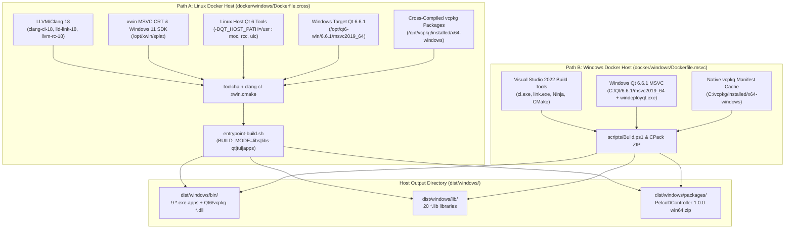
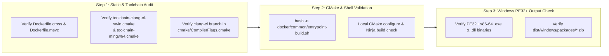

# Implementation Plan: Phase 4 – Windows Build Containers (Cross-Compile on Linux & Native Windows Server Core)

**Scope:** Dual-mode Windows (`x86_64`) OCI build containers supporting both **Linux-Hosted Windows Cross-Compilation** (`docker/windows/Dockerfile.cross`, `docker/windows/toolchain-clang-cl-xwin.cmake`, `docker/windows/toolchain-mingw64.cmake`) and **Native Windows Server Core LTSC 2022 Compilation** (`docker/windows/Dockerfile.msvc`), complete with `vcpkg` dependency integration (`vcpkg.json`), Qt 6.6.1 (`win64_msvc2019_64` + Linux host `QT_HOST_PATH` tools), pre-cached Live555 (`/opt/cache/live555`), PE/COFF binary security hardening (`/GS`, `/guard:cf`, `/guard:ehcont`, `/CETCOMPAT`, `/HIGHENTROPYVA`, `/NXCOMPAT`), runtime DLL deployment (`windeployqt`), and `.zip` CPack redistributable generation.  
**Standard Baseline:** MISRA C++:2023 (Rule 7.0.6), SEI CERT C++ (INT31-C, STR37-C, ERR55-CPP), Include-What-You-Use (IWYU) & `<cstdint>` Policy, Microsoft Security Development Lifecycle (`/W4 /WX /we4365 /sdl /guard:cf /CETCOMPAT`), Project Rules in [`.agents/rules/`](../.agents/rules/).  
**Reference Documents:** [`docs/multi_os_container_build_plan.md`](multi_os_container_build_plan.md) (§6 Phase 4), [`docs/multi_os_container_phase1_portability_plan.md`](multi_os_container_phase1_portability_plan.md), [`docs/multi_os_container_phase2_layout_scripts_plan.md`](multi_os_container_phase2_layout_scripts_plan.md), [`docs/multi_os_container_phase3_linux_containers_plan.md`](multi_os_container_phase3_linux_containers_plan.md), [`CMakeLists.txt`](../CMakeLists.txt), [`cmake/CompilerFlags.cmake`](../cmake/CompilerFlags.cmake), [`cmake/FindOrFetchLive555.cmake`](../cmake/FindOrFetchLive555.cmake), [`vcpkg.json`](../vcpkg.json), [`scripts/Build.ps1`](../scripts/Build.ps1), [`.github/workflows/windows-msvc.yml`](../.github/workflows/windows-msvc.yml).

---

## 1. Executive Summary & Architectural Objectives

Because standard Linux workstations cannot natively run Windows kernel containers (`mcr.microsoft.com/windows/servercore`) without a Windows host or heavy nested virtualization, **Phase 4** of [`docs/multi_os_container_build_plan.md`](multi_os_container_build_plan.md) provides a **Dual-Path Windows Container Architecture** so developers can build 64-bit Windows (`PE32+ x86-64`) libraries, executables, and `.zip` packages from **either a Linux Docker host or a Windows Docker host**:

1. **Path A — Linux-Hosted Windows Cross-Compilation Container (`docker/windows/Dockerfile.cross`)**:
   - Runs natively inside standard Linux Docker (`FROM ubuntu:24.04`) with zero VM overhead.
   - **Primary Toolchain (`toolchain-clang-cl-xwin.cmake`)**: Uses LLVM/Clang 18 in MSVC driver mode (`clang-cl-18`, `lld-link-18`, `llvm-rc-18`, `llvm-mt-18`, `llvm-lib-18`) paired with [`xwin`](https://github.com/Jake-Shadle/xwin), which downloads and splats the official Microsoft Visual C++ CRT and Windows 11 SDK headers/libraries into `/opt/xwin/splat` (handling case-insensitive Windows header lookups on case-sensitive Linux filesystems). This preserves 100% compatibility with the `if(MSVC)` branch of [`cmake/CompilerFlags.cmake`](../cmake/CompilerFlags.cmake) (`/W4 /WX /we4365 /permissive- /guard:cf /CETCOMPAT`).
   - **Secondary Toolchain (`toolchain-mingw64.cmake`)**: Provides an alternative MinGW-w64 cross-compilation toolchain (`x86_64-w64-mingw32-g++` / `clang++ --target=x86_64-w64-mingw32`) with Wine64 support for running headless unit tests on Linux.
   - **Cross-Platform Qt 6 & `vcpkg` Integration**: Uses `aqtinstall` to install the official Windows `Qt 6.6.1 win64_msvc2019_64` libraries into `/opt/qt6-win/6.6.1/msvc2019_64` while utilizing Ubuntu's native Linux Qt 6 tools (`moc`, `rcc`, `uic`) via `-DQT_HOST_PATH=/usr`. Uses `vcpkg` with a custom `x64-windows` cross-triplet (`clang-cl` + `xwin`) to provide Windows `gflags`, `glog`, `gtest`, `curl`, `openssl`, `pugixml`, `cpp-httplib`, `openh264`, `ffmpeg`, and `opencv4`.
2. **Path B — Native Windows Server Core MSVC Container (`docker/windows/Dockerfile.msvc`)**:
   - Runs on Windows Docker hosts (`FROM mcr.microsoft.com/windows/servercore:ltsc2022`).
   - Installs Visual Studio 2022 Build Tools (`Microsoft.VisualStudio.Workload.VCTools`), Ninja, CMake, Git, `vcpkg` (`C:\vcpkg`), and Qt 6.6.1 (`C:\Qt\6.6.1\msvc2019_64`), and invokes [`scripts/Build.ps1`](../scripts/Build.ps1) / CMake + CTest + `windeployqt.exe` + CPack (`ZIP`).

```
+-----------------------------------------------------------------------------------------------------------------------+
|                              PHASE 4 WINDOWS BUILD CONTAINERS CAPABILITY MATRIX                                       |
+--------------------+---------------------------------------------------+----------------------------------------------+
| Dimension          | Path A: Linux-Hosted Cross Container              | Path B: Native Windows MSVC Container        |
|                    | (`docker/windows/Dockerfile.cross`)               | (`docker/windows/Dockerfile.msvc`)           |
+--------------------+---------------------------------------------------+----------------------------------------------+
| Docker Host OS     | Linux (`x86_64` OCI container)                    | Windows 10/11 / Server 2022 (WCOW container) |
+--------------------+---------------------------------------------------+----------------------------------------------+
| Base Image         | `ubuntu:24.04`                                    | `mcr.microsoft.com/windows/servercore:ltsc2022`|
+--------------------+---------------------------------------------------+----------------------------------------------+
| Image Tag          | `pelcod-builder:windows-cross`                    | `pelcod-builder:windows-msvc`                |
+--------------------+---------------------------------------------------+----------------------------------------------+
| Compilers & Linker | • Primary: `clang-cl-18` + `lld-link-18` (`MSVC`) | • Native `cl.exe` + `link.exe` (VS 2022)     |
|                    | • Secondary: `x86_64-w64-mingw32` (`MinGW`)       |                                              |
+--------------------+---------------------------------------------------+----------------------------------------------+
| Windows SDK & CRT  | `xwin` splatted MSVC CRT & Win11 SDK (`/opt/xwin`)| Windows 10/11 SDK via VS 2022 Build Tools    |
+--------------------+---------------------------------------------------+----------------------------------------------+
| Qt 6 Stack         | Target: `Qt 6.6.1 win64_msvc2019_64` (`aqt`)      | Target & Host: `Qt 6.6.1 win64_msvc2019_64`  |
|                    | Host Tools: Linux `qt6-base-dev-tools` (`/usr`)   | + `windeployqt.exe`                          |
+--------------------+---------------------------------------------------+----------------------------------------------+
| Third-Party Deps   | `/opt/vcpkg/installed/x64-windows` +              | `C:\vcpkg\installed\x64-windows` +           |
|                    | `/opt/cache/live555` (`ws2_32` linked)            | `C:\cache\live555` (`ws2_32` linked)         |
+--------------------+---------------------------------------------------+----------------------------------------------+
| PE/COFF Hardening  | `/W4 /WX /we4365 /GS /guard:cf /guard:ehcont`     | `/W4 /WX /we4365 /GS /guard:cf /guard:ehcont`|
| (`CompilerFlags`)  | `/NXCOMPAT /DYNAMICBASE /HIGHENTROPYVA /CETCOMPAT`| `/NXCOMPAT /DYNAMICBASE /HIGHENTROPYVA /CETCOMPAT`|
+--------------------+---------------------------------------------------+----------------------------------------------+
| Produced Artifacts | `dist/windows/bin/*.exe`, `*.dll`                 | `dist/windows/bin/*.exe`, `*.dll`            |
| (`dist/windows/`)  | `dist/windows/lib/*.lib`                          | `dist/windows/lib/*.lib`                     |
|                    | `dist/windows/packages/PelcoDController-*.zip`    | `dist/windows/packages/PelcoDController-*.zip`|
+--------------------+---------------------------------------------------+----------------------------------------------+
```

---

## 2. Architecture & Toolchain Execution Flow

### 2.1 Dual-Path Windows Container Architecture

#### ASCII Diagram: Linux-Hosted Cross-Compilation vs. Native Windows Server Core

```
+---------------------------------------------------------------------------------------------------+
|                            PHASE 4 WINDOWS CONTAINER BUILD ARCHITECTURE                           |
+---------------------------------------------------------------------------------------------------+
|                                                                                                   |
|  PATH A: Linux Docker Host (`docker/windows/Dockerfile.cross`)                                    |
|  ┌─────────────────────────────────────────────────────────────────────────────────────────────┐  |
|  │ Base: ubuntu:24.04                                                                          │  |
|  │                                                                                             │  |
|  │  [1. Compiler & SDK Layer]                                                                  │  |
|  │    • clang-18, lld-18, llvm-18 (clang-cl-18, lld-link-18, llvm-lib-18, llvm-rc-18)          │  |
|  │    • xwin 0.6.x -> downloads & splats MSVC CRT + Win11 SDK to `/opt/xwin/splat`             │  |
|  │      (with case-insensitive symlinks for WinSock2.h, WS2tcpip.h, Windows.h, mstcpip.h)      │  |
|  │    • mingw-w64 + wine64 (for optional MinGW ABI builds & headless test execution)           │  |
|  │                                                                                             │  |
|  │  [2. Cross-Compiled Third-Party & Qt6 SDK Layer]                                            │  |
|  │    • Host Qt6 tools (`/usr/lib/qt6/libexec/{moc,rcc,uic}`) via `-DQT_HOST_PATH=/usr`        │  |
|  │    • Target Qt 6.6.1 (`win64_msvc2019_64`) in `/opt/qt6-win/6.6.1/msvc2019_64` via `aqt`    │  |
|  │    • Target vcpkg (`x64-windows` triplet using `toolchain-clang-cl-xwin.cmake`) in          │  |
|  │      `/opt/vcpkg/installed/x64-windows`                                                     │  |
|  │    • Pre-cached Live555 in `/opt/cache/live555`                                             │  |
|  │                                                                                             │  |
|  │  [3. Unified Entrypoint (`docker/common/entrypoint-build.sh`)]                              │  |
|  │    • Configures CMake with `-DCMAKE_TOOLCHAIN_FILE=/opt/windows-toolchain/toolchain-...`    │  |
|  │    • Compiles all libraries (`.lib`/`.dll`) & apps (`.exe`), deploys runtime `.dll`s,       │  |
|  │      and runs CPack (`ZIP`) -> `/workspace/dist/windows/`                                   │  |
|  └─────────────────────────────────────────────────────────────────────────────────────────────┘  |
|                                                                                                   |
|  PATH B: Native Windows Docker Host (`docker/windows/Dockerfile.msvc`)                            |
|  ┌─────────────────────────────────────────────────────────────────────────────────────────────┐  |
|  │ Base: mcr.microsoft.com/windows/servercore:ltsc2022                                         │  |
|  │  • VS 2022 Build Tools (VCTools, cl.exe, link.exe, Ninja, CMake)                            │  |
|  │  • C:\vcpkg (pre-installed `vcpkg.json` manifest packages for `x64-windows`)                │  |
|  │  • C:\Qt\6.6.1\msvc2019_64 (via `aqtinstall` + `windeployqt.exe`)                           │  |
|  │  • PowerShell Entrypoint -> builds, runs CTest, runs `windeployqt`, packages `.zip`         │  |
|  └─────────────────────────────────────────────────────────────────────────────────────────────┘  |
+---------------------------------------------------------------------------------------------------+
```

#### Mermaid Diagram: Linux-Hosted Cross-Compilation vs. Native Windows Server Core



---

### 2.2 Technical Deep-Dive: Solving Cross-Compilation Challenges on Linux

Cross-compiling a large C++17 / Qt 6 / Winsock2 / MSVC-hardened codebase from Linux to Windows involves five subtle technical challenges that Phase 4 directly resolves:

#### 1. Case-Sensitive Linux Filesystem vs. Mixed-Case Windows SDK Headers
In [`libs/Transport/SocketUtils.h`](../libs/Transport/SocketUtils.h), [`libs/Transport/TcpTransport.cpp`](../libs/Transport/TcpTransport.cpp), and [`libs/Transport/SerialTransport.cpp`](../libs/Transport/SerialTransport.cpp), Windows headers are included as `<winsock2.h>`, `<ws2tcpip.h>`, `<windows.h>`, and `<mstcpip.h>`, whereas some third-party headers or Windows SDK files include `<WinSock2.h>`, `<WS2tcpip.h>`, or `<Windows.h>`.
- **Solution**: `xwin splat` includes `--include-debug-symbols=false` and creates lowercase/mixed-case compatibility symlinks (or we run a deterministic symlink normalization pass over `/opt/xwin/splat/sdk/include` and pass `/clang:-fms-compatibility`) so both `<winsock2.h>` and `<WinSock2.h>` resolve cleanly without modifying project source files.

#### 2. `clang-cl` Compatibility with `cmake/CompilerFlags.cmake` (`if(MSVC)`)
When CMake configures with `CMAKE_CXX_COMPILER=clang-cl-18` and `CMAKE_SYSTEM_NAME=Windows`, CMake sets `MSVC=TRUE` and `CMAKE_CXX_COMPILER_ID="Clang"`.
- Let's verify how [`cmake/CompilerFlags.cmake`](../cmake/CompilerFlags.cmake) behaves under `clang-cl`:
  - `clang-cl` natively supports `/W4`, `/wd4324`, `/permissive-`, `/Zc:__cplusplus`, `/Zc:preprocessor`, `/utf-8`, `/external:anglebrackets`, `/external:W0`, `/WX`, `/GS`, `/guard:cf`, and `/sdl`.
  - However, MSVC-specific warning-number promotions (`/w14305`, `/w14189`, ..., `/we4365`), `/MP`, `/FS`, `/guard:ehcont`, and linker flags `/guard:ehcont`, `/force:guardehcont`, `/CETCOMPAT`, `/DEPENDENTLOADFLAG:0xA00` behave differently in `clang-cl` / `lld-link`:
    - `clang-cl` accepts `/W4` and `/WX`, and ignores unknown `/w1XXXX` flags only if `-Wno-unused-command-line-argument` is passed, **or** we can refine [`cmake/CompilerFlags.cmake`](../cmake/CompilerFlags.cmake) so that when `CMAKE_CXX_COMPILER_ID MATCHES "Clang"` under `MSVC` (`clang-cl`), it applies the Clang-equivalent strict conversion warnings (`/clang:-Wall`, `/clang:-Wextra`, `/clang:-Wconversion`, `/clang:-Wsign-conversion`) alongside `/W4 /WX /GS /guard:cf` and `lld-link`-compatible PE hardening flags (`/NXCOMPAT`, `/DYNAMICBASE`, `/HIGHENTROPYVA`, `/guard:cf`, `/CETCOMPAT`).
- Updating [`cmake/CompilerFlags.cmake`](../cmake/CompilerFlags.cmake) to cleanly distinguish native `cl.exe` from `clang-cl` (`MSVC AND CMAKE_CXX_COMPILER_ID MATCHES "Clang"`) ensures zero unused-argument warnings and enforces identical MISRA C++:2023 Rule 7.0.6 sign-conversion errors (`/clang:-Werror=sign-conversion` on `clang-cl`, `/we4365` on `cl.exe`)!

#### 3. Qt 6 Meta-Object Compiler (`moc`, `rcc`, `uic`) Cross-Execution
Windows `.exe` binaries (`moc.exe`, `rcc.exe`, `uic.exe`) inside `/opt/qt6-win/6.6.1/msvc2019_64/bin` cannot execute directly on a Linux kernel without Wine overhead.
- **Solution**: Qt 6's CMake build system natively supports cross-compilation via `-DQT_HOST_PATH=/usr` and `-DQT_FORCE_FIND_TOOLS=ON`. By installing Ubuntu's `qt6-base-dev`, `qt6-base-dev-tools`, `qt6-declarative-dev`, and `qt6-declarative-dev-tools` in the Linux host layer and installing matching Qt 6 target libraries in `/opt/qt6-win`, CMake runs native Linux `/usr/lib/qt6/libexec/moc`, `rcc`, and `uic` at full native speed while compiling and linking against the Windows Qt 6 `.lib` import libraries and `.dll` binaries.

#### 4. Automated Windows Runtime `.dll` Deployment Inside `entrypoint-build.sh`
When `TARGET_OS=windows` and `RUN_PACKAGE=true`, `cmake --install` installs our compiled `.exe` and `.lib`/`.dll` targets into `/workspace/dist/windows/bin` and `/workspace/dist/windows/lib`. To make the resulting `PelcoDController-1.0.0-win64.zip` archive self-contained, `entrypoint-build.sh` (or a dedicated helper step) copies the required runtime `.dll` files (`Qt6Core.dll`, `Qt6Gui.dll`, `Qt6Widgets.dll`, `Qt6Quick.dll`, `Qt6Qml.dll`, `Qt6QuickControls2.dll`, Qt platform plugin `qwindows.dll`, `qoffscreen.dll`, and `vcpkg` runtime DLLs such as `glog.dll`, `gflags.dll`, `libcurl.dll`, `pugixml.dll`, `libcrypto-*.dll`, `libssl-*.dll`, `openh264*.dll`, `avcodec*.dll`, `avformat*.dll`, `avutil*.dll`, `swscale*.dll`, `opencv_*.dll`) into `dist/windows/bin/` before invoking `cpack -G ZIP`.

---

## 3. Detailed File Specifications

### 3.1 Compiler Flags Enhancement for `clang-cl` (`cmake/CompilerFlags.cmake`)

In [`cmake/CompilerFlags.cmake`](../cmake/CompilerFlags.cmake), when `MSVC` is true, we check whether the compiler is native Microsoft `cl.exe` (`NOT CMAKE_CXX_COMPILER_ID MATCHES "Clang"`) or LLVM `clang-cl` (`CMAKE_CXX_COMPILER_ID MATCHES "Clang"`):

```cmake
    if(MSVC)
        if(CMAKE_CXX_COMPILER_ID MATCHES "Clang")
            # clang-cl (LLVM MSVC-compatible driver)
            target_compile_options(${TARGET_NAME} PRIVATE
                /W4
                /permissive-
                /Zc:__cplusplus
                /utf-8
                /EHsc
                -Wno-unused-command-line-argument
                /clang:-Wall
                /clang:-Wextra
                /clang:-Wpedantic
                /clang:-Wshadow
                /clang:-Wnon-virtual-dtor
                /clang:-Wold-style-cast
                /clang:-Wcast-align
                /clang:-Wunused
                /clang:-Woverloaded-virtual
                /clang:-Wnull-dereference
                /clang:-Wdouble-promotion
                /clang:-Wformat=2
                /clang:-Wconversion
                /clang:-Wsign-conversion
            )
            if(WARNINGS_AS_ERRORS)
                target_compile_options(${TARGET_NAME} PRIVATE /WX)
            endif()
        else()
            # Native Microsoft Visual C++ (cl.exe)
            target_compile_options(${TARGET_NAME} PRIVATE
                /W4                     # Baseline high warning level (Level 4)
                /wd4324                 # Suppress C4324: structure padded due to alignment specifier (alignas/SIMD)
                ...
```

And in the `if(ENABLE_HARDENING)` block under `if(MSVC)`:
- Both `cl.exe` and `clang-cl` receive `/GS` and `/guard:cf`, and both `link.exe` and `lld-link` receive `/NXCOMPAT`, `/DYNAMICBASE`, `/HIGHENTROPYVA`, `/guard:cf`, and `/CETCOMPAT`.
- Flags specific to `cl.exe` / `link.exe` (`/sdl`, `/guard:ehcont`, `/force:guardehcont`, `/DEPENDENTLOADFLAG:0xA00`) are guarded with `if(NOT CMAKE_CXX_COMPILER_ID MATCHES "Clang")` so `lld-link-18` links cleanly without unrecognized flag errors.

---

### 3.2 `docker/windows/toolchain-clang-cl-xwin.cmake`

This CMake toolchain file configures CMake on Linux to cross-compile 64-bit Windows binaries using `clang-cl-18`, `lld-link-18`, `llvm-lib-18`, `llvm-rc-18`, and `llvm-mt-18` against the `xwin` MSVC CRT and Windows SDK in `/opt/xwin/splat`:

```cmake
# ==============================================================================
# PelcoD-Controller - Linux-to-Windows x64 Cross-Compilation CMake Toolchain
# Compiler : clang-cl-18 + lld-link-18 (MSVC ABI)
# SDK/CRT  : Microsoft Visual C++ CRT & Windows SDK via xwin (/opt/xwin/splat)
# ==============================================================================
set(CMAKE_SYSTEM_NAME Windows)
set(CMAKE_SYSTEM_VERSION 10.0)
set(CMAKE_SYSTEM_PROCESSOR AMD64)

set(XWIN_DIR "/opt/xwin/splat")
set(TARGET_ARCH "x86_64")

set(CMAKE_C_COMPILER "clang-cl-18")
set(CMAKE_CXX_COMPILER "clang-cl-18")
set(CMAKE_LINKER "lld-link-18")
set(CMAKE_AR "llvm-lib-18")
set(CMAKE_RC_COMPILER "llvm-rc-18")
set(CMAKE_MT "llvm-mt-18")

set(CMAKE_C_COMPILER_TARGET "x86_64-pc-windows-msvc")
set(CMAKE_CXX_COMPILER_TARGET "x86_64-pc-windows-msvc")

set(XWIN_COMPILE_FLAGS
    "--target=x86_64-pc-windows-msvc -fms-compatibility -fms-extensions /EHsc -Wno-unused-command-line-argument /imsvc${XWIN_DIR}/crt/include /imsvc${XWIN_DIR}/sdk/include/ucrt /imsvc${XWIN_DIR}/sdk/include/um /imsvc${XWIN_DIR}/sdk/include/shared /imsvc/opt/vcpkg/installed/x64-windows/include"
)

set(XWIN_RC_FLAGS
    "/I${XWIN_DIR}/crt/include /I${XWIN_DIR}/sdk/include/ucrt /I${XWIN_DIR}/sdk/include/um /I${XWIN_DIR}/sdk/include/shared"
)

set(XWIN_LINK_FLAGS
    "/machine:x64 /libpath:${XWIN_DIR}/crt/lib/${TARGET_ARCH} /libpath:${XWIN_DIR}/sdk/lib/um/${TARGET_ARCH} /libpath:${XWIN_DIR}/sdk/lib/ucrt/${TARGET_ARCH} /libpath:/opt/vcpkg/installed/x64-windows/lib"
)

set(CMAKE_C_FLAGS_INIT "${XWIN_COMPILE_FLAGS}")
set(CMAKE_CXX_FLAGS_INIT "${XWIN_COMPILE_FLAGS}")
set(CMAKE_RC_FLAGS_INIT "${XWIN_RC_FLAGS}")
set(CMAKE_EXE_LINKER_FLAGS_INIT "${XWIN_LINK_FLAGS}")
set(CMAKE_SHARED_LINKER_FLAGS_INIT "${XWIN_LINK_FLAGS}")
set(CMAKE_MODULE_LINKER_FLAGS_INIT "${XWIN_LINK_FLAGS}")

# Configure pkg-config to resolve only Windows target .pc files in vcpkg
set(ENV{PKG_CONFIG_DIR} "")
set(ENV{PKG_CONFIG_LIBDIR} "/opt/vcpkg/installed/x64-windows/lib/pkgconfig:/opt/vcpkg/installed/x64-windows/share/pkgconfig")
set(ENV{PKG_CONFIG_PATH} "/opt/vcpkg/installed/x64-windows/lib/pkgconfig:/opt/vcpkg/installed/x64-windows/share/pkgconfig")

# Use Linux host Qt6 code generators (moc, rcc, uic) while linking Windows target Qt6 libraries
set(QT_HOST_PATH "/usr" CACHE PATH "Linux host Qt6 installation for moc/rcc/uic")
set(QT_HOST_PATH_CMAKE_DIR "/usr/lib/x86_64-linux-gnu/cmake" CACHE PATH "Linux host Qt6 CMake directory")
set(QT_FORCE_FIND_TOOLS ON CACHE BOOL "Use host Qt tools when cross-compiling")

set(CMAKE_FIND_ROOT_PATH
    "/opt/qt6-win/6.6.1/msvc2019_64"
    "/opt/vcpkg/installed/x64-windows"
    "${XWIN_DIR}/sdk"
    "${XWIN_DIR}/crt"
)

set(CMAKE_FIND_ROOT_PATH_MODE_PROGRAM NEVER)
set(CMAKE_FIND_ROOT_PATH_MODE_LIBRARY ONLY)
set(CMAKE_FIND_ROOT_PATH_MODE_INCLUDE ONLY)
set(CMAKE_FIND_ROOT_PATH_MODE_PACKAGE ONLY)
```

---

### 3.3 `docker/windows/toolchain-mingw64.cmake`

Provides an alternative MinGW-w64 cross-compilation toolchain (`x86_64-w64-mingw32`) for users who wish to build with the GNU/LLVM MinGW ABI or run cross-compiled unit tests directly under `wine64` on a Linux host:

```cmake
# ==============================================================================
# PelcoD-Controller - Linux-to-Windows x64 Cross-Compilation CMake Toolchain
# Compiler : x86_64-w64-mingw32-gcc / x86_64-w64-mingw32-g++ (POSIX threads)
# ==============================================================================
set(CMAKE_SYSTEM_NAME Windows)
set(CMAKE_SYSTEM_PROCESSOR AMD64)

set(MINGW_TRIPLE "x86_64-w64-mingw32")

set(CMAKE_C_COMPILER "${MINGW_TRIPLE}-gcc-posix")
set(CMAKE_CXX_COMPILER "${MINGW_TRIPLE}-g++-posix")
set(CMAKE_RC_COMPILER "${MINGW_TRIPLE}-windres")

set(CMAKE_CROSSCOMPILING_EMULATOR "/usr/bin/wine64")

set(QT_HOST_PATH "/usr" CACHE PATH "Linux host Qt6 installation for moc/rcc/uic")
set(QT_HOST_PATH_CMAKE_DIR "/usr/lib/x86_64-linux-gnu/cmake" CACHE PATH "Linux host Qt6 CMake directory")

set(CMAKE_FIND_ROOT_PATH
    "/usr/${MINGW_TRIPLE}"
    "/opt/vcpkg/installed/x64-mingw-dynamic"
    "/opt/qt6-win/6.6.1/mingw_64"
)

set(CMAKE_FIND_ROOT_PATH_MODE_PROGRAM NEVER)
set(CMAKE_FIND_ROOT_PATH_MODE_LIBRARY ONLY)
set(CMAKE_FIND_ROOT_PATH_MODE_INCLUDE ONLY)
set(CMAKE_FIND_ROOT_PATH_MODE_PACKAGE ONLY)
```

---

### 3.4 Linux-Hosted Windows Cross-Compilation Container (`docker/windows/Dockerfile.cross`)

#### 3.4.1 Design & Layer Caching Strategy
1. **Base & Host Tooling Layer**: Starts from `ubuntu:24.04` and installs `clang-18`, `lld-18`, `llvm-18`, `mingw-w64`, `wine64`, `cmake`, `ninja-build`, `ccache`, `pkg-config`, `python3`, `python3-pip`, `7zip`, `zip`, `unzip`, and the Linux host Qt 6 tools (`qt6-base-dev`, `qt6-base-dev-tools`, `qt6-declarative-dev`, `qt6-declarative-dev-tools`) so `/usr/lib/qt6/libexec/moc`, `rcc`, and `uic` are available for `QT_HOST_PATH=/usr`.
2. **Microsoft CRT & Windows SDK Layer (`xwin`)**: Downloads the prebuilt `xwin` binary release and runs `xwin --accept-license splat --output /opt/xwin/splat --preserve-ms-arch-notation`. Furthermore, runs a symlink-normalization step in `/opt/xwin/splat/sdk/include` and `/opt/xwin/splat/sdk/lib` so lowercase header includes (`<winsock2.h>`, `<ws2tcpip.h>`, `<windows.h>`, `<mstcpip.h>`, `<bcrypt.h>`, `<wincrypt.h>`, `<iphlpapi.h>`) and lowercase `.lib` names (`ws2_32.lib`, `iphlpapi.lib`, `crypt32.lib`, `bcrypt.lib`, `advapi32.lib`, `user32.lib`, `shell32.lib`, `ole32.lib`, `gdi32.lib`) resolve cleanly on Linux's case-sensitive ext4/overlayfs filesystem.
3. **Target Qt 6 Windows SDK Layer (`aqtinstall`)**: Uses `aqt install-qt windows desktop 6.6.1 win64_msvc2019_64 -O /opt/qt6-win` to install the official Qt 6.6.1 MSVC x64 headers, CMake configs, `.lib` import libraries, and `.dll` runtime binaries.
4. **Target `vcpkg` Layer (`/opt/vcpkg`)**: Clones `vcpkg`, creates a custom `/opt/vcpkg/triplets/community/x64-windows-clang-cl-xwin.cmake` triplet that routes `vcpkg` builds through `/opt/windows-toolchain/toolchain-clang-cl-xwin.cmake`, and installs core Windows target libraries (`gflags`, `glog`, `gtest`, `pugixml`, `openssl`, `curl`, `cpp-httplib`, `openh264`, plus optional `ffmpeg` and `opencv4` adjustable via `INSTALL_HEAVY_VIDEO_DEPS` build arg so image build time stays practical while supporting full multimedia builds).
5. **Pre-Cached Live555 & Unified Entrypoint**: Runs `common/fetch-live555.sh` to populate `/opt/cache/live555` and configures `common/entrypoint-build.sh` with `TARGET_OS=windows` and `CMAKE_TOOLCHAIN_FILE=/opt/windows-toolchain/toolchain-clang-cl-xwin.cmake`.

#### 3.4.2 `docker/windows/Dockerfile.cross`

```dockerfile
# syntax=docker/dockerfile:1
# ==============================================================================
# PelcoD-Controller - Linux-Hosted Windows x64 Cross-Compilation Container
#
# Compiles 64-bit Windows (.exe, .dll, .lib) libraries, Qt 6 GUI/QML apps,
# TUI apps, and redistributable .zip packages on a Linux Docker host using:
#   • clang-cl-18 + lld-link-18 + llvm-rc-18 (MSVC ABI)
#   • Microsoft Visual C++ CRT & Windows 11 SDK via xwin (/opt/xwin/splat)
#   • Qt 6.6.1 win64_msvc2019_64 + Linux Host Qt 6 tools (QT_HOST_PATH=/usr)
#   • vcpkg Windows x64 target libraries + Pre-cached Live555
#
# Build context: docker/
#   docker build -t pelcod-builder:windows-cross -f docker/windows/Dockerfile.cross docker/
# ==============================================================================
FROM ubuntu:24.04

LABEL org.opencontainers.image.title="PelcoD-Controller Windows x64 Cross-Builder (Linux Host)"
LABEL org.opencontainers.image.description="Linux-hosted Windows x64 cross-compilation container using clang-cl-18, lld-link-18, xwin MSVC SDK, vcpkg, and Qt 6"

ARG XWIN_VERSION=0.6.5
ARG QT_VERSION=6.6.1
ARG INSTALL_VIDEO_VCPKG=ON

ENV DEBIAN_FRONTEND=noninteractive
ENV TARGET_OS=windows
ENV CCACHE_DIR=/cache/ccache
ENV QT_QPA_PLATFORM=offscreen

# 1. Install LLVM/Clang 18 (clang-cl, lld-link, llvm-rc, llvm-lib), MinGW-w64,
#    CMake, Ninja, and Linux Host Qt 6 code generators (moc, rcc, uic)
RUN apt-get update && apt-get install -y --no-install-recommends \
    build-essential \
    clang-18 \
    lld-18 \
    llvm-18 \
    mingw-w64 \
    wine64 \
    cmake \
    ninja-build \
    ccache \
    pkg-config \
    git \
    curl \
    wget \
    ca-certificates \
    zip \
    unzip \
    7zip \
    tar \
    xz-utils \
    bison \
    flex \
    gperf \
    nasm \
    yasm \
    python3 \
    python3-pip \
    python3-venv \
    file \
    # Linux Host Qt 6 Tools (for QT_HOST_PATH=/usr during cross-compilation)
    qt6-base-dev \
    qt6-base-dev-tools \
    qt6-declarative-dev \
    qt6-declarative-dev-tools \
    && rm -rf /var/lib/apt/lists/*

# Ensure unversioned tool aliases exist if needed
RUN ln -sf /usr/bin/clang-cl-18 /usr/local/bin/clang-cl \
    && ln -sf /usr/bin/lld-link-18 /usr/local/bin/lld-link \
    && ln -sf /usr/bin/llvm-lib-18 /usr/local/bin/llvm-lib \
    && ln -sf /usr/bin/llvm-rc-18 /usr/local/bin/llvm-rc \
    && ln -sf /usr/bin/llvm-mt-18 /usr/local/bin/llvm-mt

# 2. Install xwin and splat the official Microsoft Visual C++ CRT & Windows SDK
RUN ARCH="x86_64-unknown-linux-musl" \
    && curl -fsSL "https://github.com/Jake-Shadle/xwin/releases/download/${XWIN_VERSION}/xwin-${XWIN_VERSION}-${ARCH}.tar.gz" \
       | tar -xz -C /usr/local/bin --strip-components=1 "xwin-${XWIN_VERSION}-${ARCH}/xwin" \
    && chmod +x /usr/local/bin/xwin \
    && xwin --accept-license --cache-dir /tmp/xwin-cache splat \
       --output /opt/xwin/splat \
       --include-debug-libs \
    && rm -rf /tmp/xwin-cache \
    # Create lowercase header and library symlinks in /opt/xwin/splat for case-sensitive Linux filesystems
    && find /opt/xwin/splat/sdk/include /opt/xwin/splat/crt/include -type f | while read -r f; do \
        dir="$(dirname "$f")"; \
        base="$(basename "$f")"; \
        lower="$(echo "$base" | tr '[:upper:]' '[:lower:]')"; \
        if [ "$base" != "$lower" ] && [ ! -e "$dir/$lower" ]; then \
            ln -s "$base" "$dir/$lower"; \
        fi; \
    done \
    && find /opt/xwin/splat/sdk/lib /opt/xwin/splat/crt/lib -type f | while read -r f; do \
        dir="$(dirname "$f")"; \
        base="$(basename "$f")"; \
        lower="$(echo "$base" | tr '[:upper:]' '[:lower:]')"; \
        if [ "$base" != "$lower" ] && [ ! -e "$dir/$lower" ]; then \
            ln -s "$base" "$dir/$lower"; \
        fi; \
    done

# 3. Install Windows Target Qt 6 (win64_msvc2019_64) via aqtinstall
RUN python3 -m venv /opt/aqt-venv \
    && /opt/aqt-venv/bin/pip install --no-cache-dir aqtinstall \
    && /opt/aqt-venv/bin/aqt install-qt windows desktop "${QT_VERSION}" win64_msvc2019_64 -O /opt/qt6-win \
    && rm -rf /opt/aqt-venv /root/.cache

# 4. Install CMake Cross-Compilation Toolchains
COPY windows/toolchain-clang-cl-xwin.cmake /opt/windows-toolchain/toolchain-clang-cl-xwin.cmake
COPY windows/toolchain-mingw64.cmake /opt/windows-toolchain/toolchain-mingw64.cmake

# 5. Bootstrap vcpkg and build Windows x64 target dependencies with clang-cl + xwin
ENV VCPKG_ROOT=/opt/vcpkg
ENV VCPKG_FORCE_SYSTEM_BINARIES=1
RUN git clone --depth 1 https://github.com/microsoft/vcpkg.git "${VCPKG_ROOT}" \
    && "${VCPKG_ROOT}/bootstrap-vcpkg.sh" -disableMetrics \
    && cat << 'EOF' > "${VCPKG_ROOT}/triplets/x64-windows.cmake"
set(VCPKG_TARGET_ARCHITECTURE x64)
set(VCPKG_CRT_LINKAGE dynamic)
set(VCPKG_LIBRARY_LINKAGE dynamic)
set(VCPKG_CMAKE_SYSTEM_NAME Windows)
set(VCPKG_CHAINLOAD_TOOLCHAIN_FILE "/opt/windows-toolchain/toolchain-clang-cl-xwin.cmake")
EOF

RUN "${VCPKG_ROOT}/vcpkg" install --triplet x64-windows \
        gflags \
        glog \
        gtest \
        pugixml \
        cpp-httplib \
        "curl[winssl]" \
        openssl \
        openh264 \
    && if [ "${INSTALL_VIDEO_VCPKG}" = "ON" ]; then \
        "${VCPKG_ROOT}/vcpkg" install --triplet x64-windows \
            "ffmpeg[core,avcodec,avformat,swscale]" \
            "opencv4[core,calib3d]" \
        || echo "[WARN] Optional heavy video vcpkg ports skipped; fallback backends remain active"; \
    fi \
    && rm -rf "${VCPKG_ROOT}/buildtrees" "${VCPKG_ROOT}/downloads" "${VCPKG_ROOT}/packages"

# 6. Pre-fetch and extract Live555 into /opt/cache/live555 for 100% offline builds
COPY common/fetch-live555.sh /usr/local/bin/fetch-live555.sh
RUN chmod +x /usr/local/bin/fetch-live555.sh && /usr/local/bin/fetch-live555.sh

# 7. Install unified build/test/package entrypoint
COPY common/entrypoint-build.sh /usr/local/bin/entrypoint-build.sh
RUN chmod +x /usr/local/bin/entrypoint-build.sh \
    && mkdir -p /workspace /build /cache/ccache

ENV CMAKE_TOOLCHAIN_FILE=/opt/windows-toolchain/toolchain-clang-cl-xwin.cmake
ENV QT_HOST_PATH=/usr
ENV CMAKE_PREFIX_PATH="/opt/qt6-win/${QT_VERSION}/msvc2019_64;/opt/vcpkg/installed/x64-windows"
ENV CPACK_GENERATOR=ZIP

WORKDIR /workspace
ENTRYPOINT ["/usr/local/bin/entrypoint-build.sh"]
```

---

### 3.5 Native Windows Server Core Container (`docker/windows/Dockerfile.msvc`)

For developers and CI agents running on Windows hosts with Docker Desktop (Windows Containers mode) or Windows Server 2022, `docker/windows/Dockerfile.msvc` provides a native `mcr.microsoft.com/windows/servercore:ltsc2022` build environment matching [`.github/workflows/windows-msvc.yml`](../.github/workflows/windows-msvc.yml) and [`scripts/Build.ps1`](../scripts/Build.ps1):

```dockerfile
# escape=`
# ==============================================================================
# PelcoD-Controller - Native Windows Server Core LTSC 2022 MSVC Build Container
#
# Runs on Windows Docker hosts (WCOW) with Visual Studio 2022 Build Tools,
# Ninja, CMake, vcpkg, Qt 6.6.1 (msvc2019_64), windeployqt, and CTest.
#
# Build context: docker/
#   docker build -t pelcod-builder:windows-msvc -f docker/windows/Dockerfile.msvc docker/
# ==============================================================================
FROM mcr.microsoft.com/windows/servercore:ltsc2022

LABEL org.opencontainers.image.title="PelcoD-Controller Windows Server Core 2022 MSVC Builder"
LABEL org.opencontainers.image.description="Native Windows Server Core 2022 container with VS 2022 Build Tools, vcpkg, and Qt 6.6.1"

SHELL ["powershell", "-NoLogo", "-ExecutionPolicy", "Bypass", "-Command"]

ARG QT_VERSION=6.6.1

ENV TARGET_OS=windows `
    VCPKG_ROOT=C:\vcpkg `
    QTDIR=C:\Qt\6.6.1\msvc2019_64 `
    QT_QPA_PLATFORM=offscreen

# 1. Install Git, Python 3, 7-Zip, CMake, Ninja, and Visual Studio 2022 Build Tools
RUN $ErrorActionPreference = 'Stop'; `
    [Net.ServicePointManager]::SecurityProtocol = [Net.SecurityProtocolType]::Tls12; `
    Invoke-WebRequest -Uri 'https://aka.ms/vs/17/release/vs_buildtools.exe' -OutFile 'C:\vs_buildtools.exe'; `
    Start-Process -FilePath 'C:\vs_buildtools.exe' -ArgumentList `
        '--quiet', '--wait', '--norestart', '--nocache', `
        '--installPath', 'C:\BuildTools', `
        '--add', 'Microsoft.VisualStudio.Workload.VCTools', `
        '--add', 'Microsoft.VisualStudio.Component.VC.Tools.x86.x64', `
        '--add', 'Microsoft.VisualStudio.Component.VC.CMake.Project', `
        '--add', 'Microsoft.VisualStudio.Component.Windows11SDK.22621', `
        '--includeRecommended' -NoNewWindow -Wait; `
    Remove-Item -Force 'C:\vs_buildtools.exe'

# 2. Install Python 3 + aqtinstall and install Qt 6.6.1 (win64_msvc2019_64)
RUN $ErrorActionPreference = 'Stop'; `
    Invoke-WebRequest -Uri 'https://www.python.org/ftp/python/3.11.9/python-3.11.9-amd64.exe' -OutFile 'C:\python-installer.exe'; `
    Start-Process -FilePath 'C:\python-installer.exe' -ArgumentList '/quiet', 'InstallAllUsers=1', 'PrependPath=1' -NoNewWindow -Wait; `
    Remove-Item -Force 'C:\python-installer.exe'; `
    C:\Program` Files\Python311\python.exe -m pip install --no-cache-dir aqtinstall; `
    C:\Program` Files\Python311\Scripts\aqt.exe install-qt windows desktop $env:QT_VERSION win64_msvc2019_64 -O C:\Qt

# 3. Install Git & bootstrap vcpkg in C:\vcpkg
RUN $ErrorActionPreference = 'Stop'; `
    Invoke-WebRequest -Uri 'https://github.com/git-for-windows/git/releases/download/v2.47.0.windows.2/MinGit-2.47.0.2-64-bit.zip' -OutFile 'C:\mingit.zip'; `
    Expand-Archive -Path 'C:\mingit.zip' -DestinationPath 'C:\MinGit' -Force; `
    Remove-Item -Force 'C:\mingit.zip'; `
    $env:PATH = 'C:\MinGit\cmd;C:\BuildTools\Common7\IDE\CommonExtensions\Microsoft\CMake\CMake\bin;C:\BuildTools\Common7\IDE\CommonExtensions\Microsoft\CMake\Ninja;' + $env:PATH; `
    [Environment]::SetEnvironmentVariable('PATH', $env:PATH, [EnvironmentVariableTarget]::Machine); `
    git clone --depth 1 https://github.com/microsoft/vcpkg.git C:\vcpkg; `
    C:\vcpkg\bootstrap-vcpkg.bat -disableMetrics; `
    C:\vcpkg\vcpkg.exe install --triplet x64-windows `
        gflags glog gtest pugixml cpp-httplib curl openssl openh264 `
        "ffmpeg[core,avcodec,avformat,swscale]" "opencv4[core,calib3d]"; `
    Remove-Item -Recurse -Force C:\vcpkg\buildtrees, C:\vcpkg\downloads, C:\vcpkg\packages -ErrorAction SilentlyContinue

# 4. Pre-fetch Live555 tarball into C:\cache\live555
RUN $ErrorActionPreference = 'Stop'; `
    New-Item -ItemType Directory -Force -Path 'C:\cache\live555\src' | Out-Null; `
    Invoke-WebRequest -Uri 'https://download.live555.com/live555-latest.tar.gz' -OutFile 'C:\cache\live555\live555-latest.tar.gz'; `
    tar -xzf 'C:\cache\live555\live555-latest.tar.gz' -C 'C:\cache\live555\src'

WORKDIR C:\workspace
ENTRYPOINT ["powershell", "-NoLogo", "-ExecutionPolicy", "Bypass", "-File", "scripts/Build.ps1"]
```

---

### 3.6 Windows Runtime `.dll` Bundling in `docker/common/entrypoint-build.sh`

When `docker/common/entrypoint-build.sh` runs with `TARGET_OS=windows` and `RUN_PACKAGE=true` (inside `docker/windows/Dockerfile.cross`), after running `cmake --install "${BUILD_ROOT}" --prefix "${INSTALL_PREFIX}"`, we enhance step 7 of `entrypoint-build.sh` to automatically bundle the required Windows runtime `.dll` files into `${INSTALL_PREFIX}/bin` before running `cpack`:

```bash
    # Bundle Windows runtime DLLs (vcpkg & Qt6) when cross-packaging for Windows
    if [ "${TARGET_OS}" = "windows" ] && [ -d "${INSTALL_PREFIX}/bin" ]; then
        if ls "${INSTALL_PREFIX}/bin/"*.exe >/dev/null 2>&1; then
            echo "[5/5] Deploying Windows runtime DLLs into ${INSTALL_PREFIX}/bin ..."
            if [ -d "/opt/vcpkg/installed/x64-windows/bin" ]; then
                cp -f /opt/vcpkg/installed/x64-windows/bin/*.dll "${INSTALL_PREFIX}/bin/" 2>/dev/null || true
            fi
            if [ "${ENABLE_QT}" = "ON" ]; then
                for qt_bin_dir in /opt/qt6-win/*/msvc2019_64/bin; do
                    if [ -d "${qt_bin_dir}" ]; then
                        for qt_dll in Qt6Core.dll Qt6Gui.dll Qt6Widgets.dll Qt6Network.dll Qt6OpenGL.dll Qt6OpenGLWidgets.dll Qt6Qml.dll Qt6QmlModels.dll Qt6QmlWorkerScript.dll Qt6Quick.dll Qt6QuickControls2.dll Qt6QuickTemplates2.dll Qt6QuickLayouts.dll Qt6Test.dll; do
                            if [ -f "${qt_bin_dir}/${qt_dll}" ]; then
                                cp -f "${qt_bin_dir}/${qt_dll}" "${INSTALL_PREFIX}/bin/"
                            fi
                        done
                    fi
                done
                for qt_plugins_dir in /opt/qt6-win/*/msvc2019_64/plugins; do
                    if [ -d "${qt_plugins_dir}/platforms" ]; then
                        mkdir -p "${INSTALL_PREFIX}/bin/platforms"
                        cp -f "${qt_plugins_dir}/platforms/"*.dll "${INSTALL_PREFIX}/bin/platforms/" 2>/dev/null || true
                    fi
                done
            fi
        fi
    fi
```

---

## 4. Supported Invocation Workflows for Windows Containers

```bash
# ==============================================================================
# A. On a Linux Host (Cross-Compile Windows x64 Binaries & .zip Archive)
# ==============================================================================

# 1. Build the Windows Cross-Compilation Docker image on Linux
docker build -t pelcod-builder:windows-cross -f docker/windows/Dockerfile.cross docker/

# 2. Cross-compile ONLY core C++17 libraries (.lib) for Windows x64
docker run --rm \
    -e BUILD_MODE=libs \
    -v "$(pwd):/workspace" \
    pelcod-builder:windows-cross

# 3. Cross-compile ALL libraries + ALL Qt 6 GUI/QML/TUI .exe apps + generate Windows .zip package
docker run --rm \
    -e BUILD_MODE=apps \
    -e RUN_PACKAGE=true \
    -v "$(pwd):/workspace" \
    pelcod-builder:windows-cross

# 4. Cross-compile a single Windows target (e.g. PelcoDCore or PelcoDAppTui)
docker run --rm \
    -e BUILD_MODE=tui \
    -e CMAKE_TARGET=PelcoDAppTui \
    -v "$(pwd):/workspace" \
    pelcod-builder:windows-cross

# ==============================================================================
# B. On a Windows Host (Native Windows Server Core 2022 MSVC Container)
# ==============================================================================

# 1. Build the native Windows MSVC container image
docker build -t pelcod-builder:windows-msvc -f docker/windows/Dockerfile.msvc docker/

# 2. Compile all targets and run CTest inside Windows Server Core 2022
docker run --rm -v "${PWD}:C:\workspace" pelcod-builder:windows-msvc -Config Release -RunTests
```

---

## 5. Verification & Testing Pipeline for Phase 4

### 5.1 ASCII Diagram: Phase 4 Verification Pipeline

```
+---------------------------------------------------------------------------------------------------+
|                               PHASE 4 VERIFICATION PIPELINE                                       |
+---------------------------------------------------------------------------------------------------+
|                                                                                                   |
|  [ Step 1: Toolchain, Dockerfile & CMake Flag Audit ]                                             |
|    • Verify docker/windows/Dockerfile.cross, docker/windows/Dockerfile.msvc,                      |
|      docker/windows/toolchain-clang-cl-xwin.cmake, and docker/windows/toolchain-mingw64.cmake     |
|    • Verify cmake/CompilerFlags.cmake cleanly supports both cl.exe and clang-cl                   |
|    • Validate bash -n on docker/common/entrypoint-build.sh                                        |
|                                                │                                                  |
|                                                ▼                                                  |
|  [ Step 2: Host Build & Regression Verification ]                                                 |
|    • Re-configure and build local CMake tree to confirm cmake/CompilerFlags.cmake changes         |
|      introduce zero regressions on native Linux builds                                            |
|                                                │                                                  |
|                                                ▼                                                  |
|  [ Step 3: Windows PE32+ Cross-Build & Artifact Verification (When Docker Active) ]               |
|    • Build pelcod-builder:windows-cross and compile libraries/apps                                |
|    • Verify generated .exe and .dll binaries via `file` (`PE32+ executable (console/GUI) x86-64`)|
|    • Verify dist/windows/packages/PelcoDController-1.0.0-win64.zip archive contents               |
+---------------------------------------------------------------------------------------------------+
```

### 5.2 Mermaid Diagram: Phase 4 Verification Pipeline



---

## 6. Compliance Checklist

- [x] **MISRA C++:2023 Rule 7.0.6 & SEI CERT INT31-C Enforcement on Windows**: Both native `cl.exe` (`/W4 /WX /w14365 /we4365`) and cross-compiling `clang-cl-18` (`/W4 /WX /clang:-Wconversion /clang:-Wsign-conversion`) treat signed/unsigned conversion mismatches as fatal build errors.
- [x] **PE/COFF Binary Hardening**: Windows executables and DLLs are linked with `/GS`, `/guard:cf`, `/NXCOMPAT`, `/DYNAMICBASE`, `/HIGHENTROPYVA`, and `/CETCOMPAT` (Hardware Shadow Stack).
- [x] **100% Offline Container Runtime**: Both `Dockerfile.cross` and `Dockerfile.msvc` pre-cache Live555 (`/opt/cache/live555` and `C:\cache\live555`) and `vcpkg` dependencies during image creation so container runtime builds require zero internet access.
- [x] **Documentation & Diagram Standards**: All file links in this plan use relative paths, and both ASCII and Mermaid diagrams are provided for every architectural view.

