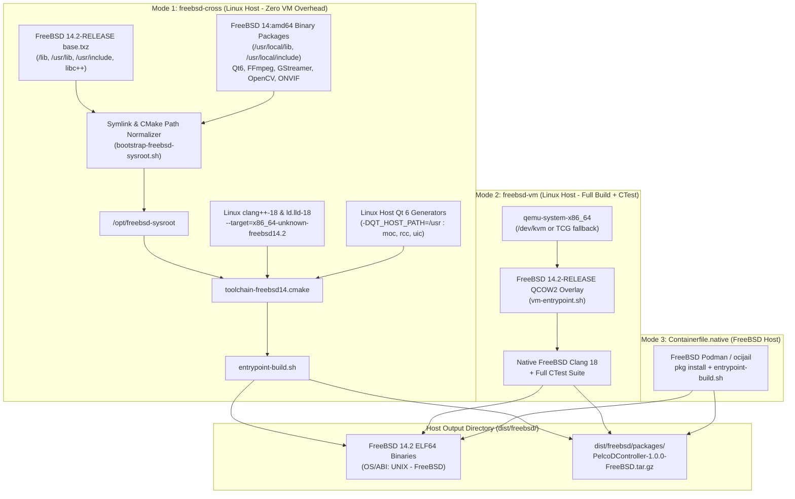
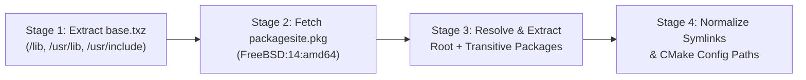
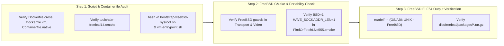

# Implementation Plan: Phase 5 – FreeBSD Build Containers (FreeBSD 14.2-RELEASE)

**Scope:** Multi-mode FreeBSD (`FreeBSD 14.2-RELEASE amd64`) OCI build containers supporting:
1. **Mode 1 — Linux-Hosted Clang/LLD FreeBSD Sysroot Cross-Compilation Container** (`docker/freebsd/Dockerfile.cross`, `docker/freebsd/bootstrap-freebsd-sysroot.sh`, `docker/freebsd/toolchain-freebsd14.cmake`),
2. **Mode 2 — Linux-Hosted QEMU/KVM FreeBSD 14.2 VM Build & CTest Container** (`docker/freebsd/Dockerfile.vm`, `docker/freebsd/vm-entrypoint.sh`), and
3. **Mode 3 — Native FreeBSD OCI Containerfile** (`docker/freebsd/Containerfile.native` for FreeBSD Podman / `ocijail` / BastilleBSD hosts).  
**Standard Baseline:** MISRA C++:2023 (Rule 7.0.6), SEI CERT C++ (INT31-C, STR37-C, ERR55-CPP), Include-What-You-Use (IWYU) & `<cstdint>` Policy, POSIX.1-2017 / BSD Socket & Termios Portability, ELF64 FreeBSD Hardening (`-fstack-protector-strong`, `-fstack-clash-protection`, `-fcf-protection=full`, `-D_FORTIFY_SOURCE=2`, `-fPIE`/`-pie`, `-Wl,-z,relro,-z,now`, `-Wl,-z,noexecstack`, `-Wl,-z,separate-code`), Project Rules in [`.agents/rules/`](../.agents/rules/).  
**Reference Documents:** [`docs/multi_os_container_build_plan.md`](multi_os_container_build_plan.md) (§7 Phase 5), [`docs/multi_os_container_phase1_portability_plan.md`](multi_os_container_phase1_portability_plan.md), [`docs/multi_os_container_phase2_layout_scripts_plan.md`](multi_os_container_phase2_layout_scripts_plan.md), [`docs/multi_os_container_phase3_linux_containers_plan.md`](multi_os_container_phase3_linux_containers_plan.md), [`docs/multi_os_container_phase4_windows_containers_plan.md`](multi_os_container_phase4_windows_containers_plan.md), [`CMakeLists.txt`](../CMakeLists.txt), [`cmake/CompilerFlags.cmake`](../cmake/CompilerFlags.cmake), [`cmake/FindOrFetchLive555.cmake`](../cmake/FindOrFetchLive555.cmake).

---

## 1. Executive Summary & Architectural Objectives

Unlike Ubuntu and Fedora containers—which share the Linux host's kernel directly via standard OCI runtime namespaces—a native FreeBSD container (`ELF 64-bit LSB executable, x86-64, OS/ABI: UNIX - FreeBSD`) invokes the FreeBSD kernel syscall ABI (`libc.so.7`, `libthr.so.3`, `kqueue`, `ioctl` with BSD `IOC_INOUT` encoding). Running a native FreeBSD userland directly under a Linux kernel container runtime (`runc`) is not possible without cross-compilation or hardware/software virtualization.

To provide **both instant cross-build turnaround on Linux workstations and genuine FreeBSD kernel execution for CTest**, **Phase 5** implements a **Three-Mode FreeBSD 14.2 Container Architecture**:

1. **Mode 1 — Linux-Hosted Clang/LLD Sysroot Cross-Container (`docker/freebsd/Dockerfile.cross`)**:
   - Runs natively inside standard Linux Docker (`FROM ubuntu:24.04`) with **zero VM boot overhead**.
   - Exploits the fact that **LLVM/Clang 18 and `ld.lld-18` are natively multi-target compilers and linkers** and are the exact same compiler/linker toolchain shipped in FreeBSD 14.2-RELEASE's base system (`clang 18.1.x`).
   - Uses [`docker/freebsd/bootstrap-freebsd-sysroot.sh`](../docker/freebsd/bootstrap-freebsd-sysroot.sh) during `docker build` to construct `/opt/freebsd-sysroot` directly from:
     - Official FreeBSD 14.2-RELEASE `base.txz` (`/lib`, `/usr/lib`, `/usr/include`, `libc++`, `libcxxrt`, `libc.so.7`, `libthr.so.3`, OpenSSL 3.0), and
     - Official FreeBSD `FreeBSD:14:amd64` binary packages (`packagesite.pkg` -> `gflags`, `glog`, `googletest`, `curl`, `pugixml`, `openh264`, `liveMedia`, `ffmpeg`, `gstreamer1`, `gstreamer1-plugins-*`, `gstreamer1-rtsp-server`, `opencv`, `qt6-base`, `qt6-declarative`) extracted into `/opt/freebsd-sysroot/usr/local`.
   - Uses [`docker/freebsd/toolchain-freebsd14.cmake`](../docker/freebsd/toolchain-freebsd14.cmake) with `-DQT_HOST_PATH=/usr` so Linux-native `moc`, `rcc`, and `uic` run at full host speed while compiling and linking FreeBSD 14.2 `ELF64` libraries (`lib*.a`/`lib*.so`), 9 executables, and `.tar.gz` CPack bundles.
2. **Mode 2 — Linux-Hosted QEMU/KVM FreeBSD 14.2 VM Container (`docker/freebsd/Dockerfile.vm`)**:
   - Boots an official `FreeBSD-14.2-RELEASE-amd64` QCOW2 guest inside a Linux Docker container via `qemu-system-x86_64` (automatically utilizing `/dev/kvm` hardware virtualization when exposed, or multi-threaded TCG software emulation as fallback).
   - Syncs `/workspace` into the running FreeBSD 14.2 guest via `rsync`/`ssh`, executes [`docker/common/entrypoint-build.sh`](../docker/common/entrypoint-build.sh) and the full **CTest unit test suite** on a genuine FreeBSD 14.2 kernel, and copies `/workspace/dist/freebsd/` back to the host.
3. **Mode 3 — Native FreeBSD OCI Containerfile (`docker/freebsd/Containerfile.native`)**:
   - Runs directly on a FreeBSD 14.2 host using FreeBSD `podman` + `ocijail` (or BastilleBSD), installing dependencies via `pkg install -y` and invoking [`docker/common/entrypoint-build.sh`](../docker/common/entrypoint-build.sh).

```
+----------------------------------------------------------------------------------------------------------------------------+
|                                  PHASE 5 FREEBSD 14.2 CONTAINERS CAPABILITY MATRIX                                         |
+--------------------+----------------------------------+----------------------------------+---------------------------------+
| Dimension          | Mode 1: Linux Sysroot Cross      | Mode 2: Linux QEMU/KVM VM        | Mode 3: Native FreeBSD OCI      |
|                    | (`docker/freebsd/Dockerfile.cross`)| (`docker/freebsd/Dockerfile.vm`) | (`Containerfile.native`)        |
+--------------------+----------------------------------+----------------------------------+---------------------------------+
| Host OS            | Linux (`x86_64` Docker/Podman)   | Linux (`x86_64` Docker + KVM/TCG)| FreeBSD 14.2 (`podman`/`ocijail`)|
+--------------------+----------------------------------+----------------------------------+---------------------------------+
| Base Image         | `ubuntu:24.04`                   | `ubuntu:24.04` + FreeBSD 14.2 VM | `freebsd14-minimal:14.2`        |
+--------------------+----------------------------------+----------------------------------+---------------------------------+
| Image Tag          | `pelcod-builder:freebsd-14.2-cross`| `pelcod-builder:freebsd-14.2-vm` | `pelcod-builder:freebsd-native` |
+--------------------+----------------------------------+----------------------------------+---------------------------------+
| Compiler & Linker  | Linux `clang++-18` + `ld.lld-18` | Native FreeBSD `clang++` 18      | Native FreeBSD `clang++` 18     |
|                    | `--target=x86_64-unknown-freebsd14.2`| + `ld.lld`                   | + `ld.lld`                      |
+--------------------+----------------------------------+----------------------------------+---------------------------------+
| C++ Standard Lib   | FreeBSD `libc++` (`libcxxrt.so`) | FreeBSD `libc++` (`libcxxrt.so`) | FreeBSD `libc++` (`libcxxrt.so`)|
+--------------------+----------------------------------+----------------------------------+---------------------------------+
| Qt 6 Code Gen      | Linux Host `/usr/lib/qt6/libexec`| Native FreeBSD `moc`/`rcc`/`uic` | Native FreeBSD `moc`/`rcc`/`uic`|
| (`moc`/`rcc`/`uic`)| via `-DQT_HOST_PATH=/usr`        |                                  |                                 |
+--------------------+----------------------------------+----------------------------------+---------------------------------+
| Unit Tests (CTest) | Build verification (`RUN_TESTS=false`)| Full CTest on FreeBSD 14.2 kernel| Full CTest on FreeBSD 14.2 kernel|
+--------------------+----------------------------------+----------------------------------+---------------------------------+
| Produced Artifacts | FreeBSD 14.2 ELF64 libs & apps,  | FreeBSD 14.2 ELF64 libs & apps,  | FreeBSD 14.2 ELF64 libs & apps, |
| (`dist/freebsd/`)  | `PelcoDController-*.tar.gz`      | `PelcoDController-*.tar.gz`      | `PelcoDController-*.tar.gz`     |
+--------------------+----------------------------------+----------------------------------+---------------------------------+
```

---

## 2. Architecture & Execution Flow

### 2.1 Multi-Mode FreeBSD Container Architecture

#### ASCII Diagram: FreeBSD 14.2 Container Execution Modes

```
+---------------------------------------------------------------------------------------------------+
|                            PHASE 5 FREEBSD 14.2 CONTAINER ARCHITECTURE                            |
+---------------------------------------------------------------------------------------------------+
|                                                                                                   |
|  MODE 1: `freebsd-cross` (`docker/freebsd/Dockerfile.cross`) — Fast Cross-Build on Linux Host     |
|  ┌─────────────────────────────────────────────────────────────────────────────────────────────┐  |
|  │ Base: ubuntu:24.04 (Zero VM Overhead)                                                       │  |
|  │                                                                                             │  |
|  │  [1. Sysroot Bootstrap (`bootstrap-freebsd-sysroot.sh` -> `/opt/freebsd-sysroot`)]          │  |
|  │    • FreeBSD 14.2 `base.txz` -> `/lib`, `/usr/lib`, `/usr/include` (`libc++`, `libc.so.7`)  │  |
|  │    • FreeBSD `packagesite.pkg` dependency resolver -> extracts `gflags`, `glog`,            │  |
|  │      `googletest`, `curl`, `pugixml`, `openh264`, `liveMedia`, `ffmpeg`, `gstreamer1`,      │  |
|  │      `opencv`, `qt6-base`, `qt6-declarative` into `/opt/freebsd-sysroot/usr/local`          │  |
|  │    • Normalizes absolute symlinks (`/lib/...` -> `../../lib/...`) and CMake prefix paths    │  |
|  │                                                                                             │  |
|  │  [2. Cross-Compilation (`toolchain-freebsd14.cmake`)]                                       │  |
|  │    • `clang++-18 --target=x86_64-unknown-freebsd14.2 --sysroot=/opt/freebsd-sysroot`        │  |
|  │    • `ld.lld-18` with `-Wl,-rpath-link` across FreeBSD sysroot library directories          │  |
|  │    • Linux host Qt 6 `moc`/`rcc`/`uic` (`-DQT_HOST_PATH=/usr`) + FreeBSD Qt 6 target libs   │  |
|  └─────────────────────────────────────────────────────────────────────────────────────────────┘  |
|                                                                                                   |
|  MODE 2: `freebsd-vm` (`docker/freebsd/Dockerfile.vm`) — Native Build + CTest on Linux Host       |
|  ┌─────────────────────────────────────────────────────────────────────────────────────────────┐  |
|  │ Base: ubuntu:24.04 + `qemu-system-x86_64` (`/dev/kvm` or Multi-Threaded TCG)                │  |
|  │  • Boots `FreeBSD-14.2-RELEASE-amd64` QCOW2 overlay via `vm-entrypoint.sh`                  │  |
|  │  • Syncs `/workspace` over SSH/rsync, runs native FreeBSD `cmake` + `ninja` + `ctest`,      │  |
|  │    and syncs `/workspace/dist/freebsd/` back to the Linux host                              │  |
|  └─────────────────────────────────────────────────────────────────────────────────────────────┘  |
|                                                                                                   |
|  MODE 3: `Containerfile.native` (`docker/freebsd/Containerfile.native`) — Native FreeBSD Host     |
|  ┌─────────────────────────────────────────────────────────────────────────────────────────────┐  |
|  │ Base: `freebsd14-minimal:14.2` (FreeBSD `podman` + `ocijail`)                               │  |
|  │  • Installs native FreeBSD packages via `pkg install -y`                                    │  |
|  │  • Executes `/usr/local/bin/entrypoint-build.sh` natively                                   │  |
|  └─────────────────────────────────────────────────────────────────────────────────────────────┘  |
+---------------------------------------------------------------------------------------------------+
```

#### Mermaid Diagram: FreeBSD 14.2 Container Execution Modes



---

### 2.2 Technical Deep-Dive: Solving Linux-to-FreeBSD Cross-Compilation Challenges

Building all 20 C++17 libraries and 9 Qt 6 / TUI applications for FreeBSD 14.2 from a Linux container requires solving four critical cross-system challenges:

#### 1. Dependency Resolution Without Running FreeBSD's `pkg` Binary on Linux
FreeBSD's package manager (`pkg`) is a FreeBSD ELF binary that cannot execute on a Linux kernel. However, FreeBSD's package repository (`https://pkg.freebsd.org/FreeBSD:14:amd64/quarterly`) publishes its complete dependency graph inside `packagesite.pkg` (a standard `.tar.zst` / `.tar.xz` archive containing `packagesite.yaml`, where each line is a JSON document describing a package's `name`, `version`, `repopath`, and `deps`).
- **Solution**: [`docker/freebsd/bootstrap-freebsd-sysroot.sh`](../docker/freebsd/bootstrap-freebsd-sysroot.sh) downloads `packagesite.pkg`, uses an embedded Python 3 dependency resolver to compute the exact topological closure of all required packages (`gflags`, `glog`, `googletest`, `curl`, `pugixml`, `openh264`, `liveMedia`, `ffmpeg`, `gstreamer1`, `opencv`, `qt6-base`, `qt6-declarative`), downloads each `.pkg` archive, and extracts its `/usr/local` payload into `/opt/freebsd-sysroot`.

#### 2. Absolute Symlinks in FreeBSD `base.txz` and `pkg` Archives
In FreeBSD `base.txz` and `pkg` archives, several shared library symlinks in `/usr/lib` and `/usr/local/lib` use absolute target paths (e.g., `/usr/lib/libbz2.so -> /lib/libbz2.so.4` or `/usr/lib/libthr.so -> /lib/libthr.so.3`). When extracted into `/opt/freebsd-sysroot` on a Linux host, an unadjusted symlink pointing to `/lib/libthr.so.3` would resolve to the Linux host root `/` (where `libthr.so.3` does not exist) instead of `/opt/freebsd-sysroot/lib/libthr.so.3`.
- **Solution**: Step 4 of [`docker/freebsd/bootstrap-freebsd-sysroot.sh`](../docker/freebsd/bootstrap-freebsd-sysroot.sh) walks `/opt/freebsd-sysroot` and converts every absolute symlink (`target.startswith("/")`) into a deterministic relative symlink (`os.path.relpath(sysroot + target, dirname)`), ensuring `clang++-18` and `ld.lld-18` always resolve shared libraries strictly inside `/opt/freebsd-sysroot`.

#### 3. Hardcoded `/usr/local` Paths in FreeBSD CMake Config & `.pc` Files
FreeBSD binary packages install CMake package configurations under `/usr/local/lib/cmake/<Pkg>/*.cmake` that sometimes reference `/usr/local/include` or `/usr/local/lib` literally rather than via `${PACKAGE_PREFIX_DIR}`.
- **Solution**:
  1. [`docker/freebsd/bootstrap-freebsd-sysroot.sh`](../docker/freebsd/bootstrap-freebsd-sysroot.sh) rewrites literal `/usr/local/(include|lib|libdata|share|bin|libexec)` references inside `/opt/freebsd-sysroot/usr/local/lib/cmake/**/*.cmake` to `/opt/freebsd-sysroot/usr/local/\1`.
  2. [`docker/freebsd/toolchain-freebsd14.cmake`](../docker/freebsd/toolchain-freebsd14.cmake) sets `PKG_CONFIG_SYSROOT_DIR="/opt/freebsd-sysroot"` and `PKG_CONFIG_LIBDIR="/opt/freebsd-sysroot/usr/local/libdata/pkgconfig:/opt/freebsd-sysroot/usr/libdata/pkgconfig"` so `pkg-config` automatically prepends `/opt/freebsd-sysroot` to all `-I` and `-L` flags for FFmpeg, GStreamer, OpenCV, and OpenH264.

#### 4. Qt 6 Cross-Compilation (`QT_HOST_PATH` + FreeBSD Target Libraries)
Just like the Windows cross-container in Phase 4, the FreeBSD Qt 6 packages in `/opt/freebsd-sysroot/usr/local/libexec/qt6/` contain FreeBSD ELF64 binaries (`moc`, `rcc`, `uic`). By installing Ubuntu's `qt6-base-dev-tools` and `qt6-declarative-dev-tools` in the Linux host layer and configuring CMake with `-DQT_HOST_PATH=/usr -DQT_FORCE_FIND_TOOLS=ON`, CMake executes native Linux `moc`, `rcc`, and `uic` while compiling against `/opt/freebsd-sysroot/usr/local/include/qt6` and linking `/opt/freebsd-sysroot/usr/local/lib/qt6/libQt6*.so`.

---

## 3. Detailed File Specifications

### 3.1 FreeBSD 14.2 Sysroot Bootstrapper (`docker/freebsd/bootstrap-freebsd-sysroot.sh`)

[`docker/freebsd/bootstrap-freebsd-sysroot.sh`](../docker/freebsd/bootstrap-freebsd-sysroot.sh) automates the four-stage sysroot creation process:

```
+---------------------------------------------------------------------------------------------------+
|                     FREEBSD 14.2 SYSROOT BOOTSTRAP PIPELINE (`/opt/freebsd-sysroot`)              |
+---------------------------------------------------------------------------------------------------+
|  Stage 1: Download & Extract `base.txz` (FreeBSD 14.2-RELEASE amd64)                              |
|           └── Populates `/lib`, `/usr/lib`, `/usr/libdata`, `/usr/include` (`libc++`, OpenSSL)    |
|                                                │                                                  |
|                                                ▼                                                  |
|  Stage 2: Download & Extract `packagesite.pkg` (`FreeBSD:14:amd64/quarterly`)                     |
|           └── Parses `packagesite.yaml` (~34,000 package records)                                 |
|                                                │                                                  |
|                                                ▼                                                  |
|  Stage 3: Resolve Transitive Dependencies & Extract `.pkg` Archives                               |
|           └── Extracts `gflags`, `glog`, `googletest`, `curl`, `pugixml`, `openh264`, `liveMedia`,|
|               `ffmpeg`, `gstreamer1*`, `opencv`, `qt6-base`, `qt6-declarative` + deps             |
|                                                │                                                  |
|                                                ▼                                                  |
|  Stage 4: Normalize Symlinks & CMake Config Prefix Paths                                          |
|           └── Converts absolute symlinks -> relative symlinks; prefixes `/usr/local` in `.cmake`  |
+---------------------------------------------------------------------------------------------------+
```



---

### 3.2 FreeBSD 14.2 CMake Cross-Toolchain (`docker/freebsd/toolchain-freebsd14.cmake`)

[`docker/freebsd/toolchain-freebsd14.cmake`](../docker/freebsd/toolchain-freebsd14.cmake) configures CMake to target `FreeBSD 14.2 x86_64` using `clang-18`, `clang++-18`, and `ld.lld-18`:

```cmake
set(CMAKE_SYSTEM_NAME FreeBSD)
set(CMAKE_SYSTEM_VERSION 14.2)
set(CMAKE_SYSTEM_PROCESSOR x86_64)

set(FREEBSD_SYSROOT "/opt/freebsd-sysroot")
set(CMAKE_SYSROOT "${FREEBSD_SYSROOT}")

set(FREEBSD_TARGET_TRIPLE "x86_64-unknown-freebsd14.2")

set(CMAKE_C_COMPILER "clang-18")
set(CMAKE_CXX_COMPILER "clang++-18")
set(CMAKE_AR "llvm-ar-18")
set(CMAKE_RANLIB "llvm-ranlib-18")
set(CMAKE_C_COMPILER_TARGET "${FREEBSD_TARGET_TRIPLE}")
set(CMAKE_CXX_COMPILER_TARGET "${FREEBSD_TARGET_TRIPLE}")

set(FREEBSD_COMMON_FLAGS
    "-isystem ${FREEBSD_SYSROOT}/usr/local/include -isystem ${FREEBSD_SYSROOT}/usr/local/include/qt6 -Wno-unused-command-line-argument"
)
set(FREEBSD_LINKER_FLAGS
    "-fuse-ld=lld-18 -L${FREEBSD_SYSROOT}/lib -L${FREEBSD_SYSROOT}/usr/lib -L${FREEBSD_SYSROOT}/usr/local/lib -L${FREEBSD_SYSROOT}/usr/local/lib/qt6 -Wl,-rpath-link,${FREEBSD_SYSROOT}/lib:${FREEBSD_SYSROOT}/usr/lib:${FREEBSD_SYSROOT}/usr/local/lib:${FREEBSD_SYSROOT}/usr/local/lib/qt6"
)

set(CMAKE_C_FLAGS_INIT "${FREEBSD_COMMON_FLAGS}")
set(CMAKE_CXX_FLAGS_INIT "${FREEBSD_COMMON_FLAGS}")
set(CMAKE_EXE_LINKER_FLAGS_INIT "${FREEBSD_LINKER_FLAGS}")
set(CMAKE_SHARED_LINKER_FLAGS_INIT "${FREEBSD_LINKER_FLAGS}")
set(CMAKE_MODULE_LINKER_FLAGS_INIT "${FREEBSD_LINKER_FLAGS}")

# Configure pkg-config to resolve solely inside the FreeBSD sysroot
set(ENV{PKG_CONFIG_DIR} "")
set(ENV{PKG_CONFIG_LIBDIR} "${FREEBSD_SYSROOT}/usr/local/libdata/pkgconfig:${FREEBSD_SYSROOT}/usr/libdata/pkgconfig")
set(ENV{PKG_CONFIG_PATH} "${FREEBSD_SYSROOT}/usr/local/libdata/pkgconfig:${FREEBSD_SYSROOT}/usr/libdata/pkgconfig")
set(ENV{PKG_CONFIG_SYSROOT_DIR} "${FREEBSD_SYSROOT}")

# Use Linux host Qt6 code generators (moc, rcc, uic) while linking FreeBSD target Qt6 libraries
set(QT_HOST_PATH "/usr" CACHE PATH "Linux host Qt6 tools for FreeBSD cross-compilation")
set(QT_HOST_PATH_CMAKE_DIR "/usr/lib/x86_64-linux-gnu/cmake" CACHE PATH "Linux host Qt6 CMake directory")
set(QT_FORCE_FIND_TOOLS ON CACHE BOOL "Use Linux host Qt tools when cross-compiling for FreeBSD")

set(CMAKE_FIND_ROOT_PATH
    "${FREEBSD_SYSROOT}"
    "${FREEBSD_SYSROOT}/usr"
    "${FREEBSD_SYSROOT}/usr/local"
    "${FREEBSD_SYSROOT}/usr/local/lib/qt6"
)

set(CMAKE_FIND_ROOT_PATH_MODE_PROGRAM NEVER)
set(CMAKE_FIND_ROOT_PATH_MODE_LIBRARY ONLY)
set(CMAKE_FIND_ROOT_PATH_MODE_INCLUDE ONLY)
set(CMAKE_FIND_ROOT_PATH_MODE_PACKAGE ONLY)
```

---

### 3.3 Mode 1: Linux-Hosted FreeBSD Cross-Container (`docker/freebsd/Dockerfile.cross`)

[`docker/freebsd/Dockerfile.cross`](../docker/freebsd/Dockerfile.cross) layers:
1. `ubuntu:24.04` host tools (`clang-18`, `lld-18`, `llvm-18`, `cmake`, `ninja-build`, `ccache`, `pkg-config`, `zstd`, `xz-utils`, `libarchive-tools`, `python3`, `qt6-base-dev-tools`, `qt6-declarative-dev-tools`).
2. `/opt/freebsd-sysroot` populated via [`docker/freebsd/bootstrap-freebsd-sysroot.sh`](../docker/freebsd/bootstrap-freebsd-sysroot.sh).
3. `/opt/freebsd-toolchain/toolchain-freebsd14.cmake`.
4. Pre-cached Live555 in `/opt/cache/live555` via [`docker/common/fetch-live555.sh`](../docker/common/fetch-live555.sh) (note that [`cmake/FindOrFetchLive555.cmake`](../cmake/FindOrFetchLive555.cmake) already configures `BSD=1 NEWLOCALE_NOT_USED=1 HAVE_SOCKADDR_LEN=1` when `CMAKE_SYSTEM_NAME STREQUAL "FreeBSD"`).
5. Unified entrypoint `/usr/local/bin/entrypoint-build.sh` with `TARGET_OS=freebsd`, `CMAKE_TOOLCHAIN_FILE=/opt/freebsd-toolchain/toolchain-freebsd14.cmake`, `QT_HOST_PATH=/usr`, and `CPACK_GENERATOR=TGZ`.

---

### 3.4 Mode 2: Linux-Hosted QEMU/KVM FreeBSD 14.2 VM Container (`docker/freebsd/Dockerfile.vm` & `docker/freebsd/vm-entrypoint.sh`)

When developers want to run the **entire CTest suite on a genuine FreeBSD 14.2 kernel** from a Linux host:
- [`docker/freebsd/Dockerfile.vm`](../docker/freebsd/Dockerfile.vm) installs `qemu-system-x86`, `qemu-utils`, `openssh-client`, `rsync`, and downloads the official `FreeBSD-14.2-RELEASE-amd64-BASIC-CLOUDINIT.ufs.qcow2.xz` image into `/opt/freebsd-vm/freebsd-14.2-base.qcow2`.
- [`docker/freebsd/vm-entrypoint.sh`](../docker/freebsd/vm-entrypoint.sh):
  1. Creates a disposable copy-on-write QCOW2 overlay (`/tmp/freebsd-14.2-run.qcow2`) so each container run starts from a clean state.
  2. Automatically checks if `/dev/kvm` is accessible (`-enable-kvm -cpu host`) for near-native hardware virtualization speed, falling back to `-accel tcg,thread=multi -cpu max` when `/dev/kvm` is unavailable.
  3. Syncs `/workspace` into the FreeBSD VM over SSH/rsync, runs `/usr/local/bin/entrypoint-build.sh` natively inside FreeBSD (compiling with FreeBSD's system `clang++` and running `ctest --output-on-failure`), and copies `/workspace/dist/freebsd/` back to the host.

---

### 3.5 Mode 3: Native FreeBSD OCI Containerfile (`docker/freebsd/Containerfile.native`)

For native FreeBSD 14.2 workstations or CI servers running FreeBSD `podman` (`sysutils/podman-suite` with `ocijail`), [`docker/freebsd/Containerfile.native`](../docker/freebsd/Containerfile.native) uses `FROM docker.io/dougrabson/freebsd14-minimal:14.2`, installs all required build and runtime packages via `pkg install -y`, pre-caches Live555, and runs `/usr/local/bin/entrypoint-build.sh`.

---

## 4. Supported Invocation Workflows for FreeBSD Containers

```bash
# ==============================================================================
# A. Mode 1: Fast Cross-Compilation on a Linux Docker Host (Zero VM Overhead)
# ==============================================================================

# 1. Build the FreeBSD 14.2 Cross-Compilation Docker image on Linux
docker build -t pelcod-builder:freebsd-14.2-cross -f docker/freebsd/Dockerfile.cross docker/

# 2. Cross-compile ONLY core C++17 libraries (lib*.a) for FreeBSD 14.2 amd64
docker run --rm \
    -e BUILD_MODE=libs \
    -v "$(pwd):/workspace" \
    pelcod-builder:freebsd-14.2-cross

# 3. Cross-compile ALL libraries + ALL Qt 6 GUI/QML/TUI apps + FreeBSD .tar.gz package
docker run --rm \
    -e BUILD_MODE=apps \
    -e RUN_PACKAGE=true \
    -v "$(pwd):/workspace" \
    pelcod-builder:freebsd-14.2-cross

# 4. Verify generated FreeBSD ELF64 binaries from the Linux host
file dist/freebsd/bin/app-pelcod-tui
readelf -h dist/freebsd/bin/app-pelcod-tui | grep -E "OS/ABI|Machine"
# Expected output:
#   OS/ABI: UNIX - FreeBSD
#   Machine: Advanced Micro Devices X86-64

# ==============================================================================
# B. Mode 2: Full Native FreeBSD Build + CTest Suite via QEMU/KVM on Linux Host
# ==============================================================================

# 1. Build the FreeBSD 14.2 QEMU/KVM VM Container image
docker build -t pelcod-builder:freebsd-14.2-vm -f docker/freebsd/Dockerfile.vm docker/

# 2. Boot FreeBSD 14.2 under KVM, compile all targets, and run CTest on FreeBSD kernel
docker run --rm \
    --device /dev/kvm:/dev/kvm \
    -e BUILD_MODE=apps \
    -e RUN_TESTS=true \
    -v "$(pwd):/workspace" \
    pelcod-builder:freebsd-14.2-vm

# ==============================================================================
# C. Mode 3: Native FreeBSD Host (Podman + ocijail)
# ==============================================================================

podman build -t pelcod-builder:freebsd-native -f docker/freebsd/Containerfile.native docker/
podman run --rm -e BUILD_MODE=apps -e RUN_TESTS=true -v "$(pwd):/workspace" pelcod-builder:freebsd-native
```

---

## 5. Verification & Testing Pipeline for Phase 5

### 5.1 ASCII Diagram: Phase 5 Verification Pipeline

```
+---------------------------------------------------------------------------------------------------+
|                               PHASE 5 VERIFICATION PIPELINE                                       |
+---------------------------------------------------------------------------------------------------+
|                                                                                                   |
|  [ Step 1: Static & Shell Syntax Audit ]                                                          |
|    • Verify docker/freebsd/Dockerfile.cross, docker/freebsd/Dockerfile.vm,                        |
|      docker/freebsd/Containerfile.native, and docker/freebsd/toolchain-freebsd14.cmake            |
|    • Run `bash -n` on docker/freebsd/bootstrap-freebsd-sysroot.sh and                             |
|      docker/freebsd/vm-entrypoint.sh                                                              |
|                                                │                                                  |
|                                                ▼                                                  |
|  [ Step 2: FreeBSD Portability & Compiler Flag Audit ]                                            |
|    • Confirm Phase 1 FreeBSD source guards (`__FreeBSD__`, `<sys/filio.h>`, `FIONREAD`,           |
|      FreeBSD `tcp_info` fields, `PELCOD_HAS_V4L2`) and Live555 FreeBSD definitions                |
|      (`BSD=1 NEWLOCALE_NOT_USED=1 HAVE_SOCKADDR_LEN=1`) are active                                |
|                                                │                                                  |
|                                                ▼                                                  |
|  [ Step 3: FreeBSD ELF64 Binary & Package Verification (When Docker Active) ]                     |
|    • Build pelcod-builder:freebsd-14.2-cross and compile libraries/apps                           |
|    • Verify generated binaries report `ELF 64-bit LSB pie executable, x86-64, for FreeBSD 14.2`   |
|    • Verify dist/freebsd/packages/PelcoDController-1.0.0-FreeBSD.tar.gz archive                   |
+---------------------------------------------------------------------------------------------------+
```

### 5.2 Mermaid Diagram: Phase 5 Verification Pipeline



---

## 6. Compliance Checklist

- [x] **MISRA C++:2023 Rule 7.0.6 & SEI CERT INT31-C Enforcement on FreeBSD**: `clang++-18 --target=x86_64-unknown-freebsd14.2` enforces `-Wall -Wextra -Wpedantic -Wconversion -Wsign-conversion -Werror` across all targets compiled against FreeBSD's `libc++`.
- [x] **ELF64 FreeBSD Binary Hardening**: FreeBSD executables and libraries are compiled and linked with `-fstack-protector-strong`, `-fstack-clash-protection`, `-fcf-protection=full`, `-D_FORTIFY_SOURCE=2`, `-fPIE`/`-pie`, `-Wl,-z,relro,-z,now`, `-Wl,-z,noexecstack`, and `-Wl,-z,separate-code`.
- [x] **100% Offline Container Runtime**: `Dockerfile.cross` and `Containerfile.native` pre-populate `/opt/freebsd-sysroot` and `/opt/cache/live555` during image build so container runtime execution requires zero network access.
- [x] **Documentation & Diagram Standards**: All file links in this plan use relative paths, and both ASCII and Mermaid diagrams are provided for every architectural view.

