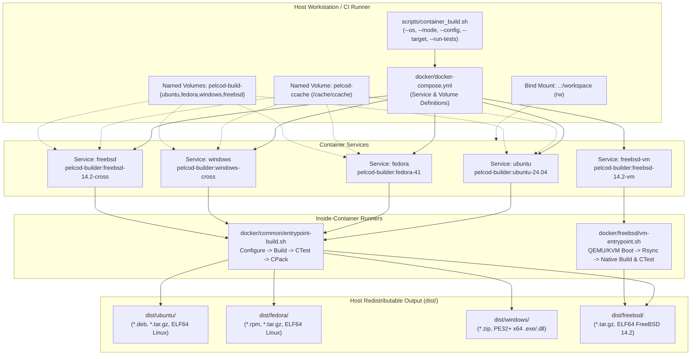
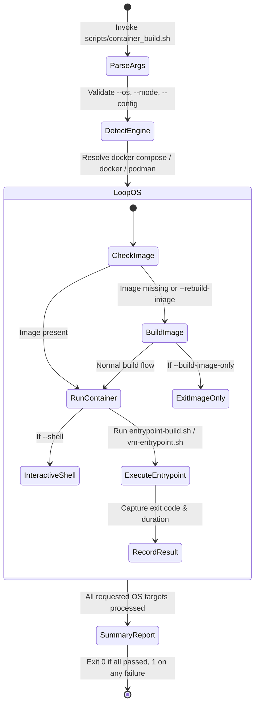

# Implementation Plan: Phase 6 – Multi-OS Container Orchestration (`docker/docker-compose.yml` & `scripts/container_build.sh`)

**Scope:** Multi-container orchestration specification ([`docker/docker-compose.yml`](../docker/docker-compose.yml)), host CLI automation orchestrator ([`scripts/container_build.sh`](../scripts/container_build.sh)), and developer quickstart & container reference documentation ([`docker/README.md`](../docker/README.md)).  
**Standard Baseline:** MISRA C++:2023 (Rule 7.0.6), SEI CERT C++ (INT31-C, STR37-C, ERR55-CPP), Include-What-You-Use (IWYU) & `<cstdint>` Policy, POSIX Shell Safety (`set -euo pipefail`), ELF/PE Hardening (`ENABLE_HARDENING=ON`, `WARNINGS_AS_ERRORS=ON`), Project Rules in [`.agents/rules/`](../.agents/rules/).  
**Reference Documents:** [`docs/multi_os_container_build_plan.md`](multi_os_container_build_plan.md) (§8 Phase 6), [`docs/multi_os_container_phase1_portability_plan.md`](multi_os_container_phase1_portability_plan.md), [`docs/multi_os_container_phase2_layout_scripts_plan.md`](multi_os_container_phase2_layout_scripts_plan.md), [`docs/multi_os_container_phase3_linux_containers_plan.md`](multi_os_container_phase3_linux_containers_plan.md), [`docs/multi_os_container_phase4_windows_containers_plan.md`](multi_os_container_phase4_windows_containers_plan.md), [`docs/multi_os_container_phase5_freebsd_containers_plan.md`](multi_os_container_phase5_freebsd_containers_plan.md), [`docker/common/entrypoint-build.sh`](../docker/common/entrypoint-build.sh), [`docker/freebsd/vm-entrypoint.sh`](../docker/freebsd/vm-entrypoint.sh).

---

## 1. Executive Summary & Architectural Objectives

With the source portability fixes (Phase 1), shared container entrypoint and offline Live555 cache (Phase 2), Ubuntu 24.04 & Fedora 41 builders (Phase 3), Windows x64 cross/native builders (Phase 4), and FreeBSD 14.2 cross/VM/native builders (Phase 5) in place, **Phase 6** unifies all target operating systems behind two complementary orchestration interfaces:

1. **Declarative Multi-Container Compose Specification ([`docker/docker-compose.yml`](../docker/docker-compose.yml))**:
   - Defines reproducible build services for `ubuntu`, `fedora`, `windows`, `freebsd`, and `freebsd-vm`.
   - Configures shared and per-OS named Docker volumes (`pelcod-ccache`, `pelcod-build-ubuntu`, `pelcod-build-fedora`, `pelcod-build-windows`, `pelcod-build-freebsd`) so incremental rebuilds across all four OSes complete in seconds without cross-OS CMake cache collisions.
   - Forwards host user/group ownership (`HOST_UID`, `HOST_GID`) and all build control environment variables (`BUILD_MODE`, `BUILD_CONFIG`, `COMPILER_FAMILY`, `CMAKE_TARGET`, `RUN_TESTS`, `CTEST_FILTER`, `RUN_PACKAGE`, `CLEAN_BUILD`, `RECONFIGURE`, `WARNINGS_AS_ERRORS`, `ENABLE_HARDENING`, `ENABLE_ONVIF`, `ENABLE_VIDEO`, `ENABLE_DJI`, `PARALLEL_JOBS`) into [`docker/common/entrypoint-build.sh`](../docker/common/entrypoint-build.sh) and [`docker/freebsd/vm-entrypoint.sh`](../docker/freebsd/vm-entrypoint.sh).

2. **Ergonomic Host CLI Orchestrator ([`scripts/container_build.sh`](../scripts/container_build.sh))**:
   - Provides a single command-line entrypoint on the developer workstation or CI host supporting `--os`, `--mode`, `--config`, `--compiler`, `--target`, `--run-tests`, `--ctest-filter`, `--no-package`, `--clean`, `--reconfigure`, `--rebuild-image`, `--build-image-only`, `--shell`, and `-j/--jobs`.
   - Automatically detects `docker compose` (v2 plugin), `docker-compose` (standalone), or direct `docker` / `podman` CLI execution.
   - Dynamically inspects `/dev/kvm` availability when running `freebsd-vm` so hardware virtualization is enabled when present and QEMU multi-threaded TCG fallback works seamlessly when `/dev/kvm` is absent.
   - Prints a consolidated multi-OS build status and artifact summary table upon completion.

```text
+----------------------------------------------------------------------------------------------------------------------------+
|                                  PHASE 6 MULTI-OS ORCHESTRATION SERVICE MATRIX                                             |
+----------------+----------------------------------+----------------------------------+-------------------------------------+
| Service Name   | Container Image Tag              | Dockerfile (`docker/` context)   | Host Output & Named Volumes         |
+----------------+----------------------------------+----------------------------------+-------------------------------------+
| `ubuntu`       | `pelcod-builder:ubuntu-24.04`    | `ubuntu/Dockerfile`              | `dist/ubuntu/` (`.deb`, `.tar.gz`)  |
|                |                                  |                                  | `pelcod-build-ubuntu`, `pelcod-ccache`|
+----------------+----------------------------------+----------------------------------+-------------------------------------+
| `fedora`       | `pelcod-builder:fedora-41`       | `fedora/Dockerfile`              | `dist/fedora/` (`.rpm`, `.tar.gz`)  |
|                |                                  |                                  | `pelcod-build-fedora`, `pelcod-ccache`|
+----------------+----------------------------------+----------------------------------+-------------------------------------+
| `windows`      | `pelcod-builder:windows-cross`   | `windows/Dockerfile.cross`       | `dist/windows/` (`.exe`, `.dll`, `.zip`)|
|                |                                  |                                  | `pelcod-build-windows`, `pelcod-ccache`|
+----------------+----------------------------------+----------------------------------+-------------------------------------+
| `freebsd`      | `pelcod-builder:freebsd-14.2-cross`| `freebsd/Dockerfile.cross`     | `dist/freebsd/` (FreeBSD ELF64, `.tar.gz`)|
|                |                                  |                                  | `pelcod-build-freebsd`, `pelcod-ccache`|
+----------------+----------------------------------+----------------------------------+-------------------------------------+
| `freebsd-vm`   | `pelcod-builder:freebsd-14.2-vm` | `freebsd/Dockerfile.vm`          | `dist/freebsd/` + Native FreeBSD    |
|                |                                  |                                  | 14.2 Kernel CTest Execution         |
+----------------+----------------------------------+----------------------------------+-------------------------------------+
```

---

## 2. System Architecture & Orchestration Flow

### 2.1 End-to-End Orchestration Pipeline

#### ASCII Diagram: Host CLI & Docker Compose Orchestration Flow

```text
+---------------------------------------------------------------------------------------------------+
|                                  HOST WORKSTATION / CI RUNNER                                     |
|                                                                                                   |
|   $ ./scripts/container_build.sh --os ubuntu,fedora,windows,freebsd --mode apps --config Release  |
+-------------------------------------------------+-------------------------------------------------+
                                                  |
                  +-------------------------------+-------------------------------+
                  | Parses CLI flags, resolves HOST_UID/HOST_GID, checks runtime  |
                  v                                                               v
+-----------------------------------+                           +-----------------------------------+
|   docker/docker-compose.yml       |                           |   Direct Docker / Podman Engine   |
|   (docker compose run --rm <svc>) |                           |   (Fallback or --shell interactive|
+-----------------+-----------------+                           +-----------------+-----------------+
                  |                                                               |
                  +-------------------------------+-------------------------------+
                                                  |
        +--------------------+--------------------+--------------------+--------------------+
        |                    |                    |                    |                    |
        v                    v                    v                    v                    v
+---------------+    +---------------+    +---------------+    +---------------+    +---------------+
|Service: ubuntu|    |Service: fedora|    |Service:windows|    |Service:freebsd|    |Service:       |
|ubuntu:24.04   |    |fedora:41      |    |Dockerfile.cros|    |Dockerfile.cros|    |freebsd-vm     |
|GCC 13/Clang 17|    |GCC 14/Clang 19|    |clang-cl + xwin|    |clang-18 + LLD |    |QEMU/KVM + SSH |
+-------+-------+    +-------+-------+    +-------+-------+    +-------+-------+    +-------+-------+
        |                    |                    |                    |                    |
        +--------------------+--------------------+--------------------+                    |
                                       |                                                    |
                                       v                                                    v
                    +-------------------------------------+              +----------------------------------+
                    | docker/common/entrypoint-build.sh   |              | docker/freebsd/vm-entrypoint.sh  |
                    |  1. Seed Live555 offline cache      |              |  1. Boot FreeBSD 14.2 QCOW2      |
                    |  2. Configure CMake + Ninja + ccache|              |  2. Rsync /workspace over SSH    |
                    |  3. Build selected mode/targets     |              |  3. Run entrypoint-build.sh      |
                    |  4. Run CTest (xvfb-run -a)         |              |  4. Rsync dist/freebsd/ to host  |
                    |  5. Install & CPack -> dist/<os>/   |              +-----------------+----------------+
                    +------------------+------------------+                                |
                                       |                                                   |
                                       +-------------------------+-------------------------+
                                                                 |
                                                                 v
+---------------------------------------------------------------------------------------------------+
|                                   HOST ARTIFACT OUTPUT (`dist/`)                                  |
|  • dist/ubuntu/   (lib/, bin/, include/, packages/*.deb, packages/*.tar.gz)                       |
|  • dist/fedora/   (lib64/, bin/, include/, packages/*.rpm, packages/*.tar.gz)                     |
|  • dist/windows/  (lib/*.lib, bin/*.exe, bin/*.dll, include/, packages/*.zip)                     |
|  • dist/freebsd/  (lib/, bin/, include/, packages/*.tar.gz)                                       |
+---------------------------------------------------------------------------------------------------+
```

#### Mermaid Diagram: Host CLI & Docker Compose Orchestration Flow



---

### 2.2 `scripts/container_build.sh` Execution State Machine

#### ASCII Diagram: `scripts/container_build.sh` State Machine

```text
+-----------------------------------------------------------------------------------+
| 1. Parse & Validate Arguments                                                     |
|    - Validate --os list (ubuntu, fedora, windows, freebsd, freebsd-vm, all)       |
|    - Validate --mode (libs, libs-qt, tui, apps) & --config (Release, Debug, ...)  |
+-----------------------------------------+-----------------------------------------+
                                          |
                                          v
+-----------------------------------------------------------------------------------+
| 2. Detect Container Engine & Compose Support                                      |
|    - Prefer `docker compose` (v2) -> fallback `docker-compose` -> `docker` /      |
|      `podman` direct execution                                                    |
|    - Capture HOST_UID=$(id -u) and HOST_GID=$(id -g)                              |
+-----------------------------------------+-----------------------------------------+
                                          |
                                          v
+-----------------------------------------------------------------------------------+
| 3. Iterate Over Requested Target OS List                                          |
|    For each OS in [ubuntu, fedora, windows, freebsd, freebsd-vm]:                 |
|      a) Ensure container image exists (or rebuild if --rebuild-image)             |
|      b) Prepare host output directory: dist/<os>/                                 |
|      c) Run container with mounted workspace + persistent ccache & build volumes  |
|      d) Record pass/fail status and elapsed duration                              |
+-----------------------------------------+-----------------------------------------+
                                          |
                                          v
+-----------------------------------------------------------------------------------+
| 4. Print Multi-OS Summary Table & Exit with Aggregate Status Code                 |
+-----------------------------------------------------------------------------------+
```

#### Mermaid Diagram: `scripts/container_build.sh` State Machine



---

## 3. Detailed Component Specifications

### 3.1 `docker/docker-compose.yml`

Located at [`docker/docker-compose.yml`](../docker/docker-compose.yml) with `context: .` (`docker/`), providing:

- **YAML Extension Block (`x-common-env`)**: Centralizes common build environment variables (`BUILD_MODE`, `BUILD_CONFIG`, `COMPILER_FAMILY`, `CMAKE_TARGET`, `CTEST_FILTER`, `RUN_PACKAGE`, `CLEAN_BUILD`, `RECONFIGURE`, `WARNINGS_AS_ERRORS`, `ENABLE_HARDENING`, `ENABLE_ONVIF`, `ENABLE_VIDEO`, `ENABLE_DJI`, `PARALLEL_JOBS`, `HOST_UID`, `HOST_GID`).
- **Five Named Services**:
  1. `ubuntu` (`pelcod-builder:ubuntu-24.04`, `ubuntu/Dockerfile`)
  2. `fedora` (`pelcod-builder:fedora-41`, `fedora/Dockerfile`)
  3. `windows` (`pelcod-builder:windows-cross`, `windows/Dockerfile.cross`)
  4. `freebsd` (`pelcod-builder:freebsd-14.2-cross`, `freebsd/Dockerfile.cross`)
  5. `freebsd-vm` (`pelcod-builder:freebsd-14.2-vm`, `freebsd/Dockerfile.vm`)
- **Five Named Volumes**:
  - `pelcod-ccache` (mounted at `/cache/ccache` across all containers)
  - `pelcod-build-ubuntu` (mounted at `/build` for `ubuntu`)
  - `pelcod-build-fedora` (mounted at `/build` for `fedora`)
  - `pelcod-build-windows` (mounted at `/build` for `windows`)
  - `pelcod-build-freebsd` (mounted at `/build` for `freebsd`)

---

### 3.2 `scripts/container_build.sh`

Located at [`scripts/container_build.sh`](../scripts/container_build.sh), supporting the following CLI flags:

| Flag | Values / Default | Description |
| :--- | :--- | :--- |
| `--os <list>` | `ubuntu`, `fedora`, `windows`, `freebsd`, `freebsd-vm`, or `all` (default: `all` = `ubuntu,fedora,windows,freebsd`) | Comma-separated list of target operating systems to build. |
| `--mode <mode>` | `libs`, `libs-qt`, `tui`, `apps` (default: `apps`) | Selects the build tier (`libs` = 17 core C++17 libraries without Qt; `libs-qt` = core + 3 Qt adapter libraries; `tui` = core + headless TUI/ONVIF server apps; `apps` = all 20 libraries + all 9 GUI/QML/TUI apps). |
| `--config <cfg>` | `Release` (default), `Debug`, `RelWithDebInfo`, `MinSizeRel` | CMake `CMAKE_BUILD_TYPE` configuration. |
| `--compiler <comp>` | `default`, `gcc`, `clang`, `clang-cl`, `mingw` | Selects the compiler family inside the container (`clang-cl` or `mingw` also selects the matching Windows cross-toolchain). |
| `--target <name>` | Any CMake target name (e.g., `PelcoDCore`, `Onvif`, `SightlineAppQt`) | Builds only the specified CMake target(s). |
| `--run-tests` | Boolean flag (`RUN_TESTS=true`) | Executes `ctest` inside the container after building. |
| `--ctest-filter <regex>` | Regex string | Filters tests executed by `ctest -R <regex>`. |
| `--no-package` | Boolean flag (`RUN_PACKAGE=false`) | Skips `cmake --install` and `cpack` archive generation. |
| `--clean` | Boolean flag (`CLEAN_BUILD=true`) | Wipes the container build directory before configuring. |
| `--reconfigure` | Boolean flag (`RECONFIGURE=true`) | Deletes `CMakeCache.txt` and forces a fresh CMake configure step. |
| `--rebuild-image` | Boolean flag | Rebuilds the Docker image(s) before running the build container(s). |
| `--build-image-only` | Boolean flag | Builds the Docker image(s) for the selected `--os` targets and exits. |
| `--shell` | Boolean flag | Opens an interactive `bash` shell inside the target container. |
| `-j, --jobs <N>` | Positive integer (default: host core count) | Parallel build and test jobs inside the container. |
| `-h, --help` | Flag | Displays CLI usage and examples. |

---

### 3.3 `docker/README.md`

Located at [`docker/README.md`](../docker/README.md), providing a comprehensive reference manual covering:
- Quickstart commands via [`scripts/container_build.sh`](../scripts/container_build.sh) and [`docker/docker-compose.yml`](../docker/docker-compose.yml).
- Build mode matrix (`libs`, `libs-qt`, `tui`, `apps`).
- OS-by-OS container usage (`ubuntu`, `fedora`, `windows`, `freebsd`, `freebsd-vm`, and native Windows/FreeBSD containers).
- Output directory structure (`dist/<os>/`) and package verification commands.

---

## 4. Verification & Compliance Checklist

1. **Shell & Compose Verification**:
   - Validate [`scripts/container_build.sh`](../scripts/container_build.sh) syntax via `bash -n scripts/container_build.sh`.
   - Verify `--help` output and error handling for invalid `--os`, `--mode`, and `--config` arguments.
   - Validate [`docker/docker-compose.yml`](../docker/docker-compose.yml) schema via `docker compose -f docker/docker-compose.yml config`.
2. **Project Compliance Gate Checks**:
   - All file paths in documentation are strictly relative.
   - Both ASCII and Mermaid diagrams are included for every architectural diagram.
   - Run `python3 scripts/verify_iwyu_cstdint.py --strict`, `python3 scripts/verify_type_conversions.py`, and `python3 scripts/verify_function_lengths.py`.

