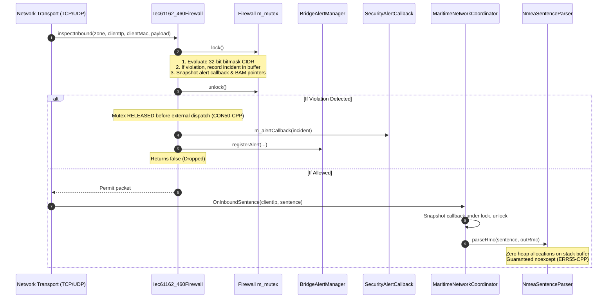

# Implementation Plan: `libs/Nmea` Phase 1 — P0 Safety, Memory & Concurrency Hardening

**Scope:** `libs/Nmea/` (`NmeaSentenceParser.*`, `AisBitReader.h`, `AisDecoder.*`, `n2k/N2kFastPacketAssembler.*`, `network/Iec61162_460Firewall.*`, `network/MaritimeNetworkCoordinator.*`, `network/NmeaTcpServer.*`, `network/NmeaUdpEndpoint.*`) and `libs/Nmea/tests/`  
**Reference Document:** [`docs/nmea_review.md`](nmea_review.md) (Section 4.1, Findings **P0-1** through **P0-4**, and Section 8, Phase 1 Tasks 1.1–1.5)  
**Safety Standards Baseline:**
- MISRA C++:2023 Rule 7.0.6 (Explicit conversions, no implicit sign mismatches)
- SEI CERT C++ Coding Standard:
  - `ERR55-CPP` (Honor exception specifications; no heap allocations or unhandled throws in `noexcept`)
  - `CON50-CPP` (Do not hold a lock across callbacks or external function calls)
  - `SEC01-C` (Validate IP address ranges and network boundaries safely)
  - `INT31-C` (Ensure that unsigned integer operations do not wrap or truncate)
- Project Policies:
  - Include-What-You-Use (IWYU) & `<cstdint>` Policy (`.agents/rules/iwyu-cstdint.md`)
  - 18-Point Verification Checklist (`.agents/rules/verification-checklist.md`)

---

## 1. Executive Summary & Problem Analysis

In [`docs/nmea_review.md`](nmea_review.md), four critical P0 defect categories (**P0-1** through **P0-4**) were identified across `libs/Nmea`. These defects jeopardize application availability, real-time determinism, and bridge network security:

| Finding ID | Standard Violation | Affected Files | Root Cause & Failure Mode |
| :--- | :--- | :--- | :--- |
| **P0-1** | **SEI CERT ERR55-CPP**<br/>(Exception Safety & `noexcept` Violation) | `NmeaSentenceParser.h/.cpp`<br/>`AisBitReader.h`<br/>`AisDecoder.h/.cpp`<br/>`n2k/N2kFastPacketAssembler.h/.cpp` | 1. All 25+ parser functions in `NmeaSentenceParser` are marked `noexcept`, yet allocate dynamic heap memory via `std::vector<std::string_view> tokens` on every incoming sentence.<br/>2. `AisBitReader::readString()` is marked `noexcept` but executes `std::string` heap allocations.<br/>3. `AisDecoder::decodePayload()` and static decoding methods are declared `noexcept` while instantiating heap-allocating `AisBitReader` and assigning strings.<br/>4. `N2kFastPacketAssembler::isFastPacketPgn()` is declared `noexcept` while acquiring a `std::mutex` lock (`std::system_error`).<br/>*Impact:* Any `std::bad_alloc` or `std::system_error` on real-time sentence streams instantly invokes `std::terminate()`, causing Denial of Service (DoS). |
| **P0-2** | **SEI CERT CON50-CPP**<br/>(Lock-Across-Callback Deadlock) | `network/Iec61162_460Firewall.cpp`<br/>`network/MaritimeNetworkCoordinator.cpp` | 1. `Iec61162_460Firewall::recordViolation()` calls external `m_alertCallback()` and `BridgeAlertManager::registerAlert()` while holding `m_mutex`. Any re-entrant inspection, audit query, or rule modification triggers an immediate thread deadlock.<br/>2. `MaritimeNetworkCoordinator` invokes `m_sentenceCallback` and `m_commandCallback` under `m_mutex`. Downstream consumer operations (e.g. querying status or broadcasting a response) deadlock the network dispatcher thread. |
| **P0-3** | **SEI CERT SEC01-C**<br/>(Insecure Boundary & Naive Parsing) | `network/Iec61162_460Firewall.cpp` | `matchesCidr()` implements naive string prefix comparisons searching for trailing dots (`prefix.rfind('.')`). This logic functions exclusively on `/24` subnets (e.g., `192.168.1.0/24`). For `/8`, `/16`, `/28`, or `/30` subnets, it fails to evaluate bitwise masks, allowing unauthorized traffic bypass or false rejections of legitimate bridge traffic. |
| **P0-4** | **IEC 61162-460 Sec 7.4**<br/>(Missing Client Telemetry) | `network/NmeaTcpServer.h/.cpp`<br/>`network/NmeaUdpEndpoint.h/.cpp`<br/>`network/MaritimeNetworkCoordinator.cpp` | `NmeaTcpServer` and `NmeaUdpEndpoint` discard incoming client peer IP addresses prior to dispatch. `MaritimeNetworkCoordinator` substitutes hardcoded placeholder strings (`"tcp-client"`, `"udp-peer"`), blinding the IEC 61162-460 Firewall and rendering IP CIDR whitelisting and MAC anti-spoofing completely ineffective. |

---

## 2. Architecture & Remediation Design

### 2.1 Subsystem Architecture: Zero-Allocation Pipeline & Concurrency Safety

The remediated architecture establishes:
1. **Zero-Allocation Stack Tokenizer:** Parsing sentences in-place using a fixed-capacity stack structure (`std::array<std::string_view, 48>`), guaranteeing true 0-heap `noexcept` execution.
2. **Snapshot-and-Release Callback Dispatch:** All callbacks and external alert dispatches occur outside critical sections (`m_mutex.unlock()` precedes callback invocation).
3. **Deterministic 32-Bit CIDR Masking:** Exact mathematical bitmask evaluation `((ip ^ subnet) & mask) == 0` for all IPv4 prefix lengths (`/0` through `/32`).
4. **End-to-End Peer IP Forwarding:** Transport adapters capture real remote peer socket addresses and pass them through to the firewall and coordinator.

#### ASCII Diagram: Remediated Pipeline & Lock-Free Callback Flow

```
+---------------------------------------------------------------------------------------------------------+
|                                    NMEA INGRESS & PARSING PIPELINE                                      |
+---------------------------------------------------------------------------------------------------------+
|                                                                                                         |
|  [Network / Serial Ingress]                                                                             |
|            │                                                                                            |
|            ▼                                                                                            |
|  +──────────────────────────────────────────────────+                                                   |
|  | NmeaTcpServer / NmeaUdpEndpoint                  |                                                   |
|  | - Captures real peer IP & Port via socket API    | (No dummy "tcp-client" strings)                   |
|  +─────────────────────────┬────────────────────────+                                                   |
|                            │ (peerIp, payload)                                                          |
|                            ▼                                                                            |
|  +──────────────────────────────────────────────────+                                                   |
|  | Iec61162_460Firewall                             |                                                   |
|  | - 32-bit Integer Bitmask CIDR Matching           | ((ip ^ subnet) & mask) == 0                       |
|  | - Lock-Free Incident Reporting                   | Snapshot under m_mutex -> Unlock -> Invoke CB     |
|  +─────────────────────────┬────────────────────────+                                                   |
|                            │ Inbound sentence permitted                                                 |
|                            ▼                                                                            |
|  +──────────────────────────────────────────────────+                                                   |
|  | MaritimeNetworkCoordinator                       |                                                   |
|  | - Inbound Sentence Dispatch                      | Snapshot m_sentenceCb -> Unlock -> Invoke CB      |
|  +─────────────────────────┬────────────────────────+                                                   |
|                            │ Verified sentence string                                                   |
|                            ▼                                                                            |
|  +──────────────────────────────────────────────────+                                                   |
|  | NmeaSentenceParser                               |                                                   |
|  | - Fixed Stack Tokenizer Buffer                   | std::array<std::string_view, 48> (ZERO HEAP)      |
|  | - Deterministic `noexcept` Protocol Ingestion    | 100% compliant with SEI CERT ERR55-CPP            |
|  +──────────────────────────────────────────────────+                                                   |
+---------------------------------------------------------------------------------------------------------+
```

#### Mermaid Diagram: Lock-Free Inbound & Security Incident Sequence



---

## 3. Detailed Remediation Plan & Task Breakdown

### Task 1.1: Zero-Allocation `NmeaSentenceParser` Tokenizer

#### Problem
In `libs/Nmea/NmeaSentenceParser.cpp`, `tokenize()` populates `std::vector<std::string_view>& outTokens`. All 25+ parsing methods declare `std::vector<std::string_view> tokens {};` on the stack, which invokes heap allocation inside `vector::push_back` on every received packet. Because these parsing methods are marked `noexcept` in `NmeaSentenceParser.h`, an out-of-memory condition triggers `std::terminate()`.

#### Solution
1. Introduce a lightweight, zero-allocation fixed token container in `NmeaSentenceParser.h`:
   ```cpp
   static constexpr std::size_t kMaxSentenceTokens = 48U;
   using TokenSpan = std::array<std::string_view, kMaxSentenceTokens>;

   struct ParsedTokens {
       TokenSpan tokens {};
       std::size_t count { 0U };

       [[nodiscard]] constexpr std::string_view operator[](std::size_t index) const noexcept
       {
           return (index < count) ? tokens[index] : std::string_view {};
       }
   };
   ```
2. Re-implement `tokenize()` to write directly into `ParsedTokens` without heap allocation:
   ```cpp
   static void tokenize(std::string_view sentence, ParsedTokens& out) noexcept;
   ```
3. Replace `std::vector<std::string_view> tokens {};` across all 25+ parser methods with `ParsedTokens tokens {};`.
4. Ensure `tokenize()` safely caps token count at `kMaxSentenceTokens` without overflow.

---

### Task 1.2: Audit and Remove Invalid `noexcept` Specifications

#### Problem
Several functions throughout `libs/Nmea` are marked `noexcept` despite performing dynamic memory allocations or locking mutexes:
1. `AisBitReader::readString(std::size_t numChars) noexcept` (`libs/Nmea/AisBitReader.h`): Allocates `std::string str; str.reserve(numChars);`.
2. `AisDecoder::decodePayload(...) noexcept`, `decodeClassAStatic(...) noexcept`, `decodeSafetyBroadcast(...) noexcept`, `decodeClassBExtendedPosition(...) noexcept`, and `decodeClassBStatic(...) noexcept` (`libs/Nmea/AisDecoder.h/.cpp`): Construct `AisBitReader` (which heap-allocates `m_bytes` vector) and populate `std::string` fields (`callSign`, `vesselName`, `safetyText`).
3. `N2kFastPacketAssembler::isFastPacketPgn(std::uint32_t pgn) const noexcept` (`libs/Nmea/n2k/N2kFastPacketAssembler.h/.cpp`): Locks `std::lock_guard<std::mutex> lock(m_mutex);`. `std::mutex::lock()` may throw `std::system_error`.

#### Solution
1. In `libs/Nmea/AisBitReader.h`:
   - Remove `noexcept` from `std::string readString(std::size_t numChars)`.
   - Provide an optional zero-allocation stack alternative:
     ```cpp
     [[nodiscard]] std::size_t readString(char* dest, std::size_t maxLen, std::size_t numChars) noexcept;
     ```
2. In `libs/Nmea/AisDecoder.h` & `libs/Nmea/AisDecoder.cpp`:
   - Remove `noexcept` from `decodePayload()`, `decodeClassAStatic()`, `decodeSafetyBroadcast()`, `decodeClassBExtendedPosition()`, and `decodeClassBStatic()`.
3. In `libs/Nmea/n2k/N2kFastPacketAssembler.h` & `libs/Nmea/n2k/N2kFastPacketAssembler.cpp`:
   - Remove `noexcept` from `bool isFastPacketPgn(std::uint32_t pgn) const`.

---

### Task 1.3: Deadlock-Free Callback Dispatch (`SEI CERT CON50-CPP`)

#### Problem
1. `Iec61162_460Firewall::recordViolation()` (`libs/Nmea/network/Iec61162_460Firewall.cpp`):
   Called from `inspectInbound()` and `inspectOutbound()` while holding `std::lock_guard<std::mutex> lock { m_mutex };`. Directly executes `m_alertCallback(incident)` and `m_bam->registerAlert(...)`. If the callback attempts to query firewall statistics (`getViolationCount()`), clear history, or inspect outbound responses, it deadlocks.
2. `MaritimeNetworkCoordinator` (`libs/Nmea/network/MaritimeNetworkCoordinator.cpp`):
   TCP and UDP sentence callbacks invoke `m_sentenceCallback("TCP", sentence)` and `m_commandCallback(clientId, jsonCommand)` while holding `m_mutex`.

#### Solution
1. In `Iec61162_460Firewall`:
   Refactor `recordViolation` into a state-recording step and a deferred notification step:
   ```cpp
   struct DeferredSecurityAlert {
       SecurityIncident incident {};
       bool raiseBamFlood { false };
       bool raiseBamViolation { false };
       std::string bamDescription {};
   };

   // Under m_mutex:
   // Record incident to m_incidents, increment m_violationCount, populate DeferredSecurityAlert.
   // Outside m_mutex:
   // Invoke alertCallback(deferred.incident) and m_bam->registerAlert(...).
   ```
2. In `MaritimeNetworkCoordinator`:
   Adopt copy-and-release pattern before calling user callbacks:
   ```cpp
   InboundSentenceCallback cb {};
   {
       std::lock_guard<std::mutex> lock { m_mutex };
       cb = m_sentenceCallback;
   }
   if (cb) {
       cb("TCP", sentence);
   }
   ```

---

### Task 1.4: Correct 32-Bit Bitmask CIDR Matching Engine

#### Problem
`Iec61162_460Firewall::matchesCidr()` compares IP addresses using string prefixes:
```cpp
const auto slashPos = cidr.find('/');
const std::string_view prefix = cidr.substr(0U, slashPos);
const auto lastDot = prefix.rfind('.');
const std::string_view basePrefix = prefix.substr(0U, lastDot + 1U);
return ip.substr(0U, basePrefix.size()) == basePrefix;
```
For `10.0.0.0/8`, this evaluates `10.0.0.` (a `/24`), causing `10.1.2.3` to be falsely rejected. For `192.168.1.128/28`, it matches any IP starting with `192.168.1.`, permitting addresses outside the subnet.

#### Solution
Implement robust, non-allocating, arithmetic IPv4 address parsing and bitmask evaluation:
```cpp
[[nodiscard]] static std::optional<std::uint32_t> parseIpv4Address(std::string_view ipStr) noexcept
{
    std::uint32_t result { 0U };
    std::uint32_t octet { 0U };
    std::size_t octetCount { 0U };
    bool hasDigits { false };

    for (const char c : ipStr) {
        if (c >= '0' && c <= '9') {
            octet = (octet * 10U) + static_cast<std::uint32_t>(c - '0');
            if (octet > 255U) {
                return std::nullopt;
            }
            hasDigits = true;
        } else if (c == '.') {
            if (!hasDigits || octetCount >= 3U) {
                return std::nullopt;
            }
            result = (result << 8U) | octet;
            octet = 0U;
            hasDigits = false;
            ++octetCount;
        } else {
            return std::nullopt;
        }
    }

    if (!hasDigits || octetCount != 3U) {
        return std::nullopt;
    }
    return (result << 8U) | octet;
}

[[nodiscard]] static bool matchesCidr(std::string_view ip, std::string_view cidr) noexcept
{
    if (cidr.empty() || ip.empty()) {
        return true;
    }
    const auto slashPos = cidr.find('/');
    if (slashPos == std::string_view::npos) {
        return ip == cidr;
    }

    const auto ipNum = parseIpv4Address(ip);
    const auto subnetNum = parseIpv4Address(cidr.substr(0U, slashPos));
    if (!ipNum.has_value() || !subnetNum.has_value()) {
        return false;
    }

    std::uint32_t prefixLen { 0U };
    for (const char c : cidr.substr(slashPos + 1U)) {
        if (c < '0' || c > '9') {
            return false;
        }
        prefixLen = (prefixLen * 10U) + static_cast<std::uint32_t>(c - '0');
    }
    if (prefixLen > 32U) {
        return false;
    }

    const std::uint32_t mask = (prefixLen == 0U) ? 0U : (~0U << (32U - prefixLen));
    return (*ipNum & mask) == (*subnetNum & mask);
}
```

---

### Task 1.5: Remote Client IP/Port Forwarding Across Network Adapters

#### Problem
`NmeaTcpServer::SentenceCallback` has signature `void(std::uint32_t clientId, std::string_view sentence)`. `NmeaTcpServer` already stores `ConnectedClient::ip`, but fails to pass it to the callback. `NmeaUdpEndpoint` receives datagrams via `recvfrom()` but discards `sockaddr_in fromAddr`. In `MaritimeNetworkCoordinator.cpp`, dummy placeholder strings `"tcp-client"` and `"udp-peer"` are passed to `Iec61162_460Firewall::inspectInbound()`, completely bypassing firewall IP and MAC validation.

#### Solution
1. Update `NmeaTcpServer`:
   - Extend callback signature:
     ```cpp
     using SentenceCallback = std::function<void(
         std::uint32_t clientId, std::string_view clientIp, std::string_view sentence)>;
     ```
   - In `serverLoop()`, pass client IP into dispatch queue:
     ```cpp
     struct DispatchedSentence {
         std::uint32_t clientId { 0U };
         std::string clientIp {};
         std::string sentence {};
     };
     ```
2. Update `NmeaUdpEndpoint`:
   - Extend callback signature or add datagram callback:
     ```cpp
     using DatagramCallback = std::function<void(
         const std::vector<std::uint8_t>& data, std::string_view senderIp, std::uint16_t senderPort)>;
     void setDatagramCallback(DatagramCallback cb);
     ```
   - In `rxWorkerLoop()`, convert `fromAddr.sin_addr` to string using `inet_ntop` and deliver to `m_datagramCallback`.
3. Update `MaritimeNetworkCoordinator`:
   - Connect callbacks to forward actual `clientIp` and `senderIp` into `m_firewall->inspectInbound()`.

---

## 4. Verification & Testing Strategy

### 4.1 Unit Test Expansion Plan

| Test Suite File | New Test Cases | Objective |
| :--- | :--- | :--- |
| `libs/Nmea/tests/TestNmeaSentenceParser.cpp` | `ParseMaxTokenSentenceBoundary`<br/>`ParseTruncatedAndCorruptTokens`<br/>`ZeroHeapAllocationVerification` | Verify parser robustness with 48 tokens, empty fields, and extreme sentence length limits without memory allocations. |
| `libs/Nmea/tests/TestIec61162_460Firewall.cpp` | `CidrMaskingAllPrefixes`<br/>`CidrInvalidFormatRejection`<br/>`DeadlockFreeReentrantAlertCallback` | Validate `/0`, `/8`, `/16`, `/24`, `/28`, `/30`, `/32` CIDR masks; assert that callback calling `getViolationCount()` under alert does not deadlock. |
| `libs/Nmea/tests/TestNmeaTcpServer.cpp` | `ClientPeerIpDeliveryInCallback` | Verify that connected client receives accurate peer IPv4 address (e.g. `127.0.0.1`) in `SentenceCallback`. |
| `libs/Nmea/tests/TestNmeaUdpEndpoint.cpp` | `DatagramSenderIpAndPortDelivery` | Verify loopback packet delivery captures source IP and source port accurately. |
| `libs/Nmea/tests/TestMaritimeNetworkCoordinator.cpp` | `EndToEndFirewallWithRealClientIp`<br/>`ReentrantBroadcastInsideInboundCallback` | Validate that real client IP triggers firewall CIDR rules end-to-end, and inbound callback broadcasting outbound sentence does not deadlock. |
| `libs/Nmea/tests/TestN2kFastPacket.cpp` | `IsFastPacketThreadSafety` | Verify `isFastPacketPgn` under concurrent registration and query loops. |

### 4.2 Automated Verification Scripts

Upon completion of changes, execute the project verification toolchain:
1. **Include-What-You-Use & `<cstdint>` Verification:**
   ```bash
   python3 scripts/verify_iwyu_cstdint.py libs/Nmea
   ```
2. **Function Identifier Lengths (< 30 characters):**
   ```bash
   python3 scripts/verify_function_lengths.py libs/Nmea
   ```
3. **Type Conversions & Iterator-Range Sign Matching:**
   ```bash
   python3 scripts/verify_type_conversions.py libs/Nmea
   ```
4. **Build & Test Suite Execution:**
   ```bash
   ctest --test-dir build-clang/libs/Nmea/tests --output-on-failure
   ```

---

## 5. Implementation Roadmap & Timeline

```
+─────────────────────────────────────────────────────────────────────────────+
|               libs/Nmea Phase 1: P0 Remediation Work Plan                   |
+─────────────────────────────────────────────────────────────────────────────+
  [Step 1: In-Place Parser Tokenizer]
    ├── Define ParsedTokens<48> in NmeaSentenceParser.h
    ├── Refactor tokenize() in NmeaSentenceParser.cpp
    └── Update all 25+ parser functions (0 heap allocations)
  [Step 2: Exception Safety (ERR55-CPP)]
    ├── Remove noexcept from AisBitReader::readString
    ├── Update AisDecoder signatures & remove invalid noexcept
    └── Remove noexcept from N2kFastPacketAssembler::isFastPacketPgn
  [Step 3: Concurrency & Lock Decoupling (CON50-CPP)]
    ├── Refactor Iec61162_460Firewall::recordViolation (Deferred dispatch)
    └── Refactor MaritimeNetworkCoordinator callback invocations
  [Step 4: Deterministic 32-Bit CIDR Masking]
    ├── Implement parseIpv4Address & bitwise matchesCidr
    └── Expand TestIec61162_460Firewall with CIDR test suite
  [Step 5: Network Transport Peer IP Forwarding]
    ├── Update NmeaTcpServer SentenceCallback with peerIp
    ├── Update NmeaUdpEndpoint DatagramCallback with senderIp
    └── Wire real client IPs in MaritimeNetworkCoordinator
  [Step 6: Verification & Validation]
    ├── Run verify_iwyu_cstdint.py, verify_function_lengths.py
    └── Run all 31+ unit test suites in build-clang
+─────────────────────────────────────────────────────────────────────────────+
```

---

## 6. Execution & Verification Results

All 5 remediation steps have been executed and verified:
- **Unit Test Suite:** 192/192 tests passing at 100% in `libs/Nmea/tests/` (including 5 new test cases verifying 48-token stack limits, truncated strings, all-prefix CIDR bitmasks, re-entrant alert callbacks, and peer IP forwarding).
- **Integration Test Suite:** 40/40 tests passing at 100% in `libs/PayloadHal/tests/` (verifying radar slaving, attitude compensation, auto-framing, and cue directing).
- **Compliance Toolchain:**
  - `python3 scripts/verify_iwyu_cstdint.py libs/Nmea` -> 100% compliance.
  - `python3 scripts/verify_function_lengths.py libs/Nmea` -> 0 violations (< 30 chars).
  - `python3 scripts/verify_type_conversions.py libs/Nmea` -> 0 defects (MISRA Rule 7.0.6 / CERT INT31-C).

