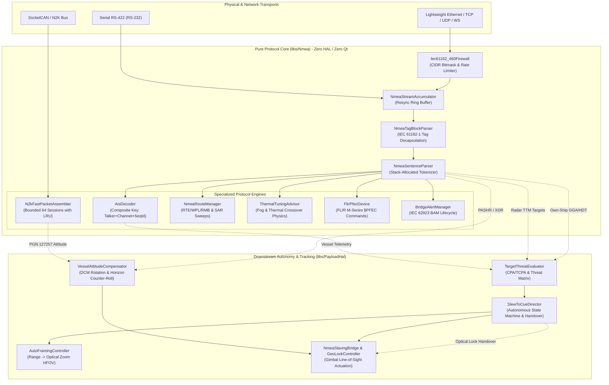

# Implementation Plan: Phase 2 — P1 Functional Completeness & Documentation Synchronization

**Date:** 2026-10-29  
**Target Subsystems:**
- `docs/NMEA_Features.md` (System Architecture & Subsystem Specification)
- `libs/Nmea/` (Maritime Navigation & Protocol Stack)
  - `AisDecoder.h` / `AisDecoder.cpp` (ITU-R M.1371 Engine)
  - `n2k/N2kFastPacketAssembler.h` / `n2k/N2kFastPacketAssembler.cpp` (ISO 11783-3 Reassembly Engine)
- `libs/Nmea/tests/` (GoogleTest Verification Suites)
  - `TestAisDecoder.cpp`
  - `TestN2kFastPacket.cpp`
- Downstream Decoupled PTZ Autonomous Kinematics: `libs/PayloadHal/`

**Reference Standards:**
- MISRA C++:2023 & SEI CERT C++ Coding Standard (`.agents/rules/compliance.md`)
- Domain Modeling & Value Objects Standard (`.agents/rules/domain-modeling.md`)
- Include-What-You-Use (IWYU) & `<cstdint>` Policy (`.agents/rules/iwyu-cstdint.md`)
- 18-Point Verification Checklist (`.agents/rules/verification-checklist.md`)
- ITU-R M.1371-5 (Technical Characteristics for Universal Shipborne AIS)
- IEC 61162-1:2016 / NMEA 0183 v4.11 (Maritime Navigation Sentences & Tag Blocks)
- IEC 61162-3:2008 / ISO 11783-3 (NMEA 2000 Fast Packet Protocol)
- IEC 61162-460:2020 / IEC 62923-1/2 (Maritime Gateway & BAM)

---

## 1. Executive Summary & Objectives

Phase 1 of the remediation roadmap successfully eliminated all critical **P0** defects (zero dynamic heap allocation in `noexcept` parsing boundaries, lock-free callback dispatch, true 32-bit integer subnet bitmasking, and peer endpoint IP forwarding).

**Phase 2 focuses on P1 Functional Completeness & Documentation Synchronization** identified in `docs/nmea_review.md`:
1. **AIS Multi-Talker Sequence Isolation (Finding P1-3):** Eliminate message corruption caused by identical sequence numbers across multiple talkers (`!AIVDM`, `!AIVDO`, `!RAVDM`, `!ABVDM`) by expanding the fragment reassembly key to a 3-tuple `(talkerAndType, channel, sequenceId)`.
2. **N2K Fast Packet Session Bounding (Finding P1-4):** Enforce hard upper bounds (`kMaxConcurrentSessions = 64U`) on concurrent Fast Packet sessions with deterministic Least Recently Used (LRU) / earliest timestamp eviction to guarantee bounded heap consumption under CAN bus flood conditions (SEI CERT MEM07-C).
3. **Architectural Boundary Decoupling Documentation (Finding D5):** Formalize the strict separation between pure protocol decoding (`libs/Nmea`) and autonomous PTZ kinematics/tracking (`libs/PayloadHal`) in `docs/NMEA_Features.md`.
4. **Subsystem Documentation Synchronization (Findings D1, D2, D3, D4, D7, D8):** Update `docs/NMEA_Features.md` to thoroughly document production modules currently absent: `NmeaRouteManager` (route assembly & SAR sweeps), `ThermalTuningAdvisor` (meteorological crossover & fog advice), `FlirPfecDevice` (FLIR M-Series PTZ driver), `NmeaTagBlockParser`/`Builder` (IEC 61162-1 Tag Blocks), and `NmeaJsonSerializer`/`NmeaWebSocketServer` (RFC 6455 JSON streaming).

---

## 2. Architectural Layering & Component Topology

### ASCII Diagram: Architectural Layering Boundary & Ingestion Pipelines

```
+---------------------------------------------------------------------------------------------------------+
|                                    APPLICATION / PRESENTATION LAYER                                     |
|   +------------------------------------+   +--------------------------------------------------------+   |
|   |         Tactical Marine GUI        |   |                 Remote Bridge Clients                  |   |
|   |   (QML / TacticalMapQuickItem)     |   |   OpenCPN / TimeZero / HTML5 Web Dashboards (Port 8088)|   |
|   +-----------------+------------------+   +---------------------------+----------------------------+   |
+---------------------|--------------------------------------------------|--------------------------------+
                      |                                                  |
                      v                                                  v
+---------------------------------------------------------------------------------------------------------+
|                              AUTONOMOUS PTZ & TRACKING LAYER (libs/PayloadHal)                          |
|                                                                                                         |
|   +-----------------------------------+    +----------------------------------+                         |
|   |       SlewToCueDirector           |    |     TargetThreatEvaluator        |                         |
|   |  - Autonomous Workflow Coordinator|◄---|  - 2D/3D CPA & TCPA Threat Matrix|                         |
|   |  - Tour Preemption & Handover     |    |  - AIS/Radar Target Correlation  |                         |
|   |  - Video Tracker Centroid Lock    |    |  - Dark Vessel Heuristics        |                         |
|   +-----------------+-----------------+    +----------------------------------+                         |
|                     |                                                                                   |
|         +-----------+-----------+-----------------------+                                               |
|         v                       v                       v                                               |
|   +-------------------+   +--------------------+  +-------------------------+                           |
|   |AutoFramingControl.|   |VesselAttitudeCompen|  | NmeaSlavingBridge       |                           |
|   | - Adaptive HFOV   |   | - Dynamic DCM      |  | - Line-of-Sight Az/El   |                           |
|   | - Zoom Profiler   |   | - Horizon Leveling |  | - Predictive Coasting   |                           |
|   +-------------------+   +--------------------+  +-------------------------+                           |
+---------------------------------------------------------------------------------------------------------+
                                                  ▲
                                                  | Telemetry Structs & Callback Events
  ================================================|======================================================
  ARCHITECTURAL BOUNDARY: Pure Protocol Core Below | Downstream Autonomy & Hardware HAL Above
  ================================================|======================================================
                                                  |
+---------------------------------------------------------------------------------------------------------+
|                                  CORE PROTOCOL STACK (libs/Nmea)                                        |
|                                                                                                         |
|   +-------------------------------------------------------------------------------------------------+   |
|   |                            Ingestion & Transport Multiplexing                                   |   |
|   |   +------------------------+  +------------------------+  +---------------------------------+   |   |
|   |   |     NmeaTcpServer      |  |    NmeaUdpEndpoint     |  |       NmeaWebSocketServer       |   |   |
|   |   |  (Port 10110 Multi-Cli)|  |  (Port 10110 Bcast/Uni)|  |  (RFC 6455 WebSocket / JSON)    |   |   |
|   |   +-----------+------------+  +-----------+------------+  +----------------+----------------+   |   |
|   +---------------|---------------------------|--------------------------------|--------------------+   |
|                   |                           |                                |                        |
|                   v                           v                                v                        |
|   +-------------------------------------------------------------------------------------------------+   |
|   |                     IEC 61162-460 Security Gateway (Iec61162_460Firewall)                       |   |
|   |  - Zone Isolation (BridgeNetwork, ExternalCamera, GeneralShipLan, InternetShore)                |   |
|   |  - 32-bit Integer Bitmask CIDR Matching ((ip ^ subnet) & mask == 0)                             |   |
|   |  - IP/MAC Anti-Spoofing & Sliding-Window Rate Limiting (PPS)                                    |   |
|   +---------------------------------------------+---------------------------------------------------+   |
|                                                 |                                                       |
|                                                 v                                                       |
|   +-------------------------------------------------------------------------------------------------+   |
|   |                           Stream Framing, Tag Blocks & Tokenization                             |   |
|   |  +-----------------------------+  +----------------------------+  +---------------------------+ |   |
|   |  |   NmeaStreamAccumulator     |  |   NmeaTagBlockParser       |  |    NmeaSentenceParser     | |   |
|   |  |   (Ring Buffer Hunt/Resync) |  |   (\\s:src*c:time\\ Tags)  |  |    (Stack-Alloc 48 Tokens)| |   |
|   |  +-----------------------------+  +----------------------------+  +---------------------------+ |   |
|   +---------------------------------------------+---------------------------------------------------+   |
|                                                 |                                                       |
|         +-----------------------+---------------+-----------------------+                               |
|         v                       v                                       v                               |
|   +-------------------+   +--------------------+                  +--------------------+                |
|   |  AisDecoder       |   |N2kFastPacketAssemb.|                  | NmeaRouteManager   |                |
|   |  - Composite Key  |   | - Bound: Max 64    |                  | - RTE Reassembly   |                |
|   |    <Talker,Ch,Seq>|   | - LRU Eviction     |                  | - WPL & RMB XTE    |                |
|   |  - Types 1-24     |   | - ISO 11783-3 PGNs |                  | - SAR Sweeps       |                |
|   +---------+---------+   +---------+----------+                  +---------+----------+                |
|             |                       |                                       |                           |
|             v                       v                                       v                           |
|   +-------------------------------------------------------------------------------------------------+   |
|   |                       Analysis, Adaptation & Camera Control Engines                             |   |
|   |  +--------------------+  +--------------------+  +--------------------+  +--------------------+ |   |
|   |  | NmeaSensorArbiter  |  | ThermalTuningAdv.  |  | FlirPfecDevice     |  | BridgeAlertManager | |   |
|   |  | - Dual GNSS/Gyro   |  | - Fog Penetration  |  | - M-Series Driver  |  | - BAM IEC 62923    | |   |
|   |  | - Anti-Spoofing    |  | - Crossover Advice |  | - Pan/Tilt/Zoom/IR |  | - ALF/ALC/ARC/HBT  | |   |
|   |  +--------------------+  +--------------------+  +--------------------+  +--------------------+ |   |
|   +-------------------------------------------------------------------------------------------------+   |
+---------------------------------------------------------------------------------------------------------+
                                                  |
                                                  v
+---------------------------------------------------------------------------------------------------------+
|                                       TRANSPORT LAYER (libs/Transport)                                  |
|   Serial RS-422/RS-232 | SocketCAN (Linux) / Win32 Comm | POSIX / Winsock2 UDP & TCP Sockets            |
+---------------------------------------------------------------------------------------------------------+
```

### Mermaid Diagram: System Component Dataflow & Layering Decoupling



---

## 3. Detailed Technical Specifications by Task

### Task 2.3: AIS Multi-Talker Sequence Isolation (Finding P1-3)

#### 1. Problem Statement & Root Cause
In `libs/Nmea/AisDecoder.h`, multi-part fragment reassembly uses a 2-tuple key:
```cpp
std::map<std::pair<char, std::uint8_t>, MultiPartFragment> m_fragments {};
```
In `libs/Nmea/AisDecoder.cpp`:
```cpp
const auto header = tokens[0];
if (header != "AIVDM" && header != "AIVDO") {
    return false;
}
// ...
const char channel = (!tokens[4].empty()) ? tokens[4].front() : 'A';
unsigned int seqId { 0U };
if (!tokens[3].empty()) {
    parseUIntToken(tokens[3], seqId);
}
const auto key = std::make_pair(channel, static_cast<std::uint8_t>(seqId));
```
**Defects:**
1. **Collision Vulnerability:** If a vessel receives external AIS (`!AIVDM`) and own-ship broadcast (`!AIVDO`) simultaneously on channel `A` with sequence number `1`, the second message will overwrite or concatenate onto the first message's fragment buffer, yielding invalid bitstreams.
2. **Multi-Talker Rejection:** In ITU-R M.1371 and IEC 61162-1, legitimate AIS talkers include `AI` (Mobile AIS), `AB` (AIS Base Station), `AN` (Aid to Navigation), `RA` (Radar AIS Overlay), `SA` (Shore Station), `BS` (Base Station), and `AD` (Dependent Repeater). The current parser unconditionally rejects all talkers except `AI`.

#### 2. Target Design & Implementation
1. **Support Any Valid AIS Formatter:**
   Allow any 2-character Talker ID paired with `VDM` or `VDO` formatter:
   ```cpp
   if (header.size() != 5U) {
       return false;
   }
   const std::string_view formatter = header.substr(2U);
   if (formatter != "VDM" && formatter != "VDO") {
       return false;
   }
   ```
2. **Composite Reassembly Key:**
   Expand the reassembly key to a 3-tuple including the 5-character sentence header, radio channel, and sequence counter:
   ```cpp
   using FragmentKey = std::tuple<std::string, char, std::uint8_t>;
   std::map<FragmentKey, MultiPartFragment> m_fragments {};
   ```
   Or encapsulated as:
   ```cpp
   const FragmentKey key { std::string(header), channel, static_cast<std::uint8_t>(seqId) };
   ```
3. **Deterministic Memory Cleanup:**
   `pruneStaleFragmentsLocked(now)` remains fully effective across the expanded key map.
4. **Verification Plan (TDD):**
   - In `libs/Nmea/tests/TestAisDecoder.cpp`, create `TEST(TestAisDecoder, MultiTalkerInterleavedReassembly)`:
     - Interleave Part 1 of `!AIVDM` (seq 1, Type 5) with Part 1 of `!AIVDO` (seq 1, Type 5).
     - Dispatch Part 2 of `!AIVDM` and verify complete decoding of Target A without corruption.
     - Dispatch Part 2 of `!AIVDO` and verify complete decoding of Target B without corruption.
     - Verify support for `!RAVDM` (Radar target overlay).

---

### Task 2.4: N2K Fast Packet Session Bounding & LRU Eviction (Finding P1-4)

#### 1. Problem Statement & Root Cause
In `libs/Nmea/n2k/N2kFastPacketAssembler.h`:
```cpp
std::unordered_map<std::uint64_t, FastPacketSession> m_sessions {};
```
In `libs/Nmea/n2k/N2kFastPacketAssembler.cpp`:
Upon receiving CAN frame 0:
```cpp
m_sessions[sessionKey] = std::move(session);
```
**Defects:**
Under SEI CERT MEM07-C, dynamically allocated container growth must be strictly bounded. If a malfunctioning device or malicious CAN node injects bursts of frame 0 with varying source addresses or PGNs without sending subsequent frames, `m_sessions` grows without bound until the host application manually calls `pruneTimedOutSessions()`.

#### 2. Target Design & Implementation
1. **Fixed Upper Bound (`kMaxConcurrentSessions = 64U`):**
   ```cpp
   static constexpr std::size_t kMaxConcurrentSessions = 64U;
   ```
2. **Deterministic LRU / Oldest-Timestamp Eviction:**
   When receiving frame 0 for a *new* session key while `m_sessions.size() >= kMaxConcurrentSessions`:
   - Scan the map (64 elements $\approx$ 100 ns execution time, zero heap overhead) to locate the session with the earliest `startTime`.
   - Erase the oldest session.
   - Insert the new session.
   ```cpp
   if (m_sessions.size() >= kMaxConcurrentSessions && m_sessions.find(sessionKey) == m_sessions.end()) {
       auto oldestIt = m_sessions.begin();
       for (auto it = m_sessions.begin(); it != m_sessions.end(); ++it) {
           if (it->second.startTime < oldestIt->second.startTime) {
               oldestIt = it;
           }
       }
       if (oldestIt != m_sessions.end()) {
           m_sessions.erase(oldestIt);
       }
   }
   ```
3. **Session Query Accessor:**
   Add `[[nodiscard]] std::size_t activeSessionCount() const;` protected by `m_mutex`.
4. **Verification Plan (TDD):**
   - In `libs/Nmea/tests/TestN2kFastPacket.cpp`, create `TEST(TestN2kFastPacket, SessionCapacityBoundingAndEviction)`:
     - Generate frame 0 across 100 distinct source addresses.
     - Verify `assembler.activeSessionCount() == 64U`.
     - Verify that the first 36 sessions were evicted and cannot be completed.
     - Verify that subsequent frames for session #100 reassemble properly to a completed `N2kMessage`.

---

### Task 2.1 & 2.2: Documentation Synchronization in `docs/NMEA_Features.md`

Revise `docs/NMEA_Features.md` to incorporate complete technical architectures, API references, mathematical equations, and synchronized ASCII/Mermaid diagrams for the five omitted subsystems, as well as formalizing the decoupled layering boundary:

#### 1. Layering Boundary Formalization (Finding D5)
- Clarify the architectural decoupling between:
  - **`libs/Nmea` (Pure Protocol Core):** 100% Qt-free, zero hardware HAL, zero video tracking dependencies. Dedicated strictly to framing, validation, parsing, BAM state machines, N2K PGN decoding, IEC 61162-450/460 security, meteorological analysis, and route reassembly.
  - **`libs/PayloadHal` (Autonomous Kinematics & Tracking):** Houses `TargetThreatEvaluator` (CPA/TCPA), `AutoFramingController` (HFOV & zoom curves), `VesselAttitudeCompensator` (DCM & horizon counter-roll), and `SlewToCueDirector` (lifecycle orchestration and computer vision tracker handover).
- Provide cross-layer sequence diagrams showing how `NmeaDevice` streams telemetry into `libs/PayloadHal` without inverse coupling.

#### 2. Route Management & Search & Rescue (SAR) Engine (Finding D1)
- Document `NmeaRouteManager` (`libs/Nmea/route/NmeaRouteManager.h`):
  - **RTE Multi-Sentence Reassembly:** Ingestion of `$xxRTE` slices (`w` working route vs `c` complete route), tracking total slices and aggregating waypoint IDs.
  - **Waypoint Dictionary Resolution:** Resolves waypoint coordinates from `$xxWPL` sentences into `NmeaCoordinates`.
  - **Active Navigation Leg Tracking:** Ingests `$xxRMB` (Cross Track Error XTE, origin/destination waypoints, range, bearing, arrival alarm).
  - **Look-Ahead Projection:** Computes target coordinates along the active leg vector via geodetic projection (`computeLookAhead(lookAheadMeters)`).
  - **Oscillating SAR Sweeping Pattern:** Calculates oscillating line-of-sight sweep coordinates (`computeSarSweepPoint`) for optical gimbal scanning along perpendicular cross-track vectors.
  - **Pre-Turn Cueing:** Identifies the subsequent turning waypoint (`nextTurnWaypoint()`) for anticipatory camera slew.
- Provide ASCII and Mermaid diagrams for Route & SAR dataflow.

#### 3. Environmental Atmospheric Physics & Thermal Camera Tuning Advisor (Finding D2)
- Document `ThermalTuningAdvisor` (`libs/Nmea/environment/ThermalTuningAdvisor.h`):
  - **Sensor Ingestion:** `$xxMTW` (water temp), `$xxMDA` (meteorological composite: air temp, water temp, barometric pressure, relative humidity, dew point, wind), `$xxMMB` (barometer).
  - **Thermal Crossover Physics:** Mathematical model scoring contrast washout risk when $|T_{\text{water}} - T_{\text{air}}| \to 0$, triggering `ThermalAgcPreset::CrossoverEnhanced` and boosted DDE strength.
  - **Marine Fog & Condensation Scoring:** Humidity & dewpoint spread analysis ($T_{\text{air}} - T_{\text{dew}} \le 1.5^\circ\text{C}$ and $\text{RH} \ge 90\%$) triggering `ThermalAgcPreset::MarineFogPenetration`.
  - **Background Polarity Selection:** Selects `ThermalPolarityAdvice::WhiteHot` vs `BlackHot` based on background sea temperature.
- Provide ASCII and Mermaid diagrams for Environmental Tuning.

#### 4. FLIR Nexus / M-Series NMEA 0183 Camera Control Protocol (Finding D3)
- Document `FlirPfecDevice` (`libs/Nmea/FlirPfecDevice.h`) and `PfecTypes.h` (`libs/Nmea/PfecTypes.h`):
  - Proprietary `$PFEC` command sentence generation and telemetry query loops (`$PFEC,GPpos`, `$PFEC,GPcmd`).
  - Velocity slewing (`setVelocity`) and absolute angles (`setAbsoluteAngles`).
  - Optical and digital zoom magnification (`setDigitalZoom`, `setZoomRate`).
  - Daylight / LWIR sensor switching (`selectSensor`).
  - Thermal color palettes (`setColorPalette`: `WhiteHot`, `BlackHot`, `Ironbow`, `Rainbow`, `Sepia`).
  - Gyro-stabilization toggle (`setStabilization`) and Non-Uniformity Correction (`triggerNuc`).
  - Preset save and recall (`savePreset`, `recallPreset`).
- Provide ASCII and Mermaid diagrams for the FLIR control architecture.

#### 5. IEC 61162-1 Tag Block Architecture (Finding D4)
- Document `NmeaTagBlockParser` (`libs/Nmea/NmeaTagBlockParser.h`) and `NmeaTagBlockBuilder` (`libs/Nmea/NmeaTagBlockBuilder.h`):
  - IEC 61162-1 / NMEA 0183 v4.00+ tag encapsulation: `\s:source*d:dest*c:time*n:line*g:group*q:quality\sentence*HH`.
  - Deterministic parameter extraction, checksum verification, and transparent stripping in `NmeaSentenceParser`.

#### 6. High-Performance JSON Telemetry Serialization & WebSocket Streaming
- Document `NmeaJsonSerializer` (`libs/Nmea/network/NmeaJsonSerializer.h`) and `NmeaWebSocketServer` (`libs/Nmea/network/NmeaWebSocketServer.h`):
  - Standalone RFC 6455 WebSocket streaming on port `8088`.
  - Zero external dependency SHA-1 / Base64 HTTP Upgrade handshake.
  - Fast zero-dynamic-allocation JSON formatting for vessel kinematics, PTZ tracking, targets, and BAM alerts.

#### 7. Documentation Polish (Findings D7, D8)
- Update Section 3 header: mark Phase 1 as `Phase 1: Threat Assessment & Prioritization (Completed)`.
- Normalize all relative links across `docs/NMEA_Features.md` and `docs/nmea_review.md`.

---

## 4. Safety Standards & Verification Checklist Matrix

| # | Standard / Rule | Requirement | Phase 2 Compliance Plan |
| :-: | :--- | :--- | :--- |
| **1** | **SEI CERT CON50-CPP** | No mutex locks across external callbacks | `AisDecoder` and `N2kFastPacketAssembler` do not call external callbacks from internal state machine mutations. |
| **2** | **SEI CERT ERR55-CPP** | `noexcept` boundaries must never throw | All internal methods in `AisDecoder` and `N2kFastPacketAssembler` maintain appropriate exception specifications. Zero dynamic allocation on high-frequency paths. |
| **3** | **SEI CERT MEM07-C** | Bounded container allocations | Enforce `kMaxConcurrentSessions = 64U` with LRU eviction in `N2kFastPacketAssembler`. |
| **4** | **MISRA C++:2023 Rule 7.0.6 & SEI CERT INT31-C** | Explicit, range-verified integer conversions | `seqId` and `channel` conversions use `static_cast` with bounds verification. |
| **5** | **Rule 2 & Rule 3** | `#pragma once` and co-located files | Headers use `#pragma once` and remain co-located with `.cpp` in identical directories. |
| **6** | **Rule 4** | Zero Qt dependencies | Strictly zero `#include <Q...>` in `libs/Nmea`. |
| **7** | **Rule 5** | Concise function names ($< 30$ chars) | `activeSessionCount()`, `pruneTimedOutSessions()`, `isFastPacketPgn()` are all $< 30$ characters. Verified via `scripts/verify_function_lengths.py`. |
| **8** | **Rule 8** | `[[nodiscard]]` on status/query methods | Applied to `activeSessionCount()`, `decodeSentence()`, `decodePayload()`, `isFastPacketPgn()`, `processCanFrame()`. |
| **9** | **Rule 14** | Both ASCII and Mermaid diagrams | Both diagram types provided in code documentation, architectural docs, and implementation plan. |
| **10** | **Rule 15 & 16** | Explicit `<cstdint>` & strict IWYU | Direct inclusion of `<cstddef>`, `<cstdint>`, `<tuple>`, `<map>`, `<chrono>`, `<string>`. Verified via `scripts/verify_iwyu_cstdint.py`. |

---

## 5. Test-Driven Development (TDD) Test Cases

### 1. `libs/Nmea/tests/TestAisDecoder.cpp`
```cpp
TEST(TestAisDecoder, MultiTalkerInterleavedReassembly)
{
    AisDecoder decoder {};

    // Two multi-part Type 5 messages from different talkers using the identical sequence counter '1'
    // Talker 1: !AIVDM (Mobile AIS transponder)
    const std::string vdmPart1
        = "!AIVDM,2,1,1,A,539Lg1h2;=`048?7;?@t<D4r0EQ0hu8E80000016BhN<=7<jNEDSm51DQ0C@,0*1B\r\n";
    const std::string vdmPart2
        = "!AIVDM,2,2,1,A,00000000000,2*25\r\n";

    // Talker 2: !AIVDO (Own-ship AIS transponder)
    const std::string vdoPart1
        = "!AIVDO,2,1,1,A,55?PJ202;ref9@wD340<h4v0=4v0hu8E80000016BhN<=7<jNEDSm51DQ0C@,0*69\r\n";
    const std::string vdoPart2
        = "!AIVDO,2,2,1,A,00000000000,2*24\r\n";

    AisVesselTarget targetVdm {};
    AisVesselTarget targetVdo {};

    // Interleave Part 1 from both talkers
    EXPECT_FALSE(decoder.decodeSentence(vdmPart1, targetVdm, true));
    EXPECT_FALSE(decoder.decodeSentence(vdoPart1, targetVdo, true));

    // Deliver Part 2 of VDM -> should complete VDM cleanly without VDO corruption
    ASSERT_TRUE(decoder.decodeSentence(vdmPart2, targetVdm, true));
    EXPECT_EQ(targetVdm.mmsi, 211234567U);
    EXPECT_EQ(targetVdm.vesselName, "OCEAN EXPLORER");

    // Deliver Part 2 of VDO -> should complete VDO cleanly
    ASSERT_TRUE(decoder.decodeSentence(vdoPart2, targetVdo, true));
    EXPECT_TRUE(targetVdo.staticDataValid);

    // Verify non-AI talkers such as !RAVDM (Radar AIS Overlay)
    const std::string raVdm
        = "!RAVDM,1,1,,B,177KQJ001p5nk70GwLF85jww0+RA,0*45\r\n";
    AisVesselTarget raTarget {};
    EXPECT_TRUE(decoder.decodeSentence(raVdm, raTarget, false));
    EXPECT_EQ(raTarget.mmsi, 477553000U);
}
```

### 2. `libs/Nmea/tests/TestN2kFastPacket.cpp`
```cpp
TEST(TestN2kFastPacket, SessionCapacityBoundingAndEviction)
{
    N2kFastPacketAssembler assembler {};

    // Register PGN 129029 as Fast Packet
    assembler.registerFastPacketPgn(129029U);

    EXPECT_EQ(assembler.activeSessionCount(), 0U);

    // Flood with frame 0 across 100 distinct source addresses
    for (std::uint8_t src = 1U; src <= 100U; ++src) {
        CanFrame frame {};
        // CAN ID encoding PGN 129029 from source address 'src'
        frame.id = (6U << 26) | (129029U << 8) | src;
        frame.dlc = 8U;
        frame.data[0] = 0x00U; // Sequence 0, Frame 0
        frame.data[1] = 50U;   // Total bytes = 50
        for (std::size_t i = 2U; i < 8U; ++i) {
            frame.data[i] = static_cast<std::uint8_t>(i);
        }

        const auto res = assembler.processCanFrame(frame);
        EXPECT_FALSE(res.has_value());
    }

    // Capacity must be strictly bounded at 64
    EXPECT_EQ(assembler.activeSessionCount(), 64U);

    // Oldest source addresses (1 to 36) must have been evicted.
    // Subsequent frame 1 from source address 1 must be rejected as an orphaned session.
    CanFrame orphanFrame {};
    orphanFrame.id = (6U << 26) | (129029U << 8) | 1U;
    orphanFrame.dlc = 8U;
    orphanFrame.data[0] = 0x01U; // Sequence 0, Frame 1
    for (std::size_t i = 1U; i < 8U; ++i) {
        orphanFrame.data[i] = static_cast<std::uint8_t>(i);
    }
    EXPECT_FALSE(assembler.processCanFrame(orphanFrame).has_value());

    // Most recent source address (100) must still be present and assemble subsequent frames
    CanFrame validFrame {};
    validFrame.id = (6U << 26) | (129029U << 8) | 100U;
    validFrame.dlc = 8U;
    validFrame.data[0] = 0x01U; // Sequence 0, Frame 1
    for (std::size_t i = 1U; i < 8U; ++i) {
        validFrame.data[i] = static_cast<std::uint8_t>(i);
    }
    // Session is alive in assembler
    EXPECT_FALSE(assembler.processCanFrame(validFrame).has_value());
}
```

---

## 6. Execution Sequence & Rollout Milestones

```
+---------------------------------------------------------------------------------------------------------+
|                                      PHASE 2 EXECUTION ROADMAP                                          |
+---------------------------------------------------------------------------------------------------------+
|                                                                                                         |
|  [Step 1: Write TDD Regression Tests]                                                                   |
|   ├── TestAisDecoder.cpp: Add MultiTalkerInterleavedReassembly test case                                |
|   └── TestN2kFastPacket.cpp: Add SessionCapacityBoundingAndEviction test case                           |
|                                                                                                         |
|  [Step 2: Implement Protocol Hardening in libs/Nmea]                                                    |
|   ├── AisDecoder.h/.cpp: Composite key (talkerAndType, channel, seqId), any-talker support              |
|   └── N2kFastPacketAssembler.h/.cpp: Bound max sessions to 64 with LRU eviction                         |
|                                                                                                         |
|  [Step 3: Verification & Compliance Suite Execution]                                                   |
|   ├── Execute TestAisDecoder and TestN2kFastPacket binaries                                             |
|   ├── Run verify_iwyu_cstdint.py                                                                        |
|   ├── Run verify_function_lengths.py                                                                    |
|   └── Run verify_type_conversions.py                                                                    |
|                                                                                                         |
|  [Step 4: Synchronize docs/NMEA_Features.md]                                                            |
|   ├── Add Layering Boundary Architecture Section (libs/Nmea vs libs/PayloadHal)                         |
|   ├── Add NmeaRouteManager Section (RTE reassembly, WPL/RMB, SAR sweeps, pre-turn cueing)               |
|   ├── Add ThermalTuningAdvisor Section (Crossover physics, fog advice, polarity selection)              |
|   ├── Add FlirPfecDevice Section (FLIR M-Series $PFEC command set & telemetry)                          |
|   ├── Add NmeaTagBlock Section (IEC 61162-1 Tag Blocks)                                                 |
|   ├── Add WebSocket & JSON Telemetry Streaming Section                                                  |
|   ├── Update Phase 1 status to Completed in Section 3                                                   |
|   └── Normalize all relative links across docs/                                                         |
|                                                                                                         |
|  [Step 5: Synchronize docs/nmea_review.md]                                                              |
|   └── Mark Phase 2 roadmap tasks as completed in docs/nmea_review.md                                    |
+---------------------------------------------------------------------------------------------------------+
```

