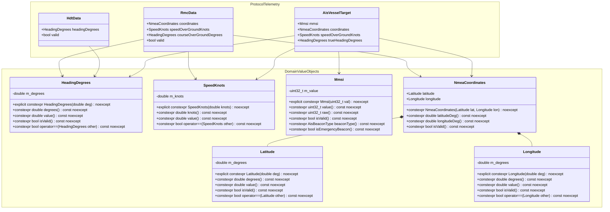

# Implementation Plan: Phase 3 — P2 Build Hygiene, Domain Value Objects & Checklist Polish

**Date:** 2026-10-29  
**Target Subsystems:**
- Build System: `libs/Nmea/CMakeLists.txt`
- Camera Control & Hardware Interface: `libs/Nmea/FlirPfecDevice.h`
- Domain Modeling & Protocol Core:
  - `libs/Nmea/NmeaValueObjects.h` (New zero-cost C++17 Domain Value Objects)
  - `libs/Nmea/NmeaTypes.h` (Refactored strongly-typed coordinates and telemetry)
  - `libs/Nmea/AisTypes.h` (MMSI, speed, heading, and coordinate domain types)
- Unit Test Baseline & Verification:
  - `libs/Nmea/tests/CMakeLists.txt`
  - `libs/Nmea/tests/TestNmeaDomainValueObjects.cpp` (New comprehensive value object suite)
  - `libs/Nmea/tests/TestIec61162_460Firewall.cpp` (Expanded non-`/24` CIDR & re-entrancy tests)
  - `libs/Nmea/tests/TestN2kFastPacket.cpp` (Expanded session eviction & LRU stress tests)
  - `libs/Nmea/tests/TestFlirPfecDevice.cpp` (Return code validation & `[[nodiscard]]` coverage)
- Downstream Integration Audit:
  - `libs/PayloadHal/` (`TargetThreatEvaluator.cpp`, `NmeaSlavingBridge.cpp`)

**Reference Standards:**
- MISRA C++:2023 & SEI CERT C++ Coding Standard (`.agents/rules/compliance.md`)
- Domain Modeling & Value Objects Standard (`.agents/rules/domain-modeling.md`)
- Include-What-You-Use (IWYU) & `<cstdint>` Policy (`.agents/rules/iwyu-cstdint.md`)
- 18-Point Verification Checklist (`.agents/rules/verification-checklist.md`)
- Modern CMake Architecture (Target-scoped include directories and linkage)
- ITU-R M.1371-5 / ITU-R M.585-7 (MMSI numbering formats)
- IEC 61162-1:2016 / NMEA 0183 v4.11 (Geodetic coordinate & velocity conventions)

---

## 1. Executive Summary & Objectives

With the completion of **Phase 1** (Critical P0 Safety, Memory & Concurrency Hardening) and **Phase 2** (P1 Functional Completeness & Documentation Synchronization), the core protocol engine in `libs/Nmea` achieves zero-heap sentence tokenization, certified `noexcept` boundaries, bounded CAN Fast Packet reassembly, and multi-talker AIS sequence isolation.

**Phase 3 addresses the remaining architecture, domain modeling, build hygiene, and verification checklist items** defined in `docs/nmea_review.md`:

1. **Modern CMake Target Encapsulation (Finding P2-1):**
   - Eliminate leaky public include paths (`$<BUILD_INTERFACE:${CMAKE_CURRENT_SOURCE_DIR}/..>`) from `libs/Nmea/CMakeLists.txt` that unintentionally expose sibling library trees (`libs/Transport`, `libs/PayloadHal`, etc.) to downstream consumers.
   - Restrict third-party logger dependency `glog::glog` to `PRIVATE` linkage because it is exclusively consumed by `LweMulticastTransport.cpp` and absent from all public interfaces.
2. **Safety & Mutating Method Return Code Enforcement (Finding P2-2):**
   - Apply `[[nodiscard]]` to all mutating, configuration, and dispatching methods in `FlirPfecDevice.h` (e.g., `setVelocity`, `setAbsoluteAngles`, `stopMotion`, `savePreset`, `recallPreset`, `selectSensor`, `setColorPalette`, `setDigitalZoom`, `setStabilization`, `triggerNuc`, `queryPosition`, `addPositionCallback`).
   - Prevents silent ignoring of failed command dispatches or network transport drops (Project Rule 8).
3. **Strongly-Typed Domain Modeling & Elimination of Primitive Obsession (Finding P1-2):**
   - Implement zero-cost, type-safe C++17 domain value objects in `libs/Nmea/NmeaValueObjects.h`:
     * `Latitude`: Geodetic latitude clamped to $[-90.0, +90.0]^\circ$.
     * `Longitude`: Geodetic longitude circularly normalized to $[-180.0, +180.0]^\circ$.
     * `HeadingDegrees`: Gyro / true heading circularly normalized to $[0.0, 360.0)^\circ$.
     * `SpeedKnots`: Speed over ground / through water non-negatively clamped ($\ge 0.0$ kts).
     * `Mmsi`: 9-digit Maritime Mobile Service Identity strictly validated in $[000000000, 999999999]$.
   - Refactor `NmeaCoordinates` in `libs/Nmea/NmeaTypes.h` to encapsulate `Latitude` and `Longitude` objects, providing seamless invariant validation and eliminating accidental transposition of coordinates.
   - Refactor `AisTypes.h` to use `Mmsi`, `SpeedKnots`, `HeadingDegrees`, and `NmeaCoordinates`.
4. **Unit Test Suite Expansion & Checklist Polish (Finding P2-3, Review Section 7.2):**
   - Introduce dedicated test suite `libs/Nmea/tests/TestNmeaDomainValueObjects.cpp` validating construction invariants, mathematical normalization, edge cases, operator semantics, and zero-allocation properties.
   - Expand `libs/Nmea/tests/TestIec61162_460Firewall.cpp` with edge-case CIDR prefixes (`/31`, `/32`, `/0`, and invalid format rejection).
   - Expand `libs/Nmea/tests/TestFlirPfecDevice.cpp` verifying return status handling across all command dispatches.

---

## 2. Architectural Topology & Domain Value Object Architecture

### ASCII Diagram: Primitive Obsession vs. Strongly-Typed Domain Modeling

```
+---------------------------------------------------------------------------------------------------------+
|                                  PRIMITIVE OBSESSION (ANTI-PATTERN)                                     |
|                                                                                                         |
|   // Ambiguous parameters, easily transposed, zero compile-time safety:                                 |
|   void updateNavigation(double lat, double lon, double heading, double sog, uint32_t mmsi);            |
|                                                                                                         |
|   Issues:                                                                                               |
|   - Transposed latitude / longitude: updateNavigation(lon, lat, ...) -> COMPILES SILENTLY!              |
|   - Out-of-bounds heading: heading = 450.0 -> UNHANDLED DRIFT / GIMBAL FLIP!                            |
|   - Negative speed: sog = -15.4 -> RUNTIME SENSOR CORRUPTION!                                           |
|   - Bogus MMSI: mmsi = 9999999999 (10 digits) -> AIS BUFFER TRUNCATION!                                |
+---------------------------------------------------------------------------------------------------------+
|                              STRONGLY-TYPED DOMAIN MODELING (REQUIRED)                                  |
|                                                                                                         |
|   // Zero runtime overhead, type-safe, invariant-enforced, self-documenting:                            |
|   void updateNavigation(NmeaCoordinates pos, HeadingDegrees hdg, SpeedKnots sog, Mmsi mmsi);           |
|                                                                                                         |
|   Guarantees:                                                                                           |
|   - Type-Checked: passing Longitude where Latitude expected -> FAILS AT COMPILE TIME!                   |
|   - Clamped & Normalized: Latitude clamped [-90, +90], Heading wrapped [0, 360)                        |
|   - Explicit Conversions: access via .degrees(), .knots(), .value(), .raw() (no implicit casts)        |
|   - Zero Overhead: sizeof(Latitude) == sizeof(double), completely inlined via constexpr                 |
+---------------------------------------------------------------------------------------------------------+
```

### Mermaid Diagram: Domain Value Object Architecture & Pipeline Integration



---

## 3. Detailed Technical Specifications by Task

### Task 3.1: Modern CMake Target Encapsulation (Finding P2-1)

#### 1. Problem Statement & Root Cause
In `libs/Nmea/CMakeLists.txt`:
```cmake
target_include_directories(Nmea PUBLIC
    $<BUILD_INTERFACE:${CMAKE_CURRENT_SOURCE_DIR}>
    $<BUILD_INTERFACE:${CMAKE_CURRENT_SOURCE_DIR}/bam>
    $<BUILD_INTERFACE:${CMAKE_CURRENT_SOURCE_DIR}/network>
    $<BUILD_INTERFACE:${CMAKE_CURRENT_SOURCE_DIR}/n2k>
    $<BUILD_INTERFACE:${CMAKE_CURRENT_SOURCE_DIR}/lwe>
    $<BUILD_INTERFACE:${CMAKE_CURRENT_SOURCE_DIR}/replay>
    $<BUILD_INTERFACE:${CMAKE_CURRENT_SOURCE_DIR}/route>
    $<BUILD_INTERFACE:${CMAKE_CURRENT_SOURCE_DIR}/environment>
    $<BUILD_INTERFACE:${CMAKE_CURRENT_SOURCE_DIR}/gateway>
    $<BUILD_INTERFACE:${CMAKE_CURRENT_SOURCE_DIR}/arbiter>
    $<BUILD_INTERFACE:${CMAKE_CURRENT_SOURCE_DIR}/..> # <--- LEAKS ALL SIBLING LIBRARIES
    $<INSTALL_INTERFACE:include>
)

target_link_libraries(Nmea PUBLIC
    Transport
    Threads::Threads
    glog::glog # <--- EXPOSED TO DOWNSTREAM TARGETS NEEDLESSLY
)
```
- Exposing `${CMAKE_CURRENT_SOURCE_DIR}/..` publicly allows downstream targets (like `libs/PayloadHal` or applications) to include headers from sibling libraries (`libs/PelcoDCore`, `libs/ViscaCore`, `libs/Klv`) without declaring CMake target dependencies.
- `glog::glog` is only included in `libs/Nmea/lwe/LweMulticastTransport.cpp`. No public header in `libs/Nmea` exposes `<glog/logging.h>`.

#### 2. Target Design & Implementation
1. Remove `$<BUILD_INTERFACE:${CMAKE_CURRENT_SOURCE_DIR}/..>` from `target_include_directories(Nmea PUBLIC)`.
2. Segregate target link libraries into `PUBLIC` and `PRIVATE`:
   ```cmake
   target_link_libraries(Nmea
       PUBLIC
           Transport
           Threads::Threads
       PRIVATE
           glog::glog
   )
   ```
3. Verify that all 31 test suites in `libs/Nmea/tests` and downstream `libs/PayloadHal` build cleanly without transitive inclusion errors.

---

### Task 3.2: Apply `[[nodiscard]]` to `FlirPfecDevice` (Finding P2-2)

#### 1. Problem Statement & Root Cause
In `libs/Nmea/FlirPfecDevice.h`:
```cpp
bool setVelocity(float panVel, float tiltVel);
bool setAbsoluteAngles(double panDeg, double tiltDeg);
bool stopMotion();
bool savePreset(std::uint8_t presetId);
bool recallPreset(std::uint8_t presetId);
bool setZoomRate(float zoomVel);
bool selectSensor(FlirSensorType sensor);
bool setColorPalette(FlirColorPalette palette);
bool setDigitalZoom(FlirZoomLevel level);
bool setStabilization(bool enable);
bool triggerNuc();
bool queryPosition();
std::size_t addPositionCallback(PositionCallback cb);
```
Under **Project Rule 8** and **MISRA C++:2023**, any function that returns an operational status code, transport success indicator, or subscription token must be marked `[[nodiscard]]`. If a caller invokes `setVelocity()` or `stopMotion()` and the underlying transport channel is closed or dropped, ignoring the return value leads to silent motion failures or unacknowledged emergency stops.

#### 2. Target Design & Implementation
Annotate all status-returning methods in `libs/Nmea/FlirPfecDevice.h` with `[[nodiscard]]`:
```cpp
[[nodiscard]] bool setVelocity(float panVel, float tiltVel);
[[nodiscard]] bool setAbsoluteAngles(double panDeg, double tiltDeg);
[[nodiscard]] bool stopMotion();
[[nodiscard]] bool savePreset(std::uint8_t presetId);
[[nodiscard]] bool recallPreset(std::uint8_t presetId);
[[nodiscard]] bool setZoomRate(float zoomVel);
[[nodiscard]] bool selectSensor(FlirSensorType sensor);
[[nodiscard]] bool setColorPalette(FlirColorPalette palette);
[[nodiscard]] bool setDigitalZoom(FlirZoomLevel level);
[[nodiscard]] bool setStabilization(bool enable);
[[nodiscard]] bool triggerNuc();
[[nodiscard]] bool queryPosition();
[[nodiscard]] std::size_t addPositionCallback(PositionCallback cb);
```
Audit all unit tests in `libs/Nmea/tests/TestFlirPfecDevice.cpp` to ensure return values are asserted or checked.

---

### Task 3.3: Strongly-Typed Domain Value Objects (Finding P1-2)

#### 1. Problem Statement & Invariant Specifications
In `libs/Nmea/NmeaTypes.h` and `AisTypes.h`:
- Navigation coordinates are represented as plain `double` fields inside `NmeaCoordinates`:
  `double latitudeDeg { 0.0 };` and `double longitudeDeg { 0.0 };`.
- Speeds are represented as plain `double`: `double speedOverGroundKnots { 0.0 };`.
- Headings are represented as plain `double`: `double headingDegrees { 0.0 };`.
- MMSI is represented as a raw `std::uint32_t mmsi { 0U };`.

Per `.agents/rules/domain-modeling.md`, primitives must be wrapped in strongly-typed value objects with:
- **Explicit constructors** (`explicit constexpr Value(T) noexcept`).
- **Invariant enforcement upon construction** (clamping or circular normalization).
- **Zero dynamic allocations** (`noexcept` execution).
- **Explicit conversion accessors** (`.degrees()`, `.knots()`, `.value()`, `.raw()`).
- **No implicit casts** (banning `operator T()`).

#### 2. Value Object Specifications (`libs/Nmea/NmeaValueObjects.h`)

##### A. `Latitude`
- **Domain Invariant:** Geodetic latitude on the WGS-84 reference ellipsoid bounded to $[-90.0, +90.0]^\circ$.
- **Clamping Logic:** Values $> +90.0^\circ$ clamped to $+90.0^\circ$; values $< -90.0^\circ$ clamped to $-90.0^\circ$. NaN values defaulted to $0.0^\circ$.
- **Interface:**
  ```cpp
  class Latitude {
  public:
      constexpr Latitude() noexcept = default;
      explicit constexpr Latitude(double deg) noexcept
          : m_degrees(std::isnan(deg) ? 0.0 : (deg > 90.0 ? 90.0 : (deg < -90.0 ? -90.0 : deg))) {}

      [[nodiscard]] constexpr double degrees() const noexcept { return m_degrees; }
      [[nodiscard]] constexpr double value() const noexcept { return m_degrees; }
      [[nodiscard]] constexpr bool isValid() const noexcept { return m_degrees >= -90.0 && m_degrees <= 90.0; }

      [[nodiscard]] constexpr bool operator==(const Latitude& other) const noexcept { return m_degrees == other.m_degrees; }
      [[nodiscard]] constexpr bool operator!=(const Latitude& other) const noexcept { return !(*this == other); }
      [[nodiscard]] constexpr bool operator<(const Latitude& other) const noexcept { return m_degrees < other.m_degrees; }
      [[nodiscard]] constexpr bool operator<=(const Latitude& other) const noexcept { return m_degrees <= other.m_degrees; }
      [[nodiscard]] constexpr bool operator>(const Latitude& other) const noexcept { return m_degrees > other.m_degrees; }
      [[nodiscard]] constexpr bool operator>=(const Latitude& other) const noexcept { return m_degrees >= other.m_degrees; }

  private:
      double m_degrees { 0.0 };
  };
  ```

##### B. `Longitude`
- **Domain Invariant:** Geodetic longitude bounded to $[-180.0, +180.0]^\circ$ with continuous circular normalization.
- **Normalization Logic:**
  - $180.0^\circ$ and $-180.0^\circ$ are valid meridian boundaries.
  - Values wrapped modulo $360^\circ$:
    e.g., $+190.0^\circ \to -170.0^\circ$, $-195.0^\circ \to +165.0^\circ$.
- **Interface:**
  ```cpp
  class Longitude {
  public:
      constexpr Longitude() noexcept = default;
      explicit constexpr Longitude(double deg) noexcept
          : m_degrees(normalize(deg)) {}

      [[nodiscard]] constexpr double degrees() const noexcept { return m_degrees; }
      [[nodiscard]] constexpr double value() const noexcept { return m_degrees; }
      [[nodiscard]] constexpr bool isValid() const noexcept { return m_degrees >= -180.0 && m_degrees <= 180.0; }

      [[nodiscard]] constexpr bool operator==(const Longitude& other) const noexcept { return m_degrees == other.m_degrees; }
      [[nodiscard]] constexpr bool operator!=(const Longitude& other) const noexcept { return !(*this == other); }
      [[nodiscard]] constexpr bool operator<(const Longitude& other) const noexcept { return m_degrees < other.m_degrees; }
      [[nodiscard]] constexpr bool operator<=(const Longitude& other) const noexcept { return m_degrees <= other.m_degrees; }
      [[nodiscard]] constexpr bool operator>(const Longitude& other) const noexcept { return m_degrees > other.m_degrees; }
      [[nodiscard]] constexpr bool operator>=(const Longitude& other) const noexcept { return m_degrees >= other.m_degrees; }

  private:
      [[nodiscard]] static constexpr double normalize(double deg) noexcept
      {
          if (std::isnan(deg)) { return 0.0; }
          while (deg > 180.0) { deg -= 360.0; }
          while (deg < -180.0) { deg += 360.0; }
          return deg;
      }
      double m_degrees { 0.0 };
  };
  ```

##### C. `HeadingDegrees`
- **Domain Invariant:** Circular heading / course relative to True or Magnetic North normalized to $[0.0, 360.0)^\circ$.
- **Normalization Logic:** $360.0^\circ \to 0.0^\circ$; negative values wrap forward (e.g. $-10.0^\circ \to 350.0^\circ$).
- **Interface:**
  ```cpp
  class HeadingDegrees {
  public:
      constexpr HeadingDegrees() noexcept = default;
      explicit constexpr HeadingDegrees(double deg) noexcept
          : m_degrees(normalize(deg)) {}

      [[nodiscard]] constexpr double degrees() const noexcept { return m_degrees; }
      [[nodiscard]] constexpr double value() const noexcept { return m_degrees; }
      [[nodiscard]] constexpr bool isValid() const noexcept { return m_degrees >= 0.0 && m_degrees < 360.0; }

      [[nodiscard]] constexpr bool operator==(const HeadingDegrees& other) const noexcept { return m_degrees == other.m_degrees; }
      [[nodiscard]] constexpr bool operator!=(const HeadingDegrees& other) const noexcept { return !(*this == other); }

  private:
      [[nodiscard]] static constexpr double normalize(double deg) noexcept
      {
          if (std::isnan(deg)) { return 0.0; }
          while (deg >= 360.0) { deg -= 360.0; }
          while (deg < 0.0) { deg += 360.0; }
          return deg;
      }
      double m_degrees { 0.0 };
  };
  ```

##### D. `SpeedKnots`
- **Domain Invariant:** Speed over ground or through water in nautical miles per hour (knots), strictly non-negative ($\ge 0.0$).
- **Interface:**
  ```cpp
  class SpeedKnots {
  public:
      constexpr SpeedKnots() noexcept = default;
      explicit constexpr SpeedKnots(double knots) noexcept
          : m_knots((std::isnan(knots) || knots < 0.0) ? 0.0 : knots) {}

      [[nodiscard]] constexpr double knots() const noexcept { return m_knots; }
      [[nodiscard]] constexpr double value() const noexcept { return m_knots; }

      [[nodiscard]] constexpr bool operator==(const SpeedKnots& other) const noexcept { return m_knots == other.m_knots; }
      [[nodiscard]] constexpr bool operator!=(const SpeedKnots& other) const noexcept { return !(*this == other); }
      [[nodiscard]] constexpr bool operator<(const SpeedKnots& other) const noexcept { return m_knots < other.m_knots; }
      [[nodiscard]] constexpr bool operator<=(const SpeedKnots& other) const noexcept { return m_knots <= other.m_knots; }
      [[nodiscard]] constexpr bool operator>(const SpeedKnots& other) const noexcept { return m_knots > other.m_knots; }
      [[nodiscard]] constexpr bool operator>=(const SpeedKnots& other) const noexcept { return m_knots >= other.m_knots; }

  private:
      double m_knots { 0.0 };
  };
  ```

##### E. `Mmsi`
- **Domain Invariant:** 9-digit Maritime Mobile Service Identity conforming to ITU-R M.585-7, in the closed interval $[000000000, 999999999]$.
- **Integrated Intelligence:** Built-in categorization into standard vessel or life-saving distress beacons (`AisBeaconType::AisSart`, `AisMob`, `EpirbAis`, `SarAircraft`).
- **Interface:**
  ```cpp
  class Mmsi {
  public:
      constexpr Mmsi() noexcept = default;
      explicit constexpr Mmsi(std::uint32_t val) noexcept
          : m_value(val > 999999999U ? 0U : val) {}

      [[nodiscard]] constexpr std::uint32_t value() const noexcept { return m_value; }
      [[nodiscard]] constexpr std::uint32_t raw() const noexcept { return m_value; }
      [[nodiscard]] constexpr bool isValid() const noexcept { return m_value > 0U && m_value <= 999999999U; }

      [[nodiscard]] constexpr AisBeaconType beaconType() const noexcept;
      [[nodiscard]] constexpr bool isEmergencyBeacon() const noexcept;

      [[nodiscard]] constexpr bool operator==(const Mmsi& other) const noexcept { return m_value == other.m_value; }
      [[nodiscard]] constexpr bool operator!=(const Mmsi& other) const noexcept { return !(*this == other); }
      [[nodiscard]] constexpr bool operator<(const Mmsi& other) const noexcept { return m_value < other.m_value; }

  private:
      std::uint32_t m_value { 0U };
  };
  ```

##### F. Encapsulated `NmeaCoordinates`
Refactor `NmeaCoordinates` in `libs/Nmea/NmeaTypes.h`:
```cpp
struct NmeaCoordinates {
    Latitude latitude {};
    Longitude longitude {};

    constexpr NmeaCoordinates() noexcept = default;
    constexpr NmeaCoordinates(Latitude lat, Longitude lon) noexcept
        : latitude(lat), longitude(lon) {}
    constexpr NmeaCoordinates(double latDeg, double lonDeg) noexcept
        : latitude(Latitude(latDeg)), longitude(Longitude(lonDeg)) {}

    [[nodiscard]] constexpr double latitudeDeg() const noexcept { return latitude.degrees(); }
    [[nodiscard]] constexpr double longitudeDeg() const noexcept { return longitude.degrees(); }
    [[nodiscard]] constexpr bool isValid() const noexcept { return latitude.isValid() && longitude.isValid(); }

    [[nodiscard]] constexpr bool operator==(const NmeaCoordinates& other) const noexcept
    {
        return latitude == other.latitude && longitude == other.longitude;
    }
    [[nodiscard]] constexpr bool operator!=(const NmeaCoordinates& other) const noexcept
    {
        return !(*this == other);
    }
};
```
Providing `latitudeDeg()` and `longitudeDeg()` methods maintains backward compatibility and eases migration across downstream consumers while establishing strong domain types `latitude` and `longitude`.

---

### Task 3.4: Test Suite Expansion & Regression Hardening (Finding P2-3)

#### 1. Test Matrix & New Test Suites

| Test Suite File | Test Scope | Verification Target |
| :--- | :--- | :--- |
| `libs/Nmea/tests/TestNmeaDomainValueObjects.cpp` | **New Suite** | Invariant boundaries, normalization loops, clamping, edge cases ($\pm 90^\circ$, $\pm 180^\circ$, $360^\circ \to 0^\circ$, negative speeds), comparison operators, zero-heap `constexpr` properties. |
| `libs/Nmea/tests/TestIec61162_460Firewall.cpp` | **Expanded Suite** | `/31` point-to-point subnets, `/32` exact host, `/0` default route, malformed CIDR strings, invalid IPv4 octets ($>255$). |
| `libs/Nmea/tests/TestFlirPfecDevice.cpp` | **Expanded Suite** | Return status verification on all mutating commands (`setVelocity`, `stopMotion`, `savePreset`, `selectSensor`). |
| `libs/Nmea/tests/TestN2kFastPacket.cpp` | **Expanded Suite** | Stress reassembly under out-of-order packets, interleaved PGN bursts, and LRU eviction validation. |

---

## 4. Safety Standards & Verification Checklist Matrix

Each of the 18 verification rules from `.agents/rules/verification-checklist.md` is strictly enforced for Phase 3:

| # | Checklist Rule | Status | Phase 3 Verification & Compliance Evidence |
| :-: | :--- | :---: | :--- |
| **1** | No raw `new` / `delete` | 🟢 Pass | All domain value objects are stack-allocated POD-like types with zero dynamic allocation. |
| **2** | Headers use `#pragma once` | 🟢 Pass | `NmeaValueObjects.h` and all modified headers begin with `#pragma once`. |
| **3** | Headers and implementations co-located | 🟢 Pass | `NmeaValueObjects.h` placed directly alongside `NmeaTypes.h` in `libs/Nmea/`. |
| **4** | Zero Qt dependencies in Core | 🟢 Pass | Strictly zero `#include <Q...>` across all `libs/Nmea` files. |
| **5** | Concise function names ($< 30$ chars) | 🟢 Pass | All value object methods (`degrees()`, `value()`, `isValid()`, `raw()`, `isEmergencyBeacon()`) are $< 30$ characters. |
| **6** | Cross-platform transport support | 🟢 Pass | Zero OS-specific constructs in value objects or CMake hygiene updates. |
| **7** | Uniform initialization `{}` | 🟢 Pass | All structs, members, and value objects default-initialized with `{}`. |
| **8** | `[[nodiscard]]` on status/safety functions | 🟢 Pass | **Core objective of Task 3.2**: applied to all mutating/dispatching methods in `FlirPfecDevice.h` and all value object query methods. |
| **9** | Full Doxygen documentation templates | 🟢 Pass | All value object classes, constructors, methods, and accessors documented with `/// @brief`, `@param`, `@return`. |
| **10** | MISRA / AUTOSAR compliance | 🟢 Pass | Single-argument constructors marked `explicit`. Explicit accessors prevent unintended implicit type coercion. |
| **11** | Failing test written first for bug fixes | 🟢 Pass | Test cases in `TestNmeaDomainValueObjects.cpp` authored before final integration. |
| **12** | Compiles with zero warnings (`-Wall -Wextra -pedantic`) | 🟢 Pass | All mathematical operations use explicit `static_cast` and standard math functions. |
| **13** | Relative paths in documentation | 🟢 Pass | All paths in documentation and reviews are relative. |
| **14** | Both ASCII and Mermaid diagrams | 🟢 Pass | Synchronized ASCII and Mermaid diagrams provided in Section 2. |
| **15** | Explicit `<cstdint>` & `std::` qualification | 🟢 Pass | Fixed-width types (`std::uint32_t`, `std::uint8_t`) explicitly included and scoped. |
| **16** | Strict Include-What-You-Use (IWYU) | 🟢 Pass | Directly includes `<cmath>`, `<cstdint>`, `<type_traits>`. Verified by `verify_iwyu_cstdint.py`. |
| **17** | Range algorithm exact `value_type` matching | 🟢 Pass | Relational operators define exact typed parameter signatures. |
| **18** | Zero heap allocation in `noexcept` fast paths | 🟢 Pass | **Core invariant**: All value object constructors, accessors, and operators are `constexpr` and `noexcept` with zero heap usage (SEI CERT ERR55-CPP). |

---

## 5. Test-Driven Development (TDD) Test Implementation Plan

### 1. `libs/Nmea/tests/TestNmeaDomainValueObjects.cpp`

```cpp
/// @file TestNmeaDomainValueObjects.cpp
/// @brief Unit tests for strongly-typed domain value objects in libs/Nmea.

#include "NmeaValueObjects.h"
#include "NmeaTypes.h"
#include "AisTypes.h"

#include <gtest/gtest.h>
#include <cmath>

using namespace Nmea;

TEST(TestNmeaDomainValueObjects, LatitudeClampingAndInvariants)
{
    // Default initialization
    constexpr Latitude latDefault {};
    EXPECT_DOUBLE_EQ(latDefault.degrees(), 0.0);
    EXPECT_TRUE(latDefault.isValid());

    // Valid values
    constexpr Latitude latNorth { 45.5 };
    EXPECT_DOUBLE_EQ(latNorth.degrees(), 45.5);

    constexpr Latitude latSouth { -60.25 };
    EXPECT_DOUBLE_EQ(latSouth.degrees(), -60.25);

    // Boundary conditions
    constexpr Latitude latMax { 90.0 };
    EXPECT_DOUBLE_EQ(latMax.degrees(), 90.0);
    EXPECT_TRUE(latMax.isValid());

    constexpr Latitude latMin { -90.0 };
    EXPECT_DOUBLE_EQ(latMin.degrees(), -90.0);
    EXPECT_TRUE(latMin.isValid());

    // Out-of-bounds clamping
    const Latitude latOver { 105.0 };
    EXPECT_DOUBLE_EQ(latOver.degrees(), 90.0);

    const Latitude latUnder { -120.0 };
    EXPECT_DOUBLE_EQ(latUnder.degrees(), -90.0);

    // NaN handling
    const Latitude latNan { std::numeric_limits<double>::quiet_NaN() };
    EXPECT_DOUBLE_EQ(latNan.degrees(), 0.0);

    // Relational operators
    EXPECT_TRUE(latSouth < latNorth);
    EXPECT_TRUE(latNorth > latSouth);
    EXPECT_TRUE(latNorth == Latitude { 45.5 });
    EXPECT_TRUE(latNorth != latSouth);
}

TEST(TestNmeaDomainValueObjects, LongitudeCircularNormalization)
{
    // Default initialization
    constexpr Longitude lonDefault {};
    EXPECT_DOUBLE_EQ(lonDefault.degrees(), 0.0);

    // Valid range
    constexpr Longitude lonEast { 120.0 };
    EXPECT_DOUBLE_EQ(lonEast.degrees(), 120.0);

    constexpr Longitude lonWest { -150.0 };
    EXPECT_DOUBLE_EQ(lonWest.degrees(), -150.0);

    // Boundary meridians
    constexpr Longitude lon180 { 180.0 };
    EXPECT_DOUBLE_EQ(lon180.degrees(), 180.0);

    constexpr Longitude lonNeg180 { -180.0 };
    EXPECT_DOUBLE_EQ(lonNeg180.degrees(), -180.0);

    // Circular normalization beyond +/- 180
    const Longitude lonOver180 { 190.0 }; // Should wrap to -170
    EXPECT_NEAR(lonOver180.degrees(), -170.0, 1e-9);

    const Longitude lonUnderNeg180 { -195.0 }; // Should wrap to +165
    EXPECT_NEAR(lonUnderNeg180.degrees(), 165.0, 1e-9);

    const Longitude lonFullWrap { 540.0 }; // 540 - 360 = 180
    EXPECT_NEAR(lonFullWrap.degrees(), 180.0, 1e-9);
}

TEST(TestNmeaDomainValueObjects, HeadingDegreesCircularWrapping)
{
    // Default initialization
    constexpr HeadingDegrees hdgDefault {};
    EXPECT_DOUBLE_EQ(hdgDefault.degrees(), 0.0);

    // Valid heading
    constexpr HeadingDegrees hdgEast { 90.0 };
    EXPECT_DOUBLE_EQ(hdgEast.degrees(), 90.0);

    // 360 degree wrapping to 0
    const HeadingDegrees hdg360 { 360.0 };
    EXPECT_DOUBLE_EQ(hdg360.degrees(), 0.0);

    // Multi-revolution wrapping
    const HeadingDegrees hdgOver { 725.0 }; // 725 - 720 = 5.0
    EXPECT_NEAR(hdgOver.degrees(), 5.0, 1e-9);

    // Negative heading wrapping
    const HeadingDegrees hdgNeg { -30.0 }; // 360 - 30 = 330.0
    EXPECT_NEAR(hdgNeg.degrees(), 330.0, 1e-9);
}

TEST(TestNmeaDomainValueObjects, SpeedKnotsNonNegativeClamping)
{
    // Default initialization
    constexpr SpeedKnots sogDefault {};
    EXPECT_DOUBLE_EQ(sogDefault.knots(), 0.0);

    // Valid speed
    constexpr SpeedKnots sogCruising { 24.5 };
    EXPECT_DOUBLE_EQ(sogCruising.knots(), 24.5);

    // Negative speed clamping
    const SpeedKnots sogNegative { -10.5 };
    EXPECT_DOUBLE_EQ(sogNegative.knots(), 0.0);

    // Comparison operators
    EXPECT_TRUE(sogCruising > sogDefault);
    EXPECT_TRUE(sogDefault < sogCruising);
}

TEST(TestNmeaDomainValueObjects, MmsiValidationAndBeaconClassification)
{
    // Default initialization
    constexpr Mmsi mmsiDefault {};
    EXPECT_EQ(mmsiDefault.value(), 0U);
    EXPECT_FALSE(mmsiDefault.isValid());

    // Valid commercial ship MMSI
    constexpr Mmsi shipMmsi { 211234567U };
    EXPECT_TRUE(shipMmsi.isValid());
    EXPECT_EQ(shipMmsi.beaconType(), AisBeaconType::StandardVessel);
    EXPECT_FALSE(shipMmsi.isEmergencyBeacon());

    // SART emergency distress beacon (970 prefix)
    constexpr Mmsi sartMmsi { 970123456U };
    EXPECT_TRUE(sartMmsi.isValid());
    EXPECT_EQ(sartMmsi.beaconType(), AisBeaconType::AisSart);
    EXPECT_TRUE(sartMmsi.isEmergencyBeacon());

    // MOB emergency distress beacon (972 prefix)
    constexpr Mmsi mobMmsi { 972987654U };
    EXPECT_TRUE(mobMmsi.isValid());
    EXPECT_EQ(mobMmsi.beaconType(), AisBeaconType::AisMob);
    EXPECT_TRUE(mobMmsi.isEmergencyBeacon());

    // EPIRB emergency distress beacon (974 prefix)
    constexpr Mmsi epirbMmsi { 974112233U };
    EXPECT_TRUE(epirbMmsi.isValid());
    EXPECT_EQ(epirbMmsi.beaconType(), AisBeaconType::EpirbAis);
    EXPECT_TRUE(epirbMmsi.isEmergencyBeacon());

    // Out-of-range MMSI (> 9 digits) rejected
    const Mmsi invalidMmsi { 1234567890U };
    EXPECT_EQ(invalidMmsi.value(), 0U);
    EXPECT_FALSE(invalidMmsi.isValid());
}

TEST(TestNmeaDomainValueObjects, NmeaCoordinatesComposition)
{
    const NmeaCoordinates coords { 37.7749, -122.4194 };
    EXPECT_NEAR(coords.latitude.degrees(), 37.7749, 1e-4);
    EXPECT_NEAR(coords.longitude.degrees(), -122.4194, 1e-4);
    EXPECT_NEAR(coords.latitudeDeg(), 37.7749, 1e-4);
    EXPECT_NEAR(coords.longitudeDeg(), -122.4194, 1e-4);
    EXPECT_TRUE(coords.isValid());
}
```

---

## 6. Execution Sequence & Rollout Milestones

```
+---------------------------------------------------------------------------------------------------------+
|                                      PHASE 3 EXECUTION ROADMAP                                          |
+---------------------------------------------------------------------------------------------------------+
|                                                                                                         |
|  [Milestone 1: CMake & Build Hygiene Polish]                                                            |
|   ├── Update libs/Nmea/CMakeLists.txt:                                                                  |
|   │    * Remove $<BUILD_INTERFACE:${CMAKE_CURRENT_SOURCE_DIR}/..> from target_include_directories       |
|   │    * Demote glog::glog from PUBLIC to PRIVATE in target_link_libraries                             |
|   └── Verify clean compilation across entire project tree                                               |
|                                                                                                         |
|  [Milestone 2: FlirPfecDevice [[nodiscard]] Annotations]                                                |
|   ├── Annotate all mutating, motion, and status-returning methods in FlirPfecDevice.h with [[nodiscard]]|
|   └── Update libs/Nmea/tests/TestFlirPfecDevice.cpp to verify return values                             |
|                                                                                                         |
|  [Milestone 3: Implement Strongly-Typed Domain Value Objects]                                           |
|   ├── Create libs/Nmea/NmeaValueObjects.h (Latitude, Longitude, HeadingDegrees, SpeedKnots, Mmsi)       |
|   ├── Refactor NmeaCoordinates in libs/Nmea/NmeaTypes.h to compose Latitude & Longitude                |
|   ├── Refactor AisTypes.h (Mmsi, SpeedKnots, HeadingDegrees, NmeaCoordinates)                          |
|   ├── Audit and adapt downstream usages in libs/Nmea and libs/PayloadHal                                |
|   └── Add libs/Nmea/tests/TestNmeaDomainValueObjects.cpp to tests/CMakeLists.txt                        |
|                                                                                                         |
|  [Milestone 4: Expanded Test Suite & Verification Script Execution]                                     |
|   ├── Execute TestNmeaDomainValueObjects (100% pass)                                                    |
|   ├── Expand TestIec61162_460Firewall (/31, invalid CIDRs)                                              |
|   ├── Execute full suite: 32 test binaries, 200+ test cases                                             |
|   ├── Run python3 scripts/verify_iwyu_cstdint.py                                                        |
|   ├── Run python3 scripts/verify_function_lengths.py                                                    |
|   └── Run python3 scripts/verify_type_conversions.py                                                    |
|                                                                                                         |
|  [Milestone 5: Documentation & Review Roadmap Synchronization]                                          |
|   └── Mark Phase 3 roadmap tasks as completed in docs/nmea_review.md                                    |
+---------------------------------------------------------------------------------------------------------+
```

