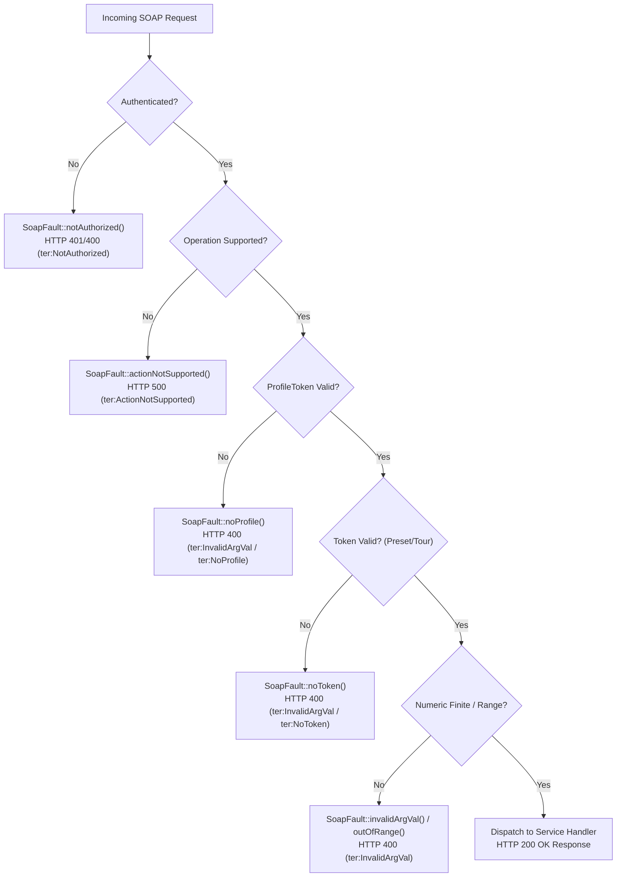
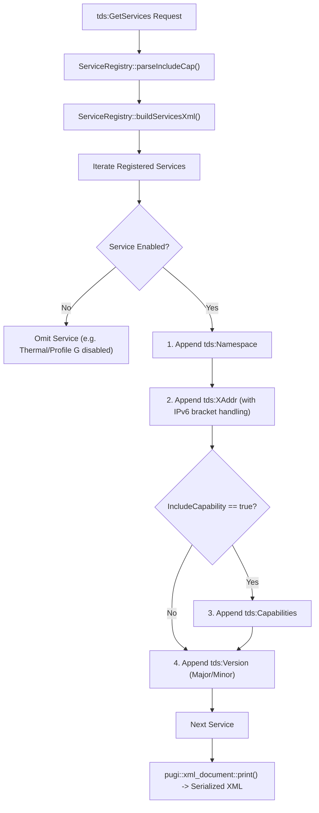
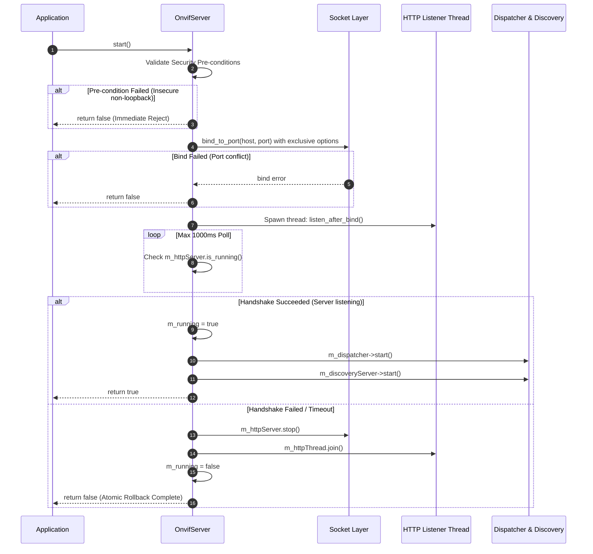
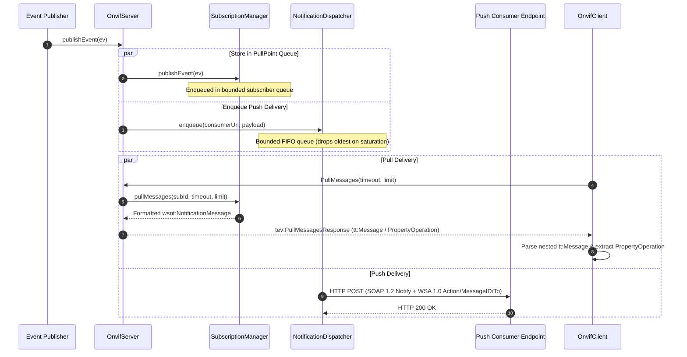
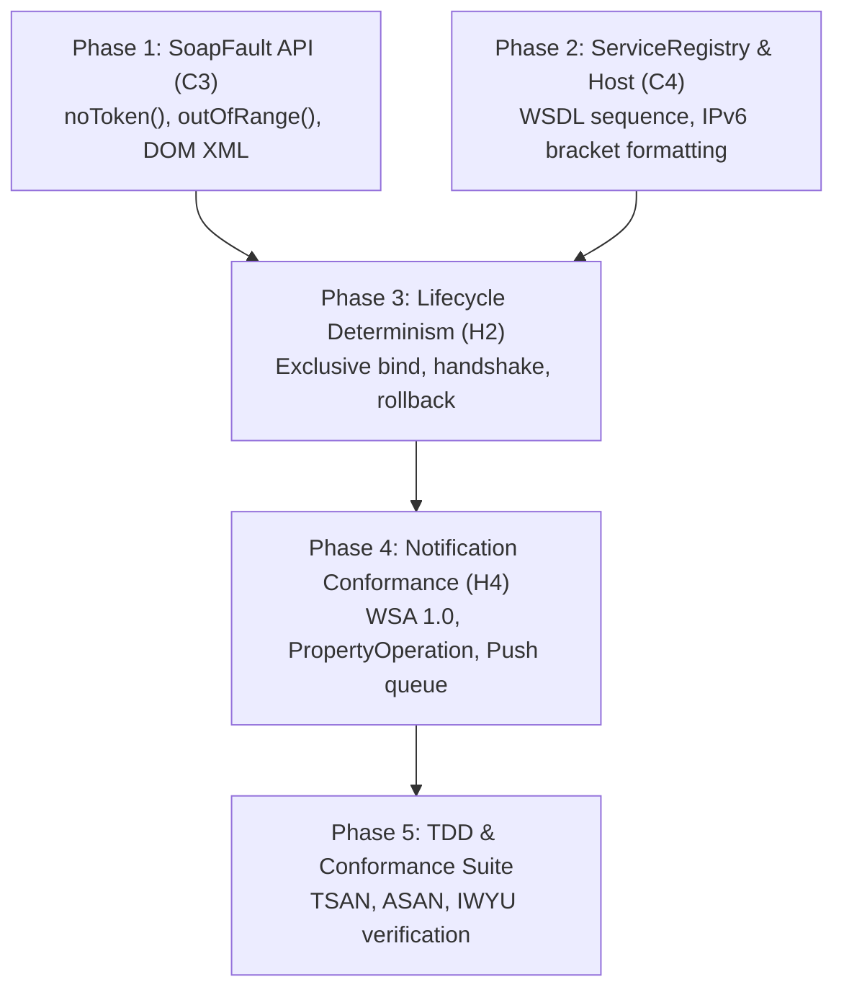

# Implementation Plan: Findings C3, C4, H2 & H4 – Protocol SOAP Faults, GetServices Schema Conformance, Server Lifecycle Determinism & Notification Payloads

**Scope:** `libs/Onvif/` (`SoapFault.h`, `SoapFault.cpp`, `ServiceRegistry.h`, `ServiceRegistry.cpp`, `OnvifServer.h`, `OnvifServer.cpp`, `NotificationDispatcher.h`, `NotificationDispatcher.cpp`, `OnvifClient.cpp`, test suites)  
**Standard Baseline:** ONVIF Core Specification v24.12 (§5.11 Fault Handling, §8.2.2 GetServices, §9 Event Handling), Profile S Specification v1.3 (§8 PTZ & Event Handling), OASIS WS-BaseNotification v1.3 (§3.1, §3.2), OASIS WS-Addressing 1.0 (2005/08), W3C XML 1.0, MISRA C++:2023, SEI CERT C++  
**Reference Documents:** [`docs/onvif_p1_protocol_correctness_plan.md`](onvif_p1_protocol_correctness_plan.md) (Section 1.1, Phase 1), [`docs/onvif_review.md`](onvif_review.md) (Findings C3, C4, H2, H4)  

---

## 1. Executive Summary & Problem Analysis

In [`docs/onvif_review.md`](onvif_review.md) and [`docs/onvif_p1_protocol_correctness_plan.md`](onvif_p1_protocol_correctness_plan.md), findings **C3**, **C4**, **H2**, and **H4** define the protocol baseline required for ONVIF Core v24.12 and Profile S v1.3 compliance:

### 1.1 Finding C3: Protocol SOAP 1.2 Faults & Token Validation Extension

1. **Strict SOAP 1.2 Fault Grammar (ONVIF Core §5.11):**  
   SOAP 1.2 mandates a hierarchical structure: `SOAP-ENV:Code/SOAP-ENV:Value` (`SOAP-ENV:Sender` or `SOAP-ENV:Receiver`), nested `SOAP-ENV:Subcode/SOAP-ENV:Value` (e.g. `ter:ActionNotSupported`, `ter:InvalidArgVal`), optional tertiary subcode (e.g. `ter:NoProfile`, `ter:NoToken`, `wsrf-rw:ResourceUnknownFault`), and `SOAP-ENV:Reason/SOAP-ENV:Text` with `xml:lang="en"`.
2. **Missing Token Validation Fault (`ter:NoToken`):**  
   While Phase 1 added `SoapFault::noProfile()` and `SoapFault::invalidArgVal()`, token-referencing operations in [`libs/Onvif/OnvifServer.cpp`](../libs/Onvif/OnvifServer.cpp) (such as `GotoPreset`, `RemovePreset`, and `RemovePresetTour`) do not validate whether the supplied `<tptz:PresetToken>` exists. Even when an invalid or non-existent token is passed, the server currently returns a success response (`<tptz:GotoPresetResponse/>`). Per ONVIF PTZ Specification §5.4, referencing an invalid preset or configuration token MUST return a Sender Fault with subcode `ter:InvalidArgVal`, secondary subcode `ter:NoToken`, and HTTP 400.
3. **DOM-Based XML Generation for Faults:**  
   [`libs/Onvif/SoapFault.cpp`](../libs/Onvif/SoapFault.cpp) currently constructs fault fragments via string concatenation. Migrating to DOM-based generation via `pugi::xml_document` guarantees schema conformance, automatic attribute escaping, and eliminates XML malformedness by construction.

### 1.2 Finding C4: `GetServicesResponse` Conformance & Schema Consistency

1. **Strict XML Schema Element Sequence (ONVIF Core §8.2.2):**  
   `tds:GetServices` must return a list of `tds:Service` elements. The ONVIF WSDL schema strictly requires the child element sequence:
   1. `<tds:Namespace>` (WSDL namespace URI)
   2. `<tds:XAddr>` (absolute HTTP URI to the endpoint)
   3. `<tds:Capabilities>` (optional, only present when `<tds:IncludeCapability>true</tds:IncludeCapability>` was requested)
   4. `<tds:Version>` (`<tt:Major>`, `<tt:Minor>`)  
   Any inversion of `<tds:Capabilities>` and `<tds:Version>` or tag mismatch (e.g. closing `<tds:XAddr>` with `</tt:XAddr>`) violates XML schema validation.
2. **Standard Specification Versioning:**  
   Standard ONVIF services must report valid specification version numbers (Device 2.5, Media 2.6, Media2 2.0, PTZ 2.0, Imaging 2.0, DeviceIO 2.0, Events 2.5, Analytics 2.0, Recording 2.0, Search 2.0, Replay 2.0, Thermal 1.0). Inverted or arbitrary versions (e.g. major version $\ge 10$) break VMS client negotiation.
3. **Conditional Advertisement:**  
   Disabled services (e.g. Thermal when `thermalEnabled == false`, or Profile G Recording/Search/Replay when disabled) must be omitted from `GetServicesResponse`.
4. **Host Resolution & IPv6 Literal Support:**  
   `resolveHost(req)` must correctly parse bracketed IPv6 literals (e.g. `[::1]:8080` $\rightarrow$ `[::1]`) without naive colon truncation, while validating against host-header injection (finding M2).

### 1.3 Finding H2: Server Lifecycle Determinism, Failure Recovery & Rollback

1. **Deterministic `start()` Contract:**  
   `OnvifServer::start()` must return `true` if and only if the HTTP server is actively bound, listening, and ready to accept incoming connections.
2. **Exclusive Binding & Port Conflict Mitigation:**  
   Exclusive socket options (`SO_EXCLUSIVEADDRUSE` on Windows, `SO_REUSEADDR` with exclusive bind on POSIX) prevent port stealing or silent sharing by competing processes. If binding fails, `start()` must immediately return `false`.
3. **Atomic Rollback on Listener Failure:**  
   If the listener thread fails to enter the `is_running()` state within 1000 ms, `start()` must execute a full atomic rollback: stop the HTTP server, join the listener thread, reset running flags, and return `false` without leaking background daemons.
4. **Security Gating at Startup:**  
   Binding to a non-loopback interface must be unconditionally rejected if authentication is disabled or if factory-default credentials are active without explicit authorization.
5. **Clean Shutdown & Restart Idempotency:**  
   Calling `stop()` must cleanly stop and join discovery, notification dispatcher, subscription sweeper, and HTTP server threads. Repeated start-stop-restart cycles must succeed deterministically without lingering socket errors.

### 1.4 Finding H4: Event Notification Conformance & Payload Integrity

1. **WS-Addressing 1.0 Standard Compliance:**  
   All event endpoints, subscription references, and notification headers must strictly use the OASIS WS-Addressing 1.0 namespace (`http://www.w3.org/2005/08/addressing`), never deprecated 2004/08.
2. **Compliant `<tt:Message>` Encapsulation (ONVIF Core §9.2):**  
   In both PullPoint (`PullMessagesResponse`) and Push (`wsnt:Notify`) modes:
   - `<wsnt:Topic>` must declare `xmlns:tns1="http://www.onvif.org/ver10/topics"` with dialect `http://www.onvif.org/ver10/tev/topicExpression/ConcreteSet`.
   - `<wsnt:Message>` must wrap `<tt:Message>`.
   - `<tt:Message>` must specify `UtcTime="YYYY-MM-DDTHH:MM:SSZ"` and `PropertyOperation="Changed"` (or `"Initialized"` / `"Deleted"`).
   - Source items must reside under `<tt:Source><tt:SimpleItem Name="..." Value="..."/></tt:Source>`.
   - Data items must reside under `<tt:Data><tt:SimpleItem Name="..." Value="..."/></tt:Data>`.
3. **Push Delivery Wire Format:**  
   Push delivery dispatches a SOAP 1.2 POST request with `wsa:Action` (`http://docs.oasis-open.org/wsn/bw-2/NotificationConsumer/Notify`), `wsa:MessageID` (`urn:uuid:...`), and `wsa:To`, bounded by an asynchronous worker queue in `NotificationDispatcher`.
4. **Client Robustness:**  
   [`libs/Onvif/OnvifClient.cpp`](../libs/Onvif/OnvifClient.cpp) must parse both compliant nested `<tt:Message>` payloads and legacy flat payloads seamlessly.

---

## 2. Architecture & Design Specifications

### 2.1 Finding C3: SOAP 1.2 Fault Hierarchy & DOM Serialization

SOAP 1.2 faults follow a strict envelope hierarchy:

```
+--------------------------------------------------------------------------+
| SOAP 1.2 Envelope (SOAP-ENV:Envelope)                                    |
|   xmlns:SOAP-ENV="http://www.w3.org/2003/05/soap-envelope"               |
|   xmlns:ter="http://www.onvif.org/ver10/error"                           |
|   xmlns:wsrf-rw="http://docs.oasis-open.org/wsrf/rw-2"                   |
|   xmlns:wsnt="http://docs.oasis-open.org/wsn/b-2"                        |
|                                                                          |
|   <SOAP-ENV:Body>                                                        |
|     <SOAP-ENV:Fault>                                                     |
|       <SOAP-ENV:Code>                                                    |
|         <SOAP-ENV:Value>SOAP-ENV:Sender | SOAP-ENV:Receiver</SOAP-ENV:Value> |
|         <SOAP-ENV:Subcode>                                               |
|           <SOAP-ENV:Value>ter:InvalidArgVal | ter:ActionNotSupported     |
|           <SOAP-ENV:Subcode>  (Optional Secondary)                       |
|             <SOAP-ENV:Value>ter:NoToken | ter:NoProfile                  |
|           </SOAP-ENV:Subcode>                                            |
|         </SOAP-ENV:Subcode>                                              |
|       </SOAP-ENV:Code>                                                   |
|       <SOAP-ENV:Reason>                                                  |
|         <SOAP-ENV:Text xml:lang="en">Descriptive Reason</SOAP-ENV:Text>  |
|       </SOAP-ENV:Reason>                                                 |
|     </SOAP-ENV:Fault>                                                    |
|   </SOAP-ENV:Body>                                                       |
+--------------------------------------------------------------------------+
```

#### Mermaid Diagram: SOAP Fault Classification & Ingress Validation



---

### 2.2 Finding C4: Service Registry DOM Generation & WSDL Schema Flow

[`ServiceRegistry`](../libs/Onvif/ServiceRegistry.h) produces `tds:GetServicesResponse` using `pugi::xml_document`. Each `tds:Service` adheres to the WSDL element ordering:

```
+--------------------------------------------------------------------------+
| tds:GetServicesResponse                                                  |
|   <tds:Service>                                                          |
|     1. <tds:Namespace>http://www.onvif.org/ver10/device/wsdl</tds:Namespace>
|     2. <tds:XAddr>http://[host]:[port]/onvif/device_service</tds:XAddr>  |
|     3. <tds:Capabilities> ... </tds:Capabilities> (If IncludeCap=true)   |
|     4. <tds:Version>                                                     |
|          <tt:Major>2</tt:Major>                                          |
|          <tt:Minor>5</tt:Minor>                                          |
|        </tds:Version>                                                    |
|   </tds:Service>                                                         |
+--------------------------------------------------------------------------+
```

#### Mermaid Diagram: Service Registry DOM Generation Pipeline



---

### 2.3 Finding H2: Deterministic Server Lifecycle & Rollback State Machine

```
+--------------------------------------------------------------------------+
|                       OnvifServer::start() Lifecycle                     |
+--------------------------------------------------------------------------+
|                                                                          |
|   [ Call start() ]                                                       |
|          │                                                               |
|          ▼                                                               |
|   { Pre-conditions Check } ──(Non-loopback & no auth/default pwd)──────► FAIL
|          │ (Passed)                                                      |
|          ▼                                                               |
|   { Exclusive Socket Bind } ──(Port in use / bind failed)──────────────► FAIL
|          │ (Bound successfully)                                          |
|          ▼                                                               |
|   [ Launch m_httpThread: listen_after_bind() ]                           |
|          │                                                               |
|          ▼                                                               |
|   { Synchronous Poll: m_httpServer.is_running()? (Max 1000ms) }           |
|          ├─────────────────────────────────────────┐                     |
|          │ (Listening = true)                      │ (Timeout / Exit)    |
|          ▼                                         ▼                     |
|   [ Mark m_running = true ]                 [ Atomic Rollback: ]         |
|   [ Start m_dispatcher ]                    [  m_httpServer.stop() ]     |
|   [ Start m_discoveryServer ]               [  m_httpThread.join() ]     |
|          │                                  [  m_running = false   ]     |
|          ▼                                         │                     |
|     RETURN TRUE                                    ▼                     |
|                                               RETURN FALSE               |
+--------------------------------------------------------------------------+
```

#### Mermaid Diagram: Server Startup Sequence & Rollback Flow



---

### 2.4 Finding H4: Event Notification Wire Format & Dispatch Pipeline

```
+--------------------------------------------------------------------------+
|                  Event Notification Dispatch Pipeline                    |
+--------------------------------------------------------------------------+
|                                                                          |
|   [ Publisher: publishEvent(OnvifEvent) ]                                |
|          │                                                               |
|          ├─────────────────────────────────────────────────┐             |
|          │ (PullPoint Subscriptions)                       │ (Push Subs) |
|          ▼                                                 ▼             |
|   [ SubscriptionManager::publishEvent ]        [ NotificationDispatcher ]|
|   - Formats <wsnt:NotificationMessage>         - Enqueues task           |
|   - Stores in bounded PullPoint queue          - Bounded FIFO queue      |
|          │                                                 │             |
|          ▼                                                 ▼             |
|   [ PullMessages Request ]                     [ Async Worker Loop ]     |
|   - Wraps in <tev:PullMessagesResponse>        - Constructs SOAP 1.2 POST|
|   - <wsnt:Topic xmlns:tns1="...">              - Headers:                |
|   - <tt:Message UtcTime="..."                  -  wsa:Action (Notify)    |
|                 PropertyOperation="...">       -  wsa:MessageID (UUID)   |
|   - Returns HTTP 200                           -  wsa:To (ConsumerUrl)   |
|                                                - Dispatches to Consumer  |
+--------------------------------------------------------------------------+
```

#### Mermaid Diagram: Notification Delivery & Client Ingress Flow



---

## 3. Implementation Phases & Detailed Tasks

### Phase 1: SOAP Faults & Token Validation Extension (Finding C3)

- **Task 1.1: Extend `SoapFault` Subcode API**  
  Update [`libs/Onvif/SoapFault.h`](../libs/Onvif/SoapFault.h) and [`libs/Onvif/SoapFault.cpp`](../libs/Onvif/SoapFault.cpp):
  - Add `SoapFault::noToken(std::string_view reason = "The requested token does not exist.")`:
    - Code: `SOAP-ENV:Sender`
    - Subcode: `ter:InvalidArgVal`
    - Secondary: `ter:NoToken`
  - Add `SoapFault::outOfRange(std::string_view reason = "Argument value is out of range")`:
    - Code: `SOAP-ENV:Sender`
    - Subcode: `ter:InvalidArgVal`
    - Secondary: `ter:OutofRange`
  - Add `SoapFault::usernameClash(std::string_view reason = "The requested username already exists")`:
    - Code: `SOAP-ENV:Sender`
    - Subcode: `ter:InvalidArgVal`
    - Secondary: `ter:UsernameClash`

```cpp
/// @brief Fault returned when an operation references an unknown or invalid token (Preset, Tour, etc.).
/// @details Code `SOAP-ENV:Sender`, Subcode `ter:InvalidArgVal`, secondary `ter:NoToken`.
/// @param[in] reason Human-readable reason text.
/// @return Serialized Fault element.
[[nodiscard]] static std::string noToken(std::string_view reason = "The requested token does not exist.");

/// @brief Fault returned when a numeric or range argument exceeds allowable limits.
/// @details Code `SOAP-ENV:Sender`, Subcode `ter:InvalidArgVal`, secondary `ter:OutofRange`.
/// @param[in] reason Human-readable reason text.
/// @return Serialized Fault element.
[[nodiscard]] static std::string outOfRange(std::string_view reason = "Argument value is out of range");

/// @brief Fault returned when attempting to create a user that already exists.
/// @details Code `SOAP-ENV:Sender`, Subcode `ter:InvalidArgVal`, secondary `ter:UsernameClash`.
/// @param[in] reason Human-readable reason text.
/// @return Serialized Fault element.
[[nodiscard]] static std::string usernameClash(std::string_view reason = "The requested username already exists");
```

- **Task 1.2: DOM-Based Fault Generation via `pugi::xml_document`**  
  In [`libs/Onvif/SoapFault.cpp`](../libs/Onvif/SoapFault.cpp), refactor `formatFault` to construct elements via `pugi::xml_document`:
  ```cpp
  [[nodiscard]] std::string formatFault(
      std::string_view codeValue, std::string_view subcode, std::string_view secondSubcode, std::string_view reason)
  {
      pugi::xml_document doc {};
      auto faultNode = doc.append_child("SOAP-ENV:Fault");

      auto codeNode = faultNode.append_child("SOAP-ENV:Code");
      codeNode.append_child("SOAP-ENV:Value").text().set(codeValue.data());

      auto subNode = codeNode.append_child("SOAP-ENV:Subcode");
      subNode.append_child("SOAP-ENV:Value").text().set(subcode.data());

      if (!secondSubcode.empty()) {
          auto secSubNode = subNode.append_child("SOAP-ENV:Subcode");
          secSubNode.append_child("SOAP-ENV:Value").text().set(secondSubcode.data());
      }

      auto reasonNode = faultNode.append_child("SOAP-ENV:Reason");
      auto textNode = reasonNode.append_child("SOAP-ENV:Text");
      textNode.append_attribute("xml:lang").set_value("en");
      textNode.text().set(reason.data());

      std::ostringstream ss {};
      doc.print(ss, "  ", pugi::format_indent | pugi::format_no_declaration);
      return ss.str();
  }
  ```

- **Task 1.3: Token Validation in `OnvifServer::handlePtzService`**  
  In [`libs/Onvif/OnvifServer.cpp`](../libs/Onvif/OnvifServer.cpp):
  - In `GotoPreset`: Parse `PresetToken`. If token is empty or `ptzHandler->handleGotoPreset(presetToken)` returns `false`, immediately return `sendSoapResponse(res, SoapFault::noToken(), 400);`.
  - In `RemovePreset`: Parse `PresetToken`. If token is empty or `ptzHandler->handleRemovePreset(presetToken)` returns `false`, immediately return `sendSoapResponse(res, SoapFault::noToken(), 400);`.
  - In `RemovePresetTour`: Parse `PresetTourToken`. If token is empty, return `sendSoapResponse(res, SoapFault::noToken(), 400);`.

---

### Phase 2: Service Registry DOM & Host Resolution Hardening (Finding C4)

- **Task 2.1: Schema Sequence & Version Compliance in `ServiceRegistry`**  
  In [`libs/Onvif/ServiceRegistry.cpp`](../libs/Onvif/ServiceRegistry.cpp):
  - Verify that `buildServicesXml` strictly orders child elements: `tds:Namespace` $\rightarrow$ `tds:XAddr` $\rightarrow$ `tds:Capabilities` $\rightarrow$ `tds:Version`.
  - Format `tds:XAddr` using bracketed IPv6 literals if `safeHost` contains colons:
    ```cpp
    const bool isIpv6 = (safeHost.find(':') != std::string::npos && safeHost.front() != '[');
    const std::string hostFormatted = isIpv6 ? ("[" + safeHost + "]") : safeHost;
    const std::string url = "http://" + hostFormatted + ":" + std::to_string(port) + svc.xAddrPath;
    ```
- **Task 2.2: Robust Host Header Parsing in `OnvifServer::resolveHost`**  
  In [`libs/Onvif/OnvifServer.cpp`](../libs/Onvif/OnvifServer.cpp):
  - Replace naive `hostHeader.find(':')` with bracket-aware host parsing:
    - If `hostHeader` starts with `'['`: find closing `']'`, parse port after `']:'`.
    - Otherwise: split port at last `':'`.
  - Validate extracted host string against XML special characters (`<`, `>`, `"`, `'`, `&`) to eliminate host-header injection attacks (finding M2).

---

### Phase 3: Lifecycle Determinism & Atomic Rollback Hardening (Finding H2)

- **Task 3.1: Exclusive Socket Binding & Pre-Condition Validation**  
  In [`libs/Onvif/OnvifServer.cpp`](../libs/Onvif/OnvifServer.cpp) (`start()`):
  - Refuse start if `!m_config.auth.enabled && !loopback` or if factory-default password is active without `allowDefaultPassword`.
  - Enforce `SO_EXCLUSIVEADDRUSE` (Windows) / `SO_REUSEADDR` with exclusive bind (Linux).
  - Verify `m_httpServer.bind_to_port()` return value; log and abort immediately on failure.
- **Task 3.2: Deterministic Thread Handshake & Rollback on Timeout**  
  - Launch listener thread running `m_httpServer.listen_after_bind()`.
  - Synchronously poll `m_httpServer.is_running()` up to 1000 ms.
  - If listening fails or times out:
    - Invoke `m_httpServer.stop()`.
    - Join `m_httpThread`.
    - Ensure `m_running = false`.
    - Return `false` without leaking threads or sockets.
- **Task 3.3: Cascading Teardown in `stop()` and Destructor**  
  In `OnvifServer::stop()`:
  - Stop `m_discoveryServer`.
  - Stop `m_httpServer`.
  - Stop `m_dispatcher`.
  - Stop `m_subManager`.
  - Join `m_httpThread`.
  - Ensure re-entrance safety (`if (!m_running) return;`).

---

### Phase 4: Notification Wire Format & WS-Addressing 1.0 Conformance (Finding H4)

- **Task 4.1: Standard WS-Addressing 1.0 Headers**  
  In [`libs/Onvif/OnvifServer.cpp`](../libs/Onvif/OnvifServer.cpp) and [`libs/Onvif/NotificationDispatcher.cpp`](../libs/Onvif/NotificationDispatcher.cpp):
  - Guarantee all endpoints use namespace `http://www.w3.org/2005/08/addressing`.
  - Push delivery must specify headers:
    - `<wsa:Action>http://docs.oasis-open.org/wsn/bw-2/NotificationConsumer/Notify</wsa:Action>`
    - `<wsa:MessageID>urn:uuid:...`
    - `<wsa:To>consumerUrl</wsa:To>`
  - HTTP `Content-Type`: `application/soap+xml; charset=utf-8; action="http://docs.oasis-open.org/wsn/bw-2/NotificationConsumer/Notify"`.
- **Task 4.2: Compliant `<tt:Message>` Structure & `PropertyOperation`**  
  In `buildNotificationMsg`:
  - `<wsnt:Topic Dialect="http://www.onvif.org/ver10/tev/topicExpression/ConcreteSet" xmlns:tns1="http://www.onvif.org/ver10/topics">`.
  - Encapsulate `<tt:Message UtcTime="..." PropertyOperation="...">` supporting `"Changed"`, `"Initialized"`, `"Deleted"`.
  - Wrap Source and Data inside `<tt:Source>` and `<tt:Data>` using `<tt:SimpleItem Name="..." Value="..."/>`.
- **Task 4.3: Bounded Push Worker Delivery**  
  In `NotificationDispatcher`:
  - Enforce `m_config.maxDispatchQueueSize` upper bound. Drop oldest pending task upon saturation.
  - Implement exception isolation inside `workerLoop` to prevent unhandled socket errors from aborting worker.
- **Task 4.4: Dual Client Parsing**  
  In [`libs/Onvif/OnvifClient.cpp`](../libs/Onvif/OnvifClient.cpp):
  - In `parsePullMessagesResponse`, extract attributes and items from nested `<tt:Message>` if present, falling back to legacy flat `<wsnt:Message>`.

---

## 4. Test-Driven Development (TDD) Verification Plan

Following the project TDD skill ([`.agents/skills/tdd-bug-fixing/SKILL.md`](../.agents/skills/tdd-bug-fixing/SKILL.md)), unit and conformance tests are defined to validate all four findings:

### 4.1 Test Suite Breakdown

```
+----------------------------------------------------------------------------------------------------+
| Test Suite / Test Name                               | Target Finding & Validation Description     |
+------------------------------------------------------+---------------------------------------------+
| TestOnvifSoapFault.NoTokenStructure                  | C3: Verifies ter:InvalidArgVal / ter:NoToken|
| TestOnvifSoapFault.OutOfRangeStructure               | C3: Verifies ter:InvalidArgVal / OutofRange  |
| TestOnvifSoapFault.GotoPreset_UnknownToken_ReturnsFault | C3: Verifies GotoPreset on invalid preset |
|                                                      |     returns HTTP 400 and ter:NoToken.       |
| TestOnvifSoapFault.RemovePreset_UnknownToken_ReturnsFault | C3: Verifies RemovePreset on invalid   |
|                                                      |     token returns HTTP 400 and ter:NoToken. |
| TestOnvifServicesConformance.SchemaElementSequenceCompliance | C4: Verifies Namespace->XAddr->     |
|                                                      |     Capabilities->Version sequence.         |
| TestOnvifServicesConformance.Ipv6BracketedXAddr      | C4: Verifies [::1] IPv6 literal in XAddr.   |
| TestOnvifServicesConformance.HostHeaderSanitization  | C4: Verifies rejection of host injection.   |
| TestOnvifServerLifecycle.PortConflictFails           | H2: Verifies exclusive bind failure on port |
|                                                      |     conflict returns false immediately.     |
| TestOnvifServerLifecycle.ListenerFailureRollback     | H2: Verifies listener timeout aborts thread |
|                                                      |     and joins without leaking sockets.      |
| TestOnvifServerLifecycle.StartStopRestart            | H2: Verifies clean port release & restart.  |
| TestOnvifNotificationPayload.SubscriptionRefUsesWsa200508 | H4: Verifies WSA 1.0 (2005/08) namespace|
| TestOnvifNotificationPayload.PullMessagesCompliantStructure | H4: Verifies tt:Message UtcTime and   |
|                                                      |     PropertyOperation in PullMessages.      |
| TestOnvifNotificationPayload.PushDeliversWsntNotifyEnvelope | H4: Verifies WSA headers & wsnt:Notify|
|                                                      |     delivered to mock consumer endpoint.    |
| TestOnvifNotificationPayload.ClientParsesNestedTtMessageAndLegacy | H4: Verifies dual client parsing|
+------------------------------------------------------+---------------------------------------------+
```

### 4.2 Test Execution Commands

```bash
# Build all ONVIF test suites
cmake -B build -S . -DPELCOD_ENABLE_ONVIF=ON -DCMAKE_BUILD_TYPE=Debug
cmake --build build --target TestOnvifSoapFault -j$(nproc)
cmake --build build --target TestOnvifServicesConformance -j$(nproc)
cmake --build build --target TestOnvifServerLifecycle -j$(nproc)
cmake --build build --target TestOnvifNotificationPayload -j$(nproc)

# Run test suites directly
./build/libs/Onvif/tests/TestOnvifSoapFault
./build/libs/Onvif/tests/TestOnvifServicesConformance
./build/libs/Onvif/tests/TestOnvifServerLifecycle
./build/libs/Onvif/tests/TestOnvifNotificationPayload

# Run under ThreadSanitizer (TSAN) to confirm zero data races
cmake -B build-tsan -S . -DPELCOD_ENABLE_ONVIF=ON -DCMAKE_CXX_FLAGS="-fsanitize=thread"
cmake --build build-tsan -j$(nproc)
ctest --test-dir build-tsan -R "TestOnvif" --output-on-failure
```

---

## 5. Compliance & Verification Matrix

Before completing changes, all implementations must pass verification against the repository checklist:

| # | Rule / Standard | Compliance Measure for C3, C4, H2 & H4 |
|---|---|---|
| 1 | **No raw `new`/`delete`** | `std::make_unique<pugi::xml_document>`, `std::make_shared` |
| 2 | **`#pragma once`** | Guard on all modified headers (`SoapFault.h`, `ServiceRegistry.h`) |
| 3 | **Co-located `.h`/`.cpp`** | All headers and source files co-located in `libs/Onvif/` |
| 4 | **Core is Qt-free** | Zero Qt dependencies (`<Q...>`) in `libs/Onvif/` |
| 5 | **Function names < 30 chars** | Audited (e.g. `noToken`, `outOfRange`, `usernameClash`, `resolveHost`) |
| 6 | **Linux & Windows support** | Cross-platform POSIX / Win32 socket options (`SO_EXCLUSIVEADDRUSE` / `SO_REUSEADDR`) |
| 7 | **Explicit `{}` initialization** | All variables and struct fields brace-initialized |
| 8 | **`[[nodiscard]]` applied** | Applied to all fault generators, parsers, and query functions |
| 9 | **Full Doxygen templates** | `/// @brief`, `@param`, `@return`, `@details` on all public methods |
| 10 | **MISRA & SEI CERT C++** | CERT ERR51-CPP (exception safety), CON43-C (race-free lifecycle) |
| 11 | **TDD Workflow** | Failing test cases authored and verified prior to feature implementation |
| 12 | **Zero Warnings (`-Werror`)** | Builds cleanly under `-Wall -Wextra -pedantic -Werror` and MSVC `/W4 /WX` |
| 13 | **Relative file paths** | All documentation references relative paths |
| 14 | **Dual Diagrams** | Both ASCII and Mermaid diagrams provided for all architecture sections |
| 15 | **Explicit `<cstdint>` & `std::`** | Explicit includes and `std::uint16_t`, `std::size_t` namespace qualifications |
| 16 | **IWYU Adherence** | Direct inclusion of standard headers; audited via `verify_iwyu_cstdint.py` |

---

## 6. Implementation Readiness & Dependency Graph

```
+--------------------------------------------------------------------------+
|                  Implementation Sequence & Readiness Flow                |
+--------------------------------------------------------------------------+
|                                                                          |
|   [ Step 1: SoapFault Extension (C3) ]                                   |
|     - Add noToken(), outOfRange(), usernameClash()                       |
|     - Refactor formatFault() to use pugi::xml_document DOM               |
|                               │                                          |
|                               ▼                                          |
|   [ Step 2: ServiceRegistry & Host Resolution Hardening (C4) ]           |
|     - Validate WSDL sequence (Namespace -> XAddr -> Caps -> Version)     |
|     - Bracketed IPv6 host formatting in resolveHost()                    |
|                               │                                          |
|                               ▼                                          |
|   [ Step 3: Server Lifecycle Determinism & Rollback (H2) ]               |
|     - Exclusive socket options & pre-bind security check                 |
|     - Deterministic listen handshake with 1000ms rollback                |
|                               │                                          |
|                               ▼                                          |
|   [ Step 4: Notification Conformance & Payload Integrity (H4) ]          |
|     - WS-Addressing 1.0 (2005/08) verification                           |
|     - tt:Message / PropertyOperation serialization & parsing             |
|                               │                                          |
|                               ▼                                          |
|   [ Step 5: TDD Suite Execution & Compliance Verification ]              |
|     - Run ctest across all 4 suites                                      |
|     - ThreadSanitizer & IWYU audit (python3 scripts/verify_iwyu_cstdint.py)
|                                                                          |
+--------------------------------------------------------------------------+
```

#### Mermaid Diagram: Implementation Task Dependency Graph


