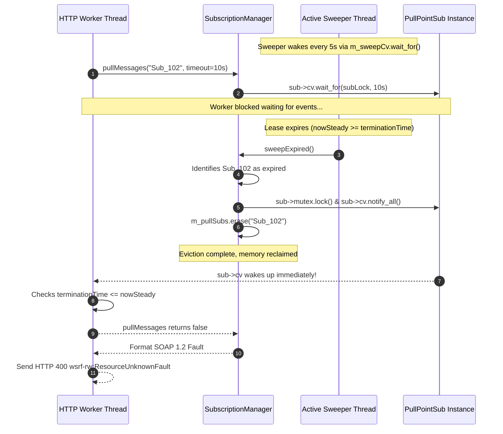
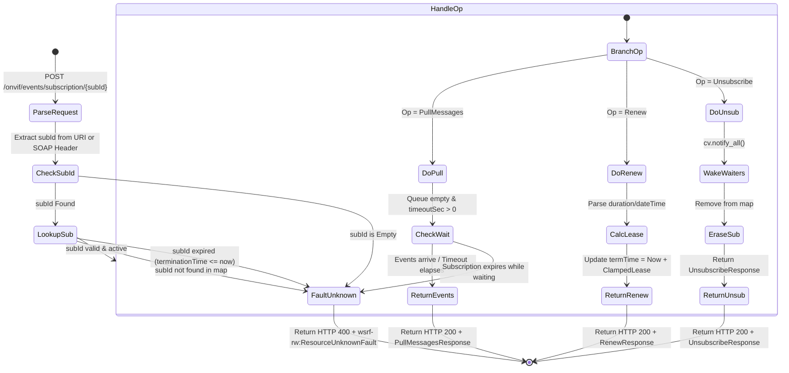

# Implementation Plan: Finding H3 – Event Subscription Lifecycle & Resource Limits

**Scope:** `libs/Onvif/` (`SubscriptionManager.h`, `SubscriptionManager.cpp`, `OnvifServer.h`, `OnvifServer.cpp`, `OnvifServerTypes.h`, `libs/Onvif/tests/TestOnvifEventLifecycle.cpp`)  
**Standard Baseline:** ONVIF Core Specification v24.12 (§9 Event Handling), Profile S Specification v1.3 (§8 Event Handling), OASIS WS-BaseNotification v1.3 (§3.1, §3.2), OASIS WS-Addressing 1.0, WSRF-ResourceLifetime / WSRF-ResourceUnknownFault, MISRA C++:2023, SEI CERT C++  
**Reference Documents:** [`docs/onvif_p1_protocol_correctness_plan.md`](onvif_p1_protocol_correctness_plan.md) (Section 2.2 & Phase 3), [`docs/onvif_review.md`](onvif_review.md) (Finding H3)  

---

## 1. Executive Summary & Problem Analysis

In [`docs/onvif_review.md`](onvif_review.md) and [`docs/onvif_p1_protocol_correctness_plan.md`](onvif_p1_protocol_correctness_plan.md), finding **H3** identifies critical lifecycle, memory, protocol conformance, and concurrency defects in the ONVIF Event Subscription subsystem:

1. **Passive Leaks (Missing Active TTL Sweeper):**  
   Expiration in [`libs/Onvif/SubscriptionManager.cpp`](../libs/Onvif/SubscriptionManager.cpp) is purely passive. Expired subscriptions are only evaluated when a new subscription is created or an event is published. If clients create subscriptions and disconnect without further activity, expired entries sit in memory indefinitely, consuming quota slots and leaking memory (CWE-400).
2. **Silent Unsubscribe on Expired/Invalid Tokens:**  
   In [`libs/Onvif/OnvifServer.cpp`](../libs/Onvif/OnvifServer.cpp) (`handleSubscriptionService`), `Unsubscribe` requests on non-existent or expired subscription IDs silently return `<wsnt:UnsubscribeResponse/>` without checking whether the subscription existed. OASIS WS-BaseNotification §3.1 and ONVIF Core §9 mandate that unknown or expired subscription references MUST fault with `wsrf-rw:ResourceUnknownFault` and HTTP 400.
3. **Lease Extension Arithmetic & Absolute Date-Time Support:**  
   `Renew` must advance lease termination from the **current** timestamp (`current_time + requested_duration`), clamped to $[T_{\text{min}}, T_{\text{max}}]$. Furthermore, WS-BaseNotification §3.2 specifies that `<wsnt:TerminationTime>` can be either an ISO 8601 duration (`PT10M`) or an absolute UTC dateTime (`2026-10-21T15:30:00Z`). Currently, absolute dateTime strings fail duration parsing and get erroneously clamped as integer years (e.g. 2026 seconds).
4. **Worker Starvation & Clamped Long-Poll Wait:**  
   Clients calling `PullMessages` specify a `<tev:Timeout>`. While `OnvifServer::parseTimeoutSeconds` attempts to clamp seconds, it relies on exception-prone `std::stoi` and only matches the `'S'` designator (failing on minutes or hours). If an unclamped or long wait enters `SubscriptionManager::pullMessages`, pool workers are held hostage. Furthermore, if a subscription expires while a worker is blocked on `wait_for`, it continues waiting fruitlessly until the full timeout elapses instead of aborting immediately.
5. **Per-Subscriber Queue Upper Bounds:**  
   While `publishEvent` enforces a queue size limit, `pullMessages` does not clamp the requested `MessageLimit`, and eviction does not notify blocked condition variables when an expired subscription is discarded.

---

## 2. Architecture & Design Specification

### 2.1 Active Background Sweeper Thread Architecture

To eliminate subscription leaks without relying on incoming traffic, [`SubscriptionManager`](../libs/Onvif/SubscriptionManager.h) manages an autonomous background sweeper thread running an interruptible sleep loop:
- **Interval:** Runs every 5 seconds (configurable via `NotificationConfig::sweepInterval`).
- **Synchronization:** Sleeps on `std::condition_variable m_sweepCv` with `m_sweepMutex`.
- **Clean RAII Shutdown:** On `SubscriptionManager::stop()` or destruction, `m_sweeperRunning` is atomically set to `false`, `m_sweepCv.notify_all()` is fired, and `m_sweepThread` is cleanly joined without latency.
- **Eviction Notification:** When `sweepExpired()` evicts an expired `PullPointSub`, it acquires the subscriber's per-instance mutex and calls `sub->cv.notify_all()`. Any in-flight `pullMessages` worker waiting on this subscription immediately unblocks and returns `false`.

#### ASCII Diagram: Active Subscription Management & Sweeping

```
  +-----------------------------------------------------------------------------------------+
  |                                   SubscriptionManager                                   |
  |                                                                                         |
  |   +-------------------------------------+             +-----------------------------+   |
  |   | m_pullSubs (std::map)               |             | m_pushSubs (std::map)       |   |
  |   |  Sub_101: Term = Now + 30s (Active) |             |  Sub_201: Now + 60s (Active)|   |
  |   |  Sub_102: Term = Now - 5s  (EXPIRED)|             |  Sub_202: Now - 1s (EXPIRED)|   |
  |   +------------------▲------------------+             +--------------▲--------------+   |
  |                      │                                               │                  |
  |                      +──────────────────────────┬────────────────────+                  |
  |                                                 │                                       |
  |                                     +-----------┴-----------+                           |
  |                                     |    sweepExpired()     |                           |
  |                                     +-----------▲-----------+                           |
  |                                                 │ (Runs every 5s)                       |
  |                                     +-----------┴-----------+                           |
  |                                     | Active Sweeper Thread |                           |
  |                                     | Sleeps on m_sweepCv   |                           |
  |                                     +-----------▲-----------+                           |
  |                                                 │                                       |
  |                   Shutdown / stop() ────────────┼─────────────────── notify_all()       |
  +-------------------------------------------------│---------------------------------------+
                                                    │
  [ HTTP Worker Thread (PullMessages) ]             │
    Waiting on Sub_102 cv.wait_for(...) ◄───────────┘ (Wakes immediately on eviction!)
    Returns false -> SOAP 1.2 wsrf-rw:ResourceUnknownFault
```

#### Mermaid Diagram: Active Subscription Sweeper & Eviction Flow



---

### 2.2 SOAP 1.2 Fault Mapping & State Machine

Every subscription operation across `/onvif/events/subscription` and `/onvif/events/subscription/{subId}` must enforce strict protocol state validation:

| Operation | Input Condition | Expected Behavior | HTTP Code | Fault Code |
|---|---|---|---|---|
| `PullMessages` | Missing `subId` | Reject immediately | 400 | `wsrf-rw:ResourceUnknownFault` |
| `PullMessages` | `subId` not in `m_pullSubs` | Reject immediately | 400 | `wsrf-rw:ResourceUnknownFault` |
| `PullMessages` | `subId` expired during wait | Evict, abort wait, reject | 400 | `wsrf-rw:ResourceUnknownFault` |
| `PullMessages` | Valid, events available | Drain up to `limit` events | 200 | `<tev:PullMessagesResponse>` |
| `Renew` | Missing `subId` | Reject immediately | 400 | `wsrf-rw:ResourceUnknownFault` |
| `Renew` | `subId` unknown / expired | Reject immediately | 400 | `wsrf-rw:ResourceUnknownFault` |
| `Renew` | Valid `subId` | Lease extended: $T_{\text{now}} + L$ | 200 | `<wsnt:RenewResponse>` |
| `Unsubscribe` | Missing `subId` | Reject immediately | 400 | `wsrf-rw:ResourceUnknownFault` |
| `Unsubscribe` | `subId` unknown / expired | Reject immediately | 400 | `wsrf-rw:ResourceUnknownFault` |
| `Unsubscribe` | Valid `subId` | Erase, wake waiters, return OK | 200 | `<wsnt:UnsubscribeResponse/>` |

#### Mermaid Diagram: Endpoint Request State Machine



---

### 2.3 Lease Parsing & Absolute Date-Time Arithmetic

OASIS WS-BaseNotification §3.1 & §3.2 specifies that termination time parameters (`<wsnt:InitialTerminationTime>` and `<wsnt:TerminationTime>`) accept:
1. **ISO 8601 Duration:** e.g., `"PT10M"`, `"PT30S"`, `"P1D"`, `"PT1H30M"`.
2. **ISO 8601 UTC Absolute DateTime:** e.g., `"2026-10-21T15:30:00Z"` or `"2026-10-21T15:30:00.000Z"`.
3. **Integer Seconds:** e.g., `"600"`.

#### Unified Parsing Algorithm

```cpp
[[nodiscard]] std::chrono::seconds parseLease(std::string_view termStr) const
```
1. **Empty String:** Returns `m_config.defaultLease`.
2. **ISO Duration (`termStr.front() == 'P'`):**  
   Parse `D`, `H`, `M`, `S` components without allocations or exceptions. Clamp total seconds to $[T_{\text{min}}, T_{\text{max}}]$.
3. **ISO UTC Absolute DateTime (`termStr` contains `'T'` and `'-'`):**  
   Parse `YYYY-MM-DDTHH:MM:SSZ` into UTC `time_point`.  
   Calculate:
   $$\Delta t = T_{\text{target}} - T_{\text{now}}$$
   If $\Delta t \le 0$, clamp to `m_config.minLease`. Otherwise, clamp to $[T_{\text{min}}, T_{\text{max}}]$.
4. **Integer Seconds:**  
   Parse using non-throwing `std::from_chars`. Clamp to $[T_{\text{min}}, T_{\text{max}}]$.
5. **Fallback:** Returns `m_config.defaultLease`.

---

### 2.4 Worker Starvation Defense & Bounded Long-Polling

In `PullMessages`:
1. **Timeout Clamping:** The requested `<tev:Timeout>` string is converted to seconds and clamped strictly to $[0, 10]$ seconds. If a client sends `PT60S` or `PT1H`, it is clamped to 10 seconds.
2. **Non-Throwing ISO Duration Parser:** Replace `std::stoi` in `OnvifServer::parseTimeoutSeconds` with `std::from_chars` and robust duration parsing conforming to MISRA C++:2023 / SEI CERT C++ ERR51-CPP.
3. **Compound Wait Predicate:**  
   ```cpp
   sub->cv.wait_for(subLock, std::chrono::seconds(timeoutSec), [&]() {
       return !sub->queue.empty() 
           || !serverRunning.load() 
           || (std::chrono::steady_clock::now() >= sub->terminationTime);
   });
   ```
   If the server is shutting down (`!serverRunning`) OR the subscription expires during the wait, the wait immediately completes without holding the worker thread until `timeoutSec` expires.

---

## 3. Step-by-Step Implementation Tasks

### Task 1: Configuration & Class Definition Enhancements
- **Target Files:**
  - [`libs/Onvif/OnvifServerTypes.h`](../libs/Onvif/OnvifServerTypes.h)
  - [`libs/Onvif/SubscriptionManager.h`](../libs/Onvif/SubscriptionManager.h)
- **Modifications:**
  1. Add `std::chrono::milliseconds sweepInterval { 5000 };` to `NotificationConfig` in [`libs/Onvif/OnvifServerTypes.h`](../libs/Onvif/OnvifServerTypes.h).
  2. In [`libs/Onvif/SubscriptionManager.h`](../libs/Onvif/SubscriptionManager.h):
     - Add active sweeper primitives:
       ```cpp
       std::atomic<bool> m_sweeperRunning { false };
       std::condition_variable m_sweepCv {};
       std::mutex m_sweepMutex {};
       std::thread m_sweepThread {};
       ```
     - Declare `void start();` and `void stop();`.
     - Update destructor signature to `~SubscriptionManager();` (explicitly defined in `.cpp` to join sweeper thread).
     - Declare private helper `void sweeperLoop();`.
     - Declare ISO 8601 dateTime parser helper.

### Task 2: Active Sweeper Thread & RAII Lifecycle Implementation
- **Target File:** [`libs/Onvif/SubscriptionManager.cpp`](../libs/Onvif/SubscriptionManager.cpp)
- **Modifications:**
  1. Implement `SubscriptionManager::SubscriptionManager(NotificationConfig config)`:
     - Initialize `m_config`.
     - Call `start()`.
  2. Implement `SubscriptionManager::~SubscriptionManager()`:
     - Call `stop()`.
  3. Implement `start()` and `stop()`:
     - `start()` sets `m_sweeperRunning = true` and spawns `m_sweepThread`.
     - `stop()` atomically transitions `m_sweeperRunning` from `true` to `false`, notifies `m_sweepCv`, joins `m_sweepThread`, and invokes `notifyAll()`.
  4. Implement `sweeperLoop()`:
     - Loops while `m_sweeperRunning.load()`.
     - Calls `m_sweepCv.wait_for(lock, m_config.sweepInterval, [this] { return !m_sweeperRunning.load(); })`.
     - If not stopping, calls `sweepExpired()`.
  5. Harden `sweepExpired()`:
     - For every evicted `PullPointSub`, lock `sub->mutex` and trigger `sub->cv.notify_all()`.

### Task 3: Lease Parsing Hardening (ISO 8601 Duration & Absolute DateTime)
- **Target File:** [`libs/Onvif/SubscriptionManager.cpp`](../libs/Onvif/SubscriptionManager.cpp)
- **Modifications:**
  1. Implement UTC string-to-timepoint parser `parseIso8601Utc(std::string_view dtStr)`.
  2. Update `parseLease(std::string_view termStr)`:
     - If string matches `YYYY-MM-DD...`, compute duration from `now`, clamping to `[minLease, maxLease]`.
     - Support full `PnDTnHnMnS` duration parsing without dynamic memory allocation or exceptions.

### Task 4: Queue Bounds & Wait Starvation Mitigation
- **Target File:** [`libs/Onvif/SubscriptionManager.cpp`](../libs/Onvif/SubscriptionManager.cpp)
- **Modifications:**
  1. In `pullMessages`:
     - Clamp `timeoutSec = std::clamp(timeoutSec, 0, 10);`.
     - Clamp `limit = std::clamp(limit, 1, 100);`.
     - Incorporate `std::chrono::steady_clock::now() >= sub->terminationTime` into condition variable predicate.
     - If subscription expired while waiting and queue is empty, return `false`.
  2. In `publishEvent`:
     - Enforce `while (it->second->queue.size() >= m_config.maxQueuePerSubscription) { it->second->queue.pop_front(); }`.

### Task 5: Server Route Handling & Fault Conformance
- **Target File:** [`libs/Onvif/OnvifServer.cpp`](../libs/Onvif/OnvifServer.cpp)
- **Modifications:**
  1. In `handleSubscriptionService`:
     - Extract `subId` from URI; if absent, inspect SOAP headers/body for `<SubscriptionId>` or `<wsa:ReferenceParameters>`.
     - If `subId` is missing: return `SoapFault::resourceUnknown("Missing subscription ID")` with HTTP 400.
     - **Fix `Unsubscribe`:**
       ```cpp
       if (!m_subManager->unsubscribe(subId)) {
           sendSoapResponse(res, SoapFault::resourceUnknown("Subscription does not exist or has expired"), 400);
           return;
       }
       ```
     - **Fix `Renew`:** If `!m_subManager->renewSub(...)`, return `SoapFault::resourceUnknown` with HTTP 400.
     - **Fix `PullMessages`:** If `!m_subManager->pullMessages(...)`, return `SoapFault::resourceUnknown` with HTTP 400.
  2. In `parseTimeoutSeconds`:
     - Eliminate `std::stoi` and try/catch.
     - Use `std::from_chars` and robust ISO duration parser, clamping output to $[0, 10]$ seconds.
  3. In `OnvifServer::stop()`:
     - Call `m_subManager->stop()` to shut down the sweeper thread and wake all pending HTTP workers immediately.

### Task 6: TDD Test Suite Authoring
- **Target Files:**
  - [`libs/Onvif/tests/TestOnvifEventLifecycle.cpp`](../libs/Onvif/tests/TestOnvifEventLifecycle.cpp)
  - [`libs/Onvif/tests/CMakeLists.txt`](../libs/Onvif/tests/CMakeLists.txt)
- **Modifications:**
  - Register `TestOnvifEventLifecycle` in `libs/Onvif/tests/CMakeLists.txt`.
  - Author test cases covering all 5 items of finding H3.

---

## 4. Test-Driven Development (TDD) Verification Plan

Following [`.agents/skills/tdd-bug-fixing/SKILL.md`](../.agents/skills/tdd-bug-fixing/SKILL.md), failing tests are written first in [`libs/Onvif/tests/TestOnvifEventLifecycle.cpp`](../libs/Onvif/tests/TestOnvifEventLifecycle.cpp) to reproduce the defects, followed by implementation and passing verification.

### 4.1 Unit & Integration Test Matrix

```
+----------------------------------------------------+---------------------------------------------------------------+
| Test Case                                          | Verification Objective                                        |
+----------------------------------------------------+---------------------------------------------------------------+
| ActiveSweeper_EvictsExpiredWithoutTraffic          | Verifies background thread sweeps expired PullPoint sub with   |
|                                                    | ZERO client traffic arriving.                                 |
+----------------------------------------------------+---------------------------------------------------------------+
| ActiveSweeper_EvictsPushExpiredWithoutTraffic      | Verifies background thread sweeps expired Push subscription.   |
+----------------------------------------------------+---------------------------------------------------------------+
| UnknownSubscription_PullMessages_Faults            | Verifies non-existent token returns HTTP 400 and               |
|                                                    | wsrf-rw:ResourceUnknownFault.                                 |
+----------------------------------------------------+---------------------------------------------------------------+
| UnknownSubscription_Unsubscribe_Faults             | Verifies Unsubscribe on invalid token returns HTTP 400 and     |
|                                                    | wsrf-rw:ResourceUnknownFault (remediates silent OK bug).      |
+----------------------------------------------------+---------------------------------------------------------------+
| UnknownSubscription_Renew_Faults                   | Verifies Renew on invalid token returns HTTP 400 and           |
|                                                    | wsrf-rw:ResourceUnknownFault.                                 |
+----------------------------------------------------+---------------------------------------------------------------+
| RenewSubscription_AdvancesFromCurrentTimestamp     | Verifies Renew calculates expiration as T_now + lease_duration|
|                                                    | rather than adding to initial lease.                          |
+----------------------------------------------------+---------------------------------------------------------------+
| RenewSubscription_AbsoluteDateTime_Supported       | Verifies Renew accepts ISO 8601 absolute UTC dateTime string   |
|                                                    | (e.g. 2026-10-21T15:00:00Z) and calculates correct remaining. |
+----------------------------------------------------+---------------------------------------------------------------+
| PullMessages_ClampsExcessiveTimeout                | Verifies requested timeout of 60s is clamped to <= 10s.       |
+----------------------------------------------------+---------------------------------------------------------------+
| PullMessages_AbortsImmediatelyOnServerStop         | Verifies waiting worker thread unblocks immediately when      |
|                                                    | server is stopped mid-wait without waiting full timeout.      |
+----------------------------------------------------+---------------------------------------------------------------+
| PullMessages_AbortsImmediatelyOnExpiration         | Verifies waiting worker unblocks when subscription expires    |
|                                                    | during wait and returns ResourceUnknownFault.                 |
+----------------------------------------------------+---------------------------------------------------------------+
| QueueBounds_EnforcesFifoEviction                   | Verifies queue caps at maxQueuePerSubscription, dropping      |
|                                                    | oldest event upon saturation.                                 |
+----------------------------------------------------+---------------------------------------------------------------+
```

### 4.2 Test Execution Commands

```bash
# Configure and build the new test target
cmake -B build -S . -DPELCOD_ENABLE_ONVIF=ON -DCMAKE_BUILD_TYPE=Debug
cmake --build build --target TestOnvifEventLifecycle -j$(nproc)

# Execute test suite under ctest and directly
./build/libs/Onvif/tests/TestOnvifEventLifecycle

# Execute under ThreadSanitizer (TSAN) to confirm zero data races
cmake -B build-tsan -S . -DPELCOD_ENABLE_ONVIF=ON -DCMAKE_CXX_FLAGS="-fsanitize=thread"
cmake --build build-tsan --target TestOnvifEventLifecycle -j$(nproc)
./build-tsan/libs/Onvif/tests/TestOnvifEventLifecycle
```

---

## 5. Compliance & Verification Matrix

| # | Rule / Standard | Compliance Measure in H3 |
|---|---|---|
| 1 | **No raw `new`/`delete`** | RAII thread handles, `std::make_shared<PullPointSub>`, `std::make_unique<SubscriptionManager>` |
| 2 | **`#pragma once`** | Guard on all headers |
| 3 | **Co-located `.h`/`.cpp`** | `SubscriptionManager.h` and `SubscriptionManager.cpp` co-located in `libs/Onvif/` |
| 4 | **Core is Qt-free** | Zero Qt dependencies (`<Q...>`) in `libs/Onvif/` |
| 5 | **Function names < 30 chars** | All functions audited (e.g. `sweepExpired`, `sweeperLoop`, `parseLease`, `pullMessages`) |
| 6 | **Linux & Windows support** | Standard POSIX / C++17 `std::chrono`, `std::thread`, and `std::condition_variable` |
| 7 | **Explicit `{}` initialization** | All variables and struct members brace-initialized |
| 8 | **`[[nodiscard]]` applied** | Applied to `createPullSub`, `createPushSub`, `renewSub`, `pullMessages`, `parseLease` |
| 9 | **Full Doxygen templates** | `/// @brief`, `@param`, `@return`, `@details` on all public methods and structs |
| 10 | **MISRA & SEI CERT C++** | CERT CON43-C (race-free), CON50-C / CON54-C (CV predicates), ERR51-CPP (no `std::stoi`) |
| 11 | **TDD Workflow** | Failing test cases authored first in `TestOnvifEventLifecycle.cpp` |
| 12 | **Zero Warnings (`-Werror`)** | Builds cleanly under `-Wall -Wextra -pedantic -Werror` and MSVC `/W4 /WX` |
| 13 | **Relative file paths** | All documentation references relative paths |
| 14 | **Dual Diagrams** | Both ASCII and Mermaid diagrams provided for architecture and sequence flows |
| 15 | **Explicit `<cstdint>` & `std::`** | Explicit includes and `std::uint32_t`, `std::size_t` namespace qualifications |
| 16 | **IWYU Adherence** | Direct inclusion of `<atomic>`, `<chrono>`, `<condition_variable>`, `<deque>`, `<map>`, `<mutex>`, `<thread>` |

---

## 6. Implementation Readiness & Dependency Graph

```
  [ Step 1: Types & Interfaces ]
  Update NotificationConfig & SubscriptionManager.h
                 │
                 ▼
  [ Step 2: TDD Test Creation ]
  Author failing tests in TestOnvifEventLifecycle.cpp
                 │
                 ▼
  [ Step 3: Sweeper & Lifecyle Implementation ]
  Implement active sweeper thread, start()/stop(), and RAII destructor
                 │
                 ▼
  [ Step 4: Protocol & Fault Hardening ]
  Harden parseLease, pullMessages timeout clamping, and OnvifServer fault dispatch
                 │
                 ▼
  [ Step 5: Verification & Merge ]
  Run unit tests, Valgrind/TSAN, and compliance checkers
```
