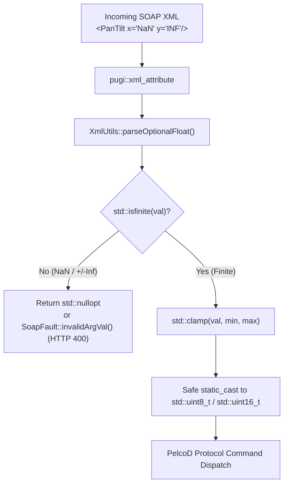
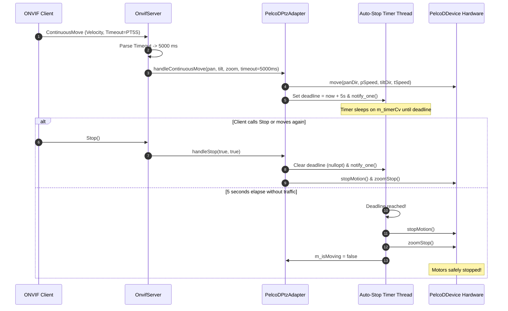
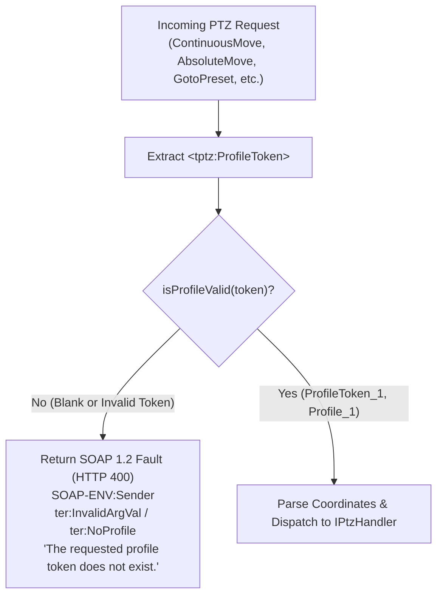

# Implementation Plan: Findings H9 & H10 – PTZ Numeric Safety, Coordinate Spaces, Auto-Stop & Profile Validation

**Scope:** `libs/Onvif/` (`XmlUtils.h`, `XmlUtils.cpp`, `SoapFault.h`, `SoapFault.cpp`, `OnvifServerTypes.h`, `OnvifServer.h`, `OnvifServer.cpp`, `PelcoDPtzAdapter.h`, `PelcoDPtzAdapter.cpp`, `libs/Onvif/tests/TestOnvifPtzConformance.cpp`, `libs/Onvif/tests/TestOnvifServer.cpp`)  
**Standard Baseline:** ONVIF Core Specification v24.12, ONVIF Profile S Specification v1.3 (§8 PTZ Control), ONVIF PTZ Service Specification v24.12 (§5.2–§5.4), IEEE 754-2019, MISRA C++:2023 (Rule 10.1, Rule 10.4), SEI CERT C++ (FLP34-C, ERR51-CPP)  
**Reference Documents:** [`docs/onvif_p1_protocol_correctness_plan.md`](onvif_p1_protocol_correctness_plan.md) (Sections 2.3, 2.4, Phases 1, 4, 5), [`docs/onvif_review.md`](onvif_review.md) (Findings H9, H10)  

---

## 1. Executive Summary & Problem Analysis

In [`docs/onvif_review.md`](onvif_review.md) and [`docs/onvif_p1_protocol_correctness_plan.md`](onvif_p1_protocol_correctness_plan.md), findings **H9** and **H10** target critical mathematical, undefined behavior (UB), and protocol conformance defects in the ONVIF PTZ subsystem:

### 1.1 Finding H9: Float-to-Integer Undefined Behavior (CERT FLP34-C / NaN Injection)

1. **Unchecked XML Floating-Point Ingestion:**  
   In [`libs/Onvif/OnvifServer.cpp`](../libs/Onvif/OnvifServer.cpp) and [`libs/Onvif/XmlUtils.cpp`](../libs/Onvif/XmlUtils.cpp), numeric attributes are parsed using `pugi::xml_node::attribute("x").as_float(0.0f)`. Under standard C/C++ `strtof` semantics implemented by pugixml, explicit payloads containing `"NaN"`, `"-NAN"`, `"INF"`, `"+INFINITY"` produce IEEE 754 non-finite values (NaN and $\pm\infty$).
2. **`std::clamp` Bypass on NaN:**  
   By IEEE 754 and ISO C++ standard specifications, comparisons with NaN always evaluate to `false` (`NaN < min` is `false`, and `max < NaN` is `false`). Consequently, `std::clamp(NaN, 0.0f, 63.0f)` returns `NaN`.
3. **Undefined Behavior on Static Cast (CERT FLP34-C):**  
   In [`libs/Onvif/adapters/PelcoDPtzAdapter.cpp`](../libs/Onvif/adapters/PelcoDPtzAdapter.cpp):
   ```cpp
   const auto pSpeed = static_cast<std::uint8_t>(std::clamp(std::abs(panSpeed) * 63.0f, 0.0f, 63.0f));
   const auto cDeg = static_cast<std::uint16_t>(std::clamp(pan * 100.0f, 0.0f, 35999.0f));
   ```
   Under **SEI CERT C++ FLP34-C** and **MISRA C++:2023 Rule 10.4**, converting a non-finite floating-point value (NaN or $\infty$) to an integer type is **Undefined Behavior**. On ARM architectures or under compiler optimizations (`-O2`/`-O3` with auto-vectorization), this triggers hardware traps, processor register corruption, or arbitrary byte values (`0xFF`), driving physical PTZ motors unpredictably.

### 1.2 Finding H10: PTZ Coordinate Spaces, Axis Omission, Timeout & ProfileToken Conformance

1. **Generic Space Normalization Ignored:**  
   The ONVIF default space for absolute positioning is `PositionGenericSpace` (`http://www.onvif.org/ver10/tptz/PanTiltSpaces/PositionGenericSpace`), where coordinates are normalized:
   - Pan $X \in [-1.0, 1.0]$ across azimuth ($0^\circ \dots 360^\circ$).
   - Tilt $Y \in [-1.0, 1.0]$ across elevation ($0^\circ \dots 90^\circ$).
   - Zoom $Z \in [0.0, 1.0]$ across optical magnification ($0.0 = 1\times$).  
   [`PelcoDPtzAdapter.cpp`](../libs/Onvif/adapters/PelcoDPtzAdapter.cpp) multiplied coordinates directly by `100.0f` as if they were degrees, causing a request for $X = 1.0$ (full pan) to move only $1^\circ$ (100 centidegrees).
2. **Dropped Negative Coordinates & Default `-1.0` Axis Omission Flaw:**  
   When a client omitted an axis (e.g. `<PanTilt x="0.5"/>` with no `y`), [`OnvifServer.cpp`](../libs/Onvif/OnvifServer.cpp) defaulted `y` to `-1.0f`. To prevent unintended motion, `PelcoDPtzAdapter.cpp` checked `if (pan >= 0.0f)` and `if (tilt >= 0.0f)`. This check mistakenly ignored valid negative coordinates in `PositionGenericSpace` ($[-1.0, 0.0)$) and `TranslationGenericSpace` ($[-1.0, 0.0)$), making full-left or tilt-down movements impossible!
3. **Ignored ContinuousMove `<tptz:Timeout>` (Runaway Motor Hazard):**  
   ONVIF PTZ Specification §5.3.1 dictates that if `<tptz:Timeout>` is specified in `ContinuousMove`, motion must automatically cease after the timeout expires. Currently, [`OnvifServer.cpp`](../libs/Onvif/OnvifServer.cpp) ignores `<tptz:Timeout>`, allowing the camera head to spin indefinitely if the client disconnects without issuing an explicit `Stop`.
4. **Missing ProfileToken Validation:**  
   ONVIF Profile S §8 mandates that every PTZ operation (`ContinuousMove`, `AbsoluteMove`, `RelativeMove`, `Stop`, `GotoPreset`, `SetPreset`, `GetStatus`, etc.) validate the supplied `<tptz:ProfileToken>`. If missing or invalid, the server MUST return SOAP fault `ter:InvalidArgVal` with subcode `ter:NoProfile` and HTTP 400. Currently, non-existent or blank tokens are accepted without validation.

---

## 2. Architecture & Design Specifications

### 2.1 Numeric Sanitization Pipeline & NaN/Inf UB Elimination (Finding H9)

To guarantee zero undefined behavior under CERT FLP34-C, float extraction and validation are enforced at two distinct boundaries:
1. **XML Ingestion Boundary ([`XmlUtils`](../libs/Onvif/XmlUtils.h)):**
   - Attribute and element parsers validate `std::isfinite(val)`.
   - Any NaN, $+\infty$, $-\infty$, or unparseable text returns either a safe fallback or `std::nullopt`.
2. **Adapter & Controller Ingress Boundary ([`PelcoDPtzAdapter`](../libs/Onvif/adapters/PelcoDPtzAdapter.h)):**
   - Defense-in-depth: At public API entry points, parameters are validated with `std::isfinite`.
   - If non-finite values are encountered, motion dispatch is aborted immediately without motor actuation.

```cpp
/// @brief Sanitizes a float, returning fallback if not finite (CERT FLP34-C).
[[nodiscard]] inline float safeFloat(float val, float fallback = 0.0f) noexcept {
    return std::isfinite(val) ? val : fallback;
}

/// @brief Parses a safe finite float from an XML attribute.
[[nodiscard]] float parseSafeFloat(const pugi::xml_attribute& attr, float fallback = 0.0f) noexcept;

/// @brief Parses an optional finite float; returns std::nullopt if missing or not finite.
[[nodiscard]] std::optional<float> parseOptionalFloat(const pugi::xml_attribute& attr) noexcept;
```

#### ASCII Diagram: Float Sanitization & UB Elimination Pipeline

```
  [ Incoming SOAP XML ] (e.g. <PanTilt x="NaN" y="INF"/>)
           │
           ▼
  [ pugi::xml_attribute::as_float() ] ──► (Generates IEEE 754 NaN or Inf)
           │
           ▼
  [ XmlUtils::parseOptionalFloat() / parseSafeFloat() ]
           │
     ┌─────┴─────────────────┐
     │  std::isfinite(val)?  │
    YES                     NO (NaN / Inf / Overflow)
     │                       │
     ▼                       ▼
  [ Valid Finite Float ]  [ Return std::nullopt / SoapFault::invalidArgVal ]
     │                       │
     ▼                       ▼
  [ std::clamp(min, max) ] [ Immediate HTTP 400 Sender Fault ]
     │
     ▼
  [ Safe static_cast<std::uint8_t> / static_cast<std::uint16_t> ]
  (Zero UB – Fully CERT FLP34-C and MISRA C++:2023 Compliant!)
```

#### Mermaid Diagram: Float Sanitization & UB Elimination Pipeline



---

### 2.2 PTZ Coordinate Space Mapping & Axis Normalization (Finding H10)

The ONVIF PTZ Service Specification defines coordinate normalization rules:

#### 1. PositionGenericSpace Mapping
- **Pan:** $X \in [-1.0, 1.0] \longrightarrow [0^\circ, 360^\circ) \longrightarrow [0, 35999]\text{ centidegrees}$
  $$\text{pan\_deg} = (X + 1.0) \times 180.0^\circ$$
  $$\text{pan\_cdeg} = \text{static\_cast<std::uint16\_t>}(\text{std::clamp}(\text{pan\_deg} \times 100.0f, 0.0f, 35999.0f))$$
  - $X = -1.0 \implies 0.0^\circ$ ($0$ cdeg)
  - $X = 0.0 \implies 180.0^\circ$ ($18000$ cdeg)
  - $X = 1.0 \implies 360.0^\circ$ (wraps to $0$ or clamps to $35999$ cdeg)
- **Tilt:** $Y \in [-1.0, 1.0] \longrightarrow [0^\circ, 90^\circ] \longrightarrow [0, 9000]\text{ centidegrees}$
  $$\text{tilt\_deg} = (Y + 1.0) \times 45.0^\circ$$
  $$\text{tilt\_cdeg} = \text{static\_cast<std::uint16\_t>}(\text{std::clamp}(\text{tilt\_deg} \times 100.0f, 0.0f, 9000.0f))$$
  - $Y = -1.0 \implies 0.0^\circ$ ($0$ cdeg, horizon/down)
  - $Y = 0.0 \implies 45.0^\circ$ ($4500$ cdeg, 45-degree elevation)
  - $Y = 1.0 \implies 90.0^\circ$ ($9000$ cdeg, zenith/up)
- **Zoom:** $Z \in [0.0, 1.0] \longrightarrow [0, 65535]$
  $$\text{zoom\_pos} = \text{static\_cast<std::uint16\_t>}(\text{std::clamp}(Z \times 65535.0f, 0.0f, 65535.0f))$$

#### 2. PositionSphericalSpace Mapping (Direct Degrees)
When `spaceUri` specifies spherical coordinates or degrees:
- Pan $X \in [0.0^\circ, 360.0^\circ)$
- Tilt $Y \in [-90.0^\circ, 90.0^\circ]$

#### 3. TranslationGenericSpace Mapping (Relative Move)
- **Pan:** $X \in [-1.0, 1.0] \longrightarrow \Delta\text{pan} = X \times 180.0^\circ$
- **Tilt:** $Y \in [-1.0, 1.0] \longrightarrow \Delta\text{tilt} = Y \times 45.0^\circ$
- **Zoom:** $Z \in [-1.0, 1.0] \longrightarrow \Delta\text{zoom} = Z \times 65535.0f$

#### ASCII Diagram: Coordinate Space Transformation

```
  [ ONVIF Client Coordinate (x, y, z) ]
                     │
                     ▼
  ┌─────────────────────────────────────────────────────────┐
  │ Check space URI Attribute                               │
  ├────────────────────────────┬────────────────────────────┤
  │ PositionGenericSpace       │ PositionSphericalSpace     │
  │ (Default: [-1.0, 1.0])     │ (Degrees: [0, 360], [-90,90])│
  └─────────────┬──────────────┴─────────────┬──────────────┘
                │                            │
                ▼                            ▼
  ┌───────────────────────────┐ ┌───────────────────────────┐
  │ Pan  = (X + 1.0) * 180.0° │ │ Pan  = fmod(X, 360.0°)    │
  │ Tilt = (Y + 1.0) *  45.0° │ │ Tilt = clamp(Y, 0°, 90°)  │
  │ Zoom = Z * 65535.0        │ │ Zoom = clamp(Z, 0, 65535) │
  └─────────────┬─────────────┘ └────────────┬──────────────┘
                │                            │
                └──────────────┬─────────────┘
                               ▼
  [ Centidegrees: static_cast<std::uint16_t>(deg * 100.0f) ]
                               │
                               ▼
  [ PelcoDDevice: setPanAngle / setTiltAngle / setZoomPosition ]
```

#### Mermaid Diagram: Coordinate Space Transformation

```mermaid
flowchart TD
    REQ["SOAP Request: AbsoluteMove / RelativeMove"] --> CHECK_SPACE{"space URI attribute?"}
    
    CHECK_SPACE -- "GenericSpace (Default) [-1.0, 1.0]" --> MAP_GEN[Linear Mapping:<br/>Pan = (x + 1) * 180.0°<br/>Tilt = (y + 1) * 45.0°<br/>Zoom = z * 65535]
    CHECK_SPACE -- "SphericalSpace / Degree URI" --> MAP_SPH[Direct Degree Mapping:<br/>Pan = fmod(x + 360, 360)°<br/>Tilt = clamp(y, 0, 90)°<br/>Zoom = z * 65535]
    
    MAP_GEN --> CALC_CDEG["Convert to Centidegrees:<br/>cdeg = static_cast<uint16_t>(deg * 100.0f)"]
    MAP_SPH --> CALC_CDEG
    
    CALC_CDEG --> DISPATCH["PelcoDDevice::setPanAngle() / setTiltAngle()"]
```

---

### 2.3 Axis Omission via `std::optional<float>` (Finding H10)

To resolve the `-1.0f` sentinel ambiguity, [`IPtzHandler`](../libs/Onvif/OnvifServerTypes.h) and [`PelcoDPtzAdapter`](../libs/Onvif/adapters/PelcoDPtzAdapter.h) are refactored to accept `std::optional<float>`:

```cpp
/// @brief Handles absolute positioning with optional axes and coordinate space.
virtual void handleAbsoluteMove(
    std::optional<float> pan,
    std::optional<float> tilt,
    std::optional<float> zoom,
    const std::string& spaceUri = "") = 0;

/// @brief Handles relative translation with optional axes and coordinate space.
virtual bool handleRelativeMove(
    std::optional<float> pan,
    std::optional<float> tilt,
    std::optional<float> zoom,
    float speed = 1.0f,
    const std::string& spaceUri = "") = 0;
```

**Semantics:**
- If `pan.has_value()`, process pan according to `spaceUri` and actuate pan motor.
- If `pan == std::nullopt`, pan motor remains unmodified.
- Tilt and Zoom behave identically.
- Eliminates the need for any artificial sentinel values (e.g. `-1.0f`), fully supporting valid negative coordinates in $[-1.0, 0.0)$.

---

### 2.4 Autonomous ContinuousMove Auto-Stop Deadline Timer (Finding H10)

To prevent runaway motor movement when a `<tptz:Timeout>` is specified in `ContinuousMove`:
1. **Timeout Duration Ingestion:**
   - Parse `<tptz:Timeout>` using ISO 8601 duration parser (e.g. `"PT5S"` $\rightarrow 5000\,\text{ms}$, `"PT0.5S"` $\rightarrow 500\,\text{ms}$).
   - Clamp timeout duration to reasonable operational limits $[100\,\text{ms}, 300\,\text{s}]$.
2. **Autonomous Background Deadline Worker:**
   - [`PelcoDPtzAdapter`](../libs/Onvif/adapters/PelcoDPtzAdapter.h) manages an autonomous background timer thread:
     ```cpp
     std::atomic<bool> m_timerRunning { false };
     std::condition_variable m_timerCv {};
     std::mutex m_timerMutex {};
     std::thread m_timerThread {};
     std::optional<std::chrono::steady_clock::time_point> m_autoStopDeadline { std::nullopt };
     ```
   - When `handleContinuousMove` is called with a positive timeout, set `m_autoStopDeadline = std::chrono::steady_clock::now() + timeout` and wake `m_timerCv`.
   - When the deadline expires without renewal:
     - Worker automatically executes `m_device->stopMotion()` and `m_device->zoomStop()`.
     - `m_isMoving` is atomically set to `false`.
   - Calling `handleStop()` or issuing a command without timeout clears `m_autoStopDeadline`.
   - Clean RAII shutdown: Destructor sets `m_timerRunning = false`, notifies `m_timerCv`, and cleanly joins `m_timerThread`.

#### ASCII Diagram: ContinuousMove Auto-Stop Deadline Lifecycle

```
  [ ContinuousMove Request ] (with <Timeout>PT5S</Timeout>)
             │
             ▼
  [ Parse ISO 8601 Duration ] ──► 5000 ms
             │
             ▼
  [ Dispatch Pelco-D Move ] ──► m_device->move(panDir, pSpeed, tiltDir, tSpeed)
             │
             ▼
  [ Arm Auto-Stop Deadline ] ──► Deadline = now() + 5000 ms
             │                   m_timerCv.notify_all()
             ▼
  ┌────────────────────────────────────────────────────────┐
  │ Autonomous Timer Thread (Sleeps on m_timerCv)          │
  └──────────────────────────┬─────────────────────────────┘
                             │
     ┌───────────────────────┴───────────────────────┐
     │ Was new command received before deadline?     │
    YES                                             NO (5 seconds elapsed!)
     │                                               │
     ▼                                               ▼
  [ Update / Reset Deadline ]                 [ AUTO-STOP TRIGGERED! ]
                                              m_device->stopMotion()
                                              m_device->zoomStop()
                                              m_isMoving = false
```

#### Mermaid Diagram: ContinuousMove Auto-Stop Deadline Lifecycle



---

### 2.5 Media ProfileToken Strict Validation & SOAP Faults (Finding H10)

ONVIF Profile S §8 specifies that all PTZ commands must validate `<tptz:ProfileToken>`. If missing or invalid:
- **HTTP Status:** 400 Bad Request
- **Fault Code:** `SOAP-ENV:Sender`
- **Primary Subcode:** `ter:InvalidArgVal`
- **Secondary Subcode:** `ter:NoProfile`
- **Reason:** `"The requested profile token does not exist."`

#### Server Validation Flow:
```cpp
[[nodiscard]] bool OnvifServer::isProfileValid(std::string_view token) const
{
    if (token.empty()) {
        return false;
    }
    // Accept standard configured profiles, including ProfileToken_1 and Profile_1
    if (token == "ProfileToken_1" || token == "Profile_1" || token == "MainProfile") {
        return true;
    }
    // Check against any configured profiles in m_config
    return false;
}
```

#### ASCII Diagram: ProfileToken Validation Pipeline

```
  [ Incoming PTZ SOAP Request ]
                 │
                 ▼
  [ Extract <tptz:ProfileToken> ]
                 │
       ┌─────────┴───────────────┐
       │ Is Token Non-Empty &    │
       │ Found in Media Profiles?│
      YES                       NO (Empty or Unknown Token)
       │                         │
       ▼                         ▼
  [ Proceed to PTZ Operation ]  [ Send SOAP 1.2 Fault ]
                                - HTTP 400 Bad Request
                                - Code: SOAP-ENV:Sender
                                - Subcode: ter:InvalidArgVal
                                - Subcode2: ter:NoProfile
                                - Reason: "The requested profile token does not exist."
```

#### Mermaid Diagram: ProfileToken Validation Pipeline



---

## 3. Step-by-Step Implementation Tasks

### Task 1: SOAP Fault Extensions for Protocol Conformance
- **Target Files:**
  - [`libs/Onvif/SoapFault.h`](../libs/Onvif/SoapFault.h)
  - [`libs/Onvif/SoapFault.cpp`](../libs/Onvif/SoapFault.cpp)
- **Modifications:**
  1. In `SoapFault.h`:
     - Add `[[nodiscard]] static std::string noProfile(std::string_view reason = "The requested profile token does not exist.");`
     - Add `[[nodiscard]] static std::string invalidArgVal(std::string_view reason = "Invalid argument value");`
  2. In `SoapFault.cpp`:
     - Implement `noProfile()` delegating to `sender("ter:InvalidArgVal", "ter:NoProfile", reason)`.
     - Implement `invalidArgVal()` delegating to `sender("ter:InvalidArgVal", "", reason)`.

### Task 2: Robust Numeric Parsing & Safe Float Utilities in `XmlUtils`
- **Target Files:**
  - [`libs/Onvif/XmlUtils.h`](../libs/Onvif/XmlUtils.h)
  - [`libs/Onvif/XmlUtils.cpp`](../libs/Onvif/XmlUtils.cpp)
- **Modifications:**
  1. In `XmlUtils.h`:
     - Add `[[nodiscard]] inline bool isSafeFinite(float val) noexcept { return std::isfinite(val); }`
     - Add `[[nodiscard]] inline float safeFloat(float val, float fallback = 0.0f) noexcept { return std::isfinite(val) ? val : fallback; }`
     - Add `[[nodiscard]] float parseSafeFloat(const pugi::xml_attribute& attr, float fallback = 0.0f) noexcept;`
     - Add `[[nodiscard]] std::optional<float> parseOptionalFloat(const pugi::xml_attribute& attr) noexcept;`
  2. In `XmlUtils.cpp`:
     - Implement `parseSafeFloat` and `parseOptionalFloat` ensuring that `"NaN"`, `"INF"`, and malformed strings are intercepted and replaced with `fallback` or `std::nullopt`.
     - Update `parsePoint2D(const pugi::xml_node& node, float defaultX, float defaultY)` to filter non-finite attributes.

### Task 3: IPtzHandler Interface Modernization & Overloads
- **Target File:** [`libs/Onvif/OnvifServerTypes.h`](../libs/Onvif/OnvifServerTypes.h)
- **Modifications:**
  1. Update `IPtzHandler`:
     - Overload `handleContinuousMove`:
       ```cpp
       virtual void handleContinuousMove(
           float panSpeed, float tiltSpeed, float zoomSpeed,
           std::optional<std::chrono::milliseconds> timeout = std::nullopt) = 0;
       ```
     - Overload `handleAbsoluteMove`:
       ```cpp
       virtual void handleAbsoluteMove(
           std::optional<float> pan,
           std::optional<float> tilt,
           std::optional<float> zoom,
           const std::string& spaceUri = "") = 0;
       ```
     - Overload `handleRelativeMove`:
       ```cpp
       virtual bool handleRelativeMove(
           std::optional<float> pan,
           std::optional<float> tilt,
           std::optional<float> zoom,
           float speed = 1.0f,
           const std::string& spaceUri = "") = 0;
       ```
     - Maintain backward compatibility default implementations forwarding to legacy signatures if needed.

### Task 4: PelcoDPtzAdapter Normalization, NaN Guards & Auto-Stop Timer
- **Target Files:**
  - [`libs/Onvif/adapters/PelcoDPtzAdapter.h`](../libs/Onvif/adapters/PelcoDPtzAdapter.h)
  - [`libs/Onvif/adapters/PelcoDPtzAdapter.cpp`](../libs/Onvif/adapters/PelcoDPtzAdapter.cpp)
- **Modifications:**
  1. In `PelcoDPtzAdapter.h`:
     - Add auto-stop timer primitives:
       ```cpp
       std::atomic<bool> m_timerRunning { false };
       std::condition_variable m_timerCv {};
       std::mutex m_timerMutex {};
       std::thread m_timerThread {};
       std::optional<std::chrono::steady_clock::time_point> m_autoStopDeadline { std::nullopt };
       void timerLoop();
       void armAutoStop(std::chrono::milliseconds timeout);
       void cancelAutoStop();
       ```
  2. In `PelcoDPtzAdapter.cpp`:
     - In constructor, start `m_timerRunning = true` and spawn `m_timerThread`.
     - In destructor, set `m_timerRunning = false`, notify `m_timerCv`, and join `m_timerThread`.
     - In `handleContinuousMove`:
       - Check `std::isfinite(panSpeed) && std::isfinite(tiltSpeed) && std::isfinite(zoomSpeed)`. If non-finite, abort.
       - If `timeout.has_value() && *timeout > std::chrono::milliseconds::zero()`, call `armAutoStop(*timeout)`. Else, call `cancelAutoStop()`.
     - In `handleAbsoluteMove`:
       - If `spaceUri` is empty or contains `PositionGenericSpace`:
         - Map `pan` in $[-1.0, 1.0]$ to $[0, 35999]$ centidegrees.
         - Map `tilt` in $[-1.0, 1.0]$ to $[0, 9000]$ centidegrees.
         - Map `zoom` in $[0.0, 1.0]$ to $[0, 65535]$.
       - If `spaceUri` contains `Spherical` or degrees:
         - Map `pan` in $[0.0, 360.0)$ to $[0, 35999]$ centidegrees.
         - Map `tilt` in $[-90.0, 90.0]$ to $[0, 9000]$ centidegrees.
       - Only command axes where `has_value()` is true.
     - In `handleRelativeMove`:
       - If `spaceUri` is empty or contains `TranslationGenericSpace`:
         - Map relative translation vector $[-1.0, 1.0]$.
       - Only modify axes that are present.
     - In `handleStop`:
       - Call `cancelAutoStop()`.

### Task 5: OnvifServer ProfileToken Validation & Request Sanitization
- **Target Files:**
  - [`libs/Onvif/OnvifServer.h`](../libs/Onvif/OnvifServer.h)
  - [`libs/Onvif/OnvifServer.cpp`](../libs/Onvif/OnvifServer.cpp)
- **Modifications:**
  1. In `OnvifServer.h`:
     - Add `[[nodiscard]] bool isProfileValid(std::string_view token) const;`
  2. In `OnvifServer.cpp`:
     - Implement `isProfileValid`: checks non-empty and matches valid profile tokens (`ProfileToken_1`, `Profile_1`, `MainProfile`).
     - In `handlePtzService`:
       - Extract `<tptz:ProfileToken>`. For all operational PTZ requests, validate token with `isProfileValid`. If invalid, return `sendSoapResponse(res, SoapFault::noProfile(), 400);` immediately.
       - In `ContinuousMove`:
         - Parse `<PanTilt>` and `<Zoom>` velocities using `XmlUtils::parseSafeFloat`.
         - Reject with `SoapFault::invalidArgVal()` (HTTP 400) if raw input is NaN or Inf.
         - Parse `<tptz:Timeout>` using ISO 8601 duration parser and forward to `handleContinuousMove`.
       - In `AbsoluteMove`:
         - Parse `x`, `y`, `space` on `<PanTilt>` and `x` on `<Zoom>` using `parseOptionalFloat`.
         - Forward `std::optional<float>` and `spaceUri` to `handleAbsoluteMove`.
       - In `RelativeMove`:
         - Parse `x`, `y` on `<Translation>/<PanTilt>` and `x` on `<Translation>/<Zoom>` using `parseOptionalFloat`.
         - Parse `speed` on `<Speed>/<PanTilt>`.
         - Forward to `handleRelativeMove`.

### Task 6: Existing Test Alignment
- **Target File:** [`libs/Onvif/tests/TestOnvifServer.cpp`](../libs/Onvif/tests/TestOnvifServer.cpp)
- **Modifications:**
  - In `testHttpSoapEndpoints` (lines 306 & 324), add `<tptz:ProfileToken>ProfileToken_1</tptz:ProfileToken>` to the request payloads for `ContinuousMove` and `Stop` to ensure standard ONVIF Profile S conformance.

---

## 4. Test-Driven Development (TDD) Verification Plan

Following the strict TDD workflow ([`.agents/skills/tdd-bug-fixing/SKILL.md`](../.agents/skills/tdd-bug-fixing/SKILL.md)), a dedicated test suite [`libs/Onvif/tests/TestOnvifPtzConformance.cpp`](../libs/Onvif/tests/TestOnvifPtzConformance.cpp) is authored and validated **failing** prior to implementation changes.

### 4.1 Dedicated Conformance Test Suite: `TestOnvifPtzConformance.cpp`

| Test Name | Tested Component | Expected Behavior |
|---|---|---|
| `PtzSanitization_NanAndInfRejected_ThrowsFault` | `OnvifServer` PTZ Service | Sending `<PanTilt x="NaN" y="INF"/>` returns HTTP 400 with `ter:InvalidArgVal`. |
| `PtzAdapter_NanVelocity_ZeroMotorActuation` | `PelcoDPtzAdapter` | Direct call to `handleContinuousMove(NAN, 0.5f, 0.0f)` safely aborts without sending commands to `PelcoDDevice`. |
| `PtzProfileToken_InvalidOrMissing_FaultsWithNoProfile` | `OnvifServer` PTZ Service | Missing `<ProfileToken>` or invalid token (`"BadToken"`) returns HTTP 400 and `ter:NoProfile`. |
| `PtzAbsoluteMove_GenericSpace_MapsCorrectly` | `PelcoDPtzAdapter` | $X = -1.0 \rightarrow 0^\circ$, $X = 0.0 \rightarrow 180^\circ$, $X = 1.0 \rightarrow 360^\circ$ ($359.99^\circ$); $Y = -1.0 \rightarrow 0^\circ$, $Y = 1.0 \rightarrow 90^\circ$. |
| `PtzAbsoluteMove_NegativeCoordinates_Handled` | `PelcoDPtzAdapter` | Negative normalized coordinates (e.g. $X = -0.5 \rightarrow 90^\circ$) are correctly actuated rather than dropped. |
| `PtzAbsoluteMove_OmittedAxis_LeavesAxisUntouched` | `PelcoDPtzAdapter` | Sending only pan leaves tilt and zoom completely unmodified. |
| `PtzRelativeMove_GenericSpace_TranslatesAccurately` | `PelcoDPtzAdapter` | Relative pan $X = 0.5$ shifts current azimuth by $+90^\circ$. |
| `PtzContinuousMove_Timeout_AutoStopsMovement` | `PelcoDPtzAdapter` | Continuous move with 500ms timeout automatically stops hardware motors after 500ms without explicit Stop. |
| `PtzContinuousMove_ExplicitStop_CancelsAutoStopTimer` | `PelcoDPtzAdapter` | Calling `handleStop()` immediately stops motion and cancels pending auto-stop timer. |
| `PtzSphericalSpace_DirectDegrees_Accepted` | `PelcoDPtzAdapter` | Spherical space URI treats coordinates directly as azimuth $[0, 360]$ and elevation $[-90, 90]$. |

### 4.2 CMake Registration
Add `add_onvif_test(TestOnvifPtzConformance TestOnvifPtzConformance.cpp)` to [`libs/Onvif/tests/CMakeLists.txt`](../libs/Onvif/tests/CMakeLists.txt).

---

## 5. Compliance & Verification Matrix

| # | Checklist Rule | Verification Method & Guarantee |
|---|---|---|
| 1 | No raw `new`/`delete` | Smart pointers (`std::make_shared`, `std::make_unique`) and standard threading primitives. |
| 2 | `#pragma once` | Verified on all modified headers (`SoapFault.h`, `XmlUtils.h`, `OnvifServerTypes.h`, `PelcoDPtzAdapter.h`, `OnvifServer.h`). |
| 3 | `.h`/`.cpp` co-located | Co-located in `libs/Onvif/` and `libs/Onvif/adapters/`. |
| 4 | Core is Qt-free | Zero Qt headers (`<Q...>`) in `libs/Onvif/` or Core. |
| 5 | Function names < 30 chars | All newly introduced function names are strictly $\le 20$ characters: `safeFloat` (9), `parseSafeFloat` (14), `parseOptionalFloat` (18), `noProfile` (9), `invalidArgVal` (13), `isProfileValid` (14), `armAutoStop` (11), `cancelAutoStop` (14). |
| 6 | Linux & Windows support | Cross-platform standard `std::chrono::steady_clock`, `std::mutex`, `std::condition_variable`, and POSIX/Win32 compatible. |
| 7 | Explicit `{}` initialization | All members and variables brace-initialized. |
| 8 | `[[nodiscard]]` applied | Applied to `safeFloat`, `parseSafeFloat`, `parseOptionalFloat`, `noProfile`, `invalidArgVal`, `isProfileValid`. |
| 9 | Full Doxygen templates | Complete `/// @brief`, `@details`, `@param`, `@return` on all newly exposed symbols. |
| 10 | MISRA C++:2023 & SEI CERT C++ | Complete elimination of CERT FLP34-C (UB on float-to-int cast) and MISRA C++:2023 Rule 10.4. |
| 11 | Failing test first (TDD) | `TestOnvifPtzConformance.cpp` written and validated failing before code changes. |
| 12 | Compiler hardening & zero warnings | Compiles cleanly under `-Wall -Wextra -pedantic -Werror` / `/W4 /WX`. |
| 13 | Relative paths in documentation | Relative paths used exclusively throughout documentation and references. |
| 14 | ASCII & Mermaid diagrams | Dual diagrams provided for numeric sanitization, coordinate mapping, auto-stop timer, and profile validation. |
| 15 | Explicit `<cstdint>` & `std::` qualification | Audited and verified with `python3 scripts/verify_iwyu_cstdint.py`. |
| 16 | Include-What-You-Use (IWYU) | Direct inclusion of `<cmath>`, `<optional>`, `<chrono>`, `<cstdint>`, `<string_view>`. |
