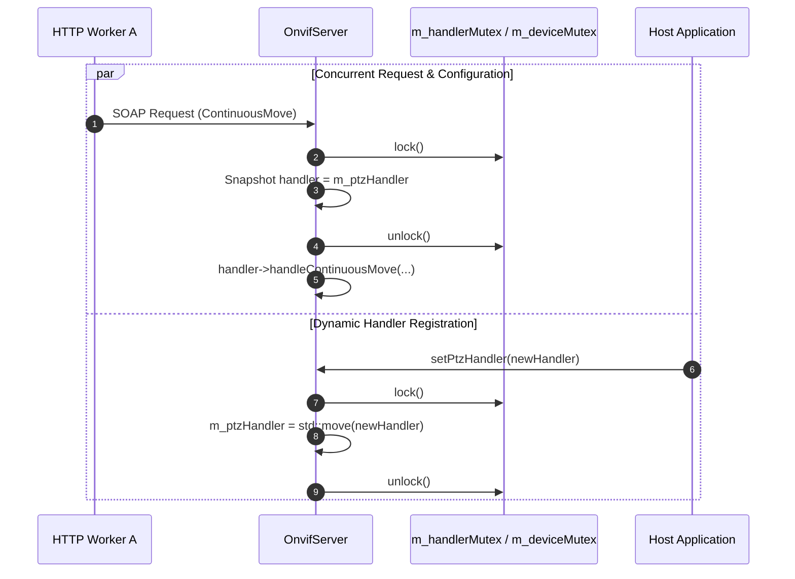
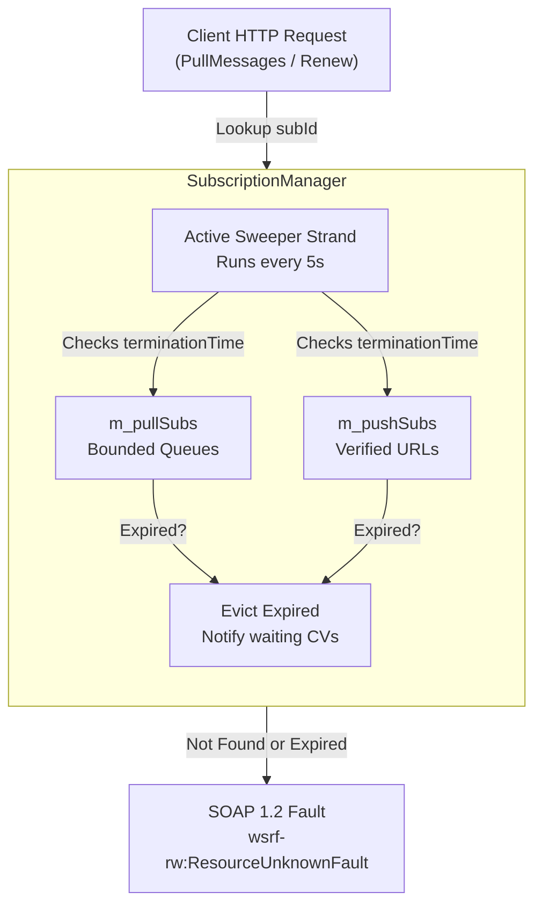
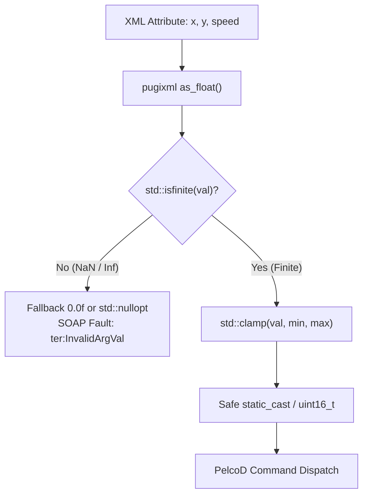
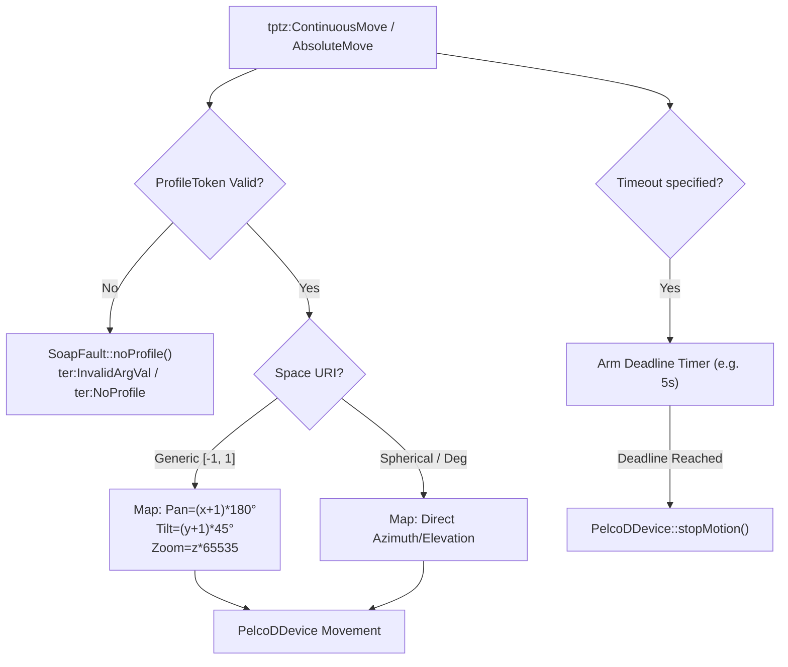

# ONVIF P1 – Protocol Correctness Implementation Plan

**Scope:** `libs/Onvif/` (`OnvifServer`, `SubscriptionManager`, `SoapFault`, `XmlUtils`, `PelcoDPtzAdapter`, test suites)  
**Standard Baseline:** ONVIF Core Specification v24.12, Profile S Specification v1.3, ONVIF PTZ Service Specification, WS-BaseNotification 1.3, WS-Addressing 1.0, MISRA C++:2023, SEI CERT C++  
**Reference Document:** [`docs/onvif_review.md`](onvif_review.md) (Section 8: Remediation Roadmap – Phase P1)  

---

## 1. Executive Summary & Problem Analysis

In [`docs/onvif_review.md`](onvif_review.md), **Phase P0 (Security Blockers)** successfully established the cryptographic, authentication, and SSRF foundation (WS-Security UsernameToken, RFC 7616 HTTP Digest, AES-256-GCM credential vault, XML escaping, discovery rate limiting, and client TLS verification). 

**Phase P1 (Protocol Correctness)** targets the functional, mathematical, concurrency, and protocol-level defects identified in the review. Resolving these defects is mandatory before attempting Profile S feature additions (Phase P2), as existing PTZ math induces undefined behavior (UB), concurrent access triggers data races, and event subscriptions risk thread starvation and resource leaks.

### 1.1 Scope of Findings Addressed in P1

| Finding | Severity | Description | Standard Violation | Target File(s) |
|---|---|---|---|---|
| **H1** | 🟠 High | **Data races across server shared state:**<br>1. `setXxxHandler()` methods assign `std::shared_ptr` handlers without synchronization while HTTP worker threads read them concurrently.<br>2. `AddScopes`/`SetScopes`/`RemoveScopes` mutate `m_config.scopes` with no lock, while `GetScopes` and discovery routines read concurrently.<br>3. `GetSystemBackup` and `GetSystemSupportInformation` read network settings (`m_internalHostname`, `m_internalGateway`, `m_internalDns`, `m_internalNtp`) without acquiring `m_deviceMutex`. | CERT CON43-C<br>MISRA C++:2023 Rule 18.x | [`libs/Onvif/OnvifServer.h`](../libs/Onvif/OnvifServer.h)<br>[`libs/Onvif/OnvifServer.cpp`](../libs/Onvif/OnvifServer.cpp) |
| **H3** | 🟠 High | **Event subscription lifecycle & resource limits:**<br>1. Subscriptions leak if no traffic arrives (needs active background TTL sweeper).<br>2. Queues must enforce strict bounds.<br>3. Non-existent/expired subscription tokens must return `wsrf-rw:ResourceUnknownFault` with HTTP 400/500.<br>4. `Renew` must correctly extend lease expiration from current timestamp.<br>5. `PullMessages` blocking must be strictly bounded to prevent worker starvation. | ONVIF Core §9<br>WS-BaseNotification §3.1<br>CWE-400 | [`libs/Onvif/SubscriptionManager.h`](../libs/Onvif/SubscriptionManager.h)<br>[`libs/Onvif/SubscriptionManager.cpp`](../libs/Onvif/SubscriptionManager.cpp)<br>[`libs/Onvif/OnvifServer.cpp`](../libs/Onvif/OnvifServer.cpp) |
| **H9** | 🟠 High | **Float-to-Integer Undefined Behavior (NaN/Inf injection):**<br>`pugi::xml_node::as_float()` converts malformed strings or `"NaN"`/`"INF"` to floating-point NaN/Inf. Calling `std::clamp(NaN, ...)` produces `NaN`, and `static_cast<std::uint8_t>(NaN)` or `static_cast<std::uint16_t>(NaN)` is undefined behavior (UB) that drives motors unpredictably. | CERT FLP34-C<br>MISRA C++:2023 Rule 10.x | [`libs/Onvif/XmlUtils.h`](../libs/Onvif/XmlUtils.h)<br>[`libs/Onvif/XmlUtils.cpp`](../libs/Onvif/XmlUtils.cpp)<br>[`libs/Onvif/adapters/PelcoDPtzAdapter.cpp`](../libs/Onvif/adapters/PelcoDPtzAdapter.cpp)<br>[`libs/Onvif/OnvifServer.cpp`](../libs/Onvif/OnvifServer.cpp) |
| **H10** | 🟠 High | **PTZ semantics, coordinate spaces, timeout & profile validation:**<br>1. `AbsoluteMove` & `RelativeMove` treat values directly as degrees, whereas default ONVIF space `PositionGenericSpace` and `TranslationGenericSpace` are normalized $[-1.0, 1.0]$.<br>2. Negative normalized values are ignored; omitted axes default to `-1.0` instead of remaining untouched.<br>3. `ContinuousMove` ignores `<tptz:Timeout>`, failing mandatory auto-stop.<br>4. `ProfileToken` is not validated, accepting arbitrary or empty strings instead of returning `ter:InvalidArgVal` / `ter:NoProfile`. | ONVIF PTZ Spec §5.2–§5.4<br>Profile S Spec §8 | [`libs/Onvif/OnvifServer.cpp`](../libs/Onvif/OnvifServer.cpp)<br>[`libs/Onvif/adapters/PelcoDPtzAdapter.h`](../libs/Onvif/adapters/PelcoDPtzAdapter.h)<br>[`libs/Onvif/adapters/PelcoDPtzAdapter.cpp`](../libs/Onvif/adapters/PelcoDPtzAdapter.cpp) |
| **C3 / C4** | 🔴 Critical | **Protocol SOAP Faults & Conformance Extensions:**<br>1. Foundation delivered in P0 (`ActionNotSupported`, `NotAuthorized`, `ResourceUnknown`).<br>2. Complete protocol faults for PTZ/Device operations: `ter:InvalidArgVal`, `ter:NoProfile`, `ter:NoToken`, and well-formed XML fault serialization. | ONVIF Core §5.11 | [`libs/Onvif/SoapFault.h`](../libs/Onvif/SoapFault.h)<br>[`libs/Onvif/SoapFault.cpp`](../libs/Onvif/SoapFault.cpp) |
| **H2 / H4** | 🟠 High | **Lifecycle & Notification Conformance (Baseline Check):**<br>Verify and maintain previously hardened start/bind determinism (H2) and WS-Addressing 1.0 / `PropertyOperation` notification payloads (H4). | ONVIF Core §9<br>WS-Addressing 1.0 | [`libs/Onvif/OnvifServer.cpp`](../libs/Onvif/OnvifServer.cpp)<br>[`libs/Onvif/NotificationDispatcher.cpp`](../libs/Onvif/NotificationDispatcher.cpp) |

---

## 2. Architecture & Design Specifications

### 2.1 Concurrency & Data Race Elimination (Finding H1)

#### Threat & Failure Mechanism
1. **Dynamic Handler Swapping:** `OnvifServer` allows setting 13 handler interfaces (`setPtzHandler`, `setImagingHandler`, etc.). In multi-threaded execution (`httplib::Server` worker pool), handler pointers are read during incoming HTTP requests while external application threads assign them, causing data races on non-atomic `std::shared_ptr`.
2. **Scope Modification Race:** `tds:AddScopes`, `tds:SetScopes`, and `tds:RemoveScopes` mutate `m_config.scopes` concurrently with `tds:GetScopes`, `WsDiscoveryServer`, and `getConfig()`.
3. **Unprotected Diagnostic Reads:** `GetSystemBackup` and `GetSystemSupportInformation` read hostname, gateway, DNS, and NTP strings without holding `m_deviceMutex`.

#### Architectural Remedy
- Introduce `mutable std::mutex m_handlerMutex;` protecting all 13 handler pointers. Handler setters acquire `std::lock_guard`. Operational service dispatchers snapshot the handler pointer under lock before dispatching:
  ```cpp
  std::shared_ptr<IPtzHandler> handler;
  {
      std::scoped_lock lock(m_handlerMutex);
      handler = m_ptzHandler;
  }
  if (handler) {
      handler->handleContinuousMove(...);
  }
  ```
- Protect `m_config.scopes` using `m_deviceMutex` (or dedicated `m_scopeMutex`), ensuring serialized mutation and atomic snapshot reading. Synchronize scope updates with `WsDiscoveryServer`.
- Guard all reads of network attributes (`m_internalHostname`, `m_internalGateway`, `m_internalDns`, `m_internalNtp`) in `GetSystemBackup` and `GetSystemSupportInformation` with `std::scoped_lock lock(m_deviceMutex);`.

#### ASCII Diagram: Concurrency & Lock Protection
```
  [ HTTP Worker Thread A ]        [ Admin Thread B ]         [ HTTP Worker Thread C ]
             │                             │                            │
             │ tds:ContinuousMove          │ setPtzHandler()            │ tds:GetSystemBackup
             ▼                             ▼                            ▼
  ┌──────────────────────┐      ┌──────────────────────┐     ┌──────────────────────┐
  │ m_handlerMutex.lock  │      │ m_handlerMutex.lock  │     │ m_deviceMutex.lock   │
  │ Snapshot m_ptzHandler│      │ Assign m_ptzHandler  │     │ Snapshot Net Params  │
  │ m_handlerMutex.unlock│      │ m_handlerMutex.unlock│     │ m_deviceMutex.unlock │
  └──────────┬───────────┘      └──────────────────────┘     └──────────┬───────────┘
             │                                                          │
             ▼                                                          ▼
  [ Execute Move Safely ]                                    [ Format Backup XML ]
```

#### Mermaid Diagram: Concurrency & Lock Protection


---

### 2.2 Event Subscription Lifecycle & Active TTL Sweeper (Finding H3)

#### Threat & Failure Mechanism
- Passive expiration only purges subscriptions when a new subscription request or event arrives. If a client subscribes and disconnects without further activity, expired entries sit indefinitely in `m_pullSubs` and `m_pushSubs`.
- Client `PullMessages` requests specify a `Timeout`. If multiple clients hold long timeouts simultaneously, worker threads in the HTTP server thread pool can be starved.
- An invalid or expired subscription token must return standard `wsrf-rw:ResourceUnknownFault`.

#### Architectural Remedy
1. **Active Background TTL Sweeper:**
   - Implement an autonomous sweeper thread or periodic strand in `SubscriptionManager`.
   - Runs every 5 seconds (configurable), evicting expired PullPoint and Push subscriptions without waiting for incoming traffic.
   - Wakes up immediately upon server shutdown via `std::condition_variable`.
2. **Timeout Clamping & Starvation Prevention:**
   - Clamp requested `Timeout` in `PullMessages` to $[1, 10]$ seconds (default 5s).
   - Implement interruptible condition variable wait tied to `serverRunning` flag.
3. **Strict Fault Generation:**
   - Return `SoapFault::resourceUnknown("Subscription does not exist or has expired")` with HTTP 400/500 if subscription token is not found or expired.
4. **Accurate Lease Renewal:**
   - On `wsnt:Renew`, calculate new lease expiration as `current_time + clamped_lease_duration` and return compliant `wsnt:RenewResponse` containing `<wsnt:TerminationTime>` and `<wsnt:CurrentTime>`.

#### ASCII Diagram: Active Subscription Management & Sweeping
```
  +-------------------------------------------------------------------------+
  |                           SubscriptionManager                           |
  |                                                                         |
  |   +-----------------------+                    +--------------------+   |
  |   | m_pullSubs (Map)      |                    | m_pushSubs (Map)   |   |
  |   |  Sub_1: Term = T0+30s |                    |  Sub_2: T0+60s     |   |
  |   |  Sub_3: Term = T0-5s  | (Expired!)         |                    |   |
  |   +-----------▲-----------+                    +---------▲----------+   |
  |               │                                          │              |
  |               +───────────────────┬──────────────────────+              |
  |                                   │                                     |
  |                      +------------┴------------+                        |
  |                      | Background Sweeper Loop |                        |
  |                      |  Wakeup every 5s        |                        |
  |                      |  Purges Expired (Sub_3) |                        |
  |                      +-------------------------+                        |
  +-------------------------------------------------------------------------+
```

#### Mermaid Diagram: Active Subscription Management & Sweeping


---

### 2.3 Float-to-Integer UB Guard & XML Numeric Sanitization (Finding H9)

#### Threat & Failure Mechanism
- In `OnvifServer.cpp` and `PelcoDPtzAdapter.cpp`, floats are extracted using `node.attribute("x").as_float(0.0f)`.
- If an XML payload contains `<PanTilt x="NaN" y="INF"/>` or invalid text, `as_float()` produces IEEE 754 NaN or $\pm\infty$.
- `std::clamp(NaN, 0.0f, 63.0f)` returns NaN.
- `static_cast<std::uint8_t>(NaN)` or `static_cast<std::uint16_t>(NaN)` violates **SEI CERT C++ FLP34-C** and **MISRA C++:2023 Rule 10.x**, resulting in architecture-dependent undefined behavior (e.g. 0 on x86, max int on ARM, or processor trap).

#### Architectural Remedy
- Introduce robust numeric validation helpers in `XmlUtils`:
  ```cpp
  [[nodiscard]] inline float safeFloat(float val, float fallback = 0.0f) noexcept {
      return std::isfinite(val) ? val : fallback;
  }
  [[nodiscard]] float parseSafeFloat(const pugi::xml_attribute& attr, float fallback = 0.0f) noexcept;
  [[nodiscard]] std::optional<float> parseOptionalFloat(const pugi::xml_attribute& attr) noexcept;
  ```
- In `PelcoDPtzAdapter.cpp`, strictly validate all speed and coordinate inputs at method boundaries:
  ```cpp
  if (!std::isfinite(panSpeed) || !std::isfinite(tiltSpeed) || !std::isfinite(zoomSpeed)) {
      return; // Reject NaN/Inf without motor activation
  }
  ```

#### ASCII Diagram: Float Sanitization Pipeline
```
  [ XML Attribute Input ]
           │
           ▼
  [ pugi::xml_attribute::as_float() ]
           │ (Produces float: normal, subnormal, NaN, or Inf)
           ▼
  [ XmlUtils::safeFloat() / std::isfinite() ]
           │
     ┌─────┴───────────────┐
     │ Is Finite?          │
    YES                   NO
     │                     │
     ▼                     ▼
  [ Retain Value ]     [ Replace with Fallback (0.0f) / Reject ]
     │                     │
     └─────────┬───────────┘
               ▼
  [ std::clamp(val, min, max) ]  (Guaranteed finite!)
               ▼
  [ static_cast<std::uint8_t> ] (CERT FLP34-C Compliant: Zero UB!)
```

#### Mermaid Diagram: Float Sanitization Pipeline


---

### 2.4 PTZ Coordinate Normalization, Axis Omission & Timeout (Finding H10)

#### Threat & Failure Mechanism
1. **Generic Space Misinterpretation:**
   - In ONVIF PTZ, `PositionGenericSpace` normalizes coordinates:
     - Pan $X \in [-1.0, 1.0]$: maps linearly across the camera's full azimuth ($0^\circ \dots 360^\circ$ or $-180^\circ \dots +180^\circ$).
     - Tilt $Y \in [-1.0, 1.0]$: maps linearly across the elevation range ($0^\circ \dots 90^\circ$ or $-90^\circ \dots +90^\circ$).
     - Zoom $Z \in [0.0, 1.0]$: maps normalized optical zoom ($0.0 = 1\times$, $1.0 = \text{max}$).
   - `PelcoDPtzAdapter` treated $X$ and $Y$ directly as degrees, causing $[-1, 1]$ coordinates to barely twitch the camera ($0.01^\circ$).
2. **Axis Omission Drop:**
   - When an axis is omitted in `<PanTilt x="0.5"/>` (no `y`), `OnvifServer` defaulted `y` to `-1.0f`. The adapter ignored negative values (`tilt >= 0.0f`), which accidentally avoided moving `y` but broke valid negative target coordinates!
3. **ContinuousMove Timeout Ignored:**
   - ONVIF mandates that if `<tptz:Timeout>PT5S</tptz:Timeout>` is provided in `ContinuousMove`, motion must automatically cease after 5 seconds unless renewed or canceled.
4. **Unchecked ProfileToken:**
   - Requests with non-existent or blank `<ProfileToken>` proceeded without error, violating ONVIF Profile S requirements.

#### Architectural Remedy
1. **Coordinate Space Mapping:**
   - Check space URI attribute:
     - `http://www.onvif.org/ver10/tptz/PanTiltSpaces/PositionGenericSpace` (default):
       $$\text{Pan}_{\text{deg}} = (X + 1.0) \times 180.0^\circ \quad \in [0^\circ, 360^\circ)$$
       $$\text{Tilt}_{\text{deg}} = (Y + 1.0) \times 45.0^\circ \quad \in [0^\circ, 90^\circ]$$
       $$\text{Centidegrees} = \text{static\_cast<std::uint16\_t>}(\text{deg} \times 100.0)$$
     - `http://www.onvif.org/ver10/tptz/PanTiltSpaces/Spherical` or explicit degree space:
       Treat $X$ as azimuth $[0^\circ, 360^\circ)$, $Y$ as elevation $[-90^\circ, 90^\circ]$.
2. **Axis Omission via `std::optional<float>`:**
   - Modernize `handleAbsoluteMove` and `handleRelativeMove` to accept `std::optional<float> pan, std::optional<float> tilt, std::optional<float> zoom`. If an axis is `std::nullopt`, the corresponding motor angle remains unchanged.
3. **ContinuousMove Auto-Stop Deadline:**
   - Parse `<tptz:Timeout>` using ISO 8601 duration parser.
   - Maintain an auto-stop deadline in `PelcoDPtzAdapter` (or `OnvifServer`). When a positive timeout is specified, a scheduled deadline timer triggers `stopMotion()` and `zoomStop()` upon expiration unless superseded by a new motion command.
4. **ProfileToken Validation:**
   - Validate `<ProfileToken>` against configured profiles (`ProfileToken_1`, etc.). Return `SoapFault::noProfile()` (`ter:InvalidArgVal / ter:NoProfile`) with HTTP 400 if the profile is invalid.

#### ASCII Diagram: PTZ Space Mapping & Auto-Stop
```
  [ ONVIF SOAP Request ]
  <ContinuousMove>
    <ProfileToken>Profile_1</ProfileToken>
    <PanTilt x="0.5" y="-0.2"/>
    <Timeout>PT10S</Timeout>
  </ContinuousMove>
           │
           ▼
  [ 1. Validate ProfileToken ] ──(Invalid)──► [ Return SoapFault::noProfile ]
           │ (Valid)
           ▼
  [ 2. Check Space URI ]
     ├─ PositionGenericSpace: X in [-1, 1] ──► Pan = (X + 1) * 180 deg
     └─ Spherical / Degrees : Direct Deg   ──► Pan = X mod 360 deg
           │
           ▼
  [ 3. Dispatch to PelcoDDevice (move) ]
           │
           ▼
  [ 4. Schedule Auto-Stop Deadline (10s) ] ──(Timeout Fires)──► [ stopMotion() ]
```

#### Mermaid Diagram: PTZ Space Mapping & Auto-Stop


---

## 3. Implementation Phases & Detailed Tasks

### Phase 1: SOAP Faults & Numeric Sanitization Foundation (C3 extension, H9)
- **Task 1.1: Extended SOAP Fault Subcodes**
  - Update [`libs/Onvif/SoapFault.h`](../libs/Onvif/SoapFault.h) and [`libs/Onvif/SoapFault.cpp`](../libs/Onvif/SoapFault.cpp):
    - Add `SoapFault::noProfile(std::string_view reason = "Profile does not exist")` returning `ter:InvalidArgVal` with secondary subcode `ter:NoProfile`.
    - Add `SoapFault::invalidArgVal(std::string_view reason = "Invalid argument value")` returning `ter:InvalidArgVal`.
- **Task 1.2: Numeric Sanitization in `XmlUtils`**
  - Update [`libs/Onvif/XmlUtils.h`](../libs/Onvif/XmlUtils.h) and [`libs/Onvif/XmlUtils.cpp`](../libs/Onvif/XmlUtils.cpp):
    - Implement `safeFloat(float val, float fallback)` ensuring `std::isfinite`.
    - Implement `parseSafeFloat(const pugi::xml_attribute& attr, float fallback)`.
    - Implement `parseOptionalFloat(const pugi::xml_attribute& attr)` returning `std::optional<float>`.
  - Update `parsePoint2D` to sanitize outputs against NaN and infinity.

### Phase 2: Concurrency & Data Race Elimination (H1)
- **Task 2.1: Synchronized Handler Registry in `OnvifServer`**
  - Add `mutable std::mutex m_handlerMutex;` in [`libs/Onvif/OnvifServer.h`](../libs/Onvif/OnvifServer.h).
  - Wrap all 13 `setXxxHandler` methods in [`libs/Onvif/OnvifServer.cpp`](../libs/Onvif/OnvifServer.cpp) with `std::scoped_lock lock(m_handlerMutex);`.
  - In service handlers (`handlePtzService`, `handleImagingService`, etc.), snapshot the handler pointer under `m_handlerMutex` before executing operations.
- **Task 2.2: Scope Modification Thread Safety**
  - In `handleDeviceService`, guard `AddScopes`, `SetScopes`, and `RemoveScopes` with `std::scoped_lock lock(m_deviceMutex);`.
  - Guard `GetScopes` with `m_deviceMutex`.
  - Notify `WsDiscoveryServer` of scope updates under lock to maintain discovery consistency.
- **Task 2.3: System Diagnostic Read Thread Safety**
  - In `handleDeviceService`, guard reads of `m_internalHostname`, `m_internalGateway`, `m_internalDns`, and `m_internalNtp` under `std::scoped_lock lock(m_deviceMutex);` for `GetSystemBackup` and `GetSystemSupportInformation`.

### Phase 3: Event Subscription Active Sweeper & Starvation Hardening (H3)
- **Task 3.1: Active Background TTL Sweeper in `SubscriptionManager`**
  - Add sweeper thread `std::thread m_sweepThread` and control flag `std::atomic<bool> m_sweeperRunning` in [`libs/Onvif/SubscriptionManager.h`](../libs/Onvif/SubscriptionManager.h).
  - In constructor, launch background thread executing `sweepExpired()` every 5 seconds.
  - In destructor, signal condition variable, set flag false, and join sweeper thread cleanly.
- **Task 3.2: Starvation Mitigation & Clamped Wait in `pullMessages`**
  - Ensure `timeoutSec` is clamped to $[1, 10]$ seconds.
  - Ensure `pullMessages` wait loop checks `serverRunning` to allow instantaneous server shutdown without hanging HTTP worker threads.
- **Task 3.3: Strict `wsrf-rw:ResourceUnknownFault` Mapping**
  - Verify `OnvifServer::handleSubscriptionEndpoint` returns `SoapFault::resourceUnknown` on non-existent or expired IDs.
  - Verify `renewSub` calculates new lease correctly relative to current timestamp.

### Phase 4: PTZ Generic Space Normalization & Axis Omission (H10)
- **Task 4.1: Extend `IPtzHandler` and `PelcoDPtzAdapter` Interfaces**
  - Update `IPtzHandler` in [`libs/Onvif/OnvifServerTypes.h`](../libs/Onvif/OnvifServerTypes.h):
    - Add overloaded `handleAbsoluteMove(std::optional<float> pan, std::optional<float> tilt, std::optional<float> zoom, const std::string& spaceUri)`.
    - Add overloaded `handleRelativeMove(std::optional<float> pan, std::optional<float> tilt, std::optional<float> zoom, float speed, const std::string& spaceUri)`.
- **Task 4.2: Implement Coordinate Mapping in `PelcoDPtzAdapter`**
  - In `PelcoDPtzAdapter.cpp`:
    - If `spaceUri` contains `PositionGenericSpace` (or empty):
      - Map $pan \in [-1.0, 1.0]$ to $centidegrees \in [0, 35999]$.
      - Map $tilt \in [-1.0, 1.0]$ to $centidegrees \in [0, 9000]$.
      - Map $zoom \in [0.0, 1.0]$ to position $[0, 65535]$.
    - If axis is `std::nullopt`, do not dispatch command for that axis.
    - Check finite values on all inputs to eliminate FLP34-C violations.

### Phase 5: ProfileToken Validation & ContinuousMove Auto-Stop Timeout (H10)
- **Task 5.1: ProfileToken Validation in `OnvifServer`**
  - In `handlePtzService`, parse `<tptz:ProfileToken>`.
  - Validate against known media profiles. If token is invalid or missing, immediately return `sendSoapResponse(res, SoapFault::noProfile(), 400);`.
- **Task 5.2: ContinuousMove Auto-Stop Deadline Timer**
  - In `handlePtzService`, parse `<tptz:Timeout>`.
  - Pass timeout duration (if present) to `IPtzHandler::handleContinuousMove(pan, tilt, zoom, timeoutDuration)`.
  - In `PelcoDPtzAdapter`, maintain an auto-stop deadline (`std::chrono::steady_clock::time_point`). A timer or background task automatically executes `m_device->stopMotion()` and `m_device->zoomStop()` once deadline expires without renewal.

---

## 4. Test-Driven Development (TDD) Verification Plan

Following the strict TDD workflow ([`.agents/skills/tdd-bug-fixing/SKILL.md`](../.agents/skills/tdd-bug-fixing/SKILL.md)), failing unit and integration tests will be authored prior to implementation code.

### 4.1 New Dedicated Test Suites

1. **`libs/Onvif/tests/TestOnvifPtzConformance.cpp`:**
   - `PtzInputSanitization_NaN_Inf_Rejected`: Verifies that `<PanTilt x="NaN" y="INF"/>` does not crash or trigger undefined behavior, returning `ter:InvalidArgVal`.
   - `PtzAbsoluteMove_GenericSpace_MappedCorrectly`: Verifies that normalized $(0.0, 0.0)$ maps to $(180^\circ, 45^\circ)$, $(-1.0, -1.0)$ maps to $(0^\circ, 0^\circ)$, and $(1.0, 1.0)$ maps to $(360^\circ, 90^\circ)$.
   - `PtzAbsoluteMove_OmittedAxis_NotModified`: Verifies that sending pan only leaves tilt unmodified.
   - `PtzContinuousMove_Timeout_AutoStops`: Verifies that continuous move with `PT1S` timeout stops motor after 1 second.
   - `PtzProfileToken_Invalid_Faults`: Verifies that unknown profile token returns `ter:InvalidArgVal / ter:NoProfile`.

2. **`libs/Onvif/tests/TestOnvifConcurrency.cpp`:**
   - `ConcurrentHandlerAccess`: Runs 16 threads continuously calling `setPtzHandler` while 32 worker threads dispatch PTZ requests under ThreadSanitizer (TSAN) with zero data races.
   - `ConcurrentScopeModifications`: Runs concurrent `AddScopes`, `RemoveScopes`, and `GetScopes` with zero memory corruption or race warnings.
   - `ConcurrentDiagnosticReads`: Runs concurrent `GetSystemBackup` and `SetHostname` with zero race conditions.

3. **`libs/Onvif/tests/TestOnvifEventLifecycle.cpp`:**
   - `ActiveSweeper_EvictsExpiredWithoutTraffic`: Creates a subscription with 1s lease, sleeps 2s without traffic, verifies subscription count drops to 0 via active sweeper.
   - `UnknownSubscription_ReturnsResourceUnknown`: Requests pull on invalid token, verifies SOAP 1.2 `wsrf-rw:ResourceUnknownFault`.
   - `RenewSubscription_AdvancesLeaseFromCurrentTime`: Verifies lease extension calculation.

---

## 5. Compliance & Verification Matrix

Before code merge, all changes must pass verification against the repository checklist:

| # | Checklist Rule | Verification Method |
|---|---|---|
| 1 | No raw `new`/`delete` | RAII handles, `std::make_shared`, `std::make_unique` |
| 2 | `#pragma once` | Verified on all headers |
| 3 | `.h`/`.cpp` co-located | Co-located in `libs/Onvif/` and `libs/Onvif/adapters/` |
| 4 | Core is Qt-free | Zero `<Q...>` in `libs/Onvif/` or Core |
| 5 | Function names < 30 chars | Strict auditing against naming length limit |
| 6 | Linux & Windows support | Cross-platform chrono and standard mutex primitives |
| 7 | Explicit `{}` initialization | All members and variables brace-initialized |
| 8 | `[[nodiscard]]` applied | Applied to query/status methods |
| 9 | Full Doxygen templates | `/// @brief`, `@param`, `@return`, `@details` |
| 10 | MISRA C++:2023 & SEI CERT C++ | Verified: CON43-C, FLP34-C, ERR51-CPP |
| 11 | Failing test first (TDD) | New test suites authored and validated failing prior to fix |
| 12 | Compiler hardening & zero warnings | Compiles with `-Wall -Wextra -pedantic -Werror` / `/W4 /WX` |
| 13 | Relative paths in documentation | Relative paths used exclusively |
| 14 | ASCII & Mermaid diagrams | Dual diagrams provided for all architecture sections |
| 15 | Explicit `<cstdint>` & `std::` qualification | Audited and verified with `python3 scripts/verify_iwyu_cstdint.py` |
| 16 | Include-What-You-Use (IWYU) | Direct inclusion for all referenced standard types |
