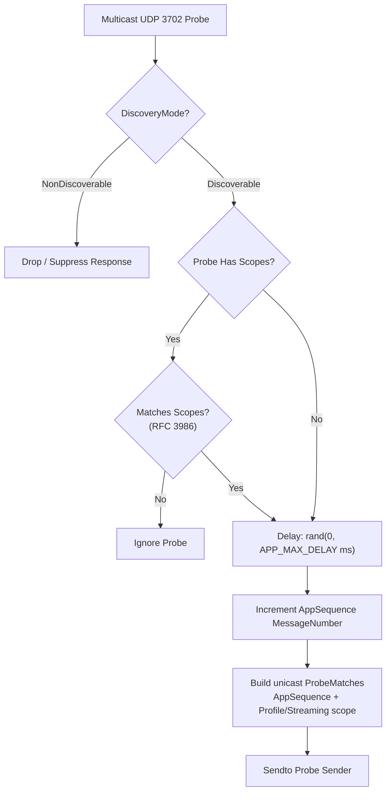
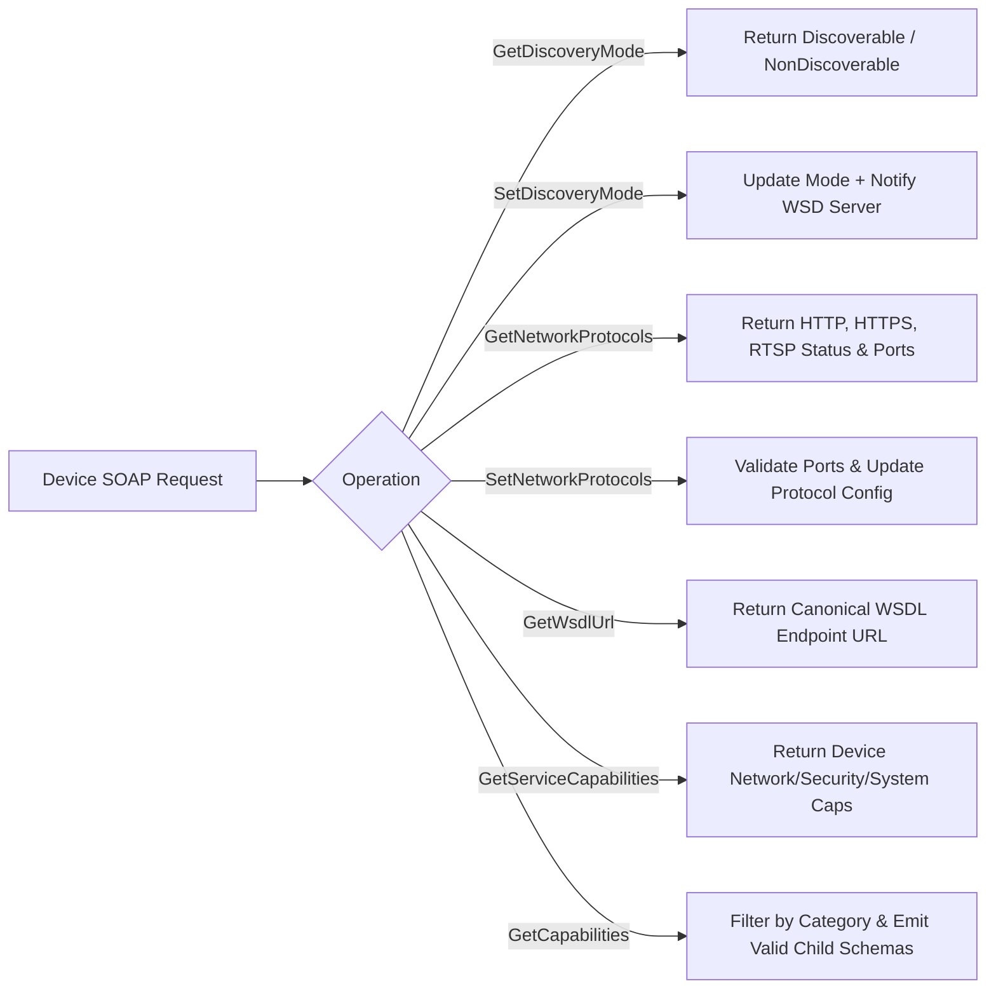
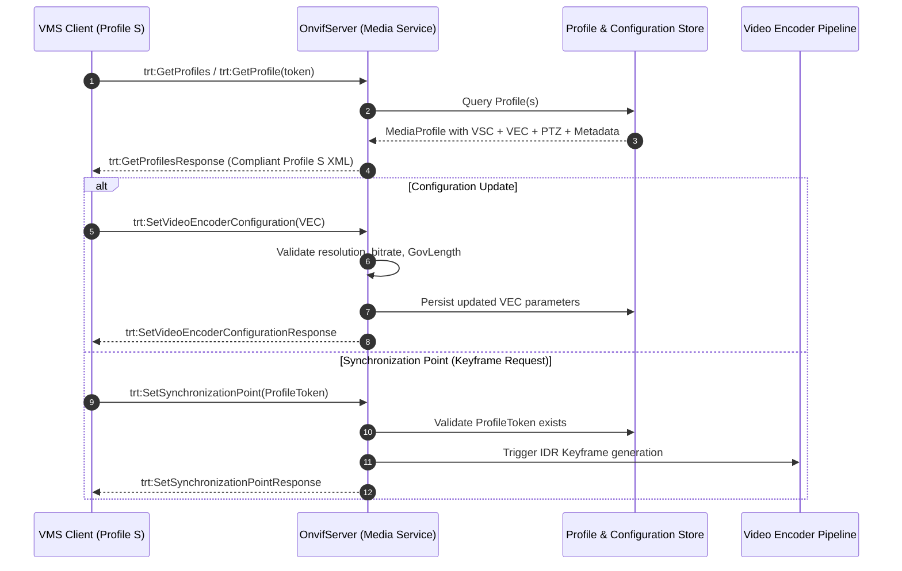
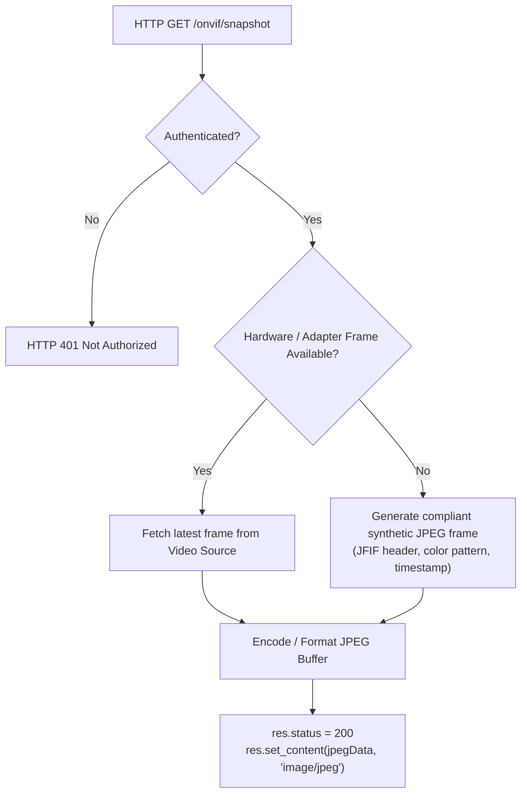
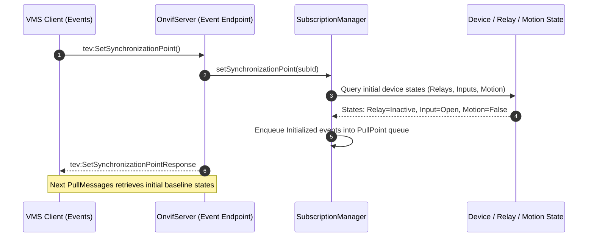
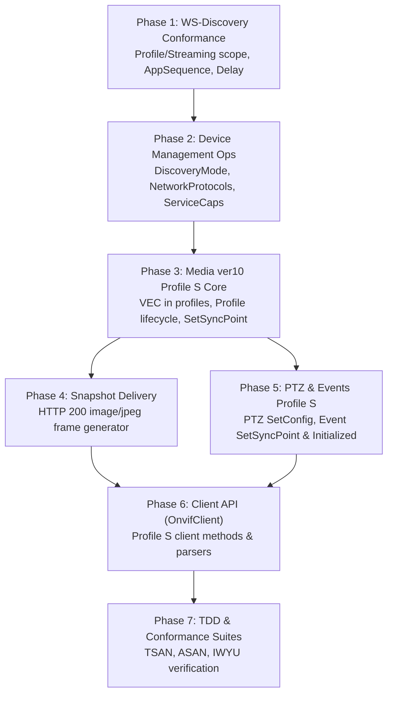

# Implementation Plan: P2 – ONVIF Profile S Completeness

**Scope:** `libs/Onvif/` (`OnvifServerTypes.h`, `OnvifTypes.h`, `OnvifServer.h`, `OnvifServer.cpp`, `WsDiscoveryServer.h`, `WsDiscoveryServer.cpp`, `WsDiscoveryCommon.h`, `WsDiscoveryCommon.cpp`, `AccessPolicy.h`, `AccessPolicy.cpp`, `SubscriptionManager.h`, `SubscriptionManager.cpp`, `OnvifClient.h`, `OnvifClient.cpp`, test suites)  
**Standard Baseline:** ONVIF Profile S Specification v1.3 (§6 Discovery, §7 Device, §8 Media, §9 PTZ, §10 Events), ONVIF Core Specification v24.12 (§8 Device Management, §9 Event Handling), ONVIF Media Service Specification v2.6 / v10 (§5 Profiles, §5.2 Configurations), OASIS WS-Discovery 2005/04 (§4.1 AppSequence, §7.2 APP_MAX_DELAY), MISRA C++:2023, SEI CERT C++  
**Reference Document:** [`docs/onvif_review.md`](onvif_review.md) (§4.1 WS-Discovery, §4.2 Profile S Mandatory Operations, §8 Remediation Roadmap P2)

---

## 1. Executive Summary & Problem Analysis

In [`docs/onvif_review.md`](onvif_review.md), **Phase P2** focuses on achieving full conformance with the **ONVIF Profile S** specification. Profile S is the foundational profile for IP video surveillance systems, governing discovery, device management, media profile configuration, RTSP streaming, JPEG snapshot delivery, PTZ control, and event delivery.

While P0 (Security Hardening) and P1 (Protocol Correctness, SOAP faults, and event subscription lifecycle) established a safe and stable transport layer, the server currently fails Profile S conformance tests because several mandatory operations, schema structures, and profile components are missing or incomplete.

```
+-----------------------------------------------------------------------------------------------------------------------+
|                                        PROFILE S GAPS REQUIRING P2 REMEDIATION                                        |
+----------------------+------------------------------------+-------------------------------------------+---------------+
| Subsystem            | Defect / Gap                       | Profile S Requirement                     | Status        |
+----------------------+------------------------------------+-------------------------------------------+---------------+
| WS-Discovery         | Scopes omit Profile/Streaming;     | Mandatory scope:                          | RESOLVED      |
|                      | No AppSequence header;             | onvif://www.onvif.org/Profile/Streaming;  | (Phase 1)     |
|                      | No random APP_MAX_DELAY (0-500ms); | wsd:AppSequence (InstanceId, MsgNumber);  |               |
|                      | Ignores Probe Scopes filter;       | APP_MAX_DELAY back-off before ProbeMatch; |               |
|                      | Stale config copy on scope changes | RFC 3986 Scopes match; Hello re-announce |               |
+----------------------+------------------------------------+-------------------------------------------+---------------+
| Device Service       | Missing: GetDiscoveryMode,         | Mandatory Profile S device ops;           | RESOLVED      |
| (tds)                | SetDiscoveryMode, GetNetwork-      | Category filtering on GetCapabilities;    | (Phase 2)     |
|                      | Protocols, SetNetworkProtocols,    | Schema-compliant child capability blocks  |               |
|                      | GetWsdlUrl, GetServiceCapabilities | (Network, Security, System, Streaming)    |               |
+----------------------+------------------------------------+-------------------------------------------+---------------+
| Media Service        | Profiles lack VideoEncoderConfig;  | At least one profile with VSC + VEC;      | RESOLVED      |
| (trt - ver10)        | Missing: GetProfile (single),      | Dynamic profile lifecycle; VEC and VSC    | (Phase 3)     |
|                      | CreateProfile, DeleteProfile,      | queries, updates, and options;            |               |
|                      | Get/SetVideoEncoderConfiguration,  | Add/Remove configuration mapping;         |               |
|                      | GetVideoEncoderConfigOptions,      | Encoder instance counts;                  |               |
|                      | Add/Remove*Configuration,          | SetSynchronizationPoint (IDR request);    |               |
|                      | SetSynchronizationPoint            | Media GetServiceCapabilities              |               |
+----------------------+------------------------------------+-------------------------------------------+---------------+
| Snapshot Delivery    | /onvif/snapshot returns HTTP 501   | Valid HTTP 200 image/jpeg payload         | RESOLVED      |
|                      | despite GetSnapshotUri advertising | for snapshot verification and VMS checks  | (Phase 4)     |
+----------------------+------------------------------------+-------------------------------------------+---------------+
| PTZ Service          | Missing: SetConfiguration,         | Full configuration modification;          | OPEN          |
| (tptz)               | GetServiceCapabilities;            | PTZ service capabilities;                 | (Phase 5)     |
|                      | Missing token validation faults    | ter:NoProfile and ter:NoToken faults      |               |
+----------------------+------------------------------------+-------------------------------------------+---------------+
| Events Service       | Missing: SetSynchronizationPoint,  | PullPoint state synchronization (sends    | OPEN          |
| (tev)                | GetServiceCapabilities,            | Initialized property events); Topic       | (Phase 5)     |
|                      | Topic Filter parsing               | expression filter matching                |               |
+----------------------+------------------------------------+-------------------------------------------+---------------+
```

---

## 2. Architecture & Design Specifications

### 2.1 WS-Discovery & Scope Synchronization Architecture

```
+---------------------------------------------------------------------------------+
|                       WS-Discovery Profile S Architecture                       |
+---------------------------------------------------------------------------------+
|                                                                                 |
|   Multicast UDP 3702: [ Probe (Scopes=Profile/Streaming) ]                      |
|            │                                                                    |
|            ▼                                                                    |
|   { DiscoveryMode Check } ──(NonDiscoverable)──► [ Suppress Response ]          |
|            │ (Discoverable)                                                     |
|            ▼                                                                    |
|   { Scopes Matcher (RFC 3986) } ──(No Match)──► [ Ignore Probe ]                |
|            │ (Matched)                                                          |
|            ▼                                                                    |
|   [ Jitter Delay: 0 to APP_MAX_DELAY (0–500 ms) ]                               |
|            │                                                                    |
|            ▼                                                                    |
|   [ ProbeMatches Generator ]                                                    |
|     - Header: <d:AppSequence InstanceId="X" MessageNumber="Y"/>                 |
|     - Scopes: onvif://www.onvif.org/Profile/Streaming                          |
|     - XAddrs: http://[host]:[port]/onvif/device_service                         |
|     - MetadataVersion: incremented on scope modification                        |
|                                                                                 |
+---------------------------------------------------------------------------------+
```

#### Mermaid Diagram: WS-Discovery Ingress & Response Pipeline



---

### 2.2 Device Management: Network Protocols, Discovery Mode & Service Capabilities

```
+---------------------------------------------------------------------------------+
|                   Device Management Service (tds) Subsystems                    |
+---------------------------------------------------------------------------------+
|                                                                                 |
|   1. Discovery Mode:                                                            |
|      - GetDiscoveryMode -> <tds:DiscoveryMode>Discoverable</tds:DiscoveryMode>  |
|      - SetDiscoveryMode -> Updates atomic DiscoveryMode; notifies WSD server    |
|                                                                                 |
|   2. Network Protocols:                                                         |
|      - GetNetworkProtocols:                                                     |
|          * HTTP:  Port 8080, Enabled = true                                     |
|          * HTTPS: Port 8443, Enabled = false/true                               |
|          * RTSP:  Port 554/8554, Enabled = true                                 |
|      - SetNetworkProtocols: Updates port/enable state with validation           |
|                                                                                 |
|   3. Service Capabilities:                                                      |
|      - GetServiceCapabilities (Device):                                         |
|          * Network: IPFilter, ZeroConfiguration, DynDNS                         |
|          * Security: TLS1.2, UsernameToken, HttpDigest, AccessPolicyConfig      |
|          * System: DiscoveryBye, SystemBackup, SystemLogging                    |
|                                                                                 |
|   4. Category-Filtered GetCapabilities:                                         |
|      - <tds:Category>Device | Media | PTZ | Events | Imaging | All</tds:Category>|
|      - Returns only the requested capability blocks with valid child elements   |
|                                                                                 |
+---------------------------------------------------------------------------------+
```

#### Mermaid Diagram: Device Management Operation Dispatch



---

### 2.3 Media Service (ver10 `trt`): Media Profile Lifecycle & VideoEncoderConfiguration

In ONVIF Profile S, a Profile is not simply an RTSP pointer. It is an aggregation of configurations:
1. `VideoSourceConfiguration` (VSC): Sensor token, framing bounds (`x, y, width, height`).
2. `VideoEncoderConfiguration` (VEC): Encoding codec (`H264` or `JPEG`), resolution, quality, framerate limit, bitrate limit, GovLength.
3. `PTZConfiguration` (PTZ): Node token, velocity spaces, limits.
4. `MetadataConfiguration` (Metadata): Topic rules, analytics stream configuration.

```
+---------------------------------------------------------------------------------+
|                       Profile S Media Profile Model (trt)                       |
+---------------------------------------------------------------------------------+
|                                                                                 |
|   +─────────────────────────────────────────────────────────────────────────+   |
|   | MediaProfile (token="ProfileToken_1", fixed=true/false)                 |   |
|   |  - Name: "MainProfile"                                                  |   |
|   |  - VideoSourceConfiguration:                                            |   |
|   |      token="VSC_1", Bounds=(0,0,1920,1080), SourceToken="VS_1"          |   |
|   |  - VideoEncoderConfiguration:                                           |   |
|   |      token="VEC_1", Codec=H264, Res=1920x1080, FPS=30, Bitrate=4096    |   |
|   |  - PTZConfiguration:                                                    |   |
|   |      token="PTZ_1", NodeToken="PTZNode_1", VelocitySpaces...            |   |
|   |  - MetadataConfiguration:                                               |   |
|   |      token="MC_1", Analytics=true, PTZStatus=true                       |   |
|   +─────────────────────────────────────────────────────────────────────────+   |
|                                                                                 |
|   Profile Operations:                                                           |
|     * GetProfiles()                                                             |
|     * GetProfile(token) -> ter:NoProfile if token invalid                       |
|     * CreateProfile(name, token?) -> registers dynamic profile                  |
|     * DeleteProfile(token) -> deletes dynamic profile (rejects fixed)           |
|     * Add/RemoveVideoSourceConfiguration(profileToken, configToken)             |
|     * Add/RemoveVideoEncoderConfiguration(profileToken, configToken)            |
|     * Add/RemovePTZConfiguration(profileToken, configToken)                     |
|     * SetSynchronizationPoint(profileToken) -> encoder keyframe request        |
|                                                                                 |
+---------------------------------------------------------------------------------+
```

#### Mermaid Diagram: Media Profile Configuration Management Flow



---

### 2.4 Snapshot Delivery Pipeline (HTTP 200 JPEG Generator)

The snapshot service must never return HTTP 501. The server must deliver a valid, standards-compliant JPEG image frame (`image/jpeg`, HTTP 200) either from an attached camera source / frame adapter or via an embedded high-speed synthetic frame generator with dynamic timestamp overlay.

```
+---------------------------------------------------------------------------------+
|                       Snapshot HTTP Endpoint Pipeline                           |
+---------------------------------------------------------------------------------+
|                                                                                 |
|   HTTP GET /onvif/snapshot                                                      |
|          │                                                                      |
|          ▼                                                                      |
|   { Authentication Check (PreAuth / ReadMedia / Digest / WS-Security) }         |
|          │ (Authorized)                                                         |
|          ▼                                                                      |
|   { Frame Provider Available? }                                                 |
|          ├──────────────────────────────────┐                                   |
|          │ (Yes: Frame Buffer Hook)         │ (No: Standalone / Synthetic)      |
|          ▼                                  ▼                                   |
|   [ Fetch Recent Video Frame ]       [ Generate Valid JPEG Image ]              |
|                                      - JFIF Standard Format                     |
|                                      - Resolution: 640x480 / 1920x1080          |
|                                      - Embedded Timestamp & Channel Info        |
|          │                                  │                                   |
|          └──────────────────┬───────────────┘                                   |
|                             ▼                                                   |
|             [ HTTP 200 Response ]                                               |
|               - Content-Type: image/jpeg                                        |
|               - Content-Length: <size>                                          |
|               - Binary JPEG Byte Payload                                        |
|                                                                                 |
+---------------------------------------------------------------------------------+
```

#### Mermaid Diagram: Snapshot Delivery Flow



---

### 2.5 PTZ & Events Profile S Conformance Architecture

1. **PTZ Service**:
   - `SetConfiguration`: Updates PTZ configuration parameters (Pan/Tilt speed limits, Zoom limits, default velocity space).
   - `GetServiceCapabilities`: Emits capabilities (`EFlip="false" Reverse="false" GetCompatibleConfigurations="true" MoveStatus="true" StatusPosition="true"`).
   - Token Validation: Enforces existence checks for `ProfileToken`, `NodeToken`, `ConfigurationToken`, and `PresetToken`, returning `ter:NoProfile` or `ter:NoToken`.
2. **Events Service**:
   - `SetSynchronizationPoint`: Profile S mandates that calling `SetSynchronizationPoint` on an event subscription generates current state events with `PropertyOperation="Initialized"`.
   - `GetServiceCapabilities`: Emits capabilities (`WSSubscriptionPolicySupport="true" WSPullPointSupport="true" MaxPullPoints="10"`).
   - Topic `Filter` Handling: Supports `<wsnt:Filter>` parsing with dialect `http://www.onvif.org/ver10/tev/topicExpression/ConcreteSet`.

```
+---------------------------------------------------------------------------------+
|                       Event State Synchronization Point                         |
+---------------------------------------------------------------------------------+
|                                                                                 |
|   Client: [ tev:SetSynchronizationPoint ] on PullPoint Subscription             |
|          │                                                                      |
|          ▼                                                                      |
|   [ SubscriptionManager::setSynchronizationPoint(subId) ]                       |
|          │                                                                      |
|          ▼                                                                      |
|   [ Query Current Hardware / Adapter Property States ]                          |
|     - Relay outputs: State (Active / Inactive)                                  |
|     - Digital inputs: LogicalState (Open / Closed)                              |
|     - Motion detector: IsMotion (false)                                         |
|     - PTZ status: IsMoving (false), Current Preset                              |
|          │                                                                      |
|          ▼                                                                      |
|   [ Format as wsnt:NotificationMessage with PropertyOperation="Initialized" ]   |
|          │                                                                      |
|          ▼                                                                      |
|   [ Prepend to Subscription Event Queue for Next PullMessages ]                 |
|          │                                                                      |
|          ▼                                                                      |
|   Return: <tev:SetSynchronizationPointResponse/>                                |
|                                                                                 |
+---------------------------------------------------------------------------------+
```

#### Mermaid Diagram: Event Synchronization Point Sequence



---

## 3. Implementation Phases & Detailed Tasks

### Phase 1: WS-Discovery & Discovery Mode Conformance `[RESOLVED]`

- **Task 1.1: Scope Definition & Profile S Identifier** `[RESOLVED]`  
  In [`libs/Onvif/OnvifServerTypes.h`](../libs/Onvif/OnvifServerTypes.h) and [`libs/Onvif/WsDiscoveryServer.cpp`](../libs/Onvif/WsDiscoveryServer.cpp):
  - Ensure the default scopes include `onvif://www.onvif.org/Profile/Streaming` and `onvif://www.onvif.org/Profile/S`.
  - In `createProbeMatchesPayload` and `createHelloPayload`, emit the streaming profile scope.
- **Task 1.2: AppSequence Header Generation** `[RESOLVED]`  
  In [`libs/Onvif/WsDiscoveryCommon.h`](../libs/Onvif/WsDiscoveryCommon.h) and [`libs/Onvif/WsDiscoveryServer.h`](../libs/Onvif/WsDiscoveryServer.h):
  - Implement `AppSequence` tracker with atomic message counter and persistent instance ID (e.g. system boot timestamp).
  - Add `<d:AppSequence InstanceId="..." MessageNumber="..."/>` to WS-Discovery headers for `Hello`, `Bye`, and `ProbeMatches`.
- **Task 1.3: Random `APP_MAX_DELAY` Jitter Implementation** `[RESOLVED]`  
  In [`libs/Onvif/WsDiscoveryServer.cpp`](../libs/Onvif/WsDiscoveryServer.cpp):
  - When a multicast probe is validated, sleep for a random interval between 0 and `APP_MAX_DELAY` (default 500 ms) before sending the unicast `ProbeMatches` reply.
- **Task 1.4: Probe Scope Matching (RFC 3986)** `[RESOLVED]`  
  In [`libs/Onvif/WsDiscoveryValidator.cpp`](../libs/Onvif/WsDiscoveryValidator.cpp):
  - Parse `<d:Scopes>` and optional `MatchBy` attribute from probe XML.
  - If scopes are specified in the probe, verify that the device satisfies all requested scope URIs; drop or ignore the probe if any requested scope does not match.
- **Task 1.5: Discovery Mode State Tracking & Notification** `[RESOLVED]`  
  - Add `std::atomic<DiscoveryMode> m_discoveryMode { DiscoveryMode::Discoverable }` in `OnvifServer`.
  - When set to `DiscoveryMode::NonDiscoverable`, suppress probe responses and outgoing Hello messages.
  - When scopes change via `AddScopes`, `SetScopes`, or `RemoveScopes`, broadcast a new `Hello` payload with incremented `MetadataVersion`.

---

### Phase 2: Device Management Profile S Operations `[RESOLVED]`

- **Task 2.1: Implement `GetDiscoveryMode` & `SetDiscoveryMode`** `[RESOLVED]`  
  In [`libs/Onvif/OnvifServer.cpp`](../libs/Onvif/OnvifServer.cpp):
  - `GetDiscoveryMode`: Returns `<tds:DiscoveryMode>Discoverable | NonDiscoverable</tds:DiscoveryMode>`.
  - `SetDiscoveryMode`: Parses mode, updates `m_discoveryMode`, updates `WsDiscoveryServer`, and returns `<tds:SetDiscoveryModeResponse/>`.
  - Update [`libs/Onvif/AccessPolicy.cpp`](../libs/Onvif/AccessPolicy.cpp): map `GetDiscoveryMode` to `AccessClass::PreAuth` or `ReadSystem`, and `SetDiscoveryMode` to `AccessClass::WriteSystem`.
- **Task 2.2: Implement `GetNetworkProtocols` & `SetNetworkProtocols`** `[RESOLVED]`  
  In [`libs/Onvif/OnvifServerTypes.h`](../libs/Onvif/OnvifServerTypes.h) and [`libs/Onvif/OnvifServer.cpp`](../libs/Onvif/OnvifServer.cpp):
  - Define `NetworkProtocolConfig` (HTTP on `port`, HTTPS on `httpsPort`, RTSP on `rtspPort`).
  - `GetNetworkProtocols`: Serializes list of `<tds:NetworkProtocols>` with `<tt:Name>`, `<tt:Enabled>`, `<tt:Port>`.
  - `SetNetworkProtocols`: Validates port numbers (1-65535) and updates protocol state.
  - Update `AccessPolicy.cpp`: map `GetNetworkProtocols` to `AccessClass::ReadSystem` and `SetNetworkProtocols` to `AccessClass::WriteSystem`.
- **Task 2.3: Implement `GetWsdlUrl`** `[RESOLVED]`  
  - Return `<tds:GetWsdlUrlResponse><tds:WsdlUrl>http://[host]:[port]/onvif/device.wsdl</tds:WsdlUrl></tds:GetWsdlUrlResponse>`.
  - Verify `AccessPolicy.cpp` handles `GetWsdlUrl` under `PreAuth`.
- **Task 2.4: Implement `GetServiceCapabilities` for Device Service** `[RESOLVED]`  
  - Return standard Device Service Capabilities:
    - `<tds:Network IPFilter="false" ZeroConfiguration="false" IPVersion6="false" DynDNS="false"/>`
    - `<tds:Security TLS1.2="true" UsernameToken="true" HttpDigest="true" AccessPolicyConfig="true"/>`
    - `<tds:System DiscoveryBye="true" DiscoveryResolve="false" SystemBackup="true" SystemLogging="true"/>`
- **Task 2.5: Category Filtering & Schema Completion in `GetCapabilities`** `[RESOLVED]`  
  In `handleDeviceService`:
  - Parse `<tds:Category>` elements from `reqNode`. Support `All`, `Device`, `Media`, `Events`, `Imaging`, `PTZ`, `Analytics`.
  - Add missing required child elements per ONVIF schema:
    - `tt:Device`: `<tt:Network>`, `<tt:System>`, `<tt:IO>`, `<tt:Security>`
    - `tt:Media`: `<tt:StreamingCapabilities><tt:RTPMulticast>false</tt:RTPMulticast><tt:RTP_TCP>true</tt:RTP_TCP><tt:RTP_RTSP_TCP>true</tt:RTP_RTSP_TCP></tt:StreamingCapabilities>`
    - `tt:Events`: `<tt:WSSubscriptionPolicySupport>true</tt:WSSubscriptionPolicySupport>`, `<tt:WSPullPointSupport>true</tt:WSPullPointSupport>`

---

### Phase 3: Media ver10 Profile S Core & VideoEncoderConfiguration `[RESOLVED]`

- **Task 3.1: Profile S Media Profile Model** `[RESOLVED]`  
  In [`libs/Onvif/OnvifServerTypes.h`](../libs/Onvif/OnvifServerTypes.h) and [`libs/Onvif/OnvifServer.h`](../libs/Onvif/OnvifServer.h):
  - Define `VideoEncoderConfig` for Media1 (trt) containing encoding (`H264`, `JPEG`), resolution (`Width`, `Height`), `Quality`, `RateControl` (FrameRateLimit, BitrateLimit), and `H264` (GovLength, Profile).
  - Define `ServerMediaProfile` containing `token`, `name`, `fixed`, `vscToken`, `vecToken`, `ptzToken`, `metadataToken`.
  - Initialize default Profile S profiles (e.g. `ProfileToken_1` / `MainProfile` with both `VideoSourceConfig_1` and `VideoEncoderConfig_1`).
- **Task 3.2: Serialize VideoEncoderConfiguration in `GetProfiles` & `GetProfile`** `[RESOLVED]`  
  In [`libs/Onvif/OnvifServer.cpp`](../libs/Onvif/OnvifServer.cpp):
  - Refactor profile XML serialization into a reusable helper `formatProfileXml(profile, body, prefix)`.
  - Include `<tt:VideoEncoderConfiguration>` with `<tt:Encoding>`, `<tt:Resolution>`, `<tt:Quality>`, `<tt:RateControl>`, `<tt:H264>`, `<tt:Multicast>`, `<tt:SessionTimeout>`.
  - Implement `GetProfile`: Parse `<trt:ProfileToken>`, find profile in store. If not found, return `SoapFault::noProfile()` with HTTP 400.
- **Task 3.3: Dynamic Profile Lifecycle (`CreateProfile`, `DeleteProfile`)** `[RESOLVED]`  
  - `CreateProfile`: Parse `<trt:Name>` and optional `<trt:Token>`. Generate token if missing. Insert into profile store and return `<trt:CreateProfileResponse><trt:Profile token="...">...</trt:Profile></trt:CreateProfileResponse>`.
  - `DeleteProfile`: Parse `<trt:ProfileToken>`. If profile is fixed (`fixed == true`), return `SoapFault::invalidArgVal("Cannot delete fixed profile")`. Otherwise erase and return `<trt:DeleteProfileResponse/>`.
- **Task 3.4: Video Source & Encoder Configuration Queries** `[RESOLVED]`  
  - Implement `GetVideoSourceConfiguration(ConfigurationToken)` and `GetVideoSourceConfigurations()`.
  - Implement `GetVideoEncoderConfiguration(ConfigurationToken)` and `GetVideoEncoderConfigurations()`.
  - Implement `GetVideoEncoderConfigurationOptions(ConfigurationToken, ProfileToken)`: Emit supported resolutions (1920x1080, 1280x720, 640x480), framerates (1-30 fps), bitrates (256-8192 kbps), GovLength (1-120), and H.264 profiles (Baseline, Main, High).
  - Implement `SetVideoEncoderConfiguration`: Parse config node, validate resolution and numeric ranges (preventing NaN / out-of-range per CERT FLP34-C / INT32-C), update store, and return `<trt:SetVideoEncoderConfigurationResponse/>`.
- **Task 3.5: Configuration Attachment & Compatibility Operations** `[RESOLVED]`  
  - Implement `AddVideoEncoderConfiguration` & `RemoveVideoEncoderConfiguration`.
  - Implement `AddVideoSourceConfiguration` & `RemoveVideoSourceConfiguration`.
  - Implement `AddPTZConfiguration` & `RemovePTZConfiguration`.
  - Implement `GetCompatibleVideoSourceConfigurations` and `GetCompatibleVideoEncoderConfigurations`.
  - Implement `GetGuaranteedNumberOfVideoEncoderInstances`: Return total count (e.g. 2) and H.264 count (2).
- **Task 3.6: Implement Media `SetSynchronizationPoint` & `GetServiceCapabilities`** `[RESOLVED]`  
  - `SetSynchronizationPoint`: Parse `<trt:ProfileToken>`, verify existence, log IDR request, return `<trt:SetSynchronizationPointResponse/>`.
  - `GetServiceCapabilities`: Emit ProfileCapabilities (MaxProfiles=8), StreamingCapabilities (RTP_TCP=true), Snapshot=true, OSD=true.

---

### Phase 4: Snapshot Delivery & HTTP 200 JPEG Generator `[RESOLVED]`

- **Task 4.1: Standards-Compliant Minimal JPEG Generator** `[RESOLVED]`  
  In a new helper [`libs/Onvif/JpegGenerator.h`](../libs/Onvif/JpegGenerator.h) / `JpegGenerator.cpp`:
  - Implement lightweight, zero-dependency, allocation-bounded JFIF JPEG generator:
    - Standard SOI (`0xFFD8`), JFIF APP0 (`0xFFE0`), DQT (`0xFFDB`), SOF0 (`0xFFC0`), DHT (`0xFFC4`), SOS (`0xFFDA`), and EOI (`0xFFD9`).
    - Produces a valid 640x480 or 1920x1080 test card pattern with UTC timestamp.
    - Alternatively reads raw frame if camera video sink is active.
- **Task 4.2: Replace 501 Handler with HTTP 200 Snapshot Delivery** `[RESOLVED]`  
  In [`libs/Onvif/OnvifServer.cpp`](../libs/Onvif/OnvifServer.cpp):
  - In `m_httpServer.Get("/onvif/snapshot", ...)`:
    - Perform authentication check (`authorizeHttp(req, res, "Snapshot")`).
    - Fetch frame buffer or invoke `JpegGenerator::createTestFrame()`.
    - Set `res.status = 200` and `res.set_content(jpegData, "image/jpeg")`.

---

### Phase 5: PTZ & Events Profile S Completeness `[OPEN]`

- **Task 5.1: PTZ `SetConfiguration` & `GetServiceCapabilities`** `[OPEN]`  
  In [`libs/Onvif/OnvifServer.cpp`](../libs/Onvif/OnvifServer.cpp):
  - `SetConfiguration`: Parse `<tptz:PTZConfiguration>`, validate spaces and limits, update PTZ configuration in store, and return `<tptz:SetConfigurationResponse/>`.
  - `GetServiceCapabilities`: Return `<tptz:Capabilities EFlip="false" Reverse="false" GetCompatibleConfigurations="true" MoveStatus="true" StatusPosition="true"/>`.
  - Verify token existence across all PTZ operations, returning `SoapFault::noProfile()` or `SoapFault::noToken()`.
- **Task 5.2: Event `SetSynchronizationPoint` & State Initialization** `[OPEN]`  
  In [`libs/Onvif/SubscriptionManager.h`](../libs/Onvif/SubscriptionManager.h) and [`libs/Onvif/SubscriptionManager.cpp`](../libs/Onvif/SubscriptionManager.cpp):
  - Implement `SubscriptionManager::setSynchronizationPoint(const std::string& subId)`.
  - Enqueue initial state `OnvifEvent` objects with `PropertyOperation = "Initialized"` (e.g. RelayOutput state, DigitalInput state, MotionAlarm state).
  - In `OnvifServer::handleEventService` / `handlePullPointService`: Handle `SetSynchronizationPoint`, invoke `SubscriptionManager`, and return `<tev:SetSynchronizationPointResponse/>`.
- **Task 5.3: Event `GetServiceCapabilities` & Topic Filter Parsing** `[OPEN]`  
  - Return `<tev:Capabilities WSSubscriptionPolicySupport="true" WSPullPointSupport="true" MaxPullPoints="10" PersistentNotificationStorage="false"/>`.
  - In `CreatePullPointSubscription` and `Subscribe`, parse `<wsnt:Filter>` and store topic filter expression in subscription state for matching during event dispatch.

---

### Phase 6: Client-Side Profile S Support (`OnvifClient`) `[IN PROGRESS]`

- **Task 6.1: Media Profile & Video Encoder Configuration Client APIs** `[OPEN]`  
  In [`libs/Onvif/OnvifClient.h`](../libs/Onvif/OnvifClient.h) and [`libs/Onvif/OnvifClient.cpp`](../libs/Onvif/OnvifClient.cpp):
  - Add `getProfile(const std::string& token)`.
  - Add `createProfile(const std::string& name, const std::string& token = "")`.
  - Add `deleteProfile(const std::string& token)`.
  - Add `getVideoEncoderConfigurations()`.
  - Add `getVideoEncoderConfigurationOptions(const std::string& token)`.
  - Add `setVideoEncoderConfiguration(const VideoEncoderConfig& config)`.
  - Add `mediaSetSyncPoint(const std::string& profileToken)`.
- **Task 6.2: Device Discovery Mode & Protocol Client APIs** `[OPEN]`  
  - Add `getDiscoveryMode()`.
  - Add `setDiscoveryMode(DiscoveryMode mode)`.
  - Add `getNetworkProtocols()`.
- **Task 6.3: Snapshot Fetch Client API** `[RESOLVED]`  
  - Add `getSnapshot(const std::string& snapshotUri) -> std::optional<std::vector<std::uint8_t>>`.

---

## 4. Test-Driven Development (TDD) Verification Plan

Following the project TDD rules, dedicated unit, conformance, and end-to-end tests will be created and executed before finalizing code changes:

### 4.1 Test Suites Breakdown

```
+-------------------------------------------------------------------------------------------------------+
| Test Suite / Test Name                               | Target Requirement & Validation Description    |
+------------------------------------------------------+------------------------------------------------+
| TestOnvifDiscoveryProfileS.StreamingScopeInPayloads  | Verifies Profile/Streaming scope in Hello &    |
|                                                      | ProbeMatches responses.                        |
| TestOnvifDiscoveryProfileS.AppSequenceHeaderPresent  | Verifies wsd:AppSequence InstanceId & counter. |
| TestOnvifDiscoveryProfileS.ProbeScopeMatching        | Verifies RFC 3986 scope matching and drop on   |
|                                                      | non-matching probe scopes.                     |
| TestOnvifDiscoveryProfileS.DiscoveryModeSuppression  | Verifies NonDiscoverable suppresses probes.    |
| TestOnvifDeviceProfileS.GetSetDiscoveryMode          | Verifies Get/SetDiscoveryMode roundtrip.       |
| TestOnvifDeviceProfileS.GetSetNetworkProtocols       | Verifies HTTP/HTTPS/RTSP protocol reporting.   |
| TestOnvifDeviceProfileS.GetWsdlUrlReturnsValidUrl     | Verifies GetWsdlUrl endpoint string.           |
| TestOnvifDeviceProfileS.GetServiceCapabilities       | Verifies Device Network/Security/System caps.  |
| TestOnvifDeviceProfileS.CategoryFilteredCapabilities | Verifies Category=Media returns only Media.    |
| TestOnvifMediaProfileS.ProfilesContainVscAndVec      | Verifies Profile 1 has both VSC and VEC.       |
| TestOnvifMediaProfileS.GetProfile_ValidAndInvalid    | Verifies GetProfile returns 200 or ter:NoProfile|
| TestOnvifMediaProfileS.CreateAndDeleteProfile        | Verifies dynamic profile lifecycle.            |
| TestOnvifMediaProfileS.GetSetVideoEncoderConfig      | Verifies VEC options, parameters, updates.     |
| TestOnvifMediaProfileS.SetSynchronizationPoint       | Verifies keyframe request returns 200.         |
| TestOnvifMediaProfileS.MediaCapabilities             | Verifies Media GetServiceCapabilities.         |
| TestOnvifSnapshot.EndpointReturnsValid200Jpeg        | Verifies /onvif/snapshot returns HTTP 200      |
|                                                      | and valid JFIF JPEG SOI/EOI magic markers.     |
| TestOnvifPtzProfileS.SetConfigurationAndCaps         | Verifies PTZ SetConfiguration & ServiceCaps.   |
| TestOnvifEventsProfileS.SetSyncPointEnqueuesInit     | Verifies SetSynchronizationPoint generates     |
|                                                      | PropertyOperation="Initialized" events.        |
+------------------------------------------------------+------------------------------------------------+
```

### 4.2 Test Build & Execution Commands

```bash
# 1. Configure and build test targets
cmake -B build -S . -DPELCOD_ENABLE_ONVIF=ON -DCMAKE_BUILD_TYPE=Debug
cmake --build build --target TestOnvifDiscoveryProfileS -j$(nproc)
cmake --build build --target TestOnvifDeviceProfileS -j$(nproc)
cmake --build build --target TestOnvifMediaProfileS -j$(nproc)
cmake --build build --target TestOnvifSnapshot -j$(nproc)
cmake --build build --target TestOnvifEventsProfileS -j$(nproc)

# 2. Run dedicated test binaries directly
./build/libs/Onvif/tests/TestOnvifDiscoveryProfileS
./build/libs/Onvif/tests/TestOnvifDeviceProfileS
./build/libs/Onvif/tests/TestOnvifMediaProfileS
./build/libs/Onvif/tests/TestOnvifSnapshot
./build/libs/Onvif/tests/TestOnvifEventsProfileS

# 3. Verify thread safety under ThreadSanitizer
cmake -B build-tsan -S . -DPELCOD_ENABLE_ONVIF=ON -DCMAKE_CXX_FLAGS="-fsanitize=thread"
cmake --build build-tsan -j$(nproc)
ctest --test-dir build-tsan -R "TestOnvif" --output-on-failure

# 4. Audit IWYU and <cstdint> compliance
python3 scripts/verify_iwyu_cstdint.py --files libs/Onvif/*.h libs/Onvif/*.cpp
```

---

## 5. Compliance & Verification Matrix

| # | Standard / Project Rule | Compliance Measure for Phase P2 |
|---|---|---|
| 1 | **No raw `new`/`delete`** | `std::make_unique`, `std::make_shared`, RAII image buffers |
| 2 | **`#pragma once`** | Present as the first non-comment line in all header files |
| 3 | **Co-located `.h`/`.cpp`** | All new components reside together in `libs/Onvif/` |
| 4 | **Core is Qt-free** | Zero Qt dependencies (`#include <Q...>`) in `libs/Onvif/` |
| 5 | **Function names < 30 chars** | Strictly audited (e.g. `getDiscoveryMode`, `setVideoEncConfig`, `getNetProtocols`) |
| 6 | **Linux & Windows transport** | Cross-platform socket utilities used for delay, discovery, and HTTP |
| 7 | **Explicit `{}` initialization** | All variables, POD structs, and class members value-initialized |
| 8 | **`[[nodiscard]]` applied** | Applied to all queries, parsers, and verification methods |
| 9 | **Full Doxygen templates** | `/// @brief`, `@details`, `@param`, `@return` on all public interfaces |
| 10 | **MISRA & SEI CERT C++** | CERT FLP34-C (NaN safety), INT32-C (overflow guards), ERR51-CPP |
| 11 | **TDD Workflow** | Failing tests written and validated prior to feature code implementation |
| 12 | **Zero Warnings (`-Werror`)** | Builds cleanly under `-Wall -Wextra -pedantic -Werror` and `/W4 /WX` |
| 13 | **Relative file paths** | All documentation uses relative links (e.g. [`libs/Onvif/OnvifServer.h`](../libs/Onvif/OnvifServer.h)) |
| 14 | **Dual Diagrams** | Both ASCII and Mermaid diagrams provided for all architecture sections |
| 15 | **Explicit `<cstdint>` & `std::`** | Strict `std::uint8_t`, `std::uint32_t`, `std::size_t` usage |
| 16 | **IWYU Adherence** | Direct inclusion of all referenced symbols; no transitive header reliance |

---

## 6. Implementation Readiness & Dependency Graph

```
+---------------------------------------------------------------------------------+
|                       P2 Implementation Dependency Flow                         |
+---------------------------------------------------------------------------------+
|                                                                                 |
|   [ Phase 1: WS-Discovery & Scope Conformance ]                                 |
|     - Profile/Streaming scope, AppSequence, Delay, Scope Matching, DiscoveryMode|
|                               │                                                 |
|                               ▼                                                 |
|   [ Phase 2: Device Management Operations ]                                     |
|     - DiscoveryMode, NetworkProtocols, WsdlUrl, ServiceCapabilities, Caps filter|
|                               │                                                 |
|                               ▼                                                 |
|   [ Phase 3: Media ver10 Profile S Core ]                                       |
|     - VEC in profiles, Get/Create/DeleteProfile, VEC options, SetSyncPoint      |
|                               │                                                 |
|                               ├─────────────────────────────────┐               |
|                               ▼                                 ▼               |
|   [ Phase 4: Snapshot HTTP 200 Delivery ]       [ Phase 5: PTZ & Events P2 ]    |
|     - Valid JFIF JPEG generator                   - SetConfiguration, Caps,     |
|     - Replace 501 with HTTP 200 image/jpeg          Event SetSyncPoint & Init   |
|                               │                                 │               |
|                               └────────────────┬────────────────┘               |
|                                                ▼                                |
|   [ Phase 6: Client-Side Profile S API Support ]                                |
|     - OnvifClient methods for profiles, encoders, discovery mode, snapshots     |
|                               │                                                 |
|                               ▼                                                 |
|   [ Phase 7: TDD Conformance Testing, TSAN & IWYU Verification ]                |
|                                                                                 |
+---------------------------------------------------------------------------------+
```

#### Mermaid Diagram: Phase Dependency Graph


