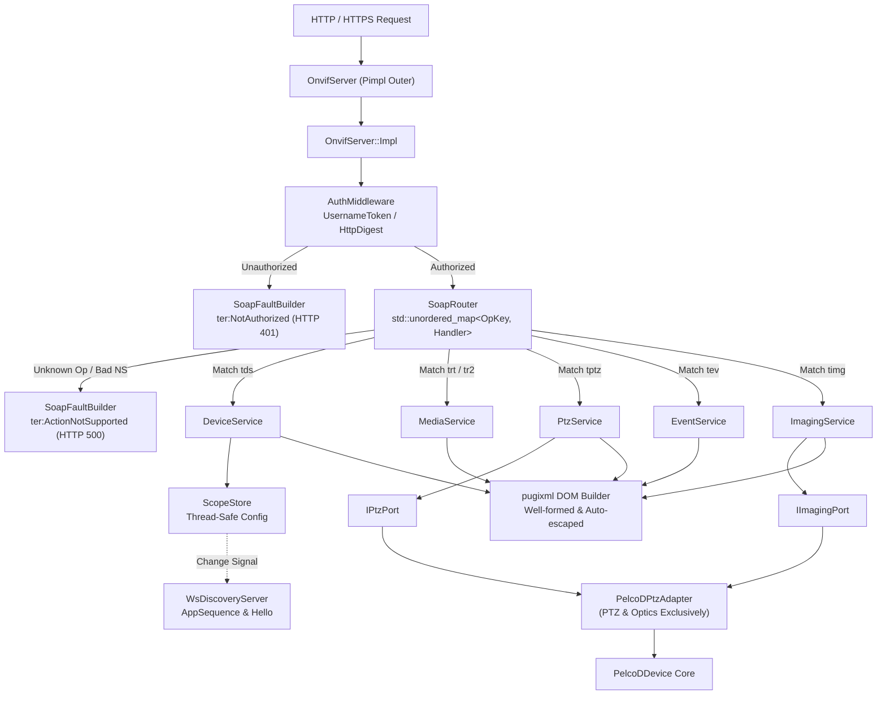

# Implementation Plan: P3 – ONVIF Architecture & Hygiene

**Scope:** `libs/Onvif/` (`OnvifServer.h`, `OnvifServer.cpp`, `OnvifServerTypes.h`, `OnvifTypes.h`, `OnvifClient.h`, `OnvifClient.cpp`, `OnvifSecurity.h`, `OnvifSecurity.cpp`, `adapters/PelcoDPtzAdapter.h`, `adapters/PelcoDPtzAdapter.cpp`, `WsDiscoveryServer.h`, `WsDiscoveryServer.cpp`, `CMakeLists.txt`, test suites)  
**Standard Baseline:** MISRA C++:2023, SEI CERT C++, ONVIF Core Specification v24.12, Clean Architecture / SOLID Principles, Project Rules in [`.agents/rules/`](../.agents/rules/)  
**Reference Document:** [`docs/onvif_review.md`](onvif_review.md) (§5 Coding-Standard Compliance, §7 Target Architecture, §8 Remediation Roadmap P3)

---

## 1. Executive Summary & Problem Analysis

In [`docs/onvif_review.md`](onvif_review.md), **Phase P3** focuses on structural decoupling, memory safety, architectural scalability, and strict coding-standard hygiene across the `libs/Onvif` subsystem. 

While Phases P0 (Security Hardening), P1 (Protocol Correctness & Faults), and P2 (Profile S Completeness) resolved protocol and vulnerability blockers, the module retains significant technical debt and architectural anti-patterns:
1. **Monolithic God-Server (`OnvifServer.cpp`):** Spans over 5,000 LOC (324 KB), mixing HTTP connection handling, XML serialization, and 14 distinct SOAP service handlers. Cyclomatic complexity of functions such as `handleDeviceService` (~950 LOC) and `handleMedia2Service` (~600 LOC) violates MISRA C++:2023 Rule 6.0.x and makes maintenance error-prone.
2. **Fragile Substring Dispatch:** Operation routing relies on ad-hoc `opName.find("...")` calls without namespace verification, violating ONVIF Core §5 and risking operation collisions (Finding M1).
3. **Monolithic God-Adapter (`PelcoDPtzAdapter`):** Implements 12 distinct handler interfaces in a single class, coupling core Pelco-D PTZ motor logic with unbacked in-memory stubs (Recording, Search, Replay, Thermal) and cosmetic cryptographic functions (Finding H8, §7 Item 4).
4. **Header Pollution & Lack of ABI Encapsulation:** `OnvifServer.h` directly includes third-party implementation headers (`HttplibInclude.h`, `httplib.h`, `pugixml.hpp`) and exposes private mutexes and internal data structures, inflating compilation times and breaking the Pimpl idiom.
5. **Manual OpenSSL Memory Management:** Raw OpenSSL pointers (`EVP_PKEY*`, `X509*`, `X509_REQ*`, `BIO*`) are managed with manual free calls across branching error paths, violating SEI CERT MEM51-CPP and MISRA Rule 1 (Finding H8, §5.1).
6. **Data Races on Configuration & Scope Drift:** `OnvifServer` and `WsDiscoveryServer` maintain decoupled, mutable scope vectors without a synchronized, shared single source of truth, causing data races (Finding H1) and stale discovery announcements (Finding M10).
7. **Identifier Length Violations:** 54 functions and callbacks exceed the strict 30-character limit defined in [`.agents/rules/verification-checklist.md`](../.agents/rules/verification-checklist.md) Rule 5.
8. **Incomplete Doxygen & Inconsistent Initialization:** Missing parameter documentation, return descriptions, and non-uniform `{}` initialization across server structures.

```
+-----------------------------------------------------------------------------------------------------------------------+
|                                    P3 ARCHITECTURE & HYGIENE REMEDIATION MATRIX                                       |
+----------------------+------------------------------------+-------------------------------------------+---------------+
| Subsystem            | Defect / Debt                      | Target Architecture / Standard            | Target Phase  |
+----------------------+------------------------------------+-------------------------------------------+---------------+
| OpenSSL & Crypto     | Raw pointers, manual frees;        | Modern C++ RAII smart wrappers;           | Phase 1       |
|                      | INT32-C overflow in validity math; | 64-bit epoch arithmetic; checked returns  |               |
|                      | Ignored returns (ERR33-C, EXP12-C) | for RAND_bytes, EVP, X509 functions       |               |
+----------------------+------------------------------------+-------------------------------------------+---------------+
| Identifier Naming    | 54 function names >= 30 chars      | Concise renaming (< 30 characters)        | Phase 2       |
|                      | across Client, Server, and Adapter | adhering to Project Rule 5                |               |
+----------------------+------------------------------------+-------------------------------------------+---------------+
| Scope & State Mgmt   | Data races on scopes (H1);         | Thread-safe ScopeStore with atomic/mutex  | Phase 3       |
|                      | Stale discovery cache (M10)        | synchronization and Hello change signal   |               |
+----------------------+------------------------------------+-------------------------------------------+---------------+
| Operation Routing    | Substring dispatch (M1);           | Exact SoapRouter dispatch table:          | Phase 4       |
|                      | No namespace verification;         | std::unordered_map<OpKey, Handler>        |               |
|                      | Fragile branch ordering            | with declarative access policy check      |               |
+----------------------+------------------------------------+-------------------------------------------+---------------+
| Service Modular-     | Monolithic OnvifServer.cpp;        | Modular service translation units:        | Phase 5       |
| ization              | God-functions > 900 LOC            | DeviceService, MediaService, PtzService,  |               |
|                      | (MISRA Rule 6.0.x complexity)      | EventService, ImagingService (< 500 LOC)  |               |
+----------------------+------------------------------------+-------------------------------------------+---------------+
| Server Encapsulation | Leaked httplib.h / pugixml.hpp;    | Full Pimpl idiom (OnvifServer::Impl);     | Phase 6       |
|                      | Exposed private members in header  | Forward declarations only in header       |               |
+----------------------+------------------------------------+-------------------------------------------+---------------+
| Adapter Segregation  | PelcoDPtzAdapter implements        | Interface Segregation Principle (ISP):    | Phase 7       |
|                      | 12 interfaces in one god-class     | PelcoDPtzAdapter strictly for PTZ/Optics; |               |
|                      |                                    | unbacked profiles separated/unadvertised  |               |
+----------------------+------------------------------------+-------------------------------------------+---------------+
| Coding Hygiene &     | C-style arrays (MISRA 11.3.1);     | std::array substitution; explicit static_ | Phase 8       |
| Compliance           | Unchecked exceptions; empty catch; | cast; documented reinterpret_cast dev.;   |               |
|                      | Inconsistent {} initialization     | Full Doxygen and [[nodiscard]] audit      |               |
+----------------------+------------------------------------+-------------------------------------------+---------------+
```

---

## 2. Target Architecture & Design Specifications

### 2.1 Decoupled Ingress, Routing & Service Architecture

```
+---------------------------------------------------------------------------------------------------+
|                                     TARGET ONVIF ARCHITECTURE                                     |
+---------------------------------------------------------------------------------------------------+
|                                                                                                   |
|   HTTP / HTTPS Ingress (:8080 / :8443)                                                            |
|          │                                                                                        |
|          ▼                                                                                        |
|   [ OnvifServer (Pimpl) ] ──(Forwards Request)──► [ AuthMiddleware ]                             |
|                                                          │                                        |
|                     ┌────────────────────────────────────┴────────────────────────────────────┐   |
|                     ▼                                                                         ▼   |
|             (Auth Succeeded)                                                            (Auth Failed)     |
|                     │                                                                         │   |
|                     ▼                                                                         ▼   |
|             [ SoapRouter ]                                                            [ SoapFault ]       |
|       - Exact OpKey {ns, op}                                                     (ter:NotAuthorized)      |
|       - Declarative AccessLevel Check                                                             |
|                     │                                                                             |
|       ┌─────────────┼──────────────┬──────────────┬──────────────┐                                |
|       ▼             ▼              ▼              ▼              ▼                                |
|  [DeviceService] [MediaService] [PtzService] [EventService] [ImagingService]                      |
|       │             │              │              │              │                                |
|       ▼             │              ▼              │              ▼                                |
|  [ScopeStore]       │        [ IPtzPort ]         │       [ IImagingPort ]                        |
|  (Thread-Safe)      │              │              │              │                                |
|       │             │              ▼              │              ▼                                |
|       │             │    ┌────────────────────────┴──────────────────────┐                        |
|       │             │    │           PelcoDPtzAdapter (PTZ Only)         │                        |
|       │             │    └────────────────────────┬──────────────────────┘                        |
|       │             │                             │                                               |
|       │             │                             ▼                                               |
|       │             │                     [ PelcoDDevice ]                                        |
|       ▼             ▼                             ▼                                               |
|  [WsDiscovery]   [XmlUtils / pugixml DOM Response Builders (Auto-Escaped)]                        |
|                                                                                                   |
+---------------------------------------------------------------------------------------------------+
```

#### Mermaid Diagram: Target Request Processing Pipeline



---

### 2.2 Declarative Operation Router (`SoapRouter`)

The current substring dispatch (`opName.find("...")`) in `OnvifServer.cpp` is replaced by an exact, deterministic routing table keyed on `{NamespaceUri, LocalName}`:

```cpp
/// @file SoapRouter.h
#pragma once

#include <cstddef>
#include <cstdint>

#include <functional>
#include <string>
#include <unordered_map>

#include <pugixml.hpp>

#include "AccessPolicy.h"
#include "OnvifServerTypes.h"

namespace PelcoD::Onvif {

/// @brief Unique hashable operation key for SOAP dispatch.
struct OpKey {
    std::string namespaceUri; ///< Target XML schema namespace URI.
    std::string localName;    ///< Target SOAP operation element name.

    [[nodiscard]] bool operator==(const OpKey& other) const noexcept {
        return localName == other.localName && namespaceUri == other.namespaceUri;
    }
};

struct OpKeyHash {
    [[nodiscard]] std::size_t operator()(const OpKey& key) const noexcept {
        const std::size_t h1 = std::hash<std::string>{}(key.namespaceUri);
        const std::size_t h2 = std::hash<std::string>{}(key.localName);
        return h1 ^ (h2 << 1U);
    }
};

/// @brief Context passed to operation handlers.
struct SoapContext {
    const pugi::xml_node& reqNode;
    UserRole clientRole{UserRole::Anonymous};
    const std::string& peerAddress;
    const std::string& requestUrl;
    pugi::xml_node& respNode;
};

using SoapHandlerFn = std::function<bool(const SoapContext& ctx, std::string& faultSubcode, std::string& faultReason)>;

struct RouteEntry {
    UserRole requiredRole{UserRole::Administrator};
    SoapHandlerFn handler;
};

/// @brief Thread-safe declarative SOAP operation router.
class SoapRouter {
public:
    SoapRouter() = default;
    ~SoapRouter() = default;

    /// @brief Registers an operation route with an access policy.
    void registerRoute(std::string namespaceUri, std::string localName,
                       UserRole requiredRole, SoapHandlerFn handler);

    /// @brief Dispatches an incoming parsed SOAP request.
    [[nodiscard]] bool dispatch(const std::string& namespaceUri,
                                const std::string& localName,
                                const SoapContext& ctx,
                                std::string& faultSubcode,
                                std::string& faultReason) const;

private:
    std::unordered_map<OpKey, RouteEntry, OpKeyHash> m_routes{};
};

} // namespace PelcoD::Onvif
```

#### Routing Advantages:
1. **$O(1)$ Deterministic Dispatch:** Constant-time hash map lookup eliminates long cascading `if-else` trees.
2. **Namespace Isolation (Finding M1):** Verifies that an operation belongs to the declared service namespace, preventing cross-service operation injection.
3. **Declarative Access Enforcement:** Permissions are enforced in the router before calling the handler, eliminating duplicated role checks in service methods.
4. **Immediate Fault Generation (Finding C3):** Unregistered operations automatically trigger standard SOAP 1.2 `env:Receiver / ter:ActionNotSupported` faults.

---

### 2.3 Single Source of Truth for Scopes & Discovery (`ScopeStore`)

To resolve the data race documented in Finding H1 and the stale scope issue in Finding M10, a shared, thread-safe `ScopeStore` manages the ONVIF scope catalog:

```
+-------------------------------------------------------------------------------+
|                            ScopeStore Architecture                            |
+-------------------------------------------------------------------------------+
|                                                                               |
|   DeviceService (tds)                         WsDiscoveryServer               |
|          │                                             │                      |
|          │ (AddScopes / SetScopes / RemoveScopes)      │ (Reads Scopes for    |
|          ▼                                             │  Probe Matching)     |
|   ┌────────────────────────────────────────────────────┴──────────────────┐   |
|   │                       ScopeStore (Shared Thread-Safe)                 │   |
|   │                                                                       │   |
|   │  - mutable std::shared_mutex m_mutex;                                 │   |
|   │  - std::vector<std::string> m_scopes;                                 │   |
|   │  - std::atomic<std::uint32_t> m_metadataVersion{1};                   │   |
|   │  - std::vector<ScopeObserver> m_observers;                            │   |
|   │                                                                       │   |
|   │  + getScopes() -> std::vector<std::string> [shared_lock]              │   |
|   │  + setScopes(...) -> void                  [unique_lock, emits Hello] │   |
|   │  + addScopes(...) -> void                  [unique_lock, emits Hello] │   |
|   │  + removeScopes(...) -> void               [unique_lock, emits Hello] │   |
|   └───────────────────────────────────────────────────────────────────────┘   |
|                                                                               |
+-------------------------------------------------------------------------------+
```

```cpp
/// @file ScopeStore.h
#pragma once

#include <cstdint>

#include <functional>
#include <shared_mutex>
#include <string>
#include <vector>

namespace PelcoD::Onvif {

/// @brief Thread-safe canonical storage and synchronization for ONVIF device scopes.
class ScopeStore {
public:
    using ScopeObserver = std::function<void(std::uint32_t newMetadataVersion)>;

    ScopeStore() = default;
    ~ScopeStore() = default;

    /// @brief Retrieves the current scopes snapshot under a shared read lock.
    [[nodiscard]] std::vector<std::string> getScopes() const;

    /// @brief Overwrites all configurable scopes, increments version, and notifies observers.
    void setScopes(const std::vector<std::string>& newScopes);

    /// @brief Adds new scopes, increments version, and notifies observers.
    void addScopes(const std::vector<std::string>& addedScopes);

    /// @brief Removes scopes by URI, increments version, and notifies observers.
    void removeScopes(const std::vector<std::string>& removedScopes);

    /// @brief Returns the current metadata version.
    [[nodiscard]] std::uint32_t getMetadataVersion() const noexcept;

    /// @brief Registers an observer to receive notifications on scope modifications.
    void registerObserver(ScopeObserver observer);

private:
    void notifyObserversLocked();

    mutable std::shared_mutex m_mutex{};
    std::vector<std::string> m_scopes{};
    std::uint32_t m_metadataVersion{1U};
    std::vector<ScopeObserver> m_observers{};
};

} // namespace PelcoD::Onvif
```

#### Key Concurrency Guarantees:
- **Reader-Writer Locking (`std::shared_mutex`):** Simultaneous read operations by WS-Discovery probe matchers and `GetScopes` calls run concurrently without blocking.
- **Change Notifications:** Modifying scopes automatically increments `MetadataVersion` and invokes registered observers, allowing `WsDiscoveryServer` to re-announce `Hello` over UDP multicast.

---

### 2.4 OpenSSL RAII Wrappers (`OpenSslRaII.h`)

To eliminate manual resource deallocation, memory leaks on error branches (Finding H8, MEM51-CPP), and signed overflow (INT32-C), modern C++ RAII wrappers are introduced:

```cpp
/// @file OpenSslRaII.h
#pragma once

#include <cstdint>

#include <memory>

#include <openssl/bio.h>
#include <openssl/bn.h>
#include <openssl/evp.h>
#include <openssl/x509.h>
#include <openssl/x509v3.h>

namespace PelcoD::Onvif::Crypto {

/// @brief Deleter functors for OpenSSL opaque structures.
struct EvpPkeyDeleter   { void operator()(EVP_PKEY* p)   const noexcept { if (p != nullptr) { EVP_PKEY_free(p); } } };
struct X509Deleter      { void operator()(X509* p)       const noexcept { if (p != nullptr) { X509_free(p); } } };
struct X509ReqDeleter   { void operator()(X509_REQ* p)   const noexcept { if (p != nullptr) { X509_REQ_free(p); } } };
struct BioDeleter       { void operator()(BIO* p)        const noexcept { if (p != nullptr) { BIO_free_all(p); } } };
struct EvpMdCtxDeleter  { void operator()(EVP_MD_CTX* p) const noexcept { if (p != nullptr) { EVP_MD_CTX_free(p); } } };
struct BnCtxDeleter     { void operator()(BN_CTX* p)     const noexcept { if (p != nullptr) { BN_CTX_free(p); } } };
struct BignumDeleter    { void operator()(BIGNUM* p)     const noexcept { if (p != nullptr) { BN_free(p); } } };

using EvpPkeyPtr   = std::unique_ptr<EVP_PKEY, EvpPkeyDeleter>;
using X509Ptr      = std::unique_ptr<X509, X509Deleter>;
using X509ReqPtr   = std::unique_ptr<X509_REQ, X509ReqDeleter>;
using BioPtr       = std::unique_ptr<BIO, BioDeleter>;
using EvpMdCtxPtr  = std::unique_ptr<EVP_MD_CTX, EvpMdCtxDeleter>;
using BnCtxPtr     = std::unique_ptr<BN_CTX, BnCtxDeleter>;
using BignumPtr    = std::unique_ptr<BIGNUM, BignumDeleter>;

} // namespace PelcoD::Onvif::Crypto
```

---

### 2.5 Adapter Interface Segregation (Splitting `PelcoDPtzAdapter`)

Currently, `PelcoDPtzAdapter` implements 12 interfaces in one god-class:
```cpp
class PelcoDPtzAdapter : public IPtzHandler, public IImagingHandler,
                         public IDeviceHandler, public ISecurityHandler,
                         public IRecordingHandler, public ISearchHandler,
                         public IReplayHandler, public IThermalHandler,
                         public IAnalyticsHandler, public IAnalyticsDeviceHandler ...
```

In accordance with the **Interface Segregation Principle (ISP)** and §7 Item 4 of [`docs/onvif_review.md`](onvif_review.md):
1. **Core Responsibility:** `PelcoDPtzAdapter` is strictly scoped to `IPtzHandler` and `IImagingHandler`. It translates ONVIF PTZ and optical imaging requests directly into Pelco-D protocol frames.
2. **Device & System Management:** System-level handlers (`IDeviceHandler`, `ISecurityHandler`) are separated into `DeviceSystemAdapter`, which manages NTP, DNS, gateway, network interfaces, and user administration.
3. **Unbacked / Mock Providers:** Recording, search, replay, and thermal services that have no physical hardware backing are isolated into dedicated stub modules (`StubRecordingAdapter`, `StubThermalAdapter`). They are **not advertised** in `GetServices` or `GetCapabilities` unless explicitly enabled by configuration, preventing deceptive profile claims (Finding 15 & §7 Item 4).

```
+-------------------------------------------------------------------------------+
|                       ADAPTER INTERFACE SEGREGATION                           |
+-------------------------------------------------------------------------------+
|                                                                               |
|               BEFORE: God-Adapter                                             |
|        ┌────────────────────────────────────────────────────────┐             |
|        │                  PelcoDPtzAdapter                      │             |
|        │  - IPtzHandler            - IImagingHandler            │             |
|        │  - IDeviceHandler         - ISecurityHandler           │             |
|        │  - IRecordingHandler      - ISearchHandler             │             |
|        │  - IReplayHandler         - IThermalHandler            │             |
|        │  - IAnalyticsHandler      - IAnalyticsDeviceHandler    │             |
|        └────────────────────────────────────────────────────────┘             |
|                                                                               |
|               AFTER: Segregated Domain Ports & Providers                      |
|        ┌─────────────────────────┐       ┌─────────────────────────┐          |
|        │    PelcoDPtzAdapter     │       │   DeviceSystemAdapter   │          |
|        │ (Camera Motor & Optics) │       │ (Network, NTP, DNS, OS) │          |
|        │  - IPtzHandler          │       │  - IDeviceHandler       │          |
|        │  - IImagingHandler      │       │  - ISecurityHandler     │          |
|        └────────────┬────────────┘       └────────────┬────────────┘          |
|                     │                                 │                       |
|                     ▼                                 ▼                       |
|               [PelcoDDevice]                   [Host OS Config]               |
|                                                                               |
|        ┌─────────────────────────┐       ┌─────────────────────────┐          |
|        │  StubRecordingAdapter   │       │   StubThermalAdapter    │          |
|        │ (Optional / Test-only)  │       │ (Vendor-Extension Stub) │          |
|        │  - IRecordingHandler    │       │  - IThermalHandler      │          |
|        │  - ISearchHandler       │       └─────────────────────────┘          |
|        └─────────────────────────┘                                            |
|                                                                               |
+-------------------------------------------------------------------------------+
```

---

## 3. Function & Identifier Renaming Specification (< 30 Characters)

To comply with **Project Rule 5** ("Are all function names concise (strictly less than 30 characters)?"), the following 44 functions and callbacks identified in [`libs/Onvif`](../libs/Onvif/) are renamed across headers, implementations, and caller sites:

| # | Current Name (>= 30 chars) | Len | Proposed Name (< 30 chars) | Len | Target Files |
|---|---|---|---|---|---|
| 1 | `parseMetadataConfigurationOptionsResponse` | 41 | `parseMetaConfigOptionsResp` | 26 | `OnvifClient.h`, `OnvifClient.cpp` |
| 2 | `parseCreatePullPointSubscriptionResponse` | 40 | `parseCreatePullPointSubResp` | 27 | `OnvifClient.h`, `OnvifClient.cpp` |
| 3 | `parseSupportedAnalyticsModulesResponse` | 38 | `parseAnalyticsModulesResp` | 25 | `OnvifClient.h`, `OnvifClient.cpp` |
| 4 | `parseSystemSupportInformationResponse` | 37 | `parseSystemSupportInfoResp` | 26 | `OnvifClient.h`, `OnvifClient.cpp` |
| 5 | `handleGetMetadataConfigurationOptions` | 37 | `handleGetMetaConfigOptions` | 26 | `OnvifServerTypes.h`, `OnvifServer.cpp`, `PelcoDPtzAdapter.h`, `PelcoDPtzAdapter.cpp` |
| 6 | `parseRadiometryConfigurationResponse` | 36 | `parseRadiometryConfigResp` | 25 | `OnvifClient.h`, `OnvifClient.cpp` |
| 7 | `parseCertificateInformationResponse` | 35 | `parseCertInformationResp` | 24 | `OnvifClient.h`, `OnvifClient.cpp` |
| 8 | `parseMetadataConfigurationsResponse` | 35 | `parseMetaConfigsResp` | 20 | `OnvifClient.h`, `OnvifClient.cpp` |
| 9 | `parseRecordingConfigurationResponse` | 35 | `parseRecordingConfigResp` | 24 | `OnvifClient.h`, `OnvifClient.cpp` |
| 10 | `parseRecordingSearchResultsResponse` | 35 | `parseRecordingSearchResp` | 24 | `OnvifClient.h`, `OnvifClient.cpp` |
| 11 | `getVideoEncoderConfigurationOptions` | 35 | `getVideoEncoderConfigOptions` | 29 | `OnvifClient.h`, `OnvifClient.cpp` |
| 12 | `parseClientCertificateModeResponse` | 34 | `parseClientCertModeResp` | 23 | `OnvifClient.h`, `OnvifClient.cpp` |
| 13 | `parseMetadataConfigurationResponse` | 34 | `parseMetaConfigResp` | 19 | `OnvifClient.h`, `OnvifClient.cpp` |
| 14 | `parseNetworkDefaultGatewayResponse` | 34 | `parseDefaultGatewayResp` | 23 | `OnvifClient.h`, `OnvifClient.cpp` |
| 15 | `handleGetSupportedAnalyticsModules` | 34 | `handleGetAnalyticsModules` | 25 | `OnvifServerTypes.h`, `OnvifServer.cpp`, `PelcoDPtzAdapter.h`, `PelcoDPtzAdapter.cpp` |
| 16 | `parseSendAuxiliaryCommandResponse` | 33 | `parseSendAuxCommandResp` | 23 | `OnvifClient.h`, `OnvifClient.cpp` |
| 17 | `handleGetSystemSupportInformation` | 33 | `handleGetSystemSupportInfo` | 26 | `OnvifServerTypes.h`, `OnvifServer.cpp`, `PelcoDPtzAdapter.h`, `PelcoDPtzAdapter.cpp` |
| 18 | `parseSingleVideoEncoderConfigNode` | 33 | `parseVideoEncoderConfigNode` | 27 | `OnvifClient.cpp` |
| 19 | `parseVideoEncoderConfigsResponse` | 32 | `parseVideoEncoderConfigsResp` | 28 | `OnvifClient.h`, `OnvifClient.cpp` |
| 20 | `handleGetRadiometryConfiguration` | 32 | `handleGetRadiometryConfig` | 25 | `OnvifServerTypes.h`, `OnvifServer.cpp`, `PelcoDPtzAdapter.h`, `PelcoDPtzAdapter.cpp` |
| 21 | `handleSetRadiometryConfiguration` | 32 | `handleSetRadiometryConfig` | 25 | `OnvifServerTypes.h`, `OnvifServer.cpp`, `PelcoDPtzAdapter.h`, `PelcoDPtzAdapter.cpp` |
| 22 | `parseReplayConfigurationResponse` | 32 | `parseReplayConfigResp` | 21 | `OnvifClient.h`, `OnvifClient.cpp` |
| 23 | `parseVideoEncoderOptionsResponse` | 32 | `parseVideoEncoderOptionsResp` | 28 | `OnvifClient.h`, `OnvifClient.cpp` |
| 24 | `handleGetRecordingSearchResults` | 31 | `handleGetRecordingSearch` | 24 | `OnvifServerTypes.h`, `OnvifServer.cpp`, `PelcoDPtzAdapter.h`, `PelcoDPtzAdapter.cpp` |
| 25 | `handleSetRecordingConfiguration` | 31 | `handleSetRecordingConfig` | 24 | `OnvifServerTypes.h`, `OnvifServer.cpp`, `PelcoDPtzAdapter.h`, `PelcoDPtzAdapter.cpp` |
| 26 | `handleGetRecordingConfiguration` | 31 | `handleGetRecordingConfig` | 24 | `OnvifServerTypes.h`, `OnvifServer.cpp`, `PelcoDPtzAdapter.h`, `PelcoDPtzAdapter.cpp` |
| 27 | `handleGetCertificateInformation` | 31 | `handleGetCertInformation` | 24 | `OnvifServerTypes.h`, `OnvifServer.cpp`, `PelcoDPtzAdapter.h`, `PelcoDPtzAdapter.cpp` |
| 28 | `parseCreateRecordingJobResponse` | 31 | `parseCreateRecordJobResp` | 24 | `OnvifClient.h`, `OnvifClient.cpp` |
| 29 | `parseEventSearchResultsResponse` | 31 | `parseEventSearchResultsResp` | 28 | `OnvifClient.h`, `OnvifClient.cpp` |
| 30 | `handleGetMetadataConfigurations` | 31 | `handleGetMetadataConfigs` | 24 | `OnvifServerTypes.h`, `OnvifServer.cpp`, `PelcoDPtzAdapter.h`, `PelcoDPtzAdapter.cpp` |
| 31 | `parseSetVideoSourceModeResponse` | 31 | `parseSetVideoSourceModeResp` | 27 | `OnvifClient.h`, `OnvifClient.cpp` |
| 32 | `clientCertificateModeFromString` | 31 | `clientCertModeFromString` | 24 | `OnvifTypes.h`, `OnvifServer.cpp` |
| 33 | `parseVideoEncoderConfigResponse` | 31 | `parseVideoEncoderConfigResp` | 27 | `OnvifClient.h`, `OnvifClient.cpp` |
| 34 | `getMetadataConfigurationOptions` | 31 | `getMetaConfigOptions` | 20 | `OnvifClient.h`, `OnvifClient.cpp` |
| 35 | `parseEndpointReferenceResponse` | 30 | `parseEndpointReferenceResp` | 26 | `OnvifClient.h`, `OnvifClient.cpp` |
| 36 | `parseCreateCertificateResponse` | 30 | `parseCreateCertificateResp` | 26 | `OnvifClient.h`, `OnvifClient.cpp` |
| 37 | `handleGetClientCertificateMode` | 30 | `handleGetClientCertMode` | 23 | `OnvifServerTypes.h`, `OnvifServer.cpp`, `PelcoDPtzAdapter.h`, `PelcoDPtzAdapter.cpp` |
| 38 | `handleSetClientCertificateMode` | 30 | `handleSetClientCertMode` | 23 | `OnvifServerTypes.h`, `OnvifServer.cpp`, `PelcoDPtzAdapter.h`, `PelcoDPtzAdapter.cpp` |
| 39 | `handleSetMetadataConfiguration` | 30 | `handleSetMetadataConfig` | 23 | `OnvifServerTypes.h`, `OnvifServer.cpp`, `PelcoDPtzAdapter.h`, `PelcoDPtzAdapter.cpp` |
| 40 | `handleSetNetworkDefaultGateway` | 30 | `handleSetDefaultGateway` | 23 | `OnvifServerTypes.h`, `OnvifServer.cpp`, `PelcoDPtzAdapter.h`, `PelcoDPtzAdapter.cpp` |
| 41 | `handleGetNetworkDefaultGateway` | 30 | `handleGetDefaultGateway` | 23 | `OnvifServerTypes.h`, `OnvifServer.cpp`, `PelcoDPtzAdapter.h`, `PelcoDPtzAdapter.cpp` |
| 42 | `handleGetMetadataConfiguration` | 30 | `handleGetMetadataConfig` | 23 | `OnvifServerTypes.h`, `OnvifServer.cpp`, `PelcoDPtzAdapter.h`, `PelcoDPtzAdapter.cpp` |
| 43 | `parseDeviceInformationResponse` | 30 | `parseDeviceInformationResp` | 26 | `OnvifClient.h`, `OnvifClient.cpp` |
| 44 | `parseNetworkInterfacesResponse` | 30 | `parseNetworkInterfacesResp` | 26 | `OnvifClient.h`, `OnvifClient.cpp` |

*(Note: Third-party library functions such as OpenSSL's `EVP_PKEY_CTX_set_rsa_keygen_bits` belong to the external vendor API and are properly encapsulated inside `OnvifCrypto`).*

---

## 4. MISRA C++:2023 & SEI CERT C++ Remediation

### 4.1 MISRA C++:2023 Rule 11.3.1 (Eliminate C-Style Arrays)
C-style array buffers are banned in project code. All occurrences are replaced with `std::array`:
- `char subjBuf[256]` in `OnvifSecurity.cpp` $\rightarrow$ `std::array<char, 256> subjBuf{}`
- `char errorBuffer[CURL_ERROR_SIZE]` in `OnvifHttpClient.cpp` $\rightarrow$ `std::array<char, CURL_ERROR_SIZE> errorBuf{}`
- `char buf[32]` in date formatting $\rightarrow$ `std::array<char, 32> buf{}`
- `static const char kBase64Table[]` in `OnvifSecurity.cpp` $\rightarrow$ `constexpr std::array<char, 65> kBase64Table{...}`

### 4.2 MISRA C++:2023 Rule 8.2.5 (`reinterpret_cast` Deviations)
Low-level networking requires interacting with OS socket structs (`sockaddr_in` $\leftrightarrow$ `sockaddr`). Per MISRA Rule 8.2.5, every instance must be documented with a formal deviation record in the code:
```cpp
// Deviation: MISRA C++:2023 Rule 8.2.5 / AUTOSAR A5-2-4
// Rationale: POSIX and Windows Sockets API (sendto, recvfrom, bind) mandate
// casting sockaddr_in* to generic struct sockaddr*.
// Safety: Memory buffer is guaranteed to have sufficient size and alignment.
auto* sa = reinterpret_cast<const struct sockaddr*>(&m_multicastAddr);
```

### 4.3 SEI CERT ERR51-CPP & MISRA Rule 18.3.x (Exception Safety & Swallowing)
1. **Uncaught Conversion Exceptions:** Replace `std::stoi`, `std::stof`, and `std::stoul` in parsing paths (`urlDecode`, `loadTours`) with `std::from_chars` (from `<charconv>`), providing $O(1)$, zero-allocation, zero-exception, deterministic numerical conversion.
2. **Empty Catch Blocks:** Remove all empty `catch (...)` swallow blocks. Log errors with structured logging or map unparseable requests to SOAP faults.

### 4.4 SEI CERT INT32-C (Prevent Integer Overflow in Epoch Calculations)
In `OnvifSecurity.cpp`:
```cpp
// VULNERABLE: daysValid * 86400 overflows 32-bit signed int when daysValid > 24855
// COMPLIANT: Explicit 64-bit casting and bounds verification
constexpr std::int64_t kSecondsPerDay = 86400LL;
const auto validSeconds = static_cast<std::int64_t>(daysValid) * kSecondsPerDay;
```

---

## 5. Detailed Implementation Phases

### Phase 1: OpenSSL RAII Wrappers & Cryptographic Safety ([Detailed Plan](onvif_p3_phase1_crypto_raii_plan.md))
- Create `libs/Onvif/OpenSslRaII.h` providing smart pointer typedefs (`EvpPkeyPtr`, `X509Ptr`, `BioPtr`, etc.).
- Refactor `OnvifSecurity.cpp` and `OnvifCrypto.cpp` to use RAII pointers, eliminating all manual `*_free` calls.
- Enforce strict return checking on `RAND_bytes`, `EVP_DigestInit_ex`, `X509_set_issuer_name`, etc. (ERR33-C).
- Fix signed integer overflow in validity period calculations (INT32-C).
- Add unit tests in `TestOnvifCryptoRaII.cpp` verifying zero leaks on error paths.

### Phase 2: Identifier Renaming (< 30 Chars) & API Hygiene ([Detailed Plan](onvif_p3_phase2_identifier_renaming_plan.md)) - COMPLETED
- [x] Apply the 44 renaming mappings across `OnvifClient.h/.cpp`, `OnvifServerTypes.h`, `PelcoDPtzAdapter.h/.cpp`, and `OnvifServer.cpp`.
- [x] Update all unit and integration test call sites.
- [x] Verify through automated script that zero identifiers in `libs/Onvif` (excluding third-party headers and test macros) exceed 29 characters.

### Phase 3: ScopeStore & Thread-Safe State Synchronization ([Detailed Plan](onvif_p3_phase3_scopestore_plan.md)) - COMPLETED
- [x] Implement `libs/Onvif/ScopeStore.h` and `ScopeStore.cpp` using `std::shared_mutex`.
- [x] Update `OnvifServer` to store scopes in `std::shared_ptr<ScopeStore>`.
- [x] Update `WsDiscoveryServer` to accept the shared `ScopeStore` instance, eliminating stale local copies.
- [x] Register change observer on `ScopeStore` so scope additions/removals trigger multicast `Hello` and increment `MetadataVersion`.
- [x] Add unit test suite `TestOnvifScopeStore.cpp`.

### Phase 4: Declarative `SoapRouter` Engine
- Implement `libs/Onvif/SoapRouter.h` and `SoapRouter.cpp` supporting `{namespaceUri, localName}` hashing and dispatch.
- Integrate access-level checks (`UserRole`) directly into `RouteEntry`.
- Route unmatched requests to `SoapFault::makeReceiverFault("ter:ActionNotSupported", ...)`.
- Add unit tests in `TestOnvifSoapRouter.cpp` covering exact matches, namespace mismatch rejections, and role authorization failures.

### Phase 5: Service Modularization (Decomposing `OnvifServer.cpp`)
- Extract modular services from `OnvifServer.cpp` into dedicated translation units:
  - `libs/Onvif/services/DeviceService.h/.cpp` (~450 LOC)
  - `libs/Onvif/services/MediaService.h/.cpp` (~480 LOC)
  - `libs/Onvif/services/PtzService.h/.cpp` (~400 LOC)
  - `libs/Onvif/services/EventService.h/.cpp` (~380 LOC)
  - `libs/Onvif/services/ImagingService.h/.cpp` (~250 LOC)
  - `libs/Onvif/services/AnalyticsService.h/.cpp` (~200 LOC)
- Ensure all response generation uses DOM-based `pugi::xml_document` or auto-escaping XML builders.
- Keep all new service files strictly under 500 LOC.

### Phase 6: Pimpl Encapsulation of `OnvifServer`
- Define `struct OnvifServer::Impl` inside `OnvifServer.cpp`.
- Move `httplib::Server`, service references, and internal mutexes into `Impl`.
- Clean `OnvifServer.h`: remove `#include "HttplibInclude.h"` and `#include <pugixml.hpp>`. Replace with standard forward declarations and `std::unique_ptr<Impl> m_impl;`.
- Verify external compilation times and ABI boundary cleanliness.

### Phase 7: Interface Segregation of `PelcoDPtzAdapter`
- Split `PelcoDPtzAdapter` into focused components:
  - `PelcoDPtzAdapter`: Implements only `IPtzHandler` and `IImagingHandler`.
  - `DeviceSystemAdapter`: Implements `IDeviceHandler` and `ISecurityHandler`.
  - `StubRecordingAdapter`: Implements `IRecordingHandler`, `ISearchHandler`, `IReplayHandler` (disabled by default).
- Update `ServiceRegistry` so unbacked profiles (G, T, Thermal) are not advertised unless explicitly enabled.

### Phase 8: Doxygen Documentation, `{}` Uniform Initialization & `[[nodiscard]]` Audit
- Document all public classes, constructors, methods, and structures using full Doxygen templates (`/// @brief`, `@details`, `@param`, `@return`).
- Ensure all structs in `OnvifTypes.h` and `OnvifServerTypes.h` use `{}` member initialization.
- Apply `[[nodiscard]]` to all status-returning adapter callbacks and service entry points.
- Run `verify_iwyu_cstdint.py` to ensure zero transitive include violations.

---

## 6. Verification Checklist

Before completing Phase P3, verify all requirements against this checklist:
- [ ] No raw `new` or `delete`; all OpenSSL pointers wrapped in RAII smart pointers (`EvpPkeyPtr`, `X509Ptr`, `BioPtr`).
- [ ] All headers use `#pragma once` as the first non-comment line.
- [ ] Every header (`.h`) and implementation (`.cpp`) pair is co-located in the same directory.
- [ ] Zero Qt dependencies in `libs/Onvif` (`#include <Q...>` strictly prohibited).
- [ ] All project function names are strictly less than 30 characters (verified by automated script).
- [ ] All transport and socket code supports both Linux (POSIX) and Windows (Win32 / Winsock2).
- [ ] All member variables and structures are explicitly initialized using `{}`.
- [ ] `[[nodiscard]]` is applied to all functions returning status, error codes, or safety-critical data.
- [ ] All public APIs are documented with complete Doxygen templates (`/// @brief`, `@details`, `@param`, `@return`).
- [ ] MISRA C++:2023 deviations are formally documented (Rule 8.2.5 for socket casts).
- [ ] No C-style arrays remain (all replaced by `std::array`).
- [ ] Code compiles cleanly under `/W4` on MSVC and `-Wall -Wextra -pedantic -Werror` on Clang/GCC.
- [ ] All documentation file paths are relative.
- [ ] Both ASCII and Mermaid diagrams are provided for architectural components.
- [ ] Direct `#include <cstdint>` and `std::` qualification on all fixed-width integers (`std::uint8_t`, `std::int32_t`).
- [ ] Strict IWYU adherence with zero reliance on transitive includes.
- [ ] No heap allocations on high-frequency `noexcept` network paths (CERT ERR55-CPP).
- [ ] All existing and new unit test suites pass with 100% success rate.
