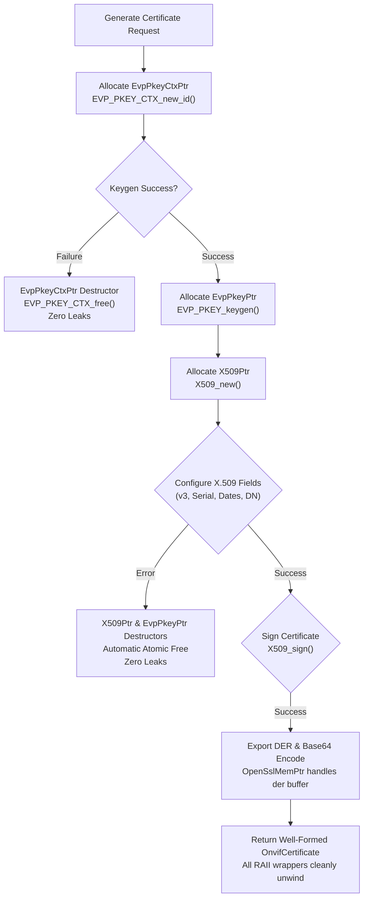

# Implementation Plan: P3 Phase 1 – OpenSSL RAII Wrappers & Cryptographic Safety

**Scope:** `libs/Onvif/` (`OpenSslRaII.h`, `OnvifSecurity.h`, `OnvifSecurity.cpp`, `OnvifCrypto.h`, `OnvifCrypto.cpp`, `CredentialVault.cpp`, `tests/TestOnvifCryptoRaII.cpp`, `CMakeLists.txt`)  
**Standard Baseline:** MISRA C++:2023 (Rule 7.0.6, 11.3.1), SEI CERT C++ (MEM51-CPP, INT32-C, ERR33-C, EXP12-C, MSC51-CPP), RFC 5280 (X.509 v3), Clean Architecture, Project Rules in [`.agents/rules/`](../.agents/rules/)  
**Reference Document:** [`docs/onvif_p3_architecture_hygiene_plan.md`](onvif_p3_architecture_hygiene_plan.md) (Phase 1), [`docs/onvif_review.md`](onvif_review.md) (§3.2 Finding H8, §5.1, §5.2)

---

## 1. Executive Summary & Problem Analysis

In [`docs/onvif_p3_architecture_hygiene_plan.md`](onvif_p3_architecture_hygiene_plan.md), **Phase 1** establishes foundational memory safety, resource encapsulation, and cryptographic correctness for all OpenSSL primitives used across the ONVIF subsystem.

Currently, cryptographic and PKI operations in [`OnvifSecurity.cpp`](../libs/Onvif/OnvifSecurity.cpp) exhibit multiple critical defects and coding-standard violations:
1. **Manual Resource Deallocation (SEI CERT MEM51-CPP):** In `OnvifSecurity::generateSelfSignedCertificate` and `OnvifSecurity::generatePkcs10Csr`, raw pointers (`EVP_PKEY_CTX*`, `EVP_PKEY*`, `X509*`, `X509_REQ*`, `BIO*`) are freed manually at distinct exit points. Any future branching, refactoring, or early error return risks leaking unmanaged heap memory.
2. **Duplicated Ad-Hoc Deleters:** [`OnvifCrypto.cpp`](../libs/Onvif/OnvifCrypto.cpp) defines `MdCtxDeleter` while [`CredentialVault.cpp`](../libs/Onvif/CredentialVault.cpp) defines `CipherCtxDeleter` in anonymous namespaces, fragmenting OpenSSL memory management rather than providing a unified RAII header.
3. **Signed Integer Overflow (SEI CERT INT32-C):** In `generateSelfSignedCertificate` and validity checks, `daysValid * 86400` multiplies signed 32-bit integers without widening. For `daysValid > 24855`, this arithmetic overflows `INT_MAX` (2,147,483,647), producing negative validity intervals and undefined behaviour.
4. **Unchecked Return Values (SEI CERT ERR33-C / EXP12-C):** Multiple OpenSSL mutator and serialization APIs are called without verifying their return codes:
   - `ASN1_INTEGER_set` (can fail on memory allocation)
   - `X509_gmtime_adj` (returns `nullptr` on error)
   - `X509_set_pubkey` (returns 0 on failure)
   - `X509_set_issuer_name` (returns 0 on failure)
   - `X509_NAME_add_entry_by_txt` (returns 0 on error)
   - `X509_sign` and `X509_REQ_sign` (returns 0 on failure)
   - `X509_REQ_set_version` and `X509_REQ_set_pubkey`
   - `PEM_write_bio_X509_REQ` (returns 0 on failure)
5. **Cosmetic & Non-Compliant X.509 Certificates (Finding H8):**
   - **X.509 Version:** Certificates do not invoke `X509_set_version(x509, 2)`, defaulting to legacy X.509 v1 instead of standard v3 required by TLS and RFC 5280.
   - **Static Serial Numbers:** Serial numbers are hardcoded to `1`, violating RFC 5280 §4.1.2.2 which mandates positive, unique serial numbers within a CA domain.
   - **Fake Metadata Extraction:** `OnvifSecurity::parseCertificateInfo` ignores the actual validity times in the X.509 certificate and hardcodes fabricated dates (`generateIsoTimestamp(0)` and `365 * 86400`), concealing expired or custom certificates from integrators.
6. **Banned C-Style Arrays (MISRA C++:2023 Rule 11.3.1):** `parseCertificateInfo` uses stack-allocated C-style arrays (`char subjBuf[256]` and `char issuerBuf[256]`) instead of `std::array`.

```
+-----------------------------------------------------------------------------------------------------------------------+
|                                    PHASE 1 CRYPTOGRAPHIC REMEDIATION MATRIX                                           |
+----------------------+------------------------------------+-------------------------------------------+---------------+
| Component            | Defect / Violation                 | Standard Requirement                      | Target Fix    |
+----------------------+------------------------------------+-------------------------------------------+---------------+
| Memory Management    | Raw OpenSSL pointers; manual       | SEI CERT MEM51-CPP; MISRA Rule 1.1        | OpenSslRaII.h |
|                      | cleanup; fragmented deleters       | Zero raw free calls; std::unique_ptr RAII | smart aliases |
+----------------------+------------------------------------+-------------------------------------------+---------------+
| Validity Arithmetic  | daysValid * 86400 signed overflow  | SEI CERT INT32-C                          | 64-bit int    |
|                      | when daysValid > 24855             | Safe std::int64_t multiplication          | arithmetic    |
+----------------------+------------------------------------+-------------------------------------------+---------------+
| API Verification     | Ignored return codes on X509,      | SEI CERT ERR33-C / EXP12-C                | Explicit ret  |
|                      | EVP, BIO, and ASN1 calls           | Every return validated; atomic rollback   | value checks  |
+----------------------+------------------------------------+-------------------------------------------+---------------+
| X.509 Structure      | v1 certs; hardcoded serial = 1;    | RFC 5280 §4.1.2.1, §4.1.2.2; ONVIF Core   | X.509 v3,     |
|                      | discarded keys; fabricated dates   | Cryptographically random serials; parse   | CSPRNG serial,|
|                      | in parseCertificateInfo            | actual ASN1_TIME from certificate         | true ASN1 time|
+----------------------+------------------------------------+-------------------------------------------+---------------+
| Coding Hygiene       | C-style arrays char buf[256]       | MISRA C++:2023 Rule 11.3.1                | std::array    |
+----------------------+------------------------------------+-------------------------------------------+---------------+
```

---

## 2. Architecture & Design Specifications

### 2.1 Unified OpenSSL RAII Architecture (`OpenSslRaII.h`)

All OpenSSL pointer management is centralized into a dedicated internal header [`libs/Onvif/OpenSslRaII.h`](../libs/Onvif/OpenSslRaII.h). Each wrapper uses a stateless functor deleter with a `noexcept` `nullptr` guard, ensuring zero runtime overhead and clean semantics under `std::unique_ptr`.

```
+-------------------------------------------------------------------------------+
|                       OPENSSL RAII WRAPPER ARCHITECTURE                       |
+-------------------------------------------------------------------------------+
|                                                                               |
|   OpenSSL Opaque Type              Deleter Functor            Smart Pointer   |
|   --------------------             ---------------            -------------   |
|   EVP_PKEY_CTX*            ───►    EvpPkeyCtxDeleter   ───►   EvpPkeyCtxPtr   |
|   EVP_PKEY*                ───►    EvpPkeyDeleter      ───►   EvpPkeyPtr      |
|   EVP_CIPHER_CTX*          ───►    EvpCipherCtxDeleter ───►   EvpCipherCtxPtr |
|   EVP_MD_CTX*              ───►    EvpMdCtxDeleter     ───►   EvpMdCtxPtr     |
|   X509*                    ───►    X509Deleter         ───►   X509Ptr         |
|   X509_REQ*                ───►    X509ReqDeleter      ───►   X509ReqPtr      |
|   BIO*                     ───►    BioDeleter          ───►   BioPtr          |
|   BN_CTX*                  ───►    BnCtxDeleter        ───►   BnCtxPtr        |
|   BIGNUM*                  ───►    BignumDeleter       ───►   BignumPtr       |
|   ASN1_INTEGER*            ───►    Asn1IntegerDeleter  ───►   Asn1IntegerPtr  |
|   unsigned char* (OPENSSL) ───►    OpenSslMemDeleter   ───►   OpenSslMemPtr   |
|                                                                               |
+-------------------------------------------------------------------------------+
```

#### Mermaid Diagram: RAII Lifetime and Error-Path Cleanup



---

### 2.2 Header Specification: `OpenSslRaII.h`

```cpp
/// @file OpenSslRaII.h
/// @brief Modern C++ RAII wrappers and smart pointer aliases for OpenSSL opaque types.
#pragma once

#include <cstddef>
#include <cstdint>

#include <memory>

#include <openssl/asn1.h>
#include <openssl/bio.h>
#include <openssl/bn.h>
#include <openssl/crypto.h>
#include <openssl/evp.h>
#include <openssl/x509.h>
#include <openssl/x509v3.h>

namespace Onvif::Crypto {

/// @brief Deleter functor releasing an EVP_PKEY_CTX handle.
struct EvpPkeyCtxDeleter {
    void operator()(EVP_PKEY_CTX* p) const noexcept {
        if (p != nullptr) {
            EVP_PKEY_CTX_free(p);
        }
    }
};

/// @brief Deleter functor releasing an EVP_PKEY handle.
struct EvpPkeyDeleter {
    void operator()(EVP_PKEY* p) const noexcept {
        if (p != nullptr) {
            EVP_PKEY_free(p);
        }
    }
};

/// @brief Deleter functor releasing an EVP_CIPHER_CTX handle.
struct EvpCipherCtxDeleter {
    void operator()(EVP_CIPHER_CTX* p) const noexcept {
        if (p != nullptr) {
            EVP_CIPHER_CTX_free(p);
        }
    }
};

/// @brief Deleter functor releasing an EVP_MD_CTX handle.
struct EvpMdCtxDeleter {
    void operator()(EVP_MD_CTX* p) const noexcept {
        if (p != nullptr) {
            EVP_MD_CTX_free(p);
        }
    }
};

/// @brief Deleter functor releasing an X509 certificate handle.
struct X509Deleter {
    void operator()(X509* p) const noexcept {
        if (p != nullptr) {
            X509_free(p);
        }
    }
};

/// @brief Deleter functor releasing an X509_REQ certificate request handle.
struct X509ReqDeleter {
    void operator()(X509_REQ* p) const noexcept {
        if (p != nullptr) {
            X509_REQ_free(p);
        }
    }
};

/// @brief Deleter functor releasing a BIO stream handle and its chain.
struct BioDeleter {
    void operator()(BIO* p) const noexcept {
        if (p != nullptr) {
            BIO_free_all(p);
        }
    }
};

/// @brief Deleter functor releasing a BN_CTX bignum context.
struct BnCtxDeleter {
    void operator()(BN_CTX* p) const noexcept {
        if (p != nullptr) {
            BN_CTX_free(p);
        }
    }
};

/// @brief Deleter functor releasing a BIGNUM instance.
struct BignumDeleter {
    void operator()(BIGNUM* p) const noexcept {
        if (p != nullptr) {
            BN_free(p);
        }
    }
};

/// @brief Deleter functor releasing an ASN1_INTEGER instance.
struct Asn1IntegerDeleter {
    void operator()(ASN1_INTEGER* p) const noexcept {
        if (p != nullptr) {
            ASN1_INTEGER_free(p);
        }
    }
};

/// @brief Deleter functor releasing OpenSSL allocated memory buffers (OPENSSL_malloc/i2d).
struct OpenSslMemDeleter {
    void operator()(void* p) const noexcept {
        if (p != nullptr) {
            OPENSSL_free(p);
        }
    }
};

using EvpPkeyCtxPtr   = std::unique_ptr<EVP_PKEY_CTX, EvpPkeyCtxDeleter>;
using EvpPkeyPtr      = std::unique_ptr<EVP_PKEY, EvpPkeyDeleter>;
using EvpCipherCtxPtr = std::unique_ptr<EVP_CIPHER_CTX, EvpCipherCtxDeleter>;
using EvpMdCtxPtr     = std::unique_ptr<EVP_MD_CTX, EvpMdCtxDeleter>;
using X509Ptr         = std::unique_ptr<X509, X509Deleter>;
using X509ReqPtr      = std::unique_ptr<X509_REQ, X509ReqDeleter>;
using BioPtr          = std::unique_ptr<BIO, BioDeleter>;
using BnCtxPtr        = std::unique_ptr<BN_CTX, BnCtxDeleter>;
using BignumPtr       = std::unique_ptr<BIGNUM, BignumDeleter>;
using Asn1IntegerPtr  = std::unique_ptr<ASN1_INTEGER, Asn1IntegerDeleter>;
using OpenSslMemPtr   = std::unique_ptr<unsigned char, OpenSslMemDeleter>;

} // namespace Onvif::Crypto
```

---

### 2.3 X.509 Cryptographic Safety Enhancements

#### 1. Safe 64-Bit Epoch Arithmetic (CERT INT32-C)
To guarantee absence of signed integer overflow:
```cpp
constexpr std::int64_t kSecondsPerDay = 86400LL;
constexpr std::int64_t kMaxSafeDays   = 36500LL; // 100 years max

[[nodiscard]] inline std::int64_t safeValiditySeconds(int daysValid) noexcept {
    const auto days = std::clamp(static_cast<std::int64_t>(daysValid), 1LL, kMaxSafeDays);
    return days * kSecondsPerDay;
}
```

#### 2. Cryptographically Random Serials (RFC 5280 & CERT MSC51-CPP)
Instead of static serial `1`, generate a positive 64-bit cryptographically random serial:
```cpp
[[nodiscard]] bool setRandomSerialNumber(X509* cert) noexcept {
    if (cert == nullptr) {
        return false;
    }
    const BignumPtr bn{BN_new()};
    if (bn == nullptr) {
        return false;
    }
    // Generate 64-bit non-negative random number
    if (BN_rand(bn.get(), 64, BN_RAND_TOP_ANY, BN_RAND_BOTTOM_ANY) != 1) {
        return false;
    }
    ASN1_INTEGER* serial = X509_get_serialNumber(cert);
    if (serial == nullptr) {
        return false;
    }
    return (BN_to_ASN1_INTEGER(bn.get(), serial) != nullptr);
}
```

#### 3. Standard X.509 v3 Configuration
```cpp
// Explicitly set X.509 version 3 (version integer 2)
if (X509_set_version(x509.get(), 2L) != 1) {
    return cert;
}
```

#### 4. Real ASN1_TIME Parsing in `parseCertificateInfo`
Replace hardcoded validity strings with actual ASN1 date parsing from the X.509 structure:
```cpp
[[nodiscard]] std::string asn1TimeToIsoUtc(const ASN1_TIME* tm) {
    if (tm == nullptr) {
        return {};
    }
    const BioPtr bio{BIO_new(BIO_s_mem())};
    if (bio == nullptr) {
        return {};
    }
    if (ASN1_TIME_print(bio.get(), tm) != 1) {
        return {};
    }
    BUF_MEM* bptr = nullptr;
    BIO_get_mem_ptr(bio.get(), &bptr);
    if (bptr == nullptr || bptr->data == nullptr || bptr->length == 0U) {
        return {};
    }
    // Convert formatted string or parse ASN1_TIME to ISO-8601 (YYYY-MM-DDTHH:MM:SSZ)
    return formatAsn1TimeToIso(std::string_view(bptr->data, bptr->length));
}
```

---

## 3. Work Breakdown Structure (Phased Tasks)

### Task 1: Create `OpenSslRaII.h` & Update CMake Build
- **File:** `libs/Onvif/OpenSslRaII.h`
- **Actions:**
  1. Define all 11 OpenSSL deleter structs with `noexcept` `nullptr` checks.
  2. Define canonical `using` alias pointers (`EvpPkeyPtr`, `X509Ptr`, `BioPtr`, etc.).
  3. Include `<cstdint>`, `<cstddef>`, `<memory>`, and exact OpenSSL interface headers.
  4. Register `OpenSslRaII.h` in [`libs/Onvif/CMakeLists.txt`](../libs/Onvif/CMakeLists.txt).

### Task 2: Refactor `OnvifCrypto.h` and `OnvifCrypto.cpp`
- **Files:** `libs/Onvif/OnvifCrypto.h`, `libs/Onvif/OnvifCrypto.cpp`
- **Actions:**
  1. Replace internal local `MdCtxDeleter` with `Onvif::Crypto::EvpMdCtxPtr` from `OpenSslRaII.h`.
  2. Standardize CSPRNG buffer filling in `randomBytes()` using checked `RAND_bytes`.
  3. Ensure strict IWYU and `<cstdint>` inclusion.

### Task 3: Refactor `CredentialVault.cpp`
- **File:** `libs/Onvif/CredentialVault.cpp`
- **Actions:**
  1. Remove local `CipherCtxDeleter` and `CipherCtxPtr`.
  2. Include `OpenSslRaII.h` and use `Onvif::Crypto::EvpCipherCtxPtr`.
  3. Verify all return values for `EVP_EncryptInit_ex`, `EVP_EncryptUpdate`, `EVP_EncryptFinal_ex`, `EVP_CIPHER_CTX_ctrl`.

### Task 4: Complete Refactor of PKI Functions in `OnvifSecurity.cpp`
- **File:** `libs/Onvif/OnvifSecurity.cpp`
- **Actions:**
  1. Include `OpenSslRaII.h`.
  2. Refactor `generateSelfSignedCertificate`:
     - Wrap `pctx`, `pkey`, `x509` in RAII smart pointers.
     - Enforce X.509 v3 (`X509_set_version(x509.get(), 2L)`).
     - Generate cryptographically random serial numbers with `BN_rand` / `BN_to_ASN1_INTEGER`.
     - Use `safeValiditySeconds()` to eliminate INT32-C overflow.
     - Validate every OpenSSL return code (`X509_set_pubkey`, `X509_set_issuer_name`, `X509_sign`, etc.).
     - Wrap DER buffer output with `OpenSslMemPtr`.
  3. Refactor `generatePkcs10Csr`:
     - Wrap `pctx`, `pkey`, `x509Req`, `bio` in RAII smart pointers.
     - Validate every return code (`X509_REQ_set_version`, `X509_REQ_set_pubkey`, `X509_REQ_sign`, `PEM_write_bio_X509_REQ`).
  4. Refactor `parseCertificateInfo`:
     - Wrap `d2i_X509` output in `X509Ptr`.
     - Extract true validity dates from `X509_get0_notBefore` and `X509_get0_notAfter`.
     - Replace C-style arrays `char subjBuf[256]` with `std::array<char, 256>` or BIO string extraction (MISRA 11.3.1).

### Task 5: Implement Dedicated Unit Test Suite `TestOnvifCryptoRaII`
- **File:** `libs/Onvif/tests/TestOnvifCryptoRaII.cpp`
- **Actions:**
  1. Test RAII pointer auto-cleanup on normal scope exit and simulated error conditions.
  2. Test `generateSelfSignedCertificate` validity:
     - Verify X.509 version is v3.
     - Verify serial number is non-zero and varies across invocations.
     - Test large `daysValid` (e.g. 50,000 days) to prove absence of INT32-C overflow.
  3. Test `parseCertificateInfo`:
     - Parse self-signed certificate and assert that extracted `validNotBefore` and `validNotAfter` match actual certificate dates.
     - Verify subject and issuer strings match input DN.
  4. Test `generatePkcs10Csr`:
     - Verify generated PEM contains valid `BEGIN CERTIFICATE REQUEST` / `END CERTIFICATE REQUEST`.
  5. Register `TestOnvifCryptoRaII` in [`libs/Onvif/tests/CMakeLists.txt`](../libs/Onvif/tests/CMakeLists.txt).

---

## 4. Verification Checklist

Before completing Phase 1, verify the following:
- [ ] `OpenSslRaII.h` includes all standard OpenSSL types with `noexcept` `nullptr` guard.
- [ ] Zero manual `EVP_PKEY_free`, `X509_free`, `X509_REQ_free`, `BIO_free_all`, `EVP_CIPHER_CTX_free`, `EVP_MD_CTX_free` calls in `OnvifSecurity.cpp`, `OnvifCrypto.cpp`, or `CredentialVault.cpp`.
- [ ] No raw `new` or `delete` in any modified file.
- [ ] Headers use `#pragma once` as the first non-comment line.
- [ ] All integer types strictly use `std::` prefix and `<cstdint>`.
- [ ] `safeValiditySeconds` prevents signed integer overflow for all inputs (INT32-C).
- [ ] All OpenSSL API return codes checked (ERR33-C / EXP12-C).
- [ ] X.509 version is set to v3 (`version = 2`).
- [ ] Certificate serial numbers are cryptographically random (RFC 5280).
- [ ] `parseCertificateInfo` extracts real ASN1 dates instead of hardcoded strings.
- [ ] No C-style arrays remain in modified functions (`std::array` used throughout, MISRA 11.3.1).
- [ ] All modified public methods have full Doxygen comments.
- [ ] All tests in `TestOnvifCryptoRaII` and existing 25 test suites pass cleanly.
