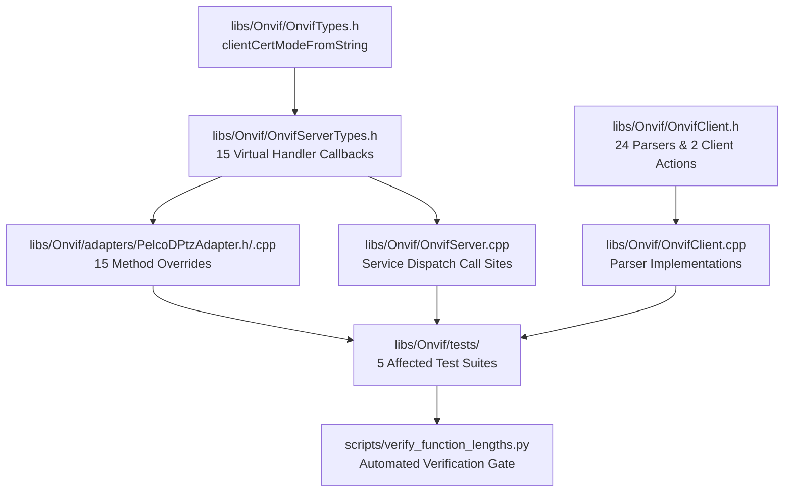

# Implementation Plan: P3 Phase 2 – Identifier Renaming (< 30 Chars) & API Hygiene

**Scope:** `libs/Onvif/` (`OnvifClient.h`, `OnvifClient.cpp`, `OnvifServerTypes.h`, `OnvifServer.cpp`, `OnvifTypes.h`, `adapters/PelcoDPtzAdapter.h`, `adapters/PelcoDPtzAdapter.cpp`, test suites, `scripts/verify_function_lengths.py`)  
**Standard Baseline:** MISRA C++:2023, SEI CERT C++, Clean Architecture, Project Rules in [`.agents/rules/`](../.agents/rules/)  
**Reference Document:** [`docs/onvif_p3_architecture_hygiene_plan.md`](onvif_p3_architecture_hygiene_plan.md) (Phase 2), [`docs/onvif_review.md`](onvif_review.md) (§5.3 Item 5)

---

## 1. Executive Summary & Problem Analysis

In [`docs/onvif_p3_architecture_hygiene_plan.md`](onvif_p3_architecture_hygiene_plan.md), **Phase 2** establishes strict compliance with **Project Rule 5** ("Are all function names concise (strictly less than 30 characters)?") and enforces end-to-end API hygiene across the ONVIF client, server, adapter interfaces, and test fixtures.

In [`docs/onvif_review.md`](onvif_review.md) §5.3 (Finding 5), an audit of `libs/Onvif` identified **44 unique function and method names** (spanning 54 declarations across interface hierarchies) that equal or exceed 30 characters. The longest identifier (`parseMetadataConfigurationOptionsResponse`) reaches 41 characters.

### Key Issues Identified:
1. **Identifier Length Violations (Project Rule 5):** 44 member and free functions across `OnvifClient`, `OnvifServer`, `OnvifServerTypes`, and `PelcoDPtzAdapter` range between 30 and 41 characters.
2. **Partial / Fragmented Aliases:** In earlier phases, short aliases (e.g., `getVideoEncoderOptions`, `parseVideoEncConfigResponse`) were added alongside existing 30+ character names, leaving the violating symbols active in the public and protected ABI.
3. **Inconsistent Doxygen Documentation (Project Rule 9):** Several long-named methods lack comprehensive Doxygen tags (`@details`, `@param[in]`, `@return`), or only document partial parameters.
4. **Missing `[[nodiscard]]` Annotations (Project Rule 8):** Several query and parser functions omit `[[nodiscard]]`, allowing callers to silently discard parsed responses or status results.
5. **Lack of Automated CI Gatekeeper:** No automated script currently checks identifier lengths on pull requests or pre-commit checks, allowing identifier length regressions to slip through.

```
+-----------------------------------------------------------------------------------------------------------------------+
|                                  PHASE 2 IDENTIFIER RENAMING & HYGIENE MATRIX                                         |
+----------------------+------------------------------------+-------------------------------------------+---------------+
| Domain               | Current Defect                     | Standard Requirement                      | Target Action |
+----------------------+------------------------------------+-------------------------------------------+---------------+
| Client Parsers       | 24 static response parser methods  | Rule 5: Length < 30 chars;                | Abbreviate:   |
|                      | with names 30 to 41 characters     | Rule 8: [[nodiscard]]; Rule 9: Doxygen    | Resp, Config, |
|                      | (e.g. parseMetadataConfig...)      |                                           | Sub, Info     |
+----------------------+------------------------------------+-------------------------------------------+---------------+
| Client Actions       | 2 public client service methods    | Rule 5: Length < 30 chars;                | Unify with    |
|                      | >= 30 chars (getVideoEncoder...)   | Rule 8: [[nodiscard]]; Rule 9: Doxygen    | concise API   |
+----------------------+------------------------------------+-------------------------------------------+---------------+
| Server Handlers      | 15 virtual handler callbacks in    | Rule 5: Length < 30 chars;                | Concise       |
|                      | IMetadataHandler, ISecurityHandler,| Rule 8: [[nodiscard]] on pure queries;    | handle*       |
|                      | IRecordingHandler, IThermalHandler | Rule 7: {} default argument syntax        | signatures    |
+----------------------+------------------------------------+-------------------------------------------+---------------+
| Adapter & Server     | Overrides & dispatch call-sites in | Rule 5: Length < 30 chars;                | Synchronize   |
| Implementation       | PelcoDPtzAdapter and OnvifServer   | Direct invocation without extra hops      | overrides     |
+----------------------+------------------------------------+-------------------------------------------+---------------+
| Utility & Helpers    | clientCertificateModeFromString    | Rule 5: Length < 30 chars;                | Rename to     |
|                      | (31 chars)                         | Rule 8: [[nodiscard]] noexcept            | clientCertMode|
+----------------------+------------------------------------+-------------------------------------------+---------------+
| CI Automation        | No automated enforcement of Rule 5 | Verification Checklist automated audit    | Python & PS1  |
|                      |                                    |                                           | audit scripts |
+----------------------+------------------------------------+-------------------------------------------+---------------+
```

---

## 2. Target Architecture & Renaming Taxonomy

To maintain readability and consistency across all ONVIF services, abbreviations follow a uniform taxonomy:

| Full Term | Abbreviation | Example Before (Len) | Example After (Len) |
|---|---|---|---|
| `Configuration` | `Config` | `MetadataConfiguration` | `MetadataConfig` |
| `Configurations` | `Configs` | `MetadataConfigurations` | `MetadataConfigs` |
| `Options` | `Options` / `Opts` | `ConfigurationOptions` | `ConfigOptions` |
| `Response` | `Resp` | `InformationResponse` | `InformationResp` |
| `Information` | `Info` | `SupportInformation` | `SupportInfo` |
| `Subscription` | `Sub` | `PullPointSubscription` | `PullPointSub` |
| `Recording` | `Record` / `Recording` | `CreateRecordingJob` | `CreateRecordJob` |
| `Certificate` | `Cert` | `CertificateInformation` | `CertInformation` |
| `DefaultGateway`| `DefaultGateway` | `NetworkDefaultGateway` | `DefaultGateway` |

```
+-----------------------------------------------------------------------------------------------+
|                             PHASE 2 SYSTEM REFACTORING WORKFLOW                               |
+-----------------------------------------------------------------------------------------------+
|                                                                                               |
|   [ OnvifTypes.h ]                                                                            |
|        │                                                                                      |
|        ▼                                                                                      |
|   [ OnvifServerTypes.h ] ──(Interface Contracts)──► [ PelcoDPtzAdapter.h / .cpp ]             |
|        │                                                   ▲                                  |
|        ▼                                                   │                                  |
|   [ OnvifServer.cpp ] ─────────────────────────────────────┘                                  |
|        │                                                                                      |
|        ▼                                                                                      |
|   [ OnvifClient.h / .cpp ]                                                                    |
|        │                                                                                      |
|        ▼                                                                                      |
|   [ Test Suites ] ──► (TestPelcoDOnvif, TestOnvifClientProfileS, TestOnvifServer, etc.)       |
|        │                                                                                      |
|        ▼                                                                                      |
|   [ scripts/verify_function_lengths.py ] ──► (Zero Violations < 30 Chars Gatekeeper)          |
|                                                                                               |
+-----------------------------------------------------------------------------------------------+
```

### Mermaid Diagram: System Refactoring Pipeline



---

## 3. Comprehensive Renaming & API Hygiene Catalog

The following table provides the exhaustive mapping for all 44 identifiers. Every replacement name strictly satisfies **length $\le 29$ characters** (Project Rule 5), applies `[[nodiscard]]` (Project Rule 8), and mandates full Doxygen documentation (Project Rule 9).

### 3.1 Client Response Parsers (24 Functions)

| # | Original Name | Len | Proposed Name | Len | Target Files |
|---|---|---|---|---|---|
| 1 | `parseMetadataConfigurationOptionsResponse` | 41 | `parseMetaConfigOptionsResp` | 26 | `OnvifClient.h`, `OnvifClient.cpp`, `TestPelcoDOnvif.cpp` |
| 2 | `parseCreatePullPointSubscriptionResponse` | 40 | `parseCreatePullPointSubResp` | 27 | `OnvifClient.h`, `OnvifClient.cpp`, `TestPelcoDOnvif.cpp` |
| 3 | `parseSupportedAnalyticsModulesResponse` | 38 | `parseAnalyticsModulesResp` | 25 | `OnvifClient.h`, `OnvifClient.cpp`, `TestPelcoDOnvif.cpp` |
| 4 | `parseSystemSupportInformationResponse` | 37 | `parseSystemSupportInfoResp` | 26 | `OnvifClient.h`, `OnvifClient.cpp`, `TestPelcoDOnvif.cpp` |
| 5 | `parseRadiometryConfigurationResponse` | 36 | `parseRadiometryConfigResp` | 25 | `OnvifClient.h`, `OnvifClient.cpp`, `TestPelcoDOnvif.cpp` |
| 6 | `parseCertificateInformationResponse` | 35 | `parseCertInformationResp` | 24 | `OnvifClient.h`, `OnvifClient.cpp`, `TestPelcoDOnvif.cpp` |
| 7 | `parseMetadataConfigurationsResponse` | 35 | `parseMetaConfigsResp` | 20 | `OnvifClient.h`, `OnvifClient.cpp`, `TestPelcoDOnvif.cpp` |
| 8 | `parseRecordingConfigurationResponse` | 35 | `parseRecordingConfigResp` | 24 | `OnvifClient.h`, `OnvifClient.cpp` |
| 9 | `parseRecordingSearchResultsResponse` | 35 | `parseRecordingSearchResp` | 24 | `OnvifClient.h`, `OnvifClient.cpp`, `TestPelcoDOnvif.cpp` |
| 10 | `parseClientCertificateModeResponse` | 34 | `parseClientCertModeResp` | 23 | `OnvifClient.h`, `OnvifClient.cpp`, `TestPelcoDOnvif.cpp` |
| 11 | `parseMetadataConfigurationResponse` | 34 | `parseMetaConfigResp` | 19 | `OnvifClient.h`, `OnvifClient.cpp` |
| 12 | `parseNetworkDefaultGatewayResponse` | 34 | `parseDefaultGatewayResp` | 23 | `OnvifClient.h`, `OnvifClient.cpp`, `TestPelcoDOnvif.cpp` |
| 13 | `parseSendAuxiliaryCommandResponse` | 33 | `parseSendAuxCommandResp` | 23 | `OnvifClient.h`, `OnvifClient.cpp`, `TestPelcoDOnvif.cpp` |
| 14 | `parseSingleVideoEncoderConfigNode` | 33 | `parseVideoEncoderConfigNode` | 27 | `OnvifClient.cpp` |
| 15 | `parseVideoEncoderConfigsResponse` | 32 | `parseVideoEncoderConfigsResp` | 28 | `OnvifClient.h`, `OnvifClient.cpp`, `TestOnvifClientProfileS.cpp` |
| 16 | `parseReplayConfigurationResponse` | 32 | `parseReplayConfigResp` | 21 | `OnvifClient.h`, `OnvifClient.cpp`, `TestPelcoDOnvif.cpp` |
| 17 | `parseVideoEncoderOptionsResponse` | 32 | `parseVideoEncoderOptionsResp` | 28 | `OnvifClient.h`, `OnvifClient.cpp`, `TestOnvifClientProfileS.cpp` |
| 18 | `parseCreateRecordingJobResponse` | 31 | `parseCreateRecordJobResp` | 24 | `OnvifClient.h`, `OnvifClient.cpp` |
| 19 | `parseEventSearchResultsResponse` | 31 | `parseEventSearchResultsResp` | 28 | `OnvifClient.h`, `OnvifClient.cpp`, `TestPelcoDOnvif.cpp` |
| 20 | `parseSetVideoSourceModeResponse` | 31 | `parseSetVideoSourceModeResp` | 27 | `OnvifClient.h`, `OnvifClient.cpp`, `TestPelcoDOnvif.cpp` |
| 21 | `parseVideoEncoderConfigResponse` | 31 | `parseVideoEncoderConfigResp` | 27 | `OnvifClient.h`, `OnvifClient.cpp`, `TestOnvifClientProfileS.cpp` |
| 22 | `parseEndpointReferenceResponse` | 30 | `parseEndpointReferenceResp` | 26 | `OnvifClient.h`, `OnvifClient.cpp`, `TestPelcoDOnvif.cpp` |
| 23 | `parseCreateCertificateResponse` | 30 | `parseCreateCertificateResp` | 26 | `OnvifClient.h`, `OnvifClient.cpp` |
| 24 | `parseDeviceInformationResponse` | 30 | `parseDeviceInformationResp` | 26 | `OnvifClient.h`, `OnvifClient.cpp`, `TestPelcoDOnvif.cpp` |
| 25 | `parseNetworkInterfacesResponse` | 30 | `parseNetworkInterfacesResp` | 26 | `OnvifClient.h`, `OnvifClient.cpp`, `TestPelcoDOnvif.cpp` |

### 3.2 Client Service Operations (2 Functions)

| # | Original Name | Len | Proposed Name | Len | Target Files |
|---|---|---|---|---|---|
| 26 | `getVideoEncoderConfigurationOptions` | 35 | `getVideoEncoderConfigOptions` | 29 | `OnvifClient.h`, `OnvifClient.cpp`, `TestOnvifClientProfileS.cpp` |
| 27 | `getMetadataConfigurationOptions` | 31 | `getMetaConfigOptions` | 20 | `OnvifClient.h`, `OnvifClient.cpp` |

### 3.3 Server & Adapter Handler Callbacks (16 Functions)

| # | Original Name | Len | Proposed Name | Len | Target Files |
|---|---|---|---|---|---|
| 28 | `handleGetMetadataConfigurationOptions` | 37 | `handleGetMetaConfigOptions` | 26 | `OnvifServerTypes.h`, `OnvifServer.cpp`, `PelcoDPtzAdapter.h`, `PelcoDPtzAdapter.cpp` |
| 29 | `handleGetSupportedAnalyticsModules` | 34 | `handleGetAnalyticsModules` | 25 | `OnvifServerTypes.h`, `OnvifServer.cpp`, `PelcoDPtzAdapter.h`, `PelcoDPtzAdapter.cpp` |
| 30 | `handleGetSystemSupportInformation` | 33 | `handleGetSystemSupportInfo` | 26 | `OnvifServerTypes.h`, `OnvifServer.cpp`, `PelcoDPtzAdapter.h`, `PelcoDPtzAdapter.cpp`, `TestOnvifConcurrency.cpp` |
| 31 | `handleGetRadiometryConfiguration` | 32 | `handleGetRadiometryConfig` | 25 | `OnvifServerTypes.h`, `OnvifServer.cpp`, `PelcoDPtzAdapter.h`, `PelcoDPtzAdapter.cpp`, `TestOnvifServer.cpp` |
| 32 | `handleSetRadiometryConfiguration` | 32 | `handleSetRadiometryConfig` | 25 | `OnvifServerTypes.h`, `OnvifServer.cpp`, `PelcoDPtzAdapter.h`, `PelcoDPtzAdapter.cpp` |
| 33 | `handleGetRecordingSearchResults` | 31 | `handleGetRecordingSearch` | 24 | `OnvifServerTypes.h`, `OnvifServer.cpp`, `PelcoDPtzAdapter.h`, `PelcoDPtzAdapter.cpp` |
| 34 | `handleSetRecordingConfiguration` | 31 | `handleSetRecordingConfig` | 24 | `OnvifServerTypes.h`, `OnvifServer.cpp`, `PelcoDPtzAdapter.h`, `PelcoDPtzAdapter.cpp` |
| 35 | `handleGetRecordingConfiguration` | 31 | `handleGetRecordingConfig` | 24 | `OnvifServerTypes.h`, `OnvifServer.cpp`, `PelcoDPtzAdapter.h`, `PelcoDPtzAdapter.cpp` |
| 36 | `handleGetCertificateInformation` | 31 | `handleGetCertInformation` | 24 | `OnvifServerTypes.h`, `OnvifServer.cpp`, `PelcoDPtzAdapter.h`, `PelcoDPtzAdapter.cpp` |
| 37 | `handleGetMetadataConfigurations` | 31 | `handleGetMetadataConfigs` | 24 | `OnvifServerTypes.h`, `OnvifServer.cpp`, `PelcoDPtzAdapter.h`, `PelcoDPtzAdapter.cpp` |
| 38 | `handleGetClientCertificateMode` | 30 | `handleGetClientCertMode` | 23 | `OnvifServerTypes.h`, `OnvifServer.cpp`, `PelcoDPtzAdapter.h`, `PelcoDPtzAdapter.cpp` |
| 39 | `handleSetClientCertificateMode` | 30 | `handleSetClientCertMode` | 23 | `OnvifServerTypes.h`, `OnvifServer.cpp`, `PelcoDPtzAdapter.h`, `PelcoDPtzAdapter.cpp` |
| 40 | `handleSetMetadataConfiguration` | 30 | `handleSetMetadataConfig` | 23 | `OnvifServerTypes.h`, `OnvifServer.cpp`, `PelcoDPtzAdapter.h`, `PelcoDPtzAdapter.cpp` |
| 41 | `handleSetNetworkDefaultGateway` | 30 | `handleSetDefaultGateway` | 23 | `OnvifServerTypes.h`, `OnvifServer.cpp`, `PelcoDPtzAdapter.h`, `PelcoDPtzAdapter.cpp` |
| 42 | `handleGetNetworkDefaultGateway` | 30 | `handleGetDefaultGateway` | 23 | `OnvifServerTypes.h`, `OnvifServer.cpp`, `PelcoDPtzAdapter.h`, `PelcoDPtzAdapter.cpp` |
| 43 | `handleGetMetadataConfiguration` | 30 | `handleGetMetadataConfig` | 23 | `OnvifServerTypes.h`, `OnvifServer.cpp`, `PelcoDPtzAdapter.h`, `PelcoDPtzAdapter.cpp`, `TestOnvifServer.cpp` |

### 3.4 Utility & Conversion Functions (1 Function)

| # | Original Name | Len | Proposed Name | Len | Target Files |
|---|---|---|---|---|---|
| 44 | `clientCertificateModeFromString` | 31 | `clientCertModeFromString` | 24 | `OnvifTypes.h`, `OnvifServer.cpp` |

---

## 4. API Hygiene & Coding Standards Enforcement

Renaming alone does not complete hygiene remediation. Each modified function must satisfy the project's quality baseline:

### 4.1 Strict `[[nodiscard]]` Auditing (Project Rule 8)
- Every parser method (`parse*Resp`) extracts data from raw XML and returns `std::optional<T>`, `std::vector<T>`, or `std::string`. Discarding these return values indicates a logic flaw at the call site.
- Every getter operation on `OnvifClient` and pure query handler on adapter interfaces (`handleGet*`) must be decorated with `[[nodiscard]]`.
- Mutators that return `bool` indicating success or failure (`handleSet*`, `set*`) must be decorated with `[[nodiscard]]` unless intentionally designed for fire-and-forget.

### 4.2 Comprehensive Doxygen Documentation (Project Rule 9)
All renamed functions must include full Doxygen headers. Legacy placeholder comments or comments without `@param` and `@return` descriptions must be rewritten.

**Compliant Client Parser Example:**
```cpp
/// @brief Parses GetSystemSupportInformation XML response from device service.
/// @details Extracts binary support diagnostics or log archives encoded in base64.
/// @param[in] xml Raw SOAP XML response payload.
/// @return Extracted SystemSupportInformation or nullopt if parsing fails.
[[nodiscard]] static std::optional<SystemSupportInformation> parseSystemSupportInfoResp(
    const std::string& xml);
```

**Compliant Server Interface Example:**
```cpp
/// @brief Queries metadata configuration options supported by the device.
/// @param[in] configToken Target configuration token (e.g. "MetaConfig_1").
/// @param[in] profileToken Optional associated media profile token.
/// @return MetadataConfigurationOptions containing schema filters and PTZ status support.
[[nodiscard]] virtual MetadataConfigurationOptions handleGetMetaConfigOptions(
    const std::string& configToken, const std::string& profileToken = "")
{
    (void)configToken;
    (void)profileToken;
    return MetadataConfigurationOptions {};
}
```

### 4.3 Zero Qt Dependencies in Core (Project Rule 4)
Verify that no Qt types (`QString`, `QByteArray`, `QObject`) leak into `libs/Onvif`. Use standard C++17 types (`std::string`, `std::string_view`, `std::vector`, `std::optional`).

### 4.4 Fixed-Width Types & IWYU Compliance (Project Rules 15 & 16)
- Explicit inclusion of `<cstdint>` and `<cstddef>`.
- Strict qualification with `std::` (`std::uint8_t`, `std::uint32_t`, `std::size_t`).
- No reliance on transitive includes across headers.

---

## 5. Work Breakdown Structure (Phased Tasks)

```
+-----------------------------------------------------------------------------------------------+
|                               PHASE 2 WORK BREAKDOWN STRUCTURE                                |
+-----------------------------------------------------------------------------------------------+
|                                                                                               |
|   Task 1: Type & Enum Conversion Utility               (libs/Onvif/OnvifTypes.h)              |
|        │                                                                                      |
|        ▼                                                                                      |
|   Task 2: Server Handler Interfaces                     (libs/Onvif/OnvifServerTypes.h)        |
|        │                                                                                      |
|        ▼                                                                                      |
|   Task 3: PelcoDPtzAdapter Implementation              (libs/Onvif/adapters/PelcoDPtzAdapter) |
|        │                                                                                      |
|        ▼                                                                                      |
|   Task 4: OnvifServer Dispatch & Call Sites            (libs/Onvif/OnvifServer.cpp)           |
|        │                                                                                      |
|        ▼                                                                                      |
|   Task 5: OnvifClient API & Response Parsers           (libs/Onvif/OnvifClient.h/.cpp)        |
|        │                                                                                      |
|        ▼                                                                                      |
|   Task 6: Test Suites & Fixture Alignment             (libs/Onvif/tests/*.cpp)               |
|        │                                                                                      |
|        ▼                                                                                      |
|   Task 7: CI Verification Script & CTest Gate          (scripts/verify_function_lengths.py)   |
|                                                                                               |
+-----------------------------------------------------------------------------------------------+
```

### Task 1: Type & Conversion Renaming in `OnvifTypes.h`
- **File:** `libs/Onvif/OnvifTypes.h`
- **Actions:**
  1. Rename `clientCertificateModeFromString` (31 chars) to `clientCertModeFromString` (24 chars).
  2. Add `[[nodiscard]]` and `noexcept`.
  3. Ensure full Doxygen comments.
  4. Ensure `{}` initialization on all struct members in `OnvifTypes.h`.

### Task 2: Handler Interface Renaming in `OnvifServerTypes.h`
- **File:** `libs/Onvif/OnvifServerTypes.h`
- **Actions:**
  1. Update `IDeviceHandler`:
     - `handleGetSystemSupportInformation` $\rightarrow$ `handleGetSystemSupportInfo` (26 chars)
     - `handleGetNetworkDefaultGateway` $\rightarrow$ `handleGetDefaultGateway` (23 chars)
     - `handleSetNetworkDefaultGateway` $\rightarrow$ `handleSetDefaultGateway` (23 chars)
  2. Update `ISecurityHandler`:
     - `handleGetCertificateInformation` $\rightarrow$ `handleGetCertInformation` (24 chars)
     - `handleGetClientCertificateMode` $\rightarrow$ `handleGetClientCertMode` (23 chars)
     - `handleSetClientCertificateMode` $\rightarrow$ `handleSetClientCertMode` (23 chars)
  3. Update `IMetadataHandler`:
     - `handleGetMetadataConfiguration` $\rightarrow$ `handleGetMetadataConfig` (23 chars)
     - `handleSetMetadataConfiguration` $\rightarrow$ `handleSetMetadataConfig` (23 chars)
     - `handleGetMetadataConfigurations` $\rightarrow$ `handleGetMetadataConfigs` (24 chars)
     - `handleGetMetadataConfigurationOptions` $\rightarrow$ `handleGetMetaConfigOptions` (26 chars)
  4. Update `IRecordingHandler`:
     - `handleGetRecordingConfiguration` $\rightarrow$ `handleGetRecordingConfig` (24 chars)
     - `handleSetRecordingConfiguration` $\rightarrow$ `handleSetRecordingConfig` (24 chars)
  5. Update `ISearchHandler`:
     - `handleGetRecordingSearchResults` $\rightarrow$ `handleGetRecordingSearch` (24 chars)
  6. Update `IThermalHandler`:
     - `handleGetRadiometryConfiguration` $\rightarrow$ `handleGetRadiometryConfig` (25 chars)
     - `handleSetRadiometryConfiguration` $\rightarrow$ `handleSetRadiometryConfig` (25 chars)
  7. Update `IAnalyticsHandler`:
     - `handleGetSupportedAnalyticsModules` $\rightarrow$ `handleGetAnalyticsModules` (25 chars)
  8. Apply `[[nodiscard]]` across all query methods; format default empty bodies with `{}` syntax.

### Task 3: Adapter Method Overrides in `PelcoDPtzAdapter.h` and `PelcoDPtzAdapter.cpp`
- **Files:** `libs/Onvif/adapters/PelcoDPtzAdapter.h`, `libs/Onvif/adapters/PelcoDPtzAdapter.cpp`
- **Actions:**
  1. Update all overridden declarations in `PelcoDPtzAdapter.h` to match new method names from Task 2.
  2. Mark all overrides with `override` and `[[nodiscard]]`.
  3. Rename implementation function signatures in `PelcoDPtzAdapter.cpp`.
  4. Maintain identical internal logic and Pelco-D frame mapping.

### Task 4: Server Dispatch Update in `OnvifServer.cpp`
- **File:** `libs/Onvif/OnvifServer.cpp`
- **Actions:**
  1. Update caller sites invoking adapter handler methods:
     - `deviceHandler->handleGetSystemSupportInfo(...)`
     - `deviceHandler->handleGetDefaultGateway(...)`
     - `deviceHandler->handleSetDefaultGateway(...)`
     - `securityHandler->handleGetCertInformation(...)`
     - `securityHandler->handleGetClientCertMode(...)`
     - `securityHandler->handleSetClientCertMode(...)`
     - `metadataHandler->handleGetMetaConfigOptions(...)`
     - `metadataHandler->handleGetMetadataConfig(...)`
     - `metadataHandler->handleSetMetadataConfig(...)`
     - `metadataHandler->handleGetMetadataConfigs(...)`
     - `recordingHandler->handleGetRecordingConfig(...)`
     - `recordingHandler->handleSetRecordingConfig(...)`
     - `searchHandler->handleGetRecordingSearch(...)`
     - `thermalHandler->handleGetRadiometryConfig(...)`
     - `thermalHandler->handleSetRadiometryConfig(...)`
     - `analyticsHandler->handleGetAnalyticsModules(...)`
  2. Update call sites of `clientCertModeFromString`.
  3. Ensure zero compiler warnings under `/W4` and `-Wall -Wextra`.

### Task 5: Client API & Response Parsers in `OnvifClient.h` and `OnvifClient.cpp`
- **Files:** `libs/Onvif/OnvifClient.h`, `libs/Onvif/OnvifClient.cpp`
- **Actions:**
  1. Rename the 24 parser declarations and implementations:
     - E.g., `parseMetadataConfigurationOptionsResponse` $\rightarrow$ `parseMetaConfigOptionsResp`
     - `parseCreatePullPointSubscriptionResponse` $\rightarrow$ `parseCreatePullPointSubResp`
     - `parseVideoEncoderConfigResponse` $\rightarrow$ `parseVideoEncoderConfigResp`
     - `parseVideoEncoderOptionsResponse` $\rightarrow$ `parseVideoEncoderOptionsResp`
     - `parseVideoEncoderConfigsResponse` $\rightarrow$ `parseVideoEncoderConfigsResp`
  2. Remove legacy long-named duplicate aliases from `OnvifClient.h` (e.g., remove `getVideoEncoderConfigurationOptions`, replace with `getVideoEncoderConfigOptions`).
  3. Rename `getMetadataConfigurationOptions` $\rightarrow$ `getMetaConfigOptions` (20 chars).
  4. Apply `[[nodiscard]]` on all parser methods and getters.
  5. Add complete Doxygen comments for each method.

### Task 6: Test Suite Updates
- **Files:**
  - `libs/Onvif/tests/TestPelcoDOnvif.cpp`
  - `libs/Onvif/tests/TestOnvifClientProfileS.cpp`
  - `libs/Onvif/tests/TestOnvifServer.cpp`
  - `libs/Onvif/tests/TestOnvifConcurrency.cpp`
  - `libs/Onvif/tests/TestOnvifMediaProfileS.cpp`
- **Actions:**
  1. Update direct calls to renamed parser methods in `TestPelcoDOnvif.cpp` and `TestOnvifClientProfileS.cpp`.
  2. Update mock or inline handler calls in `TestOnvifServer.cpp` and `TestOnvifConcurrency.cpp`.
  3. Verify that all 52+ ONVIF tests compile and pass 100%.

### Task 7: Automated Verification Script & CI Integration
- **File:** `scripts/verify_function_lengths.py`
- **Actions:**
  1. Create Python verification script scanning `libs/` for any C++ function or method identifier $\ge 30$ characters.
  2. Filter out GoogleTest macros (`TEST`, `TEST_F`, `TEST_P`), standard library symbols, and external library macros (`OPENSSL_*`, `EVP_*`, `X509_*`).
  3. Return non-zero exit code if any project function violates Rule 5 (< 30 characters).
  4. Register the script as a CTest target or verification step in `tests/CMakeLists.txt`.

---

## 6. Automated Verification Script Specification

```python
#!/usr/bin/env python3
"""
verify_function_lengths.py - Audit C++ function and method identifier lengths.
Enforces Project Rule 5: All function names must be strictly < 30 characters.
"""

import os
import re
import sys
from typing import List, Tuple

# Patterns to ignore (external libraries, GTest macros, system macros)
IGNORED_PREFIXES = (
    "TEST", "EXPECT_", "ASSERT_", "OPENSSL_", "EVP_", "X509_", "ASN1_",
    "BIO_", "BN_", "CURL", "HTTP_", "PELCOD_", "PelcoD_"
)

FUNCTION_PATTERN = re.compile(
    r'^\s*(?:(?:virtual|static|inline|explicit|[[nodiscard]])\s+)*'
    r'(?:[\w:<>]+\s+)+([A-Za-z_][A-Za-z0-9_]{29,})\s*\('
)

def scan_file(filepath: str) -> List[Tuple[int, str, int]]:
    violations = []
    with open(filepath, "r", encoding="utf-8", errors="ignore") as f:
        for idx, line in enumerate(f, 1):
            clean = line.strip()
            if clean.startswith("//") or clean.startswith("*") or clean.startswith("/*"):
                continue
            match = FUNCTION_PATTERN.search(line)
            if match:
                name = match.group(1)
                if not any(name.startswith(p) for p in IGNORED_PREFIXES):
                    violations.append((idx, name, len(name)))
    return violations

def main() -> int:
    target_dir = sys.argv[1] if len(sys.argv) > 1 else "libs/Onvif"
    total_violations = 0
    
    for root, _, files in os.walk(target_dir):
        if "tests" in root and "--include-tests" not in sys.argv:
            # Optionally check or skip test bodies
            pass
        for file in files:
            if file.endswith((".h", ".cpp")):
                path = os.path.join(root, file)
                v = scan_file(path)
                for line, name, length in v:
                    print(f"VIOLATION: {path}:{line} '{name}' ({length} chars >= 30)")
                    total_violations += 1

    if total_violations > 0:
        print(f"\nFAILURE: {total_violations} function identifiers exceed 29 characters.")
        return 1
    print("\nSUCCESS: All function identifiers in target directory are strictly < 30 characters.")
    return 0

if __name__ == "__main__":
    sys.exit(main())
```

---

## 7. Verification Checklist

Before completing Phase 2, verify all items against this checklist:
- [ ] Exactly 44 function/method identifiers renamed to concise alternatives strictly $< 30$ characters.
- [ ] No remaining project function or method identifier in `libs/Onvif` has length $\ge 30$ characters.
- [ ] Every renamed parser and query function has explicit `[[nodiscard]]` decoration (Project Rule 8).
- [ ] All 44 renamed methods possess complete Doxygen documentation with `@brief`, `@param`, and `@return` tags (Project Rule 9).
- [ ] All structs and classes use `{}` uniform initialization syntax (Project Rule 7).
- [ ] Core interfaces maintain zero Qt dependencies (Project Rule 4).
- [ ] All files explicitly include `<cstdint>` and scope integer types with `std::` (Project Rule 15).
- [ ] Strict IWYU adherence with zero transitive header reliance (Project Rule 16).
- [ ] Automated verification script `scripts/verify_function_lengths.py` exits with 0 violations.
- [ ] All 5 affected test suites compile without warnings under `/W4` on MSVC and `-Wall -Wextra -pedantic` on GCC/Clang.
- [ ] 100% of unit and integration test suites pass cleanly.
