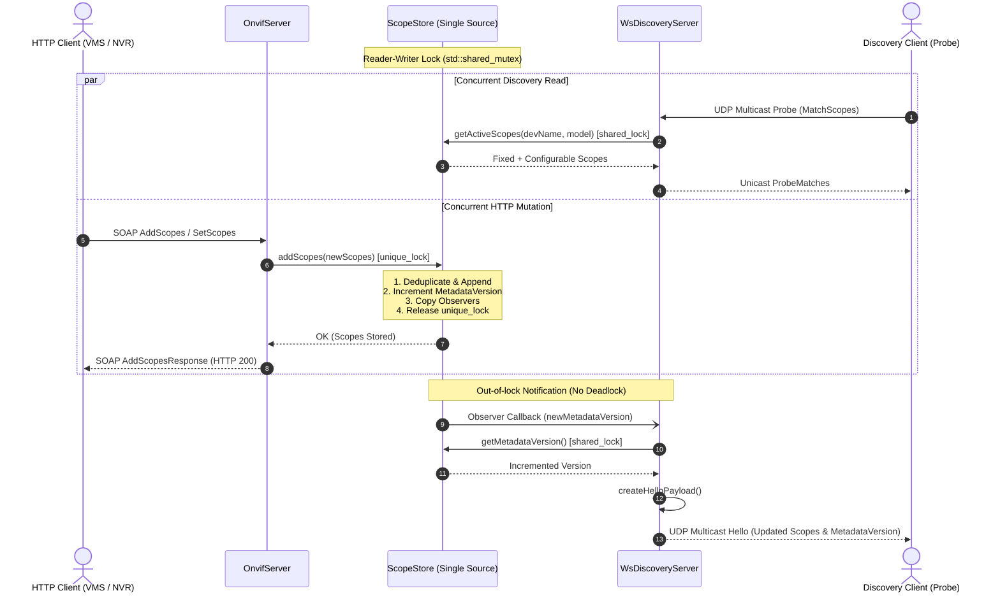

# Implementation Plan: P3 Phase 3 – ScopeStore & Thread-Safe State Synchronization

**Scope:** `libs/Onvif/` (`ScopeStore.h`, `ScopeStore.cpp`, `WsDiscoveryServer.h`, `WsDiscoveryServer.cpp`, `OnvifServer.h`, `OnvifServer.cpp`, `OnvifServerTypes.h`, `tests/TestOnvifScopeStore.cpp`, `tests/TestOnvifConcurrency.cpp`, `CMakeLists.txt`)  
**Standard Baseline:** MISRA C++:2023 (Rule 7.0.6, Rule 11.3.1), SEI CERT C++ (CON43-C, CON50-CPP, ERR55-CPP), ONVIF Core Specification v24.12 (§8.2 Scope Management), WS-Discovery 2005/04 (§5, §7), Clean Architecture, Project Rules in [`.agents/rules/`](../.agents/rules/)  
**Reference Document:** [`docs/onvif_p3_architecture_hygiene_plan.md`](onvif_p3_architecture_hygiene_plan.md) (Phase 3), [`docs/onvif_review.md`](onvif_review.md) (§3.2 Finding H1, §3.3 Finding M10, §4.1)

---

## 1. Executive Summary & Problem Analysis

In [`docs/onvif_p3_architecture_hygiene_plan.md`](onvif_p3_architecture_hygiene_plan.md), **Phase 3** resolves state synchronization defects, data races on configurable device scopes, and WS-Discovery announcement drift across the `libs/Onvif` subsystem.

Currently, scope management between [`OnvifServer`](../libs/Onvif/OnvifServer.cpp) and [`WsDiscoveryServer`](../libs/Onvif/WsDiscoveryServer.cpp) relies on decoupled, duplicated vectors and ad-hoc notification calls:
1. **Data Races on Configuration & Scope Drift (Finding H1):** 
   - `OnvifServer` stores `m_config.scopes` protected by `m_deviceMutex`.
   - `WsDiscoveryServer` holds an independent duplicate `m_config.scopes` protected by `m_scopeMutex`.
   - When scopes are mutated via HTTP SOAP operations (`AddScopes`, `RemoveScopes`, `SetScopes`), `OnvifServer` updates its local copy, then conditionally calls `m_discoveryServer->updateScopes(updatedScopes)`. However, concurrent calls to `getConfig()`, `GetScopes`, and discovery probe matching cause race conditions (CERT CON43-C).
2. **Stale Discovery Announcements & Stale Metadata (Finding M10 & §4.1):** 
   - WS-Discovery 2005/04 §7 mandates that when an endpoint's metadata or scopes change dynamically, it MUST increment `d:MetadataVersion` and broadcast a `d:Hello` announcement with the updated metadata version.
   - Because discovery state is detached, metadata version tracking is desynchronized between HTTP SOAP services and UDP multicast discovery.
3. **Lock Contention Under High-Frequency Discovery Probing:**
   - Standard mutual exclusion (`std::mutex`) serializes all readers. In dense networks, high-frequency WS-Discovery `Probe` matches and client `GetScopes` queries unnecessarily block one another.
4. **Duplicate Scopes & Unbounded Growth:**
   - In `OnvifServer::handleDeviceService`, `AddScopes` unconditionally appends received URIs via `push_back` without uniqueness validation. Under concurrent requests, identical scopes duplicate indefinitely, leading to memory bloat and corrupted discovery payloads.
5. **Lock-Order Deadlock Hazard (Finding M6):**
   - Directly invoking external notification callbacks or multicast network sends while holding internal mutex locks creates lock-order inversion hazards.

```
+-----------------------------------------------------------------------------------------------------------------------+
|                                    PHASE 3 SCOPE & STATE SYNCHRONIZATION MATRIX                                       |
+----------------------+------------------------------------+-------------------------------------------+---------------+
| Domain               | Current Defect                     | Standard Requirement                      | Target Action |
+----------------------+------------------------------------+-------------------------------------------+---------------+
| Concurrency & Data   | Decoupled scope vectors in         | CERT CON43-C, CON50-CPP;                  | Unified       |
| Races (Finding H1)   | OnvifServer and WsDiscoveryServer  | Single source of truth with               | ScopeStore    |
|                      | with separate mutexes              | std::shared_mutex reader-writer lock      | component     |
+----------------------+------------------------------------+-------------------------------------------+---------------+
| Read Performance     | std::mutex blocks concurrent       | High-frequency Probe matching requires    | Shared lock   |
|                      | Probe queries and GetScopes        | lock-free reads via std::shared_lock      | (Reader-Writer|
|                      |                                    | concurrent execution                      | pattern)      |
+----------------------+------------------------------------+-------------------------------------------+---------------+
| Discovery Sync       | MetadataVersion desynchronized;    | WS-Discovery §7; ONVIF Core §8.2.3;       | ScopeStore    |
| (Finding M10 / §4.1) | multicast Hello emission manual    | Atomic version increment + observer       | change signals|
|                      | and easily missed                  | pattern triggering broadcastHello()       | & observers   |
+----------------------+------------------------------------+-------------------------------------------+---------------+
| Set Semantics &      | AddScopes appends duplicates;      | ONVIF Core §8.2.3;                        | Deduplication |
| Unbounded Growth     | unbounded growth under loop load   | Configurable scopes maintain uniqueness   | on Add/Set    |
+----------------------+------------------------------------+-------------------------------------------+---------------+
| Lock Safety & Dead-  | Observers / network calls invoked  | CERT CON50-CPP; Zero callbacks while      | Invoke        |
| lock Prevention      | while holding mutex                | holding lock; copy callbacks & notify     | outside lock  |
+----------------------+------------------------------------+-------------------------------------------+---------------+
| Coding Standard      | Methods >= 30 chars;               | Project Rule 5 (< 30 chars); Rule 8;      | Clean Doxygen |
| Compliance           | missing Doxygen / [[nodiscard]]    | IWYU & std::uint32_t explicitly qualified | & nodiscard   |
+----------------------+------------------------------------+-------------------------------------------+---------------+
```

---

## 2. Target Architecture & Design Specifications

### 2.1 Canonical `ScopeStore` Architecture

A thread-safe canonical store [`ScopeStore`](../libs/Onvif/ScopeStore.h) manages all device scopes as the single source of truth for both `OnvifServer` (HTTP/SOAP) and `WsDiscoveryServer` (UDP multicast).

```
+-------------------------------------------------------------------------------+
|                       PHASE 3: TARGET SCOPESTORE ARCHITECTURE                 |
+-------------------------------------------------------------------------------+
|                                                                               |
|   HTTP Service (:8080)                                UDP Multicast (:3702)   |
|   DeviceService (tds)                                 WsDiscoveryServer       |
|   - GetScopes                                         - MatchesScopes (Probe) |
|   - AddScopes / SetScopes / RemoveScopes              - CreateProbeMatches    |
|             │                                         - CreateHelloPayload    |
|             │                                                    │            |
|             │ (Add / Set / Remove)        (Read Scopes / Ver)    │            |
|             ▼                                                    ▼            |
|   ┌───────────────────────────────────────────────────────────────────────┐   |
|   │                       PelcoD::Onvif::ScopeStore                       │   |
|   │                                                                       │   |
|   │  - mutable std::shared_mutex m_mutex;                                 │   |
|   │  - std::vector<std::string> m_scopes;         (Configurable Scopes)   │   |
|   │  - std::uint32_t m_metadataVersion{1U};      (AppSequence sync)      │   |
|   │  - std::vector<ScopeObserver> m_observers;                            │   |
|   │                                                                       │   |
|   │  [Concurrent Readers: std::shared_lock]                               │   |
|   │  + getScopes() -> std::vector<std::string>                            │   |
|   │  + getActiveScopes(devName, model) -> std::vector<std::string>        │   |
|   │  + hasScope(scopeUri) -> bool                                         │   |
|   │  + getMetadataVersion() -> std::uint32_t                              │   |
|   │                                                                       │   |
|   │  [Exclusive Mutators: std::unique_lock]                               │   |
|   │  + setScopes(newScopes)    ──► (Bump Version, Unload Lock, Broadcast)│   |
|   │  + addScopes(addedScopes)  ──► (Bump Version, Unload Lock, Broadcast)│   |
|   │  + removeScopes(remScopes) ──► (Bump Version, Unload Lock, Broadcast)│   |
|   │                                                                       │   |
|   │  [Observer Management]                                                │   |
|   │  + registerObserver(observer) -> void                                 │   |
|   │  + clearObservers() -> void                                           │   |
|   └───────────────────────────────────────────────────────────────────────┘   |
|                                     │                                         |
|                  (Change Signal: MetadataVersion Bumper)                      |
|                                     ▼                                         |
|                       [ WsDiscoveryServer Observer ]                         |
|                                     │                                         |
|                       broadcastHello() [Multicast UDP]                        |
|                                                                               |
+-------------------------------------------------------------------------------+
```

### 2.2 Mermaid Diagram: Thread Synchronization & Discovery Re-Announcement



---

## 3. Detailed Component Specifications

### 3.1 Interface & Declaration: `libs/Onvif/ScopeStore.h`

```cpp
/// @file ScopeStore.h
/// @brief Canonical, thread-safe storage and observer synchronization for ONVIF device scopes.
#pragma once

#include <cstddef>
#include <cstdint>

#include <functional>
#include <shared_mutex>
#include <string>
#include <string_view>
#include <vector>

namespace PelcoD::Onvif {

/// @class ScopeStore
/// @brief Thread-safe single source of truth for ONVIF device scopes and WS-Discovery synchronization.
/// @details Implements a Reader-Writer synchronization model using std::shared_mutex. Allows concurrent
///          reads by WS-Discovery probe matchers and SOAP GetScopes queries, while serializing updates.
///          Notifies registered observers outside the lock upon scope mutations.
class ScopeStore {
public:
    /// @brief Observer callback invoked when scopes change and MetadataVersion increments.
    /// @param[in] newMetadataVersion Updated 32-bit WS-Discovery metadata version counter.
    using ScopeObserver = std::function<void(std::uint32_t newMetadataVersion)>;

    /// @brief Default constructor initializing empty configurable scopes and MetadataVersion 1.
    ScopeStore() = default;

    /// @brief Parameterized constructor initializing default scopes and optional initial version.
    /// @param[in] initialScopes Vector of initial configurable scope URIs.
    /// @param[in] initialVersion Initial metadata version (defaults to 1).
    explicit ScopeStore(const std::vector<std::string>& initialScopes,
                        std::uint32_t initialVersion = 1U);

    ~ScopeStore() = default;

    ScopeStore(const ScopeStore&) = delete;
    ScopeStore& operator=(const ScopeStore&) = delete;
    ScopeStore(ScopeStore&&) = delete;
    ScopeStore& operator=(ScopeStore&&) = delete;

    /// @brief Retrieves the current configurable scopes snapshot under a shared read lock.
    /// @return Snapshot vector of configurable scope URIs.
    [[nodiscard]] std::vector<std::string> getScopes() const;

    /// @brief Retrieves all active scopes combining ONVIF fixed scopes and configurable scopes.
    /// @param[in] deviceName Advertised human-readable device name.
    /// @param[in] model Advertised hardware/model string.
    /// @return Complete vector of active scope URIs.
    [[nodiscard]] std::vector<std::string> getActiveScopes(
        const std::string& deviceName, const std::string& model) const;

    /// @brief Checks whether a specific scope URI exists in the store.
    /// @param[in] scopeUri Target URI to inspect.
    /// @return True if scope is present, false otherwise.
    [[nodiscard]] bool hasScope(std::string_view scopeUri) const;

    /// @brief Returns the total number of configurable scopes.
    /// @return Count of configured scopes.
    [[nodiscard]] std::size_t size() const;

    /// @brief Overwrites all configurable scopes, increments version, and notifies observers.
    /// @param[in] newScopes Replacement vector of configurable scope URIs.
    void setScopes(const std::vector<std::string>& newScopes);

    /// @brief Adds new scopes with duplicate prevention, increments version, and notifies observers.
    /// @param[in] addedScopes Vector of scope URIs to append.
    void addScopes(const std::vector<std::string>& addedScopes);

    /// @brief Removes matching scopes by URI, increments version, and notifies observers.
    /// @param[in] removedScopes Vector of scope URIs to delete.
    void removeScopes(const std::vector<std::string>& removedScopes);

    /// @brief Returns the current metadata version.
    /// @return Incremental 32-bit metadata version counter.
    [[nodiscard]] std::uint32_t getMetadataVersion() const noexcept;

    /// @brief Registers an observer callback for scope mutations.
    /// @param[in] observer Callback functor to register.
    void registerObserver(ScopeObserver observer);

    /// @brief Removes all registered observers.
    void clearObservers();

private:
    mutable std::shared_mutex m_mutex{};
    std::vector<std::string> m_scopes{};
    std::uint32_t m_metadataVersion{1U};
    std::vector<ScopeObserver> m_observers{};
};

} // namespace PelcoD::Onvif
```

### 3.2 Implementation Details: `libs/Onvif/ScopeStore.cpp`

Key implementation safeguards:
1. **Deduplication on Insert (`addScopes` & `setScopes`):** Ensures that multiple identical scope items (e.g. from rapid client retries) do not corrupt the vector.
2. **Version Bumping on Effective Change:** If `addScopes` or `removeScopes` results in no actual change to `m_scopes`, the version is not incremented and observers are not triggered unnecessarily.
3. **Lock-Order Deadlock Prevention (Finding M6):** Observers are copied into a local stack vector under the `unique_lock`, the lock is released, and callbacks are executed. Any callback that re-enters `ScopeStore` (e.g. to call `getScopes()` or `getMetadataVersion()`) can safely acquire a shared read lock without self-deadlock.
4. **Canonical Fixed Scopes Generation:** Centralizes standard ONVIF Fixed Scope URIs (`onvif://www.onvif.org/type/video_encoder`, `onvif://www.onvif.org/type/ptz`, `onvif://www.onvif.org/name/`, `onvif://www.onvif.org/hardware/`), preventing divergence between SOAP and Discovery XML envelopes.

---

## 4. Integration Specifications

### 4.1 Integration into `WsDiscoveryServer`

In [`libs/Onvif/WsDiscoveryServer.h`](../libs/Onvif/WsDiscoveryServer.h) and [`libs/Onvif/WsDiscoveryServer.cpp`](../libs/Onvif/WsDiscoveryServer.cpp):
1. **Constructor Injection:**
   ```cpp
   explicit WsDiscoveryServer(const OnvifServerConfig& config,
                              std::shared_ptr<ScopeStore> scopeStore = nullptr);
   ```
   If `scopeStore` is `nullptr` (standalone discovery server in unit tests), `WsDiscoveryServer` instantiates a default private `ScopeStore(config.scopes)`.
2. **Elimination of Duplicate `m_config.scopes`:**
   Remove redundant `m_scopeMutex` and `m_config.scopes` reads. 
3. **Observer Registration:**
   In constructor:
   ```cpp
   if (m_scopeStore) {
       m_scopeStore->registerObserver([this](std::uint32_t /*version*/) {
           if (m_running.load(std::memory_order_relaxed) &&
               (m_discoveryMode.load(std::memory_order_relaxed) == DiscoveryMode::Discoverable)) {
               broadcastHello();
           }
       });
   }
   ```
4. **Active Scopes & Metadata Version Delegation:**
   - `getActiveScopes()` delegates directly to `m_scopeStore->getActiveScopes(m_config.deviceName, m_config.model)`.
   - `getMetadataVersion()` delegates directly to `m_scopeStore->getMetadataVersion()`.
   - `updateScopes(const std::vector<std::string>& scopes)` delegates to `m_scopeStore->setScopes(scopes)`.

### 4.2 Integration into `OnvifServer`

In [`libs/Onvif/OnvifServer.h`](../libs/Onvif/OnvifServer.h) and [`libs/Onvif/OnvifServer.cpp`](../libs/Onvif/OnvifServer.cpp):
1. **Member Ownership:**
   Add `std::shared_ptr<ScopeStore> m_scopeStore{nullptr};` to `OnvifServer`.
2. **Construction:**
   Initialize `m_scopeStore = std::make_shared<ScopeStore>(m_config.scopes);` in `OnvifServer::OnvifServer()`.
   Pass `m_scopeStore` to `WsDiscoveryServer`:
   ```cpp
   m_discoveryServer = std::make_unique<WsDiscoveryServer>(m_config, m_scopeStore);
   ```
3. **Public Accessor:**
   ```cpp
   [[nodiscard]] std::shared_ptr<ScopeStore> getScopeStore() const noexcept;
   ```
4. **Refactoring `handleDeviceService` Scopes Operations:**
   - **`GetScopes`:** Reads configurable scopes from `m_scopeStore->getScopes()`. Outputs standard ONVIF Fixed scopes followed by Configurable scopes.
   - **`AddScopes`:** Extracts `ScopeItem` nodes and invokes `m_scopeStore->addScopes(added)`. Eliminates manual calls to `m_discoveryServer->updateScopes()`.
   - **`RemoveScopes`:** Extracts `ScopeItem` nodes and invokes `m_scopeStore->removeScopes(removed)`.
   - **`SetScopes`:** Extracts `ScopeItem` nodes and invokes `m_scopeStore->setScopes(newScopes)`.
5. **Config Synchronization:**
   In `OnvifServer::getConfig()`:
   ```cpp
   OnvifServerConfig OnvifServer::getConfig() const
   {
       std::scoped_lock lock(m_deviceMutex);
       auto cfg = m_config;
       if (m_scopeStore) {
           cfg.scopes = m_scopeStore->getScopes();
       }
       return cfg;
   }
   ```

---

## 5. Coding Standards & Rule Verification Checklist

Every line of code generated in Phase 3 must comply with the project standards:

| # | Standard Requirement | Compliance Mechanism |
|---|---|---|
| 1 | **MISRA C++:2023 Rule 7.0.6 & SEI CERT INT31-C** | All fixed-width integer types strictly use `<cstdint>` with namespace `std::` (`std::uint32_t`, `std::size_t`). No implicit sign conversions. |
| 2 | **Project Rule 5 (Concise Function Naming < 30 chars)** | All identifiers strictly < 30 chars: `getScopes` (9), `getActiveScopes` (15), `setScopes` (9), `addScopes` (9), `removeScopes` (12), `getMetadataVersion` (18), `registerObserver` (16), `clearObservers` (14), `hasScope` (8). |
| 3 | **Project Rule 8 (`[[nodiscard]]` Annotations)** | Applied to all inspectors: `getScopes()`, `getActiveScopes()`, `hasScope()`, `getMetadataVersion()`, `size()`, `getScopeStore()`. |
| 4 | **Project Rule 9 (Doxygen Documentation)** | Complete Doxygen templates (`/// @brief`, `@param[in]`, `@return`, `@details`) on all public and private members. |
| 5 | **Project Rule 16 (Strict IWYU)** | Explicit includes for `<shared_mutex>`, `<vector>`, `<string>`, `<string_view>`, `<functional>`, `<cstdint>`, `<cstddef>`. Co-located `.h` and `.cpp`. |
| 6 | **CERT CON50-CPP & Lock Safety** | Observers copied under lock and invoked outside lock. Zero recursion lock-order hazards. |
| 7 | **Zero Qt Dependencies** | Zero `#include <Q...>` in `libs/Onvif`. Clean POSIX / Win32 support. |

---

## 6. Implementation Step-by-Step Roadmap

```
+-------------------------------------------------------------------------------+
|                       PHASE 3 IMPLEMENTATION WORKFLOW                         |
+-------------------------------------------------------------------------------+
|                                                                               |
|   Step 1: Test-Driven Development (TDD) Foundation                            |
|   └── Create libs/Onvif/tests/TestOnvifScopeStore.cpp                         |
|       - Unit tests for ScopeStore CRUD, deduplication, and versions           |
|       - Multithreaded reader-writer stress tests                              |
|       - Observer notification and re-entrancy safety tests                    |
|                                                                               |
|   Step 2: Core ScopeStore Component                                           |
|   └── Implement libs/Onvif/ScopeStore.h and libs/Onvif/ScopeStore.cpp         |
|   └── Register in libs/Onvif/CMakeLists.txt and tests/CMakeLists.txt          |
|                                                                               |
|   Step 3: WsDiscoveryServer Refactoring                                      |
|   └── Update WsDiscoveryServer constructor to accept shared ScopeStore       |
|   └── Connect discovery observer to broadcastHello()                          |
|   └── Delegate getActiveScopes() and getMetadataVersion() to ScopeStore       |
|                                                                               |
|   Step 4: OnvifServer State Unification                                       |
|   └── Instantiate shared ScopeStore in OnvifServer                            |
|   └── Wire ScopeStore into WsDiscoveryServer                                  |
|   └── Refactor handleDeviceService (GetScopes, AddScopes, Remove, Set)        |
|   └── Update getConfig() to reflect canonical ScopeStore state                |
|                                                                               |
|   Step 5: Verification, Concurrency Stress & Gatekeeper Validation            |
|   └── Run TestOnvifScopeStore, TestOnvifConcurrency, TestOnvifServer          |
|   └── Run scripts/verify_function_lengths.py and verify_iwyu_cstdint.py       |
|   └── Verify zero warnings under -Werror / /W4                                |
|                                                                               |
+-------------------------------------------------------------------------------+
```

### Step 1: Create Test Suite `TestOnvifScopeStore.cpp`
Implement comprehensive test coverage in [`libs/Onvif/tests/TestOnvifScopeStore.cpp`](../libs/Onvif/tests/TestOnvifScopeStore.cpp):
1. `ScopeStoreTest.DefaultInitialization`: Checks empty scopes and initial `MetadataVersion = 1`.
2. `ScopeStoreTest.ParameterizedInitialization`: Verifies initial scopes and custom version.
3. `ScopeStoreTest.SetScopesOverwritesAndIncrementsVersion`: Tests scope overwrite and version bump.
4. `ScopeStoreTest.AddScopesDeduplication`: Tests that adding existing scopes is a no-op that does not duplicate or bump version unnecessarily.
5. `ScopeStoreTest.RemoveScopes`: Tests deletion of target scopes and version increment.
6. `ScopeStoreTest.GetActiveScopesComposition`: Tests that Fixed scopes (type, name, hardware) and configurable scopes are properly merged.
7. `ScopeStoreTest.ObserverNotification`: Verifies observer is called with the exact updated version.
8. `ScopeStoreTest.ObserverReentrancy`: Verifies that an observer calling `getScopes()` or `getMetadataVersion()` from inside the callback does not deadlock.
9. `ScopeStoreTest.ConcurrentReadWriteStress`: 8 reader threads and 4 writer threads concurrently querying and mutating scopes for 1 second, validating zero race conditions or crashes.

### Step 2: Implement `ScopeStore.h` and `ScopeStore.cpp`
Create `ScopeStore.h` and `ScopeStore.cpp` in `libs/Onvif/`. Register both files in `libs/Onvif/CMakeLists.txt`. Register `TestOnvifScopeStore` in `libs/Onvif/tests/CMakeLists.txt`.

### Step 3: Refactor `WsDiscoveryServer`
Update `WsDiscoveryServer.h` and `WsDiscoveryServer.cpp`:
- Add `std::shared_ptr<ScopeStore> m_scopeStore` member.
- Update constructor signature with optional default `nullptr` fallback.
- Register observer to invoke `broadcastHello()`.
- Update `getActiveScopes()`, `getMetadataVersion()`, and `updateScopes()`.

### Step 4: Refactor `OnvifServer`
Update `OnvifServer.h` and `OnvifServer.cpp`:
- Add `std::shared_ptr<ScopeStore> m_scopeStore` member and `getScopeStore()` accessor.
- Wire `m_scopeStore` into `m_discoveryServer`.
- Replace direct `m_config.scopes` mutations in `handleDeviceService` with `m_scopeStore` API calls.
- Update `OnvifServer::getConfig()` to query `m_scopeStore->getScopes()`.

### Step 5: Verification & Quality Gates
- Compile project and run `TestOnvifScopeStore`, `TestOnvifConcurrency`, `TestOnvifServer`, `TestPelcoDOnvif`.
- Run automated verification scripts:
  - `python scripts/verify_function_lengths.py`
  - `python scripts/verify_iwyu_cstdint.py`
- Verify zero warnings under `/W4` on MSVC and `-Wall -Wextra -pedantic` on Clang/GCC.

---

## 7. Verification Checklist

Before completing Phase 3, confirm the following items:
- [ ] `ScopeStore.h` and `ScopeStore.cpp` created in `libs/Onvif/` with `#pragma once` and full Doxygen.
- [ ] `std::shared_mutex` utilized for high-throughput concurrent reader-writer access.
- [ ] Observers copied and invoked outside the mutex lock to prevent lock-order inversion deadlocks.
- [ ] Scopes deduplicated during `addScopes` and `setScopes`.
- [ ] `WsDiscoveryServer` and `OnvifServer` share the exact same `ScopeStore` instance.
- [ ] `AddScopes`, `SetScopes`, and `RemoveScopes` automatically increment `MetadataVersion` and trigger WS-Discovery `Hello` multicast.
- [ ] All new functions are strictly less than 30 characters in length.
- [ ] `[[nodiscard]]` applied to all query and inspector methods.
- [ ] Unit and concurrency tests in `TestOnvifScopeStore.cpp` pass with 100% success rate.
- [ ] Existing concurrency suite `TestOnvifConcurrency.cpp` passes without data races.
- [ ] All documentation file links use relative paths.
- [ ] Both ASCII and Mermaid diagrams provided for architecture and sequence flow.
