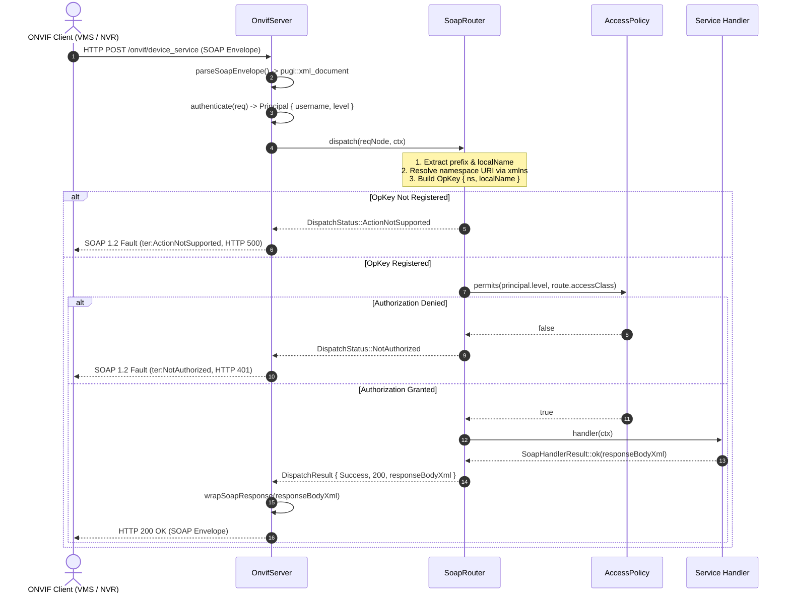

# Implementation Plan: P3 Phase 4 – Declarative SoapRouter Engine

**Scope:** `libs/Onvif/` (`SoapRouter.h`, `SoapRouter.cpp`, `OnvifServer.h`, `OnvifServer.cpp`, `OnvifServerTypes.h`, `SoapFault.h`, `SoapFault.cpp`, `AccessPolicy.h`, `AccessPolicy.cpp`, `tests/TestOnvifSoapRouter.cpp`, `CMakeLists.txt`)  
**Standard Baseline:** MISRA C++:2023 (Rule 6.0.x, Rule 7.0.6, Rule 11.3.1), SEI CERT C++ (INT31-C, STR37-C, ERR55-CPP), ONVIF Core Specification v24.12 (§5 Web Services Framework, §5.9 Access Classes, §5.11 Fault Handling), W3C SOAP 1.2 Part 1/2, Project Rules in [`.agents/rules/`](../.agents/rules/)  
**Reference Document:** [`docs/onvif_p3_architecture_hygiene_plan.md`](onvif_p3_architecture_hygiene_plan.md) (Phase 4), [`docs/onvif_review.md`](onvif_review.md) (§3.3 Finding M1, §3.1 Finding C3, §7 Target Architecture Item 2)

---

## 1. Executive Summary & Problem Analysis

In [`docs/onvif_p3_architecture_hygiene_plan.md`](onvif_p3_architecture_hygiene_plan.md), **Phase 4** addresses operation routing vulnerabilities, namespace validation gaps, and cascading cyclomatic complexity across the `libs/Onvif` subsystem.

Currently, operation dispatch in [`OnvifServer.cpp`](../libs/Onvif/OnvifServer.cpp) relies on fragile substring heuristics and massive procedural `if-else` cascades:
1. **Fragile Substring Dispatch (Finding M1):**
   - Operation matching uses `isOp(opName, "...")` or substring checks (`opName.find("Stop")`, `find("GetConfiguration")`).
   - If a request contains a method name matching a substring of another operation, branch execution is determined solely by the ordering of `if-else` statements.
2. **Missing XML Namespace Validation (Finding M1):**
   - Operations are dispatched without verifying the target XML element's namespace URI.
   - For example, an operation tagged `<tptz:Stop>` (PTZ service) directed at `/onvif/imaging_service` or `<timg:GetImagingSettings>` directed at `/onvif/device_service` could be accepted if the local names collide or match loosely.
3. **Extreme Cyclomatic Complexity (MISRA C++:2023 Rule 6.0.x):**
   - `handleDeviceService` spans ~1,300 LOC with over 45 sequential conditional branches.
   - `handleMediaService` spans ~450 LOC, `handleMedia2Service` ~150 LOC, and `handlePtzService` ~880 LOC.
   - This procedural nesting violates MISRA maintainability and complexity rules, making code extension hazardous.
4. **Scattered & Duplicated Authorization Checks:**
   - Authorization decisions are split between `OnvifServer::authorize()` and manual checks embedded within operation branches.
   - Declarative association between an operation and its required [`AccessClass`](../libs/Onvif/OnvifAuthTypes.h) (e.g. `PreAuth`, `ReadSystem`, `WriteSystem`, `Actuate`) is not unified with the route definition.
5. **Inconsistent SOAP 1.2 Fault Emission (Finding C3):**
   - Unrecognized operations fall through to generic or inconsistent faults instead of deterministic, standard-compliant `SOAP-ENV:Receiver` / `ter:ActionNotSupported` faults mandated by ONVIF Core §5.11.2.

```
+-----------------------------------------------------------------------------------------------------------------------+
|                                    PHASE 4 OPERATION ROUTING REMEDIATION MATRIX                                       |
+----------------------+------------------------------------+-------------------------------------------+---------------+
| Domain               | Current Defect                     | Target Standard / Architecture            | Target Action |
+----------------------+------------------------------------+-------------------------------------------+---------------+
| Operation Matching   | Substring / suffix matches         | Exact $O(1)$ dispatch table               | SoapRouter    |
| (Finding M1)         | via isOp() and branch ordering     | std::unordered_map<OpKey, RouteEntry>     | component     |
+----------------------+------------------------------------+-------------------------------------------+---------------+
| Namespace Security   | XML namespace URI ignored;         | XML prefix & xmlns resolution;            | Strict OpKey  |
| (Finding M1)         | cross-service operation injection  | validation against service target schema  | validation    |
+----------------------+------------------------------------+-------------------------------------------+---------------+
| Code Complexity      | Monolithic if-else cascades;       | Declarative route registration;           | Isolated      |
| (MISRA Rule 6.0.x)   | cyclomatic complexity > 40         | constant lookup; modular handlers         | dispatch map  |
+----------------------+------------------------------------+-------------------------------------------+---------------+
| Access Control       | Procedural checks scattered;       | Declarative AccessClass per RouteEntry;   | Automated     |
| (ONVIF Core §5.9.4)  | risk of unauthorized fallthrough   | evaluated automatically prior to handler  | auth gate     |
+----------------------+------------------------------------+-------------------------------------------+---------------+
| Fault Conformance    | Inconsistent fallthrough responses | SOAP 1.2 ter:ActionNotSupported           | Standard      |
| (Finding C3)         | on unrecognized actions            | for unknown keys; ter:NotAuthorized       | SoapFault     |
+----------------------+------------------------------------+-------------------------------------------+---------------+
| Coding Hygiene       | Long function names (Rule 5);      | All names < 30 chars; [[nodiscard]];      | Strict Rule   |
| & Rules Baseline     | missing IWYU and <cstdint>         | direct includes; zero Qt dependencies     | Enforcement   |
+----------------------+------------------------------------+-------------------------------------------+---------------+
```

---

## 2. Target Architecture & Design Specifications

### 2.1 Declarative SOAP Routing Architecture

The `SoapRouter` acts as an exact, deterministic routing and authorization barrier positioned between ingress HTTP request parsing and operation execution:

```
+---------------------------------------------------------------------------------------------------------------+
|                                    PHASE 4: SOAP ROUTER ARCHITECTURE                                          |
+---------------------------------------------------------------------------------------------------------------+
|                                                                                                               |
|   HTTP POST Ingress (/onvif/device_service, /onvif/ptz_service, ...)                                          |
|          │                                                                                                    |
|          ▼                                                                                                    |
|   [ Ingress XML Parser ] ──► Extracts Body Root Node & Peer Principal                                         |
|          │                                                                                                    |
|          ▼                                                                                                    |
|   [ OpKey Resolver ]                                                                                          |
|       - Resolves prefix -> xmlns attribute (walks ancestor elements)                                          |
|       - Builds OpKey { namespaceUri, localName }                                                              |
|          │                                                                                                    |
|          ▼                                                                                                    |
|   [ SoapRouter::dispatch ]                                                                                    |
|          │                                                                                                    |
|          ├───► [ OpKey Lookup in std::unordered_map<OpKey, RouteEntry, OpKeyHash> ]                          |
|          │          │                                                                                         |
|          │          ├──(Key Not Found)──► SOAP 1.2 Fault: ter:ActionNotSupported (HTTP 500)                   |
|          │          │                                                                                         |
|          │          ▼ (Key Found: RouteEntry)                                                                 |
|          │    [ AccessPolicy Gatekeeper ]                                                                     |
|          │    - AccessPolicy::permits(ctx.principal.level, route.accessClass)                                 |
|          │          │                                                                                         |
|          │          ├──(Denied)─────────► SOAP 1.2 Fault: ter:NotAuthorized (HTTP 401 / 400)                  |
|          │          │                                                                                         |
|          │          ▼ (Permitted)                                                                             |
|          └───► [ RouteEntry::handler(ctx) ] ──► Returns SoapHandlerResult { 200, responseBody }               |
|                                                                                                               |
+---------------------------------------------------------------------------------------------------------------+
```

### 2.2 Sequence Diagram: Ingress Request Dispatch & Policy Enforcement



---

## 3. Component & Interface Specifications

### 3.1 Interface Declaration: `libs/Onvif/SoapRouter.h`

```cpp
/// @file SoapRouter.h
/// @brief Declarative SOAP operation routing engine and access-level gatekeeper.
#pragma once

#include <cstddef>
#include <cstdint>

#include <functional>
#include <string>
#include <string_view>
#include <unordered_map>

#include <pugixml.hpp>

#include "AccessPolicy.h"
#include "OnvifAuthTypes.h"
#include "OnvifTypes.h"

namespace Onvif {

/// @struct OpKey
/// @brief Hashable key identifying a target SOAP operation by schema namespace and element name.
struct OpKey {
    std::string namespaceUri {}; ///< Target XML schema namespace URI.
    std::string localName {};    ///< Target SOAP operation element name (without prefix).

    /// @brief Equality operator for hash map lookups.
    [[nodiscard]] bool operator==(const OpKey& other) const noexcept
    {
        return localName == other.localName && namespaceUri == other.namespaceUri;
    }
};

/// @struct OpKeyHash
/// @brief Deterministic 64-bit hash functor for OpKey.
struct OpKeyHash {
    [[nodiscard]] std::size_t operator()(const OpKey& key) const noexcept
    {
        const std::size_t h1 = std::hash<std::string>{}(key.namespaceUri);
        const std::size_t h2 = std::hash<std::string>{}(key.localName);
        return h1 ^ (h2 + 0x9e3779b97f4a7c15ULL + (h1 << 6U) + (h1 >> 2U));
    }
};

/// @struct SoapContext
/// @brief Invocation context supplied to dispatched operation handlers.
struct SoapContext {
    pugi::xml_node reqNode {};          ///< Parsed XML node of the SOAP operation request.
    Principal principal {};             ///< Authenticated identity and user privilege level.
    std::string peerAddress {};         ///< Client IP address string.
    std::string requestUrl {};          ///< Target HTTP request URI path.
    std::string serviceName {};         ///< Human-readable service name (e.g. "Device", "PTZ").
};

/// @enum DispatchStatus
/// @brief Status outcome of a SOAP dispatch attempt.
enum class DispatchStatus : std::uint8_t {
    Success = 0U,       ///< Handler executed successfully.
    ActionNotSupported, ///< Operation or namespace not recognized.
    NotAuthorized,      ///< Caller lacks required AccessClass privilege.
    BadRequest,         ///< Malformed request payload.
    InternalFault       ///< Handler threw exception or returned failure.
};

/// @struct SoapHandlerResult
/// @brief Result payload produced by a SOAP operation handler.
struct SoapHandlerResult {
    bool success { true };              ///< True if operation succeeded.
    int httpStatusCode { 200 };         ///< Target HTTP response status code.
    std::string responseBody {};        ///< Serialized XML response fragment (Body child).
    std::string faultSubcode {};        ///< Optional ONVIF subcode if failed (e.g. "ter:InvalidArgVal").
    std::string faultReason {};         ///< Human-readable explanation if failed.

    /// @brief Factory creating a successful operation result.
    [[nodiscard]] static SoapHandlerResult ok(std::string body, int code = 200)
    {
        SoapHandlerResult res {};
        res.success = true;
        res.httpStatusCode = code;
        res.responseBody = std::move(body);
        return res;
    }

    /// @brief Factory creating a fault operation result.
    [[nodiscard]] static SoapHandlerResult fault(std::string subcode, std::string reason, int code = 400)
    {
        SoapHandlerResult res {};
        res.success = false;
        res.httpStatusCode = code;
        res.faultSubcode = std::move(subcode);
        res.faultReason = std::move(reason);
        return res;
    }
};

/// @brief Functor type for operation handlers.
using SoapHandlerFn = std::function<SoapHandlerResult(const SoapContext& ctx)>;

/// @struct RouteEntry
/// @brief Route metadata associating an operation with access policy and callback.
struct RouteEntry {
    AccessClass accessClass { AccessClass::Unrecoverable }; ///< Required ONVIF access class.
    SoapHandlerFn handler {};                              ///< Handler callback functor.
};

/// @struct DispatchResult
/// @brief Comprehensive result returned by SoapRouter::dispatch().
struct DispatchResult {
    DispatchStatus status { DispatchStatus::Success }; ///< Dispatch status code.
    int httpStatusCode { 200 };                        ///< HTTP response code.
    std::string responseXml {};                        ///< Serialized body fragment or SOAP Fault XML.
};

/// @class SoapRouter
/// @brief Thread-safe declarative SOAP operation router and access gatekeeper.
/// @details Routes incoming XML operations based on exact {namespaceUri, localName} matching.
///          Enforces ONVIF Core §5.9.4 access class policies prior to handler execution.
///          Returns standard SOAP 1.2 ActionNotSupported or NotAuthorized faults upon failures.
class SoapRouter {
public:
    SoapRouter() = default;
    ~SoapRouter() = default;

    SoapRouter(const SoapRouter&) = delete;
    SoapRouter& operator=(const SoapRouter&) = delete;
    SoapRouter(SoapRouter&&) = default;
    SoapRouter& operator=(SoapRouter&&) = default;

    /// @brief Registers an operation route with explicit namespace, local name, and access class.
    /// @param[in] nsUri Target XML schema namespace URI.
    /// @param[in] localName Operation element name without prefix.
    /// @param[in] accessClass Required ONVIF access class.
    /// @param[in] handler Callback function executing the operation.
    void registerRoute(std::string nsUri, std::string localName,
                       AccessClass accessClass, SoapHandlerFn handler);

    /// @brief Registers an operation route using an OpKey struct.
    /// @param[in] key Operation identifier key.
    /// @param[in] accessClass Required ONVIF access class.
    /// @param[in] handler Callback function executing the operation.
    void registerRoute(const OpKey& key, AccessClass accessClass, SoapHandlerFn handler);

    /// @brief Checks whether an operation route is registered.
    /// @param[in] nsUri Target XML schema namespace URI.
    /// @param[in] localName Operation element name.
    /// @return True if registered, false otherwise.
    [[nodiscard]] bool hasRoute(const std::string& nsUri, const std::string& localName) const noexcept;

    /// @brief Returns the total number of registered routes.
    /// @return Count of active routes.
    [[nodiscard]] std::size_t routeCount() const noexcept;

    /// @brief Clears all registered operation routes.
    void clearRoutes() noexcept;

    /// @brief Dispatches an operation by explicit namespace and local name.
    /// @param[in] nsUri Resolved XML namespace URI.
    /// @param[in] localName Operation element local name.
    /// @param[in] ctx Execution context.
    /// @return Result containing status, HTTP code, and response XML.
    [[nodiscard]] DispatchResult dispatch(const std::string& nsUri,
                                          const std::string& localName,
                                          const SoapContext& ctx) const;

    /// @brief Dispatches an operation parsed directly from an XML request node.
    /// @param[in] reqNode Operation root XML node within SOAP Body.
    /// @param[in] ctx Execution context.
    /// @param[in] fallbackNs Default namespace URI to assume if element omits declaration.
    /// @return Result containing status, HTTP code, and response XML.
    [[nodiscard]] DispatchResult dispatch(const pugi::xml_node& reqNode,
                                          const SoapContext& ctx,
                                          std::string_view fallbackNs = {}) const;

    /// @brief Extracts OpKey from an XML node, resolving prefix and xmlns declarations.
    /// @param[in] node Target XML element to inspect.
    /// @param[in] fallbackNs Default namespace URI if no declaration is found.
    /// @return Resolved OpKey structure.
    [[nodiscard]] OpKey extractOpKey(const pugi::xml_node& node,
                                     std::string_view fallbackNs = {}) const;

    /// @brief Resolves the XML namespace URI for a given element node by inspecting prefix and xmlns.
    /// @param[in] node Target XML element to inspect.
    /// @param[in] prefix Namespace prefix (empty for default namespace).
    /// @return Resolved namespace URI string, or empty if unresolved.
    [[nodiscard]] std::string resolveNamespace(const pugi::xml_node& node,
                                               std::string_view prefix) const;

    /// @brief Extracts the local name from a qualified XML tag (stripping prefix if present).
    /// @param[in] qualifiedName Full XML tag name (e.g. "tds:GetCapabilities").
    /// @return Local name without prefix (e.g. "GetCapabilities").
    [[nodiscard]] static std::string_view extractLocalName(std::string_view qualifiedName) noexcept;

    /// @brief Extracts the prefix from a qualified XML tag (e.g. "tds" from "tds:GetCapabilities").
    /// @param[in] qualifiedName Full XML tag name.
    /// @return Namespace prefix, or empty if tag has no prefix.
    [[nodiscard]] static std::string_view extractPrefix(std::string_view qualifiedName) noexcept;

private:
    std::unordered_map<OpKey, RouteEntry, OpKeyHash> m_routes {};
};

} // namespace Onvif
```

---

### 3.2 Implementation Safeguards: `libs/Onvif/SoapRouter.cpp`

Key implementation details and edge-case handling:
1. **XML Namespace Ancestor Resolution:**
   - To resolve prefix `pfx`, the router inspects `node.attribute("xmlns:pfx")`.
   - If not found on `node`, it ascends `node.parent()` recursively until the root document node.
   - For unprefixed nodes, it inspects `node.attribute("xmlns")` up the ancestor chain.
   - If no declaration exists in the XML document, it falls back to `fallbackNs` (the target namespace of the receiving service endpoint).
2. **Access Policy Evaluation:**
   - Permissions are validated using `AccessPolicy::permits(ctx.principal.level, entry.accessClass)`.
   - If access is denied, dispatch immediately terminates and formats `SoapFault::notAuthorized()` with HTTP 401 (or 400).
3. **ActionNotSupported Fault Formatting:**
   - When an `{namespaceUri, localName}` key is not found in `m_routes`, the router emits:
     `SoapFault::actionNotSupported("Action Not Supported: " + localName)` with HTTP 500 (`SOAP-ENV:Receiver / ter:ActionNotSupported`).
4. **Exception Containment (SEI CERT ERR51-CPP):**
   - Dispatched handlers are executed inside a `try-catch` block.
   - Standard exceptions (`std::exception`) are caught and mapped to a SOAP 1.2 `SOAP-ENV:Receiver` fault rather than crashing or terminating the server.
5. **Thread Safety Guarantees:**
   - Route registration occurs during server initialization (`OnvifServer::setupRoutes()`).
   - During runtime, `m_routes` is read-only and immutable. Concurrent calls to `dispatch()` execute completely lock-free without thread contention.

---

## 4. Integration Specifications

### 4.1 Integration into `OnvifServer`

In [`libs/Onvif/OnvifServer.h`](../libs/Onvif/OnvifServer.h) and [`libs/Onvif/OnvifServer.cpp`](../libs/Onvif/OnvifServer.cpp):
1. **Member Addition:**
   Add `SoapRouter m_soapRouter;` to `OnvifServer`.
2. **Route Registration Pipeline (`registerSoapRoutes`):**
   Refactor `OnvifServer::setupRoutes()` to register service operations with `m_soapRouter`.
3. **Pilot Route Migration (Device Service):**
   Migrate core device management operations to `SoapRouter`:
   - `http://www.onvif.org/ver10/device/wsdl`:
     - `GetSystemDateAndTime` (`AccessClass::PreAuth`)
     - `GetDeviceInformation` (`AccessClass::ReadSystem`)
     - `GetCapabilities` (`AccessClass::PreAuth`)
     - `GetServices` (`AccessClass::PreAuth`)
     - `GetScopes` (`AccessClass::ReadSystem`)
     - `AddScopes` (`AccessClass::WriteSystem`)
     - `RemoveScopes` (`AccessClass::WriteSystem`)
     - `SetScopes` (`AccessClass::WriteSystem`)
     - `GetDiscoveryMode` (`AccessClass::PreAuth`)
     - `SetDiscoveryMode` (`AccessClass::WriteSystem`)
     - `GetUsers` (`AccessClass::ReadSystemSensitive`)
     - `CreateUsers` (`AccessClass::WriteSystem`)
     - `DeleteUsers` (`AccessClass::WriteSystem`)
     - `SetUser` (`AccessClass::WriteSystem`)
4. **Unified Ingress Dispatch:**
   In `OnvifServer::handleDeviceService`:
   ```cpp
   void OnvifServer::handleDeviceService(const httplib::Request& req, httplib::Response& res)
   {
       pugi::xml_document doc;
       const auto soap = parseSoapRequest(req, res, "Device", doc);
       if (!soap) {
           return;
       }
       const auto& [bodyNode, reqNode, opName] = *soap;
       
       SoapContext ctx {};
       ctx.reqNode = reqNode;
       ctx.principal = m_lastAuthPrincipal;
       ctx.peerAddress = req.remote_addr;
       ctx.requestUrl = req.path;
       ctx.serviceName = "Device";
       
       const auto result = m_soapRouter.dispatch(reqNode, ctx, "http://www.onvif.org/ver10/device/wsdl");
       if (result.status == DispatchStatus::ActionNotSupported) {
           // Fallback to legacy branch handlers during incremental migration
           dispatchLegacyDeviceOp(req, res, reqNode, opName, doc);
           return;
       }
       sendSoapResponse(res, result.responseXml, result.httpStatusCode);
   }
   ```
   This allows incremental migration: newly routed operations execute via `SoapRouter`, while any remaining unmigrated operations fall back gracefully until Phase 5 completes full service decomposition.

---

## 5. Coding Standards & Rule Verification Checklist

Every line of code generated in Phase 4 must comply with the project standards:

| # | Standard Requirement | Compliance Mechanism |
|---|---|---|
| 1 | **MISRA C++:2023 Rule 7.0.6 & SEI CERT INT31-C** | All fixed-width integer types strictly use `<cstdint>` with namespace `std::` (`std::uint8_t`, `std::size_t`). No implicit sign conversions. |
| 2 | **Project Rule 5 (Concise Function Naming < 30 chars)** | All identifiers strictly < 30 chars: `registerRoute` (13), `hasRoute` (8), `routeCount` (10), `clearRoutes` (11), `dispatch` (8), `extractOpKey` (12), `resolveNamespace` (16), `extractLocalName` (16), `extractPrefix` (13). |
| 3 | **Project Rule 8 (`[[nodiscard]]` Annotations)** | Applied to all inspector methods and dispatchers: `hasRoute()`, `routeCount()`, `dispatch()`, `extractOpKey()`, `resolveNamespace()`, `extractLocalName()`, `extractPrefix()`, `ok()`, `fault()`. |
| 4 | **Project Rule 9 (Doxygen Documentation)** | Complete Doxygen templates (`/// @brief`, `@param[in]`, `@return`, `@details`) on all public and private members. |
| 5 | **Project Rule 16 (Strict IWYU)** | Explicit includes for `<unordered_map>`, `<functional>`, `<string>`, `<string_view>`, `<cstdint>`, `<cstddef>`, `<pugixml.hpp>`. Co-located `.h` and `.cpp`. |
| 6 | **CERT ERR55-CPP / ERR51-CPP** | Deterministic error paths; safe exception wrapping in handlers to prevent unhandled termination. |
| 7 | **Zero Qt Dependencies** | Zero `#include <Q...>` in `libs/Onvif`. Clean POSIX / Win32 support. |

---

## 6. Implementation Step-by-Step Roadmap

```
+-------------------------------------------------------------------------------+
|                       PHASE 4 IMPLEMENTATION WORKFLOW                         |
+-------------------------------------------------------------------------------+
|                                                                               |
|   Step 1: Test-Driven Development (TDD) Foundation                            |
|   └── Create libs/Onvif/tests/TestOnvifSoapRouter.cpp                         |
|       - Exact OpKey matching tests (namespace + localName)                    |
|       - Namespace mismatch rejection tests                                    |
|       - Prefix and xmlns ancestor resolution tests                            |
|       - Fallback namespace resolution tests                                   |
|       - Declarative AccessClass authorization gate tests                      |
|       - Standard ActionNotSupported and NotAuthorized fault tests             |
|       - Multithreaded concurrent dispatch test (zero contention)              |
|                                                                               |
|   Step 2: Core SoapRouter Engine Component                                    |
|   └── Implement libs/Onvif/SoapRouter.h and libs/Onvif/SoapRouter.cpp         |
|   └── Register in libs/Onvif/CMakeLists.txt and tests/CMakeLists.txt          |
|                                                                               |
|   Step 3: OnvifServer Integration & Pilot Route Registration                  |
|   └── Instantiate SoapRouter in OnvifServer                                   |
|   └── Register core Device Management routes in SoapRouter                    |
|   └── Route handleDeviceService through SoapRouter with legacy fallback       |
|                                                                               |
|   Step 4: Verification, Concurrency Stress & Gatekeeper Validation            |
|   └── Run TestOnvifSoapRouter, TestOnvifServer, TestPelcoDOnvif               |
|   └── Run scripts/verify_function_lengths.py and verify_iwyu_cstdint.py       |
|   └── Verify zero warnings under -Werror / /W4                                |
|                                                                               |
+-------------------------------------------------------------------------------+
```

### Step 1: Create Test Suite `TestOnvifSoapRouter.cpp`
Implement comprehensive unit tests in [`libs/Onvif/tests/TestOnvifSoapRouter.cpp`](../libs/Onvif/tests/TestOnvifSoapRouter.cpp):
1. `SoapRouterTest.ExactOpKeyMatch`: Tests successful dispatch when both namespace URI and local name match.
2. `SoapRouterTest.NamespaceMismatchRejection`: Tests that identical local name with different namespace returns `ActionNotSupported`.
3. `SoapRouterTest.XmlPrefixResolution`: Tests resolving namespace URI declared via `xmlns:tds` on root envelope.
4. `SoapRouterTest.XmlDefaultNamespaceResolution`: Tests resolving default namespace declared via `xmlns="..."`.
5. `SoapRouterTest.AncestorNamespaceResolution`: Tests resolving prefix declared on parent or grandparent node.
6. `SoapRouterTest.FallbackNamespace`: Tests fallback to expected service namespace when XML element omits declaration.
7. `SoapRouterTest.AccessPolicyEnforcement`: Tests authorization failure when user level is insufficient for required `AccessClass`.
8. `SoapRouterTest.AnonymousPreAuthAllowed`: Tests that anonymous caller succeeds on `AccessClass::PreAuth` routes.
9. `SoapRouterTest.ActionNotSupportedFault`: Verifies that unknown operation yields standard SOAP 1.2 `SOAP-ENV:Receiver` fault.
10. `SoapRouterTest.ConcurrentDispatchStress`: 8 threads concurrently dispatching requests through `SoapRouter`, validating thread safety and zero lock contention.

### Step 2: Implement `SoapRouter.h` and `SoapRouter.cpp`
- Create `SoapRouter.h` and `SoapRouter.cpp` in `libs/Onvif/`.
- Register both files in `libs/Onvif/CMakeLists.txt`.
- Register `TestOnvifSoapRouter` in `libs/Onvif/tests/CMakeLists.txt`.

### Step 3: Integrate with `OnvifServer`
- Add `SoapRouter m_soapRouter;` to `OnvifServer`.
- Implement `registerSoapRoutes()` registering core operations.
- Update `handleDeviceService` to dispatch via `m_soapRouter`.

### Step 4: Verification & Quality Gates
- Compile project and run `TestOnvifSoapRouter`, `TestOnvifServer`, `TestPelcoDOnvif`.
- Run automated verification scripts:
  - `python scripts/verify_function_lengths.py`
  - `python scripts/verify_iwyu_cstdint.py`
- Verify zero warnings under `/W4` on MSVC and `-Wall -Wextra -pedantic` on Clang/GCC.

---

## 7. Verification Checklist

Before completing Phase 4, confirm the following items:
- [ ] `SoapRouter.h` and `SoapRouter.cpp` created in `libs/Onvif/` with `#pragma once` and full Doxygen.
- [ ] Deterministic $O(1)$ dispatch table keyed on `OpKey { namespaceUri, localName }` with `OpKeyHash`.
- [ ] XML namespace resolution correctly inspects `xmlns` and `xmlns:prefix` attributes across node ancestors.
- [ ] Declarative `AccessClass` integrated into `RouteEntry` and validated via `AccessPolicy::permits()`.
- [ ] Unregistered operations deterministically return SOAP 1.2 `SOAP-ENV:Receiver / ter:ActionNotSupported` (HTTP 500).
- [ ] Unauthorized requests return SOAP 1.2 `SOAP-ENV:Sender / ter:NotAuthorized` (HTTP 401 / 400).
- [ ] All new functions are strictly less than 30 characters in length.
- [ ] `[[nodiscard]]` applied to all query, inspector, and dispatch methods.
- [ ] Unit and concurrency tests in `TestOnvifSoapRouter.cpp` pass with 100% success rate.
- [ ] All documentation file links use relative paths.
- [ ] Both ASCII and Mermaid diagrams provided for architecture and sequence flow.
