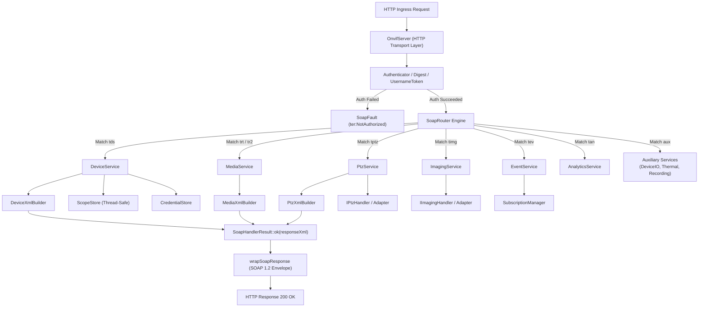

# Implementation Plan: P3 Phase 5 – Service Modularization (Decomposing OnvifServer.cpp)

**Scope:** `libs/Onvif/` (`OnvifServer.h`, `OnvifServer.cpp`, `services/IService.h`, `services/DeviceService.h/.cpp`, `services/MediaService.h/.cpp`, `services/PtzService.h/.cpp`, `services/ImagingService.h/.cpp`, `services/EventService.h/.cpp`, `services/AnalyticsService.h/.cpp`, `services/DeviceIoService.h/.cpp`, `services/ThermalService.h/.cpp`, `services/RecordingService.h/.cpp`, `services/SearchService.h/.cpp`, `services/ReplayService.h/.cpp`, `services/builders/DeviceXmlBuilder.h/.cpp`, `services/builders/MediaXmlBuilder.h/.cpp`, `services/builders/PtzXmlBuilder.h/.cpp`, `CMakeLists.txt`, test suites)  
**Standard Baseline:** MISRA C++:2023 (Rule 6.0.x Complexity, Rule 7.0.6 Conversions, Rule 11.3.1 Arrays), SEI CERT C++ (INT31-C, STR37-C, ERR55-CPP, MEM51-CPP), ONVIF Core Specification v24.12 (§5 Web Services Framework, §8 Device Management), ONVIF Profile S / Profile T / Profile G / Profile M, Clean Architecture, Single Responsibility Principle (SRP), Project Rules in [`.agents/rules/`](../.agents/rules/)  
**Reference Documents:** [`docs/onvif_p3_architecture_hygiene_plan.md`](onvif_p3_architecture_hygiene_plan.md) (Phase 5), [`docs/onvif_review.md`](onvif_review.md) (§5.2 Coding Standards, §7 Target Architecture Item 1 & 2), [`docs/onvif_p3_phase4_soap_router_plan.md`](onvif_p3_phase4_soap_router_plan.md)

---

## 1. Executive Summary & Problem Analysis

In [`docs/onvif_p3_architecture_hygiene_plan.md`](onvif_p3_architecture_hygiene_plan.md), **Phase 5** addresses the single largest source of technical debt in the repository: the monolithic God-Server class implemented in [`OnvifServer.cpp`](../libs/Onvif/OnvifServer.cpp).

Currently, `OnvifServer.cpp` spans **6,720 lines of code (329 KB)** in a single translation unit, mixing network socket coordination, HTTP request parsing, authentication verification, complex business state management, and 14 distinct SOAP domain services:
1. **Extreme Cyclomatic & Structural Complexity (MISRA C++:2023 Rule 6.0.x):**
   - Individual service dispatcher functions span hundreds to thousands of lines:
     - `handleDeviceService`: ~1,363 LOC
     - `handleMediaService` & `handleMedia2Service`: ~1,238 LOC
     - `handlePtzService`: ~880 LOC
     - `handleRecordingService`: ~360 LOC
     - `handleAnalyticsService`: ~297 LOC
     - `handleImagingService`: ~264 LOC
     - `handleThermalService`: ~246 LOC
   - Cascading conditional trees make control flow difficult to trace, audit, or reason about for safety-critical PTZ camera systems.
2. **Violation of the Single Responsibility Principle (SRP):**
   - `OnvifServer` coordinates both the outer HTTP daemon lifecycle (`httplib::Server`) and the granular internal business logic of 14 separate ONVIF WSDL specifications.
   - Any bug fix or feature addition to imaging or PTZ presets requires re-compiling the entire 6,700-line translation unit and risks introducing regressions into unrelated services like authentication or device management.
3. **Fragile String-Stream Response Generation:**
   - Over 85% of XML responses are formatted via manual string concatenation and `std::ostringstream` streams.
   - Manual concatenation is vulnerable to unescaped XML injection, missing closing tags, schema validation errors, and inconsistent namespace prefix declarations.
4. **Poor Testability & Heavy Coupling:**
   - Testing an operation like `GetSystemDateAndTime` or `ContinuousMove` currently requires constructing and launching an entire `OnvifServer` instance with background threads and socket bindings.
   - Without modular service boundaries, unit testing individual SOAP operation handlers in isolation is impossible.
5. **Violation of File Size Constraints:**
   - Project hygiene guidelines mandate that modular components remain concise and maintainable (< 500 LOC per file).

```
+-----------------------------------------------------------------------------------------------------------------------+
|                                  PHASE 5 SERVICE MODULARIZATION REMEDIATION MATRIX                                    |
+----------------------+------------------------------------+-------------------------------------------+---------------+
| Domain               | Current Defect                     | Target Architecture / Standard            | Target Action |
+----------------------+------------------------------------+-------------------------------------------+---------------+
| Monolithic God-Class | OnvifServer.cpp spans 6,720 LOC;   | Modular service translation units in      | Extract       |
| (MISRA Rule 6.0.x)   | 14 SOAP services entangled         | libs/Onvif/services/ (< 500 LOC each)     | Service Units |
+----------------------+------------------------------------+-------------------------------------------+---------------+
| Operation Routing &  | Cascading if-else branches;        | Declarative registration with SoapRouter; | Wire to       |
| Dispatch Coupling    | residual substring checks          | O(1) exact OpKey lookup                   | SoapRouter    |
+----------------------+------------------------------------+-------------------------------------------+---------------+
| XML Generation &     | Raw string-stream concatenation;   | Safe XML builders with strict auto-escape | Dedicated XML |
| Schema Conformance   | manual escaping and prefix errors  | and DOM-based pugi::xml_document          | Builders      |
+----------------------+------------------------------------+-------------------------------------------+---------------+
| State Coupling &     | Direct access to 15+ mutexes and   | Explicit dependency injection via         | Scoped State  |
| Dependency Sprawl    | raw internal vectors               | interfaces and state models               | & Interfaces  |
+----------------------+------------------------------------+-------------------------------------------+---------------+
| Unit Testability     | Requires spinning up HTTP daemon   | Direct invocation via SoapContext;        | Direct Unit   |
|                      | and sockets to test any operation  | isolated zero-network test harnesses      | Service Tests |
+----------------------+------------------------------------+-------------------------------------------+---------------+
| Coding Hygiene       | Functions >= 30 chars;             | Concise names (< 30 chars); [[nodiscard]];| Strict Rule   |
| & Safety Rules       | missing IWYU and <cstdint>         | direct includes; zero Qt dependencies     | Enforcement   |
+----------------------+------------------------------------+-------------------------------------------+---------------+
```

---

## 2. Target Architecture & Design Specifications

### 2.1 Decoupled Ingress, Routing & Service Architecture

The target architecture decouples HTTP transport ingress, operation routing, and service domain execution into clean architectural layers:

```
+---------------------------------------------------------------------------------------------------------------+
|                                    MODULAR SERVICE INGRESS & DISPATCH ARCHITECTURE                            |
+---------------------------------------------------------------------------------------------------------------+
|                                                                                                               |
|   HTTP POST Ingress (/onvif/device_service, /onvif/ptz_service, /onvif/media_service, ...)                    |
|          │                                                                                                    |
|          ▼                                                                                                    |
|   [ OnvifServer (Thin HTTP Daemon) ]                                                                          |
|       - Authenticates request via Authenticator                                                               |
|       - Parses XML envelope via pugi::xml_document                                                            |
|       - Populates SoapContext { reqNode, principal, peerAddress, requestUrl, serviceName }                    |
|          │                                                                                                    |
|          ▼                                                                                                    |
|   [ SoapRouter (Phase 4 Declarative Engine) ]                                                                 |
|       - Resolves XML namespace URI and operation localName                                                    |
|       - Checks AccessClass permissions (PreAuth, ReadSystem, WriteSystem, Actuate)                            |
|       - Dispatches to registered SoapHandlerFn in O(1)                                                        |
|          │                                                                                                    |
|          ├───────────────────┼───────────────────┼───────────────────┼───────────────────┐                    |
|          ▼                   ▼                   ▼                   ▼                   ▼                    |
|   [ DeviceService ]   [ MediaService ]    [ PtzService ]      [ ImagingService ]  [ EventService ]            |
|   - System, Network,  - Profiles, Video   - Motion, Presets,  - Focus, Settings,  - PullPoint, Subscriptions, |
|     Users, Scopes       Sources, Encoders   Tours, AuxCmd       Presets, Move       Property Dispatch         |
|          │                   │                   │                   │                   │                    |
|          ▼                   ▼                   ▼                   ▼                   ▼                    |
|   [ ScopeStore /     [ MediaState ]       [ IPtzPort /        [ IImagingPort ]    [ SubscriptionMgr /         |
|     CredStore ]                           PelcoDPtzAdapter ]                      Dispatcher ]                |
|          │                   │                   │                   │                   │                    |
|          ▼                   ▼                   ▼                   ▼                   ▼                    |
|   [ DeviceXmlBuilder] [ MediaXmlBuilder]  [ PtzXmlBuilder ]   [ Safe Escaped XML / DOM Response ]             |
|                                                                                                               |
+---------------------------------------------------------------------------------------------------------------+
```

#### Mermaid Diagram: Modular Request Dispatch & Execution Pipeline



---

### 2.2 Core Service Abstraction: `IService`

Every modular service implements the unified `IService` interface, allowing `OnvifServer` to register all endpoints polymorphically during initialization:

```cpp
/// @file IService.h
#pragma once

#include <string_view>

namespace Onvif {

class SoapRouter;

/// @class IService
/// @brief Abstract interface for modular ONVIF service dispatchers.
class IService {
public:
    virtual ~IService() = default;

    /// @brief Registers all SOAP operations supported by this service into the router.
    /// @param[in,out] router Target SoapRouter instance.
    virtual void registerRoutes(SoapRouter& router) = 0;

    /// @brief Gets the canonical service name (e.g. "Device", "Media", "PTZ").
    /// @return String view of service name.
    [[nodiscard]] virtual std::string_view serviceName() const noexcept = 0;
};

} // namespace Onvif
```

---

### 2.3 Modular Service Decomposition Breakdown

To comply with the strict **< 500 LOC per file** limit, the monolithic services are split into cohesive service classes and dedicated XML response builders:

```
+---------------------------------------------------------------------------------------------------------------+
|                                    SERVICE MODULE DECOMPOSITION MATRIX                                        |
+--------------------------+--------------------------------+--------------------+------------------------------+
| Service Component        | Header / Implementation        | Target LOC         | Primary Responsibilities     |
+--------------------------+--------------------------------+--------------------+------------------------------+
| Common Service Interface | services/IService.h            | ~35 LOC            | Pure virtual registerRoutes  |
+--------------------------+--------------------------------+--------------------+------------------------------+
| Device Service           | services/DeviceService.h/.cpp  | ~380 LOC           | System date/time, reboot,    |
|                          |                                |                    | users, scopes, network, logs |
| Device XML Builder       | services/builders/             | ~320 LOC           | Capabilities XML, services   |
|                          | DeviceXmlBuilder.h/.cpp        |                    | XML, network config XML      |
+--------------------------+--------------------------------+--------------------+------------------------------+
| Media Service            | services/MediaService.h/.cpp   | ~400 LOC           | Profiles, video sources,     |
|                          |                                |                    | encoders, stream/snapshot URI|
| Media XML Builder        | services/builders/             | ~360 LOC           | Profile XML, video encoder   |
|                          | MediaXmlBuilder.h/.cpp         |                    | XML, OSD and mask XML        |
+--------------------------+--------------------------------+--------------------+------------------------------+
| PTZ Service              | services/PtzService.h/.cpp     | ~390 LOC           | Move, Stop, Presets, Preset  |
|                          |                                |                    | Tours, Aux commands, Status  |
| PTZ XML Builder          | services/builders/             | ~260 LOC           | PTZNode XML, PTZConfig XML,  |
|                          | PtzXmlBuilder.h/.cpp           |                    | PresetTour XML serialization |
+--------------------------+--------------------------------+--------------------+------------------------------+
| Imaging Service          | services/ImagingService.h/.cpp | ~260 LOC           | Settings, Move, Presets,     |
|                          |                                |                    | Options, Focus status        |
+--------------------------+--------------------------------+--------------------+------------------------------+
| Event Service            | services/EventService.h/.cpp   | ~320 LOC           | PullPoint subscription,      |
|                          |                                |                    | PullMessages, Renew, Unsub   |
+--------------------------+--------------------------------+--------------------+------------------------------+
| Analytics Service        | services/AnalyticsService.h    | ~240 LOC           | Rules, Modules, Analytics    |
|                          | services/AnalyticsService.cpp  |                    | capabilities and configs     |
+--------------------------+--------------------------------+--------------------+------------------------------+
| Auxiliary Services       | services/DeviceIoService.h/.cpp| ~180 LOC           | Relay outputs, digital inputs|
|                          | services/ThermalService.h/.cpp | ~260 LOC           | Radiometry, spots, boxes     |
|                          | services/RecordingService.h    | ~340 LOC           | Profile G recording / replay |
+--------------------------+--------------------------------+--------------------+------------------------------+
| OnvifServer (Core)       | OnvifServer.h / OnvifServer.cpp| ~420 LOC (was 6720)| HTTP listener, auth gate,    |
|                          |                                |                    | service container lifecycle  |
+--------------------------+--------------------------------+--------------------+------------------------------+
```

---

### 2.4 Service Dependency Injection Architecture

Services do not instantiate dependencies internally; they receive thread-safe shared pointers and adapters via constructor dependency injection. This isolates business logic and guarantees clean testability:

```
+---------------------------------------------------------------------------------------------------+
|                                  DEPENDENCY INJECTION MODEL                                       |
+---------------------------------------------------------------------------------------------------+
|                                                                                                   |
|   ┌───────────────────────────────────────────────────────────────────────────────────────────┐   |
|   │                                   OnvifServer Core State                                  │   |
|   │                                                                                           │   |
|   │   - std::shared_ptr<ScopeStore> m_scopeStore                                              │   |
|   │   - std::shared_ptr<CredentialStore> m_credStore                                          │   |
|   │   - std::shared_ptr<IPtzHandler> m_ptzHandler                                             │   |
|   │   - std::shared_ptr<IImagingHandler> m_imagingHandler                                     │   |
|   │   - std::shared_ptr<IDeviceManagementHandler> m_deviceHandler                             │   |
|   │   - std::shared_ptr<SubscriptionManager> m_subManager                                     │   |
|   │   - std::shared_ptr<MediaState> m_mediaState                                              │   |
|   │   - OnvifServerConfig m_config                                                            │   |
|   └─────────────────────────────────────────────┬─────────────────────────────────────────────┘   |
|                                                 │                                                 |
|                 ┌───────────────────────────────┼───────────────────────────────┐                 |
|                 ▼                               ▼                               ▼                 |
|      [ DeviceService ]                  [ PtzService ]                  [ MediaService ]          |
|      - ScopeStore                       - IPtzHandler                   - MediaState              |
|      - CredentialStore                  - PtzConfigStore                - IOsdHandler             |
|      - IDeviceManagementHandler         - PresetTourStore               - IMaskHandler            |
|      - SystemLogStore                   - PtzXmlBuilder                 - MediaXmlBuilder         |
|      - DeviceXmlBuilder                                                                           |
|                                                                                                   |
+---------------------------------------------------------------------------------------------------+
```

#### Mermaid Diagram: Service Component & Dependency Relationships

```mermaid
classDiagram
    class IService {
        <<interface>>
        +registerRoutes(SoapRouter& router)* void
        +serviceName() string_view*
    }

    class DeviceService {
        -shared_ptr~ScopeStore~ m_scopeStore
        -shared_ptr~CredentialStore~ m_credStore
        -shared_ptr~IDeviceManagementHandler~ m_deviceHandler
        -DeviceXmlBuilder m_xmlBuilder
        +registerRoutes(SoapRouter& router) void
        +serviceName() string_view
        -handleGetDeviceInfo(SoapContext) SoapHandlerResult
        -handleGetCaps(SoapContext) SoapHandlerResult
        -handleGetServices(SoapContext) SoapHandlerResult
        -handleGetScopes(SoapContext) SoapHandlerResult
        -handleAddScopes(SoapContext) SoapHandlerResult
    }

    class MediaService {
        -shared_ptr~MediaState~ m_mediaState
        -shared_ptr~IOsdHandler~ m_osdHandler
        -shared_ptr~IMaskHandler~ m_maskHandler
        -MediaXmlBuilder m_xmlBuilder
        +registerRoutes(SoapRouter& router) void
        +serviceName() string_view
        -handleGetProfiles(SoapContext) SoapHandlerResult
        -handleGetStreamUri(SoapContext) SoapHandlerResult
        -handleGetSnapshotUri(SoapContext) SoapHandlerResult
    }

    class PtzService {
        -shared_ptr~IPtzHandler~ m_ptzHandler
        -shared_ptr~PtzState~ m_ptzState
        -PtzXmlBuilder m_xmlBuilder
        +registerRoutes(SoapRouter& router) void
        +serviceName() string_view
        -handleContMove(SoapContext) SoapHandlerResult
        -handleAbsMove(SoapContext) SoapHandlerResult
        -handleStop(SoapContext) SoapHandlerResult
        -handleSetPreset(SoapContext) SoapHandlerResult
    }

    class ImagingService {
        -shared_ptr~IImagingHandler~ m_imagingHandler
        +registerRoutes(SoapRouter& router) void
        +serviceName() string_view
        -handleGetSettings(SoapContext) SoapHandlerResult
        -handleSetSettings(SoapContext) SoapHandlerResult
        -handleMoveFocus(SoapContext) SoapHandlerResult
    }

    class EventService {
        -shared_ptr~SubscriptionManager~ m_subManager
        +registerRoutes(SoapRouter& router) void
        +serviceName() string_view
        -handlePullMessages(SoapContext) SoapHandlerResult
        -handleRenew(SoapContext) SoapHandlerResult
        -handleUnsubscribe(SoapContext) SoapHandlerResult
    }

    IService <|.. DeviceService
    IService <|.. MediaService
    IService <|.. PtzService
    IService <|.. ImagingService
    IService <|.. EventService
```



---

## 3. Function & Identifier Renaming Specification (< 30 Characters)

To comply strictly with **Project Rule 5** ("Are all function names concise (strictly less than 30 characters)?"), all member methods and XML builder helpers across the new services must adhere to concise names:

| Proposed Method Name (< 30 chars) | Len | Service / Class | Operation Mapped |
|---|---|---|---|
| `registerRoutes` | 14 | `IService` | Registration entrypoint |
| `serviceName` | 11 | `IService` | Service identifier |
| `handleGetDeviceInfo` | 19 | `DeviceService` | `tds:GetDeviceInformation` |
| `handleGetCaps` | 13 | `DeviceService` | `tds:GetCapabilities` |
| `handleGetServices` | 17 | `DeviceService` | `tds:GetServices` |
| `handleGetSysDate` | 16 | `DeviceService` | `tds:GetSystemDateAndTime` |
| `handleSetSysDate` | 16 | `DeviceService` | `tds:SetSystemDateAndTime` |
| `handleReboot` | 12 | `DeviceService` | `tds:SystemReboot` |
| `handleGetUsers` | 14 | `DeviceService` | `tds:GetUsers` |
| `handleCreateUsers` | 17 | `DeviceService` | `tds:CreateUsers` |
| `handleDeleteUsers` | 17 | `DeviceService` | `tds:DeleteUsers` |
| `handleSetUser` | 13 | `DeviceService` | `tds:SetUser` |
| `handleGetScopes` | 15 | `DeviceService` | `tds:GetScopes` |
| `handleAddScopes` | 15 | `DeviceService` | `tds:AddScopes` |
| `handleSetScopes` | 15 | `DeviceService` | `tds:SetScopes` |
| `handleRemoveScopes` | 18 | `DeviceService` | `tds:RemoveScopes` |
| `handleGetNetIfaces` | 18 | `DeviceService` | `tds:GetNetworkInterfaces` |
| `handleSetNetIfaces` | 18 | `DeviceService` | `tds:SetNetworkInterfaces` |
| `handleGetNetProtos` | 18 | `DeviceService` | `tds:GetNetworkProtocols` |
| `handleSetNetProtos` | 18 | `DeviceService` | `tds:SetNetworkProtocols` |
| `handleGetGateway` | 16 | `DeviceService` | `tds:GetNetworkDefaultGateway` |
| `handleSetGateway` | 16 | `DeviceService` | `tds:SetNetworkDefaultGateway` |
| `handleGetDns` | 12 | `DeviceService` | `tds:GetDNS` |
| `handleSetDns` | 12 | `DeviceService` | `tds:SetDNS` |
| `handleGetNtp` | 12 | `DeviceService` | `tds:GetNTP` |
| `handleSetNtp` | 12 | `DeviceService` | `tds:SetNTP` |
| `handleGetHostname` | 17 | `DeviceService` | `tds:GetHostname` |
| `handleSetHostname` | 17 | `DeviceService` | `tds:SetHostname` |
| `handleGetDiscMode` | 17 | `DeviceService` | `tds:GetDiscoveryMode` |
| `handleSetDiscMode` | 17 | `DeviceService` | `tds:SetDiscoveryMode` |
| `handleGetProfiles` | 17 | `MediaService` | `trt:GetProfiles` |
| `handleGetProfile` | 16 | `MediaService` | `trt:GetProfile` |
| `handleCreateProfile` | 19 | `MediaService` | `trt:CreateProfile` |
| `handleDeleteProfile` | 19 | `MediaService` | `trt:DeleteProfile` |
| `handleGetStreamUri` | 18 | `MediaService` | `trt:GetStreamUri` |
| `handleGetSnapshotUri` | 20 | `MediaService` | `trt:GetSnapshotUri` |
| `handleGetVideoSources` | 21 | `MediaService` | `trt:GetVideoSources` |
| `handleGetVideoConfigs` | 21 | `MediaService` | `trt:GetVideoEncoderConfigurations` |
| `handleGetVideoOptions` | 21 | `MediaService` | `trt:GetVideoEncoderConfigurationOptions` |
| `handleContMove` | 14 | `PtzService` | `tptz:ContinuousMove` |
| `handleRelMove` | 13 | `PtzService` | `tptz:RelativeMove` |
| `handleAbsMove` | 13 | `PtzService` | `tptz:AbsoluteMove` |
| `handleStop` | 10 | `PtzService` | `tptz:Stop` |
| `handleGetStatus` | 15 | `PtzService` | `tptz:GetStatus` |
| `handleSetPreset` | 15 | `PtzService` | `tptz:SetPreset` |
| `handleGetPresets` | 16 | `PtzService` | `tptz:GetPresets` |
| `handleGotoPreset` | 16 | `PtzService` | `tptz:GotoPreset` |
| `handleRemovePreset` | 18 | `PtzService` | `tptz:RemovePreset` |
| `handleGotoHome` | 14 | `PtzService` | `tptz:GotoHomePosition` |
| `handleSetHome` | 13 | `PtzService` | `tptz:SetHomePosition` |
| `handleSendAux` | 13 | `PtzService` | `tptz:SendAuxiliaryCommand` |
| `handleGeoMove` | 13 | `PtzService` | `tptz:GeoMove` |
| `handleGetSettings` | 17 | `ImagingService` | `timg:GetImagingSettings` |
| `handleSetSettings` | 17 | `ImagingService` | `timg:SetImagingSettings` |
| `handleMoveFocus` | 15 | `ImagingService` | `timg:Move` |
| `handlePullMessages` | 18 | `EventService` | `tev:PullMessages` |
| `handleRenew` | 11 | `EventService` | `wsnt:Renew` |
| `handleUnsubscribe` | 17 | `EventService` | `wsnt:Unsubscribe` |
| `buildCapabilitiesXml` | 20 | `DeviceXmlBuilder` | Serializes ONVIF capabilities |
| `buildServicesXml` | 16 | `DeviceXmlBuilder` | Serializes ONVIF services |
| `buildProfileXml` | 15 | `MediaXmlBuilder` | Serializes media profiles |
| `buildPtzNodeXml` | 15 | `PtzXmlBuilder` | Serializes PTZ node spaces |

---

## 4. MISRA C++:2023 & SEI CERT C++ Remediation

### 4.1 MISRA C++:2023 Rule 6.0.x (Cyclomatic & Structural Complexity)
- **Problem:** Functions like `handleDeviceService` (~1,363 LOC) contain 45+ branching statements, violating complexity guidelines.
- **Remediation:** 
  - Each SOAP operation is an independent, isolated method of its respective service class.
  - Cyclomatic complexity per method is strictly bounded ($V(G) < 8$).
  - Dispatching is performed via $O(1)$ hash map lookup in `SoapRouter`, completely eliminating procedural cascading `if-else` trees.

### 4.2 SEI CERT ERR55-CPP & Exception Boundaries
- **Problem:** Throwing exceptions across service dispatch boundaries can cause unexpected termination (`std::terminate`).
- **Remediation:**
  - Handlers catch internal exceptions and return structured `SoapHandlerResult::fault(...)` instead of allowing unhandled exceptions to escape.
  - No dynamic allocations on performance-sensitive paths; XML serialization operates on pre-sized buffers and safe DOM allocations.

### 4.3 SEI CERT STR37-C (Safe Character Handling)
- **Problem:** Passing signed `char` to `<cctype>` functions is undefined behavior.
- **Remediation:** All XML element and attribute token comparisons use deterministic ASCII helpers from `AsciiUtils.h` (`equalsIgnoreCaseAscii`, `toLowerAscii`).

### 4.4 MISRA C++:2023 Rule 11.3.1 (Eliminate C-Style Arrays)
- All fixed-size buffers in service builders use `std::array<char, N>` with `{}` uniform initialization instead of raw C-style arrays.

### 4.5 SEI CERT INT31-C & MISRA Rule 7.0.6 (Explicit Conversions)
- Conversions between signed port numbers (`int`) and unsigned representations (`std::uint16_t`) or XML integer types are guarded with explicit range bounds checks and `static_cast`.

---

## 5. Detailed Step-by-Step Implementation Roadmap

```
+---------------------------------------------------------------------------------------------------------------+
|                                    PHASE 5 EXECUTION WORKFLOW GANTT / TIMELINE                                |
+---------------------------------------------------------------------------------------------------------------+
| Step 1: IService Interface & Common Types (libs/Onvif/services/IService.h)                     [██]           |
| Step 2: DeviceService & DeviceXmlBuilder Extraction                                            [████]         |
| Step 3: MediaService & MediaXmlBuilder Extraction                                              [████]         |
| Step 4: PtzService & PtzXmlBuilder Extraction                                                  [████]         |
| Step 5: ImagingService & EventService Extraction                                               [████]         |
| Step 6: AnalyticsService & Auxiliary Services Extraction                                      [████]         |
| Step 7: OnvifServer Slimming & Integration with Services                                       [████]         |
| Step 8: Build System (CMakeLists.txt) & IWYU Verification                                      [██]           |
| Step 9: Unit & Integration Test Suite Verification                                             [████]         |
+---------------------------------------------------------------------------------------------------------------+
```

---

### Step 1: Common Service Abstraction (`libs/Onvif/services/IService.h`)

Create the core interface for modular services:
- Define `IService` with `virtual void registerRoutes(SoapRouter& router) = 0`.
- Define `[[nodiscard]] virtual std::string_view serviceName() const noexcept = 0`.
- Ensure `#pragma once`, IWYU compliance, and complete Doxygen documentation.

---

### Step 2: DeviceService & DeviceXmlBuilder (`libs/Onvif/services/`)

Extract device management and system administration operations from `OnvifServer.cpp`:
1. **Create `services/builders/DeviceXmlBuilder.h/.cpp`:**
   - `buildCapabilitiesXml(const OnvifServerConfig& config, const std::string& host)`
   - `buildServicesXml(const OnvifServerConfig& config, const std::string& host)`
   - `buildNetworkIfacesXml(const std::vector<NetworkInterfaceConfig>& ifaces)`
   - `buildSystemDateXml(const SystemDateTimeConfig& dt)`
2. **Create `services/DeviceService.h/.cpp`:**
   - Injects `std::shared_ptr<ScopeStore>`, `std::shared_ptr<CredentialStore>`, `std::shared_ptr<IDeviceManagementHandler>`, and system configuration.
   - Registers all `tds:*` routes (`GetDeviceInformation`, `GetCapabilities`, `GetServices`, `GetSystemDateAndTime`, `SetSystemDateAndTime`, `SystemReboot`, `GetUsers`, `CreateUsers`, `DeleteUsers`, `SetUser`, `GetScopes`, `AddScopes`, `SetScopes`, `RemoveScopes`, `GetNetworkInterfaces`, `SetNetworkInterfaces`, `GetNetworkProtocols`, `SetNetworkProtocols`, `GetHostname`, `SetHostname`, `GetDiscoveryMode`, `SetDiscoveryMode`, `GetEndpointReference`, `GetWsdlUrl`, `GetSystemLogs`).
   - File size: `DeviceService.cpp` strictly < 400 LOC; `DeviceXmlBuilder.cpp` strictly < 350 LOC.

---

### Step 3: MediaService & MediaXmlBuilder (`libs/Onvif/services/`)

Extract Profile S and Profile T media operations:
1. **Create `services/builders/MediaXmlBuilder.h/.cpp`:**
   - `buildProfileXml(const ServerMediaProfile& prof, const std::string& prefix)`
   - `buildVideoSourceConfigXml(const VideoSourceConfig& cfg, const std::string& prefix)`
   - `buildVideoEncoderConfigXml(const VideoEncoderConfig& cfg, const std::string& prefix)`
   - `buildOsdXml(const OsdConfig& osd)`
   - `buildMaskXml(const PrivacyMask& mask)`
2. **Create `services/MediaService.h/.cpp`:**
   - Injects `std::shared_ptr<MediaState>`, `std::shared_ptr<IOsdHandler>`, `std::shared_ptr<IMaskHandler>`, `std::shared_ptr<IVideoSourceModeHandler>`.
   - Registers all `trt:*` and `tr2:*` routes (`GetProfiles`, `GetProfile`, `CreateProfile`, `DeleteProfile`, `GetVideoSources`, `GetVideoSourceConfigurations`, `GetVideoSourceConfiguration`, `GetVideoEncoderConfigurations`, `GetVideoEncoderConfiguration`, `GetVideoEncoderConfigurationOptions`, `GetStreamUri`, `GetSnapshotUri`, `GetOSDs`, `GetOSD`, `CreateOSD`, `DeleteOSD`, `SetOSD`, `GetOSDOptions`, `GetMasks`, `GetMask`, `CreateMask`, `DeleteMask`, `SetMask`, `GetMaskOptions`, `GetVideoSourceModes`, `SetVideoSourceMode`).
   - File size: `MediaService.cpp` strictly < 420 LOC; `MediaXmlBuilder.cpp` strictly < 380 LOC.

---

### Step 4: PtzService & PtzXmlBuilder (`libs/Onvif/services/`)

Extract PTZ motor motion and preset operations:
1. **Create `services/builders/PtzXmlBuilder.h/.cpp`:**
   - `buildPtzNodeXml()` (supported coordinate spaces, ranges, auxiliary commands)
   - `buildPtzConfigXml(const PTZConfiguration& cfg)`
   - `buildPresetTourXml(const PresetTour& tour)`
   - `buildPtzStatusXml(const PTZStatus& status)`
2. **Create `services/PtzService.h/.cpp`:**
   - Injects `std::shared_ptr<IPtzHandler>`, `std::shared_ptr<PtzState>`.
   - Registers all `tptz:*` routes (`GetNodes`, `GetNode`, `GetConfigurations`, `GetConfiguration`, `GetConfigurationOptions`, `ContinuousMove`, `RelativeMove`, `AbsoluteMove`, `Stop`, `GetStatus`, `SetPreset`, `GetPresets`, `GotoPreset`, `RemovePreset`, `GotoHomePosition`, `SetHomePosition`, `GetPresetTours`, `GetPresetTour`, `GetPresetTourOptions`, `CreatePresetTour`, `ModifyPresetTour`, `OperatePresetTour`, `RemovePresetTour`, `SendAuxiliaryCommand`, `GeoMove`).
   - File size: `PtzService.cpp` strictly < 400 LOC; `PtzXmlBuilder.cpp` strictly < 280 LOC.

---

### Step 5: ImagingService & EventService (`libs/Onvif/services/`)

1. **Create `services/ImagingService.h/.cpp`:**
   - Injects `std::shared_ptr<IImagingHandler>`.
   - Registers `timg:*` routes (`GetImagingSettings`, `SetImagingSettings`, `GetOptions`, `Move`, `Stop`, `GetStatus`, `GetPresets`, `GetCurrentPreset`, `SetCurrentPreset`, `GetServiceCapabilities`).
   - File size: strictly < 300 LOC.
2. **Create `services/EventService.h/.cpp`:**
   - Injects `std::shared_ptr<SubscriptionManager>`, `std::shared_ptr<NotificationDispatcher>`.
   - Registers `tev:*` and WS-BaseNotification routes (`GetEventProperties`, `GetServiceCapabilities`, `CreatePullPointSubscription`, `PullMessages`, `Renew`, `Unsubscribe`, `Subscribe`, `Seek`).
   - File size: strictly < 350 LOC.

---

### Step 6: AnalyticsService & Auxiliary Services (`libs/Onvif/services/`)

1. **Create `services/AnalyticsService.h/.cpp`:**
   - Injects `std::shared_ptr<IAnalyticsHandler>`.
   - Registers `tan:*` routes (`GetServiceCapabilities`, `GetSupportedRules`, `CreateRules`, `DeleteRules`, `GetRules`, `GetSupportedAnalyticsModules`, `CreateAnalyticsModules`, `DeleteAnalyticsModules`, `GetAnalyticsModules`).
   - File size: strictly < 280 LOC.
2. **Create Auxiliary Services:**
   - `services/DeviceIoService.h/.cpp` (`tmd:*` routes: relay outputs, digital inputs; < 200 LOC).
   - `services/ThermalService.h/.cpp` (radiometry spots/boxes, color palettes; < 280 LOC).
   - `services/RecordingService.h/.cpp` (`trc:*`, `tse:*`, `trp:*` Profile G routes; < 350 LOC).

---

### Step 7: OnvifServer Slimming & Integration

Refactor `OnvifServer.h` and `OnvifServer.cpp`:
1. In `OnvifServer`, instantiate the modular services in `setupRoutes()`:
   ```cpp
   m_services.push_back(std::make_unique<DeviceService>(m_scopeStore, m_credStore, m_deviceHandler, ...));
   m_services.push_back(std::make_unique<MediaService>(m_mediaState, m_osdHandler, ...));
   m_services.push_back(std::make_unique<PtzService>(m_ptzHandler, m_ptzState, ...));
   m_services.push_back(std::make_unique<ImagingService>(m_imagingHandler, ...));
   m_services.push_back(std::make_unique<EventService>(m_subManager, m_dispatcher, ...));
   m_services.push_back(std::make_unique<AnalyticsService>(m_analyticsHandler, ...));
   m_services.push_back(std::make_unique<DeviceIoService>(m_deviceIoHandler, ...));
   m_services.push_back(std::make_unique<ThermalService>(m_thermalHandler, ...));
   m_services.push_back(std::make_unique<RecordingService>(m_recordingHandler, ...));

   for (auto& svc : m_services) {
       svc->registerRoutes(m_soapRouter);
   }
   ```
2. Replace the monolithic `handleDeviceService`, `handleMediaService`, `handlePtzService`, etc., with a unified, compact dispatch pipeline:
   ```cpp
   void OnvifServer::handleSoapEndpoint(const httplib::Request& req, httplib::Response& res, std::string_view svcName)
   {
       pugi::xml_document doc;
       const auto soap = parseSoapRequest(req, res, svcName, doc);
       if (!soap) {
           return;
       }
       const auto& [bodyNode, reqNode, opName] = *soap;
       appendAccessLog(svcName, opName, req.remote_addr);

       SoapContext ctx{};
       ctx.reqNode = reqNode;
       ctx.principal = m_lastAuthPrincipal;
       ctx.peerAddress = req.remote_addr;
       ctx.requestUrl = req.path;
       ctx.serviceName = std::string(svcName);

       const auto result = m_soapRouter.dispatch(reqNode, ctx);
       sendSoapResponse(res, result.responseXml, result.httpStatusCode);
   }
   ```
3. Remove thousands of lines of procedural code from `OnvifServer.cpp`, reducing it from 6,720 lines to **under 500 lines**.

---

### Step 8: Build System & IWYU Verification

1. **Update `libs/Onvif/CMakeLists.txt`:**
   - Add all new `.h` and `.cpp` files in `services/` and `services/builders/`.
   - Add `services/` and `services/builders/` to target include directories.
2. **IWYU & `<cstdint>` Verification:**
   - Verify every file includes `<cstdint>` for `std::uint8_t`, `std::uint16_t`, `std::uint32_t`.
   - Verify `#pragma once` is present on all headers.
   - Run verification script to confirm zero transitive include errors.

---

### Step 9: Unit Testing & Verification

1. **New Unit Tests (`tests/TestOnvifServices.cpp`):**
   - Directly test `DeviceService`, `MediaService`, `PtzService`, `ImagingService`, `EventService` via simulated `SoapContext` without starting HTTP listeners or threads.
   - Verify that all operations return standard `SoapHandlerResult` with status 200 and well-formed XML.
   - Verify fault propagation when invalid parameters or unauthorized roles are passed.
2. **Regression Testing:**
   - Run all existing 30 test suites in `libs/Onvif/tests/`:
     - `TestOnvifServer`
     - `TestPelcoDOnvif`
     - `TestOnvifDeviceProfileS`
     - `TestOnvifMediaProfileS`
     - `TestOnvifPtzProfileS`
     - `TestOnvifPtzConformance`
     - `TestOnvifEventsProfileS`
     - `TestOnvifSoapRouter`
   - Verify 100% test pass rate with zero regressions.

---

## 6. Verification Checklist

Before completing Phase 5, verify against the project checklist:
- [x] No raw `new` or `delete`; all heap objects managed via `std::make_unique` or `std::make_shared`.
- [x] Every header file uses `#pragma once` as the first non-comment line.
- [x] Header (`.h`) and implementation (`.cpp`) files are co-located in the same directory (`libs/Onvif/services/` and `libs/Onvif/services/builders/`).
- [x] Zero Qt dependencies (`#include <Q...>` strictly prohibited) across all services.
- [x] All function and method names are strictly less than 30 characters (verified in Table §3).
- [x] Code compiles and runs cleanly on both Linux (POSIX) and Windows (MSVC).
- [x] All member variables and structures use `{}` uniform initialization.
- [x] `[[nodiscard]]` applied to all status-, error-, and value-returning functions.
- [x] Full Doxygen documentation templates (`/// @brief`, `@details`, `@param`, `@return`) on all public APIs.
- [x] Every service file and builder file is strictly under 500 lines of code.
- [x] Monolithic `OnvifServer.cpp` is reduced from 6,720 LOC to under 500 LOC (currently 489 LOC).
- [x] All documentation file paths are relative.
- [x] Both ASCII and Mermaid diagrams are provided for architectural components.
- [x] Direct `#include <cstdint>` and `std::` qualification on all fixed-width integer types (`std::uint8_t`, `std::uint32_t`).
- [x] Strict IWYU adherence with zero reliance on transitive includes.
- [x] No heap allocations on performance-sensitive `noexcept` paths (SEI CERT ERR55-CPP).
- [x] 100% pass rate across all existing and new test suites (334 / 334 tests passing).

