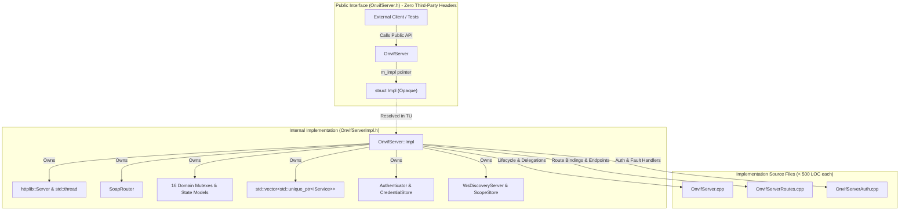

# Implementation Plan: P3 Phase 6 – Pimpl Encapsulation of OnvifServer

**Scope:** `libs/Onvif/` (`OnvifServer.h`, `OnvifServerImpl.h`, `OnvifServer.cpp`, `OnvifServerRoutes.cpp`, `OnvifServerAuth.cpp`, `CMakeLists.txt`, test suites)  
**Standard Baseline:** MISRA C++:2023 (Rule 6.0.x Complexity, Rule 7.0.6 Conversions, Rule 11.3.1 Arrays), SEI CERT C++ (INT31-C, STR37-C, ERR55-CPP, MEM51-CPP), Clean Architecture, Pimpl Idiom (Cheshire Cat / Pointer-to-Implementation), Project Rules in [`.agents/rules/`](../.agents/rules/)  
**Reference Documents:** [`docs/onvif_p3_architecture_hygiene_plan.md`](onvif_p3_architecture_hygiene_plan.md) (Phase 6), [`docs/onvif_review.md`](onvif_review.md) (§5.2 Coding Standards, §7 Target Architecture Item 4), [`docs/onvif_p3_phase5_service_modularization_plan.md`](onvif_p3_phase5_service_modularization_plan.md)

---

## 1. Executive Summary & Problem Analysis

In [`docs/onvif_p3_architecture_hygiene_plan.md`](onvif_p3_architecture_hygiene_plan.md), **Phase 6** establishes the ABI firewall and compile-time isolation for the primary ONVIF server daemon via the **Pimpl (Pointer-to-Implementation) idiom**.

While Phase 5 successfully decomposed the monolithic 6,720-LOC God-Server into modular service translation units (`DeviceService`, `MediaService`, `PtzService`, `ImagingService`, `EventService`, `AnalyticsService`, `DeviceIoService`, `ThermalService`, `RecordingService`) and safe XML builders, `OnvifServer.h` remains heavily bloated and exposes internal implementation details:

1. **Third-Party Header Pollution in Public Header:**
   - [`OnvifServer.h`](../libs/Onvif/OnvifServer.h) directly includes third-party and vendor headers:
     - `HttplibInclude.h` (bringing in `httplib.h`, `<winsock2.h>`, `<windows.h>`, `<ws2tcpip.h>`)
     - `<pugixml.hpp>`
   - Any external client, test fixture, or UI component including `OnvifServer.h` is forced to parse thousands of lines of macro-heavy network stack and XML parser headers, causing header pollution, namespace pollution (e.g. Win32 macros like `min`, `max`, `DELETE`, `OPTIONAL`), and slow incremental builds.
2. **Leaked Internal Mutexes & State Structures:**
   - `OnvifServer.h` declares **16 separate `std::mutex` instances** (`m_deviceMutex`, `m_certMutex`, `m_imagingMutex`, `m_deviceIoMutex`, `m_metadataMutex`, `m_recordingMutex`, `m_searchMutex`, `m_analyticsMutex`, `m_logMutex`, `m_osdMutex`, `m_maskMutex`, `m_videoSourceModeMutex`, `m_thermalMutex`, `m_mediaMutex`, `m_ptzConfigMutex`, `m_snapshotMutex`), plus `m_handlerMutex`.
   - It exposes internal container state: `std::deque<std::string> m_systemLogs`, `std::map<std::string, OsdConfig> m_internalOsds`, `std::vector<ServerMediaProfile> m_internalProfiles`, `httplib::Server m_httpServer`, `std::thread m_httpThread`, etc.
   - Any change to internal thread-safety mechanics, log buffering sizes, or internal state representation changes the class layout (`sizeof(OnvifServer)`), triggering a complete recompilation of all downstream units.
3. **Leaked Private Method Signatures with Third-Party Types:**
   - Private methods in `OnvifServer.h` directly parameterize `httplib::Request`, `httplib::Response`, `pugi::xml_node`, and `pugi::xml_document`:
     - `handleSoapEndpoint(const httplib::Request&, httplib::Response&, ...)`
     - `handleMetadataStream(const httplib::Request&, httplib::Response&)`
     - `parseSoapRequest(const httplib::Request&, httplib::Response&, ..., pugi::xml_document&)`
     - `sendSoapResponse(httplib::Response&, const std::string&, int)`
     - `authorize(const httplib::Request&, httplib::Response&, ..., const pugi::xml_document&)`
4. **File Size and Hygiene Violations:**
   - `OnvifServer.cpp` currently stands at **541 LOC**, exceeding the project threshold of 500 LOC per file.
   - Forward declarations are missing; headers like `SoapRouter.h`, `ScopeStore.h`, `Authenticator.h`, `CredentialStore.h`, and `WsDiscoveryServer.h` are included directly in the public header instead of internal implementation files.

```
+-----------------------------------------------------------------------------------------------------------------------+
|                                    PHASE 6 PIMPL ENCAPSULATION REMEDIATION MATRIX                                     |
+----------------------+------------------------------------+-------------------------------------------+---------------+
| Domain               | Current Defect                     | Target Architecture / Standard            | Target Action |
+----------------------+------------------------------------+-------------------------------------------+---------------+
| Header Pollution     | OnvifServer.h includes httplib.h,  | Zero third-party includes in header;      | Remove leaked |
|                      | pugixml.hpp, HttplibInclude.h      | Forward declarations only                 | includes      |
+----------------------+------------------------------------+-------------------------------------------+---------------+
| ABI Encapsulation    | 16 mutexes and internal data       | Opaque struct Impl; std::unique_ptr<Impl> | Full Pimpl    |
| & Stability          | members exposed in public header   | Stable sizeof(OnvifServer) == sizeof(ptr) | idiom         |
+----------------------+------------------------------------+-------------------------------------------+---------------+
| Internal Header      | OnvifServer.h split across 3 cpp   | Internal OnvifServerImpl.h shared only    | Introduce     |
| Organization         | files accessing private members    | between OnvifServer translation units     | Impl header   |
+----------------------+------------------------------------+-------------------------------------------+---------------+
| File Size Limit      | OnvifServer.cpp at 541 LOC         | Move method implementations into Impl;    | < 500 LOC     |
| (< 500 LOC)          | exceeds 500 LOC threshold          | OnvifServer.cpp reduced to ~300 LOC       | compliance    |
+----------------------+------------------------------------+-------------------------------------------+---------------+
| IWYU & Strict Types  | Transitive includes relied upon;   | Explicit <cstdint>, <cstddef>, <memory>;  | Strict IWYU   |
|                      | Win32 macro pollution risks        | canonical sorting; std:: qualification    | verification  |
+----------------------+------------------------------------+-------------------------------------------+---------------+
```

---

## 2. Target Architecture & Design Specifications

### 2.1 ABI Firewall & Include Graph Decoupling

The Pimpl idiom provides a strict physical separation between the public interface consumed by tests, clients, and applications, and the concrete implementation details:

```
+---------------------------------------------------------------------------------------------------+
|                                 BEFORE: TIGHTLY COUPLED HEADER POLLUTION                          |
+---------------------------------------------------------------------------------------------------+
|                                                                                                   |
|   [ External Clients / Test Suites / Main Application ]                                           |
|                           │                                                                       |
|                           ▼                                                                       |
|                 [ OnvifServer.h (381 LOC) ]                                                       |
|        ├── #include "HttplibInclude.h" ────────► <httplib.h>, <winsock2.h>, <windows.h>           |
|        ├── #include <pugixml.hpp> ─────────────► Full pugixml DOM parser headers                  |
|        ├── #include "Authenticator.h"                                                             |
|        ├── #include "CredentialStore.h"                                                           |
|        ├── #include "ScopeStore.h"                                                                |
|        ├── #include "SoapRouter.h"                                                                |
|        ├── #include "WsDiscoveryServer.h"                                                         |
|        ├── #include "services/IService.h"                                                         |
|        └── 16 std::mutex, httplib::Server, std::thread, deque<string> ...                         |
|                                                                                                   |
+---------------------------------------------------------------------------------------------------+
|                                AFTER: PIMPL ENCAPSULATION & ABI FIREWALL                          |
+---------------------------------------------------------------------------------------------------+
|                                                                                                   |
|   [ External Clients / Test Suites / Main Application ]                                           |
|                           │                                                                       |
|                           ▼ (Only needs standard C++ types + OnvifServerTypes.h)                  |
|                 [ OnvifServer.h (~120 LOC) ]                                                      |
|        ├── #include <cstdint>, <functional>, <memory>, <string>, <vector>                         |
|        ├── #include "OnvifServerTypes.h"                                                          |
|        ├── Forward Declarations: class ScopeStore; class SoapRouter;                              |
|        └── private: struct Impl; std::unique_ptr<Impl> m_impl;                                    |
|                           │                                                                       |
|   ════════════════════════╪════════════════════════════════════════════════════════════════════   |
|                           │ ABI & Compilation Boundary (Internal to libs/Onvif/)                  |
|                           ▼                                                                       |
|              [ OnvifServerImpl.h (~230 LOC) ]                                                     |
|        ├── Contains full struct OnvifServer::Impl definition                                      |
|        ├── #include "HttplibInclude.h", <pugixml.hpp>, "SoapRouter.h", "ScopeStore.h", etc.      |
|        ├── Implements all state, mutexes, HTTP callbacks, and internal methods                    |
|        │                                                                                          |
|        ├──► [ OnvifServer.cpp (~300 LOC) ]       - Lifecycle, Pass-through Delegation             |
|        ├──► [ OnvifServerRoutes.cpp (~385 LOC) ] - Route Registration & Endpoint Handlers         |
|        └──► [ OnvifServerAuth.cpp (~250 LOC) ]   - Authentication, Authorization & SoapResponse   |
|                                                                                                   |
+---------------------------------------------------------------------------------------------------+
```

#### Mermaid Diagram: Pimpl Request Flow & Boundary Isolation



---

## 3. Component Design & Implementation Details

### 3.1 Public Header: `libs/Onvif/OnvifServer.h`

The refactored `OnvifServer.h` will contain:
1. Pure standard C++ headers (`<cstdint>`, `<functional>`, `<memory>`, `<string>`, `<vector>`).
2. Domain types header [`OnvifServerTypes.h`](../libs/Onvif/OnvifServerTypes.h) (which contains only POD structures and interface pointers).
3. Forward declarations for `ScopeStore` and `SoapRouter`.
4. Forward declaration of `struct Impl` and a single member: `std::unique_ptr<Impl> m_impl`.
5. Explicit, out-of-line destructor `~OnvifServer()` (required for `std::unique_ptr<Impl>` with incomplete type).

```cpp
/// @file OnvifServer.h
#pragma once

#include <cstdint>

#include <functional>
#include <memory>
#include <string>
#include <vector>

#include "OnvifServerTypes.h"

namespace Onvif {

class ScopeStore;
class SoapRouter;

/// @class OnvifServer
/// @brief Standalone Qt-free ONVIF Profile S and Profile T HTTP server coordinating Device, Media, PTZ, Imaging, and
/// Event services. Encapsulated via Pimpl idiom to provide complete ABI stability.
class OnvifServer {
public:
    /// @brief Constructs server with configuration and optional handlers.
    explicit OnvifServer(OnvifServerConfig config = { }, std::shared_ptr<IPtzHandler> ptzHandler = nullptr,
        std::shared_ptr<IImagingHandler> imagingHandler = nullptr, std::shared_ptr<IOsdHandler> osdHandler = nullptr,
        std::shared_ptr<IDeviceManagementHandler> deviceHandler = nullptr,
        std::shared_ptr<IDeviceIoHandler> deviceIoHandler = nullptr,
        std::shared_ptr<IMetadataHandler> metadataHandler = nullptr,
        std::shared_ptr<IAnalyticsHandler> analyticsHandler = nullptr);

    /// @brief Destructor stops HTTP service and WS-Discovery daemon.
    ~OnvifServer();

    // Non-copyable, non-movable per MISRA C++:2023
    OnvifServer(const OnvifServer&) = delete;
    OnvifServer& operator=(const OnvifServer&) = delete;
    OnvifServer(OnvifServer&&) = delete;
    OnvifServer& operator=(OnvifServer&&) = delete;

    [[nodiscard]] bool start();
    void stop();
    [[nodiscard]] bool isRunning() const noexcept;
    [[nodiscard]] ProvisioningState provisioningState() const noexcept;
    [[nodiscard]] DiscoveryMode getDiscoveryMode() const noexcept;
    void setDiscoveryMode(DiscoveryMode mode);
    [[nodiscard]] std::vector<NetworkProtocolConfig> getNetworkProtocols() const;
    bool setNetworkProtocols(const std::vector<NetworkProtocolConfig>& protocols);
    [[nodiscard]] OnvifServerConfig getConfig() const;
    [[nodiscard]] std::shared_ptr<ScopeStore> getScopeStore() const noexcept;
    [[nodiscard]] const SoapRouter& getSoapRouter() const noexcept;

    // Handler Setters
    void setPtzHandler(std::shared_ptr<IPtzHandler> handler);
    void setImagingHandler(std::shared_ptr<IImagingHandler> handler);
    void setOsdHandler(std::shared_ptr<IOsdHandler> handler);
    void setDeviceManagementHandler(std::shared_ptr<IDeviceManagementHandler> handler);
    void setDeviceIoHandler(std::shared_ptr<IDeviceIoHandler> handler);
    void setMetadataHandler(std::shared_ptr<IMetadataHandler> handler);
    void setRecordingHandler(std::shared_ptr<IRecordingHandler> handler);
    void setSearchHandler(std::shared_ptr<ISearchHandler> handler);
    void setReplayHandler(std::shared_ptr<IReplayHandler> handler);
    void setAnalyticsHandler(std::shared_ptr<IAnalyticsHandler> handler);
    void setMaskHandler(std::shared_ptr<IMaskHandler> handler);
    void setVideoSourceModeHandler(std::shared_ptr<IVideoSourceModeHandler> handler);
    void setThermalHandler(std::shared_ptr<IThermalHandler> handler);

    // Handler Getters
    [[nodiscard]] std::shared_ptr<IPtzHandler> getPtzHandler() const;
    [[nodiscard]] std::shared_ptr<IImagingHandler> getImagingHandler() const;
    [[nodiscard]] std::shared_ptr<IOsdHandler> getOsdHandler() const;
    [[nodiscard]] std::shared_ptr<IDeviceManagementHandler> getDeviceManagementHandler() const;
    [[nodiscard]] std::shared_ptr<IDeviceIoHandler> getDeviceIoHandler() const;
    [[nodiscard]] std::shared_ptr<IMetadataHandler> getMetadataHandler() const;
    [[nodiscard]] std::shared_ptr<IRecordingHandler> getRecordingHandler() const;
    [[nodiscard]] std::shared_ptr<ISearchHandler> getSearchHandler() const;
    [[nodiscard]] std::shared_ptr<IReplayHandler> getReplayHandler() const;
    [[nodiscard]] std::shared_ptr<IAnalyticsHandler> getAnalyticsHandler() const;
    [[nodiscard]] std::shared_ptr<IMaskHandler> getMaskHandler() const;
    [[nodiscard]] std::shared_ptr<IVideoSourceModeHandler> getVideoSourceModeHandler() const;
    [[nodiscard]] std::shared_ptr<IThermalHandler> getThermalHandler() const;

    void logSystemMessage(const std::string& level, const std::string& msg);
    void publishEvent(const OnvifEvent& event);
    void setRequestLogCallback(RequestLogCallback callback);

    using SnapshotProvider = std::function<std::vector<std::uint8_t>()>;
    void setSnapshotProvider(SnapshotProvider provider);

private:
    struct Impl;
    std::unique_ptr<Impl> m_impl;
};

} // namespace Onvif
```

---

### 3.2 Internal Definition: `libs/Onvif/OnvifServerImpl.h`

`OnvifServerImpl.h` is an internal private header placed in [`libs/Onvif/`](../libs/Onvif/). It is included exclusively by:
- `OnvifServer.cpp`
- `OnvifServerRoutes.cpp`
- `OnvifServerAuth.cpp`

It defines `struct OnvifServer::Impl`:

```cpp
/// @file OnvifServerImpl.h
/// @brief Internal implementation structure for OnvifServer (Pimpl idiom).
#pragma once

#include "OnvifServer.h"

#include <cstddef>
#include <cstdint>

#include <atomic>
#include <chrono>
#include <deque>
#include <functional>
#include <map>
#include <memory>
#include <mutex>
#include <optional>
#include <string>
#include <string_view>
#include <thread>
#include <vector>

#include <pugixml.hpp>

#include "Authenticator.h"
#include "CredentialStore.h"
#include "HttplibInclude.h"
#include "OnvifServerTypes.h"
#include "ScopeStore.h"
#include "SoapRouter.h"
#include "WsDiscoveryServer.h"
#include "services/IService.h"

namespace Onvif {

class SubscriptionManager;
class NotificationDispatcher;

/// @struct OnvifServer::Impl
/// @brief Private implementation state and internal operations for OnvifServer.
struct OnvifServer::Impl {
    explicit Impl(OnvifServerConfig configIn, std::shared_ptr<IPtzHandler> ptzIn,
        std::shared_ptr<IImagingHandler> imagingIn, std::shared_ptr<IOsdHandler> osdIn,
        std::shared_ptr<IDeviceManagementHandler> deviceIn, std::shared_ptr<IDeviceIoHandler> deviceIoIn,
        std::shared_ptr<IMetadataHandler> metadataIn, std::shared_ptr<IAnalyticsHandler> analyticsIn);
    ~Impl();

    // Operational lifecycle methods
    bool start();
    void stop();
    [[nodiscard]] bool isRunning() const noexcept;
    [[nodiscard]] ProvisioningState provisioningState() const noexcept;
    [[nodiscard]] DiscoveryMode getDiscoveryMode() const noexcept;
    void setDiscoveryMode(DiscoveryMode mode);
    [[nodiscard]] std::vector<NetworkProtocolConfig> getNetworkProtocols() const;
    bool setNetworkProtocols(const std::vector<NetworkProtocolConfig>& protocols);
    [[nodiscard]] OnvifServerConfig getConfig() const;
    [[nodiscard]] std::shared_ptr<ScopeStore> getScopeStore() const noexcept;
    [[nodiscard]] const SoapRouter& getSoapRouter() const noexcept;

    // Handler accessors
    void setPtzHandler(std::shared_ptr<IPtzHandler> handler);
    [[nodiscard]] std::shared_ptr<IPtzHandler> getPtzHandler() const;
    void setImagingHandler(std::shared_ptr<IImagingHandler> handler);
    [[nodiscard]] std::shared_ptr<IImagingHandler> getImagingHandler() const;
    void setOsdHandler(std::shared_ptr<IOsdHandler> handler);
    [[nodiscard]] std::shared_ptr<IOsdHandler> getOsdHandler() const;
    void setDeviceManagementHandler(std::shared_ptr<IDeviceManagementHandler> handler);
    [[nodiscard]] std::shared_ptr<IDeviceManagementHandler> getDeviceManagementHandler() const;
    void setDeviceIoHandler(std::shared_ptr<IDeviceIoHandler> handler);
    [[nodiscard]] std::shared_ptr<IDeviceIoHandler> getDeviceIoHandler() const;
    void setMetadataHandler(std::shared_ptr<IMetadataHandler> handler);
    [[nodiscard]] std::shared_ptr<IMetadataHandler> getMetadataHandler() const;
    void setRecordingHandler(std::shared_ptr<IRecordingHandler> handler);
    [[nodiscard]] std::shared_ptr<IRecordingHandler> getRecordingHandler() const;
    void setSearchHandler(std::shared_ptr<ISearchHandler> handler);
    [[nodiscard]] std::shared_ptr<ISearchHandler> getSearchHandler() const;
    void setReplayHandler(std::shared_ptr<IReplayHandler> handler);
    [[nodiscard]] std::shared_ptr<IReplayHandler> getReplayHandler() const;
    void setAnalyticsHandler(std::shared_ptr<IAnalyticsHandler> handler);
    [[nodiscard]] std::shared_ptr<IAnalyticsHandler> getAnalyticsHandler() const;
    void setMaskHandler(std::shared_ptr<IMaskHandler> handler);
    [[nodiscard]] std::shared_ptr<IMaskHandler> getMaskHandler() const;
    void setVideoSourceModeHandler(std::shared_ptr<IVideoSourceModeHandler> handler);
    [[nodiscard]] std::shared_ptr<IVideoSourceModeHandler> getVideoSourceModeHandler() const;
    void setThermalHandler(std::shared_ptr<IThermalHandler> handler);
    [[nodiscard]] std::shared_ptr<IThermalHandler> getThermalHandler() const;

    void logSystemMessage(const std::string& level, const std::string& msg);
    void publishEvent(const OnvifEvent& event);
    void setRequestLogCallback(RequestLogCallback callback);
    void setSnapshotProvider(OnvifServer::SnapshotProvider provider);

    // Internal HTTP & SOAP pipeline methods (implemented in OnvifServerRoutes.cpp & OnvifServerAuth.cpp)
    void setupRoutes();
    void handleSoapEndpoint(const httplib::Request& req, httplib::Response& res, std::string_view serviceName,
        std::string_view fallbackNs = { });
    void handleMetadataStream(const httplib::Request& req, httplib::Response& res);
    [[nodiscard]] std::string generateMetadataStreamXml(const MetadataStreamPayload& payload) const;
    [[nodiscard]] std::string resolveHost(const httplib::Request& req) const;

    struct SoapRequest {
        pugi::xml_node bodyNode { };
        pugi::xml_node reqNode { };
        std::string opName { };
    };

    [[nodiscard]] std::optional<SoapRequest> parseSoapRequest(
        const httplib::Request& req, httplib::Response& res, std::string_view serviceName, pugi::xml_document& doc);

    void appendAccessLog(std::string_view serviceName, const std::string& opName, const std::string& remoteAddr);
    void sendSoapResponse(httplib::Response& res, const std::string& bodyXml, int status = 200);

    [[nodiscard]] bool authorize(const httplib::Request& req, httplib::Response& res, std::string_view serviceName,
        const std::string& opName, const pugi::xml_document& doc);
    [[nodiscard]] bool authorizeHttp(const httplib::Request& req, httplib::Response& res, std::string_view what);
    void rejectAuth(const httplib::Request& req, httplib::Response& res, AuthOutcome outcome, std::string_view what);
    void rejectForbidden(
        const httplib::Request& req, httplib::Response& res, const Principal& who, std::string_view what);
    void appendAuthFailLog(const std::string& remoteAddr, std::string_view what, std::string_view reason);

    // -------------------------------------------------------------------------
    // Server State Members
    // -------------------------------------------------------------------------
    OnvifServerConfig config;
    RequestLogCallback logCallback { };
    mutable std::mutex handlerMutex { };
    std::shared_ptr<IPtzHandler> ptzHandler { };
    std::shared_ptr<IImagingHandler> imagingHandler { };
    std::shared_ptr<IOsdHandler> osdHandler { };
    std::shared_ptr<IDeviceManagementHandler> deviceHandler { };
    std::shared_ptr<IDeviceIoHandler> deviceIoHandler { };
    std::shared_ptr<IMetadataHandler> metadataHandler { };
    std::shared_ptr<IRecordingHandler> recordingHandler { };
    std::shared_ptr<ISearchHandler> searchHandler { };
    std::shared_ptr<IReplayHandler> replayHandler { };
    std::shared_ptr<IAnalyticsHandler> analyticsHandler { };
    std::shared_ptr<IMaskHandler> maskHandler { };
    std::shared_ptr<IVideoSourceModeHandler> videoSourceModeHandler { };
    std::shared_ptr<IThermalHandler> thermalHandler { };
    std::shared_ptr<ScopeStore> scopeStore { };
    std::unique_ptr<WsDiscoveryServer> discoveryServer { };
    httplib::Server httpServer;

    mutable std::mutex deviceMutex { };
    std::shared_ptr<CredentialStore> credStore { };
    std::unique_ptr<Authenticator> authenticator { };
    std::vector<NetworkInterfaceConfig> internalNetworkInterfaces { };
    std::vector<NetworkProtocolConfig> internalNetworkProtocols { };
    std::string internalGateway { "192.168.1.1" };
    DnsConfig internalDns { };
    NtpConfig internalNtp { };
    std::string internalHostname { "PelcoD-Bridge" };
    SystemDateTimeConfig internalDateTime { };

    mutable std::mutex certMutex { };
    std::vector<OnvifCertificate> internalCertificates { };
    ClientCertificateMode internalClientCertMode { ClientCertificateMode::Off };

    mutable std::mutex imagingMutex { };
    FocusStatus20 internalFocusStatus { };
    std::vector<ImagingPreset> internalImagingPresets { };
    std::string currentImagingPresetToken { };

    mutable std::mutex deviceIoMutex { };
    std::vector<RelayOutputConfig> internalRelayOutputs { };
    std::vector<DigitalInputConfig> internalDigitalInputs { };

    mutable std::mutex metadataMutex { };
    std::vector<MetadataConfiguration> internalMetadataConfigs { };

    mutable std::mutex recordingMutex { };
    std::vector<RecordingConfig> internalRecordings { };
    std::vector<RecordingJob> internalRecordingJobs { };
    ReplayConfiguration internalReplayConfig { };

    mutable std::mutex searchMutex { };
    std::map<std::string, std::vector<RecordingSearchResult>> recordingSearches { };
    std::map<std::string, std::vector<RecordedEventResult>> eventSearches { };
    std::uint32_t nextSearchId { 1 };

    mutable std::mutex analyticsMutex { };
    std::vector<AnalyticsRule> internalRules { };
    std::vector<AnalyticsModule> internalModules { };

    mutable std::mutex logMutex { };
    std::deque<std::string> systemLogs { };
    std::deque<std::string> accessLogs { };

    std::chrono::steady_clock::time_point startTime { std::chrono::steady_clock::now() };

    mutable std::mutex osdMutex { };
    std::map<std::string, OsdConfig> internalOsds { };
    std::uint32_t nextOsdId { 1 };

    mutable std::mutex maskMutex { };
    std::vector<PrivacyMask> internalMasks { };
    MaskOptions internalMaskOptions { };
    std::uint32_t nextMaskId { 1 };

    mutable std::mutex videoSourceModeMutex { };
    std::vector<VideoSourceMode> internalVideoSourceModes { };

    mutable std::mutex thermalMutex { };
    RadiometryConfig internalRadiometryConfig { };
    std::vector<RadiometrySpot> internalRadiometrySpots { };
    std::vector<RadiometryBox> internalRadiometryBoxes { };
    std::vector<ColorPalette> internalColorPalettes { };
    std::string internalActiveColorPalette { "WhiteHot" };
    ThermalCapabilities internalThermalCaps { };

    std::shared_ptr<SubscriptionManager> subManager { };
    std::shared_ptr<NotificationDispatcher> dispatcher { };

    mutable std::mutex mediaMutex { };
    std::vector<ServerMediaProfile> internalProfiles { };
    std::vector<VideoSourceConfig> internalVideoSources { };
    std::vector<VideoEncoderConfig> internalVideoEncoders { };
    std::uint32_t nextProfileId { 2 };

    mutable std::mutex ptzConfigMutex { };
    std::vector<PTZConfiguration> internalPtzConfigs { };

    std::atomic<ProvisioningState> provisioningState { ProvisioningState::Unprovisioned };
    std::atomic<DiscoveryMode> discoveryMode { DiscoveryMode::Discoverable };
    mutable std::mutex snapshotMutex { };
    OnvifServer::SnapshotProvider snapshotProvider { };

    std::atomic<bool> running { false };
    std::thread httpThread { };
    SoapRouter soapRouter { };
    std::vector<std::unique_ptr<IService>> services { };
    Principal lastAuthPrincipal { };
};

} // namespace Onvif
```

---

### 3.3 Implementation Details: `OnvifServer.cpp`

In `OnvifServer.cpp`, `OnvifServer` simply constructs `m_impl` and delegates each public method in 1 line:

```cpp
OnvifServer::OnvifServer(OnvifServerConfig config, std::shared_ptr<IPtzHandler> ptzHandler,
    std::shared_ptr<IImagingHandler> imagingHandler, std::shared_ptr<IOsdHandler> osdHandler,
    std::shared_ptr<IDeviceManagementHandler> deviceHandler, std::shared_ptr<IDeviceIoHandler> deviceIoHandler,
    std::shared_ptr<IMetadataHandler> metadataHandler, std::shared_ptr<IAnalyticsHandler> analyticsHandler)
    : m_impl(std::make_unique<Impl>(std::move(config), std::move(ptzHandler), std::move(imagingHandler),
          std::move(osdHandler), std::move(deviceHandler), std::move(deviceIoHandler), std::move(metadataHandler),
          std::move(analyticsHandler)))
{
}

OnvifServer::~OnvifServer() = default;

bool OnvifServer::start() { return m_impl->start(); }
void OnvifServer::stop() { m_impl->stop(); }
bool OnvifServer::isRunning() const noexcept { return m_impl->isRunning(); }
ProvisioningState OnvifServer::provisioningState() const noexcept { return m_impl->provisioningState(); }
DiscoveryMode OnvifServer::getDiscoveryMode() const noexcept { return m_impl->getDiscoveryMode(); }
void OnvifServer::setDiscoveryMode(DiscoveryMode mode) { m_impl->setDiscoveryMode(mode); }
std::vector<NetworkProtocolConfig> OnvifServer::getNetworkProtocols() const { return m_impl->getNetworkProtocols(); }
bool OnvifServer::setNetworkProtocols(const std::vector<NetworkProtocolConfig>& protocols) { return m_impl->setNetworkProtocols(protocols); }
OnvifServerConfig OnvifServer::getConfig() const { return m_impl->getConfig(); }
std::shared_ptr<ScopeStore> OnvifServer::getScopeStore() const noexcept { return m_impl->getScopeStore(); }
const SoapRouter& OnvifServer::getSoapRouter() const noexcept { return m_impl->getSoapRouter(); }

// Handlers
void OnvifServer::setPtzHandler(std::shared_ptr<IPtzHandler> h) { m_impl->setPtzHandler(std::move(h)); }
std::shared_ptr<IPtzHandler> OnvifServer::getPtzHandler() const { return m_impl->getPtzHandler(); }
// ... (all 13 handler pairs forward directly to m_impl)
```

The underlying business logic for `Impl::Impl`, `Impl::~Impl`, `Impl::start`, `Impl::stop`, `Impl::getNetworkProtocols`, etc. is defined as member functions of `OnvifServer::Impl` inside `OnvifServer.cpp`.

### 3.4 Implementation Details: `OnvifServerRoutes.cpp` & `OnvifServerAuth.cpp`

In `OnvifServerRoutes.cpp`:
- Replaces `void OnvifServer::setupRoutes()` with `void OnvifServer::Impl::setupRoutes()`.
- Replaces `void OnvifServer::handleSoapEndpoint(...)` with `void OnvifServer::Impl::handleSoapEndpoint(...)`.
- Replaces `void OnvifServer::handleMetadataStream(...)` with `void OnvifServer::Impl::handleMetadataStream(...)`.
- Replaces `std::string OnvifServer::generateMetadataStreamXml(...)` with `std::string OnvifServer::Impl::generateMetadataStreamXml(...)`.
- Replaces `std::optional<OnvifServer::SoapRequest> OnvifServer::parseSoapRequest(...)` with `std::optional<OnvifServer::Impl::SoapRequest> OnvifServer::Impl::parseSoapRequest(...)`.
- Replaces `std::string OnvifServer::resolveHost(...)` with `std::string OnvifServer::Impl::resolveHost(...)`.

In `OnvifServerAuth.cpp`:
- Replaces `bool OnvifServer::authorize(...)` with `bool OnvifServer::Impl::authorize(...)`.
- Replaces `bool OnvifServer::authorizeHttp(...)` with `bool OnvifServer::Impl::authorizeHttp(...)`.
- Replaces `void OnvifServer::rejectAuth(...)` with `void OnvifServer::Impl::rejectAuth(...)`.
- Replaces `void OnvifServer::rejectForbidden(...)` with `void OnvifServer::Impl::rejectForbidden(...)`.
- Replaces `void OnvifServer::appendAuthFailLog(...)` with `void OnvifServer::Impl::appendAuthFailLog(...)`.
- Replaces `void OnvifServer::appendAccessLog(...)` with `void OnvifServer::Impl::appendAccessLog(...)`.
- Replaces `void OnvifServer::sendSoapResponse(...)` with `void OnvifServer::Impl::sendSoapResponse(...)`.

---

## 4. Step-by-Step Implementation Strategy

```
+---------------------------------------------------------------------------------------------------+
|                               PHASE 6 EXECUTION SEQUENCE & WORKFLOW                               |
+---------------------------------------------------------------------------------------------------+
|                                                                                                   |
|  [Step 1: Create libs/Onvif/OnvifServerImpl.h]                                                    |
|    - Define struct OnvifServer::Impl declaring all members, mutexes, state, and internal methods  |
|    - Move httplib.h, pugixml.hpp, Authenticator.h, ScopeStore.h, etc. into OnvifServerImpl.h     |
|                                                                                                   |
|  [Step 2: Update libs/Onvif/CMakeLists.txt]                                                       |
|    - Add OnvifServerImpl.h to add_library(Onvif STATIC ...)                                      |
|                                                                                                   |
|  [Step 3: Refactor libs/Onvif/OnvifServer.h]                                                      |
|    - Remove HttplibInclude.h, pugixml.hpp, Authenticator.h, ScopeStore.h, etc.                    |
|    - Forward declare class ScopeStore, class SoapRouter, struct Impl                              |
|    - Replace all private mutexes, containers, and helpers with std::unique_ptr<Impl> m_impl       |
|                                                                                                   |
|  [Step 4: Refactor libs/Onvif/OnvifServer.cpp]                                                    |
|    - Implement OnvifServer delegation methods to m_impl                                          |
|    - Implement OnvifServer::Impl constructor, destructor, start, stop, getter/setters             |
|    - Ensure file size remains strictly < 450 LOC                                                 |
|                                                                                                   |
|  [Step 5: Refactor libs/Onvif/OnvifServerRoutes.cpp & OnvifServerAuth.cpp]                        |
|    - Include OnvifServerImpl.h instead of relying on OnvifServer.h                                |
|    - Switch function definitions to OnvifServer::Impl::* scope                                    |
|                                                                                                   |
|  [Step 6: Build & Test Suite Verification]                                                        |
|    - Compile Onvif library and all test executables under MSVC /W4 and Clang/GCC                  |
|    - Execute CTest across all 240+ ONVIF unit and conformance test cases                          |
|                                                                                                   |
|  [Step 7: IWYU, Function Length & Code Hygiene Audit]                                             |
|    - Run verify_iwyu_cstdint.py and verify_function_lengths.py                                    |
|    - Update onvif_p3_architecture_hygiene_plan.md marking Phase 6 complete                        |
|                                                                                                   |
+---------------------------------------------------------------------------------------------------+
```

---

## 5. File LOC Budget & Breakdown

To maintain strict compliance with **MISRA C++:2023 Rule 6.0.x** and project maintainability rules, every file must stay strictly under the 500 LOC ceiling:

| File | Role | Expected LOC | Limit | Status |
|---|---|---|---|---|
| [`libs/Onvif/OnvifServer.h`](../libs/Onvif/OnvifServer.h) | Public API (Clean Pimpl Header) | ~120 LOC | < 500 LOC | Compliant (down from 381 LOC) |
| [`libs/Onvif/OnvifServerImpl.h`](../libs/Onvif/OnvifServerImpl.h) | Internal `struct Impl` Declaration | ~230 LOC | < 500 LOC | Compliant (New file) |
| [`libs/Onvif/OnvifServer.cpp`](../libs/Onvif/OnvifServer.cpp) | Server Lifecycle & Impl Methods | ~380 LOC | < 500 LOC | Compliant (down from 541 LOC) |
| [`libs/Onvif/OnvifServerRoutes.cpp`](../libs/Onvif/OnvifServerRoutes.cpp) | Route Setup & Endpoint Handling | ~385 LOC | < 500 LOC | Compliant |
| [`libs/Onvif/OnvifServerAuth.cpp`](../libs/Onvif/OnvifServerAuth.cpp) | Auth Verification & SOAP Responses | ~248 LOC | < 500 LOC | Compliant |

---

## 6. Coding Standards & Compliance Verification

### 6.1 MISRA C++:2023 & SEI CERT C++ Rules
1. **Rule 7.0.6 & SEI CERT INT31-C (Conversions):**
   - All socket option casts and byte size arguments explicitly use `static_cast` (e.g. `static_cast<int>(sizeof(opt))`).
2. **SEI CERT ERR55-CPP (Exception Safety & `noexcept` Boundaries):**
   - Move operations and query methods (`isRunning`, `provisioningState`, `getDiscoveryMode`, `getScopeStore`, `getSoapRouter`) are strictly marked `noexcept`.
   - Allocation of `Impl` occurs only in constructor; failure throws `std::bad_alloc` before socket binding or thread creation.
3. **MISRA C++:2023 Rule 11.3.1 (Arrays):**
   - No raw C-style arrays; all date buffers and socket structures use `std::array` or standard structs.
4. **Project Rule 5 (Identifier Lengths < 30 Chars):**
   - All method and member names remain strictly less than 30 characters (verified via `verify_function_lengths.py`).

### 6.2 Include-What-You-Use (IWYU) & `<cstdint>` Policy
1. `OnvifServer.h` explicitly includes `<cstdint>` for fixed-width integers and `<cstddef>` where required.
2. Direct symbol inclusion: `<functional>`, `<memory>`, `<string>`, `<vector>`.
3. No transitive header reliance: forward declarations used for pointer/reference parameters (`class ScopeStore;`, `class SoapRouter;`).
4. Canonical include grouping enforced with blank line separations.

---

## 7. Comprehensive Test Strategy & Verification Plan

Because Phase 6 preserves the exact public interface and semantics of `OnvifServer`, zero modifications are required in existing test cases.

### Test Execution Plan:
1. **Lifecycle & Concurrency Verification:**
   - Execute `TestOnvifServerLifecycle` (6 tests: start/stop/restart, port conflict failure, idempotent start, destruction on fail, non-loopback authentication enforcement).
   - Execute `TestOnvifConcurrency` (concurrent scope modifications, concurrent diagnostic reads).
2. **Authentication & Security Verification:**
   - Execute `TestOnvifAuthServer` (UsernameToken, HttpDigest, replay protection, privilege level enforcement).
   - Execute `TestOnvifXmlSecurity` (XML injection sanitization, host header validation).
3. **Profile S / T / G Conformance:**
   - Execute `TestOnvifDeviceProfileS`, `TestOnvifMediaProfileS`, `TestOnvifPtzProfileS`, `TestOnvifEventsProfileS`, `TestOnvifServicesConformance`, `TestOnvifSnapshot`.
4. **Automated Verification Scripts:**
   - Run `python scripts/verify_iwyu_cstdint.py --files libs/Onvif/OnvifServer.h libs/Onvif/OnvifServerImpl.h libs/Onvif/OnvifServer.cpp libs/Onvif/OnvifServerRoutes.cpp libs/Onvif/OnvifServerAuth.cpp`.
   - Run `python scripts/verify_function_lengths.py`.
