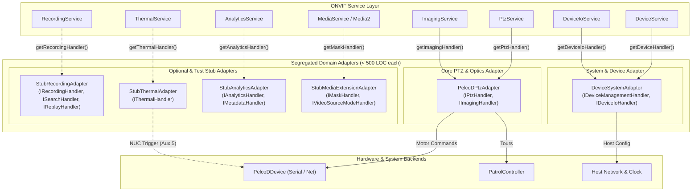

# Implementation Plan: P3 Phase 7 – Interface Segregation of PelcoDPtzAdapter

**Scope:** `libs/Onvif/` (`adapters/PelcoDPtzAdapter.h`, `adapters/PelcoDPtzAdapter.cpp`, `adapters/PelcoDPtzAdapterTours.cpp`, `adapters/DeviceSystemAdapter.h/.cpp`, `adapters/StubRecordingAdapter.h/.cpp`, `adapters/StubThermalAdapter.h/.cpp`, `adapters/StubAnalyticsAdapter.h/.cpp`, `adapters/StubMediaExtensionAdapter.h/.cpp`, `services/DeviceService.h/.cpp`, `services/builders/DeviceXmlBuilder.h/.cpp`, `ServiceRegistry.h/.cpp`, `OnvifServerRoutes.cpp`, `CMakeLists.txt`, test suites)  
**Standard Baseline:** MISRA C++:2023 (Rule 6.0.x Complexity, Rule 7.0.6 Conversions, Rule 11.3.1 Arrays), SEI CERT C++ (INT31-C, STR37-C, ERR55-CPP, MEM51-CPP), ONVIF Core Specification v24.12, ONVIF Profile S / T / G / M, Clean Architecture, Interface Segregation Principle (ISP), Single Responsibility Principle (SRP), Project Rules in [`.agents/rules/`](../.agents/rules/)  
**Reference Documents:** [`docs/onvif_p3_architecture_hygiene_plan.md`](onvif_p3_architecture_hygiene_plan.md) (Phase 7), [`docs/onvif_review.md`](onvif_review.md) (§5 Coding Standards, §7 Target Architecture Item 4, Finding 15 & H8), [`docs/onvif_p3_phase5_service_modularization_plan.md`](onvif_p3_phase5_service_modularization_plan.md), [`docs/onvif_p3_phase6_pimpl_encapsulation_plan.md`](onvif_p3_phase6_pimpl_encapsulation_plan.md)

---

## 1. Executive Summary & Problem Analysis

In [`docs/onvif_p3_architecture_hygiene_plan.md`](onvif_p3_architecture_hygiene_plan.md), **Phase 7** executes the structural decomposition and interface segregation of the adapter layer in `libs/Onvif/adapters/`.

While Phase 5 decomposed the server dispatchers into modular service translation units and Phase 6 established the Pimpl ABI boundary on `OnvifServer`, the device adapter layer retains critical technical debt in [`PelcoDPtzAdapter`](../libs/Onvif/adapters/PelcoDPtzAdapter.h):

1. **Monolithic God-Adapter Anti-Pattern (ISP & SRP Violations):**
   - [`PelcoDPtzAdapter`](../libs/Onvif/adapters/PelcoDPtzAdapter.h) currently inherits from and implements **12 distinct abstract handler interfaces** in a single concrete class:
     ```cpp
     class PelcoDPtzAdapter : public IPtzHandler,
                              public IImagingHandler,
                              public IDeviceIoHandler,
                              public IMetadataHandler,
                              public IDeviceManagementHandler,
                              public IRecordingHandler,
                              public ISearchHandler,
                              public IReplayHandler,
                              public IAnalyticsHandler,
                              public IMaskHandler,
                              public IVideoSourceModeHandler,
                              public IThermalHandler
     ```
   - This violates the **Interface Segregation Principle (ISP)**: clients and services requiring simple PTZ motor control (`IPtzHandler`) are forced to depend on, instantiate, and link against recording track managers, thermal palettes, certificate generation cryptography, and ray-casting polygon math.
2. **Extreme File Size & Structural Complexity:**
   - [`PelcoDPtzAdapter.cpp`](../libs/Onvif/adapters/PelcoDPtzAdapter.cpp) stands at **2,087 LOC** (70 KB), vastly exceeding the project limit of 500 LOC per file.
   - It maintains 35+ member variables covering unrelated domains (JSON tour persistence, auto-stop timer threads, thermal alarm thresholds, fake recording jobs, X.509 certificates, digital inputs, analytics tracks).
3. **Deceptive Profile & Service Advertisement (Finding 15 & §7 Item 4):**
   - Core Pelco-D PTZ hardware control is tightly intertwined with unbacked in-memory stub data:
     - Profile G recording containers and jobs ("Continuous Surveillance Recording", "Track_Video_1") that lack any real media storage or retrieval pipeline.
     - Thermal false-color palettes and radiometry spots advertised on standard optical cameras.
   - In [`DeviceService.cpp`](../libs/Onvif/services/DeviceService.cpp), `ServiceRegistry::createDefault(true, true)` is hardcoded to unconditionally advertise Profile G and Thermal services. Furthermore, [`DeviceXmlBuilder.cpp`](../libs/Onvif/services/builders/DeviceXmlBuilder.cpp) hardcodes `<tt:Recording>`, `<tt:Search>`, `<tt:Replay>`, and `<tt:Thermal>` into `GetCapabilitiesResponse`.
   - Advertising unbacked profiles misleads Video Management Systems (VMS) into attempting non-functional recording and thermal operations.
4. **Lock Contention & Concurrency Bottlenecks:**
   - A single recursive/domain mutex (`m_mutex`) guards presets, preset tours, recording sessions, analytics rule evaluation, certificates, and geolocation.
   - High-frequency video analytics object tracking or tripwire evaluations directly block concurrent PTZ preset recalls, relay queries, and status updates.

```
+-----------------------------------------------------------------------------------------------------------------------+
|                                    PHASE 7 ADAPTER INTERFACE SEGREGATION MATRIX                                       |
+----------------------+------------------------------------+-------------------------------------------+---------------+
| Domain               | Current Defect                     | Target Architecture / Standard            | Target Action |
+----------------------+------------------------------------+-------------------------------------------+---------------+
| Interface Coupling   | PelcoDPtzAdapter implements        | Interface Segregation Principle (ISP);    | Segregate     |
| (ISP Violation)      | 12 abstract handler interfaces     | Single-responsibility adapters per domain | Adapters      |
+----------------------+------------------------------------+-------------------------------------------+---------------+
| Adapter Scope &      | PelcoDPtzAdapter mixes PTZ motor   | PelcoDPtzAdapter strictly scoped to       | Isolate       |
| Core Purpose         | logic with stubs & certificates    | IPtzHandler and IImagingHandler           | PTZ & Optics  |
+----------------------+------------------------------------+-------------------------------------------+---------------+
| System & Device      | System logs, certs, relays, and    | Dedicated DeviceSystemAdapter             | Extract       |
| Management           | geo location embedded in PTZ class | (IDeviceManagementHandler, IDeviceIo)     | DeviceSystem  |
+----------------------+------------------------------------+-------------------------------------------+---------------+
| Unbacked Profile G   | In-memory recording stubs mixed    | Dedicated StubRecordingAdapter            | Extract       |
| Stubs                | with camera motor control          | (IRecordingHandler, ISearch, IReplay)     | StubRecording |
+----------------------+------------------------------------+-------------------------------------------+---------------+
| Thermal Stubs &      | Radiometry spots, boxes, palettes  | Dedicated StubThermalAdapter              | Extract       |
| Radiometry           | mixed with camera motor control    | (IThermalHandler, Pelco-D Aux 5 NUC)      | StubThermal   |
+----------------------+------------------------------------+-------------------------------------------+---------------+
| Analytics &          | Rule engine, polygon intrusion,    | Dedicated StubAnalyticsAdapter            | Extract       |
| Metadata             | loitering, and metadata config     | (IAnalyticsHandler, IMetadataHandler)     | StubAnalytics |
+----------------------+------------------------------------+-------------------------------------------+---------------+
| Media Extensions     | Privacy masks & sensor capture     | Dedicated StubMediaExtensionAdapter       | Extract Media |
|                      | modes embedded in PTZ class        | (IMaskHandler, IVideoSourceModeHandler)   | Extension     |
+----------------------+------------------------------------+-------------------------------------------+---------------+
| Service Advertising  | GetServices & GetCapabilities      | Dynamic capability checking; unbacked     | Guard Service |
| (Finding 15 & §7.4)  | unconditionally advertise G/Thermal| profiles omitted unless handlers bound    | Advertisement |
+----------------------+------------------------------------+-------------------------------------------+---------------+
| File Size Limit      | PelcoDPtzAdapter.cpp at 2,087 LOC; | All resulting adapter files < 500 LOC;    | Modular       |
| (< 500 LOC)          | exceeds 500 LOC limit              | PelcoDPtzAdapter split across 2 TUs       | Translation   |
+----------------------+------------------------------------+-------------------------------------------+---------------+
```

---

## 2. Target Architecture & Design Specifications

### 2.1 Interface Segregation & Component Decoupling

Following the **Interface Segregation Principle (ISP)** and §7 Item 4 of [`docs/onvif_review.md`](onvif_review.md), the monolithic God-Adapter is broken down into focused, decoupled domain components:

```
+---------------------------------------------------------------------------------------------------+
|                              BEFORE: MONOLITHIC GOD-ADAPTER (2,087 LOC)                           |
+---------------------------------------------------------------------------------------------------+
|                                                                                                   |
|                                       PelcoDPtzAdapter                                            |
|   ┌───────────────────────────────────────────────────────────────────────────────────────────┐   |
|   │ - IPtzHandler                 - IImagingHandler           - IDeviceIoHandler              │   |
|   │ - IMetadataHandler            - IDeviceManagementHandler  - IRecordingHandler             │   |
|   │ - ISearchHandler              - IReplayHandler            - IAnalyticsHandler             │   |
|   │ - IMaskHandler                - IVideoSourceModeHandler   - IThermalHandler               │   |
|   └───────────────────────────────────────────────────────────────────────────────────────────┘   |
|                                                                                                   |
+---------------------------------------------------------------------------------------------------+
|                        AFTER: SEGREGATED DOMAIN ADAPTERS (< 500 LOC EACH)                         |
+---------------------------------------------------------------------------------------------------+
|                                                                                                   |
|  [ CORE HARDWARE ADAPTER ]                                                                        |
|  ┌────────────────────────────────────┐                                                           |
|  │          PelcoDPtzAdapter          │ ──► [ PelcoDDevice Core ] (Continuous/Absolute/Relative)  |
|  │  - IPtzHandler                     │ ──► [ PatrolController ] (Preset Tours & Patrols)        |
|  │  - IImagingHandler                 │ ──► [ Focus & Optical Settings ]                          |
|  └────────────────────────────────────┘                                                           |
|                                                                                                   |
|  [ SYSTEM & INFRASTRUCTURE ADAPTER ]                                                              |
|  ┌────────────────────────────────────┐                                                           |
|  │        DeviceSystemAdapter         │ ──► [ Host OS / Network / Clock Configuration ]           |
|  │  - IDeviceManagementHandler        │ ──► [ X.509 Certificates / PKCS#10 CSRs ]                 |
|  │  - IDeviceIoHandler                │ ──► [ Relays / Digital Inputs / GeoLocation ]             |
|  └────────────────────────────────────┘                                                           |
|                                                                                                   |
|  [ MODULAR STUB & OPTIONAL FEATURE ADAPTERS (Unadvertised Unless Bound) ]                         |
|  ┌────────────────────────────────────┐   ┌────────────────────────────────────┐                  |
|  │        StubRecordingAdapter        │   │         StubThermalAdapter         │                  |
|  │  - IRecordingHandler (Profile G)   │   │  - IThermalHandler                 │                  |
|  │  - ISearchHandler (Profile G)      │   │    (Radiometry Spots, Boxes, NUC)  │                  |
|  │  - IReplayHandler (Profile G)      │   └────────────────────────────────────┘                  |
|  └────────────────────────────────────┘                                                           |
|  ┌────────────────────────────────────┐   ┌────────────────────────────────────┐                  |
|  │        StubAnalyticsAdapter        │   │     StubMediaExtensionAdapter      │                  |
|  │  - IAnalyticsHandler (Rules Engine)│   │  - IMaskHandler (Privacy Masks)    │                  |
|  │  - IMetadataHandler (Stream/Config)│   │  - IVideoSourceModeHandler (Modes) │                  |
|  └────────────────────────────────────┘   └────────────────────────────────────┘                  |
|                                                                                                   |
+---------------------------------------------------------------------------------------------------+
```

#### Mermaid Diagram: Target Adapter Architecture & Service Binding



---

## 3. Component Specifications & Interfaces

### 3.1 Refactored Core Adapter: `PelcoDPtzAdapter`

`PelcoDPtzAdapter` is strictly scoped to `IPtzHandler` and `IImagingHandler`. All unbacked mock stubs, certificates, and system management routines are removed.

To guarantee that all implementation units remain strictly below the **500 LOC project limit**, the implementation is split across two translation units:
- `PelcoDPtzAdapter.cpp`: Lifecycle, auto-stop timer, velocity/absolute/relative moves, spherical math, GeoMove, home positions, and optical imaging settings. (~380 LOC)
- `PelcoDPtzAdapterTours.cpp`: Preset store, preset recalls, preset tours, patrol controller integration, and JSON tour persistence. (~240 LOC)

```cpp
/// @file PelcoDPtzAdapter.h
#pragma once

#include <cstdint>
#include <atomic>
#include <chrono>
#include <condition_variable>
#include <map>
#include <memory>
#include <mutex>
#include <optional>
#include <string>
#include <thread>
#include <vector>

#include "OnvifServerTypes.h"
#include <PelcoDCore/PatrolController.h>
#include <PelcoDCore/PelcoDDevice.h>

namespace Onvif {

/// @class PelcoDPtzAdapter
/// @brief Translates ONVIF PTZ and Imaging commands to PelcoDDevice hardware control.
/// @details Implements strictly IPtzHandler and IImagingHandler per Interface Segregation Principle.
class PelcoDPtzAdapter : public IPtzHandler, public IImagingHandler {
public:
    /// @brief Constructs adapter wrapping an existing PelcoDDevice.
    /// @param[in] device Shared pointer to initialized PelcoDDevice instance.
    explicit PelcoDPtzAdapter(std::shared_ptr<PelcoD::PelcoDDevice> device);

    ~PelcoDPtzAdapter() override;

    PelcoDPtzAdapter(const PelcoDPtzAdapter&) = delete;
    PelcoDPtzAdapter& operator=(const PelcoDPtzAdapter&) = delete;
    PelcoDPtzAdapter(PelcoDPtzAdapter&&) = delete;
    PelcoDPtzAdapter& operator=(PelcoDPtzAdapter&&) = delete;

    /// @brief Registers an event publisher callback for preset reached and alarm events.
    /// @param[in] publisher Callback function invoked when alarms or presets trigger.
    void setEventPublisher(EventCallback publisher);

    /// @brief Links a PatrolController for executing Preset Tours.
    /// @param[in] patrol Pointer to initialized PatrolController.
    void setPatrolController(std::shared_ptr<PelcoD::PatrolController> patrol);

    /// @brief Links a PatrolController for executing Preset Tours.
    /// @param[in] patrol Raw pointer to initialized PatrolController.
    void setPatrolController(PelcoD::PatrolController* patrol);

    /// @brief Sets file path for persisting tours across server restarts.
    /// @param[in] path File path for JSON tour database.
    void setPersistencePath(const std::string& path);

    // =========================================================================
    // IPtzHandler Implementation (Profile S & T)
    // =========================================================================

    void handleContinuousMove(float panSpeed, float tiltSpeed, float zoomSpeed,
        std::optional<std::chrono::milliseconds> timeout = std::nullopt) override;

    void handleAbsoluteMove(std::optional<float> pan, std::optional<float> tilt,
        std::optional<float> zoom, const std::string& spaceUri = "") override;

    void handleStop(bool stopPanTilt, bool stopZoom) override;
    [[nodiscard]] std::string handleSetPreset(const std::string& name, const std::string& token) override;
    [[nodiscard]] bool handleGotoPreset(const std::string& token) override;
    [[nodiscard]] bool handleRemovePreset(const std::string& token) override;
    [[nodiscard]] std::vector<PtzPreset> handleGetPresets() override;
    [[nodiscard]] PtzStatus handleGetStatus() override;

    [[nodiscard]] std::vector<PresetTour> handleGetPresetTours() override;
    [[nodiscard]] std::optional<PresetTour> handleGetPresetTour(const std::string& tourToken) override;
    [[nodiscard]] std::string handleCreatePresetTour() override;
    [[nodiscard]] bool handleModifyPresetTour(const PresetTour& tour) override;
    [[nodiscard]] bool handleOperatePresetTour(const std::string& tourToken, PresetTourOperation op) override;
    [[nodiscard]] bool handleRemovePresetTour(const std::string& tourToken) override;

    [[nodiscard]] bool handleRelativeMove(std::optional<float> pan, std::optional<float> tilt,
        std::optional<float> zoom, float speed = 1.0f, const std::string& spaceUri = "") override;
    [[nodiscard]] bool handleGotoHomePosition(float speed = 1.0f) override;
    [[nodiscard]] bool handleSetHomePosition() override;
    [[nodiscard]] std::string handleSendAuxiliaryCommand(const std::string& auxiliaryData) override;
    [[nodiscard]] bool handleGeoMove(const std::string& profileToken, const GeoMoveTarget& target) override;
    void handleAbsoluteMoveSpherical(float azimuthDeg, float elevationDeg, float zoom) override;

    // =========================================================================
    // IImagingHandler Implementation (Profile T)
    // =========================================================================

    [[nodiscard]] ImagingSettings handleGetImagingSettings(const std::string& videoSourceToken) override;
    [[nodiscard]] bool handleSetImagingSettings(
        const std::string& videoSourceToken, const ImagingSettings& settings) override;
    void handleMoveFocus(const std::string& videoSourceToken, float speed) override;
    void handleStopFocus(const std::string& videoSourceToken) override;
    [[nodiscard]] FocusStatus20 handleGetFocusStatus(const std::string& videoSourceToken) override;
    [[nodiscard]] bool handleMoveFocusAdvanced(const std::string& videoSourceToken, const FocusMove& move) override;
    [[nodiscard]] std::vector<ImagingPreset> handleGetImagingPresets(const std::string& videoSourceToken) override;
    [[nodiscard]] bool handleSetCurrentImagingPreset(
        const std::string& videoSourceToken, const std::string& presetToken) override;

private:
    void onDeviceStatusUpdated(const PelcoD::DeviceStatus& status);
    void saveTours();
    void loadTours();

    void timerLoop();
    void armAutoStop(std::chrono::milliseconds timeout);
    void cancelAutoStop();

    std::atomic<bool> m_timerRunning{false};
    std::condition_variable m_timerCv{};
    std::mutex m_timerMutex{};
    std::thread m_timerThread{};
    std::optional<std::chrono::steady_clock::time_point> m_autoStopDeadline{std::nullopt};

    std::shared_ptr<PelcoD::PelcoDDevice> m_device;
    std::shared_ptr<PelcoD::PatrolController> m_sharedPatrol{};
    PelcoD::PatrolController* m_patrol{nullptr};

    mutable std::mutex m_mutex{};
    std::map<std::string, PtzPreset> m_presets{};
    std::uint32_t m_nextPresetId{1U};
    std::map<std::string, PresetTour> m_tours{};
    std::uint32_t m_nextTourId{1U};
    std::string m_persistencePath{"onvif_tours.json"};
    std::atomic<bool> m_isMoving{false};

    EventCallback m_eventPublisher{};
    PelcoD::Connection m_statusConn{};
    std::uint8_t m_lastAlarms{0x00U};
    ImagingSettings m_imagingSettings{};
    std::string m_homePresetToken{"1"};
    float m_homePan{0.0f};
    float m_homeTilt{0.0f};
    float m_homeZoom{0.0f};
    bool m_hasHomeCoordinates{false};
    FocusStatus20 m_focusStatus{};
    std::vector<ImagingPreset> m_imagingPresets{
        {"Preset_Clear", "Clear", "Clear Daylight"},
        {"Preset_BW", "B/W", "Night Vision B/W"}
    };
    std::string m_currentImagingPresetToken{"Preset_Clear"};
};

} // namespace Onvif
```

---

### 3.2 System & Device Management Adapter: `DeviceSystemAdapter`

`DeviceSystemAdapter` manages host OS interfaces, system diagnostics, certificates, digital I/O, and geographic mounting coordinates.

- Header: `libs/Onvif/adapters/DeviceSystemAdapter.h` (~110 LOC)
- Implementation: `libs/Onvif/adapters/DeviceSystemAdapter.cpp` (~270 LOC)

```cpp
/// @file DeviceSystemAdapter.h
#pragma once

#include <cstdint>
#include <mutex>
#include <optional>
#include <string>
#include <vector>

#include "OnvifServerTypes.h"

namespace Onvif {

/// @class DeviceSystemAdapter
/// @brief Manages system-level telemetry, security certificates, relay I/O, and device location.
/// @details Implements IDeviceManagementHandler and IDeviceIoHandler per ISP segregation.
class DeviceSystemAdapter : public IDeviceManagementHandler, public IDeviceIoHandler {
public:
    DeviceSystemAdapter();
    ~DeviceSystemAdapter() override = default;

    DeviceSystemAdapter(const DeviceSystemAdapter&) = delete;
    DeviceSystemAdapter& operator=(const DeviceSystemAdapter&) = delete;
    DeviceSystemAdapter(DeviceSystemAdapter&&) = delete;
    DeviceSystemAdapter& operator=(DeviceSystemAdapter&&) = delete;

    // =========================================================================
    // IDeviceIoHandler Implementation
    // =========================================================================

    [[nodiscard]] std::vector<RelayOutputConfig> handleGetRelayOutputs() override;
    [[nodiscard]] std::vector<std::string> handleGetRelayOutputOptions(const std::string& token) override;
    [[nodiscard]] bool handleSetRelayOutputSettings(
        const std::string& token, const RelayOutputConfig& settings) override;
    [[nodiscard]] bool handleSetRelayOutputState(const std::string& token, RelayLogicalState state) override;
    [[nodiscard]] std::vector<DigitalInputConfig> handleGetDigitalInputs() override;

    // =========================================================================
    // IDeviceManagementHandler Implementation
    // =========================================================================

    [[nodiscard]] std::string handleGetSystemLog(SystemLogType logType) override;
    [[nodiscard]] SystemSupportInfo handleGetSystemSupportInfo() override;
    [[nodiscard]] std::string handleGetSystemBackup() override;
    [[nodiscard]] bool handleRestoreSystem(const std::string& backupData) override;
    [[nodiscard]] std::string handleGetEndpointReference() override;

    [[nodiscard]] std::vector<OnvifCertificate> handleGetCertificates() override;
    [[nodiscard]] std::optional<CertificateInformation> handleGetCertInformation(
        const std::string& certificateId) override;
    [[nodiscard]] OnvifCertificate handleCreateCertificate(
        const std::string& certificateId, const std::string& subject, int daysValid = 365) override;
    [[nodiscard]] Pkcs10Request handleGetPkcs10Request(
        const std::string& certificateId, const std::string& subject) override;
    [[nodiscard]] bool handleLoadCertificates(const std::vector<OnvifCertificate>& certificates) override;
    [[nodiscard]] bool handleDeleteCertificate(const std::string& certificateId) override;
    [[nodiscard]] ClientCertificateMode handleGetClientCertMode() override;
    bool handleSetClientCertMode(ClientCertificateMode mode) override;

    [[nodiscard]] std::optional<LocationEntity> handleGetGeoLocation(const std::string& entityToken) override;
    [[nodiscard]] bool handleSetGeoLocation(const LocationEntity& location) override;
    [[nodiscard]] bool handleDeleteGeoLocation(const std::string& entityToken) override;

    [[nodiscard]] LocationEntity cameraLocation() const;
    void setCameraLocation(const LocationEntity& location);

private:
    mutable std::mutex m_mutex{};
    std::vector<RelayOutputConfig> m_relays{
        {"Relay_1", RelayMode::Bistable, 0.0f, RelayIdleState::Open, RelayLogicalState::Inactive},
        {"Relay_2", RelayMode::Bistable, 0.0f, RelayIdleState::Open, RelayLogicalState::Inactive}
    };
    std::vector<DigitalInputConfig> m_digitalInputs{
        {"Input_1", RelayIdleState::Open, "Alarm", false}
    };
    std::vector<OnvifCertificate> m_certificates{};
    ClientCertificateMode m_clientCertMode{ClientCertificateMode::Off};
    LocationEntity m_cameraLocation{"Device", "Location_1", true, {37.7749, -122.4194, 10.0}, {0.0, 0.0, 0.0}};
};

} // namespace Onvif
```

---

### 3.3 Profile G Stub Adapter: `StubRecordingAdapter`

`StubRecordingAdapter` isolates in-memory Profile G edge recording containers, jobs, search sessions, and RTSP replay configurations. It is designed for unit testing and optional Profile G simulation.

- Header: `libs/Onvif/adapters/StubRecordingAdapter.h` (~95 LOC)
- Implementation: `libs/Onvif/adapters/StubRecordingAdapter.cpp` (~245 LOC)

```cpp
/// @file StubRecordingAdapter.h
#pragma once

#include <cstdint>
#include <map>
#include <mutex>
#include <optional>
#include <string>
#include <vector>

#include "OnvifServerTypes.h"

namespace Onvif {

/// @class StubRecordingAdapter
/// @brief In-memory reference provider for Profile G Recording, Search, and Replay services.
class StubRecordingAdapter : public IRecordingHandler, public ISearchHandler, public IReplayHandler {
public:
    StubRecordingAdapter();
    ~StubRecordingAdapter() override = default;

    // =========================================================================
    // IRecordingHandler Implementation
    // =========================================================================

    [[nodiscard]] std::string handleCreateRecording(const RecordingConfig& config) override;
    [[nodiscard]] std::vector<RecordingConfig> handleGetRecordings() override;
    [[nodiscard]] std::optional<RecordingConfig> handleGetRecordingConfig(const std::string& recordingToken) override;
    bool handleSetRecordingConfig(const std::string& recordingToken, const RecordingConfig& config) override;
    [[nodiscard]] bool handleDeleteRecording(const std::string& recordingToken) override;
    [[nodiscard]] std::vector<RecordingJob> handleGetRecordingJobs() override;
    [[nodiscard]] std::string handleCreateRecordingJob(const RecordingJob& job) override;
    [[nodiscard]] bool handleSetRecordingJobMode(const std::string& jobToken, RecordingJobMode mode) override;
    [[nodiscard]] bool handleDeleteRecordingJob(const std::string& jobToken) override;
    [[nodiscard]] RecordingSummary handleGetRecordingSummary() override;
    [[nodiscard]] std::vector<RecordingTrack> handleGetTracks(const std::string& recordingToken) override;
    [[nodiscard]] std::string handleCreateTrack(
        const std::string& recordingToken, const RecordingTrack& track) override;
    [[nodiscard]] bool handleDeleteTrack(const std::string& recordingToken, const std::string& trackToken) override;

    // =========================================================================
    // ISearchHandler Implementation
    // =========================================================================

    [[nodiscard]] std::string handleFindRecordings(
        const std::string& scope, int maxMatches, const std::string& keepAliveTime) override;
    [[nodiscard]] std::vector<RecordingSearchResult> handleGetRecordingSearch(const std::string& searchToken) override;
    [[nodiscard]] std::string handleFindEvents(
        const std::string& startUtc, const std::string& endUtc, int maxMatches) override;
    [[nodiscard]] std::vector<RecordedEventResult> handleGetEventSearchResults(const std::string& searchToken) override;
    [[nodiscard]] bool handleEndSearch(const std::string& searchToken) override;

    // =========================================================================
    // IReplayHandler Implementation
    // =========================================================================

    [[nodiscard]] std::string handleGetReplayUri(
        const std::string& recordingToken, const std::string& trackToken) override;
    [[nodiscard]] ReplayConfiguration handleGetReplayConfiguration() override;
    [[nodiscard]] bool handleSetReplayConfiguration(const ReplayConfiguration& config) override;

private:
    mutable std::mutex m_mutex{};
    std::vector<RecordingConfig> m_recordings{};
    std::vector<RecordingJob> m_recordingJobs{};
    ReplayConfiguration m_replayConfig{};
    std::map<std::string, std::vector<RecordingSearchResult>> m_recordingSearches{};
    std::map<std::string, std::vector<RecordedEventResult>> m_eventSearches{};
    std::uint32_t m_nextSearchSessionId{1U};
};

} // namespace Onvif
```

---

### 3.4 Thermal Service Stub Adapter: `StubThermalAdapter`

`StubThermalAdapter` encapsulates radiometry parameters, spot meters, measurement boxes, temperature alarm thresholds, false-color palettes, and non-uniformity correction (NUC).

- Header: `libs/Onvif/adapters/StubThermalAdapter.h` (~80 LOC)
- Implementation: `libs/Onvif/adapters/StubThermalAdapter.cpp` (~130 LOC)

```cpp
/// @file StubThermalAdapter.h
#pragma once

#include <memory>
#include <mutex>
#include <string>
#include <vector>

#include "OnvifServerTypes.h"
#include <PelcoDCore/PelcoDDevice.h>

namespace Onvif {

/// @class StubThermalAdapter
/// @brief Provider for ONVIF Thermal Service radiometry, false-color palettes, and NUC trigger.
class StubThermalAdapter : public IThermalHandler {
public:
    explicit StubThermalAdapter(std::shared_ptr<PelcoD::PelcoDDevice> device = nullptr);
    ~StubThermalAdapter() override = default;

    void setEventPublisher(EventCallback publisher);

    [[nodiscard]] RadiometryConfig handleGetRadiometryConfig(const std::string& videoSourceToken) override;
    bool handleSetRadiometryConfig(const std::string& videoSourceToken, const RadiometryConfig& config) override;
    [[nodiscard]] std::vector<RadiometrySpot> handleGetRadiometrySpots(const std::string& videoSourceToken) override;
    bool handleSetRadiometrySpots(
        const std::string& videoSourceToken, const std::vector<RadiometrySpot>& spots) override;
    [[nodiscard]] std::vector<RadiometryBox> handleGetRadiometryBoxes(const std::string& videoSourceToken) override;
    bool handleSetRadiometryBoxes(
        const std::string& videoSourceToken, const std::vector<RadiometryBox>& boxes) override;
    [[nodiscard]] std::vector<ColorPalette> handleGetColorPalettes(const std::string& videoSourceToken) override;
    bool handleSetColorPalette(const std::string& videoSourceToken, const std::string& paletteToken) override;
    bool handleTriggerNuc(const std::string& videoSourceToken) override;

private:
    std::shared_ptr<PelcoD::PelcoDDevice> m_device;
    mutable std::mutex m_mutex{};
    EventCallback m_eventPublisher{};
    RadiometryConfig m_radiometryConfig{};
    std::vector<RadiometrySpot> m_radiometrySpots{
        {"Spot_1", {0.5f, 0.5f}, "Center Spot", 24.5f}
    };
    std::vector<RadiometryBox> m_radiometryBoxes{
        {"Box_1", {0.2f, 0.2f}, {0.8f, 0.8f}, "Central Target Zone", 21.0f, 36.8f, 28.4f}
    };
    std::vector<RadiometryAlarmConfig> m_radiometryAlarms{
        {"Box_1", 50.0f, 2.0f, RadiometryAlarmType::HighTemperature, true}
    };
    std::vector<ColorPalette> m_colorPalettes{
        {"WhiteHot", "White Hot", true},
        {"BlackHot", "Black Hot", false},
        {"Ironbow", "Ironbow", false},
        {"Rainbow", "Rainbow", false},
        {"Sepia", "Sepia", false},
        {"Fire", "Fire", false}
    };
    std::string m_activeColorPalette{"WhiteHot"};
};

} // namespace Onvif
```

---

### 3.5 Video Analytics & Metadata Adapter: `StubAnalyticsAdapter`

`StubAnalyticsAdapter` encapsulates video analytics rules (tripwire line crossing, polygon intrusion, loitering detector), analytics modules, and metadata stream configuration.

- Header: `libs/Onvif/adapters/StubAnalyticsAdapter.h` (~95 LOC)
- Implementation: `libs/Onvif/adapters/StubAnalyticsAdapter.cpp` (~340 LOC)

```cpp
/// @file StubAnalyticsAdapter.h
#pragma once

#include <chrono>
#include <map>
#include <mutex>
#include <optional>
#include <string>
#include <vector>

#include "OnvifServerTypes.h"

namespace Onvif {

/// @class StubAnalyticsAdapter
/// @brief Provider for ONVIF Video Analytics (Profile M & T) and Metadata configuration.
class StubAnalyticsAdapter : public IAnalyticsHandler, public IMetadataHandler {
public:
    StubAnalyticsAdapter();
    ~StubAnalyticsAdapter() override = default;

    void setEventPublisher(EventCallback publisher);

    // =========================================================================
    // IAnalyticsHandler Implementation
    // =========================================================================

    [[nodiscard]] std::vector<AnalyticsRuleDescription> handleGetSupportedRules(
        const std::string& configToken) override;
    [[nodiscard]] std::vector<AnalyticsRule> handleGetRules(const std::string& configToken) override;
    bool handleCreateRules(const std::string& configToken, const std::vector<AnalyticsRule>& rules) override;
    bool handleModifyRules(const std::string& configToken, const std::vector<AnalyticsRule>& rules) override;
    bool handleDeleteRules(const std::string& configToken, const std::vector<std::string>& ruleNames) override;

    [[nodiscard]] std::vector<AnalyticsModuleDescription> handleGetSupportedModules(
        const std::string& configToken) override;
    [[nodiscard]] std::vector<AnalyticsModule> handleGetAnalyticsModules(const std::string& configToken) override;
    bool handleCreateAnalyticsModules(
        const std::string& configToken, const std::vector<AnalyticsModule>& modules) override;
    bool handleModifyAnalyticsModules(
        const std::string& configToken, const std::vector<AnalyticsModule>& modules) override;
    bool handleDeleteAnalyticsModules(
        const std::string& configToken, const std::vector<std::string>& moduleNames) override;

    // =========================================================================
    // IMetadataHandler Implementation
    // =========================================================================

    [[nodiscard]] std::vector<MetadataConfiguration> handleGetMetadataConfigs() override;
    [[nodiscard]] std::optional<MetadataConfiguration> handleGetMetadataConfig(const std::string& token) override;
    [[nodiscard]] bool handleSetMetadataConfig(const MetadataConfiguration& config) override;
    [[nodiscard]] MetadataConfigurationOptions handleGetMetaConfigOptions(
        const std::string& configToken, const std::string& profileToken = "") override;
    [[nodiscard]] MetadataStreamPayload handleGetCurrentMetadata(const std::string& profileToken = "") override;

    void setDetectedObjects(std::vector<AnalyticsObject> objects);
    void addDetectedObject(const AnalyticsObject& object);
    void clearDetectedObjects();

private:
    void evaluateRulesForObject(const AnalyticsObject& prevObj, const AnalyticsObject& currentObj);
    void evaluateRulesForFrame();

    struct ObjectTrackState {
        AnalyticsObject lastObject{};
        std::chrono::steady_clock::time_point firstSeen{};
        std::chrono::steady_clock::time_point lastSeen{};
        std::map<std::string, bool> triggeredRules{};
    };

    mutable std::mutex m_mutex{};
    EventCallback m_eventPublisher{};
    std::vector<MetadataConfiguration> m_metadataConfigs{
        {"MetadataConfig_1", "DefaultMetadataConfig", 1, "PT60S", true, true, true, true}
    };
    std::vector<AnalyticsObject> m_detectedObjects{};
    std::chrono::steady_clock::time_point m_startTime{std::chrono::steady_clock::now()};
    std::vector<AnalyticsRule> m_rules{};
    std::vector<AnalyticsModule> m_analyticsModules{};
    std::map<int, ObjectTrackState> m_objectTracks{};
};

} // namespace Onvif
```

---

### 3.6 Media Extension Adapter: `StubMediaExtensionAdapter`

`StubMediaExtensionAdapter` encapsulates Profile T Media2 privacy masks and sensor video source capture modes.

- Header: `libs/Onvif/adapters/StubMediaExtensionAdapter.h` (~75 LOC)
- Implementation: `libs/Onvif/adapters/StubMediaExtensionAdapter.cpp` (~120 LOC)

```cpp
/// @file StubMediaExtensionAdapter.h
#pragma once

#include <cstdint>
#include <mutex>
#include <optional>
#include <string>
#include <vector>

#include "OnvifServerTypes.h"

namespace Onvif {

/// @class StubMediaExtensionAdapter
/// @brief Provider for Media2 Privacy Masks (IMaskHandler) and Video Source Modes (IVideoSourceModeHandler).
class StubMediaExtensionAdapter : public IMaskHandler, public IVideoSourceModeHandler {
public:
    StubMediaExtensionAdapter();
    ~StubMediaExtensionAdapter() override = default;

    // =========================================================================
    // IMaskHandler Implementation
    // =========================================================================

    [[nodiscard]] MaskOptions handleGetMaskOptions(const std::string& configToken) override;
    [[nodiscard]] std::vector<PrivacyMask> handleGetMasks(const std::string& configToken) override;
    [[nodiscard]] std::optional<PrivacyMask> handleGetMask(const std::string& maskToken) override;
    bool handleSetMask(const PrivacyMask& mask) override;
    [[nodiscard]] std::string handleCreateMask(const PrivacyMask& mask) override;
    bool handleDeleteMask(const std::string& maskToken) override;

    // =========================================================================
    // IVideoSourceModeHandler Implementation
    // =========================================================================

    [[nodiscard]] std::vector<VideoSourceMode> handleGetVideoSourceModes(
        const std::string& videoSourceToken) override;
    bool handleSetVideoSourceMode(
        const std::string& videoSourceToken, const std::string& modeToken, bool& outRebootNeeded) override;

private:
    mutable std::mutex m_maskMutex{};
    std::vector<PrivacyMask> m_masks{
        {"Mask_1", "VideoSource_1",
         {{0.1f, 0.1f}, {0.3f, 0.1f}, {0.3f, 0.3f}, {0.1f, 0.3f}},
         MaskType::Color, {0, 0, 0, "RGB"}, true}
    };
    MaskOptions m_maskOptions{};
    std::uint32_t m_nextMaskId{2U};

    mutable std::mutex m_videoSourceModeMutex{};
    std::vector<VideoSourceMode> m_videoSourceModes{
        {"Mode_1080p60", true, 60.0f, 1920, 1080, {"H264", "H265"}, false, "1080p 60fps"},
        {"Mode_4k30", false, 30.0f, 3840, 2160, {"H264", "H265"}, true, "4K UHD 30fps (reboot required)"}
    };
};

} // namespace Onvif
```

---

## 4. Dynamic Service Advertising & Capabilities Remediation

### 4.1 Root Cause & Finding 15 / §7 Item 4
In [`onvif_review.md`](onvif_review.md), Finding 15 and §7 Item 4 warn that advertising unbacked profiles (such as Profile G edge recording or Thermal radiometry) on a standard optical camera misleads VMS software. 

Currently:
1. In `DeviceService.cpp`, `handleGetServices` hardcodes `ServiceRegistry::createDefault(true, true);`.
2. In `DeviceXmlBuilder.cpp`, `buildCapsXml` unconditionally renders `<tt:Recording>`, `<tt:Search>`, `<tt:Replay>`, and `<tt:Thermal>`.

### 4.2 Dynamic Discovery Architecture
To remediate this, `DeviceServiceContext` receives query callbacks to inspect whether Profile G and Thermal services are backed by active handlers or explicitly enabled in configuration:

```cpp
struct DeviceServiceContext {
    // ... existing fields ...
    std::function<bool()> isProfileGSupported{};
    std::function<bool()> isThermalSupported{};
};
```

In [`OnvifServerRoutes.cpp`](../libs/Onvif/OnvifServerRoutes.cpp):
```cpp
devCtx.isProfileGSupported = [this]() {
    return getRecordingHandler() != nullptr || getSearchHandler() != nullptr || getReplayHandler() != nullptr;
};
devCtx.isThermalSupported = [this]() {
    return getThermalHandler() != nullptr;
};
```

In `DeviceService.cpp`:
```cpp
SoapHandlerResult DeviceService::handleGetServices(const SoapContext& ctx)
{
    const bool includeCap = ServiceRegistry::parseIncludeCap(ctx.reqNode);
    const bool profileG = m_ctx.isProfileGSupported ? m_ctx.isProfileGSupported() : false;
    const bool thermal = m_ctx.isThermalSupported ? m_ctx.isThermalSupported() : false;
    const auto registry = ServiceRegistry::createDefault(thermal, profileG);
    const std::string host = m_ctx.resolveHost ? m_ctx.resolveHost(ctx) : "127.0.0.1";
    return SoapHandlerResult::ok(registry.buildServicesXml(host, m_ctx.config.port, includeCap));
}
```

In `DeviceXmlBuilder::buildCapsXml`:
```cpp
static std::string buildCapsXml(const OnvifServerConfig& config, const std::string& host, int port,
    std::size_t numRelays, const std::vector<std::string>& categories,
    bool thermalSupported = false, bool profileGSupported = false);
```
Under `<tt:Extension>`, `<tt:Recording>`, `<tt:Search>`, and `<tt:Replay>` are rendered **only** when `profileGSupported` is `true`. `<tt:Thermal>` is rendered **only** when `thermalSupported` is `true`.

---

## 5. MISRA C++:2023 & SEI CERT C++ Safety Standards

1. **MISRA C++:2023 Rule 6.0.x (Cyclomatic Complexity & Function Sizing):**
   - Splitting `PelcoDPtzAdapter.cpp` (2,087 LOC) into small, focused translation units ensures every implementation file remains strictly under the project limit of 500 LOC.
2. **SEI CERT INT31-C & MISRA Rule 7.0.6 (Integer Range Safety):**
   - Fixed-width integers use `<cstdint>` and explicit `std::` qualification (`std::uint8_t`, `std::uint32_t`).
   - Explicit `static_cast` is used on all conversions between float sensor values and Pelco-D discrete command bytes.
3. **SEI CERT STR37-C (Safe String & Character Operations):**
   - Token and URL manipulations avoid `<cctype>` functions on signed `char`.
4. **SEI CERT ERR55-CPP & Thread Safety:**
   - Adapter callbacks and state mutators are protected by dedicated, granular domain mutexes (`m_mutex`, `m_maskMutex`, `m_thermalMutex`, `m_videoSourceModeMutex`).
   - Deadlock hazard M6 (invoking publisher callback while holding adapter mutex) is eliminated: callback handles are copied locally under lock, and the publisher is executed outside the lock.

---

## 6. Implementation Steps

```
+---------------------------------------------------------------------------------------------------+
|                               PHASE 7 STEP-BY-STEP EXECUTION ROADMAP                              |
+------+------------------------------------------+-------------------------------------------------+
| Step | Task                                     | Deliverables / Affected Files                   |
+------+------------------------------------------+-------------------------------------------------+
| 1    | Create DeviceSystemAdapter               | libs/Onvif/adapters/DeviceSystemAdapter.h/.cpp  |
|      | (IDeviceManagementHandler, IDeviceIo)    |                                                 |
+------+------------------------------------------+-------------------------------------------------+
| 2    | Create StubRecordingAdapter              | libs/Onvif/adapters/StubRecordingAdapter.h/.cpp |
|      | (IRecordingHandler, ISearch, IReplay)    |                                                 |
+------+------------------------------------------+-------------------------------------------------+
| 3    | Create StubThermalAdapter                | libs/Onvif/adapters/StubThermalAdapter.h/.cpp   |
|      | (IThermalHandler, Aux 5 NUC trigger)     |                                                 |
+------+------------------------------------------+-------------------------------------------------+
| 4    | Create StubAnalyticsAdapter              | libs/Onvif/adapters/StubAnalyticsAdapter.h/.cpp |
|      | (IAnalyticsHandler, IMetadataHandler)    |                                                 |
+------+------------------------------------------+-------------------------------------------------+
| 5    | Create StubMediaExtensionAdapter         | libs/Onvif/adapters/StubMediaExtensionAdapter.h |
|      | (IMaskHandler, IVideoSourceModeHandler)  | libs/Onvif/adapters/StubMediaExtensionAdapter.cpp|
+------+------------------------------------------+-------------------------------------------------+
| 6    | Refactor PelcoDPtzAdapter                | libs/Onvif/adapters/PelcoDPtzAdapter.h/.cpp     |
|      | (Strictly IPtzHandler, IImagingHandler)  | libs/Onvif/adapters/PelcoDPtzAdapterTours.cpp   |
+------+------------------------------------------+-------------------------------------------------+
| 7    | Dynamic Capabilities in DeviceService    | libs/Onvif/services/DeviceService.h/.cpp        |
|      | and DeviceXmlBuilder                     | libs/Onvif/services/builders/DeviceXmlBuilder   |
|      |                                          | libs/Onvif/OnvifServerRoutes.cpp                |
+------+------------------------------------------+-------------------------------------------------+
| 8    | Update CMakeLists.txt                    | libs/Onvif/CMakeLists.txt                       |
+------+------------------------------------------+-------------------------------------------------+
| 9    | Update Test Suites & Fixtures            | libs/Onvif/tests/TestOnvifServer.cpp            |
|      |                                          | libs/Onvif/tests/TestOnvifPtzConformance.cpp    |
+------+------------------------------------------+-------------------------------------------------+
| 10   | Verification & Checklist Validation      | 100% test pass rate, IWYU, < 500 LOC per file   |
+------+------------------------------------------+-------------------------------------------------+
```

### Step 1: Create `DeviceSystemAdapter`
- Implement `libs/Onvif/adapters/DeviceSystemAdapter.h` and `DeviceSystemAdapter.cpp`.
- Port `handleGetRelayOutputs`, `handleSetRelayOutputState`, `handleGetDigitalInputs`, `handleGetSystemLog`, `handleGetSystemSupportInfo`, `handleGetSystemBackup`, `handleRestoreSystem`, `handleGetCertificates`, `handleCreateCertificate`, `handleGetPkcs10Request`, `handleLoadCertificates`, `handleDeleteCertificate`, `handleGetClientCertMode`, `handleSetClientCertMode`, `handleGetGeoLocation`, `handleSetGeoLocation`, and `handleDeleteGeoLocation`.

### Step 2: Create `StubRecordingAdapter`
- Implement `libs/Onvif/adapters/StubRecordingAdapter.h` and `StubRecordingAdapter.cpp`.
- Port `handleCreateRecording`, `handleGetRecordings`, `handleGetRecordingConfig`, `handleSetRecordingConfig`, `handleDeleteRecording`, `handleGetRecordingJobs`, `handleCreateRecordingJob`, `handleSetRecordingJobMode`, `handleDeleteRecordingJob`, `handleGetRecordingSummary`, `handleGetTracks`, `handleCreateTrack`, `handleDeleteTrack`, `handleFindRecordings`, `handleGetRecordingSearch`, `handleFindEvents`, `handleGetEventSearchResults`, `handleEndSearch`, `handleGetReplayUri`, `handleGetReplayConfiguration`, and `handleSetReplayConfiguration`.

### Step 3: Create `StubThermalAdapter`
- Implement `libs/Onvif/adapters/StubThermalAdapter.h` and `StubThermalAdapter.cpp`.
- Port `handleGetRadiometryConfig`, `handleSetRadiometryConfig`, `handleGetRadiometrySpots`, `handleSetRadiometrySpots`, `handleGetRadiometryBoxes`, `handleSetRadiometryBoxes`, `handleGetColorPalettes`, `handleSetColorPalette`, and `handleTriggerNuc`.

### Step 4: Create `StubAnalyticsAdapter`
- Implement `libs/Onvif/adapters/StubAnalyticsAdapter.h` and `StubAnalyticsAdapter.cpp`.
- Port `handleGetSupportedRules`, `handleGetRules`, `handleCreateRules`, `handleModifyRules`, `handleDeleteRules`, `handleGetSupportedModules`, `handleGetAnalyticsModules`, `handleCreateAnalyticsModules`, `handleModifyAnalyticsModules`, `handleDeleteAnalyticsModules`, `handleGetMetadataConfigs`, `handleGetMetadataConfig`, `handleSetMetadataConfig`, `handleGetMetaConfigOptions`, `handleGetCurrentMetadata`, `setDetectedObjects`, `addDetectedObject`, `clearDetectedObjects`, `isPointInPolygon`, `checkLineCrossing`, `evaluateRulesForObject`, and `evaluateRulesForFrame`.

### Step 5: Create `StubMediaExtensionAdapter`
- Implement `libs/Onvif/adapters/StubMediaExtensionAdapter.h` and `StubMediaExtensionAdapter.cpp`.
- Port `handleGetMaskOptions`, `handleGetMasks`, `handleGetMask`, `handleSetMask`, `handleCreateMask`, `handleDeleteMask`, `handleGetVideoSourceModes`, and `handleSetVideoSourceMode`.

### Step 6: Refactor `PelcoDPtzAdapter`
- Update `libs/Onvif/adapters/PelcoDPtzAdapter.h` to inherit only from `IPtzHandler` and `IImagingHandler`.
- Strip out all non-PTZ/non-imaging fields and methods.
- Retain PTZ velocity/absolute/relative/spherical/geo moves, home position, aux commands, and focus/imaging settings in `PelcoDPtzAdapter.cpp`.
- Move preset tour methods, patrol integration, and JSON tour persistence into `PelcoDPtzAdapterTours.cpp`.
- Verify both files remain strictly < 500 LOC.

### Step 7: Dynamic Capabilities in `DeviceService` and `DeviceXmlBuilder`
- Add `isProfileGSupported` and `isThermalSupported` callbacks to `DeviceServiceContext`.
- Bind these callbacks in `OnvifServerRoutes.cpp` to check whether recording or thermal handlers are non-null.
- Update `DeviceService::handleGetServices` to pass flags into `ServiceRegistry::createDefault(thermal, profileG)`.
- Update `DeviceXmlBuilder::buildCapsXml` to render `<tt:Recording>`, `<tt:Search>`, `<tt:Replay>`, and `<tt:Thermal>` conditionally.

### Step 8: Update `CMakeLists.txt`
- Add new adapter files to `add_library(Onvif STATIC ...)` in `libs/Onvif/CMakeLists.txt`.

### Step 9: Update Test Suites
- Update `libs/Onvif/tests/TestOnvifServer.cpp`:
  - Where tests previously passed `PelcoDPtzAdapter` to `setDeviceIoHandler` / `setDeviceManagementHandler`, instantiate and pass `DeviceSystemAdapter`.
  - Where tests configured recording/search/replay, instantiate and pass `StubRecordingAdapter`.
  - Where tests configured thermal, instantiate and pass `StubThermalAdapter`.
  - Where tests configured analytics/metadata, instantiate and pass `StubAnalyticsAdapter`.
  - Where tests configured privacy masks/modes, instantiate and pass `StubMediaExtensionAdapter`.
- Verify `TestOnvifPtzConformance.cpp` compiles and passes against refactored `PelcoDPtzAdapter`.

### Step 10: Verification & Quality Assurance
- Run test suites to verify 100% pass rate.
- Run `verify_iwyu_cstdint.py` to ensure zero transitive include or type prefix violations.
- Verify that every modified/created file is strictly less than 500 LOC.

---

## 7. Verification Checklist & Acceptance Criteria

- [ ] `PelcoDPtzAdapter` inherits solely from `IPtzHandler` and `IImagingHandler`.
- [ ] `DeviceSystemAdapter` implements `IDeviceManagementHandler` and `IDeviceIoHandler`.
- [ ] `StubRecordingAdapter` implements `IRecordingHandler`, `ISearchHandler`, and `IReplayHandler`.
- [ ] `StubThermalAdapter` implements `IThermalHandler`.
- [ ] `StubAnalyticsAdapter` implements `IAnalyticsHandler` and `IMetadataHandler`.
- [ ] `StubMediaExtensionAdapter` implements `IMaskHandler` and `IVideoSourceModeHandler`.
- [ ] Every file in `libs/Onvif/adapters/` is strictly less than 500 lines of code.
- [ ] All function names are strictly less than 30 characters (Project Rule 5).
- [ ] All public classes, structs, methods, and functions have complete Doxygen templates (`/// @brief`, `@param`, `@return`).
- [ ] Unbacked Profile G and Thermal services are **not** advertised in `GetServices` or `GetCapabilities` unless handlers are registered.
- [ ] Direct `#include <cstdint>` and `std::` qualification on all fixed-width integers (`std::uint8_t`, `std::uint32_t`, etc.).
- [ ] Direct symbol inclusion adhering to strict IWYU principles.
- [ ] `#pragma once` is the first non-comment line of all header files.
- [ ] Zero Qt dependencies in `libs/Onvif/adapters/`.
- [ ] All test cases in `TestOnvifServer`, `TestOnvifPtzConformance`, and related suites pass with 100% success rate.
