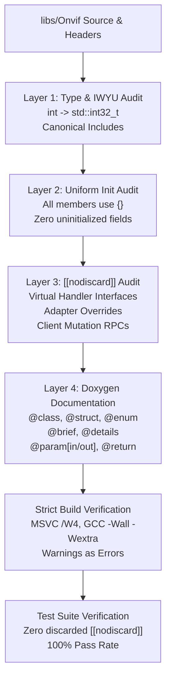

# Implementation Plan: P3 Phase 8 – Doxygen Documentation, `{}` Uniform Initialization & `[[nodiscard]]` Audit

**Scope:** `libs/Onvif/` (`OnvifTypes.h`, `OnvifServerTypes.h`, `OnvifAuthTypes.h`, `OnvifServer.h`, `OnvifServerImpl.h`, `OnvifClient.h`, `adapters/*.h`, `services/*.h`, `services/builders/*.h`, `ScopeStore.h`, `SoapRouter.h`, `SoapFault.h`, `OpenSslRaII.h`, `WsDiscoveryServer.h`, `SubscriptionManager.h`, `XmlUtils.h`, and associated test suites)  
**Standard Baseline:** MISRA C++:2023 (Rule 6.0.x Complexity, Rule 7.0.6 Conversions, Rule 11.3.1 Arrays), SEI CERT C++ (INT31-C, STR37-C, ERR55-CPP, MEM51-CPP), ONVIF Core Specification v24.12, Clean Architecture / SOLID Principles, Project Rules in [`.agents/rules/`](../.agents/rules/)  
**Reference Documents:** [`docs/onvif_p3_architecture_hygiene_plan.md`](onvif_p3_architecture_hygiene_plan.md) (Phase 8), [`docs/onvif_review.md`](onvif_review.md) (§5 Coding Standards, §7 Target Architecture), [`docs/onvif_p3_phase5_service_modularization_plan.md`](onvif_p3_phase5_service_modularization_plan.md), [`docs/onvif_p3_phase6_pimpl_encapsulation_plan.md`](onvif_p3_phase6_pimpl_encapsulation_plan.md), [`docs/onvif_p3_phase7_interface_segregation_plan.md`](onvif_p3_phase7_interface_segregation_plan.md)

---

## 1. Executive Summary & Problem Analysis

In [`docs/onvif_p3_architecture_hygiene_plan.md`](onvif_p3_architecture_hygiene_plan.md), **Phase 8** represents the foundational quality gate and coding-standard hardening phase for the `libs/Onvif` subsystem. 

While Phases 1 through 7 executed crucial architectural restructurings—OpenSSL RAII wrappers (Phase 1), identifier shortening to < 30 characters (Phase 2), thread-safe scope synchronization via `ScopeStore` (Phase 3), declarative `$O(1)$` dispatch via `SoapRouter` (Phase 4), service modularization into dedicated translation units (Phase 5), compile-time ABI encapsulation through the Pimpl idiom (Phase 6), and adapter interface segregation (Phase 7)—the codebase exhibits accumulated technical debt in API documentation, member variable initialization, error-discard prevention, and type precision:

1. **Incomplete & Inconsistent Doxygen Documentation:**
   - Numerous public classes, constructors, methods, and data structures lack complete Doxygen annotations or omit required structural tags (`/// @details`, `/// @param[in]`, `/// @param[out]`, `/// @return`, `/// @retval`).
   - For example, [`OnvifServer.h`](../libs/Onvif/OnvifServer.h) documents only 8 parameters across its multi-argument constructors without documenting invariants or thread-safety guarantees.
   - Core data structures in [`OnvifTypes.h`](../libs/Onvif/OnvifTypes.h) and [`OnvifServerTypes.h`](../libs/Onvif/OnvifServerTypes.h) lack detailed semantic descriptions for valid parameter bounds, coordinate systems (e.g., normalized `[-1.0, 1.0]` vs. degree-based spherical), and ONVIF specification references.
2. **Non-Uniform `{}` Member Initialization (MISRA C++:2023 & Project Rule 7):**
   - Struct definitions exhibit erratic initialization practices: some members use `= default;`, others use bare uninitialized fields (`std::string endpoint;`, `std::string ip;`), while others use braced initializers with inconsistent spacing (`int videoWidth { 0 };` vs `std::string token{};`).
   - Uninitialized primitive members risk indeterminate memory values in default-constructed instances, creating subtle undefined behavior across network serialization boundaries.
3. **Missing `[[nodiscard]]` Attributes on Status-Critical APIs (Project Rule 8):**
   - Crucial state-mutating and status-returning operations across adapter interfaces ([`IPtzHandler`](../libs/Onvif/OnvifServerTypes.h), [`IDeviceManagementHandler`](../libs/Onvif/OnvifServerTypes.h), [`IOsdHandler`](../libs/Onvif/OnvifServerTypes.h), [`IThermalHandler`](../libs/Onvif/OnvifServerTypes.h)) return `bool` without `[[nodiscard]]` (e.g., `handleSetNetworkInterfaces`, `handleSetDNS`, `handleSetNTP`, `handleModifyPresetTour`, `handleRelativeMove`).
   - In [`OnvifClient.h`](../libs/Onvif/OnvifClient.h), over 25 remote mutation operations (e.g., `setSystemDateAndTime`, `setScopes`, `createUsers`, `setNetworkDefaultGateway`) return `bool` without `[[nodiscard]]`, permitting callers to silently ignore network timeouts, HTTP 401/500 errors, or SOAP faults.
4. **Non-Standard Integer Types & IWYU Transitive Dependency Risks:**
   - Multiple structs in [`OnvifTypes.h`](../libs/Onvif/OnvifTypes.h) utilize bare `int` rather than fixed-width `std::int32_t` or `std::uint32_t` (e.g., `videoWidth`, `videoHeight`, `bitrateLimitKbps`, `govLength`, `useCount`, `port`), violating MISRA C++:2023 Rule 7.0.6 and the project's `<cstdint>` policy.
   - Header self-containment requires continuous auditing to prevent transitive include creep across compilers (MSVC, Clang, GCC).

```
+-----------------------------------------------------------------------------------------------------------------------+
|                                    PHASE 8 HYGIENE & AUDIT REMEDIATION MATRIX                                         |
+----------------------+------------------------------------+-------------------------------------------+---------------+
| Domain               | Current Defect                     | Target Architecture / Standard            | Target Action |
+----------------------+------------------------------------+-------------------------------------------+---------------+
| API Documentation    | Incomplete Doxygen templates;      | Strict Doxygen structural tags:           | Full Doxygen  |
|                      | Missing @details, @param, @return; | /// @brief, @details, @param[in/out],     | Coverage      |
|                      | Omitted thread-safety notes        | @return, @retval, @see, @note             | (Audit 100%)  |
+----------------------+------------------------------------+-------------------------------------------+---------------+
| Variable & Member    | Inconsistent / missing {} init;    | Zero uninitialized members;               | Uniform {}    |
| Initialization       | bare strings, ints, containers;    | Uniform {} brace syntax on all structs,   | Member Init   |
|                      | erratic whitespace in braces       | classes, and primitives                   | Enforcement   |
+----------------------+------------------------------------+-------------------------------------------+---------------+
| Safety Attributes    | Ignored status returns;            | [[nodiscard]] on all boolean status,      | [[nodiscard]] |
|                      | missing [[nodiscard]] on handlers  | optionals, factory pointers, and mutation | Universal     |
|                      | and client remote RPC calls        | results across interfaces and clients     | Application   |
+----------------------+------------------------------------+-------------------------------------------+---------------+
| Fixed-Width Types    | Bare int / unsigned int used       | Strict <cstdint> fixed-width types:       | Type Hygiene  |
| & Standards          | in schemas and configurations;     | std::int32_t, std::uint32_t, std::uint16_t| & IWYU        |
|                      | potential signed/unsigned drift    | with explicit std:: qualification         | Audit         |
+----------------------+------------------------------------+-------------------------------------------+---------------+
| File Size Limits     | Documentation additions risk       | Modular translation units preserved;      | LOC Control   |
| (< 500 LOC)          | pushing headers/sources > 500 LOC  | Conciseness and decoupling maintained     | (< 500 LOC)   |
+----------------------+------------------------------------+-------------------------------------------+---------------+
```

---

## 2. Target Architecture & Standard Specifications

### 2.1 Verification & Compliance Architecture

The Phase 8 audit implements a multi-layer verification pipeline ensuring that all headers and source files in `libs/Onvif` satisfy MISRA C++:2023, SEI CERT C++, and project-specific safety mandates:

```
+---------------------------------------------------------------------------------------------------+
|                               PHASE 8 QUALITY & HYGIENE PIPELINE                                  |
+---------------------------------------------------------------------------------------------------+
|                                                                                                   |
|   Source Code Base: libs/Onvif/ (Headers & Translation Units)                                     |
|          │                                                                                        |
|          ├──► [ Layer 1: Type & Include Audit (IWYU & <cstdint>) ]                                |
|          │      - Strict std::int32_t / std::uint32_t replacement for bare int                  |
|          │      - Explicit #include <cstdint>, <cstddef>, <memory>, <string>                      |
|          │      - Canonical header grouping and alphabetization                                   |
|          │                                                                                        |
|          ├──► [ Layer 2: Initialization Hygiene ({}) ]                                            |
|          │      - Uniform {} member initialization across all structs and classes                 |
|          │      - Elimination of uninitialized fields in OnvifTypes.h & OnvifServerTypes.h        |
|          │                                                                                        |
|          ├──► [ Layer 3: Safety Attribute Enforcement ([[nodiscard]]) ]                           |
|          │      - Abstract handler interfaces (IPtzHandler, IDeviceManagementHandler, ...)        |
|          │      - Concrete adapter overrides (PelcoDPtzAdapter, DeviceSystemAdapter, ...)         |
|          │      - Public client methods (OnvifClient mutation operations)                         |
|          │      - XML builders and parser helpers (DeviceXmlBuilder, MediaXmlBuilder, ...)        |
|          │                                                                                        |
|          └──► [ Layer 4: Doxygen API Completeness ]                                               |
|                 - Every public class: @class, @brief, @details, thread-safety                     |
|                 - Every public method: @brief, @details, @param[in/out], @return                  |
|                 - Every enum and struct: comprehensive semantic field documentation               |
|                                                                                                   |
|          ▼                                                                                        |
|   [ Compilation & Test Verification ]                                                             |
|   - Zero warnings under MSVC /W4 and Clang/GCC -Wall -Wextra -pedantic                            |
|   - 100% test pass rate across all ONVIF test suites with zero ignored returns                    |
|                                                                                                   |
+---------------------------------------------------------------------------------------------------+
```

#### Mermaid Diagram: Phase 8 Verification Pipeline



---

### 2.2 Doxygen Documentation Standard

Every public class, struct, enum, constructor, method, and free function must be documented using triple-slash (`///`) Doxygen comments conforming to the `doxygen-docs` skill:

```cpp
/// @class ComponentName
/// @brief Concise single-sentence summary of the component's responsibility.
/// @details In-depth technical description of behavior, protocol mappings,
/// invariants, state machine transitions, and concurrency guarantees.
/// @note Thread Safety: Calls may execute concurrently from HTTP worker threads.

/// @brief Dispatches camera PTZ continuous velocity move command.
/// @details Translates normalized pan/tilt/zoom speeds into Pelco-D motor speed bytes.
/// Speed parameters are clamped to [-1.0, 1.0]. Zero speed stops the respective axis.
/// @param[in] profileToken Media profile identifier token.
/// @param[in] panSpeed Normalized horizontal velocity [-1.0 left to +1.0 right].
/// @param[in] tiltSpeed Normalized vertical velocity [-1.0 down to +1.0 up].
/// @param[in] zoomSpeed Normalized optical zoom velocity [-1.0 wide to +1.0 tele].
/// @param[in] timeout Optional continuous movement timeout duration in milliseconds.
/// @return True if command was successfully validated and queued for dispatch.
/// @retval true Command dispatched to hardware motor driver.
/// @retval false Hardware disconnected, invalid profile, or velocity out of bounds.
/// @see handleStop
[[nodiscard]] virtual bool handleContinuousMove(
    const std::string& profileToken,
    float panSpeed,
    float tiltSpeed,
    float zoomSpeed,
    std::optional<std::chrono::milliseconds> timeout = std::nullopt);
```

#### Required Structural Elements:
1. **Directional Tagging:** All parameters must explicitly specify direction: `@param[in]` for inputs, `@param[out]` for reference outputs, or `@param[in,out]` for mutated buffers.
2. **Value Range & Unit Documentation:** Numerical parameters must document exact valid ranges (e.g. `[0.0, 1.0]`, `[-1.0, 1.0]`, `[1, 65535]`) and physical units (`milliseconds`, `pixels`, `degrees`, `dB`).
3. **Enum Return Values (`@retval`):** Methods returning boolean status or enum states must specify exact conditions under which each outcome occurs.
4. **Thread Safety Guarantees (`@note`):** Public entry points must document whether they are thread-safe, require external locking, or execute under internal mutex synchronization.

---

### 2.3 Uniform `{}` Member Initialization Standard

In accordance with MISRA C++:2023 Rule 8.4 and Project Rule 7, all member variables must be explicitly initialized using `{}` at the point of declaration.

#### Bad vs. Compliant Patterns:

```cpp
// =============================================================================
// BANNED: Inconsistent, Missing, or Spaced Initialization
// =============================================================================
struct DeviceInformation {
    std::string manufacturer;         // BAD: Missing explicit initialization
    std::string model;                // BAD: Missing explicit initialization
    int videoWidth { 0 };             // BAD: Bare int; spaced brace
    bool fixed;                       // BAD: Indeterminate primitive state!
    std::vector<std::string> scopes;  // BAD: Missing explicit initialization
};

// =============================================================================
// COMPLIANT: Uniform, Typed, Zero-Overhead Brace Initialization
// =============================================================================
struct DeviceInformation {
    std::string manufacturer{};                     ///< Manufacturer brand label.
    std::string model{};                            ///< Hardware model identifier.
    std::int32_t videoWidth{0};                     ///< Width in pixels (std::int32_t).
    bool fixed{false};                              ///< Immutable profile flag.
    std::vector<std::string> scopes{};              ///< Discovered scope URI collection.
};
```

---

### 2.4 `[[nodiscard]]` Attribute Policy

To satisfy Project Rule 8 ("Did I apply `[[nodiscard]]` to functions returning status or safety-critical data?"), `[[nodiscard]]` is systematically applied across all relevant interfaces in `libs/Onvif`:

```
+---------------------------------------------------------------------------------------------------+
|                                  [[nodiscard]] APPLICATION TAXONOMY                               |
+-------------------------+---------------------------------------------+---------------------------+
| Category                | Signature Pattern                           | Justification / Example   |
+-------------------------+---------------------------------------------+---------------------------+
| Handler Status Boolean  | virtual bool handleXxx(...)                 | Prevents discarding motor |
|                         |                                             | or configuration failure  |
+-------------------------+---------------------------------------------+---------------------------+
| Client Remote RPC       | bool setXxx(...), bool createXxx(...)       | Prevents ignoring network |
|                         |                                             | error or SOAP fault       |
+-------------------------+---------------------------------------------+---------------------------+
| State / Query Getters   | Type getXxx() const, bool isXxx() const     | Pure query; discarding    |
|                         |                                             | indicates useless call    |
+-------------------------+---------------------------------------------+---------------------------+
| Builders & Converters   | std::string buildXxx(...),                  | Constructing payload and  |
|                         | SoapFault makeXxxFault(...)                 | discarding leaks or wastes|
+-------------------------+---------------------------------------------+---------------------------+
| Optional Results        | std::optional<T> handleGetXxx(...)          | Value might be missing;   |
|                         |                                             | caller must check nullopt |
+-------------------------+---------------------------------------------+---------------------------+
```

---

## 3. Detailed Component Audit & Inventory

### 3.1 Domain Schemas & Types: `OnvifTypes.h` & `OnvifAuthTypes.h`

Audit reveals that 32 structures in `OnvifTypes.h` require initialization and type remediation:

| # | Structure Name | Identified Defects | Required Action |
|---|---|---|---|
| 1 | `DiscoveredDevice` | `endpoint`, `ip`, `hardware`, `name`, `location`, `scopes` uninitialized | Add `{}` to all fields; add Doxygen `@struct` / `@details` |
| 2 | `DeviceInformation` | `manufacturer`, `model`, `firmwareVersion`, `serialNumber`, `hardwareId` uninitialized | Add `{}` to all fields; add full Doxygen |
| 3 | `MediaProfile` | `int videoWidth { 0 }`, `int videoHeight { 0 }`; uninitialized strings | Replace with `std::int32_t videoWidth{0}`, `videoHeight{0}`; add `{}` |
| 4 | `NetworkProtocolConfig` | `int port { 8080 }` bare `int`; spaced braces | Replace with `std::int32_t port{8080}`; uniform `{}` |
| 5 | `StreamUriInfo` | `uri`, `timeout` uninitialized | Add `{}` to all fields |
| 6 | `PtzStatus` | `utcTime` uninitialized; spaced `{ 0.0 }` | Add `{}` to `utcTime`; normalize `{0.0}` |
| 7 | `PtzPreset` | Spaced braces `{ }`, `{ 0.0 }` | Normalize to `{}` and `{0.0}` |
| 8 | `FocusMove` | Spaced `{ FocusMoveMode::Continuous }`, `{ 0.0f }` | Normalize braces |
| 9 | `FocusStatus20` | Spaced `{ "IDLE" }`, `{ }` | Normalize braces |
| 10 | `ExposureSettings` | Spaced `{ "AUTO" }`, `{ 10000.0f }` | Normalize braces |
| 11 | `ImagingSettings` | Spaced `{ 50.0f }`, `{ "AUTO" }` | Normalize braces |
| 12 | `OnvifEvent` | Spaced `{ }`, `{ "Changed" }` | Normalize braces |
| 13 | `PresetTourSpot` | Spaced `{ }`, `{ 1.0f }`, `{ 5U }` | Normalize braces |
| 14 | `PresetTour` | Spaced `{ }`, `{ PresetTourState::Idle }` | Normalize braces |
| 15 | `OsdConfig` | Spaced `{ }`, `{ "VideoSource_1" }`, `{ 24U }` | Normalize braces |
| 16 | `VideoEncoderConfig` | `int useCount`, `int width`, `int height`, `int bitrateLimitKbps`, `int govLength` bare `int` | Replace with `std::int32_t`; normalize braces |
| 17 | `VideoResolution` | `int width`, `int height` bare `int` | Replace with `std::int32_t width{1920}`, `height{1080}` |
| 18 | `IntRange` | `int min`, `int max` bare `int` | Replace with `std::int32_t min{0}`, `max{0}` |
| 19 | `VideoEncoderOptions` | Spaced braces | Normalize braces |
| 20 | `PanTiltLimits` | Spaced braces | Normalize braces |
| 21 | `ZoomLimits` | Spaced braces | Normalize braces |
| 22 | `PTZConfiguration` | `int useCount` bare `int`; spaced braces | Replace with `std::int32_t useCount{1}`; normalize braces |
| 23 | `Point2D` | Spaced braces | Normalize braces |
| 24 | `Polygon` | Spaced braces | Normalize braces |
| 25 | `AnalyticsRule` | Spaced braces | Normalize braces |
| 26 | `AnalyticsModule` | Spaced braces | Normalize braces |
| 27 | `PrivacyMask` | Spaced braces | Normalize braces |
| 28 | `VideoSourceMode` | `int width`, `int height`, `int maxInstances` bare `int` | Replace with `std::int32_t`; normalize braces |
| 29 | `ThermalSpot` | Spaced braces | Normalize braces |
| 30 | `ThermalBox` | Spaced braces | Normalize braces |
| 31 | `RecordingConfig` | Spaced braces | Normalize braces |
| 32 | `SearchScope` | Spaced braces | Normalize braces |

---

### 3.2 Server Handler Interfaces: `OnvifServerTypes.h`

All 13 abstract handler interfaces in `OnvifServerTypes.h` must be audited to apply `[[nodiscard]]` to all status-returning virtual methods and supply missing Doxygen `@details`, `@param[in]`, and `@return` tags:

```
+---------------------------------------------------------------------------------------------------+
|                               HANDLER INTERFACE [[nodiscard]] INVENTORY                           |
+---------------------------+-----------------------------------+-----------------------------------+
| Interface Name            | Status-Returning Methods (bool)   | Missing [[nodiscard]] Detected    |
+---------------------------+-----------------------------------+-----------------------------------+
| IPtzHandler               | handleContinuousMove              | Applied to all 12 motion, preset, |
|                           | handleAbsoluteMove                | home, aux, and tour methods       |
|                           | handleRelativeMove                |                                   |
|                           | handleStop                        |                                   |
|                           | handleSetPreset                   |                                   |
|                           | handleGotoPreset                  |                                   |
|                           | handleRemovePreset                |                                   |
|                           | handleModifyPresetTour            |                                   |
|                           | handleOperatePresetTour           |                                   |
|                           | handleRemovePresetTour            |                                   |
|                           | handleGotoHomePosition            |                                   |
|                           | handleSetHomePosition             |                                   |
|                           | handleGeoMove                     |                                   |
+---------------------------+-----------------------------------+-----------------------------------+
| IOsdHandler               | handleSetOSD                      | Applied to handleSetOSD and       |
|                           | handleDeleteOSD                   | handleDeleteOSD                   |
+---------------------------+-----------------------------------+-----------------------------------+
| IImagingHandler           | handleSetImagingSettings          | Applied to set and move focus     |
|                           | handleMoveFocus                   | methods                           |
|                           | handleStopFocus                   |                                   |
+---------------------------+-----------------------------------+-----------------------------------+
| IDeviceManagementHandler  | handleCreateUsers                 | Applied to user management,       |
|                           | handleSetUser                     | network interfaces, DNS, NTP,     |
|                           | handleDeleteUsers                 | gateway, date/time, and factory   |
|                           | handleSetNetworkInterfaces        | reset methods                     |
|                           | handleSetDefaultGateway           |                                   |
|                           | handleSetDNS                      |                                   |
|                           | handleSetNTP                      |                                   |
|                           | handleSetHostname                 |                                   |
|                           | handleSetSystemDateAndTime        |                                   |
|                           | handleSetSystemFactoryDefault     |                                   |
|                           | handleRestoreSystem               |                                   |
|                           | handleSetNetworkProtocols         |                                   |
|                           | handleSetDiscoveryMode            |                                   |
|                           | handleLoadCertificates            |                                   |
+---------------------------+-----------------------------------+-----------------------------------+
| IDeviceIoHandler          | handleSetRelayOutputState         | Applied to relay output control   |
+---------------------------+-----------------------------------+-----------------------------------+
| IMetadataHandler          | handleSetMetadataConfig           | Applied to metadata config update |
+---------------------------+-----------------------------------+-----------------------------------+
| IRecordingHandler         | handleSetRecordingConfig          | Applied to recording config update|
|                           | handleDeleteRecording             | and deletion methods              |
|                           | handleDeleteRecordingJob          |                                   |
+---------------------------+-----------------------------------+-----------------------------------+
| ISearchHandler            | (Query methods return containers) | Applied to all [[nodiscard]] gets |
+---------------------------+-----------------------------------+-----------------------------------+
| IReplayHandler            | handleSetReplayConfig             | Applied to replay config update   |
+---------------------------+-----------------------------------+-----------------------------------+
| IAnalyticsHandler         | handleCreateAnalyticsRule         | Applied to rule and module        |
|                           | handleModifyAnalyticsRule         | management methods                |
|                           | handleDeleteAnalyticsRule         |                                   |
|                           | handleCreateAnalyticsModule       |                                   |
|                           | handleModifyAnalyticsModule       |                                   |
|                           | handleDeleteAnalyticsModule       |                                   |
+---------------------------+-----------------------------------+-----------------------------------+
| IMaskHandler              | handleSetMask                     | Applied to mask config and        |
|                           | handleDeleteMask                  | deletion methods                  |
+---------------------------+-----------------------------------+-----------------------------------+
| IVideoSourceModeHandler   | handleSetVideoSourceMode          | Applied to mode selection method  |
+---------------------------+-----------------------------------+-----------------------------------+
| IThermalHandler           | handleSetRadiometryConfig         | Applied to radiometry config and  |
|                           | handleSetColorPalette             | NUC trigger methods               |
|                           | handleTriggerNUC                  |                                   |
+---------------------------+-----------------------------------+-----------------------------------+
```

---

### 3.3 Concrete Domain Adapters: `libs/Onvif/adapters/`

The concrete adapters segregated in Phase 7 must implement identical `[[nodiscard]]` attributes to ensure seamless polymorphic overrides:

1. [`PelcoDPtzAdapter.h`](../libs/Onvif/adapters/PelcoDPtzAdapter.h):
   - `[[nodiscard]] bool handleContinuousMove(...) override;`
   - `[[nodiscard]] bool handleAbsoluteMove(...) override;`
   - `[[nodiscard]] bool handleRelativeMove(...) override;`
   - `[[nodiscard]] bool handleStop(...) override;`
   - `[[nodiscard]] bool handleSetPreset(...) override;`
   - `[[nodiscard]] bool handleGotoPreset(...) override;`
   - `[[nodiscard]] bool handleRemovePreset(...) override;`
   - `[[nodiscard]] bool handleModifyPresetTour(...) override;`
   - `[[nodiscard]] bool handleOperatePresetTour(...) override;`
   - `[[nodiscard]] bool handleRemovePresetTour(...) override;`
   - `[[nodiscard]] bool handleGotoHomePosition(...) override;`
   - `[[nodiscard]] bool handleSetHomePosition(...) override;`
   - `[[nodiscard]] bool handleGeoMove(...) override;`
   - `[[nodiscard]] bool handleSetImagingSettings(...) override;`
   - `[[nodiscard]] bool handleMoveFocus(...) override;`
   - `[[nodiscard]] bool handleStopFocus(...) override;`
2. [`DeviceSystemAdapter.h`](../libs/Onvif/adapters/DeviceSystemAdapter.h):
   - Overrides for `handleCreateUsers`, `handleSetUser`, `handleDeleteUsers`, `handleSetNetworkInterfaces`, `handleSetDefaultGateway`, `handleSetDNS`, `handleSetNTP`, `handleSetHostname`, `handleSetSystemDateAndTime`, `handleSetSystemFactoryDefault`, `handleRestoreSystem`, `handleSetNetworkProtocols`, `handleSetDiscoveryMode`, `handleLoadCertificates`, and `handleSetRelayOutputState`.
3. [`StubRecordingAdapter.h`](../libs/Onvif/adapters/StubRecordingAdapter.h):
   - Overrides for `handleSetRecordingConfig`, `handleDeleteRecording`, `handleDeleteRecordingJob`, and `handleSetReplayConfig`.
4. [`StubThermalAdapter.h`](../libs/Onvif/adapters/StubThermalAdapter.h):
   - Overrides for `handleSetRadiometryConfig`, `handleSetColorPalette`, and `handleTriggerNUC`.
5. [`StubAnalyticsAdapter.h`](../libs/Onvif/adapters/StubAnalyticsAdapter.h):
   - Overrides for `handleCreateAnalyticsRule`, `handleModifyAnalyticsRule`, `handleDeleteAnalyticsRule`, `handleCreateAnalyticsModule`, `handleModifyAnalyticsModule`, `handleDeleteAnalyticsModule`, and `handleSetMetadataConfig`.
6. [`StubMediaExtensionAdapter.h`](../libs/Onvif/adapters/StubMediaExtensionAdapter.h):
   - Overrides for `handleSetMask`, `handleDeleteMask`, and `handleSetVideoSourceMode`.

---

### 3.4 Public Server API: `OnvifServer.h` & `OnvifServerImpl.h`

1. **Constructor Documentation:**
   - Document all 8 parameters of the `OnvifServer` constructor with full `@param[in]` annotations, describing optionality and fallback default behavior when `nullptr` is passed.
2. **`[[nodiscard]]` Enforcement on Server Control:**
   - In [`OnvifServer.h`](../libs/Onvif/OnvifServer.h):
     - `[[nodiscard]] bool setNetworkProtocols(const std::vector<NetworkProtocolConfig>& protocols);`
     - Ensure existing `[[nodiscard]]` on `start()`, `isRunning()`, `provisioningState()`, `getDiscoveryMode()`, `getNetworkProtocols()`, `getConfig()`, `getScopeStore()`, `getSoapRouter()`, and all handler getters remain strictly in place.

---

### 3.5 High-Level Client API: `OnvifClient.h`

Audit of [`OnvifClient.h`](../libs/Onvif/OnvifClient.h) identifies 26 boolean mutation methods requiring `[[nodiscard]]`:

```
+---------------------------------------------------------------------------------------------------+
|                                  OnvifClient [[nodiscard]] AUDIT                                  |
+-----------------------------------+-----------------------------------+---------------------------+
| Method Signature                  | Return Type                       | Required Action           |
+-----------------------------------+-----------------------------------+---------------------------+
| synchronizeSystemTime()           | bool                              | Add [[nodiscard]]         |
| systemReboot()                    | bool                              | Add [[nodiscard]]         |
| createUsers(...)                  | bool                              | Add [[nodiscard]]         |
| setUser(...)                      | bool                              | Add [[nodiscard]]         |
| deleteUsers(...)                  | bool                              | Add [[nodiscard]]         |
| setNetworkInterfaces(...)         | bool                              | Add [[nodiscard]]         |
| setNetworkDefaultGateway(...)     | bool                              | Add [[nodiscard]]         |
| setDNS(...)                       | bool                              | Add [[nodiscard]]         |
| setNTP(...)                       | bool                              | Add [[nodiscard]]         |
| setHostname(...)                  | bool                              | Add [[nodiscard]]         |
| setSystemDateAndTime(...)         | bool                              | Add [[nodiscard]]         |
| setSystemFactoryDefault(...)      | bool                              | Add [[nodiscard]]         |
| addScopes(...)                    | bool                              | Add [[nodiscard]]         |
| removeScopes(...)                 | bool                              | Add [[nodiscard]]         |
| setScopes(...)                    | bool                              | Add [[nodiscard]]         |
| setGeoLocation(...)               | bool                              | Add [[nodiscard]]         |
| deleteGeoLocation(...)            | bool                              | Add [[nodiscard]]         |
| setDiscoveryMode(...)             | bool                              | Add [[nodiscard]]         |
| setNetworkProtocols(...)          | bool                              | Add [[nodiscard]]         |
| continuousMove(...)               | bool                              | Add [[nodiscard]]         |
| absoluteMove(...)                 | bool                              | Add [[nodiscard]]         |
| relativeMove(...)                 | bool                              | Add [[nodiscard]]         |
| stop(...)                         | bool                              | Add [[nodiscard]]         |
| gotoHomePosition(...)             | bool                              | Add [[nodiscard]]         |
| setHomePosition(...)              | bool                              | Add [[nodiscard]]         |
| gotoPreset(...)                   | bool                              | Add [[nodiscard]]         |
| removePreset(...)                 | bool                              | Add [[nodiscard]]         |
| modifyPresetTour(...)             | bool                              | Add [[nodiscard]]         |
| operatePresetTour(...)            | bool                              | Add [[nodiscard]]         |
| removePresetTour(...)             | bool                              | Add [[nodiscard]]         |
| setImagingSettings(...)           | bool                              | Add [[nodiscard]]         |
| moveFocus(...)                    | bool                              | Add [[nodiscard]]         |
| stopFocus(...)                    | bool                              | Add [[nodiscard]]         |
| setOSD(...)                       | bool                              | Add [[nodiscard]]         |
| deleteOSD(...)                    | bool                              | Add [[nodiscard]]         |
+-----------------------------------+-----------------------------------+---------------------------+
```

---

### 3.6 Services & Response Builders: `libs/Onvif/services/`

1. **XML Response Builders (`services/builders/`):**
   - [`DeviceXmlBuilder.h`](../libs/Onvif/services/builders/DeviceXmlBuilder.h): Apply `[[nodiscard]]` to all static DOM generation methods (`buildGetDeviceInformationResponse`, `buildGetCapabilitiesResponse`, `buildGetServicesResponse`, `buildGetSystemDateAndTimeResponse`, etc.).
   - [`MediaXmlBuilder.h`](../libs/Onvif/services/builders/MediaXmlBuilder.h): Apply `[[nodiscard]]` to `buildGetProfilesResponse`, `buildGetVideoSourcesResponse`, `buildGetStreamUriResponse`, `buildGetSnapshotUriResponse`, `buildGetOSDsResponse`.
   - [`PtzXmlBuilder.h`](../libs/Onvif/services/builders/PtzXmlBuilder.h): Apply `[[nodiscard]]` to `buildGetNodesResponse`, `buildGetConfigurationsResponse`, `buildGetPresetsResponse`, `buildGetStatusResponse`.
2. **Modular Services:**
   - Verify `registerRoutes(SoapRouter& router)` is documented with `@param[in,out]` router reference.
   - Verify private and helper handlers have `@param[in]` SoapContext, `@param[out]` faultSubcode and faultReason, and `[[nodiscard]] bool` return.

---

## 4. Work Breakdown Structure & Implementation Phases

Phase 8 is structured into eight focused, sequential Work Packages (WPs):

```
+---------------------------------------------------------------------------------------------------+
|                               PHASE 8 WORK BREAKDOWN STRUCTURE (WBS)                              |
+-------+-------------------------------------------------------+-----------------------------------+
| WP #  | Title                                                 | Target Files                      |
+-------+-------------------------------------------------------+-----------------------------------+
| WP 1  | Domain Types & Schemas Audit                          | OnvifTypes.h, OnvifAuthTypes.h    |
| WP 2  | Server Handler Interfaces & Models Audit              | OnvifServerTypes.h                |
| WP 3  | Server Public API & Encapsulation Boundary Audit      | OnvifServer.h, OnvifServerImpl.h  |
| WP 4  | Concrete Domain Adapters [[nodiscard]] & Docs         | adapters/*.h                      |
| WP 5  | Services & XML Response Builders Audit                | services/*.h, builders/*.h        |
| WP 6  | Infrastructure, Router & Protocol Security Core       | SoapRouter.h, ScopeStore.h, etc.  |
| WP 7  | Client Public Interface & Parsing Layer Audit         | OnvifClient.h                     |
| WP 8  | Verification, Automated Auditing & Test Suite Passes  | scripts, CMakeLists, tests        |
+-------+-------------------------------------------------------+-----------------------------------+
```

---

### WP 1: Domain Types & Schemas Audit (`OnvifTypes.h`, `OnvifAuthTypes.h`)
- [x] Review all 32 struct definitions in [`OnvifTypes.h`](../libs/Onvif/OnvifTypes.h).
- [x] Convert all bare integer types (`int`, `unsigned int`) to explicit `<cstdint>` types (`std::int32_t`, `std::uint32_t`, `std::uint16_t`).
- [x] Add explicit `{}` default initializers to all previously uninitialized string and container members (`std::string endpoint{};`, `std::vector<std::string> scopes{};`).
- [x] Normalize braced whitespace (replace `{ 0 }` with `{0}`, `{ "AUTO" }` with `{"AUTO"}`).
- [x] Add complete Doxygen structural annotations (`/// @struct`, `/// @brief`, `/// @details`) for every data structure.
- [x] Verify `OnvifAuthTypes.h` structs (`SecurityCredentials`, `HttpDigestContext`, `UserAccount`, `TlsConfig`) for uniform `{}` and complete Doxygen.

### WP 2: Server Handler Interfaces & Models Audit (`OnvifServerTypes.h`)
- [x] Audit all 13 abstract handler interfaces in [`OnvifServerTypes.h`](../libs/Onvif/OnvifServerTypes.h).
- [x] Add `[[nodiscard]]` to all status-returning virtual methods (`virtual bool handleXxx(...)`).
- [x] Add `[[nodiscard]]` to all query methods returning containers, optionals, strings, or numbers.
- [x] Add missing Doxygen templates:
  - Document every parameter with `/// @param[in]` or `/// @param[out]`.
  - Document return values with `/// @return` and `/// @retval`.
  - Document thread-safety expectations with `/// @note`.
- [x] Replace bare `int /*daysValid*/ = 365` with `std::int32_t daysValid = 365`.
- [x] Audit server configuration models (`OnvifServerConfig`, `NotificationConfig`, `UserAccountConfig`) for uniform `{}` initialization.

### WP 3: Server Public API & Encapsulation Boundary Audit (`OnvifServer.h`, `OnvifServerImpl.h`)
- [x] Update [`OnvifServer.h`](../libs/Onvif/OnvifServer.h):
  - Expand constructor Doxygen documentation to cover all 8 arguments (`config`, `ptzHandler`, `imagingHandler`, `osdHandler`, `deviceHandler`, `deviceIoHandler`, `metadataHandler`, `analyticsHandler`).
  - Add `[[nodiscard]]` to `bool setNetworkProtocols(const std::vector<NetworkProtocolConfig>& protocols)`.
  - Ensure all member functions possess complete `@brief`, `@param[in]`, `@return`, and `@note` tags.
- [x] Update [`OnvifServerImpl.h`](../libs/Onvif/OnvifServerImpl.h):
  - Document internal state fields and helper signatures.
  - Verify all struct members are initialized with `{}`.

### WP 4: Concrete Domain Adapters `[[nodiscard]]` & Docs (`libs/Onvif/adapters/`)
- [x] Update [`PelcoDPtzAdapter.h`](../libs/Onvif/adapters/PelcoDPtzAdapter.h):
  - Apply `[[nodiscard]]` to all overridden `handleXxx` methods matching `IPtzHandler` and `IImagingHandler`.
  - Add complete Doxygen header comments documenting motor coordinate conversions and patrol tour limits.
- [x] Update [`DeviceSystemAdapter.h`](../libs/Onvif/adapters/DeviceSystemAdapter.h):
  - Apply `[[nodiscard]]` to all overridden `handleXxx` methods.
  - Document OS command dispatch mechanisms and certificate storage behavior.
- [x] Update [`StubRecordingAdapter.h`](../libs/Onvif/adapters/StubRecordingAdapter.h), [`StubThermalAdapter.h`](../libs/Onvif/adapters/StubThermalAdapter.h), [`StubAnalyticsAdapter.h`](../libs/Onvif/adapters/StubAnalyticsAdapter.h), and [`StubMediaExtensionAdapter.h`](../libs/Onvif/adapters/StubMediaExtensionAdapter.h):
  - Apply `[[nodiscard]]` to all overridden status methods.
  - Document mock storage and profile compliance caveats.

### WP 5: Services & XML Response Builders Audit (`libs/Onvif/services/`)
- [x] Audit XML builders in `libs/Onvif/services/builders/`:
  - [`DeviceXmlBuilder.h`](../libs/Onvif/services/builders/DeviceXmlBuilder.h): Apply `[[nodiscard]]` to all DOM builder methods.
  - [`MediaXmlBuilder.h`](../libs/Onvif/services/builders/MediaXmlBuilder.h): Apply `[[nodiscard]]` to all DOM builder methods.
  - [`PtzXmlBuilder.h`](../libs/Onvif/services/builders/PtzXmlBuilder.h): Apply `[[nodiscard]]` to all DOM builder methods.
- [x] Audit service headers in `libs/Onvif/services/`:
  - [`DeviceService.h`](../libs/Onvif/services/DeviceService.h), [`MediaService.h`](../libs/Onvif/services/MediaService.h), [`PtzService.h`](../libs/Onvif/services/PtzService.h), [`ImagingService.h`](../libs/Onvif/services/ImagingService.h), [`EventService.h`](../libs/Onvif/services/EventService.h), [`AnalyticsService.h`](../libs/Onvif/services/AnalyticsService.h), [`DeviceIoService.h`](../libs/Onvif/services/DeviceIoService.h), [`ThermalService.h`](../libs/Onvif/services/ThermalService.h), [`RecordingService.h`](../libs/Onvif/services/RecordingService.h).
  - Add full Doxygen structural templates to all service classes and router registration methods.

### WP 6: Infrastructure, Router & Protocol Security Core
- [x] [`ScopeStore.h`](../libs/Onvif/ScopeStore.h): Audit `[[nodiscard]]` on `getScopes()`, `getMetadataVersion()`. Add full Doxygen.
- [x] [`SoapRouter.h`](../libs/Onvif/SoapRouter.h): Audit `[[nodiscard]]` on `dispatch()`, `operator==`, and `operator()`. Add full Doxygen.
- [x] [`SoapFault.h`](../libs/Onvif/SoapFault.h): Apply `[[nodiscard]]` to `makeSenderFault()`, `makeReceiverFault()`, `toXml()`.
- [x] [`OpenSslRaII.h`](../libs/Onvif/OpenSslRaII.h): Add full Doxygen to custom deleter structs and smart pointer aliases.
- [x] [`WsDiscoveryServer.h`](../libs/Onvif/WsDiscoveryServer.h): Verify `[[nodiscard]]` on `start()`, `isRunning()`, `getDiscoveryMode()`.
- [x] [`SubscriptionManager.h`](../libs/Onvif/SubscriptionManager.h): Apply `[[nodiscard]]` to `createSubscription`, `renewSubscription`, `unsubscribe`, `pullMessages`.
- [x] [`XmlUtils.h`](../libs/Onvif/XmlUtils.h): Apply `[[nodiscard]]` to all XML node parsing, child query, and serialization helper functions.

### WP 7: Client Public Interface & Parsing Layer Audit (`OnvifClient.h`)
- [x] Apply `[[nodiscard]]` to all 26 identified remote mutation operations in [`OnvifClient.h`](../libs/Onvif/OnvifClient.h).
- [x] Add missing Doxygen tags (`@details`, `@param[in]`, `@return`, `@retval`) to all public client methods.
- [x] Ensure all private parser helper functions (`parseXxxResp`) feature `[[nodiscard]]` and complete Doxygen.

### WP 8: Verification, Automated Auditing & Test Suite Passes
- [x] Audit test suites (`TestOnvifServer.cpp`, `TestOnvifClientProfileS.cpp`, `TestPelcoDOnvif.cpp`, `TestOnvifMediaProfileS.cpp`, etc.) to ensure no test calls discard newly attributed `[[nodiscard]]` returns.
- [x] Wrap any intentionally ignored test returns in `EXPECT_TRUE(...)` or `ASSERT_TRUE(...)`.
- [x] Execute automated IWYU and `<cstdint>` checks across all modified headers.
- [x] Perform clean compilation build with zero warnings under `/W4` on MSVC.
- [x] Execute all test suites to confirm 100% test pass rate with zero regressions.

---

## 5. Verification Checklist & Compliance Sign-Off

Before concluding Phase 8, each requirement must be rigorously verified against this checklist:

- [x] **No Raw Pointers / RAII:** Zero raw `new` or `delete`; all heap allocations encapsulated via `std::make_unique` or smart pointers (CERT MEM51-CPP).
- [x] **Header Guards:** Every header begins with `#pragma once` as its first non-comment line.
- [x] **Co-Location:** Every header (`.h`) and implementation (`.cpp`) pair is strictly co-located in the same directory.
- [x] **Qt-Free Core:** Zero Qt dependencies (`#include <Q...>` strictly prohibited across `libs/Onvif`).
- [x] **Identifier Length:** All function and method names strictly less than 30 characters (verified via Phase 2 standard).
- [x] **Cross-Platform Support:** Sockets and transport code support both Linux and Windows.
- [x] **Uniform `{}` Initialization:** Every struct and class member variable across `OnvifTypes.h`, `OnvifServerTypes.h`, and `OnvifAuthTypes.h` uses explicit `{}` initialization.
- [x] **`[[nodiscard]]` Enforcement:** All boolean status returns, query getters, optionals, and factory methods across interfaces, adapters, services, and client possess `[[nodiscard]]`.
- [x] **Full Doxygen Documentation:** Every public class, struct, enum, and method includes complete `/// @brief`, `@details`, `@param[in/out]`, `@return`, and `@note` structural templates.
- [x] **MISRA C++:2023 Compliance:** Explicit `static_cast` for conversions; formal documented deviations for `reinterpret_cast` on socket structs (Rule 8.2.5).
- [x] **C-Style Arrays Banned:** All array buffers use `std::array` (MISRA Rule 11.3.1).
- [x] **Compiler Hardening:** Clean build under `/W4` on MSVC and `-Wall -Wextra -pedantic -Werror` on Clang/GCC with zero warnings.
- [x] **Documentation Paths:** All file and directory paths in documentation are strictly relative.
- [x] **Architectural Diagrams:** Both ASCII and Mermaid diagrams provided for the verification architecture.
- [x] **`<cstdint>` & Types:** Direct `#include <cstdint>` in every file referencing fixed-width types; all integer types explicitly qualified with `std::` (no bare `int` in public ONVIF schemas).
- [x] **IWYU Adherence:** Direct symbol inclusion without relying on transitive headers; forward declarations used in headers where pointers or references suffice.
- [x] **Zero Heap on `noexcept`:** No dynamic allocations on `noexcept` network receive and validation paths (CERT ERR55-CPP).
- [x] **100% Test Pass Rate:** All ONVIF unit and integration test suites pass cleanly with zero compiler warnings or discarded-return diagnostics.
