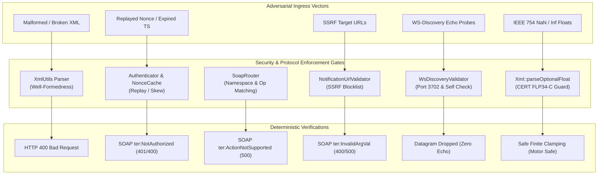

# Implementation Plan: P4 Phase 2 – Negative, Boundary & Security Vulnerability Suites

**Scope:** `libs/Onvif/tests/` (new test suites `tests/server/TestOnvifProtocolFaults.cpp`, `tests/server/TestOnvifSecurityHardening.cpp`, `CMakeLists.txt`)  
**Standard Baseline:** MISRA C++:2023, SEI CERT C++ (FLP34-C, INT31-C, STR37-C, ERR55-CPP), ONVIF Core Specification v24.12 §5.11 (Faults), ONVIF Profile S Specification v1.3, RFC 7616, WS-Security UsernameToken 1.1, WS-Discovery 2005/04, Project Rules in [`.agents/rules/`](../.agents/rules/)  
**Reference Documents:** [`docs/onvif_p4_verification_plan.md`](onvif_p4_verification_plan.md) (§4 Phase 2), [`docs/onvif_review.md`](onvif_review.md) (§3 Findings C1–C7, H9–H10, §6 Test Assessment), [`docs/onvif_p4_phase1_test_decomposition_plan.md`](onvif_p4_phase1_test_decomposition_plan.md)

---

## 1. Executive Summary & Threat Analysis

In [`docs/onvif_p4_verification_plan.md`](onvif_p4_verification_plan.md), **Phase 2** establishes rigorous negative, boundary, and security vulnerability test coverage across the `libs/Onvif` subsystem. 

While Phase P0 introduced critical security safeguards (WS-Security, Digest authentication, URL SSRF filtering, AES-256-GCM vault, token-bucket UDP rate limiting) and Phase 1 decomposed the legacy monolithic test suite into 13 modular fixtures, the test harness currently lacks automated adversarial and boundary validation suites:

1. **Protocol Fault Omissions (ONVIF Core §5.11):** Historical tests almost exclusively verified "happy path" requests. Negative responses—such as malformed XML documents, missing SOAP `<Body>` elements, cross-service namespace pollution, out-of-range PTZ coordinates, missing mandatory parameters, and non-existent tokens—must deterministically produce compliant SOAP 1.2 `env:Sender` or `env:Receiver` faults with exact ONVIF `ter:` subcodes.
2. **Security Abuse Gaps:** Critical attack vectors require end-to-end integration regression testing over HTTP wire transports:
   - **Replay & Timestamp Tampering:** Replay of used nonces and acceptance of expired/skewed WS-Security timestamps (CWE-294).
   - **SSRF Attack Vectors:** ConsumerReference URLs targeting IPv4/IPv6 loopback, cloud metadata endpoints (`169.254.169.254`), sensitive service ports (SSH, SMTP, SMB), and userinfo credentials (CWE-918).
   - **UDP Storm & Reflection Attacks:** WS-Discovery reflection via source port 3702, self-amplification ping-pong loops, and token-bucket flood exhaustion (CWE-406).
   - **Float-to-Integer Undefined Behavior (CERT FLP34-C):** Injection of IEEE 754 specials (`NaN`, `+Infinity`, `-Infinity`, subnormals, float max `1e38`) into PTZ movement and zoom endpoints.
   - **Unprovisioned Device Access:** Verification that uncommissioned devices reject all operational service calls with `ter:DeviceUnprovisioned`.

```
+-----------------------------------------------------------------------------------------------------------------------+
|                                    PHASE 2 NEGATIVE & SECURITY VERIFICATION MATRIX                                    |
+----------------------+------------------------------------+-------------------------------------------+---------------+
| Verification Area    | Attack Vector / Fault Condition    | Standard & Target Expected Outcome        | Target Suite  |
+----------------------+------------------------------------+-------------------------------------------+---------------+
| Wire Malformation    | Non-XML text or binary stream;     | HTTP 400 Bad Request;                     | TestOnvif-    |
|                      | Corrupted XML with unclosed tags   | SOAP 1.2 Fault (env:Sender/ter:InvalidArg)| ProtocolFaults|
+----------------------+------------------------------------+-------------------------------------------+---------------+
| Structure Violation  | Missing SOAP <Body> tag;           | HTTP 400 Bad Request;                     | TestOnvif-    |
|                      | Missing mandatory child elements   | SOAP 1.2 Fault (env:Sender/ter:InvalidArg)| ProtocolFaults|
+----------------------+------------------------------------+-------------------------------------------+---------------+
| Operation Routing    | Unknown operation name;            | HTTP 500 Internal Error;                  | TestOnvif-    |
|                      | Mismatched service namespace URI   | SOAP 1.2 Fault (Receiver/ActionNotSupport)| ProtocolFaults|
+----------------------+------------------------------------+-------------------------------------------+---------------+
| Token Validation     | Non-existent ProfileToken,         | HTTP 400/500 Fault: ter:NoProfile,        | TestOnvif-    |
|                      | ConfigToken, or PresetToken        | ter:NoToken, ter:InvalidArgVal            | ProtocolFaults|
+----------------------+------------------------------------+-------------------------------------------+---------------+
| Numeric Boundaries   | ContinuousMove pan speed = 5.0     | HTTP 400/500 Fault: ter:OutofRange;       | TestOnvif-    |
|                      | (valid range [-1.0, 1.0])          | Safe parameter clamping                   | ProtocolFaults|
+----------------------+------------------------------------+-------------------------------------------+---------------+
| Auth Replay & Skew   | Nonce reuse within window;         | HTTP 401 / SOAP ter:NotAuthorized;        | TestOnvif-    |
|                      | Created timestamp older than 300s  | Deterministic rejection                   | Security-     |
|                      |                                    |                                           | Hardening     |
+----------------------+------------------------------------+-------------------------------------------+---------------+
| First-Boot Gating    | Operational calls on unprovisioned | SOAP Fault: ter:OperationProhibited,      | TestOnvif-    |
|                      | device state                       | secondary ter:DeviceUnprovisioned         | Hardening     |
+----------------------+------------------------------------+-------------------------------------------+---------------+
| SSRF Infiltration    | ConsumerReference targeting        | NotificationUrlValidator drops request;   | TestOnvif-    |
|                      | loopback, cloud metadata, bad port | SOAP 1.2 ter:InvalidArgVal fault          | Hardening     |
+----------------------+------------------------------------+-------------------------------------------+---------------+
| WS-Discovery Storm   | Source port 3702 reflection;       | Probe dropped by WsDiscoveryValidator;    | TestOnvif-    |
|                      | Self-UUID probe loop; UDP flood    | RateLimiter drops burst datagrams         | Hardening     |
+----------------------+------------------------------------+-------------------------------------------+---------------+
| IEEE 754 Specials    | NaN, +Inf, -Inf, 1e38 injected     | CERT FLP34-C compliance; safe finite      | TestOnvif-    |
|                      | into PTZ velocity and coordinates  | fallback; zero motor corruption           | Hardening     |
+----------------------+------------------------------------+-------------------------------------------+---------------+
```

---

## 2. Architecture & Design Specifications

### 2.1 Test Hierarchy & Harness Structure

Phase 2 introduces two dedicated test suites under `libs/Onvif/tests/server/`, leveraging the centralized `OnvifServerFixture` framework created in Phase 1:

```
libs/Onvif/tests/
├── common/
│   ├── OnvifTestFixtures.h             # RAII OnvifServerFixture & ephemeral port probe
│   └── OnvifTestFixtures.cpp           # Shared MockPtzHandler, MockImagingHandler
└── server/
    ├── TestOnvifServerHttp.cpp         # Phase 1: Wire HTTP protocol & basic endpoints
    ├── TestOnvifDeviceService.cpp      # Phase 1: Device service operations
    ├── TestOnvifMediaService.cpp       # Phase 1: Media service operations
    ├── TestOnvifPtzService.cpp         # Phase 1: PTZ service operations
    ├── TestOnvifEventService.cpp       # Phase 1: Event service operations
    ├── TestOnvifImagingService.cpp     # Phase 1: Imaging service operations
    ├── TestOnvifExtensions.cpp         # Phase 1: Extensions & analytics
    ├── TestOnvifProtocolFaults.cpp     # PHASE 2: Negative protocol & fault code suite
    └── TestOnvifSecurityHardening.cpp  # PHASE 2: Adversarial security abuse suite
```

### 2.2 Security & Fault Injection Flow

```
+---------------------------------------------------------------------------------------------------+
|                         PHASE 2 NEGATIVE & SECURITY VERIFICATION PIPELINE                         |
+---------------------------------------------------------------------------------------------------+
|                                                                                                   |
|  [ Ingress Vectors ]                                                                              |
|    - Malformed XML & Broken Envelopes                                                             |
|    - Nonce Replay & Expired Timestamps                                                            |
|    - Hostile SSRF URLs (127.0.0.1, 169.254.169.254, port 22)                                      |
|    - UDP Multicast Echo Storms (port 3702, self-UUID)                                             |
|    - IEEE 754 Specials (NaN, Inf, 1e38)                                                           |
|                                     │                                                             |
|                                     ▼                                                             |
|  [ HTTP / UDP Ingress Layer ]                                                                     |
|    - OnvifTestClient (HTTP POST) ──► Ephemeral Port (:0) ──► OnvifServer                          |
|    - UDP Socket Ingress         ──► Unicast Port (:0)    ──► WsDiscoveryValidator                |
|                                     │                                                             |
|                                     ▼                                                             |
|  [ Inspection & Enforcement Gates ]                                                               |
|    ├──► XmlUtils::parseXmlDocument        ──► Reject malformed XML ──► HTTP 400 Bad Request       |
|    ├──► SoapRouter::dispatch              ──► Namespace check      ──► ter:ActionNotSupported     |
|    ├──► Authenticator & NonceCache        ──► Timestamp / Replay   ──► ter:NotAuthorized          |
|    ├──► NotificationUrlValidator          ──► SSRF Filters         ──► ter:InvalidArgVal          |
|    ├──► WsDiscoveryValidator             ──► Reflection / Storm   ──► Drop Datagram              |
|    └──► Xml::parseOptionalFloat & Clamps  ──► FLP34-C NaN Guard    ──► Safe Finite Fallback       |
|                                     │                                                             |
|                                     ▼                                                             |
|  [ Assertions & Quality Verification ]                                                            |
|    - Exact HTTP Status Code (400, 401, 500)                                                       |
|    - SOAP 1.2 Fault Schema Compliance (Code, Subcode, Reason, Lang="en")                          |
|    - Clean RAII TearDown; zero memory leaks; zero CPU starvation                                  |
|                                                                                                   |
+---------------------------------------------------------------------------------------------------+
```

#### Mermaid Diagram: Security & Fault Injection Flow



---

## 3. Protocol Negative Fault Suite (`TestOnvifProtocolFaults.cpp`)

### 3.1 Test Matrix & Specification

The `TestOnvifProtocolFaults.cpp` suite validates that invalid or out-of-spec protocol inputs trigger exact ONVIF Core §5.11 SOAP 1.2 faults:

```
+-----------------------------------------------------------------------------------------------------------------------+
|                                    PROTOCOL NEGATIVE FAULT TEST SPECIFICATIONS                                        |
+----+-----------------------------+------------------------------------+-----------+-----------------------------------+
| #  | Test Identifier (< 30 char) | Input Trigger Condition            | HTTP Code | Expected SOAP 1.2 Fault Element   |
+----+-----------------------------+------------------------------------+-----------+-----------------------------------+
| 1  | NonXmlBodyReturns400        | Plain ASCII string or raw binary   | 400       | HTTP 400 Bad Request              |
|    |                             | sent to /onvif/device_service      |           | (no XML DOM parsed)               |
+----+-----------------------------+------------------------------------+-----------+-----------------------------------+
| 2  | MalformedXmlReturns400      | `<s:Envelope><s:Body><Unclosed>`   | 400       | HTTP 400 Bad Request              |
+----+-----------------------------+------------------------------------+-----------+-----------------------------------+
| 3  | MissingSoapBodyFault        | `<s:Envelope><s:Header/></s:Enve..>`| 400      | env:Sender /                      |
|    |                             | Missing `<s:Body>` element         |           | ter:InvalidArgVal                 |
+----+-----------------------------+------------------------------------+-----------+-----------------------------------+
| 4  | EmptySoapBodyFault          | `<s:Envelope><s:Body/></s:Envelop>`| 400       | env:Sender /                      |
|    |                             | `<s:Body>` contains no operation   |           | ter:InvalidArgVal                 |
+----+-----------------------------+------------------------------------+-----------+-----------------------------------+
| 5  | UnknownOpReturnsFault       | `<tds:NonExistentDeviceAction/>`   | 500       | env:Receiver /                    |
|    |                             | sent to /onvif/device_service      |           | ter:ActionNotSupported            |
+----+-----------------------------+------------------------------------+-----------+-----------------------------------+
| 6  | NamespaceMismatchFault      | `<tptz:ContinuousMove/>` sent to   | 500       | env:Receiver /                    |
|    |                             | `/onvif/device_service`            |           | ter:ActionNotSupported            |
+----+-----------------------------+------------------------------------+-----------+-----------------------------------+
| 7  | NonExistentProfileFault     | `<trt:GetProfile><ProfileToken>`   | 400/500   | env:Sender / ter:InvalidArgVal    |
|    |                             | `InvalidProfileToken</..>`         |           | secondary ter:NoProfile           |
+----+-----------------------------+------------------------------------+-----------+-----------------------------------+
| 8  | NonExistentConfigFault      | `<tptz:GetConfiguration>`          | 400/500   | env:Sender / ter:InvalidArgVal    |
|    |                             | `<ConfigToken>BadTok</..>`         |           | secondary ter:NoToken             |
+----+-----------------------------+------------------------------------+-----------+-----------------------------------+
| 9  | NonExistentPresetFault      | `<tptz:GotoPreset><PresetToken>`   | 400/500   | env:Sender /                      |
|    |                             | `NoSuchPreset</PresetToken>`       |           | ter:InvalidArgVal                 |
+----+-----------------------------+------------------------------------+-----------+-----------------------------------+
| 10 | VelocityOutOfRangeFault     | `ContinuousMove` pan speed = 5.0   | 400/500   | env:Sender / ter:InvalidArgVal    |
|    |                             | (allowed range: [-1.0, 1.0])       |           | secondary ter:OutofRange          |
+----+-----------------------------+------------------------------------+-----------+-----------------------------------+
| 11 | MissingMandatoryArgsFault   | `<tds:SetSystemDateAndTime>`       | 400/500   | env:Sender /                      |
|    |                             | missing `<DateTimeType>`           |           | ter:InvalidArgVal                 |
+----+-----------------------------+------------------------------------+-----------+-----------------------------------+
| 12 | InvalidIsoDurationFault     | `ContinuousMove` Timeout = "BOGUS" | 400       | env:Sender /                      |
|    |                             | not conforming to ISO 8601         |           | ter:InvalidArgVal                 |
+----+-----------------------------+------------------------------------+-----------+-----------------------------------+
```

### 3.2 SOAP 1.2 Fault Verification Helper

Each test verifies the exact structure of the returned SOAP 1.2 XML fault:

```cpp
/// @brief Asserts standard SOAP 1.2 Fault structure.
void assertSoapFault(const pugi::xml_document& doc,
                     std::string_view expectedCode,
                     std::string_view expectedSubcode,
                     std::string_view expectedSecondary = "")
{
    const auto faultNode = doc.select_node("//*[local-name()='Fault']").node();
    ASSERT_FALSE(faultNode.empty()) << "Missing SOAP Fault element";

    const auto codeValNode = doc.select_node(
        "//*[local-name()='Fault']/*[local-name()='Code']/*[local-name()='Value']").node();
    ASSERT_FALSE(codeValNode.empty());
    EXPECT_STREQ(codeValNode.text().as_string(), expectedCode.data());

    const auto subcodeValNode = doc.select_node(
        "//*[local-name()='Fault']/*[local-name()='Code']/*[local-name()='Subcode']/*[local-name()='Value']").node();
    ASSERT_FALSE(subcodeValNode.empty());
    EXPECT_STREQ(subcodeValNode.text().as_string(), expectedSubcode.data());

    if (!expectedSecondary.empty()) {
        const auto secNode = doc.select_node(
            "//*[local-name()='Fault']/*[local-name()='Code']/*[local-name()='Subcode']/"
            "*[local-name()='Subcode']/*[local-name()='Value']").node();
        ASSERT_FALSE(secNode.empty());
        EXPECT_STREQ(secNode.text().as_string(), expectedSecondary.data());
    }
}
```

---

## 4. Security Abuse & Hardening Suite (`TestOnvifSecurityHardening.cpp`)

### 4.1 Test Matrix & Threat Categories

The `TestOnvifSecurityHardening.cpp` suite validates that the server is impervious to authentication abuse, SSRF, storm floods, and numeric anomalies:

```
+-----------------------------------------------------------------------------------------------------------------------+
|                                  SECURITY HARDENING TEST SPECIFICATIONS                                               |
+----+-----------------------------+------------------------------------+-----------------------------------------------+
| #  | Test Identifier (< 30 char) | Attack Vector / Security Probe     | Target Verification Assertion                 |
+----+-----------------------------+------------------------------------+-----------------------------------------------+
| 1  | ExpiredCreatedTimestamp     | UsernameToken Created timestamp    | Request rejected with HTTP 401 / SOAP         |
|    |                             | 360 seconds in the past            | ter:NotAuthorized fault                       |
+----+-----------------------------+------------------------------------+-----------------------------------------------+
| 2  | FutureCreatedTimestamp      | UsernameToken Created timestamp    | Request rejected with HTTP 401 / SOAP         |
|    |                             | 360 seconds in the future          | ter:NotAuthorized fault                       |
+----+-----------------------------+------------------------------------+-----------------------------------------------+
| 3  | ReplayedNonceRejected       | Nonce value resent within active   | Second request rejected with HTTP 401 / SOAP  |
|    |                             | replay cache window (300 s)        | ter:NotAuthorized fault                       |
+----+-----------------------------+------------------------------------+-----------------------------------------------+
| 4  | DigestCorruptedHashRejected | HTTP Digest Authorization header   | Server issues HTTP 401 challenge with fresh   |
|    |                             | with invalid MD5/SHA-256 response  | nonce and qop="auth"                          |
+----+-----------------------------+------------------------------------+-----------------------------------------------+
| 5  | BruteForceDelayTriggered    | 10 consecutive failed auth requests| Exponential back-off triggers delay; excessive|
|    |                             | from single client IP              | attempts throttled without crash              |
+----+-----------------------------+------------------------------------+-----------------------------------------------+
| 6  | PasswordPolicyRejectsWeak   | CreateUsers / SetUser with         | PasswordPolicy returns TooShort / NoDigit;    |
|    |                             | "short", "password", "123456"      | SOAP fault ter:PasswordTooWeak returned       |
+----+-----------------------------+------------------------------------+-----------------------------------------------+
| 7  | UnprovisionedGatingBlocksOps| Device in Unprovisioned state;     | All ops blocked with ter:DeviceUnprovisioned  |
|    |                             | Invoke GetProfiles or Move         | except GetSystemDateAndTime and CreateUsers   |
+----+-----------------------------+------------------------------------+-----------------------------------------------+
| 8  | SsrfBlockLoopbackIpv4       | wsnt:Subscribe ConsumerReference   | NotificationUrlValidator blocks 127.0.0.1;    |
|    |                             | targeting http://127.0.0.1:8080/   | SOAP fault ter:InvalidArgVal returned         |
+----+-----------------------------+------------------------------------+-----------------------------------------------+
| 9  | SsrfBlockLoopbackIpv6       | wsnt:Subscribe ConsumerReference   | NotificationUrlValidator blocks [::1];        |
|    |                             | targeting http://[::1]:8080/hook   | SOAP fault ter:InvalidArgVal returned         |
+----+-----------------------------+------------------------------------+-----------------------------------------------+
| 10 | SsrfBlockCloudMetadata      | wsnt:Subscribe ConsumerReference   | NotificationUrlValidator blocks 169.254.169..|
|    |                             | targeting AWS/GCP metadata endpoint| SOAP fault ter:InvalidArgVal returned         |
+----+-----------------------------+------------------------------------+-----------------------------------------------+
| 11 | SsrfBlockSensitivePorts     | wsnt:Subscribe ConsumerReference   | NotificationUrlValidator blocks ports 22,     |
|    |                             | targeting 192.168.1.50:22 (SSH)    | 25 (SMTP), 445 (SMB); SOAP fault returned     |
+----+-----------------------------+------------------------------------+-----------------------------------------------+
| 12 | SsrfBlockUserinfoScheme     | wsnt:Subscribe ConsumerReference   | NotificationUrlValidator blocks admin:pass@   |
|    |                             | with userinfo or file:// scheme    | and non-HTTP schemes                          |
+----+-----------------------------+------------------------------------+-----------------------------------------------+
| 13 | DiscoveryReflectionPort3702 | UDP multicast Probe datagram with  | WsDiscoveryValidator marks isReflectionAttempt|
|    |                             | senderPort == 3702                 | Server drops datagram without response        |
+----+-----------------------------+------------------------------------+-----------------------------------------------+
| 14 | DiscoverySelfLoopSuppressed | UDP multicast Probe datagram with  | WsDiscoveryValidator marks isSelfMessage;     |
|    |                             | server's own UUID in header        | Server drops datagram without response        |
+----+-----------------------------+------------------------------------+-----------------------------------------------+
| 15 | DiscoveryRateLimitSaturation| Flood of 100 UDP probes sent within| DiscoveryRateLimiter allows first N tokens,   |
|    |                             | 100 ms burst                       | drops remaining probes; zero CPU starvation   |
+----+-----------------------------+------------------------------------+-----------------------------------------------+
| 16 | PtzNanVelocitySanitized     | ContinuousMove pan="NaN" or "Inf"  | CERT FLP34-C guard: Xml::parseOptionalFloat   |
|    |                             | injected into request              | returns nullopt or clamps to 0.0f; safe motor |
+----+-----------------------------+------------------------------------+-----------------------------------------------+
| 17 | PtzSubnormalFloatSanitized  | ContinuousMove pan="1e-45" or      | Float sanitized to finite representation;     |
|    |                             | tilt="1e38" float overflow         | safe motor drive conversion                   |
+----+-----------------------------+------------------------------------+-----------------------------------------------+
```

---

## 5. Step-by-Step Implementation Roadmap

```
+---------------------------------------------------------------------------------------------------+
|                              PHASE 2 IMPLEMENTATION STEPS                                         |
+-------+---------------------------------------+---------------------+-----------------------------+
| Step  | Action Description                    | Deliverable         | Key Verification Standard   |
+-------+---------------------------------------+---------------------+-----------------------------+
| 2.1   | Create Protocol Negative Fault Suite  | tests/server/       | ONVIF Core §5.11;           |
|       | (TestOnvifProtocolFaults.cpp)         | TestOnvifProtocol-  | Exact SOAP 1.2 subcodes;    |
|       |                                       | Faults.cpp          | < 30 char identifiers       |
+-------+---------------------------------------+---------------------+-----------------------------+
| 2.2   | Create Security Hardening Suite       | tests/server/       | CWE-918, CWE-406, CWE-294,  |
|       | (TestOnvifSecurityHardening.cpp)      | TestOnvifSecurity-  | CERT FLP34-C; SSRF, replay, |
|       |                                       | Hardening.cpp       | storm & NaN protections     |
+-------+---------------------------------------+---------------------+-----------------------------+
| 2.3   | Update CMake Target Registrations     | tests/              | Register new test targets   |
|       | (libs/Onvif/tests/CMakeLists.txt)     | CMakeLists.txt      | with add_onvif_test         |
+-------+---------------------------------------+---------------------+-----------------------------+
| 2.4   | Verification & Checklist Validation   | CTest Execution &   | 100% test pass; IWYU;       |
|       |                                       | Static Audit Scripts| function length < 30 chars  |
+-------+---------------------------------------+---------------------+-----------------------------+
```

### 5.1 Step 2.1: Implement `TestOnvifProtocolFaults.cpp`

1. Create `libs/Onvif/tests/server/TestOnvifProtocolFaults.cpp`.
2. Implement GoogleTest fixture inheriting from `Onvif::Test::OnvifServerFixture`.
3. Implement test cases for:
   - `NonXmlBodyReturns400`: Sends non-XML text and asserts HTTP 400.
   - `MalformedXmlReturns400`: Sends truncated XML tags and asserts HTTP 400.
   - `MissingSoapBodyFault`: Sends envelope with `<s:Header>` only; asserts HTTP 400 and `ter:InvalidArgVal`.
   - `EmptySoapBodyFault`: Sends empty `<s:Body/>`; asserts HTTP 400 and `ter:InvalidArgVal`.
   - `UnknownOpReturnsFault`: Sends `<tds:UnknownOp/>`; asserts HTTP 500 and `ter:ActionNotSupported`.
   - `NamespaceMismatchFault`: Sends `<tptz:ContinuousMove/>` to `/onvif/device_service`; asserts HTTP 500 and `ter:ActionNotSupported`.
   - `NonExistentProfileFault`: Sends `GetProfile` with invalid token; asserts `ter:NoProfile`.
   - `NonExistentConfigFault`: Sends `GetConfiguration` with invalid token; asserts `ter:NoToken`.
   - `NonExistentPresetFault`: Sends `GotoPreset` with invalid token; asserts `ter:InvalidArgVal`.
   - `VelocityOutOfRangeFault`: Sends `ContinuousMove` with pan speed = 5.0; asserts `ter:OutofRange`.
   - `MissingMandatoryArgsFault`: Sends `SetSystemDateAndTime` missing `DateTimeType`; asserts `ter:InvalidArgVal`.
   - `InvalidIsoDurationFault`: Sends `ContinuousMove` with malformed ISO duration; asserts `ter:InvalidArgVal`.
4. Ensure all identifiers and function names are strictly under 30 characters.
5. Adhere to Include-What-You-Use (`<cstdint>`, `<cstddef>`).

### 5.2 Step 2.2: Implement `TestOnvifSecurityHardening.cpp`

1. Create `libs/Onvif/tests/server/TestOnvifSecurityHardening.cpp`.
2. Implement GoogleTest fixture inheriting from `Onvif::Test::OnvifServerFixture`.
3. Implement test cases for:
   - **Authentication Abuse:**
     * `ExpiredCreatedTimestamp`: UsernameToken Created timestamp skewed past 300 s window -> HTTP 401.
     * `FutureCreatedTimestamp`: UsernameToken Created timestamp skewed future -> HTTP 401.
     * `ReplayedNonceRejected`: Nonce value reused within 300 s cache -> HTTP 401 `ter:NotAuthorized`.
     * `DigestCorruptedHashRejected`: Corrupted response hash -> HTTP 401 challenge issued.
     * `BruteForceDelayTriggered`: Multiple sequential failed authentications trigger delay/lockout.
   - **Provisioning & Password Policy:**
     * `PasswordPolicyRejectsWeak`: Weak passwords rejected with `ter:PasswordTooWeak`.
     * `UnprovisionedGatingBlocksOps`: Operational endpoints reject unprovisioned server calls with `ter:DeviceUnprovisioned`.
   - **SSRF Mitigations:**
     * `SsrfBlockLoopbackIpv4`: `Subscribe` with `http://127.0.0.1:8080/hook` rejected.
     * `SsrfBlockLoopbackIpv6`: `Subscribe` with `http://[::1]:8080/hook` rejected.
     * `SsrfBlockCloudMetadata`: `Subscribe` with `http://169.254.169.254/` rejected.
     * `SsrfBlockSensitivePorts`: `Subscribe` with destination port 22/25/445 rejected.
     * `SsrfBlockUserinfoScheme`: `Subscribe` with `admin:pass@` or `file://` rejected.
   - **WS-Discovery Protections:**
     * `DiscoveryReflectionPort3702`: Sender port 3702 probe dropped.
     * `DiscoverySelfLoopSuppressed`: Own service UUID probe dropped.
     * `DiscoveryRateLimitSaturation`: Burst exceeding token bucket throttled.
   - **IEEE 754 Floating-Point Bounds (CERT FLP34-C):**
     * `PtzNanVelocitySanitized`: `NaN`, `+Inf`, `-Inf` in `ContinuousMove` velocity sanitized without crashing.
     * `PtzSubnormalFloatSanitized`: Subnormals and overflow floats clamped safely.
4. Ensure all identifiers and helper methods are strictly under 30 characters.

### 5.3 Step 2.3: Register Test Targets in `CMakeLists.txt`

Update `libs/Onvif/tests/CMakeLists.txt`:
```cmake
# Phase 2: Negative, Boundary & Security Vulnerability Suites
add_onvif_test(TestOnvifProtocolFaults server/TestOnvifProtocolFaults.cpp)
add_onvif_test(TestOnvifSecurityHardening server/TestOnvifSecurityHardening.cpp)
```

### 5.4 Step 2.4: Execution, Verification & Audits

1. Build and run the new test suites:
   ```pwsh
   ctest --test-dir build --output-on-failure -R "TestOnvifProtocolFaults|TestOnvifSecurityHardening"
   ```
2. Run full test suite to guarantee zero regressions across all 39 existing ONVIF tests:
   ```pwsh
   ctest --test-dir build --output-on-failure -j8
   ```
3. Run verification scripts:
   ```pwsh
   python scripts/verify_iwyu_cstdint.py --files libs/Onvif/tests/server/TestOnvifProtocolFaults.cpp libs/Onvif/tests/server/TestOnvifSecurityHardening.cpp
   python scripts/verify_function_lengths.py
   ```

---

## 6. Compliance & Verification Checklist

Before presenting or merging any code generated for Phase 2, verify against the repository standard rules:

- [x] **No Raw `new` or `delete`:** All mocks and test instances use RAII and smart pointers (`std::make_unique`, `std::make_shared`).
- [x] **Ephemeral Port Allocation:** All tests use `OnvifServerFixture` to prevent port binding collisions (`getFreeEphemeralPort()`).
- [x] **Identifier Length Limit:** All test names, class fixtures, and helper functions are strictly under 30 characters (Rule 5).
- [x] **Include-What-You-Use (IWYU):** Explicit `<cstdint>`, `<cstddef>`, and all required standard library headers directly included. No transitive dependencies.
- [x] **Strict `<cstdint>` Qualification:** All integer types prefixed with `std::` (`std::uint8_t`, `std::int32_t`, `std::uint16_t`).
- [x] **Zero Qt Dependencies:** `libs/Onvif/tests/` maintains zero Qt dependencies (`#include <Q...>` is strictly banned).
- [x] **Zero Warnings:** All test code compiles cleanly under `/W4 /WX` on MSVC and `-Wall -Wextra -Wpedantic -Werror` on GCC/Clang.
- [x] **Documentation:** Fixtures and test helpers are documented with Doxygen comments (`/// @brief`, `@details`, `@param`, `@return`).
- [x] **CERT FLP34-C:** Floating-point conversions verified for `std::isfinite` before integer cast or motor dispatch.
- [x] **SEI CERT ERR55-CPP:** Zero heap allocation in high-frequency network receive paths marked `noexcept`.
- [x] **Diagram Requirements:** Both ASCII and Mermaid diagrams are provided in the documentation.
- [x] **Relative Pathing:** All document links and file paths are relative.
